# Detailed Design

This document describes the detailed design of every backend function of METANOIA. A function is one small use case, normally one API operation (or one background job). Every function has the same four sections:

- **x.1 Class Diagram**: only the classes that take part in this function. Interfaces and the classes that implement them are both drawn, each with the methods that this function really calls (including the private helper methods of the service). Entities are drawn with all of their fields and with the associations between them. A dashed arrow from a repository or a service to an entity means that class reads or writes that entity.
- **x.2 Sequence Diagram**: the real order of the calls, taken from the source code: controller, service, nested services, repositories and the database context. `opt`/`alt` blocks show the validation branches and the exceptions that are raised, `loop` blocks show repeated work.
- **x.3 Class Specification**: one table per class (controller, services, repositories, helper classes) listing the methods used by this function with a description.
- **x.4 Methods Used**: the list of "caller -> method called", so the reader can see exactly which method each function uses, and the entities it touches.

## Conventions

- Projects: controllers are in `METANOIA` (API), service interfaces and repository interfaces in `METANOIA.Application`, service implementations and repository implementations in `METANOIA.Infrastructure`, entities in `METANOIA.Domain`.
- In class diagrams `A <|.. B` means "B implements A", `A ..> B` means "A uses B". Method names follow the source code; the `Async` suffix and the `CancellationToken` parameter are omitted for readability. `Type[]` is a list of that type, `Tuple` is a C# value tuple. A leading `+` is a public member, `-` a private member (entity fields are written with `-`).
- Every authenticated endpoint takes the user id from the JWT (`NameIdentifier` claim). Data of other users is never returned: the API answers `404`.
- Business-rule violations raise `UserFriendlyException` (HTTP `400`), missing data raises `NotFoundException` (`404`), conflicts raise `409` exceptions, an unreachable payment gateway raises `PaymentGatewayException` (`503`). `GlobalExceptionHandlerMiddleware` converts the exceptions into HTTP responses; the number in brackets in the sequence diagrams is that HTTP status.
- `UnitOfWork.SaveChanges` persists all pending changes in one database transaction. `IUnitOfWork.ExecuteInTransaction` wraps several saves in one transaction.
- Administrator operations that change data require the `X-Admin-Reason` header and are recorded in the admin audit log by `AdminAuditSaveChangesInterceptor`.
- A few services use `AppDbContext` directly instead of a repository; they are drawn with an `AppDbContext` box.
- Classes that appear in almost every function are described once in Appendix A (`UnitOfWork`, `AppDbContext`, `GlobalExceptionHandlerMiddleware`).
- The group (teamwork) branch is listed in the sections whose names start with "Group:" and in "Administration: Groups". Its classes use the prefix `Group`; its shared helpers (`GroupAccessService`, `GroupRules`, `GroupNotifier`, `GroupTaskProgress`) are described in Appendix A. A user who is not a member of a group receives `404`; a member without the right role receives `403` (`GROUP_FORBIDDEN`); an assignee who is busy at the requested time gives a warning `409` (`GROUP_ASSIGNEE_BUSY`) that the Leader can confirm.


## Table of Contents

| No | Function |
|---|---|
| | **Authentication** |
| 3.1 | Sign In with Google |
| 3.2 | Refresh Access Token |
| 3.3 | Sign Out |
| | **Account Profile and Settings** |
| 3.4 | View My Profile |
| 3.5 | View Plan Usage |
| 3.6 | Update My Profile |
| 3.7 | Update My Settings |
| 3.8 | Complete Onboarding |
| 3.9 | Delete My Account |
| | **Google Calendar** |
| 3.10 | View Google Calendar Connection Status |
| 3.11 | Start Google Calendar Connection |
| 3.12 | Complete Google Calendar Connection |
| 3.13 | Disconnect Google Calendar |
| 3.14 | Receive Google Calendar Change Notification |
| 3.15 | Synchronize Google Calendar |
| 3.16 | View Google Calendar Events |
| 3.17 | View Google Calendar Event |
| 3.18 | Create Google Calendar Event |
| 3.19 | Update Google Calendar Event |
| 3.20 | Delete Google Calendar Event |
| | **Clients** |
| 3.21 | View Client List |
| 3.22 | Filter Clients by Name |
| 3.23 | View Client Detail |
| 3.24 | Create Client |
| 3.25 | Update Client |
| 3.26 | Delete Client |
| | **Work Domains** |
| 3.27 | View Work Domain List |
| 3.28 | View Work Domain Detail |
| 3.29 | Create Work Domain |
| 3.30 | Update Work Domain |
| 3.31 | Delete Work Domain |
| | **Projects** |
| 3.32 | View Project List |
| 3.33 | Filter Projects |
| 3.34 | View Project Detail |
| 3.35 | Create Project |
| 3.36 | Update Project |
| 3.37 | Archive Project |
| 3.38 | Restore Archived Project |
| 3.39 | View Project Progress |
| | **Milestones** |
| 3.40 | View Milestone List |
| 3.41 | Create Milestone |
| 3.42 | View Milestone Detail |
| 3.43 | Update Milestone |
| 3.44 | Delete Milestone |
| | **Tasks** |
| 3.45 | View Task List |
| 3.46 | Create Task |
| 3.47 | View Task Detail |
| 3.48 | Update Task |
| 3.49 | Delete Task |
| | **Sub-tasks** |
| 3.50 | View Sub-task List |
| 3.51 | Create Sub-task |
| 3.52 | View Sub-task Detail |
| 3.53 | Update Sub-task |
| 3.54 | Delete Sub-task |
| | **Project Documents** |
| 3.55 | View My Documents |
| 3.56 | View Documents of a User |
| 3.57 | View All Documents (Admin) |
| 3.58 | View Project Documents |
| 3.59 | Upload Document File |
| 3.60 | Add Document Link |
| 3.61 | View Document Detail |
| 3.62 | Update Document |
| 3.63 | Delete Document |
| 3.64 | Download Document File |
| | **Schedule Slots** |
| 3.65 | View Schedule Slots of a Task |
| 3.66 | Create Schedule Slot |
| 3.67 | View Schedule Slot Detail |
| 3.68 | Update Schedule Slot |
| 3.69 | Cancel Schedule Slot |
| 3.70 | View Slot Change History |
| 3.71 | Record Slot Change |
| 3.72 | View Slot Change Detail |
| | **AI Schedule Proposal and Review** |
| 3.73 | Propose Schedule with AI |
| 3.74 | View Pending Proposal |
| 3.75 | Approve Proposal |
| 3.76 | Edit Proposed Slot |
| 3.77 | Reject Proposed Slot |
| 3.78 | Preview Proposal Conflicts |
| | **Calendar View** |
| 3.79 | View Calendar |
| | **Focus Session** |
| 3.80 | Start Focus Session |
| 3.81 | Stop Focus Session |
| 3.82 | View Current Focus Session |
| 3.83 | View Task Focus Sessions |
| 3.84 | View Sessions Pending Confirmation |
| 3.85 | Confirm Auto-stopped Session |
| 3.86 | Self-report Past Work |
| 3.87 | View Slot Time Summary |
| | **Notifications and Web Push** |
| 3.88 | View Notifications |
| 3.89 | Mark Notification as Read |
| 3.90 | Mark All Notifications as Read |
| 3.91 | Get VAPID Public Key |
| 3.92 | Subscribe to Web Push |
| 3.93 | Unsubscribe from Web Push |
| | **Subscription Plans** |
| 3.94 | View Subscription Plans |
| 3.95 | View Subscription Plan Detail |
| 3.96 | Create Subscription Plan |
| 3.97 | Update Subscription Plan |
| 3.98 | Delete Subscription Plan |
| | **Checkout and Payment (PayOS)** |
| 3.99 | Checkout a Plan |
| 3.100 | Synchronize Payment Status |
| 3.101 | Cancel Payment |
| 3.102 | Handle PayOS Payment Webhook |
| 3.103 | Register PayOS Webhook URL |
| | **Payment Transactions, Invoices and User Subscriptions** |
| 3.104 | View Payment Transactions |
| 3.105 | View Payment Transaction Detail |
| 3.106 | Create Payment Transaction (Admin) |
| 3.107 | Update Payment Transaction (Admin) |
| 3.108 | Delete Payment Transaction (Admin) |
| 3.109 | View Invoices |
| 3.110 | View Invoice Detail |
| 3.111 | Create Invoice (Admin) |
| 3.112 | Update Invoice (Admin) |
| 3.113 | Delete Invoice (Admin) |
| 3.114 | View User Subscriptions |
| 3.115 | View User Subscription Detail |
| 3.116 | Create User Subscription (Admin) |
| 3.117 | Update User Subscription (Admin) |
| 3.118 | Delete User Subscription (Admin) |
| | **Administration** |
| 3.119 | Admin: Search Users |
| 3.120 | Admin: View User Detail |
| 3.121 | Admin: Create User |
| 3.122 | Admin: Update User |
| 3.123 | Admin: Delete User |
| 3.124 | Admin: Restore User |
| 3.125 | Admin: View Revenue Report |
| 3.126 | Admin: View AI Usage Report |
| 3.127 | Admin: Search Audit Log |
| 3.128 | Admin: Resync Task Statuses |
| | **Group: Groups and Members** |
| 3.129 | View My Groups |
| 3.130 | Create Group |
| 3.131 | View Group Detail |
| 3.132 | Update Group |
| 3.133 | Archive Group |
| 3.134 | Restore Group |
| 3.135 | View Group Members |
| 3.136 | Change Member Role |
| 3.137 | Remove Member |
| 3.138 | Leave Group |
| | **Group: Invitations** |
| 3.139 | Invite Member by E-mail |
| 3.140 | View Group Invitations |
| 3.141 | Revoke Invitation |
| 3.142 | View Invitations Sent to Me |
| 3.143 | Accept Invitation |
| 3.144 | Accept Invitation by Token |
| 3.145 | Decline Invitation |
| | **Group: Milestones** |
| 3.146 | View Group Milestones |
| 3.147 | Create Group Milestone |
| 3.148 | View Group Milestone Detail |
| 3.149 | Update Group Milestone |
| 3.150 | Delete Group Milestone |
| | **Group: Tasks and Sub-tasks** |
| 3.151 | View Group Tasks |
| 3.152 | Create Group Task |
| 3.153 | View Group Task Detail |
| 3.154 | Update Group Task |
| 3.155 | Delete Group Task |
| 3.156 | Change Group Task Status |
| 3.157 | Assign Group Task |
| 3.158 | View Group Sub-tasks |
| 3.159 | Create Group Sub-task |
| 3.160 | View Group Sub-task Detail |
| 3.161 | Update Group Sub-task |
| 3.162 | Delete Group Sub-task |
| 3.163 | Change Group Sub-task Status |
| 3.164 | Assign Group Sub-task |
| 3.165 | View My Group Work |
| | **Group: Comments, Activity and Progress** |
| 3.166 | View Task Comments |
| 3.167 | Add Task Comment |
| 3.168 | Edit Task Comment |
| 3.169 | Delete Task Comment |
| 3.170 | View Group Activity Log |
| 3.171 | View Group Progress |
| | **Group: Focus Session** |
| 3.172 | Start Group Focus Session |
| 3.173 | Stop Group Focus Session |
| 3.174 | View My Running Group Session |
| 3.175 | View Task Time per Person |
| | **Group: Assignee Availability and Change Requests** |
| 3.176 | Check Assignee Availability |
| 3.177 | Propose Time Change |
| 3.178 | View Task Change Requests |
| 3.179 | View Group Change Requests |
| 3.180 | Approve Change Request |
| 3.181 | Reject Change Request |
| 3.182 | Withdraw Change Request |
| | **Administration: Groups** |
| 3.183 | Admin: Search Groups |
| 3.184 | Admin: View Group Statistics |
| 3.185 | Admin: View Group Detail |
| 3.186 | Admin: View Group Activity |
| 3.187 | Admin: Archive Group |
| 3.188 | Admin: Restore Group |
| | **Background Jobs** |
| 3.189 | Remind Before Slot Starts |
| 3.190 | Mark Slot Due and Prompt Start |
| 3.191 | Nudge Not-started Slot |
| 3.192 | Remind Slot Is Ending |
| 3.193 | Handle Slot End |
| 3.194 | Remind Overrun |
| 3.195 | Retry Check-in (placeholder) |
| 3.196 | Auto-stop Overrun Session |
| 3.197 | Log Unconfirmed Sessions of a Slot |

---

# Authentication

## 3.1 Sign In with Google

Validates the Google ID token sent by the client, finds or creates the account (first sign-in also creates the Free subscription and the 24-row circadian profile in one transaction; no project is created) and returns a JWT access token with a rotating refresh token. The result carries isNewUser, true when the account was just created or just claimed (an account prepared by an administrator), so the client can show the onboarding screen.

- **Endpoint:** `POST /api/auth/google`  
- **Access:** Anonymous

### 3.1.1 Class Diagram

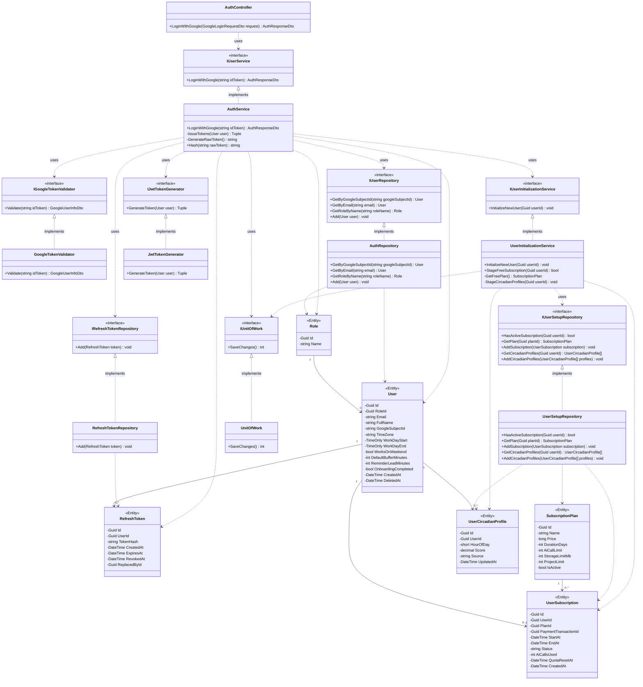

Figure 3.1.1 Class Diagram

### 3.1.2 Sequence Diagram

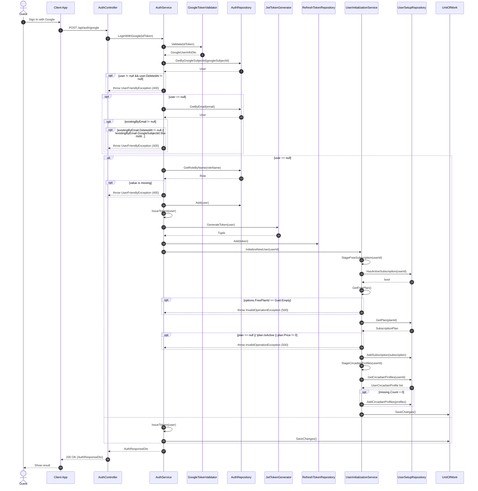

Figure 3.1.2 Sequence Diagram

### 3.1.3 Class Specification

#### 3.1.3.a AuthController

Table 3.1.3.a: AuthController Description Table

| No | Method | Description |
|---|---|---|
| 1 | `LoginWithGoogle(GoogleLoginRequestDto request) : AuthResponseDto` | `POST /api/auth/google`. Validates the Google ID token sent by the client, finds or creates the account (first sign-in also creates the Free subscription and the 24-row circadian profile in one transaction; no project is created) and returns a JWT access token with a rotating refresh token. The result carries isNewUser, true when the account was just created or just claimed (an account prepared by an administrator), so the client can show the onboarding screen. Anonymous endpoint. |

#### 3.1.3.b AuthService

Table 3.1.3.b: AuthService Description Table

| No | Method | Description |
|---|---|---|
| 1 | `LoginWithGoogle(string idToken) : AuthResponseDto` | Validates the Google ID token sent by the client, finds or creates the account (first sign-in also creates the Free subscription and the 24-row circadian profile in one transaction; no project is created) and returns a JWT access token with a rotating refresh token. The result carries isNewUser, true when the account was just created or just claimed (an account prepared by an administrator), so the client can show the onboarding screen. |
| 2 | `private IssueTokens(User user) : Tuple` | Creates a JWT access token (JwtTokenGenerator) and a random refresh token; only the SHA-256 hash of the refresh token is stored. The new RefreshToken row is added to the context and the caller saves it. |
| 3 | `private GenerateRawToken() : string` | Generates 32 random bytes encoded as URL-safe base64 for the refresh token. |
| 4 | `private Hash(string rawToken) : string` | Returns the lower-case SHA-256 hex hash of a refresh token. Only the hash is stored, so a leaked database cannot be used to sign in. |

#### 3.1.3.c GoogleTokenValidator

Table 3.1.3.c: GoogleTokenValidator Description Table

| No | Method | Description |
|---|---|---|
| 1 | `Validate(string idToken) : GoogleUserInfoDto` | Validates the Google ID token (signature, expiry, audience equals the configured client id, e-mail verified) and returns subject, e-mail and full name. Any failure raises UserFriendlyException. |

#### 3.1.3.d AuthRepository

Table 3.1.3.d: AuthRepository Description Table

| No | Method | Description |
|---|---|---|
| 1 | `GetByGoogleSubjectId(string googleSubjectId) : User` | Finds the User whose GoogleSubjectId equals the Google `sub` claim (includes soft-deleted users); null when none. |
| 2 | `GetByEmail(string email) : User` | Finds the User with the given e-mail (includes soft-deleted users); null when none. |
| 3 | `GetRoleByName(string roleName) : Role` | Finds the Role by its name (for example Freelancer or Admin); null when none. |
| 4 | `Add(User user)` | Adds a new User to the context; written when the unit of work is saved. |

#### 3.1.3.e JwtTokenGenerator

Table 3.1.3.e: JwtTokenGenerator Description Table

| No | Method | Description |
|---|---|---|
| 1 | `GenerateToken(User user) : Tuple` | Builds a signed JWT (user id, e-mail, name, role) with the configured issuer, audience and lifetime and returns it with its expiry time. |

#### 3.1.3.f RefreshTokenRepository

Table 3.1.3.f: RefreshTokenRepository Description Table

| No | Method | Description |
|---|---|---|
| 1 | `Add(RefreshToken token)` | Adds a new RefreshToken (hashed value) to the context. |

#### 3.1.3.g UserInitializationService

Table 3.1.3.g: UserInitializationService Description Table

| No | Method | Description |
|---|---|---|
| 1 | `InitializeNewUser(Guid userId)` | Idempotently prepares the Free subscription and the 24 circadian rows (no default project), then saves them with one SaveChanges (one transaction together with the pending user). |
| 2 | `private StageFreeSubscription(Guid userId) : bool` | Adds an Active Free-plan UserSubscription unless the user already has an active subscription; returns true when one was added. |
| 3 | `private GetFreePlan() : SubscriptionPlan` | Loads the Free plan configured in `Subscription:FreePlanId` and checks that it is active and costs 0; otherwise raises an error. |
| 4 | `private StageCircadianProfiles(Guid userId)` | Adds the missing UserCircadianProfile rows so that the user has one row for each of the 24 hours. |

#### 3.1.3.h UserSetupRepository

Table 3.1.3.h: UserSetupRepository Description Table

| No | Method | Description |
|---|---|---|
| 1 | `HasActiveSubscription(Guid userId) : bool` | True when the user already has an Active UserSubscription. |
| 2 | `GetPlan(Guid planId) : SubscriptionPlan` | Finds the SubscriptionPlan by id; null when none. |
| 3 | `AddSubscription(UserSubscription subscription)` | Adds a UserSubscription to the context. |
| 4 | `GetCircadianProfiles(Guid userId) : UserCircadianProfile[]` | Returns the UserCircadianProfile rows (one per hour) of the user. |
| 5 | `AddCircadianProfiles(UserCircadianProfile[] profiles)` | Adds the missing UserCircadianProfile rows to the context. |

#### 3.1.3.i UnitOfWork

Table 3.1.3.i: UnitOfWork Description Table

| No | Method | Description |
|---|---|---|
| 1 | `SaveChanges() : int` | Persists every pending change of the current unit of work to the database and returns the number of rows affected. |

### 3.1.4 Methods Used

Table 3.1.4: Methods used by this function

| No | Caller | Method called | Implemented by |
|---|---|---|---|
| 1 | AuthController.LoginWithGoogle | IUserService.LoginWithGoogle | AuthService |
| 2 | AuthService.LoginWithGoogle | IGoogleTokenValidator.Validate | GoogleTokenValidator |
| 3 | AuthService.LoginWithGoogle | IUserRepository.GetByGoogleSubjectId | AuthRepository |
| 4 | AuthService.LoginWithGoogle | IUserRepository.GetByEmail | AuthRepository |
| 5 | AuthService.LoginWithGoogle | IUserRepository.GetRoleByName | AuthRepository |
| 6 | AuthService.LoginWithGoogle | IUserRepository.Add | AuthRepository |
| 7 | AuthService.IssueTokens | IJwtTokenGenerator.GenerateToken | JwtTokenGenerator |
| 8 | AuthService.IssueTokens | IRefreshTokenRepository.Add | RefreshTokenRepository |
| 9 | AuthService.LoginWithGoogle | IUserInitializationService.InitializeNewUser | UserInitializationService |
| 10 | UserInitializationService.StageFreeSubscription | IUserSetupRepository.HasActiveSubscription | UserSetupRepository |
| 11 | UserInitializationService.GetFreePlan | IUserSetupRepository.GetPlan | UserSetupRepository |
| 12 | UserInitializationService.StageFreeSubscription | IUserSetupRepository.AddSubscription | UserSetupRepository |
| 13 | UserInitializationService.StageCircadianProfiles | IUserSetupRepository.GetCircadianProfiles | UserSetupRepository |
| 14 | UserInitializationService.StageCircadianProfiles | IUserSetupRepository.AddCircadianProfiles | UserSetupRepository |
| 15 | UserInitializationService.InitializeNewUser | IUnitOfWork.SaveChanges | UnitOfWork |
| 16 | AuthService.LoginWithGoogle | IUnitOfWork.SaveChanges | UnitOfWork |

Entities used: User, Role, RefreshToken, UserSubscription, SubscriptionPlan, UserCircadianProfile.

---

## 3.2 Refresh Access Token

Exchanges a valid refresh token for a new access token and a new refresh token. The old refresh token is revoked and linked to the new one; re-using a rotated token after the grace period revokes every session of the user.

- **Endpoint:** `POST /api/auth/refresh`  
- **Access:** Anonymous

### 3.2.1 Class Diagram

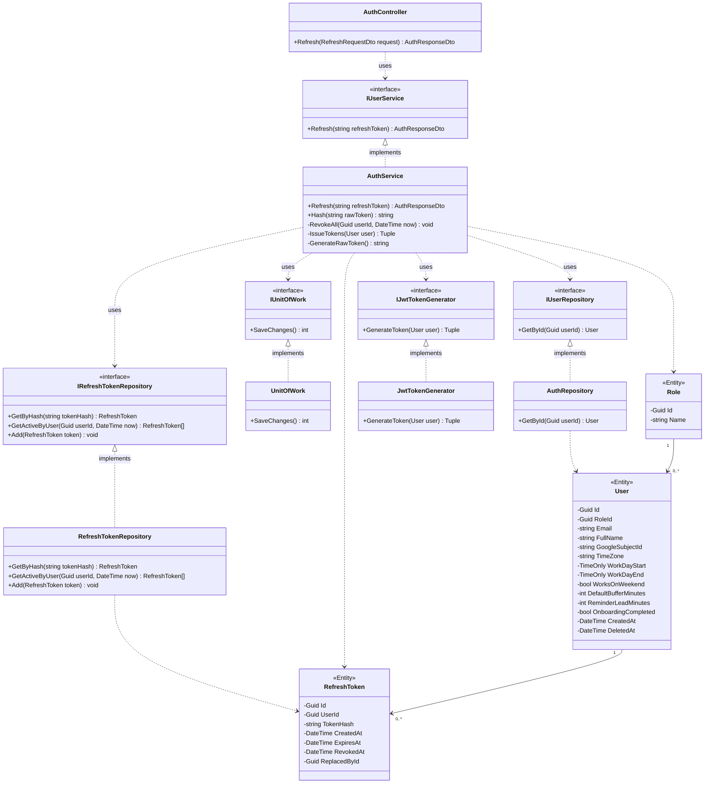

Figure 3.2.1 Class Diagram

### 3.2.2 Sequence Diagram

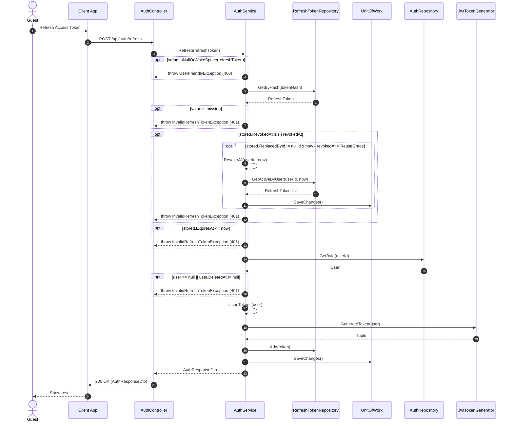

Figure 3.2.2 Sequence Diagram

### 3.2.3 Class Specification

#### 3.2.3.a AuthController

Table 3.2.3.a: AuthController Description Table

| No | Method | Description |
|---|---|---|
| 1 | `Refresh(RefreshRequestDto request) : AuthResponseDto` | `POST /api/auth/refresh`. Exchanges a valid refresh token for a new access token and a new refresh token. The old refresh token is revoked and linked to the new one; re-using a rotated token after the grace period revokes every session of the user. Anonymous endpoint. |

#### 3.2.3.b AuthService

Table 3.2.3.b: AuthService Description Table

| No | Method | Description |
|---|---|---|
| 1 | `Refresh(string refreshToken) : AuthResponseDto` | Exchanges a valid refresh token for a new access token and a new refresh token. The old refresh token is revoked and linked to the new one; re-using a rotated token after the grace period revokes every session of the user. |
| 2 | `private Hash(string rawToken) : string` | Returns the lower-case SHA-256 hex hash of a refresh token. Only the hash is stored, so a leaked database cannot be used to sign in. |
| 3 | `private RevokeAll(Guid userId, DateTime now)` | Sets RevokedAt on every active refresh token of the user (used by logout from all devices and by refresh-token reuse detection). |
| 4 | `private IssueTokens(User user) : Tuple` | Creates a JWT access token (JwtTokenGenerator) and a random refresh token; only the SHA-256 hash of the refresh token is stored. The new RefreshToken row is added to the context and the caller saves it. |
| 5 | `private GenerateRawToken() : string` | Generates 32 random bytes encoded as URL-safe base64 for the refresh token. |

#### 3.2.3.c RefreshTokenRepository

Table 3.2.3.c: RefreshTokenRepository Description Table

| No | Method | Description |
|---|---|---|
| 1 | `GetByHash(string tokenHash) : RefreshToken` | Finds the RefreshToken by the SHA-256 hash of the token the client sent; null when unknown. |
| 2 | `GetActiveByUser(Guid userId, DateTime now) : RefreshToken[]` | Returns the user's refresh tokens that are neither revoked nor expired at the given time. |
| 3 | `Add(RefreshToken token)` | Adds a new RefreshToken (hashed value) to the context. |

#### 3.2.3.d UnitOfWork

Table 3.2.3.d: UnitOfWork Description Table

| No | Method | Description |
|---|---|---|
| 1 | `SaveChanges() : int` | Persists every pending change of the current unit of work to the database and returns the number of rows affected. |

#### 3.2.3.e AuthRepository

Table 3.2.3.e: AuthRepository Description Table

| No | Method | Description |
|---|---|---|
| 1 | `GetById(Guid userId) : User` | Finds the User by id; null when none. |

#### 3.2.3.f JwtTokenGenerator

Table 3.2.3.f: JwtTokenGenerator Description Table

| No | Method | Description |
|---|---|---|
| 1 | `GenerateToken(User user) : Tuple` | Builds a signed JWT (user id, e-mail, name, role) with the configured issuer, audience and lifetime and returns it with its expiry time. |

### 3.2.4 Methods Used

Table 3.2.4: Methods used by this function

| No | Caller | Method called | Implemented by |
|---|---|---|---|
| 1 | AuthController.Refresh | IUserService.Refresh | AuthService |
| 2 | AuthService.Refresh | IRefreshTokenRepository.GetByHash | RefreshTokenRepository |
| 3 | AuthService.RevokeAll | IRefreshTokenRepository.GetActiveByUser | RefreshTokenRepository |
| 4 | AuthService.Refresh | IUnitOfWork.SaveChanges | UnitOfWork |
| 5 | AuthService.Refresh | IUserRepository.GetById | AuthRepository |
| 6 | AuthService.IssueTokens | IJwtTokenGenerator.GenerateToken | JwtTokenGenerator |
| 7 | AuthService.IssueTokens | IRefreshTokenRepository.Add | RefreshTokenRepository |

Entities used: RefreshToken, User, Role.

---

## 3.3 Sign Out

Revokes the given refresh token, or every active refresh token of the user when allDevices is true. Always succeeds, even for an unknown or already revoked token.

- **Endpoint:** `POST /api/auth/logout`  
- **Access:** Anonymous

### 3.3.1 Class Diagram

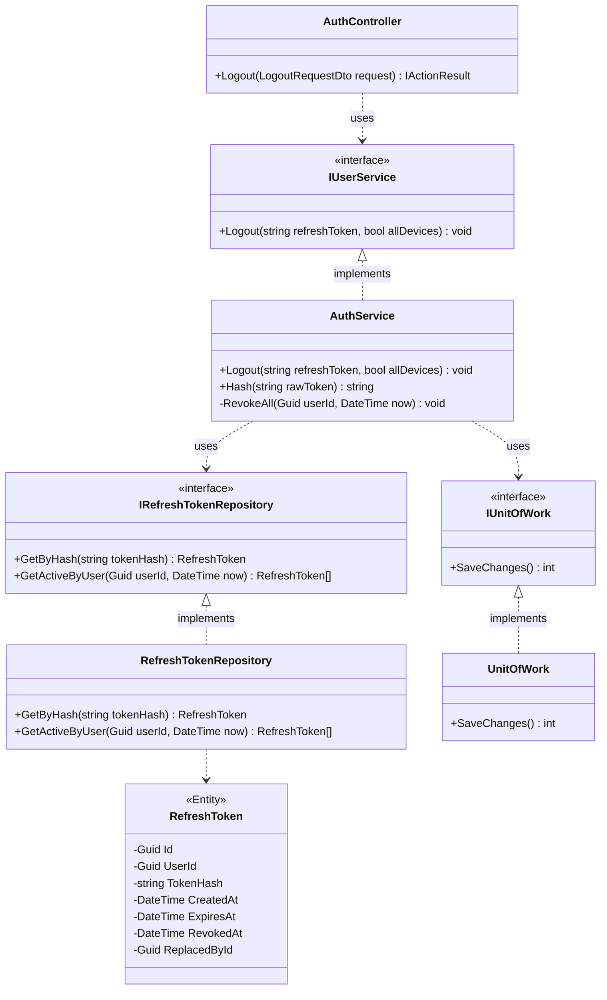

Figure 3.3.1 Class Diagram

### 3.3.2 Sequence Diagram

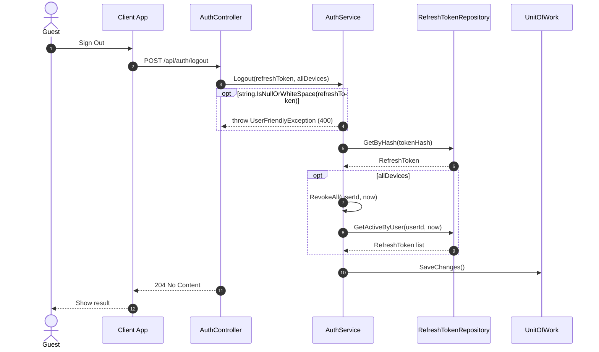

Figure 3.3.2 Sequence Diagram

### 3.3.3 Class Specification

#### 3.3.3.a AuthController

Table 3.3.3.a: AuthController Description Table

| No | Method | Description |
|---|---|---|
| 1 | `Logout(LogoutRequestDto request) : IActionResult` | `POST /api/auth/logout`. Revokes the given refresh token, or every active refresh token of the user when allDevices is true. Always succeeds, even for an unknown or already revoked token. Anonymous endpoint. |

#### 3.3.3.b AuthService

Table 3.3.3.b: AuthService Description Table

| No | Method | Description |
|---|---|---|
| 1 | `Logout(string refreshToken, bool allDevices)` | Revokes the given refresh token, or every active refresh token of the user when allDevices is true. Always succeeds, even for an unknown or already revoked token. |
| 2 | `private Hash(string rawToken) : string` | Returns the lower-case SHA-256 hex hash of a refresh token. Only the hash is stored, so a leaked database cannot be used to sign in. |
| 3 | `private RevokeAll(Guid userId, DateTime now)` | Sets RevokedAt on every active refresh token of the user (used by logout from all devices and by refresh-token reuse detection). |

#### 3.3.3.c RefreshTokenRepository

Table 3.3.3.c: RefreshTokenRepository Description Table

| No | Method | Description |
|---|---|---|
| 1 | `GetByHash(string tokenHash) : RefreshToken` | Finds the RefreshToken by the SHA-256 hash of the token the client sent; null when unknown. |
| 2 | `GetActiveByUser(Guid userId, DateTime now) : RefreshToken[]` | Returns the user's refresh tokens that are neither revoked nor expired at the given time. |

#### 3.3.3.d UnitOfWork

Table 3.3.3.d: UnitOfWork Description Table

| No | Method | Description |
|---|---|---|
| 1 | `SaveChanges() : int` | Persists every pending change of the current unit of work to the database and returns the number of rows affected. |

### 3.3.4 Methods Used

Table 3.3.4: Methods used by this function

| No | Caller | Method called | Implemented by |
|---|---|---|---|
| 1 | AuthController.Logout | IUserService.Logout | AuthService |
| 2 | AuthService.Logout | IRefreshTokenRepository.GetByHash | RefreshTokenRepository |
| 3 | AuthService.RevokeAll | IRefreshTokenRepository.GetActiveByUser | RefreshTokenRepository |
| 4 | AuthService.Logout | IUnitOfWork.SaveChanges | UnitOfWork |

Entities used: RefreshToken.

---

# Account Profile and Settings

## 3.4 View My Profile

Returns the profile, work-hour settings, role and onboarding state of the signed-in user together with the current subscription (expired plans are refreshed first).

- **Endpoint:** `GET /api/me`  
- **Access:** Signed-in user

### 3.4.1 Class Diagram

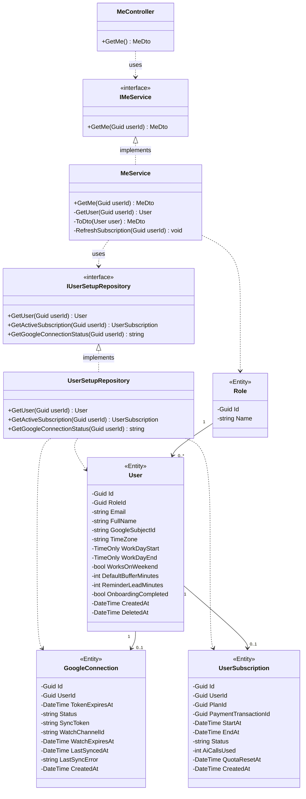

Figure 3.4.1 Class Diagram

### 3.4.2 Sequence Diagram

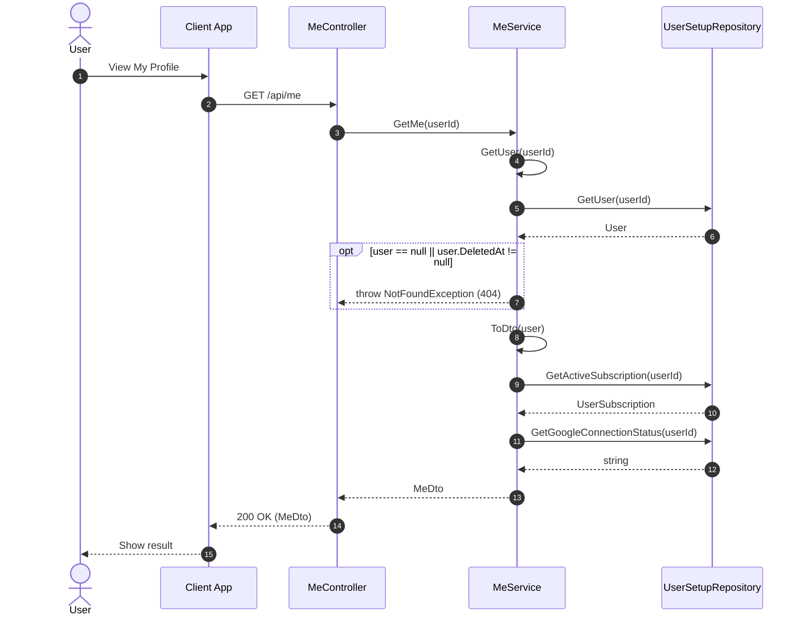

Figure 3.4.2 Sequence Diagram

### 3.4.3 Class Specification

#### 3.4.3.a MeController

Table 3.4.3.a: MeController Description Table

| No | Method | Description |
|---|---|---|
| 1 | `GetMe() : MeDto` | `GET /api/me`. Returns the profile, work-hour settings, role and onboarding state of the signed-in user together with the current subscription (expired plans are refreshed first). Requires a signed-in user. |

#### 3.4.3.b MeService

Table 3.4.3.b: MeService Description Table

| No | Method | Description |
|---|---|---|
| 1 | `GetMe(Guid userId) : MeDto` | Returns the profile, work-hour settings, role and onboarding state of the signed-in user together with the current subscription (expired plans are refreshed first). |
| 2 | `private GetUser(Guid userId) : User` | Loads the user or raises NotFoundException when the user does not exist or is soft-deleted. |
| 3 | `private ToDto(User user) : MeDto` | Refreshes the user's subscription first, then builds the profile DTO with role, settings, active subscription and Google connection status. |
| 4 | `private RefreshSubscription(Guid userId)` | Runs IPaymentService.RefreshUserSubscription in its own scope (own DbContext): an overdue Active plan expires and the queued or Free plan becomes Active. |

#### 3.4.3.c UserSetupRepository

Table 3.4.3.c: UserSetupRepository Description Table

| No | Method | Description |
|---|---|---|
| 1 | `GetUser(Guid userId) : User` | Loads the User together with its Role; null when none. |
| 2 | `GetActiveSubscription(Guid userId) : UserSubscription` | Returns the Active UserSubscription of the user with its plan; null when none. |
| 3 | `GetGoogleConnectionStatus(Guid userId) : string` | Returns the status text of the user's GoogleConnection; null when not connected. |

### 3.4.4 Methods Used

Table 3.4.4: Methods used by this function

| No | Caller | Method called | Implemented by |
|---|---|---|---|
| 1 | MeController.GetMe | IMeService.GetMe | MeService |
| 2 | MeService.GetUser | IUserSetupRepository.GetUser | UserSetupRepository |
| 3 | MeService.ToDto | IUserSetupRepository.GetActiveSubscription | UserSetupRepository |
| 4 | MeService.ToDto | IUserSetupRepository.GetGoogleConnectionStatus | UserSetupRepository |

Entities used: User, Role, UserSubscription, GoogleConnection.

---

## 3.5 View Plan Usage

Returns the plan limits and what the user has used so far: active projects, stored file megabytes, plan period and remaining days.

- **Endpoint:** `GET /api/me/usage`  
- **Access:** Signed-in user

### 3.5.1 Class Diagram

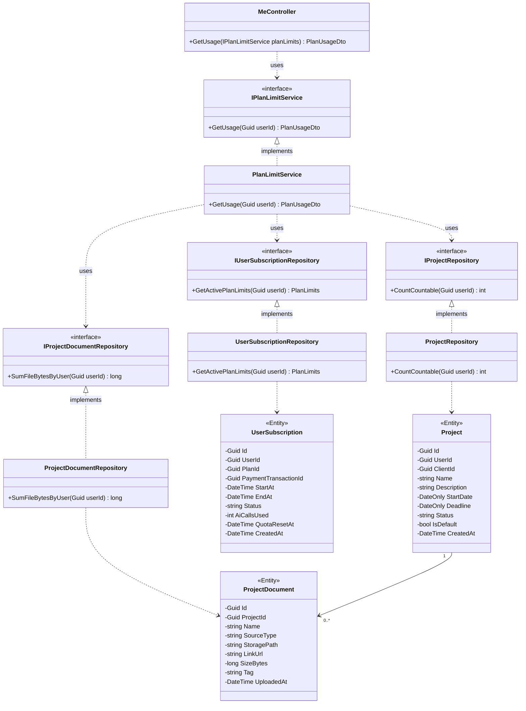

Figure 3.5.1 Class Diagram

### 3.5.2 Sequence Diagram

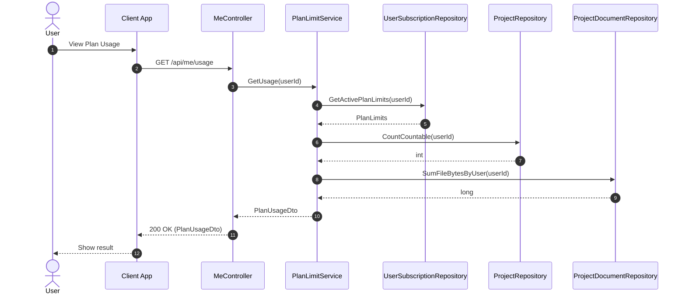

Figure 3.5.2 Sequence Diagram

### 3.5.3 Class Specification

#### 3.5.3.a MeController

Table 3.5.3.a: MeController Description Table

| No | Method | Description |
|---|---|---|
| 1 | `GetUsage(IPlanLimitService planLimits) : PlanUsageDto` | `GET /api/me/usage`. Returns the plan limits and what the user has used so far: active projects, stored file megabytes, plan period and remaining days. Requires a signed-in user. |

#### 3.5.3.b PlanLimitService

Table 3.5.3.b: PlanLimitService Description Table

| No | Method | Description |
|---|---|---|
| 1 | `GetUsage(Guid userId) : PlanUsageDto` | Returns the plan limits and what the user has used so far: active projects, stored file megabytes, plan period and remaining days. |

#### 3.5.3.c UserSubscriptionRepository

Table 3.5.3.c: UserSubscriptionRepository Description Table

| No | Method | Description |
|---|---|---|
| 1 | `GetActivePlanLimits(Guid userId) : PlanLimits` | Reads the plan name, project limit, storage limit and period (StartAt, EndAt) of the user's Active subscription in one query; null when there is no Active plan. |

#### 3.5.3.d ProjectRepository

Table 3.5.3.d: ProjectRepository Description Table

| No | Method | Description |
|---|---|---|
| 1 | `CountCountable(Guid userId) : int` | Counts the projects that count toward the plan limit: not archived and not the default personal project. |

#### 3.5.3.e ProjectDocumentRepository

Table 3.5.3.e: ProjectDocumentRepository Description Table

| No | Method | Description |
|---|---|---|
| 1 | `SumFileBytesByUser(Guid userId) : long` | Sums the size in bytes of all File documents of the user across all projects (links do not count). |

### 3.5.4 Methods Used

Table 3.5.4: Methods used by this function

| No | Caller | Method called | Implemented by |
|---|---|---|---|
| 1 | MeController.GetUsage | IPlanLimitService.GetUsage | PlanLimitService |
| 2 | PlanLimitService.GetUsage | IUserSubscriptionRepository.GetActivePlanLimits | UserSubscriptionRepository |
| 3 | PlanLimitService.GetUsage | IProjectRepository.CountCountable | ProjectRepository |
| 4 | PlanLimitService.GetUsage | IProjectDocumentRepository.SumFileBytesByUser | ProjectDocumentRepository |

Entities used: UserSubscription, Project, ProjectDocument.

---

## 3.6 Update My Profile

Lets the user change their own profile (the full name). Work hours, time zone and reminders are changed in Update My Settings.

- **Endpoint:** `PUT /api/me/profile`  
- **Access:** Signed-in user

### 3.6.1 Class Diagram

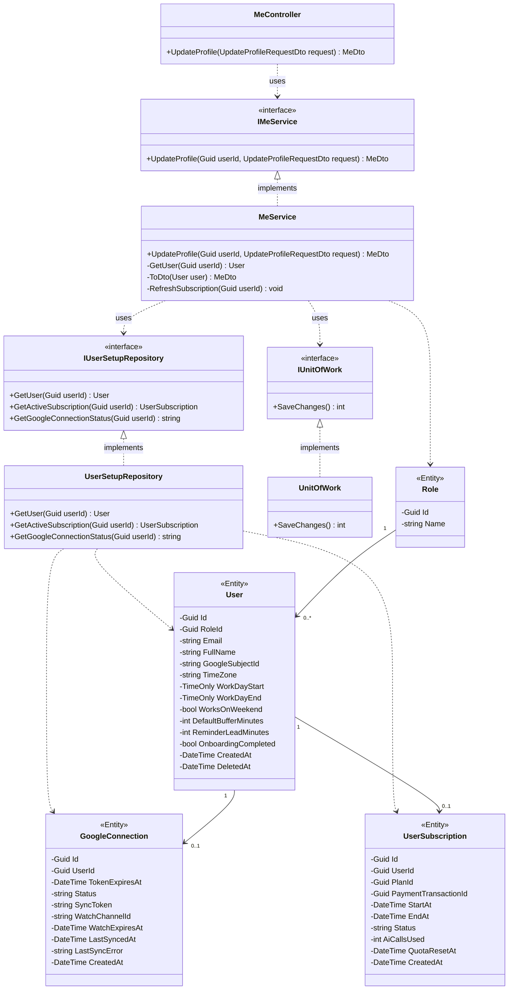

Figure 3.6.1 Class Diagram

### 3.6.2 Sequence Diagram

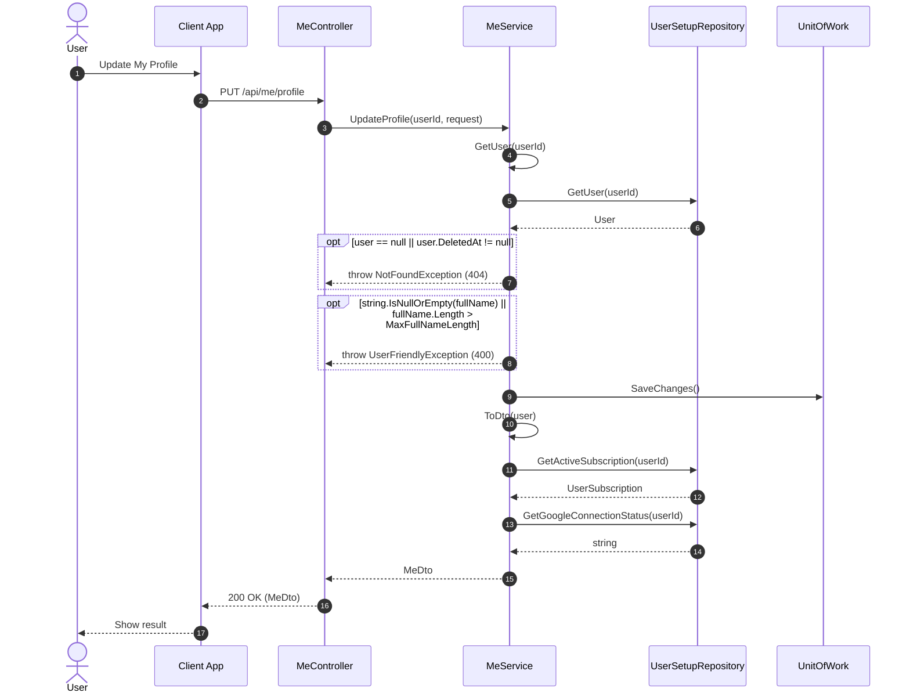

Figure 3.6.2 Sequence Diagram

### 3.6.3 Class Specification

#### 3.6.3.a MeController

Table 3.6.3.a: MeController Description Table

| No | Method | Description |
|---|---|---|
| 1 | `UpdateProfile(UpdateProfileRequestDto request) : MeDto` | `PUT /api/me/profile`. Lets the user change their own profile (the full name). Work hours, time zone and reminders are changed in Update My Settings. Requires a signed-in user. |

#### 3.6.3.b MeService

Table 3.6.3.b: MeService Description Table

| No | Method | Description |
|---|---|---|
| 1 | `UpdateProfile(Guid userId, UpdateProfileRequestDto request) : MeDto` | Lets the user change their own profile (the full name). Work hours, time zone and reminders are changed in Update My Settings. |
| 2 | `private GetUser(Guid userId) : User` | Loads the user or raises NotFoundException when the user does not exist or is soft-deleted. |
| 3 | `private ToDto(User user) : MeDto` | Refreshes the user's subscription first, then builds the profile DTO with role, settings, active subscription and Google connection status. |
| 4 | `private RefreshSubscription(Guid userId)` | Runs IPaymentService.RefreshUserSubscription in its own scope (own DbContext): an overdue Active plan expires and the queued or Free plan becomes Active. |

#### 3.6.3.c UserSetupRepository

Table 3.6.3.c: UserSetupRepository Description Table

| No | Method | Description |
|---|---|---|
| 1 | `GetUser(Guid userId) : User` | Loads the User together with its Role; null when none. |
| 2 | `GetActiveSubscription(Guid userId) : UserSubscription` | Returns the Active UserSubscription of the user with its plan; null when none. |
| 3 | `GetGoogleConnectionStatus(Guid userId) : string` | Returns the status text of the user's GoogleConnection; null when not connected. |

#### 3.6.3.d UnitOfWork

Table 3.6.3.d: UnitOfWork Description Table

| No | Method | Description |
|---|---|---|
| 1 | `SaveChanges() : int` | Persists every pending change of the current unit of work to the database and returns the number of rows affected. |

### 3.6.4 Methods Used

Table 3.6.4: Methods used by this function

| No | Caller | Method called | Implemented by |
|---|---|---|---|
| 1 | MeController.UpdateProfile | IMeService.UpdateProfile | MeService |
| 2 | MeService.GetUser | IUserSetupRepository.GetUser | UserSetupRepository |
| 3 | MeService.UpdateProfile | IUnitOfWork.SaveChanges | UnitOfWork |
| 4 | MeService.ToDto | IUserSetupRepository.GetActiveSubscription | UserSetupRepository |
| 5 | MeService.ToDto | IUserSetupRepository.GetGoogleConnectionStatus | UserSetupRepository |

Entities used: User, Role, UserSubscription, GoogleConnection.

---

## 3.7 Update My Settings

Validates work-day start and end, default buffer minutes, reminder lead minutes and the time zone, then saves them. When the work-day start or end changed, the 24 circadian scores are recomputed for the new window (only rows made by onboarding or by default; productive hours of 0.8 and rows learned by the AI stay). When the reminder lead changed, the reminder jobs of the user upcoming Approved slots are scheduled again.

- **Endpoint:** `PUT /api/me/settings`  
- **Access:** Signed-in user

### 3.7.1 Class Diagram

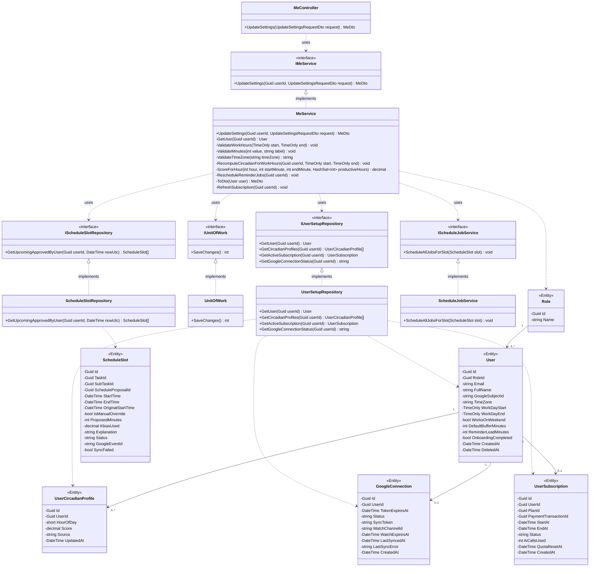

Figure 3.7.1 Class Diagram

### 3.7.2 Sequence Diagram

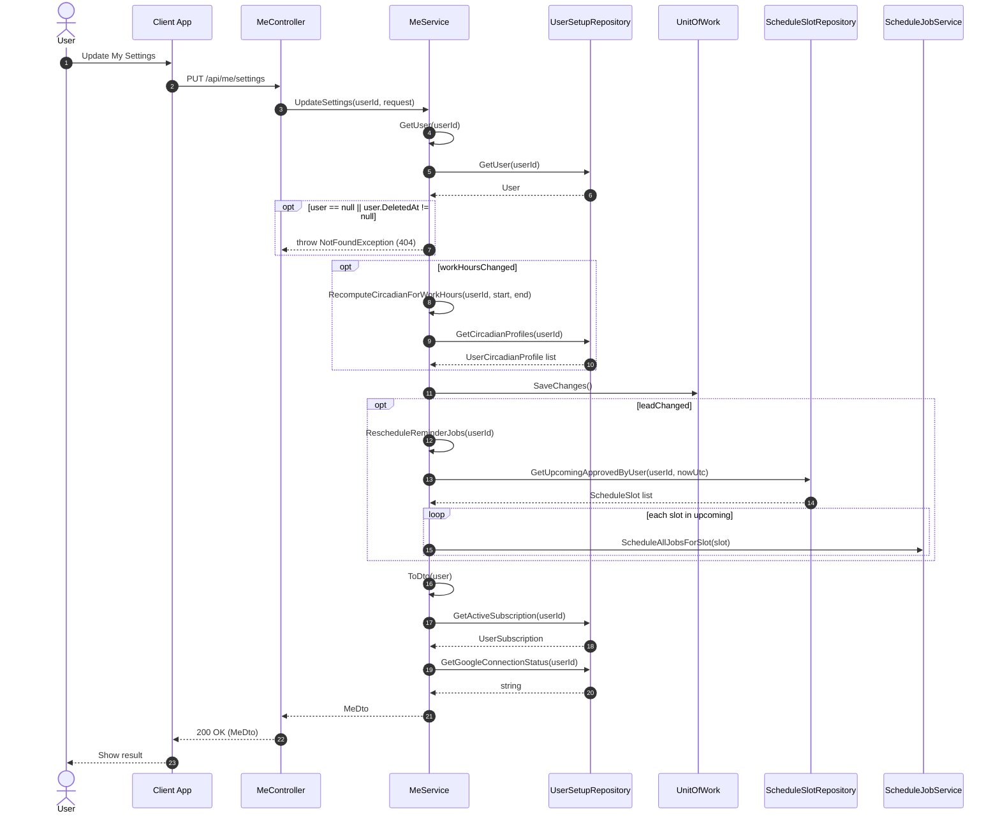

Figure 3.7.2 Sequence Diagram

### 3.7.3 Class Specification

#### 3.7.3.a MeController

Table 3.7.3.a: MeController Description Table

| No | Method | Description |
|---|---|---|
| 1 | `UpdateSettings(UpdateSettingsRequestDto request) : MeDto` | `PUT /api/me/settings`. Validates work-day start and end, default buffer minutes, reminder lead minutes and the time zone, then saves them. When the work-day start or end changed, the 24 circadian scores are recomputed for the new window (only rows made by onboarding or by default; productive hours of 0.8 and rows learned by the AI stay). When the reminder lead changed, the reminder jobs of the user upcoming Approved slots are scheduled again. Requires a signed-in user. |

#### 3.7.3.b MeService

Table 3.7.3.b: MeService Description Table

| No | Method | Description |
|---|---|---|
| 1 | `UpdateSettings(Guid userId, UpdateSettingsRequestDto request) : MeDto` | Validates work-day start and end, default buffer minutes, reminder lead minutes and the time zone, then saves them. When the work-day start or end changed, the 24 circadian scores are recomputed for the new window (only rows made by onboarding or by default; productive hours of 0.8 and rows learned by the AI stay). When the reminder lead changed, the reminder jobs of the user upcoming Approved slots are scheduled again. |
| 2 | `private GetUser(Guid userId) : User` | Loads the user or raises NotFoundException when the user does not exist or is soft-deleted. |
| 3 | `private ValidateWorkHours(TimeOnly start, TimeOnly end)` | Checks that the work-day end is after the start. |
| 4 | `private ValidateMinutes(int value, string label)` | Checks that a minutes setting is within the allowed range. |
| 5 | `private ValidateTimeZone(string timeZone) : string` | Checks that the time zone id exists. |
| 6 | `private RecomputeCircadianForWorkHours(Guid userId, TimeOnly start, TimeOnly end)` | Called when the work-day start or end changed: scores the 24 hours again against the new window (0.5 inside, 0.2 outside). Only rows made by onboarding or by default are touched; hours already at the productive score 0.8 and rows learned by the AI keep their value. |
| 7 | `private ScoreForHour(int hour, int startMinute, int endMinute, <> productiveHours) : decimal` | Returns the circadian score of one hour: productive hours get the highest score, other working hours a medium score and off hours the lowest. |
| 8 | `private RescheduleReminderJobs(Guid userId)` | Schedules again the reminder jobs of the user's upcoming Approved slots after the reminder lead minutes changed. |
| 9 | `private ToDto(User user) : MeDto` | Refreshes the user's subscription first, then builds the profile DTO with role, settings, active subscription and Google connection status. |
| 10 | `private RefreshSubscription(Guid userId)` | Runs IPaymentService.RefreshUserSubscription in its own scope (own DbContext): an overdue Active plan expires and the queued or Free plan becomes Active. |

#### 3.7.3.c UserSetupRepository

Table 3.7.3.c: UserSetupRepository Description Table

| No | Method | Description |
|---|---|---|
| 1 | `GetUser(Guid userId) : User` | Loads the User together with its Role; null when none. |
| 2 | `GetCircadianProfiles(Guid userId) : UserCircadianProfile[]` | Returns the UserCircadianProfile rows (one per hour) of the user. |
| 3 | `GetActiveSubscription(Guid userId) : UserSubscription` | Returns the Active UserSubscription of the user with its plan; null when none. |
| 4 | `GetGoogleConnectionStatus(Guid userId) : string` | Returns the status text of the user's GoogleConnection; null when not connected. |

#### 3.7.3.d UnitOfWork

Table 3.7.3.d: UnitOfWork Description Table

| No | Method | Description |
|---|---|---|
| 1 | `SaveChanges() : int` | Persists every pending change of the current unit of work to the database and returns the number of rows affected. |

#### 3.7.3.e ScheduleSlotRepository

Table 3.7.3.e: ScheduleSlotRepository Description Table

| No | Method | Description |
|---|---|---|
| 1 | `GetUpcomingApprovedByUser(Guid userId, DateTime nowUtc) : ScheduleSlot[]` | Returns the user's Approved slots that have not started yet (used to reschedule reminders when the lead time changes). |

#### 3.7.3.f ScheduleJobService

Table 3.7.3.f: ScheduleJobService Description Table

| No | Method | Description |
|---|---|---|
| 1 | `ScheduleAllJobsForSlot(ScheduleSlot slot)` | Removes the old Hangfire jobs of the slot and schedules all of its reminder and status jobs again from the current StartTime and EndTime. |

### 3.7.4 Methods Used

Table 3.7.4: Methods used by this function

| No | Caller | Method called | Implemented by |
|---|---|---|---|
| 1 | MeController.UpdateSettings | IMeService.UpdateSettings | MeService |
| 2 | MeService.GetUser | IUserSetupRepository.GetUser | UserSetupRepository |
| 3 | MeService.RecomputeCircadianForWorkHours | IUserSetupRepository.GetCircadianProfiles | UserSetupRepository |
| 4 | MeService.UpdateSettings | IUnitOfWork.SaveChanges | UnitOfWork |
| 5 | MeService.RescheduleReminderJobs | IScheduleSlotRepository.GetUpcomingApprovedByUser | ScheduleSlotRepository |
| 6 | MeService.RescheduleReminderJobs | IScheduleJobService.ScheduleAllJobsForSlot | ScheduleJobService |
| 7 | MeService.ToDto | IUserSetupRepository.GetActiveSubscription | UserSetupRepository |
| 8 | MeService.ToDto | IUserSetupRepository.GetGoogleConnectionStatus | UserSetupRepository |

Entities used: User, UserCircadianProfile, ScheduleSlot, Role, UserSubscription, GoogleConnection.

---

## 3.8 Complete Onboarding

The user chooses the settings: time zone, work hours, weekend work, buffer minutes and reminder lead are required (400 when missing or invalid). Productive hours, domains and the overrun level are optional (an empty overrun level means Sometimes). It recomputes the 24-row circadian profile and stores the K-bias of the overrun level for each chosen domain only, sets OnboardingCompleted and can be called again to overwrite the previous answers.

- **Endpoint:** `POST /api/me/onboarding`  
- **Access:** Signed-in user

### 3.8.1 Class Diagram

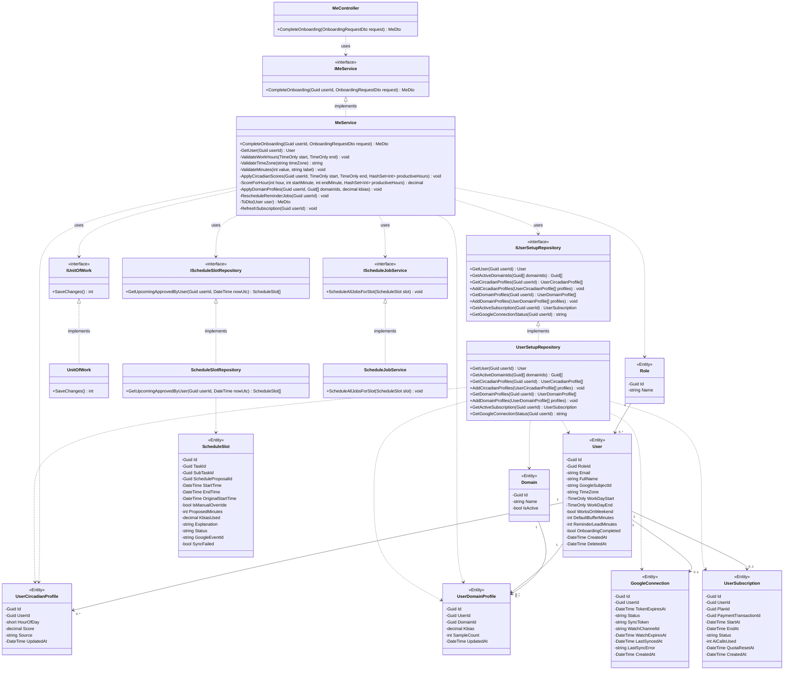

Figure 3.8.1 Class Diagram

### 3.8.2 Sequence Diagram

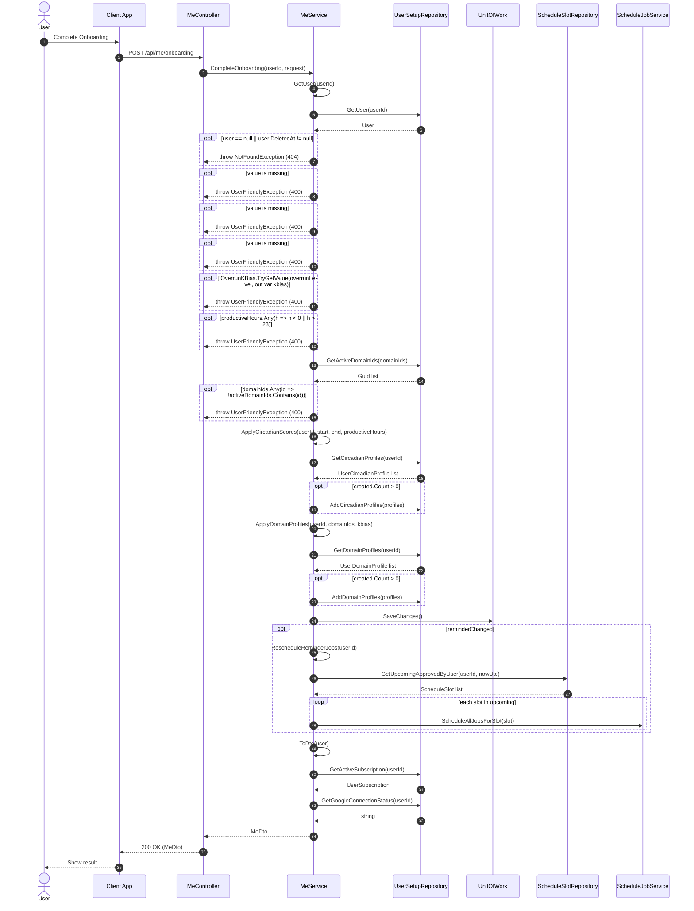

Figure 3.8.2 Sequence Diagram

### 3.8.3 Class Specification

#### 3.8.3.a MeController

Table 3.8.3.a: MeController Description Table

| No | Method | Description |
|---|---|---|
| 1 | `CompleteOnboarding(OnboardingRequestDto request) : MeDto` | `POST /api/me/onboarding`. The user chooses the settings: time zone, work hours, weekend work, buffer minutes and reminder lead are required (400 when missing or invalid). Productive hours, domains and the overrun level are optional (an empty overrun level means Sometimes). It recomputes the 24-row circadian profile and stores the K-bias of the overrun level for each chosen domain only, sets OnboardingCompleted and can be called again to overwrite the previous answers. Requires a signed-in user. |

#### 3.8.3.b MeService

Table 3.8.3.b: MeService Description Table

| No | Method | Description |
|---|---|---|
| 1 | `CompleteOnboarding(Guid userId, OnboardingRequestDto request) : MeDto` | The user chooses the settings: time zone, work hours, weekend work, buffer minutes and reminder lead are required (400 when missing or invalid). Productive hours, domains and the overrun level are optional (an empty overrun level means Sometimes). It recomputes the 24-row circadian profile and stores the K-bias of the overrun level for each chosen domain only, sets OnboardingCompleted and can be called again to overwrite the previous answers. |
| 2 | `private GetUser(Guid userId) : User` | Loads the user or raises NotFoundException when the user does not exist or is soft-deleted. |
| 3 | `private ValidateWorkHours(TimeOnly start, TimeOnly end)` | Checks that the work-day end is after the start. |
| 4 | `private ValidateTimeZone(string timeZone) : string` | Checks that the time zone id exists. |
| 5 | `private ValidateMinutes(int value, string label)` | Checks that a minutes setting is within the allowed range. |
| 6 | `private ApplyCircadianScores(Guid userId, TimeOnly start, TimeOnly end, <> productiveHours)` | Recomputes the 24 circadian scores from the work hours and productive hours (score per hour) and updates or creates the rows with source Onboarding. |
| 7 | `private ScoreForHour(int hour, int startMinute, int endMinute, <> productiveHours) : decimal` | Returns the circadian score of one hour: productive hours get the highest score, other working hours a medium score and off hours the lowest. |
| 8 | `private ApplyDomainProfiles(Guid userId, Guid[] domainIds, decimal kbias)` | Creates the K-bias profile of each chosen domain, or updates an existing one that has no real samples yet. |
| 9 | `private RescheduleReminderJobs(Guid userId)` | Schedules again the reminder jobs of the user's upcoming Approved slots after the reminder lead minutes changed. |
| 10 | `private ToDto(User user) : MeDto` | Refreshes the user's subscription first, then builds the profile DTO with role, settings, active subscription and Google connection status. |
| 11 | `private RefreshSubscription(Guid userId)` | Runs IPaymentService.RefreshUserSubscription in its own scope (own DbContext): an overdue Active plan expires and the queued or Free plan becomes Active. |

#### 3.8.3.c UserSetupRepository

Table 3.8.3.c: UserSetupRepository Description Table

| No | Method | Description |
|---|---|---|
| 1 | `GetUser(Guid userId) : User` | Loads the User together with its Role; null when none. |
| 2 | `GetActiveDomainIds(Guid[] domainIds) : Guid[]` | Of the given domain ids, returns those whose Domain is active. |
| 3 | `GetCircadianProfiles(Guid userId) : UserCircadianProfile[]` | Returns the UserCircadianProfile rows (one per hour) of the user. |
| 4 | `AddCircadianProfiles(UserCircadianProfile[] profiles)` | Adds the missing UserCircadianProfile rows to the context. |
| 5 | `GetDomainProfiles(Guid userId) : UserDomainProfile[]` | Returns the UserDomainProfile rows (K-bias per domain) of the user. |
| 6 | `AddDomainProfiles(UserDomainProfile[] profiles)` | Adds UserDomainProfile rows to the context. |
| 7 | `GetActiveSubscription(Guid userId) : UserSubscription` | Returns the Active UserSubscription of the user with its plan; null when none. |
| 8 | `GetGoogleConnectionStatus(Guid userId) : string` | Returns the status text of the user's GoogleConnection; null when not connected. |

#### 3.8.3.d UnitOfWork

Table 3.8.3.d: UnitOfWork Description Table

| No | Method | Description |
|---|---|---|
| 1 | `SaveChanges() : int` | Persists every pending change of the current unit of work to the database and returns the number of rows affected. |

#### 3.8.3.e ScheduleSlotRepository

Table 3.8.3.e: ScheduleSlotRepository Description Table

| No | Method | Description |
|---|---|---|
| 1 | `GetUpcomingApprovedByUser(Guid userId, DateTime nowUtc) : ScheduleSlot[]` | Returns the user's Approved slots that have not started yet (used to reschedule reminders when the lead time changes). |

#### 3.8.3.f ScheduleJobService

Table 3.8.3.f: ScheduleJobService Description Table

| No | Method | Description |
|---|---|---|
| 1 | `ScheduleAllJobsForSlot(ScheduleSlot slot)` | Removes the old Hangfire jobs of the slot and schedules all of its reminder and status jobs again from the current StartTime and EndTime. |

### 3.8.4 Methods Used

Table 3.8.4: Methods used by this function

| No | Caller | Method called | Implemented by |
|---|---|---|---|
| 1 | MeController.CompleteOnboarding | IMeService.CompleteOnboarding | MeService |
| 2 | MeService.GetUser | IUserSetupRepository.GetUser | UserSetupRepository |
| 3 | MeService.CompleteOnboarding | IUserSetupRepository.GetActiveDomainIds | UserSetupRepository |
| 4 | MeService.ApplyCircadianScores | IUserSetupRepository.GetCircadianProfiles | UserSetupRepository |
| 5 | MeService.ApplyCircadianScores | IUserSetupRepository.AddCircadianProfiles | UserSetupRepository |
| 6 | MeService.ApplyDomainProfiles | IUserSetupRepository.GetDomainProfiles | UserSetupRepository |
| 7 | MeService.ApplyDomainProfiles | IUserSetupRepository.AddDomainProfiles | UserSetupRepository |
| 8 | MeService.CompleteOnboarding | IUnitOfWork.SaveChanges | UnitOfWork |
| 9 | MeService.RescheduleReminderJobs | IScheduleSlotRepository.GetUpcomingApprovedByUser | ScheduleSlotRepository |
| 10 | MeService.RescheduleReminderJobs | IScheduleJobService.ScheduleAllJobsForSlot | ScheduleJobService |
| 11 | MeService.ToDto | IUserSetupRepository.GetActiveSubscription | UserSetupRepository |
| 12 | MeService.ToDto | IUserSetupRepository.GetGoogleConnectionStatus | UserSetupRepository |

Entities used: User, Domain, UserCircadianProfile, UserDomainProfile, ScheduleSlot, Role, UserSubscription, GoogleConnection.

---

## 3.9 Delete My Account

Soft-deletes the account (DeletedAt), refuses to remove the last administrator, revokes every refresh token and disconnects Google Calendar. Existing access tokens are rejected immediately afterwards.

- **Endpoint:** `DELETE /api/me`  
- **Access:** Signed-in user

### 3.9.1 Class Diagram

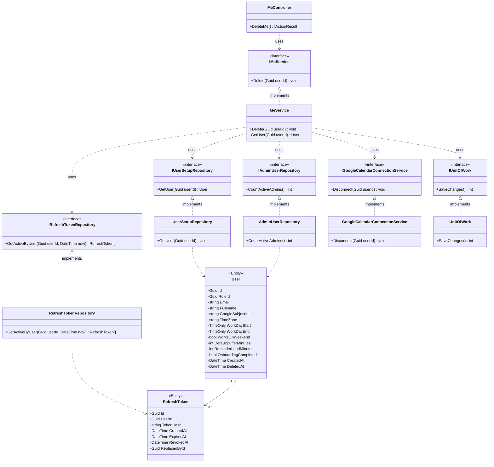

Figure 3.9.1 Class Diagram

### 3.9.2 Sequence Diagram

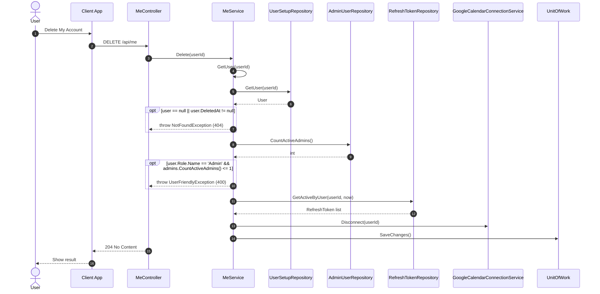

Figure 3.9.2 Sequence Diagram

### 3.9.3 Class Specification

#### 3.9.3.a MeController

Table 3.9.3.a: MeController Description Table

| No | Method | Description |
|---|---|---|
| 1 | `DeleteMe() : IActionResult` | `DELETE /api/me`. Soft-deletes the account (DeletedAt), refuses to remove the last administrator, revokes every refresh token and disconnects Google Calendar. Existing access tokens are rejected immediately afterwards. Requires a signed-in user. |

#### 3.9.3.b MeService

Table 3.9.3.b: MeService Description Table

| No | Method | Description |
|---|---|---|
| 1 | `Delete(Guid userId)` | Soft-deletes the account (DeletedAt), refuses to remove the last administrator and disconnects Google Calendar. |
| 2 | `private GetUser(Guid userId) : User` | Loads the user or raises NotFoundException when the user does not exist or is soft-deleted. |

#### 3.9.3.c UserSetupRepository

Table 3.9.3.c: UserSetupRepository Description Table

| No | Method | Description |
|---|---|---|
| 1 | `GetUser(Guid userId) : User` | Loads the User together with its Role; null when none. |

#### 3.9.3.d AdminUserRepository

Table 3.9.3.d: AdminUserRepository Description Table

| No | Method | Description |
|---|---|---|
| 1 | `CountActiveAdmins() : int` | Counts the Admin users that are not soft-deleted (used by the last-admin guard). |

#### 3.9.3.e RefreshTokenRepository

Table 3.9.3.e: RefreshTokenRepository Description Table

| No | Method | Description |
|---|---|---|
| 1 | `GetActiveByUser(Guid userId, DateTime now) : RefreshToken[]` | Returns the user's refresh tokens that are neither revoked nor expired at the given time. |

#### 3.9.3.f GoogleCalendarConnectionService

Table 3.9.3.f: GoogleCalendarConnectionService Description Table

| No | Method | Description |
|---|---|---|
| 1 | `Disconnect(Guid userId)` | Deletes the GoogleConnection (and its cached events), then revokes the grant at Google on a best-effort basis. Safe when nothing is connected. |

#### 3.9.3.g UnitOfWork

Table 3.9.3.g: UnitOfWork Description Table

| No | Method | Description |
|---|---|---|
| 1 | `SaveChanges() : int` | Persists every pending change of the current unit of work to the database and returns the number of rows affected. |

### 3.9.4 Methods Used

Table 3.9.4: Methods used by this function

| No | Caller | Method called | Implemented by |
|---|---|---|---|
| 1 | MeController.DeleteMe | IMeService.Delete | MeService |
| 2 | MeService.GetUser | IUserSetupRepository.GetUser | UserSetupRepository |
| 3 | MeService.Delete | IAdminUserRepository.CountActiveAdmins | AdminUserRepository |
| 4 | MeService.Delete | IRefreshTokenRepository.GetActiveByUser | RefreshTokenRepository |
| 5 | MeService.Delete | IGoogleCalendarConnectionService.Disconnect | GoogleCalendarConnectionService |
| 6 | MeService.Delete | IUnitOfWork.SaveChanges | UnitOfWork |

Entities used: User, RefreshToken.

---

# Google Calendar

## 3.10 View Google Calendar Connection Status

Returns whether the user has connected Google Calendar, the connection status and the time the access token expires.

- **Endpoint:** `GET /api/google-calendar/status`  
- **Access:** Signed-in user

### 3.10.1 Class Diagram

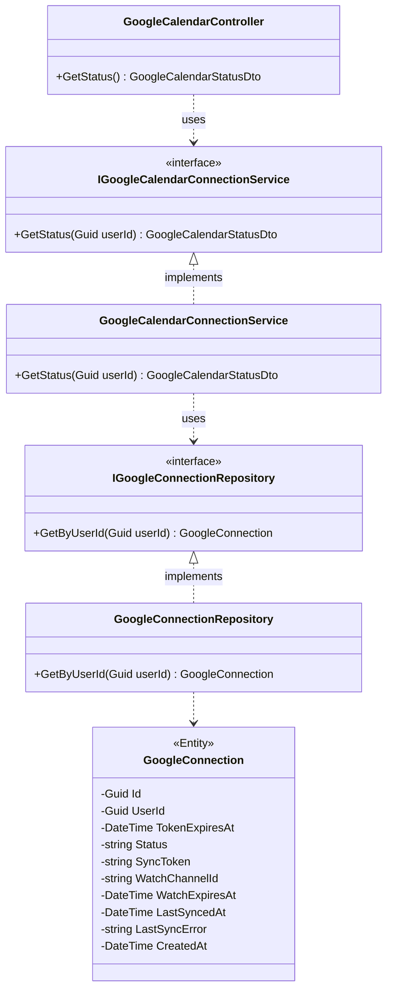

Figure 3.10.1 Class Diagram

### 3.10.2 Sequence Diagram

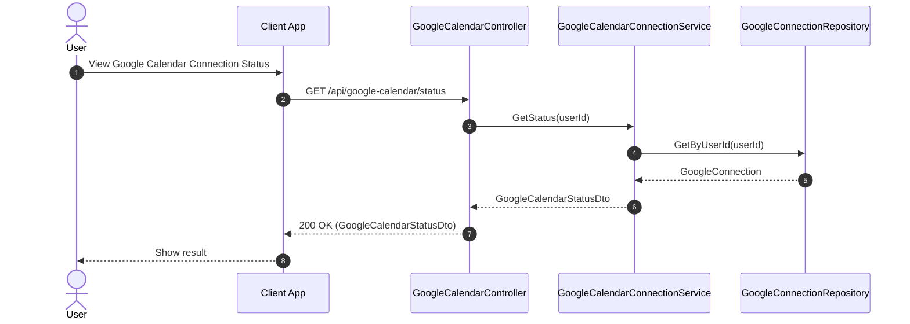

Figure 3.10.2 Sequence Diagram

### 3.10.3 Class Specification

#### 3.10.3.a GoogleCalendarController

Table 3.10.3.a: GoogleCalendarController Description Table

| No | Method | Description |
|---|---|---|
| 1 | `GetStatus() : GoogleCalendarStatusDto` | `GET /api/google-calendar/status`. Returns whether the user has connected Google Calendar, the connection status and the time the access token expires. Requires a signed-in user. |

#### 3.10.3.b GoogleCalendarConnectionService

Table 3.10.3.b: GoogleCalendarConnectionService Description Table

| No | Method | Description |
|---|---|---|
| 1 | `GetStatus(Guid userId) : GoogleCalendarStatusDto` | Returns whether the user has connected Google Calendar, the connection status and the time the access token expires. |

#### 3.10.3.c GoogleConnectionRepository

Table 3.10.3.c: GoogleConnectionRepository Description Table

| No | Method | Description |
|---|---|---|
| 1 | `GetByUserId(Guid userId) : GoogleConnection` | Finds the GoogleConnection of the user; null when not connected. |

### 3.10.4 Methods Used

Table 3.10.4: Methods used by this function

| No | Caller | Method called | Implemented by |
|---|---|---|---|
| 1 | GoogleCalendarController.GetStatus | IGoogleCalendarConnectionService.GetStatus | GoogleCalendarConnectionService |
| 2 | GoogleCalendarConnectionService.GetStatus | IGoogleConnectionRepository.GetByUserId | GoogleConnectionRepository |

Entities used: GoogleConnection.

---

## 3.11 Start Google Calendar Connection

Builds the Google OAuth consent URL for the signed-in user (the user id is carried in a signed state value) and returns it to the client.

- **Endpoint:** `GET /api/google-calendar/connect`  
- **Access:** Signed-in user

### 3.11.1 Class Diagram

```mermaid
classDiagram
  direction TB
  class GoogleCalendarController {
    +Connect() IActionResult
  }
  class IGoogleCalendarConnectionService {
    <<interface>>
    +BuildAuthorizationUrl(Guid userId) string
  }
  class GoogleCalendarConnectionService {
    +BuildAuthorizationUrl(Guid userId) string
  }
  GoogleCalendarController ..> IGoogleCalendarConnectionService : uses
  IGoogleCalendarConnectionService <|.. GoogleCalendarConnectionService : implements
```

Figure 3.11.1 Class Diagram

### 3.11.2 Sequence Diagram

```mermaid
sequenceDiagram
  autonumber
  actor User
  participant UI as Client App
  participant GoogleCalendarController
  participant GoogleCalendarConnectionService
  User->>UI: Start Google Calendar Connection
  UI->>GoogleCalendarController: GET /api/google-calendar/connect
  GoogleCalendarController->>GoogleCalendarConnectionService: BuildAuthorizationUrl(userId)
  GoogleCalendarConnectionService-->>GoogleCalendarController: string
  GoogleCalendarController-->>UI: 200 OK
  UI-->>User: Show result
```

Figure 3.11.2 Sequence Diagram

### 3.11.3 Class Specification

#### 3.11.3.a GoogleCalendarController

Table 3.11.3.a: GoogleCalendarController Description Table

| No | Method | Description |
|---|---|---|
| 1 | `Connect() : IActionResult` | `GET /api/google-calendar/connect`. Builds the Google OAuth consent URL for the signed-in user (the user id is carried in a signed state value) and returns it to the client. Requires a signed-in user. |

#### 3.11.3.b GoogleCalendarConnectionService

Table 3.11.3.b: GoogleCalendarConnectionService Description Table

| No | Method | Description |
|---|---|---|
| 1 | `BuildAuthorizationUrl(Guid userId) : string` | Builds the Google OAuth consent URL for the signed-in user (the user id is carried in a signed state value) and returns it to the client. |

### 3.11.4 Methods Used

Table 3.11.4: Methods used by this function

| No | Caller | Method called | Implemented by |
|---|---|---|---|
| 1 | GoogleCalendarController.Connect | IGoogleCalendarConnectionService.BuildAuthorizationUrl | GoogleCalendarConnectionService |

---

## 3.12 Complete Google Calendar Connection

OAuth redirect target. Exchanges the authorization code for tokens, encrypts and stores them, starts the Google watch channel and redirects the browser back to the front end with the result.

- **Endpoint:** `GET /api/google-calendar/callback`  
- **Access:** Anonymous

### 3.12.1 Class Diagram

```mermaid
classDiagram
  direction TB
  class GoogleCalendarController {
    +Callback(string code, string state, string error) IActionResult
    -RedirectToFrontend(string status, string message) IActionResult
  }
  class IGoogleCalendarConnectionService {
    <<interface>>
    +Connect(string code, string state) void
  }
  class GoogleCalendarConnectionService {
    +Connect(string code, string state) void
    -ReadUserIdFromState(string state) Guid
    -TryStartWatch(Guid userId) void
  }
  class GoogleOAuthClient {
    +ExchangeCode(string code) GoogleTokenResult
  }
  class IGoogleConnectionRepository {
    <<interface>>
    +GetByUserId(Guid userId) GoogleConnection
    +Add(GoogleConnection connection) void
  }
  class GoogleConnectionRepository {
    +GetByUserId(Guid userId) GoogleConnection
    +Add(GoogleConnection connection) void
  }
  class IUnitOfWork {
    <<interface>>
    +SaveChanges() int
  }
  class UnitOfWork {
    +SaveChanges() int
  }
  class GoogleCalendarClientProvider {
    +Open(Guid userId) GoogleCalendarSession
  }
  class GoogleConnection {
    <<Entity>>
    -Guid Id
    -Guid UserId
    -DateTime TokenExpiresAt
    -string Status
    -string SyncToken
    -string WatchChannelId
    -DateTime WatchExpiresAt
    -DateTime LastSyncedAt
    -string LastSyncError
    -DateTime CreatedAt
  }
  GoogleCalendarController ..> IGoogleCalendarConnectionService : uses
  GoogleCalendarConnectionService ..> GoogleOAuthClient : uses
  GoogleCalendarConnectionService ..> IGoogleConnectionRepository : uses
  GoogleCalendarConnectionService ..> IUnitOfWork : uses
  GoogleCalendarConnectionService ..> GoogleCalendarClientProvider : uses
  IGoogleCalendarConnectionService <|.. GoogleCalendarConnectionService : implements
  IGoogleConnectionRepository <|.. GoogleConnectionRepository : implements
  IUnitOfWork <|.. UnitOfWork : implements
  GoogleCalendarConnectionService ..> GoogleConnection
  GoogleConnectionRepository ..> GoogleConnection
```

Figure 3.12.1 Class Diagram

### 3.12.2 Sequence Diagram

```mermaid
sequenceDiagram
  autonumber
  actor Guest
  participant UI as Client App
  participant GoogleCalendarController
  participant GoogleCalendarConnectionService
  participant GoogleOAuthClient
  participant GoogleConnectionRepository
  participant UnitOfWork
  participant GoogleCalendarClientProvider
  Guest->>UI: Complete Google Calendar Connection
  UI->>GoogleCalendarController: GET /api/google-calendar/callback
  opt !string.IsNullOrEmpty(error)
    GoogleCalendarController->>GoogleCalendarController: RedirectToFrontend(status, message)
      opt value is missing
        GoogleCalendarController-->>UI: throw InvalidOperationException (500)
      end
      GoogleCalendarController-->>UI: 302 Redirect
  end
  opt string.IsNullOrEmpty(code) || string.IsNullOrEmpty(state)
    GoogleCalendarController->>GoogleCalendarController: RedirectToFrontend(status, message)
  end
  GoogleCalendarController->>GoogleCalendarConnectionService: Connect(code, state)
    GoogleCalendarConnectionService->>GoogleOAuthClient: ExchangeCode(code)
    GoogleOAuthClient-->>GoogleCalendarConnectionService: GoogleTokenResult
    GoogleCalendarConnectionService->>GoogleConnectionRepository: GetByUserId(userId)
    GoogleConnectionRepository-->>GoogleCalendarConnectionService: GoogleConnection
    opt connection == null
      GoogleCalendarConnectionService->>GoogleConnectionRepository: Add(connection)
    end
    GoogleCalendarConnectionService->>UnitOfWork: SaveChanges()
    GoogleCalendarConnectionService->>GoogleCalendarConnectionService: TryStartWatch(userId)
      opt value is missing
        GoogleCalendarConnectionService-->>GoogleCalendarController: throw InvalidOperationException (500)
      end
      GoogleCalendarConnectionService->>GoogleCalendarClientProvider: Open(userId)
      GoogleCalendarClientProvider-->>GoogleCalendarConnectionService: GoogleCalendarSession
      GoogleCalendarConnectionService->>UnitOfWork: SaveChanges()
  opt catch UserFriendlyException ex
    GoogleCalendarController->>GoogleCalendarController: RedirectToFrontend(status, message)
  end
  opt catch Exception ex
    GoogleCalendarController->>GoogleCalendarController: RedirectToFrontend(status, message)
  end
  GoogleCalendarController->>GoogleCalendarController: RedirectToFrontend(status, message)
  UI-->>Guest: Show result
```

Figure 3.12.2 Sequence Diagram

### 3.12.3 Class Specification

#### 3.12.3.a GoogleCalendarController

Table 3.12.3.a: GoogleCalendarController Description Table

| No | Method | Description |
|---|---|---|
| 1 | `Callback(string code, string state, string error) : IActionResult` | `GET /api/google-calendar/callback`. OAuth redirect target. Exchanges the authorization code for tokens, encrypts and stores them, starts the Google watch channel and redirects the browser back to the front end with the result. Anonymous endpoint. |
| 2 | `private RedirectToFrontend(string status, string message) : IActionResult` | Builds the redirect URL `Frontend:CalendarConnectedRedirectUri?calendar=<status>` (with an optional message) and returns a 302 response to the browser. |

#### 3.12.3.b GoogleCalendarConnectionService

Table 3.12.3.b: GoogleCalendarConnectionService Description Table

| No | Method | Description |
|---|---|---|
| 1 | `Connect(string code, string state)` | OAuth redirect target. Exchanges the authorization code for tokens, encrypts and stores them, starts the Google watch channel and redirects the browser back to the front end with the result. |
| 2 | `private ReadUserIdFromState(string state) : Guid` | Decrypts the signed OAuth `state` value and returns the user id; an expired or forged value raises UserFriendlyException. |
| 3 | `private TryStartWatch(Guid userId)` | Registers a Google watch channel so that Google calls the webhook when the calendar changes. Runs only when `Google:WebhookUrl` is a public https URL; failures are only logged. |

#### 3.12.3.c GoogleOAuthClient

Table 3.12.3.c: GoogleOAuthClient Description Table

| No | Method | Description |
|---|---|---|
| 1 | `ExchangeCode(string code) : GoogleTokenResult` | Exchanges the OAuth authorization code for access and refresh tokens at Google; fails when Google returns no refresh token. |

#### 3.12.3.d GoogleConnectionRepository

Table 3.12.3.d: GoogleConnectionRepository Description Table

| No | Method | Description |
|---|---|---|
| 1 | `GetByUserId(Guid userId) : GoogleConnection` | Finds the GoogleConnection of the user; null when not connected. |
| 2 | `Add(GoogleConnection connection)` | Adds a GoogleConnection to the context. |

#### 3.12.3.e UnitOfWork

Table 3.12.3.e: UnitOfWork Description Table

| No | Method | Description |
|---|---|---|
| 1 | `SaveChanges() : int` | Persists every pending change of the current unit of work to the database and returns the number of rows affected. |

#### 3.12.3.f GoogleCalendarClientProvider

Table 3.12.3.f: GoogleCalendarClientProvider Description Table

| No | Method | Description |
|---|---|---|
| 1 | `Open(Guid userId) : GoogleCalendarSession` | Loads the user's active connection, decrypts the stored tokens, refreshes the access token when it is about to expire and returns a ready Google Calendar client. Raises GoogleCalendarNotConnected or GoogleReconnectRequired. |

### 3.12.4 Methods Used

Table 3.12.4: Methods used by this function

| No | Caller | Method called | Implemented by |
|---|---|---|---|
| 1 | GoogleCalendarController.Callback | IGoogleCalendarConnectionService.Connect | GoogleCalendarConnectionService |
| 2 | GoogleCalendarConnectionService.Connect | GoogleOAuthClient.ExchangeCode |  |
| 3 | GoogleCalendarConnectionService.Connect | IGoogleConnectionRepository.GetByUserId | GoogleConnectionRepository |
| 4 | GoogleCalendarConnectionService.Connect | IGoogleConnectionRepository.Add | GoogleConnectionRepository |
| 5 | GoogleCalendarConnectionService.Connect | IUnitOfWork.SaveChanges | UnitOfWork |
| 6 | GoogleCalendarConnectionService.TryStartWatch | GoogleCalendarClientProvider.Open |  |
| 7 | GoogleCalendarConnectionService.TryStartWatch | IUnitOfWork.SaveChanges | UnitOfWork |

Entities used: GoogleConnection.

---

## 3.13 Disconnect Google Calendar

Deletes the connection and the cached Google events of the user and revokes the grant at Google. Safe to call when nothing is connected.

- **Endpoint:** `DELETE /api/google-calendar/disconnect`  
- **Access:** Signed-in user

### 3.13.1 Class Diagram

```mermaid
classDiagram
  direction TB
  class GoogleCalendarController {
    +Disconnect() IActionResult
  }
  class IGoogleCalendarConnectionService {
    <<interface>>
    +Disconnect(Guid userId) void
  }
  class GoogleCalendarConnectionService {
    +Disconnect(Guid userId) void
  }
  class IGoogleConnectionRepository {
    <<interface>>
    +GetWithEventsByUserId(Guid userId) GoogleConnection
    +Remove(GoogleConnection connection) void
  }
  class GoogleConnectionRepository {
    +GetWithEventsByUserId(Guid userId) GoogleConnection
    +Remove(GoogleConnection connection) void
  }
  class IUnitOfWork {
    <<interface>>
    +SaveChanges() int
  }
  class UnitOfWork {
    +SaveChanges() int
  }
  class GoogleOAuthClient {
    +Revoke(string token) bool
  }
  class GoogleConnection {
    <<Entity>>
    -Guid Id
    -Guid UserId
    -DateTime TokenExpiresAt
    -string Status
    -string SyncToken
    -string WatchChannelId
    -DateTime WatchExpiresAt
    -DateTime LastSyncedAt
    -string LastSyncError
    -DateTime CreatedAt
  }
  class GoogleCalendarEvent {
    <<Entity>>
    -Guid Id
    -Guid GoogleConnectionId
    -string GoogleEventId
    -string Title
    -DateTime StartTime
    -DateTime EndTime
    -bool IsAllDay
    -bool IsCreatedByMetanoia
    -string Etag
    -bool IsCancelled
    -DateTime UpdatedAt
  }
  GoogleCalendarController ..> IGoogleCalendarConnectionService : uses
  GoogleCalendarConnectionService ..> IGoogleConnectionRepository : uses
  GoogleCalendarConnectionService ..> IUnitOfWork : uses
  GoogleCalendarConnectionService ..> GoogleOAuthClient : uses
  IGoogleCalendarConnectionService <|.. GoogleCalendarConnectionService : implements
  IGoogleConnectionRepository <|.. GoogleConnectionRepository : implements
  IUnitOfWork <|.. UnitOfWork : implements
  GoogleConnectionRepository ..> GoogleConnection
  GoogleConnectionRepository ..> GoogleCalendarEvent
  GoogleConnection "1" --> "0..*" GoogleCalendarEvent
```

Figure 3.13.1 Class Diagram

### 3.13.2 Sequence Diagram

```mermaid
sequenceDiagram
  autonumber
  actor User
  participant UI as Client App
  participant GoogleCalendarController
  participant GoogleCalendarConnectionService
  participant GoogleConnectionRepository
  participant UnitOfWork
  participant GoogleOAuthClient
  User->>UI: Disconnect Google Calendar
  UI->>GoogleCalendarController: DELETE /api/google-calendar/disconnect
  GoogleCalendarController->>GoogleCalendarConnectionService: Disconnect(userId)
    GoogleCalendarConnectionService->>GoogleConnectionRepository: GetWithEventsByUserId(userId)
    GoogleConnectionRepository-->>GoogleCalendarConnectionService: GoogleConnection
    GoogleCalendarConnectionService->>GoogleConnectionRepository: Remove(connection)
    GoogleCalendarConnectionService->>UnitOfWork: SaveChanges()
    opt refreshToken != null
      GoogleCalendarConnectionService->>GoogleOAuthClient: Revoke(token)
      GoogleOAuthClient-->>GoogleCalendarConnectionService: bool
    end
  GoogleCalendarController-->>UI: 204 No Content
  UI-->>User: Show result
```

Figure 3.13.2 Sequence Diagram

### 3.13.3 Class Specification

#### 3.13.3.a GoogleCalendarController

Table 3.13.3.a: GoogleCalendarController Description Table

| No | Method | Description |
|---|---|---|
| 1 | `Disconnect() : IActionResult` | `DELETE /api/google-calendar/disconnect`. Deletes the connection and the cached Google events of the user and revokes the grant at Google. Safe to call when nothing is connected. Requires a signed-in user. |

#### 3.13.3.b GoogleCalendarConnectionService

Table 3.13.3.b: GoogleCalendarConnectionService Description Table

| No | Method | Description |
|---|---|---|
| 1 | `Disconnect(Guid userId)` | Deletes the GoogleConnection (and its cached events), then revokes the grant at Google on a best-effort basis. Safe when nothing is connected. |

#### 3.13.3.c GoogleConnectionRepository

Table 3.13.3.c: GoogleConnectionRepository Description Table

| No | Method | Description |
|---|---|---|
| 1 | `GetWithEventsByUserId(Guid userId) : GoogleConnection` | Finds the GoogleConnection together with its cached events, so that deleting the connection removes them too. |
| 2 | `Remove(GoogleConnection connection)` | Marks the GoogleConnection for deletion. |

#### 3.13.3.d UnitOfWork

Table 3.13.3.d: UnitOfWork Description Table

| No | Method | Description |
|---|---|---|
| 1 | `SaveChanges() : int` | Persists every pending change of the current unit of work to the database and returns the number of rows affected. |

#### 3.13.3.e GoogleOAuthClient

Table 3.13.3.e: GoogleOAuthClient Description Table

| No | Method | Description |
|---|---|---|
| 1 | `Revoke(string token) : bool` | Revokes the token at Google; returns false when Google refuses (for example the token was already revoked). |

### 3.13.4 Methods Used

Table 3.13.4: Methods used by this function

| No | Caller | Method called | Implemented by |
|---|---|---|---|
| 1 | GoogleCalendarController.Disconnect | IGoogleCalendarConnectionService.Disconnect | GoogleCalendarConnectionService |
| 2 | GoogleCalendarConnectionService.Disconnect | IGoogleConnectionRepository.GetWithEventsByUserId | GoogleConnectionRepository |
| 3 | GoogleCalendarConnectionService.Disconnect | IGoogleConnectionRepository.Remove | GoogleConnectionRepository |
| 4 | GoogleCalendarConnectionService.Disconnect | IUnitOfWork.SaveChanges | UnitOfWork |
| 5 | GoogleCalendarConnectionService.Disconnect | GoogleOAuthClient.Revoke |  |

Entities used: GoogleConnection, GoogleCalendarEvent.

---

## 3.14 Receive Google Calendar Change Notification

Anonymous endpoint called by Google. Verifies the channel token (403 when invalid), ignores the initial sync message, finds the connection that owns the channel and runs an incremental pull under the per-user lock.

- **Endpoint:** `POST /api/google-calendar/webhook`  
- **Access:** Anonymous

### 3.14.1 Class Diagram

```mermaid
classDiagram
  direction TB
  class GoogleCalendarController {
    +Webhook(IGoogleCalendarWebhookService webhookService) IActionResult
  }
  class IGoogleCalendarWebhookService {
    <<interface>>
    +Handle(string channelId, string token, string resourceState) GoogleWebhookResult
  }
  class GoogleCalendarWebhookService {
    +Handle(string channelId, string token, string resourceState) GoogleWebhookResult
  }
  class IGoogleConnectionRepository {
    <<interface>>
    +GetByWatchChannelId(string channelId) GoogleConnection
  }
  class GoogleConnectionRepository {
    +GetByWatchChannelId(string channelId) GoogleConnection
  }
  class GoogleSyncGate {
    +Run(Guid userId, Func~T~ action) T
  }
  class IGoogleCalendarSyncService {
    <<interface>>
    +Sync(Guid userId) GoogleCalendarSyncResultDto
  }
  class GoogleCalendarSyncService {
    +Sync(Guid userId) GoogleCalendarSyncResultDto
  }
  class GoogleConnection {
    <<Entity>>
    -Guid Id
    -Guid UserId
    -DateTime TokenExpiresAt
    -string Status
    -string SyncToken
    -string WatchChannelId
    -DateTime WatchExpiresAt
    -DateTime LastSyncedAt
    -string LastSyncError
    -DateTime CreatedAt
  }
  GoogleCalendarController ..> IGoogleCalendarWebhookService : uses
  GoogleCalendarWebhookService ..> IGoogleConnectionRepository : uses
  GoogleCalendarWebhookService ..> GoogleSyncGate : uses
  GoogleCalendarWebhookService ..> IGoogleCalendarSyncService : uses
  IGoogleCalendarWebhookService <|.. GoogleCalendarWebhookService : implements
  IGoogleConnectionRepository <|.. GoogleConnectionRepository : implements
  IGoogleCalendarSyncService <|.. GoogleCalendarSyncService : implements
  GoogleConnectionRepository ..> GoogleConnection
```

Figure 3.14.1 Class Diagram

### 3.14.2 Sequence Diagram

```mermaid
sequenceDiagram
  autonumber
  participant Google
  participant GoogleCalendarController
  participant GoogleCalendarWebhookService
  participant GoogleConnectionRepository
  participant GoogleSyncGate
  participant GoogleCalendarSyncService
  Google->>GoogleCalendarController: POST /api/google-calendar/webhook
  GoogleCalendarController->>GoogleCalendarWebhookService: Handle(channelId, token, resourceState)
    GoogleCalendarWebhookService->>GoogleConnectionRepository: GetByWatchChannelId(channelId)
    GoogleConnectionRepository-->>GoogleCalendarWebhookService: GoogleConnection
    GoogleCalendarWebhookService->>GoogleSyncGate: Run(userId, action)
    GoogleSyncGate-->>GoogleCalendarWebhookService: T
    GoogleCalendarWebhookService->>GoogleCalendarSyncService: Sync(userId)
    GoogleCalendarSyncService-->>GoogleCalendarWebhookService: GoogleCalendarSyncResultDto
  GoogleCalendarWebhookService-->>GoogleCalendarController: GoogleWebhookResult
  GoogleCalendarController-->>Google: 200 OK or 403 Forbidden
```

Figure 3.14.2 Sequence Diagram

### 3.14.3 Class Specification

#### 3.14.3.a GoogleCalendarController

Table 3.14.3.a: GoogleCalendarController Description Table

| No | Method | Description |
|---|---|---|
| 1 | `Webhook(IGoogleCalendarWebhookService webhookService) : IActionResult` | `POST /api/google-calendar/webhook`. Anonymous endpoint called by Google. Verifies the channel token (403 when invalid), ignores the initial sync message, finds the connection that owns the channel and runs an incremental pull under the per-user lock. Anonymous endpoint. |

#### 3.14.3.b GoogleCalendarWebhookService

Table 3.14.3.b: GoogleCalendarWebhookService Description Table

| No | Method | Description |
|---|---|---|
| 1 | `Handle(string channelId, string token, string resourceState) : GoogleWebhookResult` | Anonymous endpoint called by Google. Verifies the channel token (403 when invalid), ignores the initial sync message, finds the connection that owns the channel and runs an incremental pull under the per-user lock. |

#### 3.14.3.c GoogleConnectionRepository

Table 3.14.3.c: GoogleConnectionRepository Description Table

| No | Method | Description |
|---|---|---|
| 1 | `GetByWatchChannelId(string channelId) : GoogleConnection` | Finds the GoogleConnection that owns the given Google watch channel id. |

#### 3.14.3.d GoogleSyncGate

Table 3.14.3.d: GoogleSyncGate Description Table

| No | Method | Description |
|---|---|---|
| 1 | `Run(Guid userId, <> action) : T` | Runs the given action while holding a per-user lock, so two synchronizations of the same user never run at the same time. |

#### 3.14.3.e GoogleCalendarSyncService

Table 3.14.3.e: GoogleCalendarSyncService Description Table

| No | Method | Description |
|---|---|---|
| 1 | `Sync(Guid userId) : GoogleCalendarSyncResultDto` | Runs the synchronization requested (direction and date range). Without a range it pulls incrementally with the stored sync token. |

### 3.14.4 Methods Used

Table 3.14.4: Methods used by this function

| No | Caller | Method called | Implemented by |
|---|---|---|---|
| 1 | GoogleCalendarController.Webhook | IGoogleCalendarWebhookService.Handle | GoogleCalendarWebhookService |
| 2 | GoogleCalendarWebhookService.Handle | IGoogleConnectionRepository.GetByWatchChannelId | GoogleConnectionRepository |
| 3 | GoogleCalendarWebhookService.Handle | GoogleSyncGate.Run |  |
| 4 | GoogleCalendarWebhookService.Handle | IGoogleCalendarSyncService.Sync | GoogleCalendarSyncService |

Entities used: GoogleConnection.

---

## 3.15 Synchronize Google Calendar

Synchronizes in the direction and date range chosen by the user: pulls Google events into METANOIA, pushes METANOIA slots to Google, or both. Without a range it performs the incremental pull with the sync token.

- **Endpoint:** `POST /api/google-calendar/sync`  
- **Access:** Signed-in user

### 3.15.1 Class Diagram

```mermaid
classDiagram
  direction TB
  class GoogleCalendarController {
    +Sync(DateOnly from, DateOnly to, GoogleSyncDirection direction) GoogleCalendarSyncResultDto
  }
  class GoogleSyncGate {
    +Run(Guid userId, Func~T~ action) T
  }
  class IGoogleCalendarSyncService {
    <<interface>>
    +Sync(Guid userId) GoogleCalendarSyncResultDto
  }
  class GoogleCalendarSyncService {
    +Sync(Guid userId) GoogleCalendarSyncResultDto
    -ResolveRange(Guid userId, GoogleCalendarSyncRequest request) SyncRange
    -ResolveTimeZone(string id) TimeZoneInfo
    -StartOfDayUtc(DateOnly date, TimeZoneInfo zone) DateTime
    -Run(GoogleCalendarSession session, GoogleCalendarSyncRequest request, SyncRange range) GoogleCalendarSyncResultDto
    -RunSync(GoogleCalendarSession session, GoogleCalendarSyncResultDto result) void
    -Apply(GoogleConnection connection, Event googleEvent, GoogleCalendarSyncResultDto result) void
    -RunRangeSync(GoogleCalendarSession session, SyncRange range, GoogleCalendarSyncResultDto result) void
    -PushSlots(GoogleCalendarSession session, SyncRange range, GoogleCalendarSyncResultDto result) void
    -UpsertSlotEvent(GoogleCalendarSession session, ScheduleSlot slot, GoogleCalendarSyncResultDto result) void
    -ToGoogleEvent(ScheduleSlot slot, string eventId) Event
    -RemoveSlotEvent(GoogleCalendarSession session, ScheduleSlot slot, GoogleCalendarSyncResultDto result) void
    -TrySave() void
    -Trim(string value) string
    -RecordFailure(GoogleConnection connection, string message) void
  }
  class IGoogleConnectionRepository {
    <<interface>>
    +GetByUserId(Guid userId) GoogleConnection
    +GetUserTimeZone(Guid userId) string
  }
  class GoogleConnectionRepository {
    +GetByUserId(Guid userId) GoogleConnection
    +GetUserTimeZone(Guid userId) string
  }
  class GoogleCalendarClientProvider {
    +Open(Guid userId) GoogleCalendarSession
  }
  class IGoogleCalendarEventRepository {
    <<interface>>
    +GetByGoogleEventId(Guid connectionId, string googleEventId) GoogleCalendarEvent
    +Add(GoogleCalendarEvent calendarEvent) void
  }
  class GoogleCalendarEventRepository {
    +GetByGoogleEventId(Guid connectionId, string googleEventId) GoogleCalendarEvent
    +Add(GoogleCalendarEvent calendarEvent) void
  }
  class IUnitOfWork {
    <<interface>>
    +SaveChanges() int
  }
  class UnitOfWork {
    +SaveChanges() int
  }
  class IScheduleSlotRepository {
    <<interface>>
    +GetForGooglePush(Guid userId, DateTime fromUtc, DateTime toUtc, string[] liveStatuses, string[] removedStatuses) ScheduleSlot[]
  }
  class ScheduleSlotRepository {
    +GetForGooglePush(Guid userId, DateTime fromUtc, DateTime toUtc, string[] liveStatuses, string[] removedStatuses) ScheduleSlot[]
  }
  class GoogleConnection {
    <<Entity>>
    -Guid Id
    -Guid UserId
    -DateTime TokenExpiresAt
    -string Status
    -string SyncToken
    -string WatchChannelId
    -DateTime WatchExpiresAt
    -DateTime LastSyncedAt
    -string LastSyncError
    -DateTime CreatedAt
  }
  class User {
    <<Entity>>
    -Guid Id
    -Guid RoleId
    -string Email
    -string FullName
    -string GoogleSubjectId
    -string TimeZone
    -TimeOnly WorkDayStart
    -TimeOnly WorkDayEnd
    -bool WorksOnWeekend
    -int DefaultBufferMinutes
    -int ReminderLeadMinutes
    -bool OnboardingCompleted
    -DateTime CreatedAt
    -DateTime DeletedAt
  }
  class GoogleCalendarEvent {
    <<Entity>>
    -Guid Id
    -Guid GoogleConnectionId
    -string GoogleEventId
    -string Title
    -DateTime StartTime
    -DateTime EndTime
    -bool IsAllDay
    -bool IsCreatedByMetanoia
    -string Etag
    -bool IsCancelled
    -DateTime UpdatedAt
  }
  class ScheduleSlot {
    <<Entity>>
    -Guid Id
    -Guid TaskId
    -Guid SubTaskId
    -Guid ScheduleProposalId
    -DateTime StartTime
    -DateTime EndTime
    -DateTime OriginalStartTime
    -bool IsManualOverride
    -int ProposedMinutes
    -decimal KbiasUsed
    -string Explanation
    -string Status
    -string GoogleEventId
    -bool SyncFailed
  }
  GoogleCalendarController ..> GoogleSyncGate : uses
  GoogleCalendarController ..> IGoogleCalendarSyncService : uses
  GoogleCalendarSyncService ..> IGoogleConnectionRepository : uses
  GoogleCalendarSyncService ..> GoogleCalendarClientProvider : uses
  GoogleCalendarSyncService ..> IGoogleCalendarEventRepository : uses
  GoogleCalendarSyncService ..> IUnitOfWork : uses
  GoogleCalendarSyncService ..> IScheduleSlotRepository : uses
  IGoogleCalendarSyncService <|.. GoogleCalendarSyncService : implements
  IGoogleConnectionRepository <|.. GoogleConnectionRepository : implements
  IGoogleCalendarEventRepository <|.. GoogleCalendarEventRepository : implements
  IUnitOfWork <|.. UnitOfWork : implements
  IScheduleSlotRepository <|.. ScheduleSlotRepository : implements
  GoogleConnectionRepository ..> GoogleConnection
  GoogleConnectionRepository ..> User
  GoogleCalendarSyncService ..> GoogleCalendarEvent
  GoogleCalendarEventRepository ..> GoogleCalendarEvent
  ScheduleSlotRepository ..> ScheduleSlot
  GoogleConnection "1" --> "0..*" GoogleCalendarEvent
  GoogleConnection "*" --> "1" User
```

Figure 3.15.1 Class Diagram

### 3.15.2 Sequence Diagram

```mermaid
sequenceDiagram
  autonumber
  actor User
  participant UI as Client App
  participant GoogleCalendarController
  participant GoogleSyncGate
  participant GoogleCalendarSyncService
  participant GoogleConnectionRepository
  participant GoogleCalendarClientProvider
  participant GoogleCalendarEventRepository
  participant UnitOfWork
  participant ScheduleSlotRepository
  User->>UI: Synchronize Google Calendar
  UI->>GoogleCalendarController: POST /api/google-calendar/sync
  GoogleCalendarController->>GoogleSyncGate: Run(userId, action)
  GoogleSyncGate-->>GoogleCalendarController: T
  GoogleCalendarController->>GoogleCalendarSyncService: Sync(userId)
    opt request.From is ( ) from && request.To is ( ) to && to < from
      GoogleCalendarSyncService-->>GoogleCalendarController: throw UserFriendlyException (400)
    end
    GoogleCalendarSyncService->>GoogleConnectionRepository: GetByUserId(userId)
    GoogleConnectionRepository-->>GoogleCalendarSyncService: GoogleConnection
    opt connection == null
    end
    opt connection.Status != 'Active'
    end
    GoogleCalendarSyncService->>GoogleCalendarSyncService: ResolveRange(userId, request)
      GoogleCalendarSyncService->>GoogleConnectionRepository: GetUserTimeZone(userId)
      GoogleConnectionRepository-->>GoogleCalendarSyncService: string
    GoogleCalendarSyncService->>GoogleCalendarClientProvider: Open(userId)
    GoogleCalendarClientProvider-->>GoogleCalendarSyncService: GoogleCalendarSession
    GoogleCalendarSyncService->>GoogleCalendarSyncService: Run(session, request, range)
      opt request.Direction != GoogleSyncDirection.ToGoogle
        alt range == null
          GoogleCalendarSyncService->>GoogleCalendarSyncService: RunSync(session, result)
            loop do
              loop each googleEvent in page.Items ?? []
                GoogleCalendarSyncService->>GoogleCalendarSyncService: Apply(connection, googleEvent, result)
                  GoogleCalendarSyncService->>GoogleCalendarEventRepository: GetByGoogleEventId(connectionId, googleEventId)
                  GoogleCalendarEventRepository-->>GoogleCalendarSyncService: GoogleCalendarEvent
                  opt local == null
                    GoogleCalendarSyncService->>GoogleCalendarEventRepository: Add(calendarEvent)
                  end
              end
            end
            GoogleCalendarSyncService->>UnitOfWork: SaveChanges()
          opt catch GoogleApiException ex
            GoogleCalendarSyncService->>GoogleCalendarSyncService: RunSync(session, result)
          end
        else
          GoogleCalendarSyncService->>GoogleCalendarSyncService: RunRangeSync(session, range, result)
            loop do
              loop each googleEvent in page.Items ?? []
                GoogleCalendarSyncService->>GoogleCalendarSyncService: Apply(connection, googleEvent, result)
              end
            end
            GoogleCalendarSyncService->>UnitOfWork: SaveChanges()
        end
      end
      opt request.Direction != GoogleSyncDirection.FromGoogle
        GoogleCalendarSyncService->>GoogleCalendarSyncService: PushSlots(session, range, result)
          GoogleCalendarSyncService->>ScheduleSlotRepository: GetForGooglePush(userId, fromUtc, toUtc, liveStatuses, removedStatuses)
          ScheduleSlotRepository-->>GoogleCalendarSyncService: ScheduleSlot list
          loop each slot in slots
            alt LiveSlotStatuses.Contains(slot.Status)
              GoogleCalendarSyncService->>GoogleCalendarSyncService: UpsertSlotEvent(session, slot, result)
                GoogleCalendarSyncService->>GoogleCalendarEventRepository: GetByGoogleEventId(connectionId, googleEventId)
                GoogleCalendarEventRepository-->>GoogleCalendarSyncService: GoogleCalendarEvent
                opt local == null
                  GoogleCalendarSyncService->>GoogleCalendarEventRepository: Add(calendarEvent)
                end
            else
              GoogleCalendarSyncService->>GoogleCalendarSyncService: RemoveSlotEvent(session, slot, result)
                opt catch GoogleApiException ex
                  GoogleCalendarSyncService->>GoogleCalendarEventRepository: GetByGoogleEventId(connectionId, googleEventId)
                  GoogleCalendarEventRepository-->>GoogleCalendarSyncService: GoogleCalendarEvent
                end
            end
            GoogleCalendarSyncService->>UnitOfWork: SaveChanges()
            opt catch GoogleApiException ex
              GoogleCalendarSyncService->>GoogleCalendarSyncService: TrySave()
                GoogleCalendarSyncService->>UnitOfWork: SaveChanges()
            end
          end
          GoogleCalendarSyncService->>GoogleCalendarSyncService: TrySave()
      end
    opt catch GoogleCalendarNotConnectedException ex
      GoogleCalendarSyncService-->>GoogleCalendarController: throw GoogleReconnectRequiredException (409)
    end
    opt catch CryptographicException ex
      GoogleCalendarSyncService-->>GoogleCalendarController: throw GoogleReconnectRequiredException (409)
    end
    opt catch GoogleApiException ex
      GoogleCalendarSyncService->>GoogleCalendarSyncService: TrySave()
      GoogleCalendarSyncService->>GoogleCalendarSyncService: RecordFailure(connection, message)
        GoogleCalendarSyncService->>GoogleCalendarSyncService: TrySave()
      GoogleCalendarSyncService->>GoogleCalendarSyncService: RecordFailure(connection, message)
      GoogleCalendarSyncService->>GoogleCalendarSyncService: RecordFailure(connection, message)
    end
  GoogleCalendarSyncService-->>GoogleCalendarController: GoogleCalendarSyncResultDto
  GoogleCalendarController-->>UI: 200 OK (GoogleCalendarSyncResultDto)
  UI-->>User: Show result
```

Figure 3.15.2 Sequence Diagram

### 3.15.3 Class Specification

#### 3.15.3.a GoogleCalendarController

Table 3.15.3.a: GoogleCalendarController Description Table

| No | Method | Description |
|---|---|---|
| 1 | `Sync(DateOnly from, DateOnly to, GoogleSyncDirection direction) : GoogleCalendarSyncResultDto` | `POST /api/google-calendar/sync`. Synchronizes in the direction and date range chosen by the user: pulls Google events into METANOIA, pushes METANOIA slots to Google, or both. Without a range it performs the incremental pull with the sync token. Requires a signed-in user. |

#### 3.15.3.b GoogleSyncGate

Table 3.15.3.b: GoogleSyncGate Description Table

| No | Method | Description |
|---|---|---|
| 1 | `Run(Guid userId, <> action) : T` | Runs the given action while holding a per-user lock, so two synchronizations of the same user never run at the same time. |

#### 3.15.3.c GoogleCalendarSyncService

Table 3.15.3.c: GoogleCalendarSyncService Description Table

| No | Method | Description |
|---|---|---|
| 1 | `Sync(Guid userId) : GoogleCalendarSyncResultDto` | Runs the synchronization requested (direction and date range). Without a range it pulls incrementally with the stored sync token. |
| 2 | `private ResolveRange(Guid userId, GoogleCalendarSyncRequest request) : SyncRange` | Converts the From/To dates (in the user's time zone, To inclusive) to a UTC range, or nothing when no date was chosen. |
| 3 | `private ResolveTimeZone(string id) : TimeZoneInfo` | Finds the time zone by id and falls back to UTC when it is unknown. |
| 4 | `private StartOfDayUtc(DateOnly date, TimeZoneInfo zone) : DateTime` | Returns the UTC instant of local midnight of a date, handling time zones that skip midnight. |
| 5 | `private Run(GoogleCalendarSession session, GoogleCalendarSyncRequest request, SyncRange range) : GoogleCalendarSyncResultDto` | Runs the pull part when the direction is not ToGoogle and the push part when it is not FromGoogle, and collects the counters in the result. |
| 6 | `private RunSync(GoogleCalendarSession session, GoogleCalendarSyncResultDto result)` | Incremental pull: reads changed Google events page by page with the sync token, upserts or cancels the cached events and stores the next sync token. When Google rejects the token the pull starts again from scratch. |
| 7 | `private Apply(GoogleConnection connection, Event googleEvent, GoogleCalendarSyncResultDto result)` | Applies one Google event to the local cache: a cancelled event is marked cancelled, an unknown event is added (flagged as METANOIA's own when its id carries our prefix), a known one is updated. |
| 8 | `private RunRangeSync(GoogleCalendarSession session, SyncRange range, GoogleCalendarSyncResultDto result)` | Range pull: reads every event in the chosen date range (Google forbids a sync token together with a time range, so the stored token is left untouched). |
| 9 | `private PushSlots(GoogleCalendarSession session, SyncRange range, GoogleCalendarSyncResultDto result)` | Pushes the live slots (Approved, Due, InProgress, Overrun) of the range to Google and removes the Google event of slots that were cancelled. |
| 10 | `private UpsertSlotEvent(GoogleCalendarSession session, ScheduleSlot slot, GoogleCalendarSyncResultDto result)` | Creates or updates the Google event of a slot using a stable event id derived from the slot id, so a retry never creates a duplicate. |
| 11 | `private ToGoogleEvent(ScheduleSlot slot, string eventId) : Event` | Builds the Google event (title, description, start, end) from the slot, its task and its project. |
| 12 | `private RemoveSlotEvent(GoogleCalendarSession session, ScheduleSlot slot, GoogleCalendarSyncResultDto result)` | Deletes the Google event of a slot; an event already gone (404 or 410) is ignored. |
| 13 | `private TrySave()` | Saves the sync state; a failure of this save is only logged so that it does not hide the original error. |
| 14 | `private Trim(string value) : string` | Cuts an error message to the maximum length of the LastSyncError column. |
| 15 | `private RecordFailure(GoogleConnection connection, string message)` | Stores the (trimmed) error message in the connection's LastSyncError. |

#### 3.15.3.d GoogleConnectionRepository

Table 3.15.3.d: GoogleConnectionRepository Description Table

| No | Method | Description |
|---|---|---|
| 1 | `GetByUserId(Guid userId) : GoogleConnection` | Finds the GoogleConnection of the user; null when not connected. |
| 2 | `GetUserTimeZone(Guid userId) : string` | Returns the IANA time zone saved in the user's settings (used to turn chosen dates into a UTC range). |

#### 3.15.3.e GoogleCalendarClientProvider

Table 3.15.3.e: GoogleCalendarClientProvider Description Table

| No | Method | Description |
|---|---|---|
| 1 | `Open(Guid userId) : GoogleCalendarSession` | Loads the user's active connection, decrypts the stored tokens, refreshes the access token when it is about to expire and returns a ready Google Calendar client. Raises GoogleCalendarNotConnected or GoogleReconnectRequired. |

#### 3.15.3.f GoogleCalendarEventRepository

Table 3.15.3.f: GoogleCalendarEventRepository Description Table

| No | Method | Description |
|---|---|---|
| 1 | `GetByGoogleEventId(Guid connectionId, string googleEventId) : GoogleCalendarEvent` | Finds the cached GoogleCalendarEvent by connection id and Google event id. |
| 2 | `Add(GoogleCalendarEvent calendarEvent)` | Adds a GoogleCalendarEvent to the context. |

#### 3.15.3.g UnitOfWork

Table 3.15.3.g: UnitOfWork Description Table

| No | Method | Description |
|---|---|---|
| 1 | `SaveChanges() : int` | Persists every pending change of the current unit of work to the database and returns the number of rows affected. |

#### 3.15.3.h ScheduleSlotRepository

Table 3.15.3.h: ScheduleSlotRepository Description Table

| No | Method | Description |
|---|---|---|
| 1 | `GetForGooglePush(Guid userId, DateTime fromUtc, DateTime toUtc, string[] liveStatuses, string[] removedStatuses) : ScheduleSlot[]` | Returns the slots to push to Google Calendar: live slots, plus slots that already have a GoogleEventId but are now cancelled or ended (their event must be removed). |

### 3.15.4 Methods Used

Table 3.15.4: Methods used by this function

| No | Caller | Method called | Implemented by |
|---|---|---|---|
| 1 | GoogleCalendarController.Sync | GoogleSyncGate.Run |  |
| 2 | GoogleCalendarController.Sync | IGoogleCalendarSyncService.Sync | GoogleCalendarSyncService |
| 3 | GoogleCalendarSyncService.Sync | IGoogleConnectionRepository.GetByUserId | GoogleConnectionRepository |
| 4 | GoogleCalendarSyncService.ResolveRange | IGoogleConnectionRepository.GetUserTimeZone | GoogleConnectionRepository |
| 5 | GoogleCalendarSyncService.Sync | GoogleCalendarClientProvider.Open |  |
| 6 | GoogleCalendarSyncService.Apply | IGoogleCalendarEventRepository.GetByGoogleEventId | GoogleCalendarEventRepository |
| 7 | GoogleCalendarSyncService.Apply | IGoogleCalendarEventRepository.Add | GoogleCalendarEventRepository |
| 8 | GoogleCalendarSyncService.RunSync | IUnitOfWork.SaveChanges | UnitOfWork |
| 9 | GoogleCalendarSyncService.RunRangeSync | IUnitOfWork.SaveChanges | UnitOfWork |
| 10 | GoogleCalendarSyncService.PushSlots | IScheduleSlotRepository.GetForGooglePush | ScheduleSlotRepository |
| 11 | GoogleCalendarSyncService.UpsertSlotEvent | IGoogleCalendarEventRepository.GetByGoogleEventId | GoogleCalendarEventRepository |
| 12 | GoogleCalendarSyncService.UpsertSlotEvent | IGoogleCalendarEventRepository.Add | GoogleCalendarEventRepository |
| 13 | GoogleCalendarSyncService.RemoveSlotEvent | IGoogleCalendarEventRepository.GetByGoogleEventId | GoogleCalendarEventRepository |
| 14 | GoogleCalendarSyncService.PushSlots | IUnitOfWork.SaveChanges | UnitOfWork |
| 15 | GoogleCalendarSyncService.TrySave | IUnitOfWork.SaveChanges | UnitOfWork |

Entities used: GoogleConnection, User, GoogleCalendarEvent, ScheduleSlot.

---

## 3.16 View Google Calendar Events

Lists the user's Google Calendar events in a time range directly from Google.

- **Endpoint:** `GET /api/google-calendar/events`  
- **Access:** Signed-in user

### 3.16.1 Class Diagram

```mermaid
classDiagram
  direction TB
  class GoogleCalendarController {
    +GetEvents(DateTimeOffset from, DateTimeOffset to) CalendarEventDto[]
  }
  class IGoogleCalendarEventService {
    <<interface>>
    +GetEvents(Guid userId, DateTimeOffset from, DateTimeOffset to) CalendarEventDto[]
  }
  class GoogleCalendarEventService {
    +GetEvents(Guid userId, DateTimeOffset from, DateTimeOffset to) CalendarEventDto[]
    -Execute(Func~T~ call) T
  }
  class GoogleCalendarClientProvider {
    +Open(Guid userId) GoogleCalendarSession
  }
  GoogleCalendarController ..> IGoogleCalendarEventService : uses
  GoogleCalendarEventService ..> GoogleCalendarClientProvider : uses
  IGoogleCalendarEventService <|.. GoogleCalendarEventService : implements
```

Figure 3.16.1 Class Diagram

### 3.16.2 Sequence Diagram

```mermaid
sequenceDiagram
  autonumber
  actor User
  participant UI as Client App
  participant GoogleCalendarController
  participant GoogleCalendarEventService
  participant GoogleCalendarClientProvider
  User->>UI: View Google Calendar Events
  UI->>GoogleCalendarController: GET /api/google-calendar/events
  GoogleCalendarController->>GoogleCalendarEventService: GetEvents(userId, from, to)
    GoogleCalendarEventService->>GoogleCalendarClientProvider: Open(userId)
    GoogleCalendarClientProvider-->>GoogleCalendarEventService: GoogleCalendarSession
  GoogleCalendarEventService-->>GoogleCalendarController: CalendarEventDto list
  GoogleCalendarController-->>UI: 200 OK (CalendarEventDto list)
  UI-->>User: Show result
```

Figure 3.16.2 Sequence Diagram

### 3.16.3 Class Specification

#### 3.16.3.a GoogleCalendarController

Table 3.16.3.a: GoogleCalendarController Description Table

| No | Method | Description |
|---|---|---|
| 1 | `GetEvents(DateTimeOffset from, DateTimeOffset to) : CalendarEventDto[]` | `GET /api/google-calendar/events`. Lists the user's Google Calendar events in a time range directly from Google. Requires a signed-in user. |

#### 3.16.3.b GoogleCalendarEventService

Table 3.16.3.b: GoogleCalendarEventService Description Table

| No | Method | Description |
|---|---|---|
| 1 | `GetEvents(Guid userId, DateTimeOffset from, DateTimeOffset to) : CalendarEventDto[]` | Lists the user's Google Calendar events in a time range directly from Google. |
| 2 | `private Execute(<> call) : T` | Runs a Google API call and translates its errors: 404 becomes NotFoundException, other Google errors become UserFriendlyException. |

#### 3.16.3.c GoogleCalendarClientProvider

Table 3.16.3.c: GoogleCalendarClientProvider Description Table

| No | Method | Description |
|---|---|---|
| 1 | `Open(Guid userId) : GoogleCalendarSession` | Loads the user's active connection, decrypts the stored tokens, refreshes the access token when it is about to expire and returns a ready Google Calendar client. Raises GoogleCalendarNotConnected or GoogleReconnectRequired. |

### 3.16.4 Methods Used

Table 3.16.4: Methods used by this function

| No | Caller | Method called | Implemented by |
|---|---|---|---|
| 1 | GoogleCalendarController.GetEvents | IGoogleCalendarEventService.GetEvents | GoogleCalendarEventService |
| 2 | GoogleCalendarEventService.GetEvents | GoogleCalendarClientProvider.Open |  |

---

## 3.17 View Google Calendar Event

Returns one Google Calendar event of the user.

- **Endpoint:** `GET /api/google-calendar/events/{eventId}`  
- **Access:** Signed-in user

### 3.17.1 Class Diagram

```mermaid
classDiagram
  direction TB
  class GoogleCalendarController {
    +GetEvent(string eventId) CalendarEventDto
  }
  class IGoogleCalendarEventService {
    <<interface>>
    +GetEvent(Guid userId, string eventId) CalendarEventDto
  }
  class GoogleCalendarEventService {
    +GetEvent(Guid userId, string eventId) CalendarEventDto
    -Execute(Func~T~ call) T
    -ToDto(GoogleEvent googleEvent) CalendarEventDto
    -ToDateTimeOffset(EventDateTime value) DateTimeOffset
  }
  class GoogleCalendarClientProvider {
    +Open(Guid userId) GoogleCalendarSession
  }
  GoogleCalendarController ..> IGoogleCalendarEventService : uses
  GoogleCalendarEventService ..> GoogleCalendarClientProvider : uses
  IGoogleCalendarEventService <|.. GoogleCalendarEventService : implements
```

Figure 3.17.1 Class Diagram

### 3.17.2 Sequence Diagram

```mermaid
sequenceDiagram
  autonumber
  actor User
  participant UI as Client App
  participant GoogleCalendarController
  participant GoogleCalendarEventService
  participant GoogleCalendarClientProvider
  User->>UI: View Google Calendar Event
  UI->>GoogleCalendarController: GET /api/google-calendar/events/(eventId)
  GoogleCalendarController->>GoogleCalendarEventService: GetEvent(userId, eventId)
    GoogleCalendarEventService->>GoogleCalendarClientProvider: Open(userId)
    GoogleCalendarClientProvider-->>GoogleCalendarEventService: GoogleCalendarSession
  GoogleCalendarEventService-->>GoogleCalendarController: CalendarEventDto
  GoogleCalendarController-->>UI: 200 OK (CalendarEventDto)
  UI-->>User: Show result
```

Figure 3.17.2 Sequence Diagram

### 3.17.3 Class Specification

#### 3.17.3.a GoogleCalendarController

Table 3.17.3.a: GoogleCalendarController Description Table

| No | Method | Description |
|---|---|---|
| 1 | `GetEvent(string eventId) : CalendarEventDto` | `GET /api/google-calendar/events/{eventId}`. Returns one Google Calendar event of the user. Requires a signed-in user. |

#### 3.17.3.b GoogleCalendarEventService

Table 3.17.3.b: GoogleCalendarEventService Description Table

| No | Method | Description |
|---|---|---|
| 1 | `GetEvent(Guid userId, string eventId) : CalendarEventDto` | Returns one Google Calendar event of the user. |
| 2 | `private Execute(<> call) : T` | Runs a Google API call and translates its errors: 404 becomes NotFoundException, other Google errors become UserFriendlyException. |
| 3 | `private ToDto(GoogleEvent googleEvent) : CalendarEventDto` | Maps the entity to the DTO returned by the API. |
| 4 | `private ToDateTimeOffset(EventDateTime value) : DateTimeOffset` | Reads the start or end of a Google event (all-day events only have a date). |

#### 3.17.3.c GoogleCalendarClientProvider

Table 3.17.3.c: GoogleCalendarClientProvider Description Table

| No | Method | Description |
|---|---|---|
| 1 | `Open(Guid userId) : GoogleCalendarSession` | Loads the user's active connection, decrypts the stored tokens, refreshes the access token when it is about to expire and returns a ready Google Calendar client. Raises GoogleCalendarNotConnected or GoogleReconnectRequired. |

### 3.17.4 Methods Used

Table 3.17.4: Methods used by this function

| No | Caller | Method called | Implemented by |
|---|---|---|---|
| 1 | GoogleCalendarController.GetEvent | IGoogleCalendarEventService.GetEvent | GoogleCalendarEventService |
| 2 | GoogleCalendarEventService.GetEvent | GoogleCalendarClientProvider.Open |  |

---

## 3.18 Create Google Calendar Event

Creates an event in the user's primary Google calendar and caches it locally.

- **Endpoint:** `POST /api/google-calendar/events`  
- **Access:** Signed-in user

### 3.18.1 Class Diagram

```mermaid
classDiagram
  direction TB
  class GoogleCalendarController {
    +CreateEvent(CalendarEventRequestDto request) CalendarEventDto
  }
  class IGoogleCalendarEventService {
    <<interface>>
    +CreateEvent(Guid userId, CalendarEventRequestDto request) CalendarEventDto
  }
  class GoogleCalendarEventService {
    +CreateEvent(Guid userId, CalendarEventRequestDto request) CalendarEventDto
    -ValidateRequest(CalendarEventRequestDto request) void
    -Execute(Func~T~ call) T
    -ToGoogleEvent(CalendarEventRequestDto request) GoogleEvent
    -UpsertLocal(GoogleConnection connection, GoogleEvent googleEvent, bool isCreatedByMetanoia) void
    -ToDto(GoogleEvent googleEvent) CalendarEventDto
    -ToDateTimeOffset(EventDateTime value) DateTimeOffset
  }
  class GoogleCalendarClientProvider {
    +Open(Guid userId) GoogleCalendarSession
  }
  class IGoogleCalendarEventRepository {
    <<interface>>
    +GetByGoogleEventId(Guid connectionId, string googleEventId) GoogleCalendarEvent
    +Add(GoogleCalendarEvent calendarEvent) void
  }
  class GoogleCalendarEventRepository {
    +GetByGoogleEventId(Guid connectionId, string googleEventId) GoogleCalendarEvent
    +Add(GoogleCalendarEvent calendarEvent) void
  }
  class IUnitOfWork {
    <<interface>>
    +SaveChanges() int
  }
  class UnitOfWork {
    +SaveChanges() int
  }
  class GoogleCalendarEvent {
    <<Entity>>
    -Guid Id
    -Guid GoogleConnectionId
    -string GoogleEventId
    -string Title
    -DateTime StartTime
    -DateTime EndTime
    -bool IsAllDay
    -bool IsCreatedByMetanoia
    -string Etag
    -bool IsCancelled
    -DateTime UpdatedAt
  }
  GoogleCalendarController ..> IGoogleCalendarEventService : uses
  GoogleCalendarEventService ..> GoogleCalendarClientProvider : uses
  GoogleCalendarEventService ..> IGoogleCalendarEventRepository : uses
  GoogleCalendarEventService ..> IUnitOfWork : uses
  IGoogleCalendarEventService <|.. GoogleCalendarEventService : implements
  IGoogleCalendarEventRepository <|.. GoogleCalendarEventRepository : implements
  IUnitOfWork <|.. UnitOfWork : implements
  GoogleCalendarEventService ..> GoogleCalendarEvent
  GoogleCalendarEventRepository ..> GoogleCalendarEvent
```

Figure 3.18.1 Class Diagram

### 3.18.2 Sequence Diagram

```mermaid
sequenceDiagram
  autonumber
  actor User
  participant UI as Client App
  participant GoogleCalendarController
  participant GoogleCalendarEventService
  participant GoogleCalendarClientProvider
  participant GoogleCalendarEventRepository
  participant UnitOfWork
  User->>UI: Create Google Calendar Event
  UI->>GoogleCalendarController: POST /api/google-calendar/events
  GoogleCalendarController->>GoogleCalendarEventService: CreateEvent(userId, request)
    GoogleCalendarEventService->>GoogleCalendarEventService: ValidateRequest(request)
      opt string.IsNullOrWhiteSpace(request.Title)
        GoogleCalendarEventService-->>GoogleCalendarController: throw UserFriendlyException (400)
      end
      opt request.End <= request.Start
        GoogleCalendarEventService-->>GoogleCalendarController: throw UserFriendlyException (400)
      end
    GoogleCalendarEventService->>GoogleCalendarClientProvider: Open(userId)
    GoogleCalendarClientProvider-->>GoogleCalendarEventService: GoogleCalendarSession
    GoogleCalendarEventService->>GoogleCalendarEventService: UpsertLocal(connection, googleEvent, isCreatedByMetanoia)
      GoogleCalendarEventService->>GoogleCalendarEventRepository: GetByGoogleEventId(connectionId, googleEventId)
      GoogleCalendarEventRepository-->>GoogleCalendarEventService: GoogleCalendarEvent
      opt local == null
        GoogleCalendarEventService->>GoogleCalendarEventRepository: Add(calendarEvent)
      end
    GoogleCalendarEventService->>UnitOfWork: SaveChanges()
  GoogleCalendarEventService-->>GoogleCalendarController: CalendarEventDto
  GoogleCalendarController-->>UI: 201 Created (CalendarEventDto)
  UI-->>User: Show result
```

Figure 3.18.2 Sequence Diagram

### 3.18.3 Class Specification

#### 3.18.3.a GoogleCalendarController

Table 3.18.3.a: GoogleCalendarController Description Table

| No | Method | Description |
|---|---|---|
| 1 | `CreateEvent(CalendarEventRequestDto request) : CalendarEventDto` | `POST /api/google-calendar/events`. Creates an event in the user's primary Google calendar and caches it locally. Requires a signed-in user. |

#### 3.18.3.b GoogleCalendarEventService

Table 3.18.3.b: GoogleCalendarEventService Description Table

| No | Method | Description |
|---|---|---|
| 1 | `CreateEvent(Guid userId, CalendarEventRequestDto request) : CalendarEventDto` | Creates an event in the user's primary Google calendar and caches it locally. |
| 2 | `private ValidateRequest(CalendarEventRequestDto request)` | Checks that the title is present and that the end is after the start. |
| 3 | `private Execute(<> call) : T` | Runs a Google API call and translates its errors: 404 becomes NotFoundException, other Google errors become UserFriendlyException. |
| 4 | `private ToGoogleEvent(CalendarEventRequestDto request) : GoogleEvent` | Builds the Google event (title, description, location, start, end) from the request. |
| 5 | `private UpsertLocal(GoogleConnection connection, GoogleEvent googleEvent, bool isCreatedByMetanoia)` | Inserts or updates the cached copy of the Google event in GoogleCalendarEvent. |
| 6 | `private ToDto(GoogleEvent googleEvent) : CalendarEventDto` | Maps the entity to the DTO returned by the API. |
| 7 | `private ToDateTimeOffset(EventDateTime value) : DateTimeOffset` | Reads the start or end of a Google event (all-day events only have a date). |

#### 3.18.3.c GoogleCalendarClientProvider

Table 3.18.3.c: GoogleCalendarClientProvider Description Table

| No | Method | Description |
|---|---|---|
| 1 | `Open(Guid userId) : GoogleCalendarSession` | Loads the user's active connection, decrypts the stored tokens, refreshes the access token when it is about to expire and returns a ready Google Calendar client. Raises GoogleCalendarNotConnected or GoogleReconnectRequired. |

#### 3.18.3.d GoogleCalendarEventRepository

Table 3.18.3.d: GoogleCalendarEventRepository Description Table

| No | Method | Description |
|---|---|---|
| 1 | `GetByGoogleEventId(Guid connectionId, string googleEventId) : GoogleCalendarEvent` | Finds the cached GoogleCalendarEvent by connection id and Google event id. |
| 2 | `Add(GoogleCalendarEvent calendarEvent)` | Adds a GoogleCalendarEvent to the context. |

#### 3.18.3.e UnitOfWork

Table 3.18.3.e: UnitOfWork Description Table

| No | Method | Description |
|---|---|---|
| 1 | `SaveChanges() : int` | Persists every pending change of the current unit of work to the database and returns the number of rows affected. |

### 3.18.4 Methods Used

Table 3.18.4: Methods used by this function

| No | Caller | Method called | Implemented by |
|---|---|---|---|
| 1 | GoogleCalendarController.CreateEvent | IGoogleCalendarEventService.CreateEvent | GoogleCalendarEventService |
| 2 | GoogleCalendarEventService.CreateEvent | GoogleCalendarClientProvider.Open |  |
| 3 | GoogleCalendarEventService.UpsertLocal | IGoogleCalendarEventRepository.GetByGoogleEventId | GoogleCalendarEventRepository |
| 4 | GoogleCalendarEventService.UpsertLocal | IGoogleCalendarEventRepository.Add | GoogleCalendarEventRepository |
| 5 | GoogleCalendarEventService.CreateEvent | IUnitOfWork.SaveChanges | UnitOfWork |

Entities used: GoogleCalendarEvent.

---

## 3.19 Update Google Calendar Event

Changes an event in Google Calendar and refreshes the local cache.

- **Endpoint:** `PUT /api/google-calendar/events/{eventId}`  
- **Access:** Signed-in user

### 3.19.1 Class Diagram

```mermaid
classDiagram
  direction TB
  class GoogleCalendarController {
    +UpdateEvent(string eventId, CalendarEventRequestDto request) CalendarEventDto
  }
  class IGoogleCalendarEventService {
    <<interface>>
    +UpdateEvent(Guid userId, string eventId, CalendarEventRequestDto request) CalendarEventDto
  }
  class GoogleCalendarEventService {
    +UpdateEvent(Guid userId, string eventId, CalendarEventRequestDto request) CalendarEventDto
    -ValidateRequest(CalendarEventRequestDto request) void
    -Execute(Func~T~ call) T
    -ToGoogleEvent(CalendarEventRequestDto request) GoogleEvent
    -UpsertLocal(GoogleConnection connection, GoogleEvent googleEvent, bool isCreatedByMetanoia) void
    -ToDto(GoogleEvent googleEvent) CalendarEventDto
    -ToDateTimeOffset(EventDateTime value) DateTimeOffset
  }
  class GoogleCalendarClientProvider {
    +Open(Guid userId) GoogleCalendarSession
  }
  class IGoogleCalendarEventRepository {
    <<interface>>
    +GetByGoogleEventId(Guid connectionId, string googleEventId) GoogleCalendarEvent
    +Add(GoogleCalendarEvent calendarEvent) void
  }
  class GoogleCalendarEventRepository {
    +GetByGoogleEventId(Guid connectionId, string googleEventId) GoogleCalendarEvent
    +Add(GoogleCalendarEvent calendarEvent) void
  }
  class IUnitOfWork {
    <<interface>>
    +SaveChanges() int
  }
  class UnitOfWork {
    +SaveChanges() int
  }
  class GoogleCalendarEvent {
    <<Entity>>
    -Guid Id
    -Guid GoogleConnectionId
    -string GoogleEventId
    -string Title
    -DateTime StartTime
    -DateTime EndTime
    -bool IsAllDay
    -bool IsCreatedByMetanoia
    -string Etag
    -bool IsCancelled
    -DateTime UpdatedAt
  }
  GoogleCalendarController ..> IGoogleCalendarEventService : uses
  GoogleCalendarEventService ..> GoogleCalendarClientProvider : uses
  GoogleCalendarEventService ..> IGoogleCalendarEventRepository : uses
  GoogleCalendarEventService ..> IUnitOfWork : uses
  IGoogleCalendarEventService <|.. GoogleCalendarEventService : implements
  IGoogleCalendarEventRepository <|.. GoogleCalendarEventRepository : implements
  IUnitOfWork <|.. UnitOfWork : implements
  GoogleCalendarEventService ..> GoogleCalendarEvent
  GoogleCalendarEventRepository ..> GoogleCalendarEvent
```

Figure 3.19.1 Class Diagram

### 3.19.2 Sequence Diagram

```mermaid
sequenceDiagram
  autonumber
  actor User
  participant UI as Client App
  participant GoogleCalendarController
  participant GoogleCalendarEventService
  participant GoogleCalendarClientProvider
  participant GoogleCalendarEventRepository
  participant UnitOfWork
  User->>UI: Update Google Calendar Event
  UI->>GoogleCalendarController: PUT /api/google-calendar/events/(eventId)
  GoogleCalendarController->>GoogleCalendarEventService: UpdateEvent(userId, eventId, request)
    GoogleCalendarEventService->>GoogleCalendarEventService: ValidateRequest(request)
      opt string.IsNullOrWhiteSpace(request.Title)
        GoogleCalendarEventService-->>GoogleCalendarController: throw UserFriendlyException (400)
      end
      opt request.End <= request.Start
        GoogleCalendarEventService-->>GoogleCalendarController: throw UserFriendlyException (400)
      end
    GoogleCalendarEventService->>GoogleCalendarClientProvider: Open(userId)
    GoogleCalendarClientProvider-->>GoogleCalendarEventService: GoogleCalendarSession
    GoogleCalendarEventService->>GoogleCalendarEventService: UpsertLocal(connection, googleEvent, isCreatedByMetanoia)
      GoogleCalendarEventService->>GoogleCalendarEventRepository: GetByGoogleEventId(connectionId, googleEventId)
      GoogleCalendarEventRepository-->>GoogleCalendarEventService: GoogleCalendarEvent
      opt local == null
        GoogleCalendarEventService->>GoogleCalendarEventRepository: Add(calendarEvent)
      end
    GoogleCalendarEventService->>UnitOfWork: SaveChanges()
  GoogleCalendarEventService-->>GoogleCalendarController: CalendarEventDto
  GoogleCalendarController-->>UI: 200 OK (CalendarEventDto)
  UI-->>User: Show result
```

Figure 3.19.2 Sequence Diagram

### 3.19.3 Class Specification

#### 3.19.3.a GoogleCalendarController

Table 3.19.3.a: GoogleCalendarController Description Table

| No | Method | Description |
|---|---|---|
| 1 | `UpdateEvent(string eventId, CalendarEventRequestDto request) : CalendarEventDto` | `PUT /api/google-calendar/events/{eventId}`. Changes an event in Google Calendar and refreshes the local cache. Requires a signed-in user. |

#### 3.19.3.b GoogleCalendarEventService

Table 3.19.3.b: GoogleCalendarEventService Description Table

| No | Method | Description |
|---|---|---|
| 1 | `UpdateEvent(Guid userId, string eventId, CalendarEventRequestDto request) : CalendarEventDto` | Changes an event in Google Calendar and refreshes the local cache. |
| 2 | `private ValidateRequest(CalendarEventRequestDto request)` | Checks that the title is present and that the end is after the start. |
| 3 | `private Execute(<> call) : T` | Runs a Google API call and translates its errors: 404 becomes NotFoundException, other Google errors become UserFriendlyException. |
| 4 | `private ToGoogleEvent(CalendarEventRequestDto request) : GoogleEvent` | Builds the Google event (title, description, location, start, end) from the request. |
| 5 | `private UpsertLocal(GoogleConnection connection, GoogleEvent googleEvent, bool isCreatedByMetanoia)` | Inserts or updates the cached copy of the Google event in GoogleCalendarEvent. |
| 6 | `private ToDto(GoogleEvent googleEvent) : CalendarEventDto` | Maps the entity to the DTO returned by the API. |
| 7 | `private ToDateTimeOffset(EventDateTime value) : DateTimeOffset` | Reads the start or end of a Google event (all-day events only have a date). |

#### 3.19.3.c GoogleCalendarClientProvider

Table 3.19.3.c: GoogleCalendarClientProvider Description Table

| No | Method | Description |
|---|---|---|
| 1 | `Open(Guid userId) : GoogleCalendarSession` | Loads the user's active connection, decrypts the stored tokens, refreshes the access token when it is about to expire and returns a ready Google Calendar client. Raises GoogleCalendarNotConnected or GoogleReconnectRequired. |

#### 3.19.3.d GoogleCalendarEventRepository

Table 3.19.3.d: GoogleCalendarEventRepository Description Table

| No | Method | Description |
|---|---|---|
| 1 | `GetByGoogleEventId(Guid connectionId, string googleEventId) : GoogleCalendarEvent` | Finds the cached GoogleCalendarEvent by connection id and Google event id. |
| 2 | `Add(GoogleCalendarEvent calendarEvent)` | Adds a GoogleCalendarEvent to the context. |

#### 3.19.3.e UnitOfWork

Table 3.19.3.e: UnitOfWork Description Table

| No | Method | Description |
|---|---|---|
| 1 | `SaveChanges() : int` | Persists every pending change of the current unit of work to the database and returns the number of rows affected. |

### 3.19.4 Methods Used

Table 3.19.4: Methods used by this function

| No | Caller | Method called | Implemented by |
|---|---|---|---|
| 1 | GoogleCalendarController.UpdateEvent | IGoogleCalendarEventService.UpdateEvent | GoogleCalendarEventService |
| 2 | GoogleCalendarEventService.UpdateEvent | GoogleCalendarClientProvider.Open |  |
| 3 | GoogleCalendarEventService.UpsertLocal | IGoogleCalendarEventRepository.GetByGoogleEventId | GoogleCalendarEventRepository |
| 4 | GoogleCalendarEventService.UpsertLocal | IGoogleCalendarEventRepository.Add | GoogleCalendarEventRepository |
| 5 | GoogleCalendarEventService.UpdateEvent | IUnitOfWork.SaveChanges | UnitOfWork |

Entities used: GoogleCalendarEvent.

---

## 3.20 Delete Google Calendar Event

Deletes an event in Google Calendar and removes it from the local cache.

- **Endpoint:** `DELETE /api/google-calendar/events/{eventId}`  
- **Access:** Signed-in user

### 3.20.1 Class Diagram

```mermaid
classDiagram
  direction TB
  class GoogleCalendarController {
    +DeleteEvent(string eventId) IActionResult
  }
  class IGoogleCalendarEventService {
    <<interface>>
    +DeleteEvent(Guid userId, string eventId) void
  }
  class GoogleCalendarEventService {
    +DeleteEvent(Guid userId, string eventId) void
    -Execute(Func~T~ call) T
  }
  class GoogleCalendarClientProvider {
    +Open(Guid userId) GoogleCalendarSession
  }
  class IGoogleCalendarEventRepository {
    <<interface>>
    +GetByGoogleEventId(Guid connectionId, string googleEventId) GoogleCalendarEvent
  }
  class GoogleCalendarEventRepository {
    +GetByGoogleEventId(Guid connectionId, string googleEventId) GoogleCalendarEvent
  }
  class IUnitOfWork {
    <<interface>>
    +SaveChanges() int
  }
  class UnitOfWork {
    +SaveChanges() int
  }
  class GoogleCalendarEvent {
    <<Entity>>
    -Guid Id
    -Guid GoogleConnectionId
    -string GoogleEventId
    -string Title
    -DateTime StartTime
    -DateTime EndTime
    -bool IsAllDay
    -bool IsCreatedByMetanoia
    -string Etag
    -bool IsCancelled
    -DateTime UpdatedAt
  }
  GoogleCalendarController ..> IGoogleCalendarEventService : uses
  GoogleCalendarEventService ..> GoogleCalendarClientProvider : uses
  GoogleCalendarEventService ..> IGoogleCalendarEventRepository : uses
  GoogleCalendarEventService ..> IUnitOfWork : uses
  IGoogleCalendarEventService <|.. GoogleCalendarEventService : implements
  IGoogleCalendarEventRepository <|.. GoogleCalendarEventRepository : implements
  IUnitOfWork <|.. UnitOfWork : implements
  GoogleCalendarEventRepository ..> GoogleCalendarEvent
```

Figure 3.20.1 Class Diagram

### 3.20.2 Sequence Diagram

```mermaid
sequenceDiagram
  autonumber
  actor User
  participant UI as Client App
  participant GoogleCalendarController
  participant GoogleCalendarEventService
  participant GoogleCalendarClientProvider
  participant GoogleCalendarEventRepository
  participant UnitOfWork
  User->>UI: Delete Google Calendar Event
  UI->>GoogleCalendarController: DELETE /api/google-calendar/events/(eventId)
  GoogleCalendarController->>GoogleCalendarEventService: DeleteEvent(userId, eventId)
    GoogleCalendarEventService->>GoogleCalendarClientProvider: Open(userId)
    GoogleCalendarClientProvider-->>GoogleCalendarEventService: GoogleCalendarSession
    GoogleCalendarEventService->>GoogleCalendarEventRepository: GetByGoogleEventId(connectionId, googleEventId)
    GoogleCalendarEventRepository-->>GoogleCalendarEventService: GoogleCalendarEvent
    opt local != null
      GoogleCalendarEventService->>UnitOfWork: SaveChanges()
    end
  GoogleCalendarController-->>UI: 204 No Content
  UI-->>User: Show result
```

Figure 3.20.2 Sequence Diagram

### 3.20.3 Class Specification

#### 3.20.3.a GoogleCalendarController

Table 3.20.3.a: GoogleCalendarController Description Table

| No | Method | Description |
|---|---|---|
| 1 | `DeleteEvent(string eventId) : IActionResult` | `DELETE /api/google-calendar/events/{eventId}`. Deletes an event in Google Calendar and removes it from the local cache. Requires a signed-in user. |

#### 3.20.3.b GoogleCalendarEventService

Table 3.20.3.b: GoogleCalendarEventService Description Table

| No | Method | Description |
|---|---|---|
| 1 | `DeleteEvent(Guid userId, string eventId)` | Deletes an event in Google Calendar and removes it from the local cache. |
| 2 | `private Execute(<> call) : T` | Runs a Google API call and translates its errors: 404 becomes NotFoundException, other Google errors become UserFriendlyException. |

#### 3.20.3.c GoogleCalendarClientProvider

Table 3.20.3.c: GoogleCalendarClientProvider Description Table

| No | Method | Description |
|---|---|---|
| 1 | `Open(Guid userId) : GoogleCalendarSession` | Loads the user's active connection, decrypts the stored tokens, refreshes the access token when it is about to expire and returns a ready Google Calendar client. Raises GoogleCalendarNotConnected or GoogleReconnectRequired. |

#### 3.20.3.d GoogleCalendarEventRepository

Table 3.20.3.d: GoogleCalendarEventRepository Description Table

| No | Method | Description |
|---|---|---|
| 1 | `GetByGoogleEventId(Guid connectionId, string googleEventId) : GoogleCalendarEvent` | Finds the cached GoogleCalendarEvent by connection id and Google event id. |

#### 3.20.3.e UnitOfWork

Table 3.20.3.e: UnitOfWork Description Table

| No | Method | Description |
|---|---|---|
| 1 | `SaveChanges() : int` | Persists every pending change of the current unit of work to the database and returns the number of rows affected. |

### 3.20.4 Methods Used

Table 3.20.4: Methods used by this function

| No | Caller | Method called | Implemented by |
|---|---|---|---|
| 1 | GoogleCalendarController.DeleteEvent | IGoogleCalendarEventService.DeleteEvent | GoogleCalendarEventService |
| 2 | GoogleCalendarEventService.DeleteEvent | GoogleCalendarClientProvider.Open |  |
| 3 | GoogleCalendarEventService.DeleteEvent | IGoogleCalendarEventRepository.GetByGoogleEventId | GoogleCalendarEventRepository |
| 4 | GoogleCalendarEventService.DeleteEvent | IUnitOfWork.SaveChanges | UnitOfWork |

Entities used: GoogleCalendarEvent.

---

# Clients

## 3.21 View Client List

Returns every client of the signed-in user.

- **Endpoint:** `GET /api/clients`  
- **Access:** Signed-in user

### 3.21.1 Class Diagram

```mermaid
classDiagram
  direction TB
  class ClientsController {
    +GetClients() ClientDto[]
  }
  class IClientService {
    <<interface>>
    +GetClients(Guid userId) ClientDto[]
  }
  class ClientService {
    +GetClients(Guid userId) ClientDto[]
  }
  class IClientRepository {
    <<interface>>
    +GetByUserId(Guid userId) Client[]
  }
  class ClientRepository {
    +GetByUserId(Guid userId) Client[]
  }
  class Client {
    <<Entity>>
    -Guid Id
    -Guid UserId
    -string Name
    -string ContactEmail
    -string Phone
    -string Notes
    -DateTime CreatedAt
  }
  ClientsController ..> IClientService : uses
  ClientService ..> IClientRepository : uses
  IClientService <|.. ClientService : implements
  IClientRepository <|.. ClientRepository : implements
  ClientRepository ..> Client
```

Figure 3.21.1 Class Diagram

### 3.21.2 Sequence Diagram

```mermaid
sequenceDiagram
  autonumber
  actor User
  participant UI as Client App
  participant ClientsController
  participant ClientService
  participant ClientRepository
  User->>UI: View Client List
  UI->>ClientsController: GET /api/clients
  ClientsController->>ClientService: GetClients(userId)
    ClientService->>ClientRepository: GetByUserId(userId)
    ClientRepository-->>ClientService: Client list
  ClientService-->>ClientsController: ClientDto list
  ClientsController-->>UI: 200 OK (ClientDto list)
  UI-->>User: Show result
```

Figure 3.21.2 Sequence Diagram

### 3.21.3 Class Specification

#### 3.21.3.a ClientsController

Table 3.21.3.a: ClientsController Description Table

| No | Method | Description |
|---|---|---|
| 1 | `GetClients() : ClientDto[]` | `GET /api/clients`. Returns every client of the signed-in user. Requires a signed-in user. |

#### 3.21.3.b ClientService

Table 3.21.3.b: ClientService Description Table

| No | Method | Description |
|---|---|---|
| 1 | `GetClients(Guid userId) : ClientDto[]` | Returns every client of the signed-in user. |

#### 3.21.3.c ClientRepository

Table 3.21.3.c: ClientRepository Description Table

| No | Method | Description |
|---|---|---|
| 1 | `GetByUserId(Guid userId) : Client[]` | Returns every Client of the user. |

### 3.21.4 Methods Used

Table 3.21.4: Methods used by this function

| No | Caller | Method called | Implemented by |
|---|---|---|---|
| 1 | ClientsController.GetClients | IClientService.GetClients | ClientService |
| 2 | ClientService.GetClients | IClientRepository.GetByUserId | ClientRepository |

Entities used: Client.

---

## 3.22 Filter Clients by Name

Returns the clients whose name contains the given text (case-insensitive). Only an administrator may pass the id of another user.

- **Endpoint:** `GET /api/clients/filter`  
- **Access:** Signed-in user

### 3.22.1 Class Diagram

```mermaid
classDiagram
  direction TB
  class ClientsController {
    +FilterClients(Guid userId, string name) ClientDto[]
  }
  class IClientService {
    <<interface>>
    +FilterClients(Guid userId, string name) ClientDto[]
  }
  class ClientService {
    +FilterClients(Guid userId, string name) ClientDto[]
  }
  class IClientRepository {
    <<interface>>
    +SearchByUser(Guid userId, string name) Client[]
  }
  class ClientRepository {
    +SearchByUser(Guid userId, string name) Client[]
  }
  class Client {
    <<Entity>>
    -Guid Id
    -Guid UserId
    -string Name
    -string ContactEmail
    -string Phone
    -string Notes
    -DateTime CreatedAt
  }
  ClientsController ..> IClientService : uses
  ClientService ..> IClientRepository : uses
  IClientService <|.. ClientService : implements
  IClientRepository <|.. ClientRepository : implements
  ClientRepository ..> Client
```

Figure 3.22.1 Class Diagram

### 3.22.2 Sequence Diagram

```mermaid
sequenceDiagram
  autonumber
  actor User
  participant UI as Client App
  participant ClientsController
  participant ClientService
  participant ClientRepository
  User->>UI: Filter Clients by Name
  UI->>ClientsController: GET /api/clients/filter
  opt userId is ( ) other && other != CurrentUserId && !IsAdmin
    ClientsController-->>UI: 403 Forbidden
  end
  ClientsController->>ClientService: FilterClients(userId, name)
    ClientService->>ClientRepository: SearchByUser(userId, name)
    ClientRepository-->>ClientService: Client list
  ClientService-->>ClientsController: ClientDto list
  ClientsController-->>UI: 200 OK (ClientDto list)
  UI-->>User: Show result
```

Figure 3.22.2 Sequence Diagram

### 3.22.3 Class Specification

#### 3.22.3.a ClientsController

Table 3.22.3.a: ClientsController Description Table

| No | Method | Description |
|---|---|---|
| 1 | `FilterClients(Guid userId, string name) : ClientDto[]` | `GET /api/clients/filter`. Returns the clients whose name contains the given text (case-insensitive). Only an administrator may pass the id of another user. Requires a signed-in user. |

#### 3.22.3.b ClientService

Table 3.22.3.b: ClientService Description Table

| No | Method | Description |
|---|---|---|
| 1 | `FilterClients(Guid userId, string name) : ClientDto[]` | Returns the clients whose name contains the given text (case-insensitive). Only an administrator may pass the id of another user. |

#### 3.22.3.c ClientRepository

Table 3.22.3.c: ClientRepository Description Table

| No | Method | Description |
|---|---|---|
| 1 | `SearchByUser(Guid userId, string name) : Client[]` | Returns the user's clients whose name contains the text (case-insensitive); an empty text returns all. |

### 3.22.4 Methods Used

Table 3.22.4: Methods used by this function

| No | Caller | Method called | Implemented by |
|---|---|---|---|
| 1 | ClientsController.FilterClients | IClientService.FilterClients | ClientService |
| 2 | ClientService.FilterClients | IClientRepository.SearchByUser | ClientRepository |

Entities used: Client.

---

## 3.23 View Client Detail

Returns one client of the user; a client of another user is reported as not found.

- **Endpoint:** `GET /api/clients/{clientId}`  
- **Access:** Signed-in user

### 3.23.1 Class Diagram

```mermaid
classDiagram
  direction TB
  class ClientsController {
    +GetClient(Guid clientId) ClientDto
  }
  class IClientService {
    <<interface>>
    +GetClient(Guid userId, Guid clientId) ClientDto
  }
  class ClientService {
    +GetClient(Guid userId, Guid clientId) ClientDto
    -GetOwnedClient(Guid userId, Guid clientId) Client
    -ToDto(Client client) ClientDto
  }
  class IClientRepository {
    <<interface>>
    +GetByIdForUser(Guid clientId, Guid userId) Client
  }
  class ClientRepository {
    +GetByIdForUser(Guid clientId, Guid userId) Client
  }
  class Client {
    <<Entity>>
    -Guid Id
    -Guid UserId
    -string Name
    -string ContactEmail
    -string Phone
    -string Notes
    -DateTime CreatedAt
  }
  ClientsController ..> IClientService : uses
  ClientService ..> IClientRepository : uses
  IClientService <|.. ClientService : implements
  IClientRepository <|.. ClientRepository : implements
  ClientRepository ..> Client
```

Figure 3.23.1 Class Diagram

### 3.23.2 Sequence Diagram

```mermaid
sequenceDiagram
  autonumber
  actor User
  participant UI as Client App
  participant ClientsController
  participant ClientService
  participant ClientRepository
  User->>UI: View Client Detail
  UI->>ClientsController: GET /api/clients/(clientId)
  ClientsController->>ClientService: GetClient(userId, clientId)
    ClientService->>ClientService: GetOwnedClient(userId, clientId)
      ClientService->>ClientRepository: GetByIdForUser(clientId, userId)
      ClientRepository-->>ClientService: Client
      opt value is missing
        ClientService-->>ClientsController: throw NotFoundException (404)
      end
  ClientService-->>ClientsController: ClientDto
  ClientsController-->>UI: 200 OK (ClientDto)
  UI-->>User: Show result
```

Figure 3.23.2 Sequence Diagram

### 3.23.3 Class Specification

#### 3.23.3.a ClientsController

Table 3.23.3.a: ClientsController Description Table

| No | Method | Description |
|---|---|---|
| 1 | `GetClient(Guid clientId) : ClientDto` | `GET /api/clients/{clientId}`. Returns one client of the user; a client of another user is reported as not found. Requires a signed-in user. |

#### 3.23.3.b ClientService

Table 3.23.3.b: ClientService Description Table

| No | Method | Description |
|---|---|---|
| 1 | `GetClient(Guid userId, Guid clientId) : ClientDto` | Returns one client of the user; a client of another user is reported as not found. |
| 2 | `private GetOwnedClient(Guid userId, Guid clientId) : Client` | Loads the client of the user or raises NotFoundException. |
| 3 | `private ToDto(Client client) : ClientDto` | Maps the entity to the DTO returned by the API. |

#### 3.23.3.c ClientRepository

Table 3.23.3.c: ClientRepository Description Table

| No | Method | Description |
|---|---|---|
| 1 | `GetByIdForUser(Guid clientId, Guid userId) : Client` | Finds the Client by id only when it belongs to the user; null otherwise. |

### 3.23.4 Methods Used

Table 3.23.4: Methods used by this function

| No | Caller | Method called | Implemented by |
|---|---|---|---|
| 1 | ClientsController.GetClient | IClientService.GetClient | ClientService |
| 2 | ClientService.GetOwnedClient | IClientRepository.GetByIdForUser | ClientRepository |

Entities used: Client.

---

## 3.24 Create Client

Validates the name and contact fields and creates a client for the user.

- **Endpoint:** `POST /api/clients`  
- **Access:** Signed-in user

### 3.24.1 Class Diagram

```mermaid
classDiagram
  direction TB
  class ClientsController {
    +CreateClient(ClientRequestDto request) ClientDto
  }
  class IClientService {
    <<interface>>
    +CreateClient(Guid userId, ClientRequestDto request) ClientDto
  }
  class ClientService {
    +CreateClient(Guid userId, ClientRequestDto request) ClientDto
    -ValidateRequest(ClientRequestDto request) void
    -ApplyRequest(Client client, ClientRequestDto request) void
    -ToDto(Client client) ClientDto
  }
  class IClientRepository {
    <<interface>>
    +Add(Client client) void
  }
  class ClientRepository {
    +Add(Client client) void
  }
  class IUnitOfWork {
    <<interface>>
    +SaveChanges() int
  }
  class UnitOfWork {
    +SaveChanges() int
  }
  class Client {
    <<Entity>>
    -Guid Id
    -Guid UserId
    -string Name
    -string ContactEmail
    -string Phone
    -string Notes
    -DateTime CreatedAt
  }
  ClientsController ..> IClientService : uses
  ClientService ..> IClientRepository : uses
  ClientService ..> IUnitOfWork : uses
  IClientService <|.. ClientService : implements
  IClientRepository <|.. ClientRepository : implements
  IUnitOfWork <|.. UnitOfWork : implements
  ClientService ..> Client
  ClientRepository ..> Client
```

Figure 3.24.1 Class Diagram

### 3.24.2 Sequence Diagram

```mermaid
sequenceDiagram
  autonumber
  actor User
  participant UI as Client App
  participant ClientsController
  participant ClientService
  participant ClientRepository
  participant UnitOfWork
  User->>UI: Create Client
  UI->>ClientsController: POST /api/clients
  ClientsController->>ClientService: CreateClient(userId, request)
    ClientService->>ClientService: ValidateRequest(request)
      opt string.IsNullOrWhiteSpace(request.Name) || request.Name.Trim().Length > MaxNa...
        ClientService-->>ClientsController: throw UserFriendlyException (400)
      end
      opt !string.IsNullOrWhiteSpace(request.ContactEmail) && (!request.ContactEmail.Co...
        ClientService-->>ClientsController: throw UserFriendlyException (400)
      end
      opt request.Phone != null && request.Phone.Length > MaxPhoneLength
        ClientService-->>ClientsController: throw UserFriendlyException (400)
      end
    ClientService->>ClientRepository: Add(client)
    ClientService->>UnitOfWork: SaveChanges()
  ClientService-->>ClientsController: ClientDto
  ClientsController-->>UI: 201 Created (ClientDto)
  UI-->>User: Show result
```

Figure 3.24.2 Sequence Diagram

### 3.24.3 Class Specification

#### 3.24.3.a ClientsController

Table 3.24.3.a: ClientsController Description Table

| No | Method | Description |
|---|---|---|
| 1 | `CreateClient(ClientRequestDto request) : ClientDto` | `POST /api/clients`. Validates the name and contact fields and creates a client for the user. Requires a signed-in user. |

#### 3.24.3.b ClientService

Table 3.24.3.b: ClientService Description Table

| No | Method | Description |
|---|---|---|
| 1 | `CreateClient(Guid userId, ClientRequestDto request) : ClientDto` | Validates the name and contact fields and creates a client for the user. |
| 2 | `private ValidateRequest(ClientRequestDto request)` | Checks that the name is present and not too long, the contact e-mail is well formed and the phone number is not too long; otherwise UserFriendlyException. |
| 3 | `private ApplyRequest(Client client, ClientRequestDto request)` | Copies name, contact e-mail, phone and notes onto the client (empty values become null). |
| 4 | `private ToDto(Client client) : ClientDto` | Maps the entity to the DTO returned by the API. |

#### 3.24.3.c ClientRepository

Table 3.24.3.c: ClientRepository Description Table

| No | Method | Description |
|---|---|---|
| 1 | `Add(Client client)` | Adds a Client to the context. |

#### 3.24.3.d UnitOfWork

Table 3.24.3.d: UnitOfWork Description Table

| No | Method | Description |
|---|---|---|
| 1 | `SaveChanges() : int` | Persists every pending change of the current unit of work to the database and returns the number of rows affected. |

### 3.24.4 Methods Used

Table 3.24.4: Methods used by this function

| No | Caller | Method called | Implemented by |
|---|---|---|---|
| 1 | ClientsController.CreateClient | IClientService.CreateClient | ClientService |
| 2 | ClientService.CreateClient | IClientRepository.Add | ClientRepository |
| 3 | ClientService.CreateClient | IUnitOfWork.SaveChanges | UnitOfWork |

Entities used: Client.

---

## 3.25 Update Client

Validates and updates a client of the user.

- **Endpoint:** `PUT /api/clients/{clientId}`  
- **Access:** Signed-in user

### 3.25.1 Class Diagram

```mermaid
classDiagram
  direction TB
  class ClientsController {
    +UpdateClient(Guid clientId, ClientRequestDto request) ClientDto
  }
  class IClientService {
    <<interface>>
    +UpdateClient(Guid userId, Guid clientId, ClientRequestDto request) ClientDto
  }
  class ClientService {
    +UpdateClient(Guid userId, Guid clientId, ClientRequestDto request) ClientDto
    -ValidateRequest(ClientRequestDto request) void
    -GetOwnedClient(Guid userId, Guid clientId) Client
    -ApplyRequest(Client client, ClientRequestDto request) void
    -ToDto(Client client) ClientDto
  }
  class IClientRepository {
    <<interface>>
    +GetByIdForUser(Guid clientId, Guid userId) Client
  }
  class ClientRepository {
    +GetByIdForUser(Guid clientId, Guid userId) Client
  }
  class IUnitOfWork {
    <<interface>>
    +SaveChanges() int
  }
  class UnitOfWork {
    +SaveChanges() int
  }
  class Client {
    <<Entity>>
    -Guid Id
    -Guid UserId
    -string Name
    -string ContactEmail
    -string Phone
    -string Notes
    -DateTime CreatedAt
  }
  ClientsController ..> IClientService : uses
  ClientService ..> IClientRepository : uses
  ClientService ..> IUnitOfWork : uses
  IClientService <|.. ClientService : implements
  IClientRepository <|.. ClientRepository : implements
  IUnitOfWork <|.. UnitOfWork : implements
  ClientRepository ..> Client
```

Figure 3.25.1 Class Diagram

### 3.25.2 Sequence Diagram

```mermaid
sequenceDiagram
  autonumber
  actor User
  participant UI as Client App
  participant ClientsController
  participant ClientService
  participant ClientRepository
  participant UnitOfWork
  User->>UI: Update Client
  UI->>ClientsController: PUT /api/clients/(clientId)
  ClientsController->>ClientService: UpdateClient(userId, clientId, request)
    ClientService->>ClientService: ValidateRequest(request)
      opt string.IsNullOrWhiteSpace(request.Name) || request.Name.Trim().Length > MaxNa...
        ClientService-->>ClientsController: throw UserFriendlyException (400)
      end
      opt !string.IsNullOrWhiteSpace(request.ContactEmail) && (!request.ContactEmail.Co...
        ClientService-->>ClientsController: throw UserFriendlyException (400)
      end
      opt request.Phone != null && request.Phone.Length > MaxPhoneLength
        ClientService-->>ClientsController: throw UserFriendlyException (400)
      end
    ClientService->>ClientService: GetOwnedClient(userId, clientId)
      ClientService->>ClientRepository: GetByIdForUser(clientId, userId)
      ClientRepository-->>ClientService: Client
      opt value is missing
        ClientService-->>ClientsController: throw NotFoundException (404)
      end
    ClientService->>UnitOfWork: SaveChanges()
  ClientService-->>ClientsController: ClientDto
  ClientsController-->>UI: 200 OK (ClientDto)
  UI-->>User: Show result
```

Figure 3.25.2 Sequence Diagram

### 3.25.3 Class Specification

#### 3.25.3.a ClientsController

Table 3.25.3.a: ClientsController Description Table

| No | Method | Description |
|---|---|---|
| 1 | `UpdateClient(Guid clientId, ClientRequestDto request) : ClientDto` | `PUT /api/clients/{clientId}`. Validates and updates a client of the user. Requires a signed-in user. |

#### 3.25.3.b ClientService

Table 3.25.3.b: ClientService Description Table

| No | Method | Description |
|---|---|---|
| 1 | `UpdateClient(Guid userId, Guid clientId, ClientRequestDto request) : ClientDto` | Validates and updates a client of the user. |
| 2 | `private ValidateRequest(ClientRequestDto request)` | Checks that the name is present and not too long, the contact e-mail is well formed and the phone number is not too long; otherwise UserFriendlyException. |
| 3 | `private GetOwnedClient(Guid userId, Guid clientId) : Client` | Loads the client of the user or raises NotFoundException. |
| 4 | `private ApplyRequest(Client client, ClientRequestDto request)` | Copies name, contact e-mail, phone and notes onto the client (empty values become null). |
| 5 | `private ToDto(Client client) : ClientDto` | Maps the entity to the DTO returned by the API. |

#### 3.25.3.c ClientRepository

Table 3.25.3.c: ClientRepository Description Table

| No | Method | Description |
|---|---|---|
| 1 | `GetByIdForUser(Guid clientId, Guid userId) : Client` | Finds the Client by id only when it belongs to the user; null otherwise. |

#### 3.25.3.d UnitOfWork

Table 3.25.3.d: UnitOfWork Description Table

| No | Method | Description |
|---|---|---|
| 1 | `SaveChanges() : int` | Persists every pending change of the current unit of work to the database and returns the number of rows affected. |

### 3.25.4 Methods Used

Table 3.25.4: Methods used by this function

| No | Caller | Method called | Implemented by |
|---|---|---|---|
| 1 | ClientsController.UpdateClient | IClientService.UpdateClient | ClientService |
| 2 | ClientService.GetOwnedClient | IClientRepository.GetByIdForUser | ClientRepository |
| 3 | ClientService.UpdateClient | IUnitOfWork.SaveChanges | UnitOfWork |

Entities used: Client.

---

## 3.26 Delete Client

Deletes a client of the user; a client that does not belong to the user is reported as not found.

- **Endpoint:** `DELETE /api/clients/{clientId}`  
- **Access:** Signed-in user

### 3.26.1 Class Diagram

```mermaid
classDiagram
  direction TB
  class ClientsController {
    +DeleteClient(Guid clientId) IActionResult
  }
  class IClientService {
    <<interface>>
    +DeleteClient(Guid userId, Guid clientId) void
  }
  class ClientService {
    +DeleteClient(Guid userId, Guid clientId) void
    -GetOwnedClient(Guid userId, Guid clientId) Client
  }
  class IClientRepository {
    <<interface>>
    +GetByIdForUser(Guid clientId, Guid userId) Client
    +Remove(Client client) void
  }
  class ClientRepository {
    +GetByIdForUser(Guid clientId, Guid userId) Client
    +Remove(Client client) void
  }
  class IUnitOfWork {
    <<interface>>
    +SaveChanges() int
  }
  class UnitOfWork {
    +SaveChanges() int
  }
  class Client {
    <<Entity>>
    -Guid Id
    -Guid UserId
    -string Name
    -string ContactEmail
    -string Phone
    -string Notes
    -DateTime CreatedAt
  }
  ClientsController ..> IClientService : uses
  ClientService ..> IClientRepository : uses
  ClientService ..> IUnitOfWork : uses
  IClientService <|.. ClientService : implements
  IClientRepository <|.. ClientRepository : implements
  IUnitOfWork <|.. UnitOfWork : implements
  ClientRepository ..> Client
```

Figure 3.26.1 Class Diagram

### 3.26.2 Sequence Diagram

```mermaid
sequenceDiagram
  autonumber
  actor User
  participant UI as Client App
  participant ClientsController
  participant ClientService
  participant ClientRepository
  participant UnitOfWork
  User->>UI: Delete Client
  UI->>ClientsController: DELETE /api/clients/(clientId)
  ClientsController->>ClientService: DeleteClient(userId, clientId)
    ClientService->>ClientService: GetOwnedClient(userId, clientId)
      ClientService->>ClientRepository: GetByIdForUser(clientId, userId)
      ClientRepository-->>ClientService: Client
      opt value is missing
        ClientService-->>ClientsController: throw NotFoundException (404)
      end
    ClientService->>ClientRepository: Remove(client)
    ClientService->>UnitOfWork: SaveChanges()
  ClientsController-->>UI: 204 No Content
  UI-->>User: Show result
```

Figure 3.26.2 Sequence Diagram

### 3.26.3 Class Specification

#### 3.26.3.a ClientsController

Table 3.26.3.a: ClientsController Description Table

| No | Method | Description |
|---|---|---|
| 1 | `DeleteClient(Guid clientId) : IActionResult` | `DELETE /api/clients/{clientId}`. Deletes a client of the user; a client that does not belong to the user is reported as not found. Requires a signed-in user. |

#### 3.26.3.b ClientService

Table 3.26.3.b: ClientService Description Table

| No | Method | Description |
|---|---|---|
| 1 | `DeleteClient(Guid userId, Guid clientId)` | Deletes a client of the user; a client that does not belong to the user is reported as not found. |
| 2 | `private GetOwnedClient(Guid userId, Guid clientId) : Client` | Loads the client of the user or raises NotFoundException. |

#### 3.26.3.c ClientRepository

Table 3.26.3.c: ClientRepository Description Table

| No | Method | Description |
|---|---|---|
| 1 | `GetByIdForUser(Guid clientId, Guid userId) : Client` | Finds the Client by id only when it belongs to the user; null otherwise. |
| 2 | `Remove(Client client)` | Marks the Client for deletion. |

#### 3.26.3.d UnitOfWork

Table 3.26.3.d: UnitOfWork Description Table

| No | Method | Description |
|---|---|---|
| 1 | `SaveChanges() : int` | Persists every pending change of the current unit of work to the database and returns the number of rows affected. |

### 3.26.4 Methods Used

Table 3.26.4: Methods used by this function

| No | Caller | Method called | Implemented by |
|---|---|---|---|
| 1 | ClientsController.DeleteClient | IClientService.DeleteClient | ClientService |
| 2 | ClientService.GetOwnedClient | IClientRepository.GetByIdForUser | ClientRepository |
| 3 | ClientService.DeleteClient | IClientRepository.Remove | ClientRepository |
| 4 | ClientService.DeleteClient | IUnitOfWork.SaveChanges | UnitOfWork |

Entities used: Client.

---

# Work Domains

## 3.27 View Work Domain List

Returns every work domain (the categories used by the AI to estimate effort).

- **Endpoint:** `GET /api/domains`  
- **Access:** Signed-in user

### 3.27.1 Class Diagram

```mermaid
classDiagram
  direction TB
  class DomainsController {
    +GetDomains() DomainDto[]
  }
  class IDomainService {
    <<interface>>
    +GetDomains() DomainDto[]
  }
  class DomainService {
    +GetDomains() DomainDto[]
  }
  class IDomainRepository {
    <<interface>>
    +GetAll() Domain[]
  }
  class DomainRepository {
    +GetAll() Domain[]
  }
  class Domain {
    <<Entity>>
    -Guid Id
    -string Name
    -bool IsActive
  }
  DomainsController ..> IDomainService : uses
  DomainService ..> IDomainRepository : uses
  IDomainService <|.. DomainService : implements
  IDomainRepository <|.. DomainRepository : implements
  DomainRepository ..> Domain
```

Figure 3.27.1 Class Diagram

### 3.27.2 Sequence Diagram

```mermaid
sequenceDiagram
  autonumber
  actor User
  participant UI as Client App
  participant DomainsController
  participant DomainService
  participant DomainRepository
  User->>UI: View Work Domain List
  UI->>DomainsController: GET /api/domains
  DomainsController->>DomainService: GetDomains()
    DomainService->>DomainRepository: GetAll()
    DomainRepository-->>DomainService: Domain list
  DomainService-->>DomainsController: DomainDto list
  DomainsController-->>UI: 200 OK (DomainDto list)
  UI-->>User: Show result
```

Figure 3.27.2 Sequence Diagram

### 3.27.3 Class Specification

#### 3.27.3.a DomainsController

Table 3.27.3.a: DomainsController Description Table

| No | Method | Description |
|---|---|---|
| 1 | `GetDomains() : DomainDto[]` | `GET /api/domains`. Returns every work domain (the categories used by the AI to estimate effort). Requires a signed-in user. |

#### 3.27.3.b DomainService

Table 3.27.3.b: DomainService Description Table

| No | Method | Description |
|---|---|---|
| 1 | `GetDomains() : DomainDto[]` | Returns every work domain (the categories used by the AI to estimate effort). |

#### 3.27.3.c DomainRepository

Table 3.27.3.c: DomainRepository Description Table

| No | Method | Description |
|---|---|---|
| 1 | `GetAll() : Domain[]` | Returns every Domain. |

### 3.27.4 Methods Used

Table 3.27.4: Methods used by this function

| No | Caller | Method called | Implemented by |
|---|---|---|---|
| 1 | DomainsController.GetDomains | IDomainService.GetDomains | DomainService |
| 2 | DomainService.GetDomains | IDomainRepository.GetAll | DomainRepository |

Entities used: Domain.

---

## 3.28 View Work Domain Detail

Returns one work domain.

- **Endpoint:** `GET /api/domains/{domainId}`  
- **Access:** Signed-in user

### 3.28.1 Class Diagram

```mermaid
classDiagram
  direction TB
  class DomainsController {
    +GetDomain(Guid domainId) DomainDto
  }
  class IDomainService {
    <<interface>>
    +GetDomain(Guid domainId) DomainDto
  }
  class DomainService {
    +GetDomain(Guid domainId) DomainDto
    -GetExisting(Guid domainId) Domain
    -ToDto(Domain domain) DomainDto
  }
  class IDomainRepository {
    <<interface>>
    +GetById(Guid domainId) Domain
  }
  class DomainRepository {
    +GetById(Guid domainId) Domain
  }
  class Domain {
    <<Entity>>
    -Guid Id
    -string Name
    -bool IsActive
  }
  DomainsController ..> IDomainService : uses
  DomainService ..> IDomainRepository : uses
  IDomainService <|.. DomainService : implements
  IDomainRepository <|.. DomainRepository : implements
  DomainRepository ..> Domain
```

Figure 3.28.1 Class Diagram

### 3.28.2 Sequence Diagram

```mermaid
sequenceDiagram
  autonumber
  actor User
  participant UI as Client App
  participant DomainsController
  participant DomainService
  participant DomainRepository
  User->>UI: View Work Domain Detail
  UI->>DomainsController: GET /api/domains/(domainId)
  DomainsController->>DomainService: GetDomain(domainId)
    DomainService->>DomainService: GetExisting(domainId)
      DomainService->>DomainRepository: GetById(domainId)
      DomainRepository-->>DomainService: Domain
      opt value is missing
        DomainService-->>DomainsController: throw NotFoundException (404)
      end
  DomainService-->>DomainsController: DomainDto
  DomainsController-->>UI: 200 OK (DomainDto)
  UI-->>User: Show result
```

Figure 3.28.2 Sequence Diagram

### 3.28.3 Class Specification

#### 3.28.3.a DomainsController

Table 3.28.3.a: DomainsController Description Table

| No | Method | Description |
|---|---|---|
| 1 | `GetDomain(Guid domainId) : DomainDto` | `GET /api/domains/{domainId}`. Returns one work domain. Requires a signed-in user. |

#### 3.28.3.b DomainService

Table 3.28.3.b: DomainService Description Table

| No | Method | Description |
|---|---|---|
| 1 | `GetDomain(Guid domainId) : DomainDto` | Returns one work domain. |
| 2 | `private GetExisting(Guid domainId) : Domain` | Loads the work domain or raises NotFoundException. |
| 3 | `private ToDto(Domain domain) : DomainDto` | Maps the entity to the DTO returned by the API. |

#### 3.28.3.c DomainRepository

Table 3.28.3.c: DomainRepository Description Table

| No | Method | Description |
|---|---|---|
| 1 | `GetById(Guid domainId) : Domain` | Finds the Domain by id; null when none. |

### 3.28.4 Methods Used

Table 3.28.4: Methods used by this function

| No | Caller | Method called | Implemented by |
|---|---|---|---|
| 1 | DomainsController.GetDomain | IDomainService.GetDomain | DomainService |
| 2 | DomainService.GetExisting | IDomainRepository.GetById | DomainRepository |

Entities used: Domain.

---

## 3.29 Create Work Domain

Administrator only. Creates a work domain with a unique name.

- **Endpoint:** `POST /api/domains`  
- **Access:** Admin role

### 3.29.1 Class Diagram

```mermaid
classDiagram
  direction TB
  class DomainsController {
    +CreateDomain(DomainRequestDto request) DomainDto
  }
  class IDomainService {
    <<interface>>
    +CreateDomain(DomainRequestDto request) DomainDto
  }
  class DomainService {
    +CreateDomain(DomainRequestDto request) DomainDto
    -ValidateName(DomainRequestDto request, Guid excludeId) string
    -ToDto(Domain domain) DomainDto
  }
  class IDomainRepository {
    <<interface>>
    +NameExists(string name, Guid excludeId) bool
    +Add(Domain domain) void
  }
  class DomainRepository {
    +NameExists(string name, Guid excludeId) bool
    +Add(Domain domain) void
  }
  class IUnitOfWork {
    <<interface>>
    +SaveChanges() int
  }
  class UnitOfWork {
    +SaveChanges() int
  }
  class Domain {
    <<Entity>>
    -Guid Id
    -string Name
    -bool IsActive
  }
  DomainsController ..> IDomainService : uses
  DomainService ..> IDomainRepository : uses
  DomainService ..> IUnitOfWork : uses
  IDomainService <|.. DomainService : implements
  IDomainRepository <|.. DomainRepository : implements
  IUnitOfWork <|.. UnitOfWork : implements
  DomainService ..> Domain
  DomainRepository ..> Domain
```

Figure 3.29.1 Class Diagram

### 3.29.2 Sequence Diagram

```mermaid
sequenceDiagram
  autonumber
  actor Admin
  participant UI as Client App
  participant DomainsController
  participant DomainService
  participant DomainRepository
  participant UnitOfWork
  Admin->>UI: Create Work Domain
  UI->>DomainsController: POST /api/domains
  DomainsController->>DomainService: CreateDomain(request)
    DomainService->>DomainService: ValidateName(request, excludeId)
      opt string.IsNullOrWhiteSpace(request.Name) || request.Name.Trim().Length > MaxNa...
        DomainService-->>DomainsController: throw UserFriendlyException (400)
      end
      DomainService->>DomainRepository: NameExists(name, excludeId)
      DomainRepository-->>DomainService: bool
      opt domainRepository.NameExists(name, excludeId)
        DomainService-->>DomainsController: throw UserFriendlyException (400)
      end
    DomainService->>DomainRepository: Add(domain)
    DomainService->>UnitOfWork: SaveChanges()
  DomainService-->>DomainsController: DomainDto
  DomainsController-->>UI: 201 Created (DomainDto)
  UI-->>Admin: Show result
```

Figure 3.29.2 Sequence Diagram

### 3.29.3 Class Specification

#### 3.29.3.a DomainsController

Table 3.29.3.a: DomainsController Description Table

| No | Method | Description |
|---|---|---|
| 1 | `CreateDomain(DomainRequestDto request) : DomainDto` | `POST /api/domains`. Administrator only. Creates a work domain with a unique name. Requires the Admin role. |

#### 3.29.3.b DomainService

Table 3.29.3.b: DomainService Description Table

| No | Method | Description |
|---|---|---|
| 1 | `CreateDomain(DomainRequestDto request) : DomainDto` | Administrator only. Creates a work domain with a unique name. |
| 2 | `private ValidateName(DomainRequestDto request, Guid excludeId) : string` | Checks that the name is present, not too long and unique (case-insensitive); otherwise UserFriendlyException. |
| 3 | `private ToDto(Domain domain) : DomainDto` | Maps the entity to the DTO returned by the API. |

#### 3.29.3.c DomainRepository

Table 3.29.3.c: DomainRepository Description Table

| No | Method | Description |
|---|---|---|
| 1 | `NameExists(string name, Guid excludeId) : bool` | True when another Domain (not excludeId) already has this name. |
| 2 | `Add(Domain domain)` | Adds a Domain to the context. |

#### 3.29.3.d UnitOfWork

Table 3.29.3.d: UnitOfWork Description Table

| No | Method | Description |
|---|---|---|
| 1 | `SaveChanges() : int` | Persists every pending change of the current unit of work to the database and returns the number of rows affected. |

### 3.29.4 Methods Used

Table 3.29.4: Methods used by this function

| No | Caller | Method called | Implemented by |
|---|---|---|---|
| 1 | DomainsController.CreateDomain | IDomainService.CreateDomain | DomainService |
| 2 | DomainService.ValidateName | IDomainRepository.NameExists | DomainRepository |
| 3 | DomainService.CreateDomain | IDomainRepository.Add | DomainRepository |
| 4 | DomainService.CreateDomain | IUnitOfWork.SaveChanges | UnitOfWork |

Entities used: Domain.

---

## 3.30 Update Work Domain

Administrator only. Renames or edits a work domain.

- **Endpoint:** `PUT /api/domains/{domainId}`  
- **Access:** Admin role

### 3.30.1 Class Diagram

```mermaid
classDiagram
  direction TB
  class DomainsController {
    +UpdateDomain(Guid domainId, DomainRequestDto request) DomainDto
  }
  class IDomainService {
    <<interface>>
    +UpdateDomain(Guid domainId, DomainRequestDto request) DomainDto
  }
  class DomainService {
    +UpdateDomain(Guid domainId, DomainRequestDto request) DomainDto
    -GetExisting(Guid domainId) Domain
    -ValidateName(DomainRequestDto request, Guid excludeId) string
    -ToDto(Domain domain) DomainDto
  }
  class IDomainRepository {
    <<interface>>
    +GetById(Guid domainId) Domain
    +NameExists(string name, Guid excludeId) bool
  }
  class DomainRepository {
    +GetById(Guid domainId) Domain
    +NameExists(string name, Guid excludeId) bool
  }
  class IUnitOfWork {
    <<interface>>
    +SaveChanges() int
  }
  class UnitOfWork {
    +SaveChanges() int
  }
  class Domain {
    <<Entity>>
    -Guid Id
    -string Name
    -bool IsActive
  }
  DomainsController ..> IDomainService : uses
  DomainService ..> IDomainRepository : uses
  DomainService ..> IUnitOfWork : uses
  IDomainService <|.. DomainService : implements
  IDomainRepository <|.. DomainRepository : implements
  IUnitOfWork <|.. UnitOfWork : implements
  DomainRepository ..> Domain
```

Figure 3.30.1 Class Diagram

### 3.30.2 Sequence Diagram

```mermaid
sequenceDiagram
  autonumber
  actor Admin
  participant UI as Client App
  participant DomainsController
  participant DomainService
  participant DomainRepository
  participant UnitOfWork
  Admin->>UI: Update Work Domain
  UI->>DomainsController: PUT /api/domains/(domainId)
  DomainsController->>DomainService: UpdateDomain(domainId, request)
    DomainService->>DomainService: GetExisting(domainId)
      DomainService->>DomainRepository: GetById(domainId)
      DomainRepository-->>DomainService: Domain
      opt value is missing
        DomainService-->>DomainsController: throw NotFoundException (404)
      end
    DomainService->>DomainService: ValidateName(request, excludeId)
      opt string.IsNullOrWhiteSpace(request.Name) || request.Name.Trim().Length > MaxNa...
        DomainService-->>DomainsController: throw UserFriendlyException (400)
      end
      DomainService->>DomainRepository: NameExists(name, excludeId)
      DomainRepository-->>DomainService: bool
      opt domainRepository.NameExists(name, excludeId)
        DomainService-->>DomainsController: throw UserFriendlyException (400)
      end
    DomainService->>UnitOfWork: SaveChanges()
  DomainService-->>DomainsController: DomainDto
  DomainsController-->>UI: 200 OK (DomainDto)
  UI-->>Admin: Show result
```

Figure 3.30.2 Sequence Diagram

### 3.30.3 Class Specification

#### 3.30.3.a DomainsController

Table 3.30.3.a: DomainsController Description Table

| No | Method | Description |
|---|---|---|
| 1 | `UpdateDomain(Guid domainId, DomainRequestDto request) : DomainDto` | `PUT /api/domains/{domainId}`. Administrator only. Renames or edits a work domain. Requires the Admin role. |

#### 3.30.3.b DomainService

Table 3.30.3.b: DomainService Description Table

| No | Method | Description |
|---|---|---|
| 1 | `UpdateDomain(Guid domainId, DomainRequestDto request) : DomainDto` | Administrator only. Renames or edits a work domain. |
| 2 | `private GetExisting(Guid domainId) : Domain` | Loads the work domain or raises NotFoundException. |
| 3 | `private ValidateName(DomainRequestDto request, Guid excludeId) : string` | Checks that the name is present, not too long and unique (case-insensitive); otherwise UserFriendlyException. |
| 4 | `private ToDto(Domain domain) : DomainDto` | Maps the entity to the DTO returned by the API. |

#### 3.30.3.c DomainRepository

Table 3.30.3.c: DomainRepository Description Table

| No | Method | Description |
|---|---|---|
| 1 | `GetById(Guid domainId) : Domain` | Finds the Domain by id; null when none. |
| 2 | `NameExists(string name, Guid excludeId) : bool` | True when another Domain (not excludeId) already has this name. |

#### 3.30.3.d UnitOfWork

Table 3.30.3.d: UnitOfWork Description Table

| No | Method | Description |
|---|---|---|
| 1 | `SaveChanges() : int` | Persists every pending change of the current unit of work to the database and returns the number of rows affected. |

### 3.30.4 Methods Used

Table 3.30.4: Methods used by this function

| No | Caller | Method called | Implemented by |
|---|---|---|---|
| 1 | DomainsController.UpdateDomain | IDomainService.UpdateDomain | DomainService |
| 2 | DomainService.GetExisting | IDomainRepository.GetById | DomainRepository |
| 3 | DomainService.ValidateName | IDomainRepository.NameExists | DomainRepository |
| 4 | DomainService.UpdateDomain | IUnitOfWork.SaveChanges | UnitOfWork |

Entities used: Domain.

---

## 3.31 Delete Work Domain

Administrator only. Deletes a work domain that is not used by any task or user profile.

- **Endpoint:** `DELETE /api/domains/{domainId}`  
- **Access:** Admin role

### 3.31.1 Class Diagram

```mermaid
classDiagram
  direction TB
  class DomainsController {
    +DeleteDomain(Guid domainId) IActionResult
  }
  class IDomainService {
    <<interface>>
    +DeleteDomain(Guid domainId) void
  }
  class DomainService {
    +DeleteDomain(Guid domainId) void
    -GetExisting(Guid domainId) Domain
  }
  class IDomainRepository {
    <<interface>>
    +GetById(Guid domainId) Domain
    +IsInUse(Guid domainId) bool
    +Remove(Domain domain) void
  }
  class DomainRepository {
    +GetById(Guid domainId) Domain
    +IsInUse(Guid domainId) bool
    +Remove(Domain domain) void
  }
  class IUnitOfWork {
    <<interface>>
    +SaveChanges() int
  }
  class UnitOfWork {
    +SaveChanges() int
  }
  class Domain {
    <<Entity>>
    -Guid Id
    -string Name
    -bool IsActive
  }
  class Task {
    <<Entity>>
    -Guid Id
    -Guid ProjectId
    -Guid MilestoneId
    -Guid DomainId
    -string Title
    -string Description
    -string TaskType
    -string Status
    -DateTime CreatedAt
    -DateTime CompletedAt
    -DateTime Deadline
    -int EstimatedMinutes
    -int AiEstimatedMinutes
    -DateTime FixedStart
    -DateTime FixedEnd
  }
  class UserDomainProfile {
    <<Entity>>
    -Guid Id
    -Guid UserId
    -Guid DomainId
    -decimal Kbias
    -int SampleCount
    -DateTime UpdatedAt
  }
  DomainsController ..> IDomainService : uses
  DomainService ..> IDomainRepository : uses
  DomainService ..> IUnitOfWork : uses
  IDomainService <|.. DomainService : implements
  IDomainRepository <|.. DomainRepository : implements
  IUnitOfWork <|.. UnitOfWork : implements
  DomainRepository ..> Domain
  DomainRepository ..> Task
  DomainRepository ..> UserDomainProfile
  Domain "1" --> "0..*" Task
  Domain "1" --> "0..*" UserDomainProfile
```

Figure 3.31.1 Class Diagram

### 3.31.2 Sequence Diagram

```mermaid
sequenceDiagram
  autonumber
  actor Admin
  participant UI as Client App
  participant DomainsController
  participant DomainService
  participant DomainRepository
  participant UnitOfWork
  Admin->>UI: Delete Work Domain
  UI->>DomainsController: DELETE /api/domains/(domainId)
  DomainsController->>DomainService: DeleteDomain(domainId)
    DomainService->>DomainService: GetExisting(domainId)
      DomainService->>DomainRepository: GetById(domainId)
      DomainRepository-->>DomainService: Domain
      opt value is missing
        DomainService-->>DomainsController: throw NotFoundException (404)
      end
    DomainService->>DomainRepository: IsInUse(domainId)
    DomainRepository-->>DomainService: bool
    opt domainRepository.IsInUse(domainId)
      DomainService-->>DomainsController: throw UserFriendlyException (400)
    end
    DomainService->>DomainRepository: Remove(domain)
    DomainService->>UnitOfWork: SaveChanges()
  DomainsController-->>UI: 204 No Content
  UI-->>Admin: Show result
```

Figure 3.31.2 Sequence Diagram

### 3.31.3 Class Specification

#### 3.31.3.a DomainsController

Table 3.31.3.a: DomainsController Description Table

| No | Method | Description |
|---|---|---|
| 1 | `DeleteDomain(Guid domainId) : IActionResult` | `DELETE /api/domains/{domainId}`. Administrator only. Deletes a work domain that is not used by any task or user profile. Requires the Admin role. |

#### 3.31.3.b DomainService

Table 3.31.3.b: DomainService Description Table

| No | Method | Description |
|---|---|---|
| 1 | `DeleteDomain(Guid domainId)` | Administrator only. Deletes a work domain that is not used by any task or user profile. |
| 2 | `private GetExisting(Guid domainId) : Domain` | Loads the work domain or raises NotFoundException. |

#### 3.31.3.c DomainRepository

Table 3.31.3.c: DomainRepository Description Table

| No | Method | Description |
|---|---|---|
| 1 | `GetById(Guid domainId) : Domain` | Finds the Domain by id; null when none. |
| 2 | `IsInUse(Guid domainId) : bool` | True when a Task or a user domain profile still references the Domain. |
| 3 | `Remove(Domain domain)` | Marks the Domain for deletion. |

#### 3.31.3.d UnitOfWork

Table 3.31.3.d: UnitOfWork Description Table

| No | Method | Description |
|---|---|---|
| 1 | `SaveChanges() : int` | Persists every pending change of the current unit of work to the database and returns the number of rows affected. |

### 3.31.4 Methods Used

Table 3.31.4: Methods used by this function

| No | Caller | Method called | Implemented by |
|---|---|---|---|
| 1 | DomainsController.DeleteDomain | IDomainService.DeleteDomain | DomainService |
| 2 | DomainService.GetExisting | IDomainRepository.GetById | DomainRepository |
| 3 | DomainService.DeleteDomain | IDomainRepository.IsInUse | DomainRepository |
| 4 | DomainService.DeleteDomain | IDomainRepository.Remove | DomainRepository |
| 5 | DomainService.DeleteDomain | IUnitOfWork.SaveChanges | UnitOfWork |

Entities used: Domain, Task, UserDomainProfile.

---

# Projects

## 3.32 View Project List

Returns the user's projects (with the client information when a client is linked). Archived projects are included only when requested.

- **Endpoint:** `GET /api/projects`  
- **Access:** Signed-in user

### 3.32.1 Class Diagram

```mermaid
classDiagram
  direction TB
  class ProjectsController {
    +GetProjects(bool includeArchived) ProjectWithClientDto[]
  }
  class IProjectService {
    <<interface>>
    +GetProjects(Guid userId, bool includeArchived) ProjectWithClientDto[]
  }
  class ProjectService {
    +GetProjects(Guid userId, bool includeArchived) ProjectWithClientDto[]
  }
  class IProjectRepository {
    <<interface>>
    +GetByUserId(Guid userId, bool includeArchived) Project[]
  }
  class ProjectRepository {
    +GetByUserId(Guid userId, bool includeArchived) Project[]
  }
  class Project {
    <<Entity>>
    -Guid Id
    -Guid UserId
    -Guid ClientId
    -string Name
    -string Description
    -DateOnly StartDate
    -DateOnly Deadline
    -string Status
    -bool IsDefault
    -DateTime CreatedAt
  }
  ProjectsController ..> IProjectService : uses
  ProjectService ..> IProjectRepository : uses
  IProjectService <|.. ProjectService : implements
  IProjectRepository <|.. ProjectRepository : implements
  ProjectRepository ..> Project
```

Figure 3.32.1 Class Diagram

### 3.32.2 Sequence Diagram

```mermaid
sequenceDiagram
  autonumber
  actor User
  participant UI as Client App
  participant ProjectsController
  participant ProjectService
  participant ProjectRepository
  User->>UI: View Project List
  UI->>ProjectsController: GET /api/projects
  ProjectsController->>ProjectService: GetProjects(userId, includeArchived)
    ProjectService->>ProjectRepository: GetByUserId(userId, includeArchived)
    ProjectRepository-->>ProjectService: Project list
  ProjectService-->>ProjectsController: ProjectWithClientDto list
  ProjectsController-->>UI: 200 OK (ProjectWithClientDto list)
  UI-->>User: Show result
```

Figure 3.32.2 Sequence Diagram

### 3.32.3 Class Specification

#### 3.32.3.a ProjectsController

Table 3.32.3.a: ProjectsController Description Table

| No | Method | Description |
|---|---|---|
| 1 | `GetProjects(bool includeArchived) : ProjectWithClientDto[]` | `GET /api/projects`. Returns the user's projects (with the client information when a client is linked). Archived projects are included only when requested. Requires a signed-in user. |

#### 3.32.3.b ProjectService

Table 3.32.3.b: ProjectService Description Table

| No | Method | Description |
|---|---|---|
| 1 | `GetProjects(Guid userId, bool includeArchived) : ProjectWithClientDto[]` | Returns the user's projects (with the client information when a client is linked). Archived projects are included only when requested. |

#### 3.32.3.c ProjectRepository

Table 3.32.3.c: ProjectRepository Description Table

| No | Method | Description |
|---|---|---|
| 1 | `GetByUserId(Guid userId, bool includeArchived) : Project[]` | Returns the user's projects (with the client); archived ones only when includeArchived is true. |

### 3.32.4 Methods Used

Table 3.32.4: Methods used by this function

| No | Caller | Method called | Implemented by |
|---|---|---|---|
| 1 | ProjectsController.GetProjects | IProjectService.GetProjects | ProjectService |
| 2 | ProjectService.GetProjects | IProjectRepository.GetByUserId | ProjectRepository |

Entities used: Project.

---

## 3.33 Filter Projects

Filters the projects of a user by name, status and client; an empty parameter is not applied. Only an administrator may query another user.

- **Endpoint:** `GET /api/projects/filter`  
- **Access:** Signed-in user

### 3.33.1 Class Diagram

```mermaid
classDiagram
  direction TB
  class ProjectsController {
    +FilterProjects(Guid userId, string name, string status, Guid clientId) ProjectWithClientDto[]
  }
  class IProjectService {
    <<interface>>
    +FilterProjects(Guid userId, string name, string status, Guid clientId) ProjectWithClientDto[]
  }
  class ProjectService {
    +FilterProjects(Guid userId, string name, string status, Guid clientId) ProjectWithClientDto[]
  }
  class IProjectRepository {
    <<interface>>
    +SearchByUser(Guid userId, string name, string status, Guid clientId) Project[]
  }
  class ProjectRepository {
    +SearchByUser(Guid userId, string name, string status, Guid clientId) Project[]
  }
  class Project {
    <<Entity>>
    -Guid Id
    -Guid UserId
    -Guid ClientId
    -string Name
    -string Description
    -DateOnly StartDate
    -DateOnly Deadline
    -string Status
    -bool IsDefault
    -DateTime CreatedAt
  }
  ProjectsController ..> IProjectService : uses
  ProjectService ..> IProjectRepository : uses
  IProjectService <|.. ProjectService : implements
  IProjectRepository <|.. ProjectRepository : implements
  ProjectRepository ..> Project
```

Figure 3.33.1 Class Diagram

### 3.33.2 Sequence Diagram

```mermaid
sequenceDiagram
  autonumber
  actor User
  participant UI as Client App
  participant ProjectsController
  participant ProjectService
  participant ProjectRepository
  User->>UI: Filter Projects
  UI->>ProjectsController: GET /api/projects/filter
  opt userId is ( ) other && other != CurrentUserId && !IsAdmin
    ProjectsController-->>UI: 403 Forbidden
  end
  ProjectsController->>ProjectService: FilterProjects(userId, name, status, clientId)
    ProjectService->>ProjectRepository: SearchByUser(userId, name, status, clientId)
    ProjectRepository-->>ProjectService: Project list
  ProjectService-->>ProjectsController: ProjectWithClientDto list
  ProjectsController-->>UI: 200 OK (ProjectWithClientDto list)
  UI-->>User: Show result
```

Figure 3.33.2 Sequence Diagram

### 3.33.3 Class Specification

#### 3.33.3.a ProjectsController

Table 3.33.3.a: ProjectsController Description Table

| No | Method | Description |
|---|---|---|
| 1 | `FilterProjects(Guid userId, string name, string status, Guid clientId) : ProjectWithClientDto[]` | `GET /api/projects/filter`. Filters the projects of a user by name, status and client; an empty parameter is not applied. Only an administrator may query another user. Requires a signed-in user. |

#### 3.33.3.b ProjectService

Table 3.33.3.b: ProjectService Description Table

| No | Method | Description |
|---|---|---|
| 1 | `FilterProjects(Guid userId, string name, string status, Guid clientId) : ProjectWithClientDto[]` | Filters the projects of a user by name, status and client; an empty parameter is not applied. Only an administrator may query another user. |

#### 3.33.3.c ProjectRepository

Table 3.33.3.c: ProjectRepository Description Table

| No | Method | Description |
|---|---|---|
| 1 | `SearchByUser(Guid userId, string name, string status, Guid clientId) : Project[]` | Filters the user's projects by name (contains), status (exact) and clientId; an empty parameter is not applied. |

### 3.33.4 Methods Used

Table 3.33.4: Methods used by this function

| No | Caller | Method called | Implemented by |
|---|---|---|---|
| 1 | ProjectsController.FilterProjects | IProjectService.FilterProjects | ProjectService |
| 2 | ProjectService.FilterProjects | IProjectRepository.SearchByUser | ProjectRepository |

Entities used: Project.

---

## 3.34 View Project Detail

Returns one project of the user.

- **Endpoint:** `GET /api/projects/{projectId}`  
- **Access:** Signed-in user

### 3.34.1 Class Diagram

```mermaid
classDiagram
  direction TB
  class ProjectsController {
    +GetProject(Guid projectId) ProjectDto
  }
  class IProjectService {
    <<interface>>
    +GetProject(Guid userId, Guid projectId) ProjectDto
  }
  class ProjectService {
    +GetProject(Guid userId, Guid projectId) ProjectDto
    -GetOwnedProject(Guid userId, Guid projectId) Project
    -ToDto(Project project) ProjectDto
  }
  class IProjectRepository {
    <<interface>>
    +GetByIdForUser(Guid projectId, Guid userId) Project
  }
  class ProjectRepository {
    +GetByIdForUser(Guid projectId, Guid userId) Project
  }
  class Project {
    <<Entity>>
    -Guid Id
    -Guid UserId
    -Guid ClientId
    -string Name
    -string Description
    -DateOnly StartDate
    -DateOnly Deadline
    -string Status
    -bool IsDefault
    -DateTime CreatedAt
  }
  ProjectsController ..> IProjectService : uses
  ProjectService ..> IProjectRepository : uses
  IProjectService <|.. ProjectService : implements
  IProjectRepository <|.. ProjectRepository : implements
  ProjectRepository ..> Project
```

Figure 3.34.1 Class Diagram

### 3.34.2 Sequence Diagram

```mermaid
sequenceDiagram
  autonumber
  actor User
  participant UI as Client App
  participant ProjectsController
  participant ProjectService
  participant ProjectRepository
  User->>UI: View Project Detail
  UI->>ProjectsController: GET /api/projects/(projectId)
  ProjectsController->>ProjectService: GetProject(userId, projectId)
    ProjectService->>ProjectService: GetOwnedProject(userId, projectId)
      ProjectService->>ProjectRepository: GetByIdForUser(projectId, userId)
      ProjectRepository-->>ProjectService: Project
      opt value is missing
        ProjectService-->>ProjectsController: throw NotFoundException (404)
      end
  ProjectService-->>ProjectsController: ProjectDto
  ProjectsController-->>UI: 200 OK (ProjectDto)
  UI-->>User: Show result
```

Figure 3.34.2 Sequence Diagram

### 3.34.3 Class Specification

#### 3.34.3.a ProjectsController

Table 3.34.3.a: ProjectsController Description Table

| No | Method | Description |
|---|---|---|
| 1 | `GetProject(Guid projectId) : ProjectDto` | `GET /api/projects/{projectId}`. Returns one project of the user. Requires a signed-in user. |

#### 3.34.3.b ProjectService

Table 3.34.3.b: ProjectService Description Table

| No | Method | Description |
|---|---|---|
| 1 | `GetProject(Guid userId, Guid projectId) : ProjectDto` | Returns one project of the user. |
| 2 | `private GetOwnedProject(Guid userId, Guid projectId) : Project` | Loads the project of the user or raises NotFoundException. |
| 3 | `private ToDto(Project project) : ProjectDto` | Maps the entity to the DTO returned by the API. |

#### 3.34.3.c ProjectRepository

Table 3.34.3.c: ProjectRepository Description Table

| No | Method | Description |
|---|---|---|
| 1 | `GetByIdForUser(Guid projectId, Guid userId) : Project` | Finds the Project by id only when it belongs to the user; null otherwise. |

### 3.34.4 Methods Used

Table 3.34.4: Methods used by this function

| No | Caller | Method called | Implemented by |
|---|---|---|---|
| 1 | ProjectsController.GetProject | IProjectService.GetProject | ProjectService |
| 2 | ProjectService.GetOwnedProject | IProjectRepository.GetByIdForUser | ProjectRepository |

Entities used: Project.

---

## 3.35 Create Project

Validates the request, checks the plan limit on active projects and creates the project.

- **Endpoint:** `POST /api/projects`  
- **Access:** Signed-in user

### 3.35.1 Class Diagram

```mermaid
classDiagram
  direction TB
  class ProjectsController {
    +CreateProject(ProjectRequestDto request) ProjectDto
  }
  class IProjectService {
    <<interface>>
    +CreateProject(Guid userId, ProjectRequestDto request) ProjectDto
  }
  class ProjectService {
    +CreateProject(Guid userId, ProjectRequestDto request) ProjectDto
    -ValidateRequest(Guid userId, ProjectRequestDto request) void
    -ApplyRequest(Project project, ProjectRequestDto request) void
    -ToDto(Project project) ProjectDto
  }
  class IProjectRepository {
    <<interface>>
    +ClientBelongsToUser(Guid clientId, Guid userId) bool
    +CountCountable(Guid userId) int
    +Add(Project project) void
  }
  class ProjectRepository {
    +ClientBelongsToUser(Guid clientId, Guid userId) bool
    +CountCountable(Guid userId) int
    +Add(Project project) void
  }
  class IPlanLimitService {
    <<interface>>
    +EnsureCanCreateProject(Guid userId) void
  }
  class PlanLimitService {
    +EnsureCanCreateProject(Guid userId) void
  }
  class IUserSubscriptionRepository {
    <<interface>>
    +GetActivePlanLimits(Guid userId) PlanLimits
  }
  class UserSubscriptionRepository {
    +GetActivePlanLimits(Guid userId) PlanLimits
  }
  class IUnitOfWork {
    <<interface>>
    +SaveChanges() int
  }
  class UnitOfWork {
    +SaveChanges() int
  }
  class Project {
    <<Entity>>
    -Guid Id
    -Guid UserId
    -Guid ClientId
    -string Name
    -string Description
    -DateOnly StartDate
    -DateOnly Deadline
    -string Status
    -bool IsDefault
    -DateTime CreatedAt
  }
  class Client {
    <<Entity>>
    -Guid Id
    -Guid UserId
    -string Name
    -string ContactEmail
    -string Phone
    -string Notes
    -DateTime CreatedAt
  }
  class UserSubscription {
    <<Entity>>
    -Guid Id
    -Guid UserId
    -Guid PlanId
    -Guid PaymentTransactionId
    -DateTime StartAt
    -DateTime EndAt
    -string Status
    -int AiCallsUsed
    -DateTime QuotaResetAt
    -DateTime CreatedAt
  }
  ProjectsController ..> IProjectService : uses
  ProjectService ..> IProjectRepository : uses
  ProjectService ..> IPlanLimitService : uses
  PlanLimitService ..> IUserSubscriptionRepository : uses
  PlanLimitService ..> IProjectRepository : uses
  ProjectService ..> IUnitOfWork : uses
  IProjectService <|.. ProjectService : implements
  IProjectRepository <|.. ProjectRepository : implements
  IPlanLimitService <|.. PlanLimitService : implements
  IUserSubscriptionRepository <|.. UserSubscriptionRepository : implements
  IUnitOfWork <|.. UnitOfWork : implements
  ProjectService ..> Project
  ProjectRepository ..> Client
  ProjectRepository ..> Project
  UserSubscriptionRepository ..> UserSubscription
  Client "1" --> "0..*" Project
```

Figure 3.35.1 Class Diagram

### 3.35.2 Sequence Diagram

```mermaid
sequenceDiagram
  autonumber
  actor User
  participant UI as Client App
  participant ProjectsController
  participant ProjectService
  participant ProjectRepository
  participant PlanLimitService
  participant UserSubscriptionRepository
  participant UnitOfWork
  User->>UI: Create Project
  UI->>ProjectsController: POST /api/projects
  ProjectsController->>ProjectService: CreateProject(userId, request)
    ProjectService->>ProjectService: ValidateRequest(userId, request)
      opt string.IsNullOrWhiteSpace(request.Name) || request.Name.Trim().Length > MaxNa...
        ProjectService-->>ProjectsController: throw UserFriendlyException (400)
      end
      opt request.StartDate is ( ) start && request.Deadline is ( ) deadline && deadlin...
        ProjectService-->>ProjectsController: throw UserFriendlyException (400)
      end
      ProjectService->>ProjectRepository: ClientBelongsToUser(clientId, userId)
      ProjectRepository-->>ProjectService: bool
      opt request.ClientId is ( ) clientId && !projectRepository.ClientBelongsToUser(cl...
        ProjectService-->>ProjectsController: throw UserFriendlyException (400)
      end
    ProjectService->>PlanLimitService: EnsureCanCreateProject(userId)
      PlanLimitService->>UserSubscriptionRepository: GetActivePlanLimits(userId)
      UserSubscriptionRepository-->>PlanLimitService: PlanLimits
      PlanLimitService->>ProjectRepository: CountCountable(userId)
      ProjectRepository-->>PlanLimitService: int
      opt used >= max
        PlanLimitService-->>ProjectService: throw UserFriendlyException (400)
      end
    ProjectService->>ProjectRepository: Add(project)
    ProjectService->>UnitOfWork: SaveChanges()
  ProjectService-->>ProjectsController: ProjectDto
  ProjectsController-->>UI: 201 Created (ProjectDto)
  UI-->>User: Show result
```

Figure 3.35.2 Sequence Diagram

### 3.35.3 Class Specification

#### 3.35.3.a ProjectsController

Table 3.35.3.a: ProjectsController Description Table

| No | Method | Description |
|---|---|---|
| 1 | `CreateProject(ProjectRequestDto request) : ProjectDto` | `POST /api/projects`. Validates the request, checks the plan limit on active projects and creates the project. Requires a signed-in user. |

#### 3.35.3.b ProjectService

Table 3.35.3.b: ProjectService Description Table

| No | Method | Description |
|---|---|---|
| 1 | `CreateProject(Guid userId, ProjectRequestDto request) : ProjectDto` | Validates the request, checks the plan limit on active projects and creates the project. |
| 2 | `private ValidateRequest(Guid userId, ProjectRequestDto request)` | Checks that the name is present and not too long, the deadline is not before the start date and the client belongs to the user. |
| 3 | `private ApplyRequest(Project project, ProjectRequestDto request)` | Copies name, description, dates and client onto the project. |
| 4 | `private ToDto(Project project) : ProjectDto` | Maps the entity to the DTO returned by the API. |

#### 3.35.3.c ProjectRepository

Table 3.35.3.c: ProjectRepository Description Table

| No | Method | Description |
|---|---|---|
| 1 | `ClientBelongsToUser(Guid clientId, Guid userId) : bool` | True when the Client belongs to the user. |
| 2 | `CountCountable(Guid userId) : int` | Counts the projects that count toward the plan limit: not archived and not the default personal project. |
| 3 | `Add(Project project)` | Adds a Project to the context. |

#### 3.35.3.d PlanLimitService

Table 3.35.3.d: PlanLimitService Description Table

| No | Method | Description |
|---|---|---|
| 1 | `EnsureCanCreateProject(Guid userId)` | Loads the active plan limits and counts the user's active projects; raises UserFriendlyException when the plan's project limit has been reached. |

#### 3.35.3.e UserSubscriptionRepository

Table 3.35.3.e: UserSubscriptionRepository Description Table

| No | Method | Description |
|---|---|---|
| 1 | `GetActivePlanLimits(Guid userId) : PlanLimits` | Reads the plan name, project limit, storage limit and period (StartAt, EndAt) of the user's Active subscription in one query; null when there is no Active plan. |

#### 3.35.3.f UnitOfWork

Table 3.35.3.f: UnitOfWork Description Table

| No | Method | Description |
|---|---|---|
| 1 | `SaveChanges() : int` | Persists every pending change of the current unit of work to the database and returns the number of rows affected. |

### 3.35.4 Methods Used

Table 3.35.4: Methods used by this function

| No | Caller | Method called | Implemented by |
|---|---|---|---|
| 1 | ProjectsController.CreateProject | IProjectService.CreateProject | ProjectService |
| 2 | ProjectService.ValidateRequest | IProjectRepository.ClientBelongsToUser | ProjectRepository |
| 3 | ProjectService.CreateProject | IPlanLimitService.EnsureCanCreateProject | PlanLimitService |
| 4 | PlanLimitService.EnsureCanCreateProject | IUserSubscriptionRepository.GetActivePlanLimits | UserSubscriptionRepository |
| 5 | PlanLimitService.EnsureCanCreateProject | IProjectRepository.CountCountable | ProjectRepository |
| 6 | ProjectService.CreateProject | IProjectRepository.Add | ProjectRepository |
| 7 | ProjectService.CreateProject | IUnitOfWork.SaveChanges | UnitOfWork |

Entities used: Project, Client, UserSubscription.

---

## 3.36 Update Project

Validates and updates the name, description, dates and client of a project.

- **Endpoint:** `PUT /api/projects/{projectId}`  
- **Access:** Signed-in user

### 3.36.1 Class Diagram

```mermaid
classDiagram
  direction TB
  class ProjectsController {
    +UpdateProject(Guid projectId, ProjectRequestDto request) ProjectDto
  }
  class IProjectService {
    <<interface>>
    +UpdateProject(Guid userId, Guid projectId, ProjectRequestDto request) ProjectDto
  }
  class ProjectService {
    +UpdateProject(Guid userId, Guid projectId, ProjectRequestDto request) ProjectDto
    -ValidateRequest(Guid userId, ProjectRequestDto request) void
    -GetOwnedProject(Guid userId, Guid projectId) Project
    -ApplyRequest(Project project, ProjectRequestDto request) void
    -ToDto(Project project) ProjectDto
  }
  class IProjectRepository {
    <<interface>>
    +ClientBelongsToUser(Guid clientId, Guid userId) bool
    +GetByIdForUser(Guid projectId, Guid userId) Project
  }
  class ProjectRepository {
    +ClientBelongsToUser(Guid clientId, Guid userId) bool
    +GetByIdForUser(Guid projectId, Guid userId) Project
  }
  class IUnitOfWork {
    <<interface>>
    +SaveChanges() int
  }
  class UnitOfWork {
    +SaveChanges() int
  }
  class Client {
    <<Entity>>
    -Guid Id
    -Guid UserId
    -string Name
    -string ContactEmail
    -string Phone
    -string Notes
    -DateTime CreatedAt
  }
  class Project {
    <<Entity>>
    -Guid Id
    -Guid UserId
    -Guid ClientId
    -string Name
    -string Description
    -DateOnly StartDate
    -DateOnly Deadline
    -string Status
    -bool IsDefault
    -DateTime CreatedAt
  }
  ProjectsController ..> IProjectService : uses
  ProjectService ..> IProjectRepository : uses
  ProjectService ..> IUnitOfWork : uses
  IProjectService <|.. ProjectService : implements
  IProjectRepository <|.. ProjectRepository : implements
  IUnitOfWork <|.. UnitOfWork : implements
  ProjectRepository ..> Client
  ProjectRepository ..> Project
  Client "1" --> "0..*" Project
```

Figure 3.36.1 Class Diagram

### 3.36.2 Sequence Diagram

```mermaid
sequenceDiagram
  autonumber
  actor User
  participant UI as Client App
  participant ProjectsController
  participant ProjectService
  participant ProjectRepository
  participant UnitOfWork
  User->>UI: Update Project
  UI->>ProjectsController: PUT /api/projects/(projectId)
  ProjectsController->>ProjectService: UpdateProject(userId, projectId, request)
    ProjectService->>ProjectService: ValidateRequest(userId, request)
      opt string.IsNullOrWhiteSpace(request.Name) || request.Name.Trim().Length > MaxNa...
        ProjectService-->>ProjectsController: throw UserFriendlyException (400)
      end
      opt request.StartDate is ( ) start && request.Deadline is ( ) deadline && deadlin...
        ProjectService-->>ProjectsController: throw UserFriendlyException (400)
      end
      ProjectService->>ProjectRepository: ClientBelongsToUser(clientId, userId)
      ProjectRepository-->>ProjectService: bool
      opt request.ClientId is ( ) clientId && !projectRepository.ClientBelongsToUser(cl...
        ProjectService-->>ProjectsController: throw UserFriendlyException (400)
      end
    ProjectService->>ProjectService: GetOwnedProject(userId, projectId)
      ProjectService->>ProjectRepository: GetByIdForUser(projectId, userId)
      ProjectRepository-->>ProjectService: Project
      opt value is missing
        ProjectService-->>ProjectsController: throw NotFoundException (404)
      end
    ProjectService->>UnitOfWork: SaveChanges()
  ProjectService-->>ProjectsController: ProjectDto
  ProjectsController-->>UI: 200 OK (ProjectDto)
  UI-->>User: Show result
```

Figure 3.36.2 Sequence Diagram

### 3.36.3 Class Specification

#### 3.36.3.a ProjectsController

Table 3.36.3.a: ProjectsController Description Table

| No | Method | Description |
|---|---|---|
| 1 | `UpdateProject(Guid projectId, ProjectRequestDto request) : ProjectDto` | `PUT /api/projects/{projectId}`. Validates and updates the name, description, dates and client of a project. Requires a signed-in user. |

#### 3.36.3.b ProjectService

Table 3.36.3.b: ProjectService Description Table

| No | Method | Description |
|---|---|---|
| 1 | `UpdateProject(Guid userId, Guid projectId, ProjectRequestDto request) : ProjectDto` | Validates and updates the name, description, dates and client of a project. |
| 2 | `private ValidateRequest(Guid userId, ProjectRequestDto request)` | Checks that the name is present and not too long, the deadline is not before the start date and the client belongs to the user. |
| 3 | `private GetOwnedProject(Guid userId, Guid projectId) : Project` | Loads the project of the user or raises NotFoundException. |
| 4 | `private ApplyRequest(Project project, ProjectRequestDto request)` | Copies name, description, dates and client onto the project. |
| 5 | `private ToDto(Project project) : ProjectDto` | Maps the entity to the DTO returned by the API. |

#### 3.36.3.c ProjectRepository

Table 3.36.3.c: ProjectRepository Description Table

| No | Method | Description |
|---|---|---|
| 1 | `ClientBelongsToUser(Guid clientId, Guid userId) : bool` | True when the Client belongs to the user. |
| 2 | `GetByIdForUser(Guid projectId, Guid userId) : Project` | Finds the Project by id only when it belongs to the user; null otherwise. |

#### 3.36.3.d UnitOfWork

Table 3.36.3.d: UnitOfWork Description Table

| No | Method | Description |
|---|---|---|
| 1 | `SaveChanges() : int` | Persists every pending change of the current unit of work to the database and returns the number of rows affected. |

### 3.36.4 Methods Used

Table 3.36.4: Methods used by this function

| No | Caller | Method called | Implemented by |
|---|---|---|---|
| 1 | ProjectsController.UpdateProject | IProjectService.UpdateProject | ProjectService |
| 2 | ProjectService.ValidateRequest | IProjectRepository.ClientBelongsToUser | ProjectRepository |
| 3 | ProjectService.GetOwnedProject | IProjectRepository.GetByIdForUser | ProjectRepository |
| 4 | ProjectService.UpdateProject | IUnitOfWork.SaveChanges | UnitOfWork |

Entities used: Client, Project.

---

## 3.37 Archive Project

Moves a project of the user to the Archived status so that it no longer counts against the plan limit.

- **Endpoint:** `POST /api/projects/{projectId}/archive`  
- **Access:** Signed-in user

### 3.37.1 Class Diagram

```mermaid
classDiagram
  direction TB
  class ProjectsController {
    +ArchiveProject(Guid projectId) ProjectDto
  }
  class IProjectService {
    <<interface>>
    +ArchiveProject(Guid userId, Guid projectId) ProjectDto
  }
  class ProjectService {
    +ArchiveProject(Guid userId, Guid projectId) ProjectDto
    -GetOwnedProject(Guid userId, Guid projectId) Project
    -ToDto(Project project) ProjectDto
  }
  class IProjectRepository {
    <<interface>>
    +GetByIdForUser(Guid projectId, Guid userId) Project
  }
  class ProjectRepository {
    +GetByIdForUser(Guid projectId, Guid userId) Project
  }
  class IUnitOfWork {
    <<interface>>
    +SaveChanges() int
  }
  class UnitOfWork {
    +SaveChanges() int
  }
  class Project {
    <<Entity>>
    -Guid Id
    -Guid UserId
    -Guid ClientId
    -string Name
    -string Description
    -DateOnly StartDate
    -DateOnly Deadline
    -string Status
    -bool IsDefault
    -DateTime CreatedAt
  }
  ProjectsController ..> IProjectService : uses
  ProjectService ..> IProjectRepository : uses
  ProjectService ..> IUnitOfWork : uses
  IProjectService <|.. ProjectService : implements
  IProjectRepository <|.. ProjectRepository : implements
  IUnitOfWork <|.. UnitOfWork : implements
  ProjectRepository ..> Project
```

Figure 3.37.1 Class Diagram

### 3.37.2 Sequence Diagram

```mermaid
sequenceDiagram
  autonumber
  actor User
  participant UI as Client App
  participant ProjectsController
  participant ProjectService
  participant ProjectRepository
  participant UnitOfWork
  User->>UI: Archive Project
  UI->>ProjectsController: POST /api/projects/(projectId)/archive
  ProjectsController->>ProjectService: ArchiveProject(userId, projectId)
    ProjectService->>ProjectService: GetOwnedProject(userId, projectId)
      ProjectService->>ProjectRepository: GetByIdForUser(projectId, userId)
      ProjectRepository-->>ProjectService: Project
      opt value is missing
        ProjectService-->>ProjectsController: throw NotFoundException (404)
      end
    ProjectService->>UnitOfWork: SaveChanges()
  ProjectService-->>ProjectsController: ProjectDto
  ProjectsController-->>UI: 200 OK (ProjectDto)
  UI-->>User: Show result
```

Figure 3.37.2 Sequence Diagram

### 3.37.3 Class Specification

#### 3.37.3.a ProjectsController

Table 3.37.3.a: ProjectsController Description Table

| No | Method | Description |
|---|---|---|
| 1 | `ArchiveProject(Guid projectId) : ProjectDto` | `POST /api/projects/{projectId}/archive`. Moves a project of the user to the Archived status so that it no longer counts against the plan limit. Requires a signed-in user. |

#### 3.37.3.b ProjectService

Table 3.37.3.b: ProjectService Description Table

| No | Method | Description |
|---|---|---|
| 1 | `ArchiveProject(Guid userId, Guid projectId) : ProjectDto` | Moves a project of the user to the Archived status so that it no longer counts against the plan limit. |
| 2 | `private GetOwnedProject(Guid userId, Guid projectId) : Project` | Loads the project of the user or raises NotFoundException. |
| 3 | `private ToDto(Project project) : ProjectDto` | Maps the entity to the DTO returned by the API. |

#### 3.37.3.c ProjectRepository

Table 3.37.3.c: ProjectRepository Description Table

| No | Method | Description |
|---|---|---|
| 1 | `GetByIdForUser(Guid projectId, Guid userId) : Project` | Finds the Project by id only when it belongs to the user; null otherwise. |

#### 3.37.3.d UnitOfWork

Table 3.37.3.d: UnitOfWork Description Table

| No | Method | Description |
|---|---|---|
| 1 | `SaveChanges() : int` | Persists every pending change of the current unit of work to the database and returns the number of rows affected. |

### 3.37.4 Methods Used

Table 3.37.4: Methods used by this function

| No | Caller | Method called | Implemented by |
|---|---|---|---|
| 1 | ProjectsController.ArchiveProject | IProjectService.ArchiveProject | ProjectService |
| 2 | ProjectService.GetOwnedProject | IProjectRepository.GetByIdForUser | ProjectRepository |
| 3 | ProjectService.ArchiveProject | IUnitOfWork.SaveChanges | UnitOfWork |

Entities used: Project.

---

## 3.38 Restore Archived Project

Brings an archived project back to Active after checking the plan limit again.

- **Endpoint:** `POST /api/projects/{projectId}/restore`  
- **Access:** Signed-in user

### 3.38.1 Class Diagram

```mermaid
classDiagram
  direction TB
  class ProjectsController {
    +RestoreProject(Guid projectId) ProjectDto
  }
  class IProjectService {
    <<interface>>
    +RestoreProject(Guid userId, Guid projectId) ProjectDto
  }
  class ProjectService {
    +RestoreProject(Guid userId, Guid projectId) ProjectDto
    -GetOwnedProject(Guid userId, Guid projectId) Project
    -ToDto(Project project) ProjectDto
  }
  class IProjectRepository {
    <<interface>>
    +GetByIdForUser(Guid projectId, Guid userId) Project
    +CountCountable(Guid userId) int
  }
  class ProjectRepository {
    +GetByIdForUser(Guid projectId, Guid userId) Project
    +CountCountable(Guid userId) int
  }
  class IPlanLimitService {
    <<interface>>
    +EnsureCanCreateProject(Guid userId) void
  }
  class PlanLimitService {
    +EnsureCanCreateProject(Guid userId) void
  }
  class IUserSubscriptionRepository {
    <<interface>>
    +GetActivePlanLimits(Guid userId) PlanLimits
  }
  class UserSubscriptionRepository {
    +GetActivePlanLimits(Guid userId) PlanLimits
  }
  class IUnitOfWork {
    <<interface>>
    +SaveChanges() int
  }
  class UnitOfWork {
    +SaveChanges() int
  }
  class Project {
    <<Entity>>
    -Guid Id
    -Guid UserId
    -Guid ClientId
    -string Name
    -string Description
    -DateOnly StartDate
    -DateOnly Deadline
    -string Status
    -bool IsDefault
    -DateTime CreatedAt
  }
  class UserSubscription {
    <<Entity>>
    -Guid Id
    -Guid UserId
    -Guid PlanId
    -Guid PaymentTransactionId
    -DateTime StartAt
    -DateTime EndAt
    -string Status
    -int AiCallsUsed
    -DateTime QuotaResetAt
    -DateTime CreatedAt
  }
  ProjectsController ..> IProjectService : uses
  ProjectService ..> IProjectRepository : uses
  ProjectService ..> IPlanLimitService : uses
  PlanLimitService ..> IUserSubscriptionRepository : uses
  PlanLimitService ..> IProjectRepository : uses
  ProjectService ..> IUnitOfWork : uses
  IProjectService <|.. ProjectService : implements
  IProjectRepository <|.. ProjectRepository : implements
  IPlanLimitService <|.. PlanLimitService : implements
  IUserSubscriptionRepository <|.. UserSubscriptionRepository : implements
  IUnitOfWork <|.. UnitOfWork : implements
  ProjectRepository ..> Project
  UserSubscriptionRepository ..> UserSubscription
```

Figure 3.38.1 Class Diagram

### 3.38.2 Sequence Diagram

```mermaid
sequenceDiagram
  autonumber
  actor User
  participant UI as Client App
  participant ProjectsController
  participant ProjectService
  participant ProjectRepository
  participant PlanLimitService
  participant UserSubscriptionRepository
  participant UnitOfWork
  User->>UI: Restore Archived Project
  UI->>ProjectsController: POST /api/projects/(projectId)/restore
  ProjectsController->>ProjectService: RestoreProject(userId, projectId)
    ProjectService->>ProjectService: GetOwnedProject(userId, projectId)
      ProjectService->>ProjectRepository: GetByIdForUser(projectId, userId)
      ProjectRepository-->>ProjectService: Project
      opt value is missing
        ProjectService-->>ProjectsController: throw NotFoundException (404)
      end
    opt project.Status == ArchivedStatus && !project.IsDefault
      ProjectService->>PlanLimitService: EnsureCanCreateProject(userId)
        PlanLimitService->>UserSubscriptionRepository: GetActivePlanLimits(userId)
        UserSubscriptionRepository-->>PlanLimitService: PlanLimits
        PlanLimitService->>ProjectRepository: CountCountable(userId)
        ProjectRepository-->>PlanLimitService: int
        opt used >= max
          PlanLimitService-->>ProjectService: throw UserFriendlyException (400)
        end
    end
    ProjectService->>UnitOfWork: SaveChanges()
  ProjectService-->>ProjectsController: ProjectDto
  ProjectsController-->>UI: 200 OK (ProjectDto)
  UI-->>User: Show result
```

Figure 3.38.2 Sequence Diagram

### 3.38.3 Class Specification

#### 3.38.3.a ProjectsController

Table 3.38.3.a: ProjectsController Description Table

| No | Method | Description |
|---|---|---|
| 1 | `RestoreProject(Guid projectId) : ProjectDto` | `POST /api/projects/{projectId}/restore`. Brings an archived project back to Active after checking the plan limit again. Requires a signed-in user. |

#### 3.38.3.b ProjectService

Table 3.38.3.b: ProjectService Description Table

| No | Method | Description |
|---|---|---|
| 1 | `RestoreProject(Guid userId, Guid projectId) : ProjectDto` | Brings an archived project back to Active after checking the plan limit again. |
| 2 | `private GetOwnedProject(Guid userId, Guid projectId) : Project` | Loads the project of the user or raises NotFoundException. |
| 3 | `private ToDto(Project project) : ProjectDto` | Maps the entity to the DTO returned by the API. |

#### 3.38.3.c ProjectRepository

Table 3.38.3.c: ProjectRepository Description Table

| No | Method | Description |
|---|---|---|
| 1 | `GetByIdForUser(Guid projectId, Guid userId) : Project` | Finds the Project by id only when it belongs to the user; null otherwise. |
| 2 | `CountCountable(Guid userId) : int` | Counts the projects that count toward the plan limit: not archived and not the default personal project. |

#### 3.38.3.d PlanLimitService

Table 3.38.3.d: PlanLimitService Description Table

| No | Method | Description |
|---|---|---|
| 1 | `EnsureCanCreateProject(Guid userId)` | Loads the active plan limits and counts the user's active projects; raises UserFriendlyException when the plan's project limit has been reached. |

#### 3.38.3.e UserSubscriptionRepository

Table 3.38.3.e: UserSubscriptionRepository Description Table

| No | Method | Description |
|---|---|---|
| 1 | `GetActivePlanLimits(Guid userId) : PlanLimits` | Reads the plan name, project limit, storage limit and period (StartAt, EndAt) of the user's Active subscription in one query; null when there is no Active plan. |

#### 3.38.3.f UnitOfWork

Table 3.38.3.f: UnitOfWork Description Table

| No | Method | Description |
|---|---|---|
| 1 | `SaveChanges() : int` | Persists every pending change of the current unit of work to the database and returns the number of rows affected. |

### 3.38.4 Methods Used

Table 3.38.4: Methods used by this function

| No | Caller | Method called | Implemented by |
|---|---|---|---|
| 1 | ProjectsController.RestoreProject | IProjectService.RestoreProject | ProjectService |
| 2 | ProjectService.GetOwnedProject | IProjectRepository.GetByIdForUser | ProjectRepository |
| 3 | ProjectService.RestoreProject | IPlanLimitService.EnsureCanCreateProject | PlanLimitService |
| 4 | PlanLimitService.EnsureCanCreateProject | IUserSubscriptionRepository.GetActivePlanLimits | UserSubscriptionRepository |
| 5 | PlanLimitService.EnsureCanCreateProject | IProjectRepository.CountCountable | ProjectRepository |
| 6 | ProjectService.RestoreProject | IUnitOfWork.SaveChanges | UnitOfWork |

Entities used: Project, UserSubscription.

---

## 3.39 View Project Progress

Loads the project with its tasks, sub-tasks and milestones and computes its progress.

- **Endpoint:** `GET /api/projects/{projectId}/progress`  
- **Access:** Signed-in user

### 3.39.1 Class Diagram

```mermaid
classDiagram
  direction TB
  class ProjectsController {
    +GetProgress(Guid projectId) ProjectProgressDto
  }
  class IProjectService {
    <<interface>>
    +GetProgress(Guid userId, Guid projectId) ProjectProgressDto
  }
  class ProjectService {
    +GetProgress(Guid userId, Guid projectId) ProjectProgressDto
  }
  class IProjectRepository {
    <<interface>>
    +GetWithProgressData(Guid projectId, Guid userId) Project
  }
  class ProjectRepository {
    +GetWithProgressData(Guid projectId, Guid userId) Project
  }
  class Project {
    <<Entity>>
    -Guid Id
    -Guid UserId
    -Guid ClientId
    -string Name
    -string Description
    -DateOnly StartDate
    -DateOnly Deadline
    -string Status
    -bool IsDefault
    -DateTime CreatedAt
  }
  class Task {
    <<Entity>>
    -Guid Id
    -Guid ProjectId
    -Guid MilestoneId
    -Guid DomainId
    -string Title
    -string Description
    -string TaskType
    -string Status
    -DateTime CreatedAt
    -DateTime CompletedAt
    -DateTime Deadline
    -int EstimatedMinutes
    -int AiEstimatedMinutes
    -DateTime FixedStart
    -DateTime FixedEnd
  }
  class SubTask {
    <<Entity>>
    -Guid Id
    -Guid TaskId
    -string Title
    -int EstimatedMinutes
    -int OrderIndex
    -string Status
  }
  class FocusSession {
    <<Entity>>
    -Guid Id
    -Guid TaskId
    -Guid SubTaskId
    -Guid ScheduleSlotId
    -DateTime StartedAt
    -DateTime EndedAt
    -string StopReason
    -string Note
    -string CaptureMethod
    -bool IsConfirmed
  }
  ProjectsController ..> IProjectService : uses
  ProjectService ..> IProjectRepository : uses
  IProjectService <|.. ProjectService : implements
  IProjectRepository <|.. ProjectRepository : implements
  ProjectRepository ..> Project
  ProjectRepository ..> Task
  ProjectRepository ..> SubTask
  ProjectRepository ..> FocusSession
  Project "1" --> "0..*" Task
  Task "1" --> "0..*" FocusSession
  Task "1" --> "0..*" SubTask
  SubTask "1" --> "0..*" FocusSession
```

Figure 3.39.1 Class Diagram

### 3.39.2 Sequence Diagram

```mermaid
sequenceDiagram
  autonumber
  actor User
  participant UI as Client App
  participant ProjectsController
  participant ProjectService
  participant ProjectRepository
  User->>UI: View Project Progress
  UI->>ProjectsController: GET /api/projects/(projectId)/progress
  ProjectsController->>ProjectService: GetProgress(userId, projectId)
    ProjectService->>ProjectRepository: GetWithProgressData(projectId, userId)
    ProjectRepository-->>ProjectService: Project
    opt value is missing
      ProjectService-->>ProjectsController: throw NotFoundException (404)
    end
  ProjectService-->>ProjectsController: ProjectProgressDto
  ProjectsController-->>UI: 200 OK (ProjectProgressDto)
  UI-->>User: Show result
```

Figure 3.39.2 Sequence Diagram

### 3.39.3 Class Specification

#### 3.39.3.a ProjectsController

Table 3.39.3.a: ProjectsController Description Table

| No | Method | Description |
|---|---|---|
| 1 | `GetProgress(Guid projectId) : ProjectProgressDto` | `GET /api/projects/{projectId}/progress`. Loads the project with its tasks, sub-tasks and milestones and computes its progress. Requires a signed-in user. |

#### 3.39.3.b ProjectService

Table 3.39.3.b: ProjectService Description Table

| No | Method | Description |
|---|---|---|
| 1 | `GetProgress(Guid userId, Guid projectId) : ProjectProgressDto` | Loads the project with its tasks, sub-tasks and milestones and computes its progress. |

#### 3.39.3.c ProjectRepository

Table 3.39.3.c: ProjectRepository Description Table

| No | Method | Description |
|---|---|---|
| 1 | `GetWithProgressData(Guid projectId, Guid userId) : Project` | Loads the Project with its tasks, sub-tasks and milestones, which are needed to compute progress. |

### 3.39.4 Methods Used

Table 3.39.4: Methods used by this function

| No | Caller | Method called | Implemented by |
|---|---|---|---|
| 1 | ProjectsController.GetProgress | IProjectService.GetProgress | ProjectService |
| 2 | ProjectService.GetProgress | IProjectRepository.GetWithProgressData | ProjectRepository |

Entities used: Project, Task, SubTask, FocusSession.

---

# Milestones

## 3.40 View Milestone List

Returns the milestones of a project owned by the user.

- **Endpoint:** `GET /api/projects/{projectId}/milestones`  
- **Access:** Signed-in user

### 3.40.1 Class Diagram

```mermaid
classDiagram
  direction TB
  class MilestonesController {
    +GetMilestones(Guid projectId) MilestoneDto[]
  }
  class IMilestoneService {
    <<interface>>
    +GetMilestones(Guid userId, Guid projectId) MilestoneDto[]
  }
  class MilestoneService {
    +GetMilestones(Guid userId, Guid projectId) MilestoneDto[]
    -EnsureProjectOwned(Guid userId, Guid projectId) void
  }
  class IMilestoneRepository {
    <<interface>>
    +ProjectOwnedByUser(Guid projectId, Guid userId) bool
    +GetByProjectId(Guid projectId) Milestone[]
  }
  class MilestoneRepository {
    +ProjectOwnedByUser(Guid projectId, Guid userId) bool
    +GetByProjectId(Guid projectId) Milestone[]
  }
  class Project {
    <<Entity>>
    -Guid Id
    -Guid UserId
    -Guid ClientId
    -string Name
    -string Description
    -DateOnly StartDate
    -DateOnly Deadline
    -string Status
    -bool IsDefault
    -DateTime CreatedAt
  }
  class Milestone {
    <<Entity>>
    -Guid Id
    -Guid ProjectId
    -string Name
    -int OrderIndex
    -DateOnly DueDate
    -string Status
    -DateTime DeliveredAt
    -DateTime ApprovedAt
    -int RevisionCount
  }
  MilestonesController ..> IMilestoneService : uses
  MilestoneService ..> IMilestoneRepository : uses
  IMilestoneService <|.. MilestoneService : implements
  IMilestoneRepository <|.. MilestoneRepository : implements
  MilestoneRepository ..> Project
  MilestoneRepository ..> Milestone
  Project "1" --> "0..*" Milestone
```

Figure 3.40.1 Class Diagram

### 3.40.2 Sequence Diagram

```mermaid
sequenceDiagram
  autonumber
  actor User
  participant UI as Client App
  participant MilestonesController
  participant MilestoneService
  participant MilestoneRepository
  User->>UI: View Milestone List
  UI->>MilestonesController: GET /api/projects/(projectId)/milestones
  MilestonesController->>MilestoneService: GetMilestones(userId, projectId)
    MilestoneService->>MilestoneService: EnsureProjectOwned(userId, projectId)
      MilestoneService->>MilestoneRepository: ProjectOwnedByUser(projectId, userId)
      MilestoneRepository-->>MilestoneService: bool
      opt !milestoneRepository.ProjectOwnedByUser(projectId, userId)
        MilestoneService-->>MilestonesController: throw NotFoundException (404)
      end
    MilestoneService->>MilestoneRepository: GetByProjectId(projectId)
    MilestoneRepository-->>MilestoneService: Milestone list
  MilestoneService-->>MilestonesController: MilestoneDto list
  MilestonesController-->>UI: 200 OK (MilestoneDto list)
  UI-->>User: Show result
```

Figure 3.40.2 Sequence Diagram

### 3.40.3 Class Specification

#### 3.40.3.a MilestonesController

Table 3.40.3.a: MilestonesController Description Table

| No | Method | Description |
|---|---|---|
| 1 | `GetMilestones(Guid projectId) : MilestoneDto[]` | `GET /api/projects/{projectId}/milestones`. Returns the milestones of a project owned by the user. Requires a signed-in user. |

#### 3.40.3.b MilestoneService

Table 3.40.3.b: MilestoneService Description Table

| No | Method | Description |
|---|---|---|
| 1 | `GetMilestones(Guid userId, Guid projectId) : MilestoneDto[]` | Returns the milestones of a project owned by the user. |
| 2 | `private EnsureProjectOwned(Guid userId, Guid projectId)` | Checks that the project belongs to the user, otherwise raises NotFoundException. |

#### 3.40.3.c MilestoneRepository

Table 3.40.3.c: MilestoneRepository Description Table

| No | Method | Description |
|---|---|---|
| 1 | `ProjectOwnedByUser(Guid projectId, Guid userId) : bool` | True when the Project belongs to the user. |
| 2 | `GetByProjectId(Guid projectId) : Milestone[]` | Returns the milestones of a project ordered by OrderIndex. |

### 3.40.4 Methods Used

Table 3.40.4: Methods used by this function

| No | Caller | Method called | Implemented by |
|---|---|---|---|
| 1 | MilestonesController.GetMilestones | IMilestoneService.GetMilestones | MilestoneService |
| 2 | MilestoneService.EnsureProjectOwned | IMilestoneRepository.ProjectOwnedByUser | MilestoneRepository |
| 3 | MilestoneService.GetMilestones | IMilestoneRepository.GetByProjectId | MilestoneRepository |

Entities used: Project, Milestone.

---

## 3.41 Create Milestone

Validates the request and adds a milestone to a project of the user.

- **Endpoint:** `POST /api/projects/{projectId}/milestones`  
- **Access:** Signed-in user

### 3.41.1 Class Diagram

```mermaid
classDiagram
  direction TB
  class MilestonesController {
    +CreateMilestone(Guid projectId, MilestoneRequestDto request) MilestoneDto
  }
  class IMilestoneService {
    <<interface>>
    +CreateMilestone(Guid userId, Guid projectId, MilestoneRequestDto request) MilestoneDto
  }
  class MilestoneService {
    +CreateMilestone(Guid userId, Guid projectId, MilestoneRequestDto request) MilestoneDto
    -EnsureProjectOwned(Guid userId, Guid projectId) void
    -ValidateRequest(MilestoneRequestDto request) void
    -EnsureOrderIndexFree(Guid projectId, int orderIndex, Guid excludeId) void
    -ApplyRequest(Milestone milestone, MilestoneRequestDto request) void
    -ToDto(Milestone milestone) MilestoneDto
  }
  class IMilestoneRepository {
    <<interface>>
    +ProjectOwnedByUser(Guid projectId, Guid userId) bool
    +OrderIndexTaken(Guid projectId, int orderIndex, Guid excludeId) bool
    +Add(Milestone milestone) void
  }
  class MilestoneRepository {
    +ProjectOwnedByUser(Guid projectId, Guid userId) bool
    +OrderIndexTaken(Guid projectId, int orderIndex, Guid excludeId) bool
    +Add(Milestone milestone) void
  }
  class IUnitOfWork {
    <<interface>>
    +SaveChanges() int
  }
  class UnitOfWork {
    +SaveChanges() int
  }
  class Milestone {
    <<Entity>>
    -Guid Id
    -Guid ProjectId
    -string Name
    -int OrderIndex
    -DateOnly DueDate
    -string Status
    -DateTime DeliveredAt
    -DateTime ApprovedAt
    -int RevisionCount
  }
  class Project {
    <<Entity>>
    -Guid Id
    -Guid UserId
    -Guid ClientId
    -string Name
    -string Description
    -DateOnly StartDate
    -DateOnly Deadline
    -string Status
    -bool IsDefault
    -DateTime CreatedAt
  }
  MilestonesController ..> IMilestoneService : uses
  MilestoneService ..> IMilestoneRepository : uses
  MilestoneService ..> IUnitOfWork : uses
  IMilestoneService <|.. MilestoneService : implements
  IMilestoneRepository <|.. MilestoneRepository : implements
  IUnitOfWork <|.. UnitOfWork : implements
  MilestoneService ..> Milestone
  MilestoneRepository ..> Project
  MilestoneRepository ..> Milestone
  Project "1" --> "0..*" Milestone
```

Figure 3.41.1 Class Diagram

### 3.41.2 Sequence Diagram

```mermaid
sequenceDiagram
  autonumber
  actor User
  participant UI as Client App
  participant MilestonesController
  participant MilestoneService
  participant MilestoneRepository
  participant UnitOfWork
  User->>UI: Create Milestone
  UI->>MilestonesController: POST /api/projects/(projectId)/milestones
  MilestonesController->>MilestoneService: CreateMilestone(userId, projectId, request)
    MilestoneService->>MilestoneService: EnsureProjectOwned(userId, projectId)
      MilestoneService->>MilestoneRepository: ProjectOwnedByUser(projectId, userId)
      MilestoneRepository-->>MilestoneService: bool
      opt !milestoneRepository.ProjectOwnedByUser(projectId, userId)
        MilestoneService-->>MilestonesController: throw NotFoundException (404)
      end
    MilestoneService->>MilestoneService: ValidateRequest(request)
      opt string.IsNullOrWhiteSpace(request.Name) || request.Name.Trim().Length > MaxNa...
        MilestoneService-->>MilestonesController: throw UserFriendlyException (400)
      end
      opt request.OrderIndex < 1
        MilestoneService-->>MilestonesController: throw UserFriendlyException (400)
      end
      opt request.RevisionCount < 0
        MilestoneService-->>MilestonesController: throw UserFriendlyException (400)
      end
      opt !AllowedStatuses.Contains(status)
        MilestoneService-->>MilestonesController: throw UserFriendlyException (400)
      end
    MilestoneService->>MilestoneService: EnsureOrderIndexFree(projectId, orderIndex, excludeId)
      MilestoneService->>MilestoneRepository: OrderIndexTaken(projectId, orderIndex, excludeId)
      MilestoneRepository-->>MilestoneService: bool
      opt milestoneRepository.OrderIndexTaken(projectId, orderIndex, excludeId)
        MilestoneService-->>MilestonesController: throw UserFriendlyException (400)
      end
    MilestoneService->>MilestoneRepository: Add(milestone)
    MilestoneService->>UnitOfWork: SaveChanges()
  MilestoneService-->>MilestonesController: MilestoneDto
  MilestonesController-->>UI: 201 Created (MilestoneDto)
  UI-->>User: Show result
```

Figure 3.41.2 Sequence Diagram

### 3.41.3 Class Specification

#### 3.41.3.a MilestonesController

Table 3.41.3.a: MilestonesController Description Table

| No | Method | Description |
|---|---|---|
| 1 | `CreateMilestone(Guid projectId, MilestoneRequestDto request) : MilestoneDto` | `POST /api/projects/{projectId}/milestones`. Validates the request and adds a milestone to a project of the user. Requires a signed-in user. |

#### 3.41.3.b MilestoneService

Table 3.41.3.b: MilestoneService Description Table

| No | Method | Description |
|---|---|---|
| 1 | `CreateMilestone(Guid userId, Guid projectId, MilestoneRequestDto request) : MilestoneDto` | Validates the request and adds a milestone to a project of the user. |
| 2 | `private EnsureProjectOwned(Guid userId, Guid projectId)` | Checks that the project belongs to the user, otherwise raises NotFoundException. |
| 3 | `private ValidateRequest(MilestoneRequestDto request)` | Checks that the name is present and not too long, the order number is at least 1 and the revision count is not negative. |
| 4 | `private EnsureOrderIndexFree(Guid projectId, int orderIndex, Guid excludeId)` | Checks that no other milestone of the project uses the same order number, otherwise raises UserFriendlyException. |
| 5 | `private ApplyRequest(Milestone milestone, MilestoneRequestDto request)` | Copies name, order number, due date, revision count and status (Planned when empty) onto the milestone. |
| 6 | `private ToDto(Milestone milestone) : MilestoneDto` | Maps the entity to the DTO returned by the API. |

#### 3.41.3.c MilestoneRepository

Table 3.41.3.c: MilestoneRepository Description Table

| No | Method | Description |
|---|---|---|
| 1 | `ProjectOwnedByUser(Guid projectId, Guid userId) : bool` | True when the Project belongs to the user. |
| 2 | `OrderIndexTaken(Guid projectId, int orderIndex, Guid excludeId) : bool` | True when another milestone of the project already uses the same OrderIndex. |
| 3 | `Add(Milestone milestone)` | Adds a Milestone to the context. |

#### 3.41.3.d UnitOfWork

Table 3.41.3.d: UnitOfWork Description Table

| No | Method | Description |
|---|---|---|
| 1 | `SaveChanges() : int` | Persists every pending change of the current unit of work to the database and returns the number of rows affected. |

### 3.41.4 Methods Used

Table 3.41.4: Methods used by this function

| No | Caller | Method called | Implemented by |
|---|---|---|---|
| 1 | MilestonesController.CreateMilestone | IMilestoneService.CreateMilestone | MilestoneService |
| 2 | MilestoneService.EnsureProjectOwned | IMilestoneRepository.ProjectOwnedByUser | MilestoneRepository |
| 3 | MilestoneService.EnsureOrderIndexFree | IMilestoneRepository.OrderIndexTaken | MilestoneRepository |
| 4 | MilestoneService.CreateMilestone | IMilestoneRepository.Add | MilestoneRepository |
| 5 | MilestoneService.CreateMilestone | IUnitOfWork.SaveChanges | UnitOfWork |

Entities used: Milestone, Project.

---

## 3.42 View Milestone Detail

Returns one milestone of the user.

- **Endpoint:** `GET /api/milestones/{milestoneId}`  
- **Access:** Signed-in user

### 3.42.1 Class Diagram

```mermaid
classDiagram
  direction TB
  class MilestonesController {
    +GetMilestone(Guid milestoneId) MilestoneDto
  }
  class IMilestoneService {
    <<interface>>
    +GetMilestone(Guid userId, Guid milestoneId) MilestoneDto
  }
  class MilestoneService {
    +GetMilestone(Guid userId, Guid milestoneId) MilestoneDto
    -GetOwnedMilestone(Guid userId, Guid milestoneId) Milestone
    -ToDto(Milestone milestone) MilestoneDto
  }
  class IMilestoneRepository {
    <<interface>>
    +GetByIdForUser(Guid milestoneId, Guid userId) Milestone
  }
  class MilestoneRepository {
    +GetByIdForUser(Guid milestoneId, Guid userId) Milestone
  }
  class Milestone {
    <<Entity>>
    -Guid Id
    -Guid ProjectId
    -string Name
    -int OrderIndex
    -DateOnly DueDate
    -string Status
    -DateTime DeliveredAt
    -DateTime ApprovedAt
    -int RevisionCount
  }
  MilestonesController ..> IMilestoneService : uses
  MilestoneService ..> IMilestoneRepository : uses
  IMilestoneService <|.. MilestoneService : implements
  IMilestoneRepository <|.. MilestoneRepository : implements
  MilestoneRepository ..> Milestone
```

Figure 3.42.1 Class Diagram

### 3.42.2 Sequence Diagram

```mermaid
sequenceDiagram
  autonumber
  actor User
  participant UI as Client App
  participant MilestonesController
  participant MilestoneService
  participant MilestoneRepository
  User->>UI: View Milestone Detail
  UI->>MilestonesController: GET /api/milestones/(milestoneId)
  MilestonesController->>MilestoneService: GetMilestone(userId, milestoneId)
    MilestoneService->>MilestoneService: GetOwnedMilestone(userId, milestoneId)
      MilestoneService->>MilestoneRepository: GetByIdForUser(milestoneId, userId)
      MilestoneRepository-->>MilestoneService: Milestone
      opt value is missing
        MilestoneService-->>MilestonesController: throw NotFoundException (404)
      end
  MilestoneService-->>MilestonesController: MilestoneDto
  MilestonesController-->>UI: 200 OK (MilestoneDto)
  UI-->>User: Show result
```

Figure 3.42.2 Sequence Diagram

### 3.42.3 Class Specification

#### 3.42.3.a MilestonesController

Table 3.42.3.a: MilestonesController Description Table

| No | Method | Description |
|---|---|---|
| 1 | `GetMilestone(Guid milestoneId) : MilestoneDto` | `GET /api/milestones/{milestoneId}`. Returns one milestone of the user. Requires a signed-in user. |

#### 3.42.3.b MilestoneService

Table 3.42.3.b: MilestoneService Description Table

| No | Method | Description |
|---|---|---|
| 1 | `GetMilestone(Guid userId, Guid milestoneId) : MilestoneDto` | Returns one milestone of the user. |
| 2 | `private GetOwnedMilestone(Guid userId, Guid milestoneId) : Milestone` | Loads the milestone of the user or raises NotFoundException. |
| 3 | `private ToDto(Milestone milestone) : MilestoneDto` | Maps the entity to the DTO returned by the API. |

#### 3.42.3.c MilestoneRepository

Table 3.42.3.c: MilestoneRepository Description Table

| No | Method | Description |
|---|---|---|
| 1 | `GetByIdForUser(Guid milestoneId, Guid userId) : Milestone` | Finds the Milestone by id only when its project belongs to the user. |

### 3.42.4 Methods Used

Table 3.42.4: Methods used by this function

| No | Caller | Method called | Implemented by |
|---|---|---|---|
| 1 | MilestonesController.GetMilestone | IMilestoneService.GetMilestone | MilestoneService |
| 2 | MilestoneService.GetOwnedMilestone | IMilestoneRepository.GetByIdForUser | MilestoneRepository |

Entities used: Milestone.

---

## 3.43 Update Milestone

Validates the request and the unique order number, then updates the milestone. Marking it Delivered while tasks are still open answers 409 with the list of open tasks, unless the caller confirms with confirmOpenTasks.

- **Endpoint:** `PUT /api/milestones/{milestoneId}`  
- **Access:** Signed-in user

### 3.43.1 Class Diagram

```mermaid
classDiagram
  direction TB
  class MilestonesController {
    +UpdateMilestone(Guid milestoneId, MilestoneRequestDto request) MilestoneDto
  }
  class IMilestoneService {
    <<interface>>
    +UpdateMilestone(Guid userId, Guid milestoneId, MilestoneRequestDto request) MilestoneDto
  }
  class MilestoneService {
    +UpdateMilestone(Guid userId, Guid milestoneId, MilestoneRequestDto request) MilestoneDto
    -GetOwnedMilestone(Guid userId, Guid milestoneId) Milestone
    -ValidateRequest(MilestoneRequestDto request) void
    -EnsureOrderIndexFree(Guid projectId, int orderIndex, Guid excludeId) void
    -ToDto(Milestone milestone) MilestoneDto
  }
  class IMilestoneRepository {
    <<interface>>
    +GetByIdForUser(Guid milestoneId, Guid userId) Milestone
    +OrderIndexTaken(Guid projectId, int orderIndex, Guid excludeId) bool
    +GetOpenTasks(Guid milestoneId) MilestoneOpenTaskDto[]
  }
  class MilestoneRepository {
    +GetByIdForUser(Guid milestoneId, Guid userId) Milestone
    +OrderIndexTaken(Guid projectId, int orderIndex, Guid excludeId) bool
    +GetOpenTasks(Guid milestoneId) MilestoneOpenTaskDto[]
  }
  class IUnitOfWork {
    <<interface>>
    +SaveChanges() int
  }
  class UnitOfWork {
    +SaveChanges() int
  }
  class Milestone {
    <<Entity>>
    -Guid Id
    -Guid ProjectId
    -string Name
    -int OrderIndex
    -DateOnly DueDate
    -string Status
    -DateTime DeliveredAt
    -DateTime ApprovedAt
    -int RevisionCount
  }
  class Task {
    <<Entity>>
    -Guid Id
    -Guid ProjectId
    -Guid MilestoneId
    -Guid DomainId
    -string Title
    -string Description
    -string TaskType
    -string Status
    -DateTime CreatedAt
    -DateTime CompletedAt
    -DateTime Deadline
    -int EstimatedMinutes
    -int AiEstimatedMinutes
    -DateTime FixedStart
    -DateTime FixedEnd
  }
  class SubTask {
    <<Entity>>
    -Guid Id
    -Guid TaskId
    -string Title
    -int EstimatedMinutes
    -int OrderIndex
    -string Status
  }
  MilestonesController ..> IMilestoneService : uses
  MilestoneService ..> IMilestoneRepository : uses
  MilestoneService ..> IUnitOfWork : uses
  IMilestoneService <|.. MilestoneService : implements
  IMilestoneRepository <|.. MilestoneRepository : implements
  IUnitOfWork <|.. UnitOfWork : implements
  MilestoneRepository ..> Milestone
  MilestoneRepository ..> Task
  MilestoneRepository ..> SubTask
  Milestone "1" --> "0..*" Task
  Task "1" --> "0..*" SubTask
```

Figure 3.43.1 Class Diagram

### 3.43.2 Sequence Diagram

```mermaid
sequenceDiagram
  autonumber
  actor User
  participant UI as Client App
  participant MilestonesController
  participant MilestoneService
  participant MilestoneRepository
  participant UnitOfWork
  User->>UI: Update Milestone
  UI->>MilestonesController: PUT /api/milestones/(milestoneId)
  MilestonesController->>MilestoneService: UpdateMilestone(userId, milestoneId, request)
    MilestoneService->>MilestoneService: GetOwnedMilestone(userId, milestoneId)
      MilestoneService->>MilestoneRepository: GetByIdForUser(milestoneId, userId)
      MilestoneRepository-->>MilestoneService: Milestone
      opt value is missing
        MilestoneService-->>MilestonesController: throw NotFoundException (404)
      end
    MilestoneService->>MilestoneService: ValidateRequest(request)
      opt string.IsNullOrWhiteSpace(request.Name) || request.Name.Trim().Length > MaxNa...
        MilestoneService-->>MilestonesController: throw UserFriendlyException (400)
      end
      opt request.OrderIndex < 1
        MilestoneService-->>MilestonesController: throw UserFriendlyException (400)
      end
      opt request.RevisionCount < 0
        MilestoneService-->>MilestonesController: throw UserFriendlyException (400)
      end
      opt !AllowedStatuses.Contains(status)
        MilestoneService-->>MilestonesController: throw UserFriendlyException (400)
      end
    MilestoneService->>MilestoneService: EnsureOrderIndexFree(projectId, orderIndex, excludeId)
      MilestoneService->>MilestoneRepository: OrderIndexTaken(projectId, orderIndex, excludeId)
      MilestoneRepository-->>MilestoneService: bool
      opt milestoneRepository.OrderIndexTaken(projectId, orderIndex, excludeId)
        MilestoneService-->>MilestonesController: throw UserFriendlyException (400)
      end
    opt newStatus == DeliveredStatus && oldStatus != DeliveredStatus && !request.Conf...
      MilestoneService->>MilestoneRepository: GetOpenTasks(milestoneId)
      MilestoneRepository-->>MilestoneService: MilestoneOpenTaskDto list
      opt open.Count > 0
        MilestoneService-->>MilestonesController: throw MilestoneOpenTasksException (409)
      end
    end
    MilestoneService->>UnitOfWork: SaveChanges()
  MilestoneService-->>MilestonesController: MilestoneDto
  MilestonesController-->>UI: 200 OK (MilestoneDto)
  UI-->>User: Show result
```

Figure 3.43.2 Sequence Diagram

### 3.43.3 Class Specification

#### 3.43.3.a MilestonesController

Table 3.43.3.a: MilestonesController Description Table

| No | Method | Description |
|---|---|---|
| 1 | `UpdateMilestone(Guid milestoneId, MilestoneRequestDto request) : MilestoneDto` | `PUT /api/milestones/{milestoneId}`. Validates the request and the unique order number, then updates the milestone. Marking it Delivered while tasks are still open answers 409 with the list of open tasks, unless the caller confirms with confirmOpenTasks. Requires a signed-in user. |

#### 3.43.3.b MilestoneService

Table 3.43.3.b: MilestoneService Description Table

| No | Method | Description |
|---|---|---|
| 1 | `UpdateMilestone(Guid userId, Guid milestoneId, MilestoneRequestDto request) : MilestoneDto` | Validates the request and the unique order number, then updates the milestone. Marking it Delivered while tasks are still open answers 409 with the list of open tasks, unless the caller confirms with confirmOpenTasks. |
| 2 | `private GetOwnedMilestone(Guid userId, Guid milestoneId) : Milestone` | Loads the milestone of the user or raises NotFoundException. |
| 3 | `private ValidateRequest(MilestoneRequestDto request)` | Checks that the name is present and not too long, the order number is at least 1 and the revision count is not negative. |
| 4 | `private EnsureOrderIndexFree(Guid projectId, int orderIndex, Guid excludeId)` | Checks that no other milestone of the project uses the same order number, otherwise raises UserFriendlyException. |
| 5 | `private ToDto(Milestone milestone) : MilestoneDto` | Maps the entity to the DTO returned by the API. |

#### 3.43.3.c MilestoneRepository

Table 3.43.3.c: MilestoneRepository Description Table

| No | Method | Description |
|---|---|---|
| 1 | `GetByIdForUser(Guid milestoneId, Guid userId) : Milestone` | Finds the Milestone by id only when its project belongs to the user. |
| 2 | `OrderIndexTaken(Guid projectId, int orderIndex, Guid excludeId) : bool` | True when another milestone of the project already uses the same OrderIndex. |
| 3 | `GetOpenTasks(Guid milestoneId) : MilestoneOpenTaskDto[]` | Returns the tasks of the milestone that are not Done or Skipped (the warning list for Delivered). |

#### 3.43.3.d UnitOfWork

Table 3.43.3.d: UnitOfWork Description Table

| No | Method | Description |
|---|---|---|
| 1 | `SaveChanges() : int` | Persists every pending change of the current unit of work to the database and returns the number of rows affected. |

### 3.43.4 Methods Used

Table 3.43.4: Methods used by this function

| No | Caller | Method called | Implemented by |
|---|---|---|---|
| 1 | MilestonesController.UpdateMilestone | IMilestoneService.UpdateMilestone | MilestoneService |
| 2 | MilestoneService.GetOwnedMilestone | IMilestoneRepository.GetByIdForUser | MilestoneRepository |
| 3 | MilestoneService.EnsureOrderIndexFree | IMilestoneRepository.OrderIndexTaken | MilestoneRepository |
| 4 | MilestoneService.UpdateMilestone | IMilestoneRepository.GetOpenTasks | MilestoneRepository |
| 5 | MilestoneService.UpdateMilestone | IUnitOfWork.SaveChanges | UnitOfWork |

Entities used: Milestone, Task, SubTask.

---

## 3.44 Delete Milestone

Deletes a milestone of the user.

- **Endpoint:** `DELETE /api/milestones/{milestoneId}`  
- **Access:** Signed-in user

### 3.44.1 Class Diagram

```mermaid
classDiagram
  direction TB
  class MilestonesController {
    +DeleteMilestone(Guid milestoneId) IActionResult
  }
  class IMilestoneService {
    <<interface>>
    +DeleteMilestone(Guid userId, Guid milestoneId) void
  }
  class MilestoneService {
    +DeleteMilestone(Guid userId, Guid milestoneId) void
    -GetOwnedMilestone(Guid userId, Guid milestoneId) Milestone
  }
  class IMilestoneRepository {
    <<interface>>
    +GetByIdForUser(Guid milestoneId, Guid userId) Milestone
    +Remove(Milestone milestone) void
  }
  class MilestoneRepository {
    +GetByIdForUser(Guid milestoneId, Guid userId) Milestone
    +Remove(Milestone milestone) void
  }
  class IUnitOfWork {
    <<interface>>
    +SaveChanges() int
  }
  class UnitOfWork {
    +SaveChanges() int
  }
  class Milestone {
    <<Entity>>
    -Guid Id
    -Guid ProjectId
    -string Name
    -int OrderIndex
    -DateOnly DueDate
    -string Status
    -DateTime DeliveredAt
    -DateTime ApprovedAt
    -int RevisionCount
  }
  MilestonesController ..> IMilestoneService : uses
  MilestoneService ..> IMilestoneRepository : uses
  MilestoneService ..> IUnitOfWork : uses
  IMilestoneService <|.. MilestoneService : implements
  IMilestoneRepository <|.. MilestoneRepository : implements
  IUnitOfWork <|.. UnitOfWork : implements
  MilestoneRepository ..> Milestone
```

Figure 3.44.1 Class Diagram

### 3.44.2 Sequence Diagram

```mermaid
sequenceDiagram
  autonumber
  actor User
  participant UI as Client App
  participant MilestonesController
  participant MilestoneService
  participant MilestoneRepository
  participant UnitOfWork
  User->>UI: Delete Milestone
  UI->>MilestonesController: DELETE /api/milestones/(milestoneId)
  MilestonesController->>MilestoneService: DeleteMilestone(userId, milestoneId)
    MilestoneService->>MilestoneService: GetOwnedMilestone(userId, milestoneId)
      MilestoneService->>MilestoneRepository: GetByIdForUser(milestoneId, userId)
      MilestoneRepository-->>MilestoneService: Milestone
      opt value is missing
        MilestoneService-->>MilestonesController: throw NotFoundException (404)
      end
    MilestoneService->>MilestoneRepository: Remove(milestone)
    MilestoneService->>UnitOfWork: SaveChanges()
  MilestonesController-->>UI: 204 No Content
  UI-->>User: Show result
```

Figure 3.44.2 Sequence Diagram

### 3.44.3 Class Specification

#### 3.44.3.a MilestonesController

Table 3.44.3.a: MilestonesController Description Table

| No | Method | Description |
|---|---|---|
| 1 | `DeleteMilestone(Guid milestoneId) : IActionResult` | `DELETE /api/milestones/{milestoneId}`. Deletes a milestone of the user. Requires a signed-in user. |

#### 3.44.3.b MilestoneService

Table 3.44.3.b: MilestoneService Description Table

| No | Method | Description |
|---|---|---|
| 1 | `DeleteMilestone(Guid userId, Guid milestoneId)` | Deletes a milestone of the user. |
| 2 | `private GetOwnedMilestone(Guid userId, Guid milestoneId) : Milestone` | Loads the milestone of the user or raises NotFoundException. |

#### 3.44.3.c MilestoneRepository

Table 3.44.3.c: MilestoneRepository Description Table

| No | Method | Description |
|---|---|---|
| 1 | `GetByIdForUser(Guid milestoneId, Guid userId) : Milestone` | Finds the Milestone by id only when its project belongs to the user. |
| 2 | `Remove(Milestone milestone)` | Marks the Milestone for deletion. |

#### 3.44.3.d UnitOfWork

Table 3.44.3.d: UnitOfWork Description Table

| No | Method | Description |
|---|---|---|
| 1 | `SaveChanges() : int` | Persists every pending change of the current unit of work to the database and returns the number of rows affected. |

### 3.44.4 Methods Used

Table 3.44.4: Methods used by this function

| No | Caller | Method called | Implemented by |
|---|---|---|---|
| 1 | MilestonesController.DeleteMilestone | IMilestoneService.DeleteMilestone | MilestoneService |
| 2 | MilestoneService.GetOwnedMilestone | IMilestoneRepository.GetByIdForUser | MilestoneRepository |
| 3 | MilestoneService.DeleteMilestone | IMilestoneRepository.Remove | MilestoneRepository |
| 4 | MilestoneService.DeleteMilestone | IUnitOfWork.SaveChanges | UnitOfWork |

Entities used: Milestone.

---

# Tasks

## 3.45 View Task List

Returns the tasks of a project, optionally filtered by status.

- **Endpoint:** `GET /api/projects/{projectId}/tasks`  
- **Access:** Signed-in user

### 3.45.1 Class Diagram

```mermaid
classDiagram
  direction TB
  class TasksController {
    +GetTasks(Guid projectId, string status) TaskDto[]
  }
  class ITaskService {
    <<interface>>
    +GetTasks(Guid userId, Guid projectId, string status) TaskDto[]
  }
  class TaskService {
    +GetTasks(Guid userId, Guid projectId, string status) TaskDto[]
    -EnsureProjectOwned(Guid userId, Guid projectId) void
  }
  class ITaskRepository {
    <<interface>>
    +ProjectOwnedByUser(Guid projectId, Guid userId) bool
    +GetByProjectId(Guid projectId, string status) Task[]
  }
  class TaskRepository {
    +ProjectOwnedByUser(Guid projectId, Guid userId) bool
    +GetByProjectId(Guid projectId, string status) Task[]
  }
  class Project {
    <<Entity>>
    -Guid Id
    -Guid UserId
    -Guid ClientId
    -string Name
    -string Description
    -DateOnly StartDate
    -DateOnly Deadline
    -string Status
    -bool IsDefault
    -DateTime CreatedAt
  }
  class Task {
    <<Entity>>
    -Guid Id
    -Guid ProjectId
    -Guid MilestoneId
    -Guid DomainId
    -string Title
    -string Description
    -string TaskType
    -string Status
    -DateTime CreatedAt
    -DateTime CompletedAt
    -DateTime Deadline
    -int EstimatedMinutes
    -int AiEstimatedMinutes
    -DateTime FixedStart
    -DateTime FixedEnd
  }
  TasksController ..> ITaskService : uses
  TaskService ..> ITaskRepository : uses
  ITaskService <|.. TaskService : implements
  ITaskRepository <|.. TaskRepository : implements
  TaskRepository ..> Project
  TaskRepository ..> Task
  Project "1" --> "0..*" Task
```

Figure 3.45.1 Class Diagram

### 3.45.2 Sequence Diagram

```mermaid
sequenceDiagram
  autonumber
  actor User
  participant UI as Client App
  participant TasksController
  participant TaskService
  participant TaskRepository
  User->>UI: View Task List
  UI->>TasksController: GET /api/projects/(projectId)/tasks
  TasksController->>TaskService: GetTasks(userId, projectId, status)
    TaskService->>TaskService: EnsureProjectOwned(userId, projectId)
      TaskService->>TaskRepository: ProjectOwnedByUser(projectId, userId)
      TaskRepository-->>TaskService: bool
      opt !taskRepository.ProjectOwnedByUser(projectId, userId)
        TaskService-->>TasksController: throw NotFoundException (404)
      end
    opt status != null && !AllowedStatuses.Contains(status)
      TaskService-->>TasksController: throw UserFriendlyException (400)
    end
    TaskService->>TaskRepository: GetByProjectId(projectId, status)
    TaskRepository-->>TaskService: Task list
  TaskService-->>TasksController: TaskDto list
  TasksController-->>UI: 200 OK (TaskDto list)
  UI-->>User: Show result
```

Figure 3.45.2 Sequence Diagram

### 3.45.3 Class Specification

#### 3.45.3.a TasksController

Table 3.45.3.a: TasksController Description Table

| No | Method | Description |
|---|---|---|
| 1 | `GetTasks(Guid projectId, string status) : TaskDto[]` | `GET /api/projects/{projectId}/tasks`. Returns the tasks of a project, optionally filtered by status. Requires a signed-in user. |

#### 3.45.3.b TaskService

Table 3.45.3.b: TaskService Description Table

| No | Method | Description |
|---|---|---|
| 1 | `GetTasks(Guid userId, Guid projectId, string status) : TaskDto[]` | Returns the tasks of a project, optionally filtered by status. |
| 2 | `private EnsureProjectOwned(Guid userId, Guid projectId)` | Checks that the project belongs to the user, otherwise raises NotFoundException. |

#### 3.45.3.c TaskRepository

Table 3.45.3.c: TaskRepository Description Table

| No | Method | Description |
|---|---|---|
| 1 | `ProjectOwnedByUser(Guid projectId, Guid userId) : bool` | True when the Project belongs to the user. |
| 2 | `GetByProjectId(Guid projectId, string status) : Task[]` | Returns the tasks of a project, optionally only those with the given status. |

### 3.45.4 Methods Used

Table 3.45.4: Methods used by this function

| No | Caller | Method called | Implemented by |
|---|---|---|---|
| 1 | TasksController.GetTasks | ITaskService.GetTasks | TaskService |
| 2 | TaskService.EnsureProjectOwned | ITaskRepository.ProjectOwnedByUser | TaskRepository |
| 3 | TaskService.GetTasks | ITaskRepository.GetByProjectId | TaskRepository |

Entities used: Project, Task.

---

## 3.46 Create Task

Validates the request (title, status, estimates, Flexible or Fixed rules), the domain and the milestone, refuses a milestone that is already Delivered or Approved, creates the task and refreshes the milestone status.

- **Endpoint:** `POST /api/projects/{projectId}/tasks`  
- **Access:** Signed-in user

### 3.46.1 Class Diagram

```mermaid
classDiagram
  direction TB
  class TasksController {
    +CreateTask(Guid projectId, TaskRequestDto request) TaskDto
  }
  class ITaskService {
    <<interface>>
    +CreateTask(Guid userId, Guid projectId, TaskRequestDto request) TaskDto
  }
  class TaskService {
    +CreateTask(Guid userId, Guid projectId, TaskRequestDto request) TaskDto
    -EnsureProjectOwned(Guid userId, Guid projectId) void
    -ValidateRequest(TaskRequestDto request) void
    -ValidateReferences(Guid projectId, TaskRequestDto request) void
    -EnsureMilestoneAccepts(Guid milestoneId) void
    -ApplyRequest(Task task, TaskRequestDto request, string status) void
    -ToDto(Task task) TaskDto
    -AsUtc(DateTime value) DateTimeOffset
  }
  class ITaskRepository {
    <<interface>>
    +ProjectOwnedByUser(Guid projectId, Guid userId) bool
    +DomainExists(Guid domainId) bool
    +MilestoneBelongsToProject(Guid milestoneId, Guid projectId) bool
    +GetMilestoneStatus(Guid milestoneId) string
    +Add(Task task) void
  }
  class TaskRepository {
    +ProjectOwnedByUser(Guid projectId, Guid userId) bool
    +DomainExists(Guid domainId) bool
    +MilestoneBelongsToProject(Guid milestoneId, Guid projectId) bool
    +GetMilestoneStatus(Guid milestoneId) string
    +Add(Task task) void
  }
  class IUnitOfWork {
    <<interface>>
    +ExecuteInTransaction(Func~void~ action) void
    +SaveChanges() int
  }
  class UnitOfWork {
    +ExecuteInTransaction(Func~void~ action) void
    +SaveChanges() int
  }
  class ITaskProgressService {
    <<interface>>
    +RefreshMilestone(Guid milestoneId) void
  }
  class TaskProgressService {
    +RefreshMilestone(Guid milestoneId) void
    -RefreshMilestoneCore(Guid milestoneId, bool taskAlreadyStarted) void
  }
  class Task {
    <<Entity>>
    -Guid Id
    -Guid ProjectId
    -Guid MilestoneId
    -Guid DomainId
    -string Title
    -string Description
    -string TaskType
    -string Status
    -DateTime CreatedAt
    -DateTime CompletedAt
    -DateTime Deadline
    -int EstimatedMinutes
    -int AiEstimatedMinutes
    -DateTime FixedStart
    -DateTime FixedEnd
  }
  class Project {
    <<Entity>>
    -Guid Id
    -Guid UserId
    -Guid ClientId
    -string Name
    -string Description
    -DateOnly StartDate
    -DateOnly Deadline
    -string Status
    -bool IsDefault
    -DateTime CreatedAt
  }
  class Domain {
    <<Entity>>
    -Guid Id
    -string Name
    -bool IsActive
  }
  class Milestone {
    <<Entity>>
    -Guid Id
    -Guid ProjectId
    -string Name
    -int OrderIndex
    -DateOnly DueDate
    -string Status
    -DateTime DeliveredAt
    -DateTime ApprovedAt
    -int RevisionCount
  }
  TasksController ..> ITaskService : uses
  TaskService ..> ITaskRepository : uses
  TaskService ..> IUnitOfWork : uses
  TaskService ..> ITaskProgressService : uses
  ITaskService <|.. TaskService : implements
  ITaskRepository <|.. TaskRepository : implements
  IUnitOfWork <|.. UnitOfWork : implements
  ITaskProgressService <|.. TaskProgressService : implements
  TaskService ..> Task
  TaskRepository ..> Project
  TaskRepository ..> Domain
  TaskRepository ..> Milestone
  TaskRepository ..> Task
  Project "1" --> "0..*" Milestone
  Project "1" --> "0..*" Task
  Domain "1" --> "0..*" Task
  Milestone "1" --> "0..*" Task
```

Figure 3.46.1 Class Diagram

### 3.46.2 Sequence Diagram

```mermaid
sequenceDiagram
  autonumber
  actor User
  participant UI as Client App
  participant TasksController
  participant TaskService
  participant TaskRepository
  participant UnitOfWork
  participant TaskProgressService
  User->>UI: Create Task
  UI->>TasksController: POST /api/projects/(projectId)/tasks
  TasksController->>TaskService: CreateTask(userId, projectId, request)
    TaskService->>TaskService: EnsureProjectOwned(userId, projectId)
      TaskService->>TaskRepository: ProjectOwnedByUser(projectId, userId)
      TaskRepository-->>TaskService: bool
      opt !taskRepository.ProjectOwnedByUser(projectId, userId)
        TaskService-->>TasksController: throw NotFoundException (404)
      end
    TaskService->>TaskService: ValidateRequest(request)
      opt string.IsNullOrWhiteSpace(request.Title) || request.Title.Trim().Length > Max...
        TaskService-->>TasksController: throw UserFriendlyException (400)
      end
      opt !AllowedStatuses.Contains(status)
        TaskService-->>TasksController: throw UserFriendlyException (400)
      end
      opt request.EstimatedMinutes is <= 0 || request.AiEstimatedMinutes is <= 0
        TaskService-->>TasksController: throw UserFriendlyException (400)
      end
    TaskService->>TaskService: ValidateReferences(projectId, request)
      TaskService->>TaskRepository: DomainExists(domainId)
      TaskRepository-->>TaskService: bool
      opt !taskRepository.DomainExists(request.DomainId)
        TaskService-->>TasksController: throw UserFriendlyException (400)
      end
      TaskService->>TaskRepository: MilestoneBelongsToProject(milestoneId, projectId)
      TaskRepository-->>TaskService: bool
      opt request.MilestoneId is ( ) milestoneId && !taskRepository.MilestoneBelongsToP...
        TaskService-->>TasksController: throw UserFriendlyException (400)
      end
    opt !StatusRules.IsTerminalTask(status)
      TaskService->>TaskService: EnsureMilestoneAccepts(milestoneId)
        TaskService->>TaskRepository: GetMilestoneStatus(milestoneId)
        TaskRepository-->>TaskService: string
        opt status is 'Delivered' or 'Approved'
          TaskService-->>TasksController: throw UserFriendlyException (400)
        end
    end
    TaskService->>UnitOfWork: ExecuteInTransaction(action)
    TaskService->>TaskRepository: Add(task)
    TaskService->>UnitOfWork: SaveChanges()
    TaskService->>TaskProgressService: RefreshMilestone(milestoneId)
    TaskService->>UnitOfWork: SaveChanges()
  TaskService-->>TasksController: TaskDto
  TasksController-->>UI: 201 Created (TaskDto)
  UI-->>User: Show result
```

Figure 3.46.2 Sequence Diagram

### 3.46.3 Class Specification

#### 3.46.3.a TasksController

Table 3.46.3.a: TasksController Description Table

| No | Method | Description |
|---|---|---|
| 1 | `CreateTask(Guid projectId, TaskRequestDto request) : TaskDto` | `POST /api/projects/{projectId}/tasks`. Validates the request (title, status, estimates, Flexible or Fixed rules), the domain and the milestone, refuses a milestone that is already Delivered or Approved, creates the task and refreshes the milestone status. Requires a signed-in user. |

#### 3.46.3.b TaskService

Table 3.46.3.b: TaskService Description Table

| No | Method | Description |
|---|---|---|
| 1 | `CreateTask(Guid userId, Guid projectId, TaskRequestDto request) : TaskDto` | Validates the request (title, status, estimates, Flexible or Fixed rules), the domain and the milestone, refuses a milestone that is already Delivered or Approved, creates the task and refreshes the milestone status. |
| 2 | `private EnsureProjectOwned(Guid userId, Guid projectId)` | Checks that the project belongs to the user, otherwise raises NotFoundException. |
| 3 | `private ValidateRequest(TaskRequestDto request)` | Checks title, status, estimate and task type: a Flexible task needs Deadline and EstimatedMinutes, a Fixed task needs FixedStart before FixedEnd. |
| 4 | `private ValidateReferences(Guid projectId, TaskRequestDto request)` | Checks that the domain exists and that the milestone belongs to this project. |
| 5 | `private EnsureMilestoneAccepts(Guid milestoneId)` | Rejects adding or moving a task into a milestone that is Delivered or Approved (it must be moved to InRevision first). |
| 6 | `private ApplyRequest(Task task, TaskRequestDto request, string status)` | Copies the request onto the task (fixed times only for Fixed tasks) and sets or clears CompletedAt according to the Done status. |
| 7 | `private ToDto(Task task) : TaskDto` | Maps the entity to the DTO returned by the API. |
| 8 | `private AsUtc(DateTime value) : DateTimeOffset` | Converts an optional date-time to UTC. |

#### 3.46.3.c TaskRepository

Table 3.46.3.c: TaskRepository Description Table

| No | Method | Description |
|---|---|---|
| 1 | `ProjectOwnedByUser(Guid projectId, Guid userId) : bool` | True when the Project belongs to the user. |
| 2 | `DomainExists(Guid domainId) : bool` | True when the Domain exists. |
| 3 | `MilestoneBelongsToProject(Guid milestoneId, Guid projectId) : bool` | True when the Milestone belongs to the given Project. |
| 4 | `GetMilestoneStatus(Guid milestoneId) : string` | Returns the status of a milestone; null when the task has no milestone. |
| 5 | `Add(Task task)` | Adds a Task to the context. |

#### 3.46.3.d UnitOfWork

Table 3.46.3.d: UnitOfWork Description Table

| No | Method | Description |
|---|---|---|
| 1 | `ExecuteInTransaction(<> action)` | Runs the given action inside one database transaction (committed on success, rolled back on error). |
| 2 | `SaveChanges() : int` | Persists every pending change of the current unit of work to the database and returns the number of rows affected. |

#### 3.46.3.e TaskProgressService

Table 3.46.3.e: TaskProgressService Description Table

| No | Method | Description |
|---|---|---|
| 1 | `RefreshMilestone(Guid milestoneId)` | Moves a Planned milestone to InProgress when one of its tasks has started. |
| 2 | `private RefreshMilestoneCore(Guid milestoneId, bool taskAlreadyStarted)` | Moves a Planned milestone to InProgress when one of its tasks has started or is done; later steps (Delivered, InRevision, ...) are never changed automatically. |

### 3.46.4 Methods Used

Table 3.46.4: Methods used by this function

| No | Caller | Method called | Implemented by |
|---|---|---|---|
| 1 | TasksController.CreateTask | ITaskService.CreateTask | TaskService |
| 2 | TaskService.EnsureProjectOwned | ITaskRepository.ProjectOwnedByUser | TaskRepository |
| 3 | TaskService.ValidateReferences | ITaskRepository.DomainExists | TaskRepository |
| 4 | TaskService.ValidateReferences | ITaskRepository.MilestoneBelongsToProject | TaskRepository |
| 5 | TaskService.EnsureMilestoneAccepts | ITaskRepository.GetMilestoneStatus | TaskRepository |
| 6 | TaskService.CreateTask | IUnitOfWork.ExecuteInTransaction | UnitOfWork |
| 7 | TaskService.CreateTask | ITaskRepository.Add | TaskRepository |
| 8 | TaskService.CreateTask | IUnitOfWork.SaveChanges | UnitOfWork |
| 9 | TaskService.CreateTask | ITaskProgressService.RefreshMilestone | TaskProgressService |

Entities used: Task, Project, Domain, Milestone.

---

## 3.47 View Task Detail

Returns one task of the user.

- **Endpoint:** `GET /api/tasks/{taskId}`  
- **Access:** Signed-in user

### 3.47.1 Class Diagram

```mermaid
classDiagram
  direction TB
  class TasksController {
    +GetTask(Guid taskId) TaskDto
  }
  class ITaskService {
    <<interface>>
    +GetTask(Guid userId, Guid taskId) TaskDto
  }
  class TaskService {
    +GetTask(Guid userId, Guid taskId) TaskDto
    -GetOwnedTask(Guid userId, Guid taskId) Task
    -ToDto(Task task) TaskDto
    -AsUtc(DateTime value) DateTimeOffset
  }
  class ITaskRepository {
    <<interface>>
    +GetByIdForUser(Guid taskId, Guid userId) Task
  }
  class TaskRepository {
    +GetByIdForUser(Guid taskId, Guid userId) Task
  }
  class Task {
    <<Entity>>
    -Guid Id
    -Guid ProjectId
    -Guid MilestoneId
    -Guid DomainId
    -string Title
    -string Description
    -string TaskType
    -string Status
    -DateTime CreatedAt
    -DateTime CompletedAt
    -DateTime Deadline
    -int EstimatedMinutes
    -int AiEstimatedMinutes
    -DateTime FixedStart
    -DateTime FixedEnd
  }
  TasksController ..> ITaskService : uses
  TaskService ..> ITaskRepository : uses
  ITaskService <|.. TaskService : implements
  ITaskRepository <|.. TaskRepository : implements
  TaskRepository ..> Task
```

Figure 3.47.1 Class Diagram

### 3.47.2 Sequence Diagram

```mermaid
sequenceDiagram
  autonumber
  actor User
  participant UI as Client App
  participant TasksController
  participant TaskService
  participant TaskRepository
  User->>UI: View Task Detail
  UI->>TasksController: GET /api/tasks/(taskId)
  TasksController->>TaskService: GetTask(userId, taskId)
    TaskService->>TaskService: GetOwnedTask(userId, taskId)
      TaskService->>TaskRepository: GetByIdForUser(taskId, userId)
      TaskRepository-->>TaskService: Task
      opt value is missing
        TaskService-->>TasksController: throw NotFoundException (404)
      end
  TaskService-->>TasksController: TaskDto
  TasksController-->>UI: 200 OK (TaskDto)
  UI-->>User: Show result
```

Figure 3.47.2 Sequence Diagram

### 3.47.3 Class Specification

#### 3.47.3.a TasksController

Table 3.47.3.a: TasksController Description Table

| No | Method | Description |
|---|---|---|
| 1 | `GetTask(Guid taskId) : TaskDto` | `GET /api/tasks/{taskId}`. Returns one task of the user. Requires a signed-in user. |

#### 3.47.3.b TaskService

Table 3.47.3.b: TaskService Description Table

| No | Method | Description |
|---|---|---|
| 1 | `GetTask(Guid userId, Guid taskId) : TaskDto` | Returns one task of the user. |
| 2 | `private GetOwnedTask(Guid userId, Guid taskId) : Task` | Loads the task of the user or raises NotFoundException. |
| 3 | `private ToDto(Task task) : TaskDto` | Maps the entity to the DTO returned by the API. |
| 4 | `private AsUtc(DateTime value) : DateTimeOffset` | Converts an optional date-time to UTC. |

#### 3.47.3.c TaskRepository

Table 3.47.3.c: TaskRepository Description Table

| No | Method | Description |
|---|---|---|
| 1 | `GetByIdForUser(Guid taskId, Guid userId) : Task` | Finds the Task by id only when its project belongs to the user. |

### 3.47.4 Methods Used

Table 3.47.4: Methods used by this function

| No | Caller | Method called | Implemented by |
|---|---|---|---|
| 1 | TasksController.GetTask | ITaskService.GetTask | TaskService |
| 2 | TaskService.GetOwnedTask | ITaskRepository.GetByIdForUser | TaskRepository |

Entities used: Task.

---

## 3.48 Update Task

Validates and updates a task. Closing a task (Done or Skipped) is refused while a session is running and cascades to its sub-tasks and slots; reopening it or moving it into a Delivered or Approved milestone is refused; a task that becomes Done is reported to the AI service.

- **Endpoint:** `PUT /api/tasks/{taskId}`  
- **Access:** Signed-in user

### 3.48.1 Class Diagram

```mermaid
classDiagram
  direction TB
  class TasksController {
    +UpdateTask(Guid taskId, TaskRequestDto request) TaskDto
  }
  class ITaskService {
    <<interface>>
    +UpdateTask(Guid userId, Guid taskId, TaskRequestDto request) TaskDto
  }
  class TaskService {
    +UpdateTask(Guid userId, Guid taskId, TaskRequestDto request) TaskDto
    -GetOwnedTask(Guid userId, Guid taskId) Task
    -ValidateRequest(TaskRequestDto request) void
    -ValidateReferences(Guid projectId, TaskRequestDto request) void
    -EnsureMilestoneAccepts(Guid milestoneId) void
    -ApplyRequest(Task task, TaskRequestDto request, string status) void
    -ToDto(Task task) TaskDto
    -AsUtc(DateTime value) DateTimeOffset
  }
  class ITaskRepository {
    <<interface>>
    +GetByIdForUser(Guid taskId, Guid userId) Task
    +DomainExists(Guid domainId) bool
    +MilestoneBelongsToProject(Guid milestoneId, Guid projectId) bool
    +HasRunningSession(Guid taskId) bool
    +GetMilestoneStatus(Guid milestoneId) string
  }
  class TaskRepository {
    +GetByIdForUser(Guid taskId, Guid userId) Task
    +DomainExists(Guid domainId) bool
    +MilestoneBelongsToProject(Guid milestoneId, Guid projectId) bool
    +HasRunningSession(Guid taskId) bool
    +GetMilestoneStatus(Guid milestoneId) string
  }
  class IUnitOfWork {
    <<interface>>
    +ExecuteInTransaction(Func~void~ action) void
    +SaveChanges() int
  }
  class UnitOfWork {
    +ExecuteInTransaction(Func~void~ action) void
    +SaveChanges() int
  }
  class ITaskProgressService {
    <<interface>>
    +CascadeClose(Guid taskId, ProgressResult result) void
    +RefreshMilestone(Guid milestoneId) void
    +AfterCommit(ProgressResult result) void
  }
  class TaskProgressService {
    +CascadeClose(Guid taskId, ProgressResult result) void
    -Load(Guid taskId) Task
    -CancelNotStartedSlots(Task task, ProgressResult result) void
    +RefreshMilestone(Guid milestoneId) void
    -RefreshMilestoneCore(Guid milestoneId, bool taskAlreadyStarted) void
    +AfterCommit(ProgressResult result) void
  }
  class IScheduleJobService {
    <<interface>>
    +CancelAllJobs(Guid slotId) void
  }
  class ScheduleJobService {
    +CancelAllJobs(Guid slotId) void
  }
  class IAiServiceClient {
    <<interface>>
    +RecordTaskCompletion(Guid taskId) AiLearningResponseDto
  }
  class AiServiceClient {
    +RecordTaskCompletion(Guid taskId) AiLearningResponseDto
  }
  class Task {
    <<Entity>>
    -Guid Id
    -Guid ProjectId
    -Guid MilestoneId
    -Guid DomainId
    -string Title
    -string Description
    -string TaskType
    -string Status
    -DateTime CreatedAt
    -DateTime CompletedAt
    -DateTime Deadline
    -int EstimatedMinutes
    -int AiEstimatedMinutes
    -DateTime FixedStart
    -DateTime FixedEnd
  }
  class Domain {
    <<Entity>>
    -Guid Id
    -string Name
    -bool IsActive
  }
  class Milestone {
    <<Entity>>
    -Guid Id
    -Guid ProjectId
    -string Name
    -int OrderIndex
    -DateOnly DueDate
    -string Status
    -DateTime DeliveredAt
    -DateTime ApprovedAt
    -int RevisionCount
  }
  class FocusSession {
    <<Entity>>
    -Guid Id
    -Guid TaskId
    -Guid SubTaskId
    -Guid ScheduleSlotId
    -DateTime StartedAt
    -DateTime EndedAt
    -string StopReason
    -string Note
    -string CaptureMethod
    -bool IsConfirmed
  }
  class ScheduleChangeLog {
    <<Entity>>
    -Guid Id
    -Guid ScheduleSlotId
    -string ChangeType
    -string Source
    -DateTime OldStart
    -DateTime OldEnd
    -DateTime NewStart
    -DateTime NewEnd
    -DateTime ChangedAt
  }
  TasksController ..> ITaskService : uses
  TaskService ..> ITaskRepository : uses
  TaskService ..> IUnitOfWork : uses
  TaskService ..> ITaskProgressService : uses
  TaskProgressService ..> IScheduleJobService : uses
  TaskProgressService ..> IAiServiceClient : uses
  ITaskService <|.. TaskService : implements
  ITaskRepository <|.. TaskRepository : implements
  IUnitOfWork <|.. UnitOfWork : implements
  ITaskProgressService <|.. TaskProgressService : implements
  IScheduleJobService <|.. ScheduleJobService : implements
  IAiServiceClient <|.. AiServiceClient : implements
  TaskRepository ..> Task
  TaskRepository ..> Domain
  TaskRepository ..> Milestone
  TaskRepository ..> FocusSession
  TaskProgressService ..> ScheduleChangeLog
  Task "1" --> "0..*" FocusSession
  Domain "1" --> "0..*" Task
  Milestone "1" --> "0..*" Task
```

Figure 3.48.1 Class Diagram

### 3.48.2 Sequence Diagram

```mermaid
sequenceDiagram
  autonumber
  actor User
  participant UI as Client App
  participant TasksController
  participant TaskService
  participant TaskRepository
  participant UnitOfWork
  participant TaskProgressService
  participant ScheduleJobService
  participant AiServiceClient
  User->>UI: Update Task
  UI->>TasksController: PUT /api/tasks/(taskId)
  TasksController->>TaskService: UpdateTask(userId, taskId, request)
    TaskService->>TaskService: GetOwnedTask(userId, taskId)
      TaskService->>TaskRepository: GetByIdForUser(taskId, userId)
      TaskRepository-->>TaskService: Task
      opt value is missing
        TaskService-->>TasksController: throw NotFoundException (404)
      end
    TaskService->>TaskService: ValidateRequest(request)
      opt string.IsNullOrWhiteSpace(request.Title) || request.Title.Trim().Length > Max...
        TaskService-->>TasksController: throw UserFriendlyException (400)
      end
      opt !AllowedStatuses.Contains(status)
        TaskService-->>TasksController: throw UserFriendlyException (400)
      end
      opt request.EstimatedMinutes is <= 0 || request.AiEstimatedMinutes is <= 0
        TaskService-->>TasksController: throw UserFriendlyException (400)
      end
    TaskService->>TaskService: ValidateReferences(projectId, request)
      TaskService->>TaskRepository: DomainExists(domainId)
      TaskRepository-->>TaskService: bool
      opt !taskRepository.DomainExists(request.DomainId)
        TaskService-->>TasksController: throw UserFriendlyException (400)
      end
      TaskService->>TaskRepository: MilestoneBelongsToProject(milestoneId, projectId)
      TaskRepository-->>TaskService: bool
      opt request.MilestoneId is ( ) milestoneId && !taskRepository.MilestoneBelongsToP...
        TaskService-->>TasksController: throw UserFriendlyException (400)
      end
    TaskService->>TaskRepository: HasRunningSession(taskId)
    TaskRepository-->>TaskService: bool
    opt closing && taskRepository.HasRunningSession(task.Id)
      TaskService-->>TasksController: throw UserFriendlyException (400)
    end
    opt !StatusRules.IsTerminalTask(newStatus) && (reopening || milestoneChanged)
      TaskService->>TaskService: EnsureMilestoneAccepts(milestoneId)
        TaskService->>TaskRepository: GetMilestoneStatus(milestoneId)
        TaskRepository-->>TaskService: string
        opt status is 'Delivered' or 'Approved'
          TaskService-->>TasksController: throw UserFriendlyException (400)
        end
    end
    TaskService->>UnitOfWork: ExecuteInTransaction(action)
    opt closing
      TaskService->>TaskProgressService: CascadeClose(taskId, result)
    end
    TaskService->>UnitOfWork: SaveChanges()
    TaskService->>TaskProgressService: RefreshMilestone(milestoneId)
    TaskService->>UnitOfWork: SaveChanges()
    TaskService->>TaskProgressService: AfterCommit(result)
      loop each slotId in result.CancelledSlotIds.Distinct()
        TaskProgressService->>ScheduleJobService: CancelAllJobs(slotId)
      end
      opt result.TaskBecameDone && result.TaskId is ( ) taskId
        TaskProgressService->>AiServiceClient: RecordTaskCompletion(taskId)
        AiServiceClient-->>TaskProgressService: AiLearningResponseDto
      end
  TaskService-->>TasksController: TaskDto
  TasksController-->>UI: 200 OK (TaskDto)
  UI-->>User: Show result
```

Figure 3.48.2 Sequence Diagram

### 3.48.3 Class Specification

#### 3.48.3.a TasksController

Table 3.48.3.a: TasksController Description Table

| No | Method | Description |
|---|---|---|
| 1 | `UpdateTask(Guid taskId, TaskRequestDto request) : TaskDto` | `PUT /api/tasks/{taskId}`. Validates and updates a task. Closing a task (Done or Skipped) is refused while a session is running and cascades to its sub-tasks and slots; reopening it or moving it into a Delivered or Approved milestone is refused; a task that becomes Done is reported to the AI service. Requires a signed-in user. |

#### 3.48.3.b TaskService

Table 3.48.3.b: TaskService Description Table

| No | Method | Description |
|---|---|---|
| 1 | `UpdateTask(Guid userId, Guid taskId, TaskRequestDto request) : TaskDto` | Validates and updates a task. Closing a task (Done or Skipped) is refused while a session is running and cascades to its sub-tasks and slots; reopening it or moving it into a Delivered or Approved milestone is refused; a task that becomes Done is reported to the AI service. |
| 2 | `private GetOwnedTask(Guid userId, Guid taskId) : Task` | Loads the task of the user or raises NotFoundException. |
| 3 | `private ValidateRequest(TaskRequestDto request)` | Checks title, status, estimate and task type: a Flexible task needs Deadline and EstimatedMinutes, a Fixed task needs FixedStart before FixedEnd. |
| 4 | `private ValidateReferences(Guid projectId, TaskRequestDto request)` | Checks that the domain exists and that the milestone belongs to this project. |
| 5 | `private EnsureMilestoneAccepts(Guid milestoneId)` | Rejects adding or moving a task into a milestone that is Delivered or Approved (it must be moved to InRevision first). |
| 6 | `private ApplyRequest(Task task, TaskRequestDto request, string status)` | Copies the request onto the task (fixed times only for Fixed tasks) and sets or clears CompletedAt according to the Done status. |
| 7 | `private ToDto(Task task) : TaskDto` | Maps the entity to the DTO returned by the API. |
| 8 | `private AsUtc(DateTime value) : DateTimeOffset` | Converts an optional date-time to UTC. |

#### 3.48.3.c TaskRepository

Table 3.48.3.c: TaskRepository Description Table

| No | Method | Description |
|---|---|---|
| 1 | `GetByIdForUser(Guid taskId, Guid userId) : Task` | Finds the Task by id only when its project belongs to the user. |
| 2 | `DomainExists(Guid domainId) : bool` | True when the Domain exists. |
| 3 | `MilestoneBelongsToProject(Guid milestoneId, Guid projectId) : bool` | True when the Milestone belongs to the given Project. |
| 4 | `HasRunningSession(Guid taskId) : bool` | True when the task has a FocusSession that has no EndedAt yet. |
| 5 | `GetMilestoneStatus(Guid milestoneId) : string` | Returns the status of a milestone; null when the task has no milestone. |

#### 3.48.3.d UnitOfWork

Table 3.48.3.d: UnitOfWork Description Table

| No | Method | Description |
|---|---|---|
| 1 | `ExecuteInTransaction(<> action)` | Runs the given action inside one database transaction (committed on success, rolled back on error). |
| 2 | `SaveChanges() : int` | Persists every pending change of the current unit of work to the database and returns the number of rows affected. |

#### 3.48.3.e TaskProgressService

Table 3.48.3.e: TaskProgressService Description Table

| No | Method | Description |
|---|---|---|
| 1 | `CascadeClose(Guid taskId, ProgressResult result)` | Called when a task was closed by hand: its ToDo sub-tasks become Skipped and its not-started slots are cancelled. |
| 2 | `RefreshMilestone(Guid milestoneId)` | Moves a Planned milestone to InProgress when one of its tasks has started. |
| 3 | `AfterCommit(ProgressResult result)` | Runs after the save: cancels the Hangfire jobs of the slots that were cancelled and tells the AI service when the task has just become Done. |
| 4 | `private Load(Guid taskId) : Task` | Loads the task with its sub-tasks, schedule slots and focus sessions. |
| 5 | `private CancelNotStartedSlots(Task task, ProgressResult result)` | Marks every not-started slot of the task Cancelled, adds a change log row for each and remembers the ids so their jobs can be removed after the commit. |
| 6 | `private RefreshMilestoneCore(Guid milestoneId, bool taskAlreadyStarted)` | Moves a Planned milestone to InProgress when one of its tasks has started or is done; later steps (Delivered, InRevision, ...) are never changed automatically. |

#### 3.48.3.f ScheduleJobService

Table 3.48.3.f: ScheduleJobService Description Table

| No | Method | Description |
|---|---|---|
| 1 | `CancelAllJobs(Guid slotId)` | Removes every Hangfire job of the slot. |

#### 3.48.3.g AiServiceClient

Table 3.48.3.g: AiServiceClient Description Table

| No | Method | Description |
|---|---|---|
| 1 | `RecordTaskCompletion(Guid taskId) : AiLearningResponseDto` | Calls the AI service `POST /learning/task-completed` so that it learns the real duration of the finished task. A failure is only logged and never blocks the caller. |

### 3.48.4 Methods Used

Table 3.48.4: Methods used by this function

| No | Caller | Method called | Implemented by |
|---|---|---|---|
| 1 | TasksController.UpdateTask | ITaskService.UpdateTask | TaskService |
| 2 | TaskService.GetOwnedTask | ITaskRepository.GetByIdForUser | TaskRepository |
| 3 | TaskService.ValidateReferences | ITaskRepository.DomainExists | TaskRepository |
| 4 | TaskService.ValidateReferences | ITaskRepository.MilestoneBelongsToProject | TaskRepository |
| 5 | TaskService.UpdateTask | ITaskRepository.HasRunningSession | TaskRepository |
| 6 | TaskService.EnsureMilestoneAccepts | ITaskRepository.GetMilestoneStatus | TaskRepository |
| 7 | TaskService.UpdateTask | IUnitOfWork.ExecuteInTransaction | UnitOfWork |
| 8 | TaskService.UpdateTask | ITaskProgressService.CascadeClose | TaskProgressService |
| 9 | TaskService.UpdateTask | IUnitOfWork.SaveChanges | UnitOfWork |
| 10 | TaskService.UpdateTask | ITaskProgressService.RefreshMilestone | TaskProgressService |
| 11 | TaskService.UpdateTask | ITaskProgressService.AfterCommit | TaskProgressService |
| 12 | TaskProgressService.AfterCommit | IScheduleJobService.CancelAllJobs | ScheduleJobService |
| 13 | TaskProgressService.AfterCommit | IAiServiceClient.RecordTaskCompletion | AiServiceClient |

Entities used: Task, Domain, Milestone, FocusSession, ScheduleChangeLog.

---

## 3.49 Delete Task

Deletes a task of the user that has no history (focus sessions, execution memories or K-bias logs); otherwise the request is refused.

- **Endpoint:** `DELETE /api/tasks/{taskId}`  
- **Access:** Signed-in user

### 3.49.1 Class Diagram

```mermaid
classDiagram
  direction TB
  class TasksController {
    +DeleteTask(Guid taskId) IActionResult
  }
  class ITaskService {
    <<interface>>
    +DeleteTask(Guid userId, Guid taskId) void
  }
  class TaskService {
    +DeleteTask(Guid userId, Guid taskId) void
    -GetOwnedTask(Guid userId, Guid taskId) Task
  }
  class ITaskRepository {
    <<interface>>
    +GetByIdForUser(Guid taskId, Guid userId) Task
    +HasHistory(Guid taskId) bool
    +Remove(Task task) void
  }
  class TaskRepository {
    +GetByIdForUser(Guid taskId, Guid userId) Task
    +HasHistory(Guid taskId) bool
    +Remove(Task task) void
  }
  class IUnitOfWork {
    <<interface>>
    +SaveChanges() int
  }
  class UnitOfWork {
    +SaveChanges() int
  }
  class Task {
    <<Entity>>
    -Guid Id
    -Guid ProjectId
    -Guid MilestoneId
    -Guid DomainId
    -string Title
    -string Description
    -string TaskType
    -string Status
    -DateTime CreatedAt
    -DateTime CompletedAt
    -DateTime Deadline
    -int EstimatedMinutes
    -int AiEstimatedMinutes
    -DateTime FixedStart
    -DateTime FixedEnd
  }
  class FocusSession {
    <<Entity>>
    -Guid Id
    -Guid TaskId
    -Guid SubTaskId
    -Guid ScheduleSlotId
    -DateTime StartedAt
    -DateTime EndedAt
    -string StopReason
    -string Note
    -string CaptureMethod
    -bool IsConfirmed
  }
  class TaskExecutionMemory {
    <<Entity>>
    -Guid Id
    -Guid TaskId
    -Guid SubTaskId
    -string Content
    -string Outcome
    -int EstimatedMinutes
    -int ActualMinutes
    -string EmbeddingStatus
    -DateTime CreatedAt
  }
  class KbiasUpdateLog {
    <<Entity>>
    -Guid Id
    -Guid UserDomainProfileId
    -Guid TaskId
    -decimal OldKbias
    -decimal NewKbias
    -decimal Alpha
    -int EstimatedMinutes
    -int ActualMinutes
    -decimal ObservedRatio
    -string CaptureMethod
    -string ConfidenceTier
    -int SampleIndex
    -DateTime CreatedAt
  }
  TasksController ..> ITaskService : uses
  TaskService ..> ITaskRepository : uses
  TaskService ..> IUnitOfWork : uses
  ITaskService <|.. TaskService : implements
  ITaskRepository <|.. TaskRepository : implements
  IUnitOfWork <|.. UnitOfWork : implements
  TaskRepository ..> Task
  TaskRepository ..> FocusSession
  TaskRepository ..> TaskExecutionMemory
  TaskRepository ..> KbiasUpdateLog
  Task "1" --> "0..*" FocusSession
  Task "1" --> "0..*" TaskExecutionMemory
  Task "1" --> "0..1" KbiasUpdateLog
```

Figure 3.49.1 Class Diagram

### 3.49.2 Sequence Diagram

```mermaid
sequenceDiagram
  autonumber
  actor User
  participant UI as Client App
  participant TasksController
  participant TaskService
  participant TaskRepository
  participant UnitOfWork
  User->>UI: Delete Task
  UI->>TasksController: DELETE /api/tasks/(taskId)
  TasksController->>TaskService: DeleteTask(userId, taskId)
    TaskService->>TaskService: GetOwnedTask(userId, taskId)
      TaskService->>TaskRepository: GetByIdForUser(taskId, userId)
      TaskRepository-->>TaskService: Task
      opt value is missing
        TaskService-->>TasksController: throw NotFoundException (404)
      end
    TaskService->>TaskRepository: HasHistory(taskId)
    TaskRepository-->>TaskService: bool
    opt taskRepository.HasHistory(taskId)
      TaskService-->>TasksController: throw UserFriendlyException (400)
    end
    TaskService->>TaskRepository: Remove(task)
    TaskService->>UnitOfWork: SaveChanges()
  TasksController-->>UI: 204 No Content
  UI-->>User: Show result
```

Figure 3.49.2 Sequence Diagram

### 3.49.3 Class Specification

#### 3.49.3.a TasksController

Table 3.49.3.a: TasksController Description Table

| No | Method | Description |
|---|---|---|
| 1 | `DeleteTask(Guid taskId) : IActionResult` | `DELETE /api/tasks/{taskId}`. Deletes a task of the user that has no history (focus sessions, execution memories or K-bias logs); otherwise the request is refused. Requires a signed-in user. |

#### 3.49.3.b TaskService

Table 3.49.3.b: TaskService Description Table

| No | Method | Description |
|---|---|---|
| 1 | `DeleteTask(Guid userId, Guid taskId)` | Deletes a task of the user that has no history (focus sessions, execution memories or K-bias logs); otherwise the request is refused. |
| 2 | `private GetOwnedTask(Guid userId, Guid taskId) : Task` | Loads the task of the user or raises NotFoundException. |

#### 3.49.3.c TaskRepository

Table 3.49.3.c: TaskRepository Description Table

| No | Method | Description |
|---|---|---|
| 1 | `GetByIdForUser(Guid taskId, Guid userId) : Task` | Finds the Task by id only when its project belongs to the user. |
| 2 | `HasHistory(Guid taskId) : bool` | True when a focus session, a task execution memory or a K-bias update log refers to the task (so it can no longer be deleted). |
| 3 | `Remove(Task task)` | Marks the Task for deletion. |

#### 3.49.3.d UnitOfWork

Table 3.49.3.d: UnitOfWork Description Table

| No | Method | Description |
|---|---|---|
| 1 | `SaveChanges() : int` | Persists every pending change of the current unit of work to the database and returns the number of rows affected. |

### 3.49.4 Methods Used

Table 3.49.4: Methods used by this function

| No | Caller | Method called | Implemented by |
|---|---|---|---|
| 1 | TasksController.DeleteTask | ITaskService.DeleteTask | TaskService |
| 2 | TaskService.GetOwnedTask | ITaskRepository.GetByIdForUser | TaskRepository |
| 3 | TaskService.DeleteTask | ITaskRepository.HasHistory | TaskRepository |
| 4 | TaskService.DeleteTask | ITaskRepository.Remove | TaskRepository |
| 5 | TaskService.DeleteTask | IUnitOfWork.SaveChanges | UnitOfWork |

Entities used: Task, FocusSession, TaskExecutionMemory, KbiasUpdateLog.

---

# Sub-tasks

## 3.50 View Sub-task List

Returns the sub-tasks of a task in order.

- **Endpoint:** `GET /api/tasks/{taskId}/subtasks`  
- **Access:** Signed-in user

### 3.50.1 Class Diagram

```mermaid
classDiagram
  direction TB
  class SubTasksController {
    +GetSubTasks(Guid taskId) SubTaskDto[]
  }
  class ISubTaskService {
    <<interface>>
    +GetSubTasks(Guid userId, Guid taskId) SubTaskDto[]
  }
  class SubTaskService {
    +GetSubTasks(Guid userId, Guid taskId) SubTaskDto[]
    -EnsureTaskOwned(Guid userId, Guid taskId) void
  }
  class ISubTaskRepository {
    <<interface>>
    +TaskOwnedByUser(Guid taskId, Guid userId) bool
    +GetByTaskId(Guid taskId) SubTask[]
  }
  class SubTaskRepository {
    +TaskOwnedByUser(Guid taskId, Guid userId) bool
    +GetByTaskId(Guid taskId) SubTask[]
  }
  class Task {
    <<Entity>>
    -Guid Id
    -Guid ProjectId
    -Guid MilestoneId
    -Guid DomainId
    -string Title
    -string Description
    -string TaskType
    -string Status
    -DateTime CreatedAt
    -DateTime CompletedAt
    -DateTime Deadline
    -int EstimatedMinutes
    -int AiEstimatedMinutes
    -DateTime FixedStart
    -DateTime FixedEnd
  }
  class SubTask {
    <<Entity>>
    -Guid Id
    -Guid TaskId
    -string Title
    -int EstimatedMinutes
    -int OrderIndex
    -string Status
  }
  SubTasksController ..> ISubTaskService : uses
  SubTaskService ..> ISubTaskRepository : uses
  ISubTaskService <|.. SubTaskService : implements
  ISubTaskRepository <|.. SubTaskRepository : implements
  SubTaskRepository ..> Task
  SubTaskRepository ..> SubTask
  Task "1" --> "0..*" SubTask
```

Figure 3.50.1 Class Diagram

### 3.50.2 Sequence Diagram

```mermaid
sequenceDiagram
  autonumber
  actor User
  participant UI as Client App
  participant SubTasksController
  participant SubTaskService
  participant SubTaskRepository
  User->>UI: View Sub-task List
  UI->>SubTasksController: GET /api/tasks/(taskId)/subtasks
  SubTasksController->>SubTaskService: GetSubTasks(userId, taskId)
    SubTaskService->>SubTaskService: EnsureTaskOwned(userId, taskId)
      SubTaskService->>SubTaskRepository: TaskOwnedByUser(taskId, userId)
      SubTaskRepository-->>SubTaskService: bool
      opt !subTaskRepository.TaskOwnedByUser(taskId, userId)
        SubTaskService-->>SubTasksController: throw NotFoundException (404)
      end
    SubTaskService->>SubTaskRepository: GetByTaskId(taskId)
    SubTaskRepository-->>SubTaskService: SubTask list
  SubTaskService-->>SubTasksController: SubTaskDto list
  SubTasksController-->>UI: 200 OK (SubTaskDto list)
  UI-->>User: Show result
```

Figure 3.50.2 Sequence Diagram

### 3.50.3 Class Specification

#### 3.50.3.a SubTasksController

Table 3.50.3.a: SubTasksController Description Table

| No | Method | Description |
|---|---|---|
| 1 | `GetSubTasks(Guid taskId) : SubTaskDto[]` | `GET /api/tasks/{taskId}/subtasks`. Returns the sub-tasks of a task in order. Requires a signed-in user. |

#### 3.50.3.b SubTaskService

Table 3.50.3.b: SubTaskService Description Table

| No | Method | Description |
|---|---|---|
| 1 | `GetSubTasks(Guid userId, Guid taskId) : SubTaskDto[]` | Returns the sub-tasks of a task in order. |
| 2 | `private EnsureTaskOwned(Guid userId, Guid taskId)` | Checks that the task belongs to the user, otherwise raises NotFoundException. |

#### 3.50.3.c SubTaskRepository

Table 3.50.3.c: SubTaskRepository Description Table

| No | Method | Description |
|---|---|---|
| 1 | `TaskOwnedByUser(Guid taskId, Guid userId) : bool` | True when the Task belongs to the user. |
| 2 | `GetByTaskId(Guid taskId) : SubTask[]` | Returns the sub-tasks of a task ordered by OrderIndex. |

### 3.50.4 Methods Used

Table 3.50.4: Methods used by this function

| No | Caller | Method called | Implemented by |
|---|---|---|---|
| 1 | SubTasksController.GetSubTasks | ISubTaskService.GetSubTasks | SubTaskService |
| 2 | SubTaskService.EnsureTaskOwned | ISubTaskRepository.TaskOwnedByUser | SubTaskRepository |
| 3 | SubTaskService.GetSubTasks | ISubTaskRepository.GetByTaskId | SubTaskRepository |

Entities used: Task, SubTask.

---

## 3.51 Create Sub-task

Validates the request and the unique order number, adds a sub-task and derives the status of the task again.

- **Endpoint:** `POST /api/tasks/{taskId}/subtasks`  
- **Access:** Signed-in user

### 3.51.1 Class Diagram

```mermaid
classDiagram
  direction TB
  class SubTasksController {
    +CreateSubTask(Guid taskId, SubTaskRequestDto request) SubTaskDto
  }
  class ISubTaskService {
    <<interface>>
    +CreateSubTask(Guid userId, Guid taskId, SubTaskRequestDto request) SubTaskDto
  }
  class SubTaskService {
    +CreateSubTask(Guid userId, Guid taskId, SubTaskRequestDto request) SubTaskDto
    -EnsureTaskOwned(Guid userId, Guid taskId) void
    -ValidateRequest(SubTaskRequestDto request) void
    -EnsureOrderIndexFree(Guid taskId, int orderIndex, Guid excludeId) void
    -ApplyRequest(SubTask subTask, SubTaskRequestDto request, string status) void
    -ToDto(SubTask subTask) SubTaskDto
  }
  class ISubTaskRepository {
    <<interface>>
    +TaskOwnedByUser(Guid taskId, Guid userId) bool
    +OrderIndexTaken(Guid taskId, int orderIndex, Guid excludeId) bool
    +Add(SubTask subTask) void
  }
  class SubTaskRepository {
    +TaskOwnedByUser(Guid taskId, Guid userId) bool
    +OrderIndexTaken(Guid taskId, int orderIndex, Guid excludeId) bool
    +Add(SubTask subTask) void
  }
  class IUnitOfWork {
    <<interface>>
    +ExecuteInTransaction(Func~void~ action) void
    +SaveChanges() int
  }
  class UnitOfWork {
    +ExecuteInTransaction(Func~void~ action) void
    +SaveChanges() int
  }
  class ITaskProgressService {
    <<interface>>
    +RefreshTask(Guid taskId) ProgressResult
    +AfterCommit(ProgressResult result) void
  }
  class TaskProgressService {
    +RefreshTask(Guid taskId) ProgressResult
    -Load(Guid taskId) Task
    -DeriveLiveStatus(Task task, SubTask[] subTasks) string
    -CountsAsProgress(FocusSession session) bool
    -CancelNotStartedSlots(Task task, ProgressResult result) void
    -RefreshMilestoneCore(Guid milestoneId, bool taskAlreadyStarted) void
    +AfterCommit(ProgressResult result) void
  }
  class IScheduleJobService {
    <<interface>>
    +CancelAllJobs(Guid slotId) void
  }
  class ScheduleJobService {
    +CancelAllJobs(Guid slotId) void
  }
  class IAiServiceClient {
    <<interface>>
    +RecordTaskCompletion(Guid taskId) AiLearningResponseDto
  }
  class AiServiceClient {
    +RecordTaskCompletion(Guid taskId) AiLearningResponseDto
  }
  class SubTask {
    <<Entity>>
    -Guid Id
    -Guid TaskId
    -string Title
    -int EstimatedMinutes
    -int OrderIndex
    -string Status
  }
  class Task {
    <<Entity>>
    -Guid Id
    -Guid ProjectId
    -Guid MilestoneId
    -Guid DomainId
    -string Title
    -string Description
    -string TaskType
    -string Status
    -DateTime CreatedAt
    -DateTime CompletedAt
    -DateTime Deadline
    -int EstimatedMinutes
    -int AiEstimatedMinutes
    -DateTime FixedStart
    -DateTime FixedEnd
  }
  class ScheduleChangeLog {
    <<Entity>>
    -Guid Id
    -Guid ScheduleSlotId
    -string ChangeType
    -string Source
    -DateTime OldStart
    -DateTime OldEnd
    -DateTime NewStart
    -DateTime NewEnd
    -DateTime ChangedAt
  }
  SubTasksController ..> ISubTaskService : uses
  SubTaskService ..> ISubTaskRepository : uses
  SubTaskService ..> IUnitOfWork : uses
  SubTaskService ..> ITaskProgressService : uses
  TaskProgressService ..> IScheduleJobService : uses
  TaskProgressService ..> IAiServiceClient : uses
  ISubTaskService <|.. SubTaskService : implements
  ISubTaskRepository <|.. SubTaskRepository : implements
  IUnitOfWork <|.. UnitOfWork : implements
  ITaskProgressService <|.. TaskProgressService : implements
  IScheduleJobService <|.. ScheduleJobService : implements
  IAiServiceClient <|.. AiServiceClient : implements
  SubTaskService ..> SubTask
  SubTaskRepository ..> Task
  SubTaskRepository ..> SubTask
  TaskProgressService ..> ScheduleChangeLog
  Task "1" --> "0..*" SubTask
```

Figure 3.51.1 Class Diagram

### 3.51.2 Sequence Diagram

```mermaid
sequenceDiagram
  autonumber
  actor User
  participant UI as Client App
  participant SubTasksController
  participant SubTaskService
  participant SubTaskRepository
  participant UnitOfWork
  participant TaskProgressService
  participant ScheduleJobService
  participant AiServiceClient
  User->>UI: Create Sub-task
  UI->>SubTasksController: POST /api/tasks/(taskId)/subtasks
  SubTasksController->>SubTaskService: CreateSubTask(userId, taskId, request)
    SubTaskService->>SubTaskService: EnsureTaskOwned(userId, taskId)
      SubTaskService->>SubTaskRepository: TaskOwnedByUser(taskId, userId)
      SubTaskRepository-->>SubTaskService: bool
      opt !subTaskRepository.TaskOwnedByUser(taskId, userId)
        SubTaskService-->>SubTasksController: throw NotFoundException (404)
      end
    SubTaskService->>SubTaskService: ValidateRequest(request)
      opt string.IsNullOrWhiteSpace(request.Title) || request.Title.Trim().Length > Max...
        SubTaskService-->>SubTasksController: throw UserFriendlyException (400)
      end
      opt request.EstimatedMinutes <= 0
        SubTaskService-->>SubTasksController: throw UserFriendlyException (400)
      end
      opt request.OrderIndex < 1
        SubTaskService-->>SubTasksController: throw UserFriendlyException (400)
      end
      opt !AllowedStatuses.Contains(string.IsNullOrWhiteSpace(request.Status) ? ToDoSta...
        SubTaskService-->>SubTasksController: throw UserFriendlyException (400)
      end
    SubTaskService->>SubTaskService: EnsureOrderIndexFree(taskId, orderIndex, excludeId)
      SubTaskService->>SubTaskRepository: OrderIndexTaken(taskId, orderIndex, excludeId)
      SubTaskRepository-->>SubTaskService: bool
      opt subTaskRepository.OrderIndexTaken(taskId, orderIndex, excludeId)
        SubTaskService-->>SubTasksController: throw UserFriendlyException (400)
      end
    SubTaskService->>UnitOfWork: ExecuteInTransaction(action)
    SubTaskService->>SubTaskRepository: Add(subTask)
    SubTaskService->>UnitOfWork: SaveChanges()
    SubTaskService->>TaskProgressService: RefreshTask(taskId)
    TaskProgressService-->>SubTaskService: ProgressResult
    SubTaskService->>UnitOfWork: SaveChanges()
    SubTaskService->>TaskProgressService: AfterCommit(result)
      loop each slotId in result.CancelledSlotIds.Distinct()
        TaskProgressService->>ScheduleJobService: CancelAllJobs(slotId)
      end
      opt result.TaskBecameDone && result.TaskId is ( ) taskId
        TaskProgressService->>AiServiceClient: RecordTaskCompletion(taskId)
        AiServiceClient-->>TaskProgressService: AiLearningResponseDto
      end
  SubTaskService-->>SubTasksController: SubTaskDto
  SubTasksController-->>UI: 201 Created (SubTaskDto)
  UI-->>User: Show result
```

Figure 3.51.2 Sequence Diagram

### 3.51.3 Class Specification

#### 3.51.3.a SubTasksController

Table 3.51.3.a: SubTasksController Description Table

| No | Method | Description |
|---|---|---|
| 1 | `CreateSubTask(Guid taskId, SubTaskRequestDto request) : SubTaskDto` | `POST /api/tasks/{taskId}/subtasks`. Validates the request and the unique order number, adds a sub-task and derives the status of the task again. Requires a signed-in user. |

#### 3.51.3.b SubTaskService

Table 3.51.3.b: SubTaskService Description Table

| No | Method | Description |
|---|---|---|
| 1 | `CreateSubTask(Guid userId, Guid taskId, SubTaskRequestDto request) : SubTaskDto` | Validates the request and the unique order number, adds a sub-task and derives the status of the task again. |
| 2 | `private EnsureTaskOwned(Guid userId, Guid taskId)` | Checks that the task belongs to the user, otherwise raises NotFoundException. |
| 3 | `private ValidateRequest(SubTaskRequestDto request)` | Checks title (required, max length), estimate greater than 0, order number at least 1 and status ToDo, Done or Skipped. |
| 4 | `private EnsureOrderIndexFree(Guid taskId, int orderIndex, Guid excludeId)` | Checks that no other sub-task of the task uses the same order number, otherwise raises UserFriendlyException. |
| 5 | `private ApplyRequest(SubTask subTask, SubTaskRequestDto request, string status)` | Copies title, estimate, order number and status onto the sub-task. |
| 6 | `private ToDto(SubTask subTask) : SubTaskDto` | Maps the entity to the DTO returned by the API. |

#### 3.51.3.c SubTaskRepository

Table 3.51.3.c: SubTaskRepository Description Table

| No | Method | Description |
|---|---|---|
| 1 | `TaskOwnedByUser(Guid taskId, Guid userId) : bool` | True when the Task belongs to the user. |
| 2 | `OrderIndexTaken(Guid taskId, int orderIndex, Guid excludeId) : bool` | True when another sub-task of the task already uses the same OrderIndex. |
| 3 | `Add(SubTask subTask)` | Adds a SubTask to the context. |

#### 3.51.3.d UnitOfWork

Table 3.51.3.d: UnitOfWork Description Table

| No | Method | Description |
|---|---|---|
| 1 | `ExecuteInTransaction(<> action)` | Runs the given action inside one database transaction (committed on success, rolled back on error). |
| 2 | `SaveChanges() : int` | Persists every pending change of the current unit of work to the database and returns the number of rows affected. |

#### 3.51.3.e TaskProgressService

Table 3.51.3.e: TaskProgressService Description Table

| No | Method | Description |
|---|---|---|
| 1 | `RefreshTask(Guid taskId) : ProgressResult` | Derives the task status from the facts (sessions, slots, sub-tasks): Done when every sub-task is done, reopened when a sub-task is ToDo, otherwise InProgress, Scheduled or ToDo; then refreshes the milestone. A Skipped task is never changed. |
| 2 | `AfterCommit(ProgressResult result)` | Runs after the save: cancels the Hangfire jobs of the slots that were cancelled and tells the AI service when the task has just become Done. |
| 3 | `private Load(Guid taskId) : Task` | Loads the task with its sub-tasks, schedule slots and focus sessions. |
| 4 | `private DeriveLiveStatus(Task task, SubTask[] subTasks) : string` | Derives the status from the facts: InProgress when a session is running, a counted session exists or a sub-task is Done; Scheduled when a live slot exists; otherwise ToDo. |
| 5 | `private CountsAsProgress(FocusSession session) : bool` | False for an AutoTimeout session that was not confirmed (or was discarded), so it does not count as work done. |
| 6 | `private CancelNotStartedSlots(Task task, ProgressResult result)` | Marks every not-started slot of the task Cancelled, adds a change log row for each and remembers the ids so their jobs can be removed after the commit. |
| 7 | `private RefreshMilestoneCore(Guid milestoneId, bool taskAlreadyStarted)` | Moves a Planned milestone to InProgress when one of its tasks has started or is done; later steps (Delivered, InRevision, ...) are never changed automatically. |

#### 3.51.3.f ScheduleJobService

Table 3.51.3.f: ScheduleJobService Description Table

| No | Method | Description |
|---|---|---|
| 1 | `CancelAllJobs(Guid slotId)` | Removes every Hangfire job of the slot. |

#### 3.51.3.g AiServiceClient

Table 3.51.3.g: AiServiceClient Description Table

| No | Method | Description |
|---|---|---|
| 1 | `RecordTaskCompletion(Guid taskId) : AiLearningResponseDto` | Calls the AI service `POST /learning/task-completed` so that it learns the real duration of the finished task. A failure is only logged and never blocks the caller. |

### 3.51.4 Methods Used

Table 3.51.4: Methods used by this function

| No | Caller | Method called | Implemented by |
|---|---|---|---|
| 1 | SubTasksController.CreateSubTask | ISubTaskService.CreateSubTask | SubTaskService |
| 2 | SubTaskService.EnsureTaskOwned | ISubTaskRepository.TaskOwnedByUser | SubTaskRepository |
| 3 | SubTaskService.EnsureOrderIndexFree | ISubTaskRepository.OrderIndexTaken | SubTaskRepository |
| 4 | SubTaskService.CreateSubTask | IUnitOfWork.ExecuteInTransaction | UnitOfWork |
| 5 | SubTaskService.CreateSubTask | ISubTaskRepository.Add | SubTaskRepository |
| 6 | SubTaskService.CreateSubTask | IUnitOfWork.SaveChanges | UnitOfWork |
| 7 | SubTaskService.CreateSubTask | ITaskProgressService.RefreshTask | TaskProgressService |
| 8 | SubTaskService.CreateSubTask | ITaskProgressService.AfterCommit | TaskProgressService |
| 9 | TaskProgressService.AfterCommit | IScheduleJobService.CancelAllJobs | ScheduleJobService |
| 10 | TaskProgressService.AfterCommit | IAiServiceClient.RecordTaskCompletion | AiServiceClient |

Entities used: SubTask, Task, ScheduleChangeLog.

---

## 3.52 View Sub-task Detail

Returns one sub-task of the user.

- **Endpoint:** `GET /api/subtasks/{subTaskId}`  
- **Access:** Signed-in user

### 3.52.1 Class Diagram

```mermaid
classDiagram
  direction TB
  class SubTasksController {
    +GetSubTask(Guid subTaskId) SubTaskDto
  }
  class ISubTaskService {
    <<interface>>
    +GetSubTask(Guid userId, Guid subTaskId) SubTaskDto
  }
  class SubTaskService {
    +GetSubTask(Guid userId, Guid subTaskId) SubTaskDto
    -GetOwnedSubTask(Guid userId, Guid subTaskId) SubTask
    -ToDto(SubTask subTask) SubTaskDto
  }
  class ISubTaskRepository {
    <<interface>>
    +GetByIdForUser(Guid subTaskId, Guid userId) SubTask
  }
  class SubTaskRepository {
    +GetByIdForUser(Guid subTaskId, Guid userId) SubTask
  }
  class SubTask {
    <<Entity>>
    -Guid Id
    -Guid TaskId
    -string Title
    -int EstimatedMinutes
    -int OrderIndex
    -string Status
  }
  SubTasksController ..> ISubTaskService : uses
  SubTaskService ..> ISubTaskRepository : uses
  ISubTaskService <|.. SubTaskService : implements
  ISubTaskRepository <|.. SubTaskRepository : implements
  SubTaskRepository ..> SubTask
```

Figure 3.52.1 Class Diagram

### 3.52.2 Sequence Diagram

```mermaid
sequenceDiagram
  autonumber
  actor User
  participant UI as Client App
  participant SubTasksController
  participant SubTaskService
  participant SubTaskRepository
  User->>UI: View Sub-task Detail
  UI->>SubTasksController: GET /api/subtasks/(subTaskId)
  SubTasksController->>SubTaskService: GetSubTask(userId, subTaskId)
    SubTaskService->>SubTaskService: GetOwnedSubTask(userId, subTaskId)
      SubTaskService->>SubTaskRepository: GetByIdForUser(subTaskId, userId)
      SubTaskRepository-->>SubTaskService: SubTask
      opt value is missing
        SubTaskService-->>SubTasksController: throw NotFoundException (404)
      end
  SubTaskService-->>SubTasksController: SubTaskDto
  SubTasksController-->>UI: 200 OK (SubTaskDto)
  UI-->>User: Show result
```

Figure 3.52.2 Sequence Diagram

### 3.52.3 Class Specification

#### 3.52.3.a SubTasksController

Table 3.52.3.a: SubTasksController Description Table

| No | Method | Description |
|---|---|---|
| 1 | `GetSubTask(Guid subTaskId) : SubTaskDto` | `GET /api/subtasks/{subTaskId}`. Returns one sub-task of the user. Requires a signed-in user. |

#### 3.52.3.b SubTaskService

Table 3.52.3.b: SubTaskService Description Table

| No | Method | Description |
|---|---|---|
| 1 | `GetSubTask(Guid userId, Guid subTaskId) : SubTaskDto` | Returns one sub-task of the user. |
| 2 | `private GetOwnedSubTask(Guid userId, Guid subTaskId) : SubTask` | Loads the sub-task of the user or raises NotFoundException. |
| 3 | `private ToDto(SubTask subTask) : SubTaskDto` | Maps the entity to the DTO returned by the API. |

#### 3.52.3.c SubTaskRepository

Table 3.52.3.c: SubTaskRepository Description Table

| No | Method | Description |
|---|---|---|
| 1 | `GetByIdForUser(Guid subTaskId, Guid userId) : SubTask` | Finds the SubTask by id only when its task belongs to the user. |

### 3.52.4 Methods Used

Table 3.52.4: Methods used by this function

| No | Caller | Method called | Implemented by |
|---|---|---|---|
| 1 | SubTasksController.GetSubTask | ISubTaskService.GetSubTask | SubTaskService |
| 2 | SubTaskService.GetOwnedSubTask | ISubTaskRepository.GetByIdForUser | SubTaskRepository |

Entities used: SubTask.

---

## 3.53 Update Sub-task

Updates a sub-task; the status of the parent task is derived again afterwards (Done when all sub-tasks are done).

- **Endpoint:** `PUT /api/subtasks/{subTaskId}`  
- **Access:** Signed-in user

### 3.53.1 Class Diagram

```mermaid
classDiagram
  direction TB
  class SubTasksController {
    +UpdateSubTask(Guid subTaskId, SubTaskRequestDto request) SubTaskDto
  }
  class ISubTaskService {
    <<interface>>
    +UpdateSubTask(Guid userId, Guid subTaskId, SubTaskRequestDto request) SubTaskDto
  }
  class SubTaskService {
    +UpdateSubTask(Guid userId, Guid subTaskId, SubTaskRequestDto request) SubTaskDto
    -GetOwnedSubTask(Guid userId, Guid subTaskId) SubTask
    -ValidateRequest(SubTaskRequestDto request) void
    -EnsureOrderIndexFree(Guid taskId, int orderIndex, Guid excludeId) void
    -ApplyRequest(SubTask subTask, SubTaskRequestDto request, string status) void
    -ToDto(SubTask subTask) SubTaskDto
  }
  class ISubTaskRepository {
    <<interface>>
    +GetByIdForUser(Guid subTaskId, Guid userId) SubTask
    +OrderIndexTaken(Guid taskId, int orderIndex, Guid excludeId) bool
  }
  class SubTaskRepository {
    +GetByIdForUser(Guid subTaskId, Guid userId) SubTask
    +OrderIndexTaken(Guid taskId, int orderIndex, Guid excludeId) bool
  }
  class IUnitOfWork {
    <<interface>>
    +ExecuteInTransaction(Func~void~ action) void
    +SaveChanges() int
  }
  class UnitOfWork {
    +ExecuteInTransaction(Func~void~ action) void
    +SaveChanges() int
  }
  class ITaskProgressService {
    <<interface>>
    +RefreshTask(Guid taskId) ProgressResult
    +AfterCommit(ProgressResult result) void
  }
  class TaskProgressService {
    +RefreshTask(Guid taskId) ProgressResult
    -Load(Guid taskId) Task
    -DeriveLiveStatus(Task task, SubTask[] subTasks) string
    -CountsAsProgress(FocusSession session) bool
    -CancelNotStartedSlots(Task task, ProgressResult result) void
    -RefreshMilestoneCore(Guid milestoneId, bool taskAlreadyStarted) void
    +AfterCommit(ProgressResult result) void
  }
  class IScheduleJobService {
    <<interface>>
    +CancelAllJobs(Guid slotId) void
  }
  class ScheduleJobService {
    +CancelAllJobs(Guid slotId) void
  }
  class IAiServiceClient {
    <<interface>>
    +RecordTaskCompletion(Guid taskId) AiLearningResponseDto
  }
  class AiServiceClient {
    +RecordTaskCompletion(Guid taskId) AiLearningResponseDto
  }
  class SubTask {
    <<Entity>>
    -Guid Id
    -Guid TaskId
    -string Title
    -int EstimatedMinutes
    -int OrderIndex
    -string Status
  }
  class ScheduleChangeLog {
    <<Entity>>
    -Guid Id
    -Guid ScheduleSlotId
    -string ChangeType
    -string Source
    -DateTime OldStart
    -DateTime OldEnd
    -DateTime NewStart
    -DateTime NewEnd
    -DateTime ChangedAt
  }
  SubTasksController ..> ISubTaskService : uses
  SubTaskService ..> ISubTaskRepository : uses
  SubTaskService ..> IUnitOfWork : uses
  SubTaskService ..> ITaskProgressService : uses
  TaskProgressService ..> IScheduleJobService : uses
  TaskProgressService ..> IAiServiceClient : uses
  ISubTaskService <|.. SubTaskService : implements
  ISubTaskRepository <|.. SubTaskRepository : implements
  IUnitOfWork <|.. UnitOfWork : implements
  ITaskProgressService <|.. TaskProgressService : implements
  IScheduleJobService <|.. ScheduleJobService : implements
  IAiServiceClient <|.. AiServiceClient : implements
  SubTaskRepository ..> SubTask
  TaskProgressService ..> ScheduleChangeLog
```

Figure 3.53.1 Class Diagram

### 3.53.2 Sequence Diagram

```mermaid
sequenceDiagram
  autonumber
  actor User
  participant UI as Client App
  participant SubTasksController
  participant SubTaskService
  participant SubTaskRepository
  participant UnitOfWork
  participant TaskProgressService
  participant ScheduleJobService
  participant AiServiceClient
  User->>UI: Update Sub-task
  UI->>SubTasksController: PUT /api/subtasks/(subTaskId)
  SubTasksController->>SubTaskService: UpdateSubTask(userId, subTaskId, request)
    SubTaskService->>SubTaskService: GetOwnedSubTask(userId, subTaskId)
      SubTaskService->>SubTaskRepository: GetByIdForUser(subTaskId, userId)
      SubTaskRepository-->>SubTaskService: SubTask
      opt value is missing
        SubTaskService-->>SubTasksController: throw NotFoundException (404)
      end
    SubTaskService->>SubTaskService: ValidateRequest(request)
      opt string.IsNullOrWhiteSpace(request.Title) || request.Title.Trim().Length > Max...
        SubTaskService-->>SubTasksController: throw UserFriendlyException (400)
      end
      opt request.EstimatedMinutes <= 0
        SubTaskService-->>SubTasksController: throw UserFriendlyException (400)
      end
      opt request.OrderIndex < 1
        SubTaskService-->>SubTasksController: throw UserFriendlyException (400)
      end
      opt !AllowedStatuses.Contains(string.IsNullOrWhiteSpace(request.Status) ? ToDoSta...
        SubTaskService-->>SubTasksController: throw UserFriendlyException (400)
      end
    SubTaskService->>SubTaskService: EnsureOrderIndexFree(taskId, orderIndex, excludeId)
      SubTaskService->>SubTaskRepository: OrderIndexTaken(taskId, orderIndex, excludeId)
      SubTaskRepository-->>SubTaskService: bool
      opt subTaskRepository.OrderIndexTaken(taskId, orderIndex, excludeId)
        SubTaskService-->>SubTasksController: throw UserFriendlyException (400)
      end
    SubTaskService->>UnitOfWork: ExecuteInTransaction(action)
    SubTaskService->>UnitOfWork: SaveChanges()
    SubTaskService->>TaskProgressService: RefreshTask(taskId)
    TaskProgressService-->>SubTaskService: ProgressResult
    SubTaskService->>UnitOfWork: SaveChanges()
    SubTaskService->>TaskProgressService: AfterCommit(result)
      loop each slotId in result.CancelledSlotIds.Distinct()
        TaskProgressService->>ScheduleJobService: CancelAllJobs(slotId)
      end
      opt result.TaskBecameDone && result.TaskId is ( ) taskId
        TaskProgressService->>AiServiceClient: RecordTaskCompletion(taskId)
        AiServiceClient-->>TaskProgressService: AiLearningResponseDto
      end
  SubTaskService-->>SubTasksController: SubTaskDto
  SubTasksController-->>UI: 200 OK (SubTaskDto)
  UI-->>User: Show result
```

Figure 3.53.2 Sequence Diagram

### 3.53.3 Class Specification

#### 3.53.3.a SubTasksController

Table 3.53.3.a: SubTasksController Description Table

| No | Method | Description |
|---|---|---|
| 1 | `UpdateSubTask(Guid subTaskId, SubTaskRequestDto request) : SubTaskDto` | `PUT /api/subtasks/{subTaskId}`. Updates a sub-task; the status of the parent task is derived again afterwards (Done when all sub-tasks are done). Requires a signed-in user. |

#### 3.53.3.b SubTaskService

Table 3.53.3.b: SubTaskService Description Table

| No | Method | Description |
|---|---|---|
| 1 | `UpdateSubTask(Guid userId, Guid subTaskId, SubTaskRequestDto request) : SubTaskDto` | Updates a sub-task; the status of the parent task is derived again afterwards (Done when all sub-tasks are done). |
| 2 | `private GetOwnedSubTask(Guid userId, Guid subTaskId) : SubTask` | Loads the sub-task of the user or raises NotFoundException. |
| 3 | `private ValidateRequest(SubTaskRequestDto request)` | Checks title (required, max length), estimate greater than 0, order number at least 1 and status ToDo, Done or Skipped. |
| 4 | `private EnsureOrderIndexFree(Guid taskId, int orderIndex, Guid excludeId)` | Checks that no other sub-task of the task uses the same order number, otherwise raises UserFriendlyException. |
| 5 | `private ApplyRequest(SubTask subTask, SubTaskRequestDto request, string status)` | Copies title, estimate, order number and status onto the sub-task. |
| 6 | `private ToDto(SubTask subTask) : SubTaskDto` | Maps the entity to the DTO returned by the API. |

#### 3.53.3.c SubTaskRepository

Table 3.53.3.c: SubTaskRepository Description Table

| No | Method | Description |
|---|---|---|
| 1 | `GetByIdForUser(Guid subTaskId, Guid userId) : SubTask` | Finds the SubTask by id only when its task belongs to the user. |
| 2 | `OrderIndexTaken(Guid taskId, int orderIndex, Guid excludeId) : bool` | True when another sub-task of the task already uses the same OrderIndex. |

#### 3.53.3.d UnitOfWork

Table 3.53.3.d: UnitOfWork Description Table

| No | Method | Description |
|---|---|---|
| 1 | `ExecuteInTransaction(<> action)` | Runs the given action inside one database transaction (committed on success, rolled back on error). |
| 2 | `SaveChanges() : int` | Persists every pending change of the current unit of work to the database and returns the number of rows affected. |

#### 3.53.3.e TaskProgressService

Table 3.53.3.e: TaskProgressService Description Table

| No | Method | Description |
|---|---|---|
| 1 | `RefreshTask(Guid taskId) : ProgressResult` | Derives the task status from the facts (sessions, slots, sub-tasks): Done when every sub-task is done, reopened when a sub-task is ToDo, otherwise InProgress, Scheduled or ToDo; then refreshes the milestone. A Skipped task is never changed. |
| 2 | `AfterCommit(ProgressResult result)` | Runs after the save: cancels the Hangfire jobs of the slots that were cancelled and tells the AI service when the task has just become Done. |
| 3 | `private Load(Guid taskId) : Task` | Loads the task with its sub-tasks, schedule slots and focus sessions. |
| 4 | `private DeriveLiveStatus(Task task, SubTask[] subTasks) : string` | Derives the status from the facts: InProgress when a session is running, a counted session exists or a sub-task is Done; Scheduled when a live slot exists; otherwise ToDo. |
| 5 | `private CountsAsProgress(FocusSession session) : bool` | False for an AutoTimeout session that was not confirmed (or was discarded), so it does not count as work done. |
| 6 | `private CancelNotStartedSlots(Task task, ProgressResult result)` | Marks every not-started slot of the task Cancelled, adds a change log row for each and remembers the ids so their jobs can be removed after the commit. |
| 7 | `private RefreshMilestoneCore(Guid milestoneId, bool taskAlreadyStarted)` | Moves a Planned milestone to InProgress when one of its tasks has started or is done; later steps (Delivered, InRevision, ...) are never changed automatically. |

#### 3.53.3.f ScheduleJobService

Table 3.53.3.f: ScheduleJobService Description Table

| No | Method | Description |
|---|---|---|
| 1 | `CancelAllJobs(Guid slotId)` | Removes every Hangfire job of the slot. |

#### 3.53.3.g AiServiceClient

Table 3.53.3.g: AiServiceClient Description Table

| No | Method | Description |
|---|---|---|
| 1 | `RecordTaskCompletion(Guid taskId) : AiLearningResponseDto` | Calls the AI service `POST /learning/task-completed` so that it learns the real duration of the finished task. A failure is only logged and never blocks the caller. |

### 3.53.4 Methods Used

Table 3.53.4: Methods used by this function

| No | Caller | Method called | Implemented by |
|---|---|---|---|
| 1 | SubTasksController.UpdateSubTask | ISubTaskService.UpdateSubTask | SubTaskService |
| 2 | SubTaskService.GetOwnedSubTask | ISubTaskRepository.GetByIdForUser | SubTaskRepository |
| 3 | SubTaskService.EnsureOrderIndexFree | ISubTaskRepository.OrderIndexTaken | SubTaskRepository |
| 4 | SubTaskService.UpdateSubTask | IUnitOfWork.ExecuteInTransaction | UnitOfWork |
| 5 | SubTaskService.UpdateSubTask | IUnitOfWork.SaveChanges | UnitOfWork |
| 6 | SubTaskService.UpdateSubTask | ITaskProgressService.RefreshTask | TaskProgressService |
| 7 | SubTaskService.UpdateSubTask | ITaskProgressService.AfterCommit | TaskProgressService |
| 8 | TaskProgressService.AfterCommit | IScheduleJobService.CancelAllJobs | ScheduleJobService |
| 9 | TaskProgressService.AfterCommit | IAiServiceClient.RecordTaskCompletion | AiServiceClient |

Entities used: SubTask, ScheduleChangeLog.

---

## 3.54 Delete Sub-task

Deletes a sub-task that has no history (focus sessions or execution memories), then derives the status of the task again.

- **Endpoint:** `DELETE /api/subtasks/{subTaskId}`  
- **Access:** Signed-in user

### 3.54.1 Class Diagram

```mermaid
classDiagram
  direction TB
  class SubTasksController {
    +DeleteSubTask(Guid subTaskId) IActionResult
  }
  class ISubTaskService {
    <<interface>>
    +DeleteSubTask(Guid userId, Guid subTaskId) void
  }
  class SubTaskService {
    +DeleteSubTask(Guid userId, Guid subTaskId) void
    -GetOwnedSubTask(Guid userId, Guid subTaskId) SubTask
  }
  class ISubTaskRepository {
    <<interface>>
    +GetByIdForUser(Guid subTaskId, Guid userId) SubTask
    +HasHistory(Guid subTaskId) bool
    +Remove(SubTask subTask) void
  }
  class SubTaskRepository {
    +GetByIdForUser(Guid subTaskId, Guid userId) SubTask
    +HasHistory(Guid subTaskId) bool
    +Remove(SubTask subTask) void
  }
  class IUnitOfWork {
    <<interface>>
    +ExecuteInTransaction(Func~void~ action) void
    +SaveChanges() int
  }
  class UnitOfWork {
    +ExecuteInTransaction(Func~void~ action) void
    +SaveChanges() int
  }
  class ITaskProgressService {
    <<interface>>
    +RefreshTask(Guid taskId) ProgressResult
    +AfterCommit(ProgressResult result) void
  }
  class TaskProgressService {
    +RefreshTask(Guid taskId) ProgressResult
    -Load(Guid taskId) Task
    -DeriveLiveStatus(Task task, SubTask[] subTasks) string
    -CountsAsProgress(FocusSession session) bool
    -CancelNotStartedSlots(Task task, ProgressResult result) void
    -RefreshMilestoneCore(Guid milestoneId, bool taskAlreadyStarted) void
    +AfterCommit(ProgressResult result) void
  }
  class IScheduleJobService {
    <<interface>>
    +CancelAllJobs(Guid slotId) void
  }
  class ScheduleJobService {
    +CancelAllJobs(Guid slotId) void
  }
  class IAiServiceClient {
    <<interface>>
    +RecordTaskCompletion(Guid taskId) AiLearningResponseDto
  }
  class AiServiceClient {
    +RecordTaskCompletion(Guid taskId) AiLearningResponseDto
  }
  class SubTask {
    <<Entity>>
    -Guid Id
    -Guid TaskId
    -string Title
    -int EstimatedMinutes
    -int OrderIndex
    -string Status
  }
  class FocusSession {
    <<Entity>>
    -Guid Id
    -Guid TaskId
    -Guid SubTaskId
    -Guid ScheduleSlotId
    -DateTime StartedAt
    -DateTime EndedAt
    -string StopReason
    -string Note
    -string CaptureMethod
    -bool IsConfirmed
  }
  class TaskExecutionMemory {
    <<Entity>>
    -Guid Id
    -Guid TaskId
    -Guid SubTaskId
    -string Content
    -string Outcome
    -int EstimatedMinutes
    -int ActualMinutes
    -string EmbeddingStatus
    -DateTime CreatedAt
  }
  class ScheduleChangeLog {
    <<Entity>>
    -Guid Id
    -Guid ScheduleSlotId
    -string ChangeType
    -string Source
    -DateTime OldStart
    -DateTime OldEnd
    -DateTime NewStart
    -DateTime NewEnd
    -DateTime ChangedAt
  }
  SubTasksController ..> ISubTaskService : uses
  SubTaskService ..> ISubTaskRepository : uses
  SubTaskService ..> IUnitOfWork : uses
  SubTaskService ..> ITaskProgressService : uses
  TaskProgressService ..> IScheduleJobService : uses
  TaskProgressService ..> IAiServiceClient : uses
  ISubTaskService <|.. SubTaskService : implements
  ISubTaskRepository <|.. SubTaskRepository : implements
  IUnitOfWork <|.. UnitOfWork : implements
  ITaskProgressService <|.. TaskProgressService : implements
  IScheduleJobService <|.. ScheduleJobService : implements
  IAiServiceClient <|.. AiServiceClient : implements
  SubTaskRepository ..> SubTask
  SubTaskRepository ..> FocusSession
  SubTaskRepository ..> TaskExecutionMemory
  TaskProgressService ..> ScheduleChangeLog
  SubTask "1" --> "0..*" FocusSession
  SubTask "1" --> "0..*" TaskExecutionMemory
```

Figure 3.54.1 Class Diagram

### 3.54.2 Sequence Diagram

```mermaid
sequenceDiagram
  autonumber
  actor User
  participant UI as Client App
  participant SubTasksController
  participant SubTaskService
  participant SubTaskRepository
  participant UnitOfWork
  participant TaskProgressService
  participant ScheduleJobService
  participant AiServiceClient
  User->>UI: Delete Sub-task
  UI->>SubTasksController: DELETE /api/subtasks/(subTaskId)
  SubTasksController->>SubTaskService: DeleteSubTask(userId, subTaskId)
    SubTaskService->>SubTaskService: GetOwnedSubTask(userId, subTaskId)
      SubTaskService->>SubTaskRepository: GetByIdForUser(subTaskId, userId)
      SubTaskRepository-->>SubTaskService: SubTask
      opt value is missing
        SubTaskService-->>SubTasksController: throw NotFoundException (404)
      end
    SubTaskService->>SubTaskRepository: HasHistory(subTaskId)
    SubTaskRepository-->>SubTaskService: bool
    opt subTaskRepository.HasHistory(subTaskId)
      SubTaskService-->>SubTasksController: throw UserFriendlyException (400)
    end
    SubTaskService->>UnitOfWork: ExecuteInTransaction(action)
    SubTaskService->>SubTaskRepository: Remove(subTask)
    SubTaskService->>UnitOfWork: SaveChanges()
    SubTaskService->>TaskProgressService: RefreshTask(taskId)
    TaskProgressService-->>SubTaskService: ProgressResult
    SubTaskService->>UnitOfWork: SaveChanges()
    SubTaskService->>TaskProgressService: AfterCommit(result)
      loop each slotId in result.CancelledSlotIds.Distinct()
        TaskProgressService->>ScheduleJobService: CancelAllJobs(slotId)
      end
      opt result.TaskBecameDone && result.TaskId is ( ) taskId
        TaskProgressService->>AiServiceClient: RecordTaskCompletion(taskId)
        AiServiceClient-->>TaskProgressService: AiLearningResponseDto
      end
  SubTasksController-->>UI: 204 No Content
  UI-->>User: Show result
```

Figure 3.54.2 Sequence Diagram

### 3.54.3 Class Specification

#### 3.54.3.a SubTasksController

Table 3.54.3.a: SubTasksController Description Table

| No | Method | Description |
|---|---|---|
| 1 | `DeleteSubTask(Guid subTaskId) : IActionResult` | `DELETE /api/subtasks/{subTaskId}`. Deletes a sub-task that has no history (focus sessions or execution memories), then derives the status of the task again. Requires a signed-in user. |

#### 3.54.3.b SubTaskService

Table 3.54.3.b: SubTaskService Description Table

| No | Method | Description |
|---|---|---|
| 1 | `DeleteSubTask(Guid userId, Guid subTaskId)` | Deletes a sub-task that has no history (focus sessions or execution memories), then derives the status of the task again. |
| 2 | `private GetOwnedSubTask(Guid userId, Guid subTaskId) : SubTask` | Loads the sub-task of the user or raises NotFoundException. |

#### 3.54.3.c SubTaskRepository

Table 3.54.3.c: SubTaskRepository Description Table

| No | Method | Description |
|---|---|---|
| 1 | `GetByIdForUser(Guid subTaskId, Guid userId) : SubTask` | Finds the SubTask by id only when its task belongs to the user. |
| 2 | `HasHistory(Guid subTaskId) : bool` | True when a focus session or a task execution memory refers to the sub-task (so it can no longer be deleted). |
| 3 | `Remove(SubTask subTask)` | Marks the SubTask for deletion. |

#### 3.54.3.d UnitOfWork

Table 3.54.3.d: UnitOfWork Description Table

| No | Method | Description |
|---|---|---|
| 1 | `ExecuteInTransaction(<> action)` | Runs the given action inside one database transaction (committed on success, rolled back on error). |
| 2 | `SaveChanges() : int` | Persists every pending change of the current unit of work to the database and returns the number of rows affected. |

#### 3.54.3.e TaskProgressService

Table 3.54.3.e: TaskProgressService Description Table

| No | Method | Description |
|---|---|---|
| 1 | `RefreshTask(Guid taskId) : ProgressResult` | Derives the task status from the facts (sessions, slots, sub-tasks): Done when every sub-task is done, reopened when a sub-task is ToDo, otherwise InProgress, Scheduled or ToDo; then refreshes the milestone. A Skipped task is never changed. |
| 2 | `AfterCommit(ProgressResult result)` | Runs after the save: cancels the Hangfire jobs of the slots that were cancelled and tells the AI service when the task has just become Done. |
| 3 | `private Load(Guid taskId) : Task` | Loads the task with its sub-tasks, schedule slots and focus sessions. |
| 4 | `private DeriveLiveStatus(Task task, SubTask[] subTasks) : string` | Derives the status from the facts: InProgress when a session is running, a counted session exists or a sub-task is Done; Scheduled when a live slot exists; otherwise ToDo. |
| 5 | `private CountsAsProgress(FocusSession session) : bool` | False for an AutoTimeout session that was not confirmed (or was discarded), so it does not count as work done. |
| 6 | `private CancelNotStartedSlots(Task task, ProgressResult result)` | Marks every not-started slot of the task Cancelled, adds a change log row for each and remembers the ids so their jobs can be removed after the commit. |
| 7 | `private RefreshMilestoneCore(Guid milestoneId, bool taskAlreadyStarted)` | Moves a Planned milestone to InProgress when one of its tasks has started or is done; later steps (Delivered, InRevision, ...) are never changed automatically. |

#### 3.54.3.f ScheduleJobService

Table 3.54.3.f: ScheduleJobService Description Table

| No | Method | Description |
|---|---|---|
| 1 | `CancelAllJobs(Guid slotId)` | Removes every Hangfire job of the slot. |

#### 3.54.3.g AiServiceClient

Table 3.54.3.g: AiServiceClient Description Table

| No | Method | Description |
|---|---|---|
| 1 | `RecordTaskCompletion(Guid taskId) : AiLearningResponseDto` | Calls the AI service `POST /learning/task-completed` so that it learns the real duration of the finished task. A failure is only logged and never blocks the caller. |

### 3.54.4 Methods Used

Table 3.54.4: Methods used by this function

| No | Caller | Method called | Implemented by |
|---|---|---|---|
| 1 | SubTasksController.DeleteSubTask | ISubTaskService.DeleteSubTask | SubTaskService |
| 2 | SubTaskService.GetOwnedSubTask | ISubTaskRepository.GetByIdForUser | SubTaskRepository |
| 3 | SubTaskService.DeleteSubTask | ISubTaskRepository.HasHistory | SubTaskRepository |
| 4 | SubTaskService.DeleteSubTask | IUnitOfWork.ExecuteInTransaction | UnitOfWork |
| 5 | SubTaskService.DeleteSubTask | ISubTaskRepository.Remove | SubTaskRepository |
| 6 | SubTaskService.DeleteSubTask | IUnitOfWork.SaveChanges | UnitOfWork |
| 7 | SubTaskService.DeleteSubTask | ITaskProgressService.RefreshTask | TaskProgressService |
| 8 | SubTaskService.DeleteSubTask | ITaskProgressService.AfterCommit | TaskProgressService |
| 9 | TaskProgressService.AfterCommit | IScheduleJobService.CancelAllJobs | ScheduleJobService |
| 10 | TaskProgressService.AfterCommit | IAiServiceClient.RecordTaskCompletion | AiServiceClient |

Entities used: SubTask, FocusSession, TaskExecutionMemory, ScheduleChangeLog.

---

# Project Documents

## 3.55 View My Documents

Lists the documents of the signed-in user across all of their projects, with optional project, name, tag and source filters.

- **Endpoint:** `GET /api/documents`  
- **Access:** Signed-in user

### 3.55.1 Class Diagram

```mermaid
classDiagram
  direction TB
  class ProjectDocumentsController {
    +GetMyDocuments(Guid projectId, string search, string tag, string sourceType) ProjectDocumentListItemDto[]
  }
  class IProjectDocumentService {
    <<interface>>
    +GetUserDocuments(Guid userId, Guid projectId, string search, string tag, string sourceType) ProjectDocumentListItemDto[]
  }
  class ProjectDocumentService {
    +GetUserDocuments(Guid userId, Guid projectId, string search, string tag, string sourceType) ProjectDocumentListItemDto[]
    -ValidateFilters(string tag, string sourceType) void
  }
  class IProjectDocumentRepository {
    <<interface>>
    +GetByUser(Guid userId, Guid projectId, string search, string tag, string sourceType) ProjectDocumentListRow[]
  }
  class ProjectDocumentRepository {
    +GetByUser(Guid userId, Guid projectId, string search, string tag, string sourceType) ProjectDocumentListRow[]
  }
  class ProjectDocument {
    <<Entity>>
    -Guid Id
    -Guid ProjectId
    -string Name
    -string SourceType
    -string StoragePath
    -string LinkUrl
    -long SizeBytes
    -string Tag
    -DateTime UploadedAt
  }
  ProjectDocumentsController ..> IProjectDocumentService : uses
  ProjectDocumentService ..> IProjectDocumentRepository : uses
  IProjectDocumentService <|.. ProjectDocumentService : implements
  IProjectDocumentRepository <|.. ProjectDocumentRepository : implements
  ProjectDocumentRepository ..> ProjectDocument
```

Figure 3.55.1 Class Diagram

### 3.55.2 Sequence Diagram

```mermaid
sequenceDiagram
  autonumber
  actor User
  participant UI as Client App
  participant ProjectDocumentsController
  participant ProjectDocumentService
  participant ProjectDocumentRepository
  User->>UI: View My Documents
  UI->>ProjectDocumentsController: GET /api/documents
  ProjectDocumentsController->>ProjectDocumentService: GetUserDocuments(userId, projectId, search, tag, sourceType)
    ProjectDocumentService->>ProjectDocumentService: ValidateFilters(tag, sourceType)
      opt tag != null && !AllowedTags.Contains(tag)
        ProjectDocumentService-->>ProjectDocumentsController: throw UserFriendlyException (400)
      end
      opt sourceType != null && sourceType != FileType && sourceType != LinkType
        ProjectDocumentService-->>ProjectDocumentsController: throw UserFriendlyException (400)
      end
    ProjectDocumentService->>ProjectDocumentRepository: GetByUser(userId, projectId, search, tag, sourceType)
    ProjectDocumentRepository-->>ProjectDocumentService: ProjectDocumentListRow list
  ProjectDocumentService-->>ProjectDocumentsController: ProjectDocumentListItemDto list
  ProjectDocumentsController-->>UI: 200 OK (ProjectDocumentListItemDto list)
  UI-->>User: Show result
```

Figure 3.55.2 Sequence Diagram

### 3.55.3 Class Specification

#### 3.55.3.a ProjectDocumentsController

Table 3.55.3.a: ProjectDocumentsController Description Table

| No | Method | Description |
|---|---|---|
| 1 | `GetMyDocuments(Guid projectId, string search, string tag, string sourceType) : ProjectDocumentListItemDto[]` | `GET /api/documents`. Lists the documents of the signed-in user across all of their projects, with optional project, name, tag and source filters. Requires a signed-in user. |

#### 3.55.3.b ProjectDocumentService

Table 3.55.3.b: ProjectDocumentService Description Table

| No | Method | Description |
|---|---|---|
| 1 | `GetUserDocuments(Guid userId, Guid projectId, string search, string tag, string sourceType) : ProjectDocumentListItemDto[]` | Lists the documents of the signed-in user across all of their projects, with optional project, name, tag and source filters. |
| 2 | `private ValidateFilters(string tag, string sourceType)` | Checks that the tag is one of Brief, Contract, Design, Other and that the source type is File or Link. |

#### 3.55.3.c ProjectDocumentRepository

Table 3.55.3.c: ProjectDocumentRepository Description Table

| No | Method | Description |
|---|---|---|
| 1 | `GetByUser(Guid userId, Guid projectId, string search, string tag, string sourceType) : ProjectDocumentListRow[]` | Returns the documents of a user across all projects, filtered by project, name, tag and source type (File or Link). |

### 3.55.4 Methods Used

Table 3.55.4: Methods used by this function

| No | Caller | Method called | Implemented by |
|---|---|---|---|
| 1 | ProjectDocumentsController.GetMyDocuments | IProjectDocumentService.GetUserDocuments | ProjectDocumentService |
| 2 | ProjectDocumentService.GetUserDocuments | IProjectDocumentRepository.GetByUser | ProjectDocumentRepository |

Entities used: ProjectDocument.

---

## 3.56 View Documents of a User

Lists the documents of a user across all of their projects. A normal user can only query themselves; an administrator can query anyone.

- **Endpoint:** `GET /api/documents/by-user/{userId}`  
- **Access:** Signed-in user

### 3.56.1 Class Diagram

```mermaid
classDiagram
  direction TB
  class ProjectDocumentsController {
    +GetDocumentsByUser(Guid userId, Guid projectId, string search, string tag, string sourceType) ProjectDocumentListItemDto[]
  }
  class IProjectDocumentService {
    <<interface>>
    +GetUserDocuments(Guid userId, Guid projectId, string search, string tag, string sourceType) ProjectDocumentListItemDto[]
  }
  class ProjectDocumentService {
    +GetUserDocuments(Guid userId, Guid projectId, string search, string tag, string sourceType) ProjectDocumentListItemDto[]
    -ValidateFilters(string tag, string sourceType) void
  }
  class IProjectDocumentRepository {
    <<interface>>
    +GetByUser(Guid userId, Guid projectId, string search, string tag, string sourceType) ProjectDocumentListRow[]
  }
  class ProjectDocumentRepository {
    +GetByUser(Guid userId, Guid projectId, string search, string tag, string sourceType) ProjectDocumentListRow[]
  }
  class ProjectDocument {
    <<Entity>>
    -Guid Id
    -Guid ProjectId
    -string Name
    -string SourceType
    -string StoragePath
    -string LinkUrl
    -long SizeBytes
    -string Tag
    -DateTime UploadedAt
  }
  ProjectDocumentsController ..> IProjectDocumentService : uses
  ProjectDocumentService ..> IProjectDocumentRepository : uses
  IProjectDocumentService <|.. ProjectDocumentService : implements
  IProjectDocumentRepository <|.. ProjectDocumentRepository : implements
  ProjectDocumentRepository ..> ProjectDocument
```

Figure 3.56.1 Class Diagram

### 3.56.2 Sequence Diagram

```mermaid
sequenceDiagram
  autonumber
  actor User
  participant UI as Client App
  participant ProjectDocumentsController
  participant ProjectDocumentService
  participant ProjectDocumentRepository
  User->>UI: View Documents of a User
  UI->>ProjectDocumentsController: GET /api/documents/by-user/(userId)
  opt userId != CurrentUserId && !IsAdmin
    ProjectDocumentsController-->>UI: 403 Forbidden
  end
  ProjectDocumentsController->>ProjectDocumentService: GetUserDocuments(userId, projectId, search, tag, sourceType)
    ProjectDocumentService->>ProjectDocumentService: ValidateFilters(tag, sourceType)
      opt tag != null && !AllowedTags.Contains(tag)
        ProjectDocumentService-->>ProjectDocumentsController: throw UserFriendlyException (400)
      end
      opt sourceType != null && sourceType != FileType && sourceType != LinkType
        ProjectDocumentService-->>ProjectDocumentsController: throw UserFriendlyException (400)
      end
    ProjectDocumentService->>ProjectDocumentRepository: GetByUser(userId, projectId, search, tag, sourceType)
    ProjectDocumentRepository-->>ProjectDocumentService: ProjectDocumentListRow list
  ProjectDocumentService-->>ProjectDocumentsController: ProjectDocumentListItemDto list
  ProjectDocumentsController-->>UI: 200 OK (ProjectDocumentListItemDto list)
  UI-->>User: Show result
```

Figure 3.56.2 Sequence Diagram

### 3.56.3 Class Specification

#### 3.56.3.a ProjectDocumentsController

Table 3.56.3.a: ProjectDocumentsController Description Table

| No | Method | Description |
|---|---|---|
| 1 | `GetDocumentsByUser(Guid userId, Guid projectId, string search, string tag, string sourceType) : ProjectDocumentListItemDto[]` | `GET /api/documents/by-user/{userId}`. Lists the documents of a user across all of their projects. A normal user can only query themselves; an administrator can query anyone. Requires a signed-in user. |

#### 3.56.3.b ProjectDocumentService

Table 3.56.3.b: ProjectDocumentService Description Table

| No | Method | Description |
|---|---|---|
| 1 | `GetUserDocuments(Guid userId, Guid projectId, string search, string tag, string sourceType) : ProjectDocumentListItemDto[]` | Lists the documents of a user across all of their projects. A normal user can only query themselves; an administrator can query anyone. |
| 2 | `private ValidateFilters(string tag, string sourceType)` | Checks that the tag is one of Brief, Contract, Design, Other and that the source type is File or Link. |

#### 3.56.3.c ProjectDocumentRepository

Table 3.56.3.c: ProjectDocumentRepository Description Table

| No | Method | Description |
|---|---|---|
| 1 | `GetByUser(Guid userId, Guid projectId, string search, string tag, string sourceType) : ProjectDocumentListRow[]` | Returns the documents of a user across all projects, filtered by project, name, tag and source type (File or Link). |

### 3.56.4 Methods Used

Table 3.56.4: Methods used by this function

| No | Caller | Method called | Implemented by |
|---|---|---|---|
| 1 | ProjectDocumentsController.GetDocumentsByUser | IProjectDocumentService.GetUserDocuments | ProjectDocumentService |
| 2 | ProjectDocumentService.GetUserDocuments | IProjectDocumentRepository.GetByUser | ProjectDocumentRepository |

Entities used: ProjectDocument.

---

## 3.57 View All Documents (Admin)

Administrator only. Lists the documents of every user with filters and paging.

- **Endpoint:** `GET /api/documents/all`  
- **Access:** Admin role

### 3.57.1 Class Diagram

```mermaid
classDiagram
  direction TB
  class ProjectDocumentsController {
    +GetAllDocuments(Guid userId, Guid projectId, string search, string tag, string sourceType, int page, int pageSize) PagedResultDto~ProjectDocumentListItemDto~
  }
  class IProjectDocumentService {
    <<interface>>
    +GetAllDocuments(Guid userId, Guid projectId, string search, string tag, string sourceType, int page, int pageSize) PagedResultDto~ProjectDocumentListItemDto~
  }
  class ProjectDocumentService {
    +GetAllDocuments(Guid userId, Guid projectId, string search, string tag, string sourceType, int page, int pageSize) PagedResultDto~ProjectDocumentListItemDto~
    -ValidateFilters(string tag, string sourceType) void
  }
  class IProjectDocumentRepository {
    <<interface>>
    +SearchAll(Guid userId, Guid projectId, string search, string tag, string sourceType, int page, int pageSize) Tuple
  }
  class ProjectDocumentRepository {
    +SearchAll(Guid userId, Guid projectId, string search, string tag, string sourceType, int page, int pageSize) Tuple
  }
  class ProjectDocument {
    <<Entity>>
    -Guid Id
    -Guid ProjectId
    -string Name
    -string SourceType
    -string StoragePath
    -string LinkUrl
    -long SizeBytes
    -string Tag
    -DateTime UploadedAt
  }
  ProjectDocumentsController ..> IProjectDocumentService : uses
  ProjectDocumentService ..> IProjectDocumentRepository : uses
  IProjectDocumentService <|.. ProjectDocumentService : implements
  IProjectDocumentRepository <|.. ProjectDocumentRepository : implements
  ProjectDocumentRepository ..> ProjectDocument
```

Figure 3.57.1 Class Diagram

### 3.57.2 Sequence Diagram

```mermaid
sequenceDiagram
  autonumber
  actor Admin
  participant UI as Client App
  participant ProjectDocumentsController
  participant ProjectDocumentService
  participant ProjectDocumentRepository
  Admin->>UI: View All Documents (Admin)
  UI->>ProjectDocumentsController: GET /api/documents/all
  ProjectDocumentsController->>ProjectDocumentService: GetAllDocuments(userId, projectId, search, tag, sourceType, page, pageSize)
    ProjectDocumentService->>ProjectDocumentService: ValidateFilters(tag, sourceType)
      opt tag != null && !AllowedTags.Contains(tag)
        ProjectDocumentService-->>ProjectDocumentsController: throw UserFriendlyException (400)
      end
      opt sourceType != null && sourceType != FileType && sourceType != LinkType
        ProjectDocumentService-->>ProjectDocumentsController: throw UserFriendlyException (400)
      end
    ProjectDocumentService->>ProjectDocumentRepository: SearchAll(userId, projectId, search, tag, sourceType, page, pageSize)
    ProjectDocumentRepository-->>ProjectDocumentService: Tuple
  ProjectDocumentService-->>ProjectDocumentsController: PagedResultDto of ProjectDocumentListItemDto
  ProjectDocumentsController-->>UI: 200 OK (PagedResultDto of ProjectDocumentListItemDto)
  UI-->>Admin: Show result
```

Figure 3.57.2 Sequence Diagram

### 3.57.3 Class Specification

#### 3.57.3.a ProjectDocumentsController

Table 3.57.3.a: ProjectDocumentsController Description Table

| No | Method | Description |
|---|---|---|
| 1 | `GetAllDocuments(Guid userId, Guid projectId, string search, string tag, string sourceType, int page, int pageSize) : <>` | `GET /api/documents/all`. Administrator only. Lists the documents of every user with filters and paging. Requires the Admin role. |

#### 3.57.3.b ProjectDocumentService

Table 3.57.3.b: ProjectDocumentService Description Table

| No | Method | Description |
|---|---|---|
| 1 | `GetAllDocuments(Guid userId, Guid projectId, string search, string tag, string sourceType, int page, int pageSize) : <>` | Administrator only. Lists the documents of every user with filters and paging. |
| 2 | `private ValidateFilters(string tag, string sourceType)` | Checks that the tag is one of Brief, Contract, Design, Other and that the source type is File or Link. |

#### 3.57.3.c ProjectDocumentRepository

Table 3.57.3.c: ProjectDocumentRepository Description Table

| No | Method | Description |
|---|---|---|
| 1 | `SearchAll(Guid userId, Guid projectId, string search, string tag, string sourceType, int page, int pageSize) : Tuple` | Pages through the documents of all users (or one user) with the same filters; returns the rows and the total count. |

### 3.57.4 Methods Used

Table 3.57.4: Methods used by this function

| No | Caller | Method called | Implemented by |
|---|---|---|---|
| 1 | ProjectDocumentsController.GetAllDocuments | IProjectDocumentService.GetAllDocuments | ProjectDocumentService |
| 2 | ProjectDocumentService.GetAllDocuments | IProjectDocumentRepository.SearchAll | ProjectDocumentRepository |

Entities used: ProjectDocument.

---

## 3.58 View Project Documents

Lists the documents (files and links) of one project, filtered by name and tag.

- **Endpoint:** `GET /api/projects/{projectId}/documents`  
- **Access:** Signed-in user

### 3.58.1 Class Diagram

```mermaid
classDiagram
  direction TB
  class ProjectDocumentsController {
    +GetDocuments(Guid projectId, string search, string tag) ProjectDocumentDto[]
  }
  class IProjectDocumentService {
    <<interface>>
    +GetDocuments(Guid userId, Guid projectId, string search, string tag) ProjectDocumentDto[]
  }
  class ProjectDocumentService {
    +GetDocuments(Guid userId, Guid projectId, string search, string tag) ProjectDocumentDto[]
  }
  class IProjectDocumentRepository {
    <<interface>>
    +ProjectOwnedByUser(Guid projectId, Guid userId) bool
    +GetByProjectId(Guid projectId, string search, string tag) ProjectDocument[]
  }
  class ProjectDocumentRepository {
    +ProjectOwnedByUser(Guid projectId, Guid userId) bool
    +GetByProjectId(Guid projectId, string search, string tag) ProjectDocument[]
  }
  class Project {
    <<Entity>>
    -Guid Id
    -Guid UserId
    -Guid ClientId
    -string Name
    -string Description
    -DateOnly StartDate
    -DateOnly Deadline
    -string Status
    -bool IsDefault
    -DateTime CreatedAt
  }
  class ProjectDocument {
    <<Entity>>
    -Guid Id
    -Guid ProjectId
    -string Name
    -string SourceType
    -string StoragePath
    -string LinkUrl
    -long SizeBytes
    -string Tag
    -DateTime UploadedAt
  }
  ProjectDocumentsController ..> IProjectDocumentService : uses
  ProjectDocumentService ..> IProjectDocumentRepository : uses
  IProjectDocumentService <|.. ProjectDocumentService : implements
  IProjectDocumentRepository <|.. ProjectDocumentRepository : implements
  ProjectDocumentRepository ..> Project
  ProjectDocumentRepository ..> ProjectDocument
  Project "1" --> "0..*" ProjectDocument
```

Figure 3.58.1 Class Diagram

### 3.58.2 Sequence Diagram

```mermaid
sequenceDiagram
  autonumber
  actor User
  participant UI as Client App
  participant ProjectDocumentsController
  participant ProjectDocumentService
  participant ProjectDocumentRepository
  User->>UI: View Project Documents
  UI->>ProjectDocumentsController: GET /api/projects/(projectId)/documents
  ProjectDocumentsController->>ProjectDocumentService: GetDocuments(userId, projectId, search, tag)
    ProjectDocumentService->>ProjectDocumentRepository: ProjectOwnedByUser(projectId, userId)
    ProjectDocumentRepository-->>ProjectDocumentService: bool
    opt !documentRepository.ProjectOwnedByUser(projectId, userId)
      ProjectDocumentService-->>ProjectDocumentsController: throw NotFoundException (404)
    end
    opt tag != null && !AllowedTags.Contains(tag)
      ProjectDocumentService-->>ProjectDocumentsController: throw UserFriendlyException (400)
    end
    ProjectDocumentService->>ProjectDocumentRepository: GetByProjectId(projectId, search, tag)
    ProjectDocumentRepository-->>ProjectDocumentService: ProjectDocument list
  ProjectDocumentService-->>ProjectDocumentsController: ProjectDocumentDto list
  ProjectDocumentsController-->>UI: 200 OK (ProjectDocumentDto list)
  UI-->>User: Show result
```

Figure 3.58.2 Sequence Diagram

### 3.58.3 Class Specification

#### 3.58.3.a ProjectDocumentsController

Table 3.58.3.a: ProjectDocumentsController Description Table

| No | Method | Description |
|---|---|---|
| 1 | `GetDocuments(Guid projectId, string search, string tag) : ProjectDocumentDto[]` | `GET /api/projects/{projectId}/documents`. Lists the documents (files and links) of one project, filtered by name and tag. Requires a signed-in user. |

#### 3.58.3.b ProjectDocumentService

Table 3.58.3.b: ProjectDocumentService Description Table

| No | Method | Description |
|---|---|---|
| 1 | `GetDocuments(Guid userId, Guid projectId, string search, string tag) : ProjectDocumentDto[]` | Lists the documents (files and links) of one project, filtered by name and tag. |

#### 3.58.3.c ProjectDocumentRepository

Table 3.58.3.c: ProjectDocumentRepository Description Table

| No | Method | Description |
|---|---|---|
| 1 | `ProjectOwnedByUser(Guid projectId, Guid userId) : bool` | True when the Project belongs to the user. |
| 2 | `GetByProjectId(Guid projectId, string search, string tag) : ProjectDocument[]` | Returns the documents of a project filtered by name and tag, newest upload first. |

### 3.58.4 Methods Used

Table 3.58.4: Methods used by this function

| No | Caller | Method called | Implemented by |
|---|---|---|---|
| 1 | ProjectDocumentsController.GetDocuments | IProjectDocumentService.GetDocuments | ProjectDocumentService |
| 2 | ProjectDocumentService.GetDocuments | IProjectDocumentRepository.ProjectOwnedByUser | ProjectDocumentRepository |
| 3 | ProjectDocumentService.GetDocuments | IProjectDocumentRepository.GetByProjectId | ProjectDocumentRepository |

Entities used: Project, ProjectDocument.

---

## 3.59 Upload Document File

Checks the file size (20 MB) and the plan storage limit, saves the file to storage and records it as a project document.

- **Endpoint:** `POST /api/projects/{projectId}/documents/files`  
- **Access:** Signed-in user

### 3.59.1 Class Diagram

```mermaid
classDiagram
  direction TB
  class ProjectDocumentsController {
    +UploadFile(Guid projectId, DocumentFileUploadForm form) ProjectDocumentDto
  }
  class IProjectDocumentService {
    <<interface>>
    +CreateFileDocument(Guid userId, Guid projectId, string name, string tag, string originalFileName, long sizeBytes, Stream content) ProjectDocumentDto
  }
  class ProjectDocumentService {
    +CreateFileDocument(Guid userId, Guid projectId, string name, string tag, string originalFileName, long sizeBytes, Stream content) ProjectDocumentDto
    -EnsureProjectOwned(Guid userId, Guid projectId) void
    -ResolveName(string name, string fallback) string
    -ValidateName(string name) string
    -ResolveTag(string tag) string
    -ToDto(ProjectDocument document) ProjectDocumentDto
  }
  class IProjectDocumentRepository {
    <<interface>>
    +ProjectOwnedByUser(Guid projectId, Guid userId) bool
    +SumFileBytesByUser(Guid userId) long
    +Add(ProjectDocument document) void
  }
  class ProjectDocumentRepository {
    +ProjectOwnedByUser(Guid projectId, Guid userId) bool
    +SumFileBytesByUser(Guid userId) long
    +Add(ProjectDocument document) void
  }
  class IPlanLimitService {
    <<interface>>
    +EnsureCanAddFile(Guid userId, long newBytes) void
  }
  class PlanLimitService {
    +EnsureCanAddFile(Guid userId, long newBytes) void
  }
  class IUserSubscriptionRepository {
    <<interface>>
    +GetActivePlanLimits(Guid userId) PlanLimits
  }
  class UserSubscriptionRepository {
    +GetActivePlanLimits(Guid userId) PlanLimits
  }
  class IFileStorage {
    <<interface>>
    +Save(Stream content, string extension) string
  }
  class LocalFileStorage {
    +Save(Stream content, string extension) string
  }
  class IUnitOfWork {
    <<interface>>
    +SaveChanges() int
  }
  class UnitOfWork {
    +SaveChanges() int
  }
  class ProjectDocument {
    <<Entity>>
    -Guid Id
    -Guid ProjectId
    -string Name
    -string SourceType
    -string StoragePath
    -string LinkUrl
    -long SizeBytes
    -string Tag
    -DateTime UploadedAt
  }
  class Project {
    <<Entity>>
    -Guid Id
    -Guid UserId
    -Guid ClientId
    -string Name
    -string Description
    -DateOnly StartDate
    -DateOnly Deadline
    -string Status
    -bool IsDefault
    -DateTime CreatedAt
  }
  class UserSubscription {
    <<Entity>>
    -Guid Id
    -Guid UserId
    -Guid PlanId
    -Guid PaymentTransactionId
    -DateTime StartAt
    -DateTime EndAt
    -string Status
    -int AiCallsUsed
    -DateTime QuotaResetAt
    -DateTime CreatedAt
  }
  ProjectDocumentsController ..> IProjectDocumentService : uses
  ProjectDocumentService ..> IProjectDocumentRepository : uses
  ProjectDocumentService ..> IPlanLimitService : uses
  PlanLimitService ..> IUserSubscriptionRepository : uses
  PlanLimitService ..> IProjectDocumentRepository : uses
  ProjectDocumentService ..> IFileStorage : uses
  ProjectDocumentService ..> IUnitOfWork : uses
  IProjectDocumentService <|.. ProjectDocumentService : implements
  IProjectDocumentRepository <|.. ProjectDocumentRepository : implements
  IPlanLimitService <|.. PlanLimitService : implements
  IUserSubscriptionRepository <|.. UserSubscriptionRepository : implements
  IFileStorage <|.. LocalFileStorage : implements
  IUnitOfWork <|.. UnitOfWork : implements
  ProjectDocumentService ..> ProjectDocument
  ProjectDocumentRepository ..> Project
  ProjectDocumentRepository ..> ProjectDocument
  UserSubscriptionRepository ..> UserSubscription
  Project "1" --> "0..*" ProjectDocument
```

Figure 3.59.1 Class Diagram

### 3.59.2 Sequence Diagram

```mermaid
sequenceDiagram
  autonumber
  actor User
  participant UI as Client App
  participant ProjectDocumentsController
  participant ProjectDocumentService
  participant ProjectDocumentRepository
  participant PlanLimitService
  participant UserSubscriptionRepository
  participant LocalFileStorage
  participant UnitOfWork
  User->>UI: Upload Document File
  UI->>ProjectDocumentsController: POST /api/projects/(projectId)/documents/files
  ProjectDocumentsController->>ProjectDocumentService: CreateFileDocument(userId, projectId, name, tag, originalFileName, sizeBytes, content)
    ProjectDocumentService->>ProjectDocumentService: EnsureProjectOwned(userId, projectId)
      ProjectDocumentService->>ProjectDocumentRepository: ProjectOwnedByUser(projectId, userId)
      ProjectDocumentRepository-->>ProjectDocumentService: bool
      opt !documentRepository.ProjectOwnedByUser(projectId, userId)
        ProjectDocumentService-->>ProjectDocumentsController: throw NotFoundException (404)
      end
    opt sizeBytes <= 0 || sizeBytes > MaxFileBytes
      ProjectDocumentService-->>ProjectDocumentsController: throw UserFriendlyException (400)
    end
    ProjectDocumentService->>PlanLimitService: EnsureCanAddFile(userId, newBytes)
      PlanLimitService->>UserSubscriptionRepository: GetActivePlanLimits(userId)
      UserSubscriptionRepository-->>PlanLimitService: PlanLimits
      PlanLimitService->>ProjectDocumentRepository: SumFileBytesByUser(userId)
      ProjectDocumentRepository-->>PlanLimitService: long
      opt used + newBytes > maxBytes
        PlanLimitService-->>ProjectDocumentService: throw UserFriendlyException (400)
      end
    ProjectDocumentService->>ProjectDocumentService: ResolveName(name, fallback)
      ProjectDocumentService->>ProjectDocumentService: ValidateName(name)
        opt trimmed.Length == 0 || trimmed.Length > MaxNameLength
          ProjectDocumentService-->>ProjectDocumentsController: throw UserFriendlyException (400)
        end
    ProjectDocumentService->>ProjectDocumentService: ResolveTag(tag)
      opt !AllowedTags.Contains(value)
        ProjectDocumentService-->>ProjectDocumentsController: throw UserFriendlyException (400)
      end
    ProjectDocumentService->>LocalFileStorage: Save(content, extension)
    LocalFileStorage-->>ProjectDocumentService: string
    ProjectDocumentService->>ProjectDocumentRepository: Add(document)
    ProjectDocumentService->>UnitOfWork: SaveChanges()
  ProjectDocumentService-->>ProjectDocumentsController: ProjectDocumentDto
  ProjectDocumentsController-->>UI: 201 Created (ProjectDocumentDto)
  UI-->>User: Show result
```

Figure 3.59.2 Sequence Diagram

### 3.59.3 Class Specification

#### 3.59.3.a ProjectDocumentsController

Table 3.59.3.a: ProjectDocumentsController Description Table

| No | Method | Description |
|---|---|---|
| 1 | `UploadFile(Guid projectId, DocumentFileUploadForm form) : ProjectDocumentDto` | `POST /api/projects/{projectId}/documents/files`. Checks the file size (20 MB) and the plan storage limit, saves the file to storage and records it as a project document. Requires a signed-in user. |

#### 3.59.3.b ProjectDocumentService

Table 3.59.3.b: ProjectDocumentService Description Table

| No | Method | Description |
|---|---|---|
| 1 | `CreateFileDocument(Guid userId, Guid projectId, string name, string tag, string originalFileName, long sizeBytes, Stream content) : ProjectDocumentDto` | Checks the file size (20 MB) and the plan storage limit, saves the file to storage and records it as a project document. |
| 2 | `private EnsureProjectOwned(Guid userId, Guid projectId)` | Checks that the project belongs to the user, otherwise raises NotFoundException. |
| 3 | `private ResolveName(string name, string fallback) : string` | Uses the given name or, when empty, the file name, and validates its length. |
| 4 | `private ValidateName(string name) : string` | Trims the name and checks that it is present and not too long. |
| 5 | `private ResolveTag(string tag) : string` | Defaults an empty tag to Other and rejects tags other than Brief, Contract, Design and Other. |
| 6 | `private ToDto(ProjectDocument document) : ProjectDocumentDto` | Maps the entity to the DTO returned by the API. |

#### 3.59.3.c ProjectDocumentRepository

Table 3.59.3.c: ProjectDocumentRepository Description Table

| No | Method | Description |
|---|---|---|
| 1 | `ProjectOwnedByUser(Guid projectId, Guid userId) : bool` | True when the Project belongs to the user. |
| 2 | `SumFileBytesByUser(Guid userId) : long` | Sums the size in bytes of all File documents of the user across all projects (links do not count). |
| 3 | `Add(ProjectDocument document)` | Adds a ProjectDocument to the context. |

#### 3.59.3.d PlanLimitService

Table 3.59.3.d: PlanLimitService Description Table

| No | Method | Description |
|---|---|---|
| 1 | `EnsureCanAddFile(Guid userId, long newBytes)` | Sums the user's stored file bytes and raises UserFriendlyException when the new file would exceed the storage limit of the plan. |

#### 3.59.3.e UserSubscriptionRepository

Table 3.59.3.e: UserSubscriptionRepository Description Table

| No | Method | Description |
|---|---|---|
| 1 | `GetActivePlanLimits(Guid userId) : PlanLimits` | Reads the plan name, project limit, storage limit and period (StartAt, EndAt) of the user's Active subscription in one query; null when there is no Active plan. |

#### 3.59.3.f LocalFileStorage

Table 3.59.3.f: LocalFileStorage Description Table

| No | Method | Description |
|---|---|---|
| 1 | `Save(Stream content, string extension) : string` | Writes the stream to the storage folder under a random file name and returns the stored path. |

#### 3.59.3.g UnitOfWork

Table 3.59.3.g: UnitOfWork Description Table

| No | Method | Description |
|---|---|---|
| 1 | `SaveChanges() : int` | Persists every pending change of the current unit of work to the database and returns the number of rows affected. |

### 3.59.4 Methods Used

Table 3.59.4: Methods used by this function

| No | Caller | Method called | Implemented by |
|---|---|---|---|
| 1 | ProjectDocumentsController.UploadFile | IProjectDocumentService.CreateFileDocument | ProjectDocumentService |
| 2 | ProjectDocumentService.EnsureProjectOwned | IProjectDocumentRepository.ProjectOwnedByUser | ProjectDocumentRepository |
| 3 | ProjectDocumentService.CreateFileDocument | IPlanLimitService.EnsureCanAddFile | PlanLimitService |
| 4 | PlanLimitService.EnsureCanAddFile | IUserSubscriptionRepository.GetActivePlanLimits | UserSubscriptionRepository |
| 5 | PlanLimitService.EnsureCanAddFile | IProjectDocumentRepository.SumFileBytesByUser | ProjectDocumentRepository |
| 6 | ProjectDocumentService.CreateFileDocument | IFileStorage.Save | LocalFileStorage |
| 7 | ProjectDocumentService.CreateFileDocument | IProjectDocumentRepository.Add | ProjectDocumentRepository |
| 8 | ProjectDocumentService.CreateFileDocument | IUnitOfWork.SaveChanges | UnitOfWork |

Entities used: ProjectDocument, Project, UserSubscription.

---

## 3.60 Add Document Link

Adds an external link as a project document after validating the URL.

- **Endpoint:** `POST /api/projects/{projectId}/documents/links`  
- **Access:** Signed-in user

### 3.60.1 Class Diagram

```mermaid
classDiagram
  direction TB
  class ProjectDocumentsController {
    +CreateLink(Guid projectId, ProjectDocumentRequestDto request) ProjectDocumentDto
  }
  class IProjectDocumentService {
    <<interface>>
    +CreateLinkDocument(Guid userId, Guid projectId, ProjectDocumentRequestDto request) ProjectDocumentDto
  }
  class ProjectDocumentService {
    +CreateLinkDocument(Guid userId, Guid projectId, ProjectDocumentRequestDto request) ProjectDocumentDto
    -EnsureProjectOwned(Guid userId, Guid projectId) void
    -ResolveName(string name, string fallback) string
    -ValidateName(string name) string
    -ResolveTag(string tag) string
    -ValidateLink(string linkUrl) string
    -ToDto(ProjectDocument document) ProjectDocumentDto
  }
  class IProjectDocumentRepository {
    <<interface>>
    +ProjectOwnedByUser(Guid projectId, Guid userId) bool
    +Add(ProjectDocument document) void
  }
  class ProjectDocumentRepository {
    +ProjectOwnedByUser(Guid projectId, Guid userId) bool
    +Add(ProjectDocument document) void
  }
  class IUnitOfWork {
    <<interface>>
    +SaveChanges() int
  }
  class UnitOfWork {
    +SaveChanges() int
  }
  class ProjectDocument {
    <<Entity>>
    -Guid Id
    -Guid ProjectId
    -string Name
    -string SourceType
    -string StoragePath
    -string LinkUrl
    -long SizeBytes
    -string Tag
    -DateTime UploadedAt
  }
  class Project {
    <<Entity>>
    -Guid Id
    -Guid UserId
    -Guid ClientId
    -string Name
    -string Description
    -DateOnly StartDate
    -DateOnly Deadline
    -string Status
    -bool IsDefault
    -DateTime CreatedAt
  }
  ProjectDocumentsController ..> IProjectDocumentService : uses
  ProjectDocumentService ..> IProjectDocumentRepository : uses
  ProjectDocumentService ..> IUnitOfWork : uses
  IProjectDocumentService <|.. ProjectDocumentService : implements
  IProjectDocumentRepository <|.. ProjectDocumentRepository : implements
  IUnitOfWork <|.. UnitOfWork : implements
  ProjectDocumentService ..> ProjectDocument
  ProjectDocumentRepository ..> Project
  ProjectDocumentRepository ..> ProjectDocument
  Project "1" --> "0..*" ProjectDocument
```

Figure 3.60.1 Class Diagram

### 3.60.2 Sequence Diagram

```mermaid
sequenceDiagram
  autonumber
  actor User
  participant UI as Client App
  participant ProjectDocumentsController
  participant ProjectDocumentService
  participant ProjectDocumentRepository
  participant UnitOfWork
  User->>UI: Add Document Link
  UI->>ProjectDocumentsController: POST /api/projects/(projectId)/documents/links
  ProjectDocumentsController->>ProjectDocumentService: CreateLinkDocument(userId, projectId, request)
    ProjectDocumentService->>ProjectDocumentService: EnsureProjectOwned(userId, projectId)
      ProjectDocumentService->>ProjectDocumentRepository: ProjectOwnedByUser(projectId, userId)
      ProjectDocumentRepository-->>ProjectDocumentService: bool
      opt !documentRepository.ProjectOwnedByUser(projectId, userId)
        ProjectDocumentService-->>ProjectDocumentsController: throw NotFoundException (404)
      end
    ProjectDocumentService->>ProjectDocumentService: ResolveName(name, fallback)
      ProjectDocumentService->>ProjectDocumentService: ValidateName(name)
        opt trimmed.Length == 0 || trimmed.Length > MaxNameLength
          ProjectDocumentService-->>ProjectDocumentsController: throw UserFriendlyException (400)
        end
    ProjectDocumentService->>ProjectDocumentService: ResolveTag(tag)
      opt !AllowedTags.Contains(value)
        ProjectDocumentService-->>ProjectDocumentsController: throw UserFriendlyException (400)
      end
    ProjectDocumentService->>ProjectDocumentService: ValidateLink(linkUrl)
      opt string.IsNullOrWhiteSpace(linkUrl) || linkUrl.Length > MaxLinkLength || !Uri....
        ProjectDocumentService-->>ProjectDocumentsController: throw UserFriendlyException (400)
      end
    ProjectDocumentService->>ProjectDocumentRepository: Add(document)
    ProjectDocumentService->>UnitOfWork: SaveChanges()
  ProjectDocumentService-->>ProjectDocumentsController: ProjectDocumentDto
  ProjectDocumentsController-->>UI: 201 Created (ProjectDocumentDto)
  UI-->>User: Show result
```

Figure 3.60.2 Sequence Diagram

### 3.60.3 Class Specification

#### 3.60.3.a ProjectDocumentsController

Table 3.60.3.a: ProjectDocumentsController Description Table

| No | Method | Description |
|---|---|---|
| 1 | `CreateLink(Guid projectId, ProjectDocumentRequestDto request) : ProjectDocumentDto` | `POST /api/projects/{projectId}/documents/links`. Adds an external link as a project document after validating the URL. Requires a signed-in user. |

#### 3.60.3.b ProjectDocumentService

Table 3.60.3.b: ProjectDocumentService Description Table

| No | Method | Description |
|---|---|---|
| 1 | `CreateLinkDocument(Guid userId, Guid projectId, ProjectDocumentRequestDto request) : ProjectDocumentDto` | Adds an external link as a project document after validating the URL. |
| 2 | `private EnsureProjectOwned(Guid userId, Guid projectId)` | Checks that the project belongs to the user, otherwise raises NotFoundException. |
| 3 | `private ResolveName(string name, string fallback) : string` | Uses the given name or, when empty, the file name, and validates its length. |
| 4 | `private ValidateName(string name) : string` | Trims the name and checks that it is present and not too long. |
| 5 | `private ResolveTag(string tag) : string` | Defaults an empty tag to Other and rejects tags other than Brief, Contract, Design and Other. |
| 6 | `private ValidateLink(string linkUrl) : string` | Checks that the link is an absolute http or https URL of acceptable length. |
| 7 | `private ToDto(ProjectDocument document) : ProjectDocumentDto` | Maps the entity to the DTO returned by the API. |

#### 3.60.3.c ProjectDocumentRepository

Table 3.60.3.c: ProjectDocumentRepository Description Table

| No | Method | Description |
|---|---|---|
| 1 | `ProjectOwnedByUser(Guid projectId, Guid userId) : bool` | True when the Project belongs to the user. |
| 2 | `Add(ProjectDocument document)` | Adds a ProjectDocument to the context. |

#### 3.60.3.d UnitOfWork

Table 3.60.3.d: UnitOfWork Description Table

| No | Method | Description |
|---|---|---|
| 1 | `SaveChanges() : int` | Persists every pending change of the current unit of work to the database and returns the number of rows affected. |

### 3.60.4 Methods Used

Table 3.60.4: Methods used by this function

| No | Caller | Method called | Implemented by |
|---|---|---|---|
| 1 | ProjectDocumentsController.CreateLink | IProjectDocumentService.CreateLinkDocument | ProjectDocumentService |
| 2 | ProjectDocumentService.EnsureProjectOwned | IProjectDocumentRepository.ProjectOwnedByUser | ProjectDocumentRepository |
| 3 | ProjectDocumentService.CreateLinkDocument | IProjectDocumentRepository.Add | ProjectDocumentRepository |
| 4 | ProjectDocumentService.CreateLinkDocument | IUnitOfWork.SaveChanges | UnitOfWork |

Entities used: ProjectDocument, Project.

---

## 3.61 View Document Detail

Returns the metadata of one document of the user.

- **Endpoint:** `GET /api/documents/{documentId}`  
- **Access:** Signed-in user

### 3.61.1 Class Diagram

```mermaid
classDiagram
  direction TB
  class ProjectDocumentsController {
    +GetDocument(Guid documentId) ProjectDocumentDto
  }
  class IProjectDocumentService {
    <<interface>>
    +GetDocument(Guid userId, Guid documentId) ProjectDocumentDto
  }
  class ProjectDocumentService {
    +GetDocument(Guid userId, Guid documentId) ProjectDocumentDto
    -GetOwnedDocument(Guid userId, Guid documentId) ProjectDocument
    -ToDto(ProjectDocument document) ProjectDocumentDto
  }
  class IProjectDocumentRepository {
    <<interface>>
    +GetByIdForUser(Guid documentId, Guid userId) ProjectDocument
  }
  class ProjectDocumentRepository {
    +GetByIdForUser(Guid documentId, Guid userId) ProjectDocument
  }
  class ProjectDocument {
    <<Entity>>
    -Guid Id
    -Guid ProjectId
    -string Name
    -string SourceType
    -string StoragePath
    -string LinkUrl
    -long SizeBytes
    -string Tag
    -DateTime UploadedAt
  }
  ProjectDocumentsController ..> IProjectDocumentService : uses
  ProjectDocumentService ..> IProjectDocumentRepository : uses
  IProjectDocumentService <|.. ProjectDocumentService : implements
  IProjectDocumentRepository <|.. ProjectDocumentRepository : implements
  ProjectDocumentRepository ..> ProjectDocument
```

Figure 3.61.1 Class Diagram

### 3.61.2 Sequence Diagram

```mermaid
sequenceDiagram
  autonumber
  actor User
  participant UI as Client App
  participant ProjectDocumentsController
  participant ProjectDocumentService
  participant ProjectDocumentRepository
  User->>UI: View Document Detail
  UI->>ProjectDocumentsController: GET /api/documents/(documentId)
  ProjectDocumentsController->>ProjectDocumentService: GetDocument(userId, documentId)
    ProjectDocumentService->>ProjectDocumentService: GetOwnedDocument(userId, documentId)
      ProjectDocumentService->>ProjectDocumentRepository: GetByIdForUser(documentId, userId)
      ProjectDocumentRepository-->>ProjectDocumentService: ProjectDocument
      opt value is missing
        ProjectDocumentService-->>ProjectDocumentsController: throw NotFoundException (404)
      end
  ProjectDocumentService-->>ProjectDocumentsController: ProjectDocumentDto
  ProjectDocumentsController-->>UI: 200 OK (ProjectDocumentDto)
  UI-->>User: Show result
```

Figure 3.61.2 Sequence Diagram

### 3.61.3 Class Specification

#### 3.61.3.a ProjectDocumentsController

Table 3.61.3.a: ProjectDocumentsController Description Table

| No | Method | Description |
|---|---|---|
| 1 | `GetDocument(Guid documentId) : ProjectDocumentDto` | `GET /api/documents/{documentId}`. Returns the metadata of one document of the user. Requires a signed-in user. |

#### 3.61.3.b ProjectDocumentService

Table 3.61.3.b: ProjectDocumentService Description Table

| No | Method | Description |
|---|---|---|
| 1 | `GetDocument(Guid userId, Guid documentId) : ProjectDocumentDto` | Returns the metadata of one document of the user. |
| 2 | `private GetOwnedDocument(Guid userId, Guid documentId) : ProjectDocument` | Loads the document of the user or raises NotFoundException. |
| 3 | `private ToDto(ProjectDocument document) : ProjectDocumentDto` | Maps the entity to the DTO returned by the API. |

#### 3.61.3.c ProjectDocumentRepository

Table 3.61.3.c: ProjectDocumentRepository Description Table

| No | Method | Description |
|---|---|---|
| 1 | `GetByIdForUser(Guid documentId, Guid userId) : ProjectDocument` | Finds the ProjectDocument by id only when its project belongs to the user. |

### 3.61.4 Methods Used

Table 3.61.4: Methods used by this function

| No | Caller | Method called | Implemented by |
|---|---|---|---|
| 1 | ProjectDocumentsController.GetDocument | IProjectDocumentService.GetDocument | ProjectDocumentService |
| 2 | ProjectDocumentService.GetOwnedDocument | IProjectDocumentRepository.GetByIdForUser | ProjectDocumentRepository |

Entities used: ProjectDocument.

---

## 3.62 Update Document

Updates the name, the tag or the link of a document (a file document has no link).

- **Endpoint:** `PUT /api/documents/{documentId}`  
- **Access:** Signed-in user

### 3.62.1 Class Diagram

```mermaid
classDiagram
  direction TB
  class ProjectDocumentsController {
    +UpdateDocument(Guid documentId, ProjectDocumentRequestDto request) ProjectDocumentDto
  }
  class IProjectDocumentService {
    <<interface>>
    +UpdateDocument(Guid userId, Guid documentId, ProjectDocumentRequestDto request) ProjectDocumentDto
  }
  class ProjectDocumentService {
    +UpdateDocument(Guid userId, Guid documentId, ProjectDocumentRequestDto request) ProjectDocumentDto
    -GetOwnedDocument(Guid userId, Guid documentId) ProjectDocument
    -ValidateName(string name) string
    -ResolveTag(string tag) string
    -ValidateLink(string linkUrl) string
    -ToDto(ProjectDocument document) ProjectDocumentDto
  }
  class IProjectDocumentRepository {
    <<interface>>
    +GetByIdForUser(Guid documentId, Guid userId) ProjectDocument
  }
  class ProjectDocumentRepository {
    +GetByIdForUser(Guid documentId, Guid userId) ProjectDocument
  }
  class IUnitOfWork {
    <<interface>>
    +SaveChanges() int
  }
  class UnitOfWork {
    +SaveChanges() int
  }
  class ProjectDocument {
    <<Entity>>
    -Guid Id
    -Guid ProjectId
    -string Name
    -string SourceType
    -string StoragePath
    -string LinkUrl
    -long SizeBytes
    -string Tag
    -DateTime UploadedAt
  }
  ProjectDocumentsController ..> IProjectDocumentService : uses
  ProjectDocumentService ..> IProjectDocumentRepository : uses
  ProjectDocumentService ..> IUnitOfWork : uses
  IProjectDocumentService <|.. ProjectDocumentService : implements
  IProjectDocumentRepository <|.. ProjectDocumentRepository : implements
  IUnitOfWork <|.. UnitOfWork : implements
  ProjectDocumentRepository ..> ProjectDocument
```

Figure 3.62.1 Class Diagram

### 3.62.2 Sequence Diagram

```mermaid
sequenceDiagram
  autonumber
  actor User
  participant UI as Client App
  participant ProjectDocumentsController
  participant ProjectDocumentService
  participant ProjectDocumentRepository
  participant UnitOfWork
  User->>UI: Update Document
  UI->>ProjectDocumentsController: PUT /api/documents/(documentId)
  ProjectDocumentsController->>ProjectDocumentService: UpdateDocument(userId, documentId, request)
    ProjectDocumentService->>ProjectDocumentService: GetOwnedDocument(userId, documentId)
      ProjectDocumentService->>ProjectDocumentRepository: GetByIdForUser(documentId, userId)
      ProjectDocumentRepository-->>ProjectDocumentService: ProjectDocument
      opt value is missing
        ProjectDocumentService-->>ProjectDocumentsController: throw NotFoundException (404)
      end
    opt request.Name != null
      ProjectDocumentService->>ProjectDocumentService: ValidateName(name)
        opt trimmed.Length == 0 || trimmed.Length > MaxNameLength
          ProjectDocumentService-->>ProjectDocumentsController: throw UserFriendlyException (400)
        end
    end
    opt request.Tag != null
      ProjectDocumentService->>ProjectDocumentService: ResolveTag(tag)
        opt !AllowedTags.Contains(value)
          ProjectDocumentService-->>ProjectDocumentsController: throw UserFriendlyException (400)
        end
    end
    opt request.LinkUrl != null
      opt document.SourceType == FileType
        ProjectDocumentService-->>ProjectDocumentsController: throw UserFriendlyException (400)
      end
      ProjectDocumentService->>ProjectDocumentService: ValidateLink(linkUrl)
        opt string.IsNullOrWhiteSpace(linkUrl) || linkUrl.Length > MaxLinkLength || !Uri....
          ProjectDocumentService-->>ProjectDocumentsController: throw UserFriendlyException (400)
        end
    end
    ProjectDocumentService->>UnitOfWork: SaveChanges()
  ProjectDocumentService-->>ProjectDocumentsController: ProjectDocumentDto
  ProjectDocumentsController-->>UI: 200 OK (ProjectDocumentDto)
  UI-->>User: Show result
```

Figure 3.62.2 Sequence Diagram

### 3.62.3 Class Specification

#### 3.62.3.a ProjectDocumentsController

Table 3.62.3.a: ProjectDocumentsController Description Table

| No | Method | Description |
|---|---|---|
| 1 | `UpdateDocument(Guid documentId, ProjectDocumentRequestDto request) : ProjectDocumentDto` | `PUT /api/documents/{documentId}`. Updates the name, the tag or the link of a document (a file document has no link). Requires a signed-in user. |

#### 3.62.3.b ProjectDocumentService

Table 3.62.3.b: ProjectDocumentService Description Table

| No | Method | Description |
|---|---|---|
| 1 | `UpdateDocument(Guid userId, Guid documentId, ProjectDocumentRequestDto request) : ProjectDocumentDto` | Updates the name, the tag or the link of a document (a file document has no link). |
| 2 | `private GetOwnedDocument(Guid userId, Guid documentId) : ProjectDocument` | Loads the document of the user or raises NotFoundException. |
| 3 | `private ValidateName(string name) : string` | Trims the name and checks that it is present and not too long. |
| 4 | `private ResolveTag(string tag) : string` | Defaults an empty tag to Other and rejects tags other than Brief, Contract, Design and Other. |
| 5 | `private ValidateLink(string linkUrl) : string` | Checks that the link is an absolute http or https URL of acceptable length. |
| 6 | `private ToDto(ProjectDocument document) : ProjectDocumentDto` | Maps the entity to the DTO returned by the API. |

#### 3.62.3.c ProjectDocumentRepository

Table 3.62.3.c: ProjectDocumentRepository Description Table

| No | Method | Description |
|---|---|---|
| 1 | `GetByIdForUser(Guid documentId, Guid userId) : ProjectDocument` | Finds the ProjectDocument by id only when its project belongs to the user. |

#### 3.62.3.d UnitOfWork

Table 3.62.3.d: UnitOfWork Description Table

| No | Method | Description |
|---|---|---|
| 1 | `SaveChanges() : int` | Persists every pending change of the current unit of work to the database and returns the number of rows affected. |

### 3.62.4 Methods Used

Table 3.62.4: Methods used by this function

| No | Caller | Method called | Implemented by |
|---|---|---|---|
| 1 | ProjectDocumentsController.UpdateDocument | IProjectDocumentService.UpdateDocument | ProjectDocumentService |
| 2 | ProjectDocumentService.GetOwnedDocument | IProjectDocumentRepository.GetByIdForUser | ProjectDocumentRepository |
| 3 | ProjectDocumentService.UpdateDocument | IUnitOfWork.SaveChanges | UnitOfWork |

Entities used: ProjectDocument.

---

## 3.63 Delete Document

Deletes the document record and, for a file document, the stored file.

- **Endpoint:** `DELETE /api/documents/{documentId}`  
- **Access:** Signed-in user

### 3.63.1 Class Diagram

```mermaid
classDiagram
  direction TB
  class ProjectDocumentsController {
    +DeleteDocument(Guid documentId) IActionResult
  }
  class IProjectDocumentService {
    <<interface>>
    +DeleteDocument(Guid userId, Guid documentId) void
  }
  class ProjectDocumentService {
    +DeleteDocument(Guid userId, Guid documentId) void
    -GetOwnedDocument(Guid userId, Guid documentId) ProjectDocument
  }
  class IProjectDocumentRepository {
    <<interface>>
    +GetByIdForUser(Guid documentId, Guid userId) ProjectDocument
    +Remove(ProjectDocument document) void
  }
  class ProjectDocumentRepository {
    +GetByIdForUser(Guid documentId, Guid userId) ProjectDocument
    +Remove(ProjectDocument document) void
  }
  class IUnitOfWork {
    <<interface>>
    +SaveChanges() int
  }
  class UnitOfWork {
    +SaveChanges() int
  }
  class IFileStorage {
    <<interface>>
    +Delete(string storagePath) void
  }
  class LocalFileStorage {
    +Delete(string storagePath) void
  }
  class ProjectDocument {
    <<Entity>>
    -Guid Id
    -Guid ProjectId
    -string Name
    -string SourceType
    -string StoragePath
    -string LinkUrl
    -long SizeBytes
    -string Tag
    -DateTime UploadedAt
  }
  ProjectDocumentsController ..> IProjectDocumentService : uses
  ProjectDocumentService ..> IProjectDocumentRepository : uses
  ProjectDocumentService ..> IUnitOfWork : uses
  ProjectDocumentService ..> IFileStorage : uses
  IProjectDocumentService <|.. ProjectDocumentService : implements
  IProjectDocumentRepository <|.. ProjectDocumentRepository : implements
  IUnitOfWork <|.. UnitOfWork : implements
  IFileStorage <|.. LocalFileStorage : implements
  ProjectDocumentRepository ..> ProjectDocument
```

Figure 3.63.1 Class Diagram

### 3.63.2 Sequence Diagram

```mermaid
sequenceDiagram
  autonumber
  actor User
  participant UI as Client App
  participant ProjectDocumentsController
  participant ProjectDocumentService
  participant ProjectDocumentRepository
  participant UnitOfWork
  participant LocalFileStorage
  User->>UI: Delete Document
  UI->>ProjectDocumentsController: DELETE /api/documents/(documentId)
  ProjectDocumentsController->>ProjectDocumentService: DeleteDocument(userId, documentId)
    ProjectDocumentService->>ProjectDocumentService: GetOwnedDocument(userId, documentId)
      ProjectDocumentService->>ProjectDocumentRepository: GetByIdForUser(documentId, userId)
      ProjectDocumentRepository-->>ProjectDocumentService: ProjectDocument
      opt value is missing
        ProjectDocumentService-->>ProjectDocumentsController: throw NotFoundException (404)
      end
    ProjectDocumentService->>ProjectDocumentRepository: Remove(document)
    ProjectDocumentService->>UnitOfWork: SaveChanges()
    opt storagePath != null
      ProjectDocumentService->>LocalFileStorage: Delete(storagePath)
    end
  ProjectDocumentsController-->>UI: 204 No Content
  UI-->>User: Show result
```

Figure 3.63.2 Sequence Diagram

### 3.63.3 Class Specification

#### 3.63.3.a ProjectDocumentsController

Table 3.63.3.a: ProjectDocumentsController Description Table

| No | Method | Description |
|---|---|---|
| 1 | `DeleteDocument(Guid documentId) : IActionResult` | `DELETE /api/documents/{documentId}`. Deletes the document record and, for a file document, the stored file. Requires a signed-in user. |

#### 3.63.3.b ProjectDocumentService

Table 3.63.3.b: ProjectDocumentService Description Table

| No | Method | Description |
|---|---|---|
| 1 | `DeleteDocument(Guid userId, Guid documentId)` | Deletes the document record and, for a file document, the stored file. |
| 2 | `private GetOwnedDocument(Guid userId, Guid documentId) : ProjectDocument` | Loads the document of the user or raises NotFoundException. |

#### 3.63.3.c ProjectDocumentRepository

Table 3.63.3.c: ProjectDocumentRepository Description Table

| No | Method | Description |
|---|---|---|
| 1 | `GetByIdForUser(Guid documentId, Guid userId) : ProjectDocument` | Finds the ProjectDocument by id only when its project belongs to the user. |
| 2 | `Remove(ProjectDocument document)` | Marks the ProjectDocument for deletion. |

#### 3.63.3.d UnitOfWork

Table 3.63.3.d: UnitOfWork Description Table

| No | Method | Description |
|---|---|---|
| 1 | `SaveChanges() : int` | Persists every pending change of the current unit of work to the database and returns the number of rows affected. |

#### 3.63.3.e LocalFileStorage

Table 3.63.3.e: LocalFileStorage Description Table

| No | Method | Description |
|---|---|---|
| 1 | `Delete(string storagePath)` | Deletes the stored file if it exists. |

### 3.63.4 Methods Used

Table 3.63.4: Methods used by this function

| No | Caller | Method called | Implemented by |
|---|---|---|---|
| 1 | ProjectDocumentsController.DeleteDocument | IProjectDocumentService.DeleteDocument | ProjectDocumentService |
| 2 | ProjectDocumentService.GetOwnedDocument | IProjectDocumentRepository.GetByIdForUser | ProjectDocumentRepository |
| 3 | ProjectDocumentService.DeleteDocument | IProjectDocumentRepository.Remove | ProjectDocumentRepository |
| 4 | ProjectDocumentService.DeleteDocument | IUnitOfWork.SaveChanges | UnitOfWork |
| 5 | ProjectDocumentService.DeleteDocument | IFileStorage.Delete | LocalFileStorage |

Entities used: ProjectDocument.

---

## 3.64 Download Document File

Streams the stored file of a document (a link document cannot be downloaded) with its original file name.

- **Endpoint:** `GET /api/documents/{documentId}/download`  
- **Access:** Signed-in user

### 3.64.1 Class Diagram

```mermaid
classDiagram
  direction TB
  class ProjectDocumentsController {
    +Download(Guid documentId) IActionResult
  }
  class IProjectDocumentService {
    <<interface>>
    +OpenDownload(Guid userId, Guid documentId) DocumentDownload
  }
  class ProjectDocumentService {
    +OpenDownload(Guid userId, Guid documentId) DocumentDownload
    -GetOwnedDocument(Guid userId, Guid documentId) ProjectDocument
  }
  class IProjectDocumentRepository {
    <<interface>>
    +GetByIdForUser(Guid documentId, Guid userId) ProjectDocument
  }
  class ProjectDocumentRepository {
    +GetByIdForUser(Guid documentId, Guid userId) ProjectDocument
  }
  class IFileStorage {
    <<interface>>
    +OpenRead(string storagePath) Stream
  }
  class LocalFileStorage {
    +OpenRead(string storagePath) Stream
  }
  class ProjectDocument {
    <<Entity>>
    -Guid Id
    -Guid ProjectId
    -string Name
    -string SourceType
    -string StoragePath
    -string LinkUrl
    -long SizeBytes
    -string Tag
    -DateTime UploadedAt
  }
  ProjectDocumentsController ..> IProjectDocumentService : uses
  ProjectDocumentService ..> IProjectDocumentRepository : uses
  ProjectDocumentService ..> IFileStorage : uses
  IProjectDocumentService <|.. ProjectDocumentService : implements
  IProjectDocumentRepository <|.. ProjectDocumentRepository : implements
  IFileStorage <|.. LocalFileStorage : implements
  ProjectDocumentRepository ..> ProjectDocument
```

Figure 3.64.1 Class Diagram

### 3.64.2 Sequence Diagram

```mermaid
sequenceDiagram
  autonumber
  actor User
  participant UI as Client App
  participant ProjectDocumentsController
  participant ProjectDocumentService
  participant ProjectDocumentRepository
  participant LocalFileStorage
  User->>UI: Download Document File
  UI->>ProjectDocumentsController: GET /api/documents/(documentId)/download
  ProjectDocumentsController->>ProjectDocumentService: OpenDownload(userId, documentId)
    ProjectDocumentService->>ProjectDocumentService: GetOwnedDocument(userId, documentId)
      ProjectDocumentService->>ProjectDocumentRepository: GetByIdForUser(documentId, userId)
      ProjectDocumentRepository-->>ProjectDocumentService: ProjectDocument
      opt value is missing
        ProjectDocumentService-->>ProjectDocumentsController: throw NotFoundException (404)
      end
    opt document.SourceType != FileType || document.StoragePath == null
      ProjectDocumentService-->>ProjectDocumentsController: throw UserFriendlyException (400)
    end
    ProjectDocumentService->>LocalFileStorage: OpenRead(storagePath)
    LocalFileStorage-->>ProjectDocumentService: Stream
  ProjectDocumentService-->>ProjectDocumentsController: DocumentDownload
  ProjectDocumentsController-->>UI: 200 OK (file)
  UI-->>User: Show result
```

Figure 3.64.2 Sequence Diagram

### 3.64.3 Class Specification

#### 3.64.3.a ProjectDocumentsController

Table 3.64.3.a: ProjectDocumentsController Description Table

| No | Method | Description |
|---|---|---|
| 1 | `Download(Guid documentId) : IActionResult` | `GET /api/documents/{documentId}/download`. Streams the stored file of a document (a link document cannot be downloaded) with its original file name. Requires a signed-in user. |

#### 3.64.3.b ProjectDocumentService

Table 3.64.3.b: ProjectDocumentService Description Table

| No | Method | Description |
|---|---|---|
| 1 | `OpenDownload(Guid userId, Guid documentId) : DocumentDownload` | Streams the stored file of a document (a link document cannot be downloaded) with its original file name. |
| 2 | `private GetOwnedDocument(Guid userId, Guid documentId) : ProjectDocument` | Loads the document of the user or raises NotFoundException. |

#### 3.64.3.c ProjectDocumentRepository

Table 3.64.3.c: ProjectDocumentRepository Description Table

| No | Method | Description |
|---|---|---|
| 1 | `GetByIdForUser(Guid documentId, Guid userId) : ProjectDocument` | Finds the ProjectDocument by id only when its project belongs to the user. |

#### 3.64.3.d LocalFileStorage

Table 3.64.3.d: LocalFileStorage Description Table

| No | Method | Description |
|---|---|---|
| 1 | `OpenRead(string storagePath) : Stream` | Opens the stored file for reading. |

### 3.64.4 Methods Used

Table 3.64.4: Methods used by this function

| No | Caller | Method called | Implemented by |
|---|---|---|---|
| 1 | ProjectDocumentsController.Download | IProjectDocumentService.OpenDownload | ProjectDocumentService |
| 2 | ProjectDocumentService.GetOwnedDocument | IProjectDocumentRepository.GetByIdForUser | ProjectDocumentRepository |
| 3 | ProjectDocumentService.OpenDownload | IFileStorage.OpenRead | LocalFileStorage |

Entities used: ProjectDocument.

---

# Schedule Slots

## 3.65 View Schedule Slots of a Task

Returns the schedule slots of a task.

- **Endpoint:** `GET /api/tasks/{taskId}/schedule-slots`  
- **Access:** Signed-in user

### 3.65.1 Class Diagram

```mermaid
classDiagram
  direction TB
  class ScheduleSlotsController {
    +GetSlots(Guid taskId) ScheduleSlotDto[]
  }
  class IScheduleSlotService {
    <<interface>>
    +GetSlots(Guid userId, Guid taskId) ScheduleSlotDto[]
  }
  class ScheduleSlotService {
    +GetSlots(Guid userId, Guid taskId) ScheduleSlotDto[]
    -EnsureTaskOwned(Guid userId, Guid taskId) void
  }
  class IScheduleSlotRepository {
    <<interface>>
    +TaskOwnedByUser(Guid taskId, Guid userId) bool
    +GetByTaskId(Guid taskId) ScheduleSlot[]
  }
  class ScheduleSlotRepository {
    +TaskOwnedByUser(Guid taskId, Guid userId) bool
    +GetByTaskId(Guid taskId) ScheduleSlot[]
  }
  class Task {
    <<Entity>>
    -Guid Id
    -Guid ProjectId
    -Guid MilestoneId
    -Guid DomainId
    -string Title
    -string Description
    -string TaskType
    -string Status
    -DateTime CreatedAt
    -DateTime CompletedAt
    -DateTime Deadline
    -int EstimatedMinutes
    -int AiEstimatedMinutes
    -DateTime FixedStart
    -DateTime FixedEnd
  }
  class ScheduleSlot {
    <<Entity>>
    -Guid Id
    -Guid TaskId
    -Guid SubTaskId
    -Guid ScheduleProposalId
    -DateTime StartTime
    -DateTime EndTime
    -DateTime OriginalStartTime
    -bool IsManualOverride
    -int ProposedMinutes
    -decimal KbiasUsed
    -string Explanation
    -string Status
    -string GoogleEventId
    -bool SyncFailed
  }
  ScheduleSlotsController ..> IScheduleSlotService : uses
  ScheduleSlotService ..> IScheduleSlotRepository : uses
  IScheduleSlotService <|.. ScheduleSlotService : implements
  IScheduleSlotRepository <|.. ScheduleSlotRepository : implements
  ScheduleSlotRepository ..> Task
  ScheduleSlotRepository ..> ScheduleSlot
  Task "1" --> "0..*" ScheduleSlot
```

Figure 3.65.1 Class Diagram

### 3.65.2 Sequence Diagram

```mermaid
sequenceDiagram
  autonumber
  actor User
  participant UI as Client App
  participant ScheduleSlotsController
  participant ScheduleSlotService
  participant ScheduleSlotRepository
  User->>UI: View Schedule Slots of a Task
  UI->>ScheduleSlotsController: GET /api/tasks/(taskId)/schedule-slots
  ScheduleSlotsController->>ScheduleSlotService: GetSlots(userId, taskId)
    ScheduleSlotService->>ScheduleSlotService: EnsureTaskOwned(userId, taskId)
      ScheduleSlotService->>ScheduleSlotRepository: TaskOwnedByUser(taskId, userId)
      ScheduleSlotRepository-->>ScheduleSlotService: bool
      opt !slotRepository.TaskOwnedByUser(taskId, userId)
        ScheduleSlotService-->>ScheduleSlotsController: throw NotFoundException (404)
      end
    ScheduleSlotService->>ScheduleSlotRepository: GetByTaskId(taskId)
    ScheduleSlotRepository-->>ScheduleSlotService: ScheduleSlot list
  ScheduleSlotService-->>ScheduleSlotsController: ScheduleSlotDto list
  ScheduleSlotsController-->>UI: 200 OK (ScheduleSlotDto list)
  UI-->>User: Show result
```

Figure 3.65.2 Sequence Diagram

### 3.65.3 Class Specification

#### 3.65.3.a ScheduleSlotsController

Table 3.65.3.a: ScheduleSlotsController Description Table

| No | Method | Description |
|---|---|---|
| 1 | `GetSlots(Guid taskId) : ScheduleSlotDto[]` | `GET /api/tasks/{taskId}/schedule-slots`. Returns the schedule slots of a task. Requires a signed-in user. |

#### 3.65.3.b ScheduleSlotService

Table 3.65.3.b: ScheduleSlotService Description Table

| No | Method | Description |
|---|---|---|
| 1 | `GetSlots(Guid userId, Guid taskId) : ScheduleSlotDto[]` | Returns the schedule slots of a task. |
| 2 | `private EnsureTaskOwned(Guid userId, Guid taskId)` | Checks that the task belongs to the user, otherwise raises NotFoundException. |

#### 3.65.3.c ScheduleSlotRepository

Table 3.65.3.c: ScheduleSlotRepository Description Table

| No | Method | Description |
|---|---|---|
| 1 | `TaskOwnedByUser(Guid taskId, Guid userId) : bool` | True when the Task belongs to the user. |
| 2 | `GetByTaskId(Guid taskId) : ScheduleSlot[]` | Returns the schedule slots of a task ordered by start time. |

### 3.65.4 Methods Used

Table 3.65.4: Methods used by this function

| No | Caller | Method called | Implemented by |
|---|---|---|---|
| 1 | ScheduleSlotsController.GetSlots | IScheduleSlotService.GetSlots | ScheduleSlotService |
| 2 | ScheduleSlotService.EnsureTaskOwned | IScheduleSlotRepository.TaskOwnedByUser | ScheduleSlotRepository |
| 3 | ScheduleSlotService.GetSlots | IScheduleSlotRepository.GetByTaskId | ScheduleSlotRepository |

Entities used: Task, ScheduleSlot.

---

## 3.66 Create Schedule Slot

Validates the time range, the status (a new slot must be Proposed or Approved), the sub-task and proposal references and that the task is not Done or Skipped. An Approved slot may not overlap another active slot of the same user (409 SLOT_OVERLAP; touching ends are allowed); creates the slot, writes a change log row, derives the task status and schedules (or cancels) the Hangfire jobs.

- **Endpoint:** `POST /api/tasks/{taskId}/schedule-slots`  
- **Access:** Signed-in user

### 3.66.1 Class Diagram

```mermaid
classDiagram
  direction TB
  class ScheduleSlotsController {
    +CreateSlot(Guid taskId, ScheduleSlotRequestDto request) ScheduleSlotDto
  }
  class IScheduleSlotService {
    <<interface>>
    +CreateSlot(Guid userId, Guid taskId, ScheduleSlotRequestDto request) ScheduleSlotDto
  }
  class ScheduleSlotService {
    +CreateSlot(Guid userId, Guid taskId, ScheduleSlotRequestDto request) ScheduleSlotDto
    -EnsureTaskOwned(Guid userId, Guid taskId) void
    -ValidateRequest(ScheduleSlotRequestDto request) void
    -ValidateReferences(Guid userId, Guid taskId, ScheduleSlotRequestDto request) void
    -ApplyRequest(ScheduleSlot slot, ScheduleSlotRequestDto request) void
    -EnsureNoOverlap(Guid userId, ScheduleSlot slot) void
    -AddLog(Guid slotId, string changeType, DateTime oldStart, DateTime oldEnd, DateTime newStart, DateTime newEnd) void
    -SyncJobs(ScheduleSlot slot) void
    -ToDto(ScheduleSlot slot) ScheduleSlotDto
  }
  class IScheduleSlotRepository {
    <<interface>>
    +TaskOwnedByUser(Guid taskId, Guid userId) bool
    +SubTaskBelongsToTask(Guid subTaskId, Guid taskId) bool
    +ProposalOwnedByUser(Guid proposalId, Guid userId) bool
    +GetTaskStatus(Guid taskId) string
    +GetLiveSlotsOverlapping(Guid userId, DateTime startUtc, DateTime endUtc, Guid excludeSlotId) ScheduleSlot[]
    +Add(ScheduleSlot slot) void
  }
  class ScheduleSlotRepository {
    +TaskOwnedByUser(Guid taskId, Guid userId) bool
    +SubTaskBelongsToTask(Guid subTaskId, Guid taskId) bool
    +ProposalOwnedByUser(Guid proposalId, Guid userId) bool
    +GetTaskStatus(Guid taskId) string
    +GetLiveSlotsOverlapping(Guid userId, DateTime startUtc, DateTime endUtc, Guid excludeSlotId) ScheduleSlot[]
    +Add(ScheduleSlot slot) void
  }
  class IUnitOfWork {
    <<interface>>
    +ExecuteInTransaction(Func~void~ action) void
    +SaveChanges() int
  }
  class UnitOfWork {
    +ExecuteInTransaction(Func~void~ action) void
    +SaveChanges() int
  }
  class IScheduleChangeLogRepository {
    <<interface>>
    +Add(ScheduleChangeLog log) void
  }
  class ScheduleChangeLogRepository {
    +Add(ScheduleChangeLog log) void
  }
  class ITaskProgressService {
    <<interface>>
    +RefreshTask(Guid taskId) ProgressResult
    +AfterCommit(ProgressResult result) void
  }
  class TaskProgressService {
    +RefreshTask(Guid taskId) ProgressResult
    -Load(Guid taskId) Task
    -DeriveLiveStatus(Task task, SubTask[] subTasks) string
    -CountsAsProgress(FocusSession session) bool
    -CancelNotStartedSlots(Task task, ProgressResult result) void
    -RefreshMilestoneCore(Guid milestoneId, bool taskAlreadyStarted) void
    +AfterCommit(ProgressResult result) void
  }
  class IScheduleJobService {
    <<interface>>
    +ScheduleAllJobsForSlot(ScheduleSlot slot) void
    +CancelAllJobs(Guid slotId) void
  }
  class ScheduleJobService {
    +ScheduleAllJobsForSlot(ScheduleSlot slot) void
    +CancelAllJobs(Guid slotId) void
  }
  class IAiServiceClient {
    <<interface>>
    +RecordTaskCompletion(Guid taskId) AiLearningResponseDto
  }
  class AiServiceClient {
    +RecordTaskCompletion(Guid taskId) AiLearningResponseDto
  }
  class ScheduleSlot {
    <<Entity>>
    -Guid Id
    -Guid TaskId
    -Guid SubTaskId
    -Guid ScheduleProposalId
    -DateTime StartTime
    -DateTime EndTime
    -DateTime OriginalStartTime
    -bool IsManualOverride
    -int ProposedMinutes
    -decimal KbiasUsed
    -string Explanation
    -string Status
    -string GoogleEventId
    -bool SyncFailed
  }
  class Task {
    <<Entity>>
    -Guid Id
    -Guid ProjectId
    -Guid MilestoneId
    -Guid DomainId
    -string Title
    -string Description
    -string TaskType
    -string Status
    -DateTime CreatedAt
    -DateTime CompletedAt
    -DateTime Deadline
    -int EstimatedMinutes
    -int AiEstimatedMinutes
    -DateTime FixedStart
    -DateTime FixedEnd
  }
  class SubTask {
    <<Entity>>
    -Guid Id
    -Guid TaskId
    -string Title
    -int EstimatedMinutes
    -int OrderIndex
    -string Status
  }
  class ScheduleProposal {
    <<Entity>>
    -Guid Id
    -Guid UserId
    -short Level
    -string Status
    -bool IsFeasible
    -int MissingMinutes
    -string Explanation
    -DateTime CreatedAt
  }
  class ScheduleChangeLog {
    <<Entity>>
    -Guid Id
    -Guid ScheduleSlotId
    -string ChangeType
    -string Source
    -DateTime OldStart
    -DateTime OldEnd
    -DateTime NewStart
    -DateTime NewEnd
    -DateTime ChangedAt
  }
  ScheduleSlotsController ..> IScheduleSlotService : uses
  ScheduleSlotService ..> IScheduleSlotRepository : uses
  ScheduleSlotService ..> IUnitOfWork : uses
  ScheduleSlotService ..> IScheduleChangeLogRepository : uses
  ScheduleSlotService ..> ITaskProgressService : uses
  ScheduleSlotService ..> IScheduleJobService : uses
  TaskProgressService ..> IScheduleJobService : uses
  TaskProgressService ..> IAiServiceClient : uses
  IScheduleSlotService <|.. ScheduleSlotService : implements
  IScheduleSlotRepository <|.. ScheduleSlotRepository : implements
  IUnitOfWork <|.. UnitOfWork : implements
  IScheduleChangeLogRepository <|.. ScheduleChangeLogRepository : implements
  ITaskProgressService <|.. TaskProgressService : implements
  IScheduleJobService <|.. ScheduleJobService : implements
  IAiServiceClient <|.. AiServiceClient : implements
  ScheduleSlotService ..> ScheduleSlot
  ScheduleSlotService ..> ScheduleChangeLog
  ScheduleSlotRepository ..> Task
  ScheduleSlotRepository ..> SubTask
  ScheduleSlotRepository ..> ScheduleProposal
  ScheduleSlotRepository ..> ScheduleSlot
  ScheduleChangeLogRepository ..> ScheduleChangeLog
  TaskProgressService ..> ScheduleChangeLog
  ScheduleSlot "1" --> "0..*" ScheduleChangeLog
  Task "1" --> "0..*" ScheduleSlot
  Task "1" --> "0..*" SubTask
  SubTask "1" --> "0..*" ScheduleSlot
  ScheduleProposal "1" --> "0..*" ScheduleSlot
```

Figure 3.66.1 Class Diagram

### 3.66.2 Sequence Diagram

```mermaid
sequenceDiagram
  autonumber
  actor User
  participant UI as Client App
  participant ScheduleSlotsController
  participant ScheduleSlotService
  participant ScheduleSlotRepository
  participant UnitOfWork
  participant ScheduleChangeLogRepository
  participant TaskProgressService
  participant ScheduleJobService
  participant AiServiceClient
  User->>UI: Create Schedule Slot
  UI->>ScheduleSlotsController: POST /api/tasks/(taskId)/schedule-slots
  ScheduleSlotsController->>ScheduleSlotService: CreateSlot(userId, taskId, request)
    ScheduleSlotService->>ScheduleSlotService: EnsureTaskOwned(userId, taskId)
      ScheduleSlotService->>ScheduleSlotRepository: TaskOwnedByUser(taskId, userId)
      ScheduleSlotRepository-->>ScheduleSlotService: bool
      opt !slotRepository.TaskOwnedByUser(taskId, userId)
        ScheduleSlotService-->>ScheduleSlotsController: throw NotFoundException (404)
      end
    ScheduleSlotService->>ScheduleSlotService: ValidateRequest(request)
      opt request.EndTime <= request.StartTime
        ScheduleSlotService-->>ScheduleSlotsController: throw UserFriendlyException (400)
      end
      opt request.Status != null && !AllowedStatuses.Contains(request.Status)
        ScheduleSlotService-->>ScheduleSlotsController: throw UserFriendlyException (400)
      end
      opt request.Explanation?.Length > MaxExplanationLength
        ScheduleSlotService-->>ScheduleSlotsController: throw UserFriendlyException (400)
      end
      opt request.KbiasUsed is ( ) kbias && Math.Abs(kbias) >= 100
        ScheduleSlotService-->>ScheduleSlotsController: throw UserFriendlyException (400)
      end
    ScheduleSlotService->>ScheduleSlotService: ValidateReferences(userId, taskId, request)
      ScheduleSlotService->>ScheduleSlotRepository: SubTaskBelongsToTask(subTaskId, taskId)
      ScheduleSlotRepository-->>ScheduleSlotService: bool
      opt request.SubTaskId is ( ) subTaskId && !slotRepository.SubTaskBelongsToTask(su...
        ScheduleSlotService-->>ScheduleSlotsController: throw UserFriendlyException (400)
      end
      ScheduleSlotService->>ScheduleSlotRepository: ProposalOwnedByUser(proposalId, userId)
      ScheduleSlotRepository-->>ScheduleSlotService: bool
      opt request.ScheduleProposalId is ( ) proposalId && !slotRepository.ProposalOwned...
        ScheduleSlotService-->>ScheduleSlotsController: throw UserFriendlyException (400)
      end
    ScheduleSlotService->>ScheduleSlotRepository: GetTaskStatus(taskId)
    ScheduleSlotRepository-->>ScheduleSlotService: string
    opt taskStatus != null && StatusRules.IsTerminalTask(taskStatus)
      ScheduleSlotService-->>ScheduleSlotsController: throw UserFriendlyException (400)
    end
    opt slot.Status is not (ProposedStatus or 'Approved')
      ScheduleSlotService-->>ScheduleSlotsController: throw UserFriendlyException (400)
    end
    ScheduleSlotService->>ScheduleSlotService: EnsureNoOverlap(userId, slot)
      ScheduleSlotService->>ScheduleSlotRepository: GetLiveSlotsOverlapping(userId, startUtc, endUtc, excludeSlotId)
      ScheduleSlotRepository-->>ScheduleSlotService: ScheduleSlot list
      opt overlaps.Count > 0
      end
    ScheduleSlotService->>UnitOfWork: ExecuteInTransaction(action)
    ScheduleSlotService->>ScheduleSlotRepository: Add(slot)
    ScheduleSlotService->>ScheduleSlotService: AddLog(slotId, changeType, oldStart, oldEnd, newStart, newEnd)
      ScheduleSlotService->>ScheduleChangeLogRepository: Add(log)
    ScheduleSlotService->>UnitOfWork: SaveChanges()
    ScheduleSlotService->>TaskProgressService: RefreshTask(taskId)
    TaskProgressService-->>ScheduleSlotService: ProgressResult
    ScheduleSlotService->>UnitOfWork: SaveChanges()
    ScheduleSlotService->>ScheduleSlotService: SyncJobs(slot)
      ScheduleSlotService->>ScheduleJobService: ScheduleAllJobsForSlot(slot)
      ScheduleSlotService->>ScheduleJobService: CancelAllJobs(slotId)
    ScheduleSlotService->>TaskProgressService: AfterCommit(result)
      loop each slotId in result.CancelledSlotIds.Distinct()
        TaskProgressService->>ScheduleJobService: CancelAllJobs(slotId)
      end
      opt result.TaskBecameDone && result.TaskId is ( ) taskId
        TaskProgressService->>AiServiceClient: RecordTaskCompletion(taskId)
        AiServiceClient-->>TaskProgressService: AiLearningResponseDto
      end
  ScheduleSlotService-->>ScheduleSlotsController: ScheduleSlotDto
  ScheduleSlotsController-->>UI: 201 Created (ScheduleSlotDto)
  UI-->>User: Show result
```

Figure 3.66.2 Sequence Diagram

### 3.66.3 Class Specification

#### 3.66.3.a ScheduleSlotsController

Table 3.66.3.a: ScheduleSlotsController Description Table

| No | Method | Description |
|---|---|---|
| 1 | `CreateSlot(Guid taskId, ScheduleSlotRequestDto request) : ScheduleSlotDto` | `POST /api/tasks/{taskId}/schedule-slots`. Validates the time range, the status (a new slot must be Proposed or Approved), the sub-task and proposal references and that the task is not Done or Skipped. An Approved slot may not overlap another active slot of the same user (409 SLOT_OVERLAP; touching ends are allowed); creates the slot, writes a change log row, derives the task status and schedules (or cancels) the Hangfire jobs. Requires a signed-in user. |

#### 3.66.3.b ScheduleSlotService

Table 3.66.3.b: ScheduleSlotService Description Table

| No | Method | Description |
|---|---|---|
| 1 | `CreateSlot(Guid userId, Guid taskId, ScheduleSlotRequestDto request) : ScheduleSlotDto` | Validates the time range, the status (a new slot must be Proposed or Approved), the sub-task and proposal references and that the task is not Done or Skipped. An Approved slot may not overlap another active slot of the same user (409 SLOT_OVERLAP; touching ends are allowed); creates the slot, writes a change log row, derives the task status and schedules (or cancels) the Hangfire jobs. |
| 2 | `private EnsureTaskOwned(Guid userId, Guid taskId)` | Checks that the task belongs to the user, otherwise raises NotFoundException. |
| 3 | `private ValidateRequest(ScheduleSlotRequestDto request)` | Checks that the end is after the start, the status is allowed, the explanation is not too long and K-bias is within range. |
| 4 | `private ValidateReferences(Guid userId, Guid taskId, ScheduleSlotRequestDto request)` | Checks that the sub-task belongs to the task and that the referenced proposal exists. |
| 5 | `private ApplyRequest(ScheduleSlot slot, ScheduleSlotRequestDto request)` | Copies the times (stored as UTC), planned minutes, sub-task, proposal, manual-override flag, K-bias, explanation and status onto the slot. |
| 6 | `private EnsureNoOverlap(Guid userId, ScheduleSlot slot)` | Only for an active slot (Approved, Due, InProgress, Overrun): asks the repository for the user's other active slots that intersect its time (touching ends do not count) and raises SlotOverlapException (HTTP 409 SLOT_OVERLAP) listing them. |
| 7 | `private AddLog(Guid slotId, string changeType, DateTime oldStart, DateTime oldEnd, DateTime newStart, DateTime newEnd)` | Adds a ScheduleChangeLog row (change type, old and new times, source Manual) for the slot. |
| 8 | `private SyncJobs(ScheduleSlot slot)` | After a save, keeps the Hangfire jobs in line with the slot: Approved slots get all jobs scheduled, live slots keep their jobs, other slots have every job cancelled. |
| 9 | `private ToDto(ScheduleSlot slot) : ScheduleSlotDto` | Maps the entity to the DTO returned by the API. |

#### 3.66.3.c ScheduleSlotRepository

Table 3.66.3.c: ScheduleSlotRepository Description Table

| No | Method | Description |
|---|---|---|
| 1 | `TaskOwnedByUser(Guid taskId, Guid userId) : bool` | True when the Task belongs to the user. |
| 2 | `SubTaskBelongsToTask(Guid subTaskId, Guid taskId) : bool` | True when the SubTask belongs to the given Task. |
| 3 | `ProposalOwnedByUser(Guid proposalId, Guid userId) : bool` | True when the ScheduleProposal belongs to the user. |
| 4 | `GetTaskStatus(Guid taskId) : string` | Returns the status of the task (a Done or Skipped task cannot be scheduled). |
| 5 | `GetLiveSlotsOverlapping(Guid userId, DateTime startUtc, DateTime endUtc, Guid excludeSlotId) : ScheduleSlot[]` | Reads the ScheduleSlot list matching (userId, startUtc, endUtc, excludeSlotId); returns nothing or an empty list when there is no match. |
| 6 | `Add(ScheduleSlot slot)` | Adds a ScheduleSlot to the context. |

#### 3.66.3.d UnitOfWork

Table 3.66.3.d: UnitOfWork Description Table

| No | Method | Description |
|---|---|---|
| 1 | `ExecuteInTransaction(<> action)` | Runs the given action inside one database transaction (committed on success, rolled back on error). |
| 2 | `SaveChanges() : int` | Persists every pending change of the current unit of work to the database and returns the number of rows affected. |

#### 3.66.3.e ScheduleChangeLogRepository

Table 3.66.3.e: ScheduleChangeLogRepository Description Table

| No | Method | Description |
|---|---|---|
| 1 | `Add(ScheduleChangeLog log)` | Adds a ScheduleChangeLog row to the context. |

#### 3.66.3.f TaskProgressService

Table 3.66.3.f: TaskProgressService Description Table

| No | Method | Description |
|---|---|---|
| 1 | `RefreshTask(Guid taskId) : ProgressResult` | Derives the task status from the facts (sessions, slots, sub-tasks): Done when every sub-task is done, reopened when a sub-task is ToDo, otherwise InProgress, Scheduled or ToDo; then refreshes the milestone. A Skipped task is never changed. |
| 2 | `AfterCommit(ProgressResult result)` | Runs after the save: cancels the Hangfire jobs of the slots that were cancelled and tells the AI service when the task has just become Done. |
| 3 | `private Load(Guid taskId) : Task` | Loads the task with its sub-tasks, schedule slots and focus sessions. |
| 4 | `private DeriveLiveStatus(Task task, SubTask[] subTasks) : string` | Derives the status from the facts: InProgress when a session is running, a counted session exists or a sub-task is Done; Scheduled when a live slot exists; otherwise ToDo. |
| 5 | `private CountsAsProgress(FocusSession session) : bool` | False for an AutoTimeout session that was not confirmed (or was discarded), so it does not count as work done. |
| 6 | `private CancelNotStartedSlots(Task task, ProgressResult result)` | Marks every not-started slot of the task Cancelled, adds a change log row for each and remembers the ids so their jobs can be removed after the commit. |
| 7 | `private RefreshMilestoneCore(Guid milestoneId, bool taskAlreadyStarted)` | Moves a Planned milestone to InProgress when one of its tasks has started or is done; later steps (Delivered, InRevision, ...) are never changed automatically. |

#### 3.66.3.g ScheduleJobService

Table 3.66.3.g: ScheduleJobService Description Table

| No | Method | Description |
|---|---|---|
| 1 | `ScheduleAllJobsForSlot(ScheduleSlot slot)` | Removes the old Hangfire jobs of the slot and schedules all of its reminder and status jobs again from the current StartTime and EndTime. |
| 2 | `CancelAllJobs(Guid slotId)` | Removes every Hangfire job of the slot. |

#### 3.66.3.h AiServiceClient

Table 3.66.3.h: AiServiceClient Description Table

| No | Method | Description |
|---|---|---|
| 1 | `RecordTaskCompletion(Guid taskId) : AiLearningResponseDto` | Calls the AI service `POST /learning/task-completed` so that it learns the real duration of the finished task. A failure is only logged and never blocks the caller. |

### 3.66.4 Methods Used

Table 3.66.4: Methods used by this function

| No | Caller | Method called | Implemented by |
|---|---|---|---|
| 1 | ScheduleSlotsController.CreateSlot | IScheduleSlotService.CreateSlot | ScheduleSlotService |
| 2 | ScheduleSlotService.EnsureTaskOwned | IScheduleSlotRepository.TaskOwnedByUser | ScheduleSlotRepository |
| 3 | ScheduleSlotService.ValidateReferences | IScheduleSlotRepository.SubTaskBelongsToTask | ScheduleSlotRepository |
| 4 | ScheduleSlotService.ValidateReferences | IScheduleSlotRepository.ProposalOwnedByUser | ScheduleSlotRepository |
| 5 | ScheduleSlotService.CreateSlot | IScheduleSlotRepository.GetTaskStatus | ScheduleSlotRepository |
| 6 | ScheduleSlotService.EnsureNoOverlap | IScheduleSlotRepository.GetLiveSlotsOverlapping | ScheduleSlotRepository |
| 7 | ScheduleSlotService.CreateSlot | IUnitOfWork.ExecuteInTransaction | UnitOfWork |
| 8 | ScheduleSlotService.CreateSlot | IScheduleSlotRepository.Add | ScheduleSlotRepository |
| 9 | ScheduleSlotService.AddLog | IScheduleChangeLogRepository.Add | ScheduleChangeLogRepository |
| 10 | ScheduleSlotService.CreateSlot | IUnitOfWork.SaveChanges | UnitOfWork |
| 11 | ScheduleSlotService.CreateSlot | ITaskProgressService.RefreshTask | TaskProgressService |
| 12 | ScheduleSlotService.SyncJobs | IScheduleJobService.ScheduleAllJobsForSlot | ScheduleJobService |
| 13 | ScheduleSlotService.SyncJobs | IScheduleJobService.CancelAllJobs | ScheduleJobService |
| 14 | ScheduleSlotService.CreateSlot | ITaskProgressService.AfterCommit | TaskProgressService |
| 15 | TaskProgressService.AfterCommit | IScheduleJobService.CancelAllJobs | ScheduleJobService |
| 16 | TaskProgressService.AfterCommit | IAiServiceClient.RecordTaskCompletion | AiServiceClient |

Entities used: ScheduleSlot, Task, SubTask, ScheduleProposal, ScheduleChangeLog.

---

## 3.67 View Schedule Slot Detail

Returns one slot of the user.

- **Endpoint:** `GET /api/schedule-slots/{slotId}`  
- **Access:** Signed-in user

### 3.67.1 Class Diagram

```mermaid
classDiagram
  direction TB
  class ScheduleSlotsController {
    +GetSlot(Guid slotId) ScheduleSlotDto
  }
  class IScheduleSlotService {
    <<interface>>
    +GetSlot(Guid userId, Guid slotId) ScheduleSlotDto
  }
  class ScheduleSlotService {
    +GetSlot(Guid userId, Guid slotId) ScheduleSlotDto
    -GetOwnedSlot(Guid userId, Guid slotId) ScheduleSlot
    -ToDto(ScheduleSlot slot) ScheduleSlotDto
  }
  class IScheduleSlotRepository {
    <<interface>>
    +GetByIdForUser(Guid slotId, Guid userId) ScheduleSlot
  }
  class ScheduleSlotRepository {
    +GetByIdForUser(Guid slotId, Guid userId) ScheduleSlot
  }
  class ScheduleSlot {
    <<Entity>>
    -Guid Id
    -Guid TaskId
    -Guid SubTaskId
    -Guid ScheduleProposalId
    -DateTime StartTime
    -DateTime EndTime
    -DateTime OriginalStartTime
    -bool IsManualOverride
    -int ProposedMinutes
    -decimal KbiasUsed
    -string Explanation
    -string Status
    -string GoogleEventId
    -bool SyncFailed
  }
  ScheduleSlotsController ..> IScheduleSlotService : uses
  ScheduleSlotService ..> IScheduleSlotRepository : uses
  IScheduleSlotService <|.. ScheduleSlotService : implements
  IScheduleSlotRepository <|.. ScheduleSlotRepository : implements
  ScheduleSlotRepository ..> ScheduleSlot
```

Figure 3.67.1 Class Diagram

### 3.67.2 Sequence Diagram

```mermaid
sequenceDiagram
  autonumber
  actor User
  participant UI as Client App
  participant ScheduleSlotsController
  participant ScheduleSlotService
  participant ScheduleSlotRepository
  User->>UI: View Schedule Slot Detail
  UI->>ScheduleSlotsController: GET /api/schedule-slots/(slotId)
  ScheduleSlotsController->>ScheduleSlotService: GetSlot(userId, slotId)
    ScheduleSlotService->>ScheduleSlotService: GetOwnedSlot(userId, slotId)
      ScheduleSlotService->>ScheduleSlotRepository: GetByIdForUser(slotId, userId)
      ScheduleSlotRepository-->>ScheduleSlotService: ScheduleSlot
      opt value is missing
        ScheduleSlotService-->>ScheduleSlotsController: throw NotFoundException (404)
      end
  ScheduleSlotService-->>ScheduleSlotsController: ScheduleSlotDto
  ScheduleSlotsController-->>UI: 200 OK (ScheduleSlotDto)
  UI-->>User: Show result
```

Figure 3.67.2 Sequence Diagram

### 3.67.3 Class Specification

#### 3.67.3.a ScheduleSlotsController

Table 3.67.3.a: ScheduleSlotsController Description Table

| No | Method | Description |
|---|---|---|
| 1 | `GetSlot(Guid slotId) : ScheduleSlotDto` | `GET /api/schedule-slots/{slotId}`. Returns one slot of the user. Requires a signed-in user. |

#### 3.67.3.b ScheduleSlotService

Table 3.67.3.b: ScheduleSlotService Description Table

| No | Method | Description |
|---|---|---|
| 1 | `GetSlot(Guid userId, Guid slotId) : ScheduleSlotDto` | Returns one slot of the user. |
| 2 | `private GetOwnedSlot(Guid userId, Guid slotId) : ScheduleSlot` | Loads the slot of the user or raises NotFoundException. |
| 3 | `private ToDto(ScheduleSlot slot) : ScheduleSlotDto` | Maps the entity to the DTO returned by the API. |

#### 3.67.3.c ScheduleSlotRepository

Table 3.67.3.c: ScheduleSlotRepository Description Table

| No | Method | Description |
|---|---|---|
| 1 | `GetByIdForUser(Guid slotId, Guid userId) : ScheduleSlot` | Finds the ScheduleSlot by id only when its task belongs to the user. |

### 3.67.4 Methods Used

Table 3.67.4: Methods used by this function

| No | Caller | Method called | Implemented by |
|---|---|---|---|
| 1 | ScheduleSlotsController.GetSlot | IScheduleSlotService.GetSlot | ScheduleSlotService |
| 2 | ScheduleSlotService.GetOwnedSlot | IScheduleSlotRepository.GetByIdForUser | ScheduleSlotRepository |

Entities used: ScheduleSlot.

---

## 3.68 Update Schedule Slot

Validates and updates a slot of the user. When the slot is active and its time changed, or it just became active (for example Proposed to Approved), it may not overlap another active slot of the same user (409 SLOT_OVERLAP). A change of start or end is written to the change log; the task status is derived again and the Hangfire jobs are scheduled again.

- **Endpoint:** `PUT /api/schedule-slots/{slotId}`  
- **Access:** Signed-in user

### 3.68.1 Class Diagram

```mermaid
classDiagram
  direction TB
  class ScheduleSlotsController {
    +UpdateSlot(Guid slotId, ScheduleSlotRequestDto request) ScheduleSlotDto
  }
  class IScheduleSlotService {
    <<interface>>
    +UpdateSlot(Guid userId, Guid slotId, ScheduleSlotRequestDto request) ScheduleSlotDto
  }
  class ScheduleSlotService {
    +UpdateSlot(Guid userId, Guid slotId, ScheduleSlotRequestDto request) ScheduleSlotDto
    -GetOwnedSlot(Guid userId, Guid slotId) ScheduleSlot
    -ValidateRequest(ScheduleSlotRequestDto request) void
    -ValidateReferences(Guid userId, Guid taskId, ScheduleSlotRequestDto request) void
    -ApplyRequest(ScheduleSlot slot, ScheduleSlotRequestDto request) void
    -EnsureNoOverlap(Guid userId, ScheduleSlot slot) void
    -AddLog(Guid slotId, string changeType, DateTime oldStart, DateTime oldEnd, DateTime newStart, DateTime newEnd) void
    -SyncJobs(ScheduleSlot slot) void
    -ToDto(ScheduleSlot slot) ScheduleSlotDto
  }
  class IScheduleSlotRepository {
    <<interface>>
    +GetByIdForUser(Guid slotId, Guid userId) ScheduleSlot
    +SubTaskBelongsToTask(Guid subTaskId, Guid taskId) bool
    +ProposalOwnedByUser(Guid proposalId, Guid userId) bool
    +GetLiveSlotsOverlapping(Guid userId, DateTime startUtc, DateTime endUtc, Guid excludeSlotId) ScheduleSlot[]
  }
  class ScheduleSlotRepository {
    +GetByIdForUser(Guid slotId, Guid userId) ScheduleSlot
    +SubTaskBelongsToTask(Guid subTaskId, Guid taskId) bool
    +ProposalOwnedByUser(Guid proposalId, Guid userId) bool
    +GetLiveSlotsOverlapping(Guid userId, DateTime startUtc, DateTime endUtc, Guid excludeSlotId) ScheduleSlot[]
  }
  class IScheduleChangeLogRepository {
    <<interface>>
    +Add(ScheduleChangeLog log) void
  }
  class ScheduleChangeLogRepository {
    +Add(ScheduleChangeLog log) void
  }
  class IUnitOfWork {
    <<interface>>
    +ExecuteInTransaction(Func~void~ action) void
    +SaveChanges() int
  }
  class UnitOfWork {
    +ExecuteInTransaction(Func~void~ action) void
    +SaveChanges() int
  }
  class ITaskProgressService {
    <<interface>>
    +RefreshTask(Guid taskId) ProgressResult
    +AfterCommit(ProgressResult result) void
  }
  class TaskProgressService {
    +RefreshTask(Guid taskId) ProgressResult
    -Load(Guid taskId) Task
    -DeriveLiveStatus(Task task, SubTask[] subTasks) string
    -CountsAsProgress(FocusSession session) bool
    -CancelNotStartedSlots(Task task, ProgressResult result) void
    -RefreshMilestoneCore(Guid milestoneId, bool taskAlreadyStarted) void
    +AfterCommit(ProgressResult result) void
  }
  class IScheduleJobService {
    <<interface>>
    +ScheduleAllJobsForSlot(ScheduleSlot slot) void
    +CancelAllJobs(Guid slotId) void
  }
  class ScheduleJobService {
    +ScheduleAllJobsForSlot(ScheduleSlot slot) void
    +CancelAllJobs(Guid slotId) void
  }
  class IAiServiceClient {
    <<interface>>
    +RecordTaskCompletion(Guid taskId) AiLearningResponseDto
  }
  class AiServiceClient {
    +RecordTaskCompletion(Guid taskId) AiLearningResponseDto
  }
  class ScheduleSlot {
    <<Entity>>
    -Guid Id
    -Guid TaskId
    -Guid SubTaskId
    -Guid ScheduleProposalId
    -DateTime StartTime
    -DateTime EndTime
    -DateTime OriginalStartTime
    -bool IsManualOverride
    -int ProposedMinutes
    -decimal KbiasUsed
    -string Explanation
    -string Status
    -string GoogleEventId
    -bool SyncFailed
  }
  class SubTask {
    <<Entity>>
    -Guid Id
    -Guid TaskId
    -string Title
    -int EstimatedMinutes
    -int OrderIndex
    -string Status
  }
  class ScheduleProposal {
    <<Entity>>
    -Guid Id
    -Guid UserId
    -short Level
    -string Status
    -bool IsFeasible
    -int MissingMinutes
    -string Explanation
    -DateTime CreatedAt
  }
  class ScheduleChangeLog {
    <<Entity>>
    -Guid Id
    -Guid ScheduleSlotId
    -string ChangeType
    -string Source
    -DateTime OldStart
    -DateTime OldEnd
    -DateTime NewStart
    -DateTime NewEnd
    -DateTime ChangedAt
  }
  ScheduleSlotsController ..> IScheduleSlotService : uses
  ScheduleSlotService ..> IScheduleSlotRepository : uses
  ScheduleSlotService ..> IScheduleChangeLogRepository : uses
  ScheduleSlotService ..> IUnitOfWork : uses
  ScheduleSlotService ..> ITaskProgressService : uses
  ScheduleSlotService ..> IScheduleJobService : uses
  TaskProgressService ..> IScheduleJobService : uses
  TaskProgressService ..> IAiServiceClient : uses
  IScheduleSlotService <|.. ScheduleSlotService : implements
  IScheduleSlotRepository <|.. ScheduleSlotRepository : implements
  IScheduleChangeLogRepository <|.. ScheduleChangeLogRepository : implements
  IUnitOfWork <|.. UnitOfWork : implements
  ITaskProgressService <|.. TaskProgressService : implements
  IScheduleJobService <|.. ScheduleJobService : implements
  IAiServiceClient <|.. AiServiceClient : implements
  ScheduleSlotRepository ..> ScheduleSlot
  ScheduleSlotRepository ..> SubTask
  ScheduleSlotRepository ..> ScheduleProposal
  ScheduleSlotService ..> ScheduleChangeLog
  ScheduleChangeLogRepository ..> ScheduleChangeLog
  TaskProgressService ..> ScheduleChangeLog
  ScheduleSlot "1" --> "0..*" ScheduleChangeLog
  SubTask "1" --> "0..*" ScheduleSlot
  ScheduleProposal "1" --> "0..*" ScheduleSlot
```

Figure 3.68.1 Class Diagram

### 3.68.2 Sequence Diagram

```mermaid
sequenceDiagram
  autonumber
  actor User
  participant UI as Client App
  participant ScheduleSlotsController
  participant ScheduleSlotService
  participant ScheduleSlotRepository
  participant ScheduleChangeLogRepository
  participant UnitOfWork
  participant TaskProgressService
  participant ScheduleJobService
  participant AiServiceClient
  User->>UI: Update Schedule Slot
  UI->>ScheduleSlotsController: PUT /api/schedule-slots/(slotId)
  ScheduleSlotsController->>ScheduleSlotService: UpdateSlot(userId, slotId, request)
    ScheduleSlotService->>ScheduleSlotService: GetOwnedSlot(userId, slotId)
      ScheduleSlotService->>ScheduleSlotRepository: GetByIdForUser(slotId, userId)
      ScheduleSlotRepository-->>ScheduleSlotService: ScheduleSlot
      opt value is missing
        ScheduleSlotService-->>ScheduleSlotsController: throw NotFoundException (404)
      end
    ScheduleSlotService->>ScheduleSlotService: ValidateRequest(request)
      opt request.EndTime <= request.StartTime
        ScheduleSlotService-->>ScheduleSlotsController: throw UserFriendlyException (400)
      end
      opt request.Status != null && !AllowedStatuses.Contains(request.Status)
        ScheduleSlotService-->>ScheduleSlotsController: throw UserFriendlyException (400)
      end
      opt request.Explanation?.Length > MaxExplanationLength
        ScheduleSlotService-->>ScheduleSlotsController: throw UserFriendlyException (400)
      end
      opt request.KbiasUsed is ( ) kbias && Math.Abs(kbias) >= 100
        ScheduleSlotService-->>ScheduleSlotsController: throw UserFriendlyException (400)
      end
    ScheduleSlotService->>ScheduleSlotService: ValidateReferences(userId, taskId, request)
      ScheduleSlotService->>ScheduleSlotRepository: SubTaskBelongsToTask(subTaskId, taskId)
      ScheduleSlotRepository-->>ScheduleSlotService: bool
      opt request.SubTaskId is ( ) subTaskId && !slotRepository.SubTaskBelongsToTask(su...
        ScheduleSlotService-->>ScheduleSlotsController: throw UserFriendlyException (400)
      end
      ScheduleSlotService->>ScheduleSlotRepository: ProposalOwnedByUser(proposalId, userId)
      ScheduleSlotRepository-->>ScheduleSlotService: bool
      opt request.ScheduleProposalId is ( ) proposalId && !slotRepository.ProposalOwned...
        ScheduleSlotService-->>ScheduleSlotsController: throw UserFriendlyException (400)
      end
    opt (slot.StartTime != oldStart || slot.EndTime != oldEnd || !wasLive)
      ScheduleSlotService->>ScheduleSlotService: EnsureNoOverlap(userId, slot)
        ScheduleSlotService->>ScheduleSlotRepository: GetLiveSlotsOverlapping(userId, startUtc, endUtc, excludeSlotId)
        ScheduleSlotRepository-->>ScheduleSlotService: ScheduleSlot list
        opt overlaps.Count > 0
        end
    end
    opt startChanged || endChanged
      ScheduleSlotService->>ScheduleSlotService: AddLog(slotId, changeType, oldStart, oldEnd, newStart, newEnd)
        ScheduleSlotService->>ScheduleChangeLogRepository: Add(log)
    end
    ScheduleSlotService->>UnitOfWork: ExecuteInTransaction(action)
    ScheduleSlotService->>UnitOfWork: SaveChanges()
    ScheduleSlotService->>TaskProgressService: RefreshTask(taskId)
    TaskProgressService-->>ScheduleSlotService: ProgressResult
    ScheduleSlotService->>UnitOfWork: SaveChanges()
    ScheduleSlotService->>ScheduleSlotService: SyncJobs(slot)
      ScheduleSlotService->>ScheduleJobService: ScheduleAllJobsForSlot(slot)
      ScheduleSlotService->>ScheduleJobService: CancelAllJobs(slotId)
    ScheduleSlotService->>TaskProgressService: AfterCommit(result)
      loop each slotId in result.CancelledSlotIds.Distinct()
        TaskProgressService->>ScheduleJobService: CancelAllJobs(slotId)
      end
      opt result.TaskBecameDone && result.TaskId is ( ) taskId
        TaskProgressService->>AiServiceClient: RecordTaskCompletion(taskId)
        AiServiceClient-->>TaskProgressService: AiLearningResponseDto
      end
  ScheduleSlotService-->>ScheduleSlotsController: ScheduleSlotDto
  ScheduleSlotsController-->>UI: 200 OK (ScheduleSlotDto)
  UI-->>User: Show result
```

Figure 3.68.2 Sequence Diagram

### 3.68.3 Class Specification

#### 3.68.3.a ScheduleSlotsController

Table 3.68.3.a: ScheduleSlotsController Description Table

| No | Method | Description |
|---|---|---|
| 1 | `UpdateSlot(Guid slotId, ScheduleSlotRequestDto request) : ScheduleSlotDto` | `PUT /api/schedule-slots/{slotId}`. Validates and updates a slot of the user. When the slot is active and its time changed, or it just became active (for example Proposed to Approved), it may not overlap another active slot of the same user (409 SLOT_OVERLAP). A change of start or end is written to the change log; the task status is derived again and the Hangfire jobs are scheduled again. Requires a signed-in user. |

#### 3.68.3.b ScheduleSlotService

Table 3.68.3.b: ScheduleSlotService Description Table

| No | Method | Description |
|---|---|---|
| 1 | `UpdateSlot(Guid userId, Guid slotId, ScheduleSlotRequestDto request) : ScheduleSlotDto` | Validates and updates a slot of the user. When the slot is active and its time changed, or it just became active (for example Proposed to Approved), it may not overlap another active slot of the same user (409 SLOT_OVERLAP). A change of start or end is written to the change log; the task status is derived again and the Hangfire jobs are scheduled again. |
| 2 | `private GetOwnedSlot(Guid userId, Guid slotId) : ScheduleSlot` | Loads the slot of the user or raises NotFoundException. |
| 3 | `private ValidateRequest(ScheduleSlotRequestDto request)` | Checks that the end is after the start, the status is allowed, the explanation is not too long and K-bias is within range. |
| 4 | `private ValidateReferences(Guid userId, Guid taskId, ScheduleSlotRequestDto request)` | Checks that the sub-task belongs to the task and that the referenced proposal exists. |
| 5 | `private ApplyRequest(ScheduleSlot slot, ScheduleSlotRequestDto request)` | Copies the times (stored as UTC), planned minutes, sub-task, proposal, manual-override flag, K-bias, explanation and status onto the slot. |
| 6 | `private EnsureNoOverlap(Guid userId, ScheduleSlot slot)` | Only for an active slot (Approved, Due, InProgress, Overrun): asks the repository for the user's other active slots that intersect its time (touching ends do not count) and raises SlotOverlapException (HTTP 409 SLOT_OVERLAP) listing them. |
| 7 | `private AddLog(Guid slotId, string changeType, DateTime oldStart, DateTime oldEnd, DateTime newStart, DateTime newEnd)` | Adds a ScheduleChangeLog row (change type, old and new times, source Manual) for the slot. |
| 8 | `private SyncJobs(ScheduleSlot slot)` | After a save, keeps the Hangfire jobs in line with the slot: Approved slots get all jobs scheduled, live slots keep their jobs, other slots have every job cancelled. |
| 9 | `private ToDto(ScheduleSlot slot) : ScheduleSlotDto` | Maps the entity to the DTO returned by the API. |

#### 3.68.3.c ScheduleSlotRepository

Table 3.68.3.c: ScheduleSlotRepository Description Table

| No | Method | Description |
|---|---|---|
| 1 | `GetByIdForUser(Guid slotId, Guid userId) : ScheduleSlot` | Finds the ScheduleSlot by id only when its task belongs to the user. |
| 2 | `SubTaskBelongsToTask(Guid subTaskId, Guid taskId) : bool` | True when the SubTask belongs to the given Task. |
| 3 | `ProposalOwnedByUser(Guid proposalId, Guid userId) : bool` | True when the ScheduleProposal belongs to the user. |
| 4 | `GetLiveSlotsOverlapping(Guid userId, DateTime startUtc, DateTime endUtc, Guid excludeSlotId) : ScheduleSlot[]` | Reads the ScheduleSlot list matching (userId, startUtc, endUtc, excludeSlotId); returns nothing or an empty list when there is no match. |

#### 3.68.3.d ScheduleChangeLogRepository

Table 3.68.3.d: ScheduleChangeLogRepository Description Table

| No | Method | Description |
|---|---|---|
| 1 | `Add(ScheduleChangeLog log)` | Adds a ScheduleChangeLog row to the context. |

#### 3.68.3.e UnitOfWork

Table 3.68.3.e: UnitOfWork Description Table

| No | Method | Description |
|---|---|---|
| 1 | `ExecuteInTransaction(<> action)` | Runs the given action inside one database transaction (committed on success, rolled back on error). |
| 2 | `SaveChanges() : int` | Persists every pending change of the current unit of work to the database and returns the number of rows affected. |

#### 3.68.3.f TaskProgressService

Table 3.68.3.f: TaskProgressService Description Table

| No | Method | Description |
|---|---|---|
| 1 | `RefreshTask(Guid taskId) : ProgressResult` | Derives the task status from the facts (sessions, slots, sub-tasks): Done when every sub-task is done, reopened when a sub-task is ToDo, otherwise InProgress, Scheduled or ToDo; then refreshes the milestone. A Skipped task is never changed. |
| 2 | `AfterCommit(ProgressResult result)` | Runs after the save: cancels the Hangfire jobs of the slots that were cancelled and tells the AI service when the task has just become Done. |
| 3 | `private Load(Guid taskId) : Task` | Loads the task with its sub-tasks, schedule slots and focus sessions. |
| 4 | `private DeriveLiveStatus(Task task, SubTask[] subTasks) : string` | Derives the status from the facts: InProgress when a session is running, a counted session exists or a sub-task is Done; Scheduled when a live slot exists; otherwise ToDo. |
| 5 | `private CountsAsProgress(FocusSession session) : bool` | False for an AutoTimeout session that was not confirmed (or was discarded), so it does not count as work done. |
| 6 | `private CancelNotStartedSlots(Task task, ProgressResult result)` | Marks every not-started slot of the task Cancelled, adds a change log row for each and remembers the ids so their jobs can be removed after the commit. |
| 7 | `private RefreshMilestoneCore(Guid milestoneId, bool taskAlreadyStarted)` | Moves a Planned milestone to InProgress when one of its tasks has started or is done; later steps (Delivered, InRevision, ...) are never changed automatically. |

#### 3.68.3.g ScheduleJobService

Table 3.68.3.g: ScheduleJobService Description Table

| No | Method | Description |
|---|---|---|
| 1 | `ScheduleAllJobsForSlot(ScheduleSlot slot)` | Removes the old Hangfire jobs of the slot and schedules all of its reminder and status jobs again from the current StartTime and EndTime. |
| 2 | `CancelAllJobs(Guid slotId)` | Removes every Hangfire job of the slot. |

#### 3.68.3.h AiServiceClient

Table 3.68.3.h: AiServiceClient Description Table

| No | Method | Description |
|---|---|---|
| 1 | `RecordTaskCompletion(Guid taskId) : AiLearningResponseDto` | Calls the AI service `POST /learning/task-completed` so that it learns the real duration of the finished task. A failure is only logged and never blocks the caller. |

### 3.68.4 Methods Used

Table 3.68.4: Methods used by this function

| No | Caller | Method called | Implemented by |
|---|---|---|---|
| 1 | ScheduleSlotsController.UpdateSlot | IScheduleSlotService.UpdateSlot | ScheduleSlotService |
| 2 | ScheduleSlotService.GetOwnedSlot | IScheduleSlotRepository.GetByIdForUser | ScheduleSlotRepository |
| 3 | ScheduleSlotService.ValidateReferences | IScheduleSlotRepository.SubTaskBelongsToTask | ScheduleSlotRepository |
| 4 | ScheduleSlotService.ValidateReferences | IScheduleSlotRepository.ProposalOwnedByUser | ScheduleSlotRepository |
| 5 | ScheduleSlotService.EnsureNoOverlap | IScheduleSlotRepository.GetLiveSlotsOverlapping | ScheduleSlotRepository |
| 6 | ScheduleSlotService.AddLog | IScheduleChangeLogRepository.Add | ScheduleChangeLogRepository |
| 7 | ScheduleSlotService.UpdateSlot | IUnitOfWork.ExecuteInTransaction | UnitOfWork |
| 8 | ScheduleSlotService.UpdateSlot | IUnitOfWork.SaveChanges | UnitOfWork |
| 9 | ScheduleSlotService.UpdateSlot | ITaskProgressService.RefreshTask | TaskProgressService |
| 10 | ScheduleSlotService.SyncJobs | IScheduleJobService.ScheduleAllJobsForSlot | ScheduleJobService |
| 11 | ScheduleSlotService.SyncJobs | IScheduleJobService.CancelAllJobs | ScheduleJobService |
| 12 | ScheduleSlotService.UpdateSlot | ITaskProgressService.AfterCommit | TaskProgressService |
| 13 | TaskProgressService.AfterCommit | IScheduleJobService.CancelAllJobs | ScheduleJobService |
| 14 | TaskProgressService.AfterCommit | IAiServiceClient.RecordTaskCompletion | AiServiceClient |

Entities used: ScheduleSlot, SubTask, ScheduleProposal, ScheduleChangeLog.

---

## 3.69 Cancel Schedule Slot

Marks the slot Cancelled (it is not deleted, so the history stays; an already Cancelled slot is refused), writes a change log row and cancels all of its jobs.

- **Endpoint:** `DELETE /api/schedule-slots/{slotId}`  
- **Access:** Signed-in user

### 3.69.1 Class Diagram

```mermaid
classDiagram
  direction TB
  class ScheduleSlotsController {
    +CancelSlot(Guid slotId) ScheduleSlotDto
  }
  class IScheduleSlotService {
    <<interface>>
    +CancelSlot(Guid userId, Guid slotId) ScheduleSlotDto
  }
  class ScheduleSlotService {
    +CancelSlot(Guid userId, Guid slotId) ScheduleSlotDto
    -GetOwnedSlot(Guid userId, Guid slotId) ScheduleSlot
    -AddLog(Guid slotId, string changeType, DateTime oldStart, DateTime oldEnd, DateTime newStart, DateTime newEnd) void
    -ToDto(ScheduleSlot slot) ScheduleSlotDto
  }
  class IScheduleSlotRepository {
    <<interface>>
    +GetByIdForUser(Guid slotId, Guid userId) ScheduleSlot
  }
  class ScheduleSlotRepository {
    +GetByIdForUser(Guid slotId, Guid userId) ScheduleSlot
  }
  class IUnitOfWork {
    <<interface>>
    +ExecuteInTransaction(Func~void~ action) void
    +SaveChanges() int
  }
  class UnitOfWork {
    +ExecuteInTransaction(Func~void~ action) void
    +SaveChanges() int
  }
  class IScheduleChangeLogRepository {
    <<interface>>
    +Add(ScheduleChangeLog log) void
  }
  class ScheduleChangeLogRepository {
    +Add(ScheduleChangeLog log) void
  }
  class ITaskProgressService {
    <<interface>>
    +RefreshTask(Guid taskId) ProgressResult
    +AfterCommit(ProgressResult result) void
  }
  class TaskProgressService {
    +RefreshTask(Guid taskId) ProgressResult
    -Load(Guid taskId) Task
    -DeriveLiveStatus(Task task, SubTask[] subTasks) string
    -CountsAsProgress(FocusSession session) bool
    -CancelNotStartedSlots(Task task, ProgressResult result) void
    -RefreshMilestoneCore(Guid milestoneId, bool taskAlreadyStarted) void
    +AfterCommit(ProgressResult result) void
  }
  class IScheduleJobService {
    <<interface>>
    +CancelAllJobs(Guid slotId) void
  }
  class ScheduleJobService {
    +CancelAllJobs(Guid slotId) void
  }
  class IAiServiceClient {
    <<interface>>
    +RecordTaskCompletion(Guid taskId) AiLearningResponseDto
  }
  class AiServiceClient {
    +RecordTaskCompletion(Guid taskId) AiLearningResponseDto
  }
  class ScheduleSlot {
    <<Entity>>
    -Guid Id
    -Guid TaskId
    -Guid SubTaskId
    -Guid ScheduleProposalId
    -DateTime StartTime
    -DateTime EndTime
    -DateTime OriginalStartTime
    -bool IsManualOverride
    -int ProposedMinutes
    -decimal KbiasUsed
    -string Explanation
    -string Status
    -string GoogleEventId
    -bool SyncFailed
  }
  class ScheduleChangeLog {
    <<Entity>>
    -Guid Id
    -Guid ScheduleSlotId
    -string ChangeType
    -string Source
    -DateTime OldStart
    -DateTime OldEnd
    -DateTime NewStart
    -DateTime NewEnd
    -DateTime ChangedAt
  }
  ScheduleSlotsController ..> IScheduleSlotService : uses
  ScheduleSlotService ..> IScheduleSlotRepository : uses
  ScheduleSlotService ..> IUnitOfWork : uses
  ScheduleSlotService ..> IScheduleChangeLogRepository : uses
  ScheduleSlotService ..> ITaskProgressService : uses
  ScheduleSlotService ..> IScheduleJobService : uses
  TaskProgressService ..> IScheduleJobService : uses
  TaskProgressService ..> IAiServiceClient : uses
  IScheduleSlotService <|.. ScheduleSlotService : implements
  IScheduleSlotRepository <|.. ScheduleSlotRepository : implements
  IUnitOfWork <|.. UnitOfWork : implements
  IScheduleChangeLogRepository <|.. ScheduleChangeLogRepository : implements
  ITaskProgressService <|.. TaskProgressService : implements
  IScheduleJobService <|.. ScheduleJobService : implements
  IAiServiceClient <|.. AiServiceClient : implements
  ScheduleSlotRepository ..> ScheduleSlot
  ScheduleSlotService ..> ScheduleChangeLog
  ScheduleChangeLogRepository ..> ScheduleChangeLog
  TaskProgressService ..> ScheduleChangeLog
  ScheduleSlot "1" --> "0..*" ScheduleChangeLog
```

Figure 3.69.1 Class Diagram

### 3.69.2 Sequence Diagram

```mermaid
sequenceDiagram
  autonumber
  actor User
  participant UI as Client App
  participant ScheduleSlotsController
  participant ScheduleSlotService
  participant ScheduleSlotRepository
  participant UnitOfWork
  participant ScheduleChangeLogRepository
  participant TaskProgressService
  participant ScheduleJobService
  participant AiServiceClient
  User->>UI: Cancel Schedule Slot
  UI->>ScheduleSlotsController: DELETE /api/schedule-slots/(slotId)
  ScheduleSlotsController->>ScheduleSlotService: CancelSlot(userId, slotId)
    ScheduleSlotService->>ScheduleSlotService: GetOwnedSlot(userId, slotId)
      ScheduleSlotService->>ScheduleSlotRepository: GetByIdForUser(slotId, userId)
      ScheduleSlotRepository-->>ScheduleSlotService: ScheduleSlot
      opt value is missing
        ScheduleSlotService-->>ScheduleSlotsController: throw NotFoundException (404)
      end
    opt slot.Status == CancelledStatus
      ScheduleSlotService-->>ScheduleSlotsController: throw UserFriendlyException (400)
    end
    ScheduleSlotService->>UnitOfWork: ExecuteInTransaction(action)
    ScheduleSlotService->>ScheduleSlotService: AddLog(slotId, changeType, oldStart, oldEnd, newStart, newEnd)
      ScheduleSlotService->>ScheduleChangeLogRepository: Add(log)
    ScheduleSlotService->>UnitOfWork: SaveChanges()
    ScheduleSlotService->>TaskProgressService: RefreshTask(taskId)
    TaskProgressService-->>ScheduleSlotService: ProgressResult
    ScheduleSlotService->>UnitOfWork: SaveChanges()
    ScheduleSlotService->>ScheduleJobService: CancelAllJobs(slotId)
    ScheduleSlotService->>TaskProgressService: AfterCommit(result)
      loop each slotId in result.CancelledSlotIds.Distinct()
        TaskProgressService->>ScheduleJobService: CancelAllJobs(slotId)
      end
      opt result.TaskBecameDone && result.TaskId is ( ) taskId
        TaskProgressService->>AiServiceClient: RecordTaskCompletion(taskId)
        AiServiceClient-->>TaskProgressService: AiLearningResponseDto
      end
  ScheduleSlotService-->>ScheduleSlotsController: ScheduleSlotDto
  ScheduleSlotsController-->>UI: 200 OK (ScheduleSlotDto)
  UI-->>User: Show result
```

Figure 3.69.2 Sequence Diagram

### 3.69.3 Class Specification

#### 3.69.3.a ScheduleSlotsController

Table 3.69.3.a: ScheduleSlotsController Description Table

| No | Method | Description |
|---|---|---|
| 1 | `CancelSlot(Guid slotId) : ScheduleSlotDto` | `DELETE /api/schedule-slots/{slotId}`. Marks the slot Cancelled (it is not deleted, so the history stays; an already Cancelled slot is refused), writes a change log row and cancels all of its jobs. Requires a signed-in user. |

#### 3.69.3.b ScheduleSlotService

Table 3.69.3.b: ScheduleSlotService Description Table

| No | Method | Description |
|---|---|---|
| 1 | `CancelSlot(Guid userId, Guid slotId) : ScheduleSlotDto` | Marks the slot Cancelled (it is not deleted, so the history stays; an already Cancelled slot is refused), writes a change log row and cancels all of its jobs. |
| 2 | `private GetOwnedSlot(Guid userId, Guid slotId) : ScheduleSlot` | Loads the slot of the user or raises NotFoundException. |
| 3 | `private AddLog(Guid slotId, string changeType, DateTime oldStart, DateTime oldEnd, DateTime newStart, DateTime newEnd)` | Adds a ScheduleChangeLog row (change type, old and new times, source Manual) for the slot. |
| 4 | `private ToDto(ScheduleSlot slot) : ScheduleSlotDto` | Maps the entity to the DTO returned by the API. |

#### 3.69.3.c ScheduleSlotRepository

Table 3.69.3.c: ScheduleSlotRepository Description Table

| No | Method | Description |
|---|---|---|
| 1 | `GetByIdForUser(Guid slotId, Guid userId) : ScheduleSlot` | Finds the ScheduleSlot by id only when its task belongs to the user. |

#### 3.69.3.d UnitOfWork

Table 3.69.3.d: UnitOfWork Description Table

| No | Method | Description |
|---|---|---|
| 1 | `ExecuteInTransaction(<> action)` | Runs the given action inside one database transaction (committed on success, rolled back on error). |
| 2 | `SaveChanges() : int` | Persists every pending change of the current unit of work to the database and returns the number of rows affected. |

#### 3.69.3.e ScheduleChangeLogRepository

Table 3.69.3.e: ScheduleChangeLogRepository Description Table

| No | Method | Description |
|---|---|---|
| 1 | `Add(ScheduleChangeLog log)` | Adds a ScheduleChangeLog row to the context. |

#### 3.69.3.f TaskProgressService

Table 3.69.3.f: TaskProgressService Description Table

| No | Method | Description |
|---|---|---|
| 1 | `RefreshTask(Guid taskId) : ProgressResult` | Derives the task status from the facts (sessions, slots, sub-tasks): Done when every sub-task is done, reopened when a sub-task is ToDo, otherwise InProgress, Scheduled or ToDo; then refreshes the milestone. A Skipped task is never changed. |
| 2 | `AfterCommit(ProgressResult result)` | Runs after the save: cancels the Hangfire jobs of the slots that were cancelled and tells the AI service when the task has just become Done. |
| 3 | `private Load(Guid taskId) : Task` | Loads the task with its sub-tasks, schedule slots and focus sessions. |
| 4 | `private DeriveLiveStatus(Task task, SubTask[] subTasks) : string` | Derives the status from the facts: InProgress when a session is running, a counted session exists or a sub-task is Done; Scheduled when a live slot exists; otherwise ToDo. |
| 5 | `private CountsAsProgress(FocusSession session) : bool` | False for an AutoTimeout session that was not confirmed (or was discarded), so it does not count as work done. |
| 6 | `private CancelNotStartedSlots(Task task, ProgressResult result)` | Marks every not-started slot of the task Cancelled, adds a change log row for each and remembers the ids so their jobs can be removed after the commit. |
| 7 | `private RefreshMilestoneCore(Guid milestoneId, bool taskAlreadyStarted)` | Moves a Planned milestone to InProgress when one of its tasks has started or is done; later steps (Delivered, InRevision, ...) are never changed automatically. |

#### 3.69.3.g ScheduleJobService

Table 3.69.3.g: ScheduleJobService Description Table

| No | Method | Description |
|---|---|---|
| 1 | `CancelAllJobs(Guid slotId)` | Removes every Hangfire job of the slot. |

#### 3.69.3.h AiServiceClient

Table 3.69.3.h: AiServiceClient Description Table

| No | Method | Description |
|---|---|---|
| 1 | `RecordTaskCompletion(Guid taskId) : AiLearningResponseDto` | Calls the AI service `POST /learning/task-completed` so that it learns the real duration of the finished task. A failure is only logged and never blocks the caller. |

### 3.69.4 Methods Used

Table 3.69.4: Methods used by this function

| No | Caller | Method called | Implemented by |
|---|---|---|---|
| 1 | ScheduleSlotsController.CancelSlot | IScheduleSlotService.CancelSlot | ScheduleSlotService |
| 2 | ScheduleSlotService.GetOwnedSlot | IScheduleSlotRepository.GetByIdForUser | ScheduleSlotRepository |
| 3 | ScheduleSlotService.CancelSlot | IUnitOfWork.ExecuteInTransaction | UnitOfWork |
| 4 | ScheduleSlotService.AddLog | IScheduleChangeLogRepository.Add | ScheduleChangeLogRepository |
| 5 | ScheduleSlotService.CancelSlot | IUnitOfWork.SaveChanges | UnitOfWork |
| 6 | ScheduleSlotService.CancelSlot | ITaskProgressService.RefreshTask | TaskProgressService |
| 7 | ScheduleSlotService.CancelSlot | IScheduleJobService.CancelAllJobs | ScheduleJobService |
| 8 | ScheduleSlotService.CancelSlot | ITaskProgressService.AfterCommit | TaskProgressService |
| 9 | TaskProgressService.AfterCommit | IScheduleJobService.CancelAllJobs | ScheduleJobService |
| 10 | TaskProgressService.AfterCommit | IAiServiceClient.RecordTaskCompletion | AiServiceClient |

Entities used: ScheduleSlot, ScheduleChangeLog.

---

## 3.70 View Slot Change History

Returns the change log of a slot.

- **Endpoint:** `GET /api/schedule-slots/{slotId}/changes`  
- **Access:** Signed-in user

### 3.70.1 Class Diagram

```mermaid
classDiagram
  direction TB
  class ScheduleSlotsController {
    +GetChanges(Guid slotId) ScheduleChangeLogDto[]
  }
  class IScheduleChangeLogService {
    <<interface>>
    +GetChanges(Guid userId, Guid slotId) ScheduleChangeLogDto[]
  }
  class ScheduleChangeLogService {
    +GetChanges(Guid userId, Guid slotId) ScheduleChangeLogDto[]
    -EnsureSlotOwned(Guid userId, Guid slotId) void
  }
  class IScheduleSlotRepository {
    <<interface>>
    +GetByIdForUser(Guid slotId, Guid userId) ScheduleSlot
  }
  class ScheduleSlotRepository {
    +GetByIdForUser(Guid slotId, Guid userId) ScheduleSlot
  }
  class IScheduleChangeLogRepository {
    <<interface>>
    +GetBySlotId(Guid slotId) ScheduleChangeLog[]
  }
  class ScheduleChangeLogRepository {
    +GetBySlotId(Guid slotId) ScheduleChangeLog[]
  }
  class ScheduleSlot {
    <<Entity>>
    -Guid Id
    -Guid TaskId
    -Guid SubTaskId
    -Guid ScheduleProposalId
    -DateTime StartTime
    -DateTime EndTime
    -DateTime OriginalStartTime
    -bool IsManualOverride
    -int ProposedMinutes
    -decimal KbiasUsed
    -string Explanation
    -string Status
    -string GoogleEventId
    -bool SyncFailed
  }
  class ScheduleChangeLog {
    <<Entity>>
    -Guid Id
    -Guid ScheduleSlotId
    -string ChangeType
    -string Source
    -DateTime OldStart
    -DateTime OldEnd
    -DateTime NewStart
    -DateTime NewEnd
    -DateTime ChangedAt
  }
  ScheduleSlotsController ..> IScheduleChangeLogService : uses
  ScheduleChangeLogService ..> IScheduleSlotRepository : uses
  ScheduleChangeLogService ..> IScheduleChangeLogRepository : uses
  IScheduleChangeLogService <|.. ScheduleChangeLogService : implements
  IScheduleSlotRepository <|.. ScheduleSlotRepository : implements
  IScheduleChangeLogRepository <|.. ScheduleChangeLogRepository : implements
  ScheduleSlotRepository ..> ScheduleSlot
  ScheduleChangeLogRepository ..> ScheduleChangeLog
  ScheduleSlot "1" --> "0..*" ScheduleChangeLog
```

Figure 3.70.1 Class Diagram

### 3.70.2 Sequence Diagram

```mermaid
sequenceDiagram
  autonumber
  actor User
  participant UI as Client App
  participant ScheduleSlotsController
  participant ScheduleChangeLogService
  participant ScheduleSlotRepository
  participant ScheduleChangeLogRepository
  User->>UI: View Slot Change History
  UI->>ScheduleSlotsController: GET /api/schedule-slots/(slotId)/changes
  ScheduleSlotsController->>ScheduleChangeLogService: GetChanges(userId, slotId)
    ScheduleChangeLogService->>ScheduleChangeLogService: EnsureSlotOwned(userId, slotId)
      ScheduleChangeLogService->>ScheduleSlotRepository: GetByIdForUser(slotId, userId)
      ScheduleSlotRepository-->>ScheduleChangeLogService: ScheduleSlot
      opt slotRepository.GetByIdForUser(slotId, userId) == null
        ScheduleChangeLogService-->>ScheduleSlotsController: throw NotFoundException (404)
      end
    ScheduleChangeLogService->>ScheduleChangeLogRepository: GetBySlotId(slotId)
    ScheduleChangeLogRepository-->>ScheduleChangeLogService: ScheduleChangeLog list
  ScheduleChangeLogService-->>ScheduleSlotsController: ScheduleChangeLogDto list
  ScheduleSlotsController-->>UI: 200 OK (ScheduleChangeLogDto list)
  UI-->>User: Show result
```

Figure 3.70.2 Sequence Diagram

### 3.70.3 Class Specification

#### 3.70.3.a ScheduleSlotsController

Table 3.70.3.a: ScheduleSlotsController Description Table

| No | Method | Description |
|---|---|---|
| 1 | `GetChanges(Guid slotId) : ScheduleChangeLogDto[]` | `GET /api/schedule-slots/{slotId}/changes`. Returns the change log of a slot. Requires a signed-in user. |

#### 3.70.3.b ScheduleChangeLogService

Table 3.70.3.b: ScheduleChangeLogService Description Table

| No | Method | Description |
|---|---|---|
| 1 | `GetChanges(Guid userId, Guid slotId) : ScheduleChangeLogDto[]` | Returns the change log of a slot. |
| 2 | `private EnsureSlotOwned(Guid userId, Guid slotId)` | Checks that the slot belongs to the user, otherwise raises NotFoundException. |

#### 3.70.3.c ScheduleSlotRepository

Table 3.70.3.c: ScheduleSlotRepository Description Table

| No | Method | Description |
|---|---|---|
| 1 | `GetByIdForUser(Guid slotId, Guid userId) : ScheduleSlot` | Finds the ScheduleSlot by id only when its task belongs to the user. |

#### 3.70.3.d ScheduleChangeLogRepository

Table 3.70.3.d: ScheduleChangeLogRepository Description Table

| No | Method | Description |
|---|---|---|
| 1 | `GetBySlotId(Guid slotId) : ScheduleChangeLog[]` | Returns the change log rows of a slot, newest first. |

### 3.70.4 Methods Used

Table 3.70.4: Methods used by this function

| No | Caller | Method called | Implemented by |
|---|---|---|---|
| 1 | ScheduleSlotsController.GetChanges | IScheduleChangeLogService.GetChanges | ScheduleChangeLogService |
| 2 | ScheduleChangeLogService.EnsureSlotOwned | IScheduleSlotRepository.GetByIdForUser | ScheduleSlotRepository |
| 3 | ScheduleChangeLogService.GetChanges | IScheduleChangeLogRepository.GetBySlotId | ScheduleChangeLogRepository |

Entities used: ScheduleSlot, ScheduleChangeLog.

---

## 3.71 Record Slot Change

Writes a change log row (what changed and why) for a slot of the user.

- **Endpoint:** `POST /api/schedule-slots/{slotId}/changes`  
- **Access:** Signed-in user

### 3.71.1 Class Diagram

```mermaid
classDiagram
  direction TB
  class ScheduleSlotsController {
    +CreateChange(Guid slotId, ScheduleChangeLogRequestDto request) ScheduleChangeLogDto
  }
  class IScheduleChangeLogService {
    <<interface>>
    +CreateChange(Guid userId, Guid slotId, ScheduleChangeLogRequestDto request) ScheduleChangeLogDto
  }
  class ScheduleChangeLogService {
    +CreateChange(Guid userId, Guid slotId, ScheduleChangeLogRequestDto request) ScheduleChangeLogDto
    -EnsureSlotOwned(Guid userId, Guid slotId) void
    -ToDto(ScheduleChangeLog log) ScheduleChangeLogDto
  }
  class IScheduleSlotRepository {
    <<interface>>
    +GetByIdForUser(Guid slotId, Guid userId) ScheduleSlot
  }
  class ScheduleSlotRepository {
    +GetByIdForUser(Guid slotId, Guid userId) ScheduleSlot
  }
  class IScheduleChangeLogRepository {
    <<interface>>
    +Add(ScheduleChangeLog log) void
  }
  class ScheduleChangeLogRepository {
    +Add(ScheduleChangeLog log) void
  }
  class IUnitOfWork {
    <<interface>>
    +SaveChanges() int
  }
  class UnitOfWork {
    +SaveChanges() int
  }
  class ScheduleChangeLog {
    <<Entity>>
    -Guid Id
    -Guid ScheduleSlotId
    -string ChangeType
    -string Source
    -DateTime OldStart
    -DateTime OldEnd
    -DateTime NewStart
    -DateTime NewEnd
    -DateTime ChangedAt
  }
  class ScheduleSlot {
    <<Entity>>
    -Guid Id
    -Guid TaskId
    -Guid SubTaskId
    -Guid ScheduleProposalId
    -DateTime StartTime
    -DateTime EndTime
    -DateTime OriginalStartTime
    -bool IsManualOverride
    -int ProposedMinutes
    -decimal KbiasUsed
    -string Explanation
    -string Status
    -string GoogleEventId
    -bool SyncFailed
  }
  ScheduleSlotsController ..> IScheduleChangeLogService : uses
  ScheduleChangeLogService ..> IScheduleSlotRepository : uses
  ScheduleChangeLogService ..> IScheduleChangeLogRepository : uses
  ScheduleChangeLogService ..> IUnitOfWork : uses
  IScheduleChangeLogService <|.. ScheduleChangeLogService : implements
  IScheduleSlotRepository <|.. ScheduleSlotRepository : implements
  IScheduleChangeLogRepository <|.. ScheduleChangeLogRepository : implements
  IUnitOfWork <|.. UnitOfWork : implements
  ScheduleChangeLogService ..> ScheduleChangeLog
  ScheduleSlotRepository ..> ScheduleSlot
  ScheduleChangeLogRepository ..> ScheduleChangeLog
  ScheduleSlot "1" --> "0..*" ScheduleChangeLog
```

Figure 3.71.1 Class Diagram

### 3.71.2 Sequence Diagram

```mermaid
sequenceDiagram
  autonumber
  actor User
  participant UI as Client App
  participant ScheduleSlotsController
  participant ScheduleChangeLogService
  participant ScheduleSlotRepository
  participant ScheduleChangeLogRepository
  participant UnitOfWork
  User->>UI: Record Slot Change
  UI->>ScheduleSlotsController: POST /api/schedule-slots/(slotId)/changes
  ScheduleSlotsController->>ScheduleChangeLogService: CreateChange(userId, slotId, request)
    ScheduleChangeLogService->>ScheduleChangeLogService: EnsureSlotOwned(userId, slotId)
      ScheduleChangeLogService->>ScheduleSlotRepository: GetByIdForUser(slotId, userId)
      ScheduleSlotRepository-->>ScheduleChangeLogService: ScheduleSlot
      opt slotRepository.GetByIdForUser(slotId, userId) == null
        ScheduleChangeLogService-->>ScheduleSlotsController: throw NotFoundException (404)
      end
    opt !AllowedChangeTypes.Contains(request.ChangeType)
      ScheduleChangeLogService-->>ScheduleSlotsController: throw UserFriendlyException (400)
    end
    opt !AllowedSources.Contains(request.Source)
      ScheduleChangeLogService-->>ScheduleSlotsController: throw UserFriendlyException (400)
    end
    ScheduleChangeLogService->>ScheduleChangeLogRepository: Add(log)
    ScheduleChangeLogService->>UnitOfWork: SaveChanges()
  ScheduleChangeLogService-->>ScheduleSlotsController: ScheduleChangeLogDto
  ScheduleSlotsController-->>UI: 200 OK (ScheduleChangeLogDto)
  UI-->>User: Show result
```

Figure 3.71.2 Sequence Diagram

### 3.71.3 Class Specification

#### 3.71.3.a ScheduleSlotsController

Table 3.71.3.a: ScheduleSlotsController Description Table

| No | Method | Description |
|---|---|---|
| 1 | `CreateChange(Guid slotId, ScheduleChangeLogRequestDto request) : ScheduleChangeLogDto` | `POST /api/schedule-slots/{slotId}/changes`. Writes a change log row (what changed and why) for a slot of the user. Requires a signed-in user. |

#### 3.71.3.b ScheduleChangeLogService

Table 3.71.3.b: ScheduleChangeLogService Description Table

| No | Method | Description |
|---|---|---|
| 1 | `CreateChange(Guid userId, Guid slotId, ScheduleChangeLogRequestDto request) : ScheduleChangeLogDto` | Writes a change log row (what changed and why) for a slot of the user. |
| 2 | `private EnsureSlotOwned(Guid userId, Guid slotId)` | Checks that the slot belongs to the user, otherwise raises NotFoundException. |
| 3 | `private ToDto(ScheduleChangeLog log) : ScheduleChangeLogDto` | Maps the entity to the DTO returned by the API. |

#### 3.71.3.c ScheduleSlotRepository

Table 3.71.3.c: ScheduleSlotRepository Description Table

| No | Method | Description |
|---|---|---|
| 1 | `GetByIdForUser(Guid slotId, Guid userId) : ScheduleSlot` | Finds the ScheduleSlot by id only when its task belongs to the user. |

#### 3.71.3.d ScheduleChangeLogRepository

Table 3.71.3.d: ScheduleChangeLogRepository Description Table

| No | Method | Description |
|---|---|---|
| 1 | `Add(ScheduleChangeLog log)` | Adds a ScheduleChangeLog row to the context. |

#### 3.71.3.e UnitOfWork

Table 3.71.3.e: UnitOfWork Description Table

| No | Method | Description |
|---|---|---|
| 1 | `SaveChanges() : int` | Persists every pending change of the current unit of work to the database and returns the number of rows affected. |

### 3.71.4 Methods Used

Table 3.71.4: Methods used by this function

| No | Caller | Method called | Implemented by |
|---|---|---|---|
| 1 | ScheduleSlotsController.CreateChange | IScheduleChangeLogService.CreateChange | ScheduleChangeLogService |
| 2 | ScheduleChangeLogService.EnsureSlotOwned | IScheduleSlotRepository.GetByIdForUser | ScheduleSlotRepository |
| 3 | ScheduleChangeLogService.CreateChange | IScheduleChangeLogRepository.Add | ScheduleChangeLogRepository |
| 4 | ScheduleChangeLogService.CreateChange | IUnitOfWork.SaveChanges | UnitOfWork |

Entities used: ScheduleChangeLog, ScheduleSlot.

---

## 3.72 View Slot Change Detail

Returns one change log row.

- **Endpoint:** `GET /api/schedule-change-logs/{logId}`  
- **Access:** Signed-in user

### 3.72.1 Class Diagram

```mermaid
classDiagram
  direction TB
  class ScheduleSlotsController {
    +GetChange(Guid logId) ScheduleChangeLogDto
  }
  class IScheduleChangeLogService {
    <<interface>>
    +GetChange(Guid userId, Guid logId) ScheduleChangeLogDto
  }
  class ScheduleChangeLogService {
    +GetChange(Guid userId, Guid logId) ScheduleChangeLogDto
    -ToDto(ScheduleChangeLog log) ScheduleChangeLogDto
  }
  class IScheduleChangeLogRepository {
    <<interface>>
    +GetByIdForUser(Guid logId, Guid userId) ScheduleChangeLog
  }
  class ScheduleChangeLogRepository {
    +GetByIdForUser(Guid logId, Guid userId) ScheduleChangeLog
  }
  class ScheduleChangeLog {
    <<Entity>>
    -Guid Id
    -Guid ScheduleSlotId
    -string ChangeType
    -string Source
    -DateTime OldStart
    -DateTime OldEnd
    -DateTime NewStart
    -DateTime NewEnd
    -DateTime ChangedAt
  }
  ScheduleSlotsController ..> IScheduleChangeLogService : uses
  ScheduleChangeLogService ..> IScheduleChangeLogRepository : uses
  IScheduleChangeLogService <|.. ScheduleChangeLogService : implements
  IScheduleChangeLogRepository <|.. ScheduleChangeLogRepository : implements
  ScheduleChangeLogRepository ..> ScheduleChangeLog
```

Figure 3.72.1 Class Diagram

### 3.72.2 Sequence Diagram

```mermaid
sequenceDiagram
  autonumber
  actor User
  participant UI as Client App
  participant ScheduleSlotsController
  participant ScheduleChangeLogService
  participant ScheduleChangeLogRepository
  User->>UI: View Slot Change Detail
  UI->>ScheduleSlotsController: GET /api/schedule-change-logs/(logId)
  ScheduleSlotsController->>ScheduleChangeLogService: GetChange(userId, logId)
    ScheduleChangeLogService->>ScheduleChangeLogRepository: GetByIdForUser(logId, userId)
    ScheduleChangeLogRepository-->>ScheduleChangeLogService: ScheduleChangeLog
    opt value is missing
      ScheduleChangeLogService-->>ScheduleSlotsController: throw NotFoundException (404)
    end
  ScheduleChangeLogService-->>ScheduleSlotsController: ScheduleChangeLogDto
  ScheduleSlotsController-->>UI: 200 OK (ScheduleChangeLogDto)
  UI-->>User: Show result
```

Figure 3.72.2 Sequence Diagram

### 3.72.3 Class Specification

#### 3.72.3.a ScheduleSlotsController

Table 3.72.3.a: ScheduleSlotsController Description Table

| No | Method | Description |
|---|---|---|
| 1 | `GetChange(Guid logId) : ScheduleChangeLogDto` | `GET /api/schedule-change-logs/{logId}`. Returns one change log row. Requires a signed-in user. |

#### 3.72.3.b ScheduleChangeLogService

Table 3.72.3.b: ScheduleChangeLogService Description Table

| No | Method | Description |
|---|---|---|
| 1 | `GetChange(Guid userId, Guid logId) : ScheduleChangeLogDto` | Returns one change log row. |
| 2 | `private ToDto(ScheduleChangeLog log) : ScheduleChangeLogDto` | Maps the entity to the DTO returned by the API. |

#### 3.72.3.c ScheduleChangeLogRepository

Table 3.72.3.c: ScheduleChangeLogRepository Description Table

| No | Method | Description |
|---|---|---|
| 1 | `GetByIdForUser(Guid logId, Guid userId) : ScheduleChangeLog` | Finds a change log row only when its slot belongs to the user. |

### 3.72.4 Methods Used

Table 3.72.4: Methods used by this function

| No | Caller | Method called | Implemented by |
|---|---|---|---|
| 1 | ScheduleSlotsController.GetChange | IScheduleChangeLogService.GetChange | ScheduleChangeLogService |
| 2 | ScheduleChangeLogService.GetChange | IScheduleChangeLogRepository.GetByIdForUser | ScheduleChangeLogRepository |

Entities used: ScheduleChangeLog.

---

# AI Schedule Proposal and Review

## 3.73 Propose Schedule with AI

Forwards the task ids and the language to the AI service (`POST /schedule/propose`) and returns the proposal it computed (slots, feasibility and explanation).

- **Endpoint:** `POST /api/schedule/propose`  
- **Access:** Signed-in user

### 3.73.1 Class Diagram

```mermaid
classDiagram
  direction TB
  class ScheduleProposalsController {
    +ProposeSchedule(ScheduleProposalRequestDto request) AiScheduleProposalResponseDto
  }
  class IScheduleProposalService {
    <<interface>>
    +ProposeSchedule(Guid userId, ScheduleProposalRequestDto request) AiScheduleProposalResponseDto
  }
  class ScheduleProposalService {
    +ProposeSchedule(Guid userId, ScheduleProposalRequestDto request) AiScheduleProposalResponseDto
  }
  class IAiServiceClient {
    <<interface>>
    +ProposeSchedule(AiScheduleProposeRequestDto request) AiScheduleProposalResponseDto
  }
  class AiServiceClient {
    +ProposeSchedule(AiScheduleProposeRequestDto request) AiScheduleProposalResponseDto
  }
  ScheduleProposalsController ..> IScheduleProposalService : uses
  ScheduleProposalService ..> IAiServiceClient : uses
  IScheduleProposalService <|.. ScheduleProposalService : implements
  IAiServiceClient <|.. AiServiceClient : implements
```

Figure 3.73.1 Class Diagram

### 3.73.2 Sequence Diagram

```mermaid
sequenceDiagram
  autonumber
  actor User
  participant UI as Client App
  participant ScheduleProposalsController
  participant ScheduleProposalService
  participant AiServiceClient
  User->>UI: Propose Schedule with AI
  UI->>ScheduleProposalsController: POST /api/schedule/propose
  ScheduleProposalsController->>ScheduleProposalService: ProposeSchedule(userId, request)
    ScheduleProposalService->>AiServiceClient: ProposeSchedule(request)
    AiServiceClient-->>ScheduleProposalService: AiScheduleProposalResponseDto
  ScheduleProposalService-->>ScheduleProposalsController: AiScheduleProposalResponseDto
  ScheduleProposalsController-->>UI: 200 OK (AiScheduleProposalResponseDto)
  UI-->>User: Show result
```

Figure 3.73.2 Sequence Diagram

### 3.73.3 Class Specification

#### 3.73.3.a ScheduleProposalsController

Table 3.73.3.a: ScheduleProposalsController Description Table

| No | Method | Description |
|---|---|---|
| 1 | `ProposeSchedule(ScheduleProposalRequestDto request) : AiScheduleProposalResponseDto` | `POST /api/schedule/propose`. Forwards the task ids and the language to the AI service (`POST /schedule/propose`) and returns the proposal it computed (slots, feasibility and explanation). Requires a signed-in user. |

#### 3.73.3.b ScheduleProposalService

Table 3.73.3.b: ScheduleProposalService Description Table

| No | Method | Description |
|---|---|---|
| 1 | `ProposeSchedule(Guid userId, ScheduleProposalRequestDto request) : AiScheduleProposalResponseDto` | Forwards the task ids and the language to the AI service (`POST /schedule/propose`) and returns the proposal it computed (slots, feasibility and explanation). |

#### 3.73.3.c AiServiceClient

Table 3.73.3.c: AiServiceClient Description Table

| No | Method | Description |
|---|---|---|
| 1 | `ProposeSchedule(AiScheduleProposeRequestDto request) : AiScheduleProposalResponseDto` | Calls the AI service `POST /schedule/propose` with the task ids and language and returns the proposed slots and explanation. |

### 3.73.4 Methods Used

Table 3.73.4: Methods used by this function

| No | Caller | Method called | Implemented by |
|---|---|---|---|
| 1 | ScheduleProposalsController.ProposeSchedule | IScheduleProposalService.ProposeSchedule | ScheduleProposalService |
| 2 | ScheduleProposalService.ProposeSchedule | IAiServiceClient.ProposeSchedule | AiServiceClient |

---

## 3.74 View Pending Proposal

Returns the latest Pending proposal of the user with its proposed slots, or nothing.

- **Endpoint:** `GET /api/schedule/proposals/pending`  
- **Access:** Signed-in user

### 3.74.1 Class Diagram

```mermaid
classDiagram
  direction TB
  class ScheduleProposalsController {
    +GetPendingProposal() ScheduleProposalDto
  }
  class IScheduleProposalService {
    <<interface>>
    +GetPendingProposal(Guid userId) ScheduleProposalDto
  }
  class ScheduleProposalService {
    +GetPendingProposal(Guid userId) ScheduleProposalDto
    -ToDto(ScheduleProposal proposal) ScheduleProposalDto
  }
  ScheduleProposalsController ..> IScheduleProposalService : uses
  IScheduleProposalService <|.. ScheduleProposalService : implements
```

Figure 3.74.1 Class Diagram

### 3.74.2 Sequence Diagram

```mermaid
sequenceDiagram
  autonumber
  actor User
  participant UI as Client App
  participant ScheduleProposalsController
  participant ScheduleProposalService
  User->>UI: View Pending Proposal
  UI->>ScheduleProposalsController: GET /api/schedule/proposals/pending
  ScheduleProposalsController->>ScheduleProposalService: GetPendingProposal(userId)
  ScheduleProposalService-->>ScheduleProposalsController: ScheduleProposalDto
  opt proposal == null
    ScheduleProposalsController-->>UI: 204 No Content
  end
  ScheduleProposalsController-->>UI: 200 OK (ScheduleProposalDto)
  UI-->>User: Show result
```

Figure 3.74.2 Sequence Diagram

### 3.74.3 Class Specification

#### 3.74.3.a ScheduleProposalsController

Table 3.74.3.a: ScheduleProposalsController Description Table

| No | Method | Description |
|---|---|---|
| 1 | `GetPendingProposal() : ScheduleProposalDto` | `GET /api/schedule/proposals/pending`. Returns the latest Pending proposal of the user with its proposed slots, or nothing. Requires a signed-in user. |

#### 3.74.3.b ScheduleProposalService

Table 3.74.3.b: ScheduleProposalService Description Table

| No | Method | Description |
|---|---|---|
| 1 | `GetPendingProposal(Guid userId) : ScheduleProposalDto` | Returns the latest Pending proposal of the user with its proposed slots, or nothing. |
| 2 | `private ToDto(ScheduleProposal proposal) : ScheduleProposalDto` | Maps the entity to the DTO returned by the API. |

### 3.74.4 Methods Used

Table 3.74.4: Methods used by this function

| No | Caller | Method called | Implemented by |
|---|---|---|---|
| 1 | ScheduleProposalsController.GetPendingProposal | IScheduleProposalService.GetPendingProposal | ScheduleProposalService |

---

## 3.75 Approve Proposal

Pulls the latest Google changes and checks the Proposed slots against Google Calendar. Conflicts with Google events, and proposed slots that overlap an active slot of the user (Approved, Due, InProgress or Overrun), answer 409 (SCHEDULE_CONFLICT or SLOT_OVERLAP) unless skipConflicts is true (those slots are then cancelled and left out); the remaining slots become Approved, their reminder jobs are created and the proposal is approved.

- **Endpoint:** `POST /api/schedule/proposals/{proposalId}/approve`  
- **Access:** Signed-in user

### 3.75.1 Class Diagram

```mermaid
classDiagram
  direction TB
  class ScheduleProposalsController {
    +ApproveProposal(Guid proposalId, bool skipConflicts) ScheduleProposalDto
  }
  class IScheduleProposalService {
    <<interface>>
    +ApproveProposal(Guid userId, Guid proposalId, bool skipConflicts) ScheduleProposalDto
  }
  class ScheduleProposalService {
    +ApproveProposal(Guid userId, Guid proposalId, bool skipConflicts) ScheduleProposalDto
    -LoadProposal(Guid userId, Guid proposalId) ScheduleProposal
    -RefreshGoogle(Guid userId) string
    -HasActiveGoogleConnection(Guid userId) bool
    -FindConflicts(Guid userId, ScheduleSlot[] slots) SlotConflictDto[]
    -FindOverlaps(Guid userId, ScheduleSlot[] slots) ProposalSlotOverlapDto[]
    -NewLog(Guid slotId, string changeType, string source, DateTime oldStart, DateTime oldEnd, DateTime newStart, DateTime newEnd, DateTime at) ScheduleChangeLog
    -ToDto(ScheduleProposal proposal) ScheduleProposalDto
  }
  class GoogleSyncGate {
    +Run(Guid userId, Func~T~ action) T
  }
  class IGoogleCalendarSyncService {
    <<interface>>
    +Sync(Guid userId) GoogleCalendarSyncResultDto
  }
  class GoogleCalendarSyncService {
    +Sync(Guid userId) GoogleCalendarSyncResultDto
  }
  class ICalendarRepository {
    <<interface>>
    +GetGoogleEvents(Guid userId, DateTime from, DateTime to) GoogleCalendarEvent[]
  }
  class CalendarRepository {
    +GetGoogleEvents(Guid userId, DateTime from, DateTime to) GoogleCalendarEvent[]
  }
  class IUnitOfWork {
    <<interface>>
    +ExecuteInTransaction(Func~void~ action) void
    +SaveChanges() int
  }
  class UnitOfWork {
    +ExecuteInTransaction(Func~void~ action) void
    +SaveChanges() int
  }
  class ITaskProgressService {
    <<interface>>
    +RefreshTask(Guid taskId) ProgressResult
    +AfterCommit(ProgressResult result) void
  }
  class TaskProgressService {
    +RefreshTask(Guid taskId) ProgressResult
    -Load(Guid taskId) Task
    -DeriveLiveStatus(Task task, SubTask[] subTasks) string
    -CountsAsProgress(FocusSession session) bool
    -CancelNotStartedSlots(Task task, ProgressResult result) void
    -RefreshMilestoneCore(Guid milestoneId, bool taskAlreadyStarted) void
    +AfterCommit(ProgressResult result) void
  }
  class IScheduleJobService {
    <<interface>>
    +ScheduleAllJobsForSlot(ScheduleSlot slot) void
    +CancelAllJobs(Guid slotId) void
  }
  class ScheduleJobService {
    +ScheduleAllJobsForSlot(ScheduleSlot slot) void
    +CancelAllJobs(Guid slotId) void
  }
  class IAiServiceClient {
    <<interface>>
    +RecordTaskCompletion(Guid taskId) AiLearningResponseDto
  }
  class AiServiceClient {
    +RecordTaskCompletion(Guid taskId) AiLearningResponseDto
  }
  class GoogleCalendarEvent {
    <<Entity>>
    -Guid Id
    -Guid GoogleConnectionId
    -string GoogleEventId
    -string Title
    -DateTime StartTime
    -DateTime EndTime
    -bool IsAllDay
    -bool IsCreatedByMetanoia
    -string Etag
    -bool IsCancelled
    -DateTime UpdatedAt
  }
  class ScheduleChangeLog {
    <<Entity>>
    -Guid Id
    -Guid ScheduleSlotId
    -string ChangeType
    -string Source
    -DateTime OldStart
    -DateTime OldEnd
    -DateTime NewStart
    -DateTime NewEnd
    -DateTime ChangedAt
  }
  ScheduleProposalsController ..> IScheduleProposalService : uses
  ScheduleProposalService ..> GoogleSyncGate : uses
  ScheduleProposalService ..> IGoogleCalendarSyncService : uses
  ScheduleProposalService ..> ICalendarRepository : uses
  ScheduleProposalService ..> IUnitOfWork : uses
  ScheduleProposalService ..> ITaskProgressService : uses
  ScheduleProposalService ..> IScheduleJobService : uses
  TaskProgressService ..> IScheduleJobService : uses
  TaskProgressService ..> IAiServiceClient : uses
  IScheduleProposalService <|.. ScheduleProposalService : implements
  IGoogleCalendarSyncService <|.. GoogleCalendarSyncService : implements
  ICalendarRepository <|.. CalendarRepository : implements
  IUnitOfWork <|.. UnitOfWork : implements
  ITaskProgressService <|.. TaskProgressService : implements
  IScheduleJobService <|.. ScheduleJobService : implements
  IAiServiceClient <|.. AiServiceClient : implements
  CalendarRepository ..> GoogleCalendarEvent
  ScheduleProposalService ..> ScheduleChangeLog
  TaskProgressService ..> ScheduleChangeLog
```

Figure 3.75.1 Class Diagram

### 3.75.2 Sequence Diagram

```mermaid
sequenceDiagram
  autonumber
  actor User
  participant UI as Client App
  participant ScheduleProposalsController
  participant ScheduleProposalService
  participant GoogleSyncGate
  participant GoogleCalendarSyncService
  participant CalendarRepository
  participant UnitOfWork
  participant TaskProgressService
  participant ScheduleJobService
  participant AiServiceClient
  User->>UI: Approve Proposal
  UI->>ScheduleProposalsController: POST /api/schedule/proposals/(proposalId)/approve
  ScheduleProposalsController->>ScheduleProposalService: ApproveProposal(userId, proposalId, skipConflicts)
    ScheduleProposalService->>ScheduleProposalService: LoadProposal(userId, proposalId)
      opt value is missing
        ScheduleProposalService-->>ScheduleProposalsController: throw NotFoundException (404)
      end
    opt proposal.Status != PendingStatus
      ScheduleProposalService-->>ScheduleProposalsController: throw UserFriendlyException (400)
    end
    opt !proposal.ScheduleSlots.Any(s => s.Status == ProposedSlotStatus)
      ScheduleProposalService-->>ScheduleProposalsController: throw UserFriendlyException (400)
    end
    ScheduleProposalService->>ScheduleProposalService: RefreshGoogle(userId)
      ScheduleProposalService->>GoogleSyncGate: Run(userId, action)
      GoogleSyncGate-->>ScheduleProposalService: T
      ScheduleProposalService->>GoogleCalendarSyncService: Sync(userId)
      GoogleCalendarSyncService-->>ScheduleProposalService: GoogleCalendarSyncResultDto
    ScheduleProposalService->>ScheduleProposalService: FindConflicts(userId, slots)
      ScheduleProposalService->>CalendarRepository: GetGoogleEvents(userId, from, to)
      CalendarRepository-->>ScheduleProposalService: GoogleCalendarEvent list
    opt conflicts.Count > 0 && !skipConflicts
      ScheduleProposalService-->>ScheduleProposalsController: throw ScheduleConflictException (409)
    end
    opt overlaps.Count > 0 && !skipConflicts
      ScheduleProposalService-->>ScheduleProposalsController: throw SlotOverlapException
    end
    opt toApprove.Count == 0
      ScheduleProposalService-->>ScheduleProposalsController: throw UserFriendlyException (400)
    end
    ScheduleProposalService->>UnitOfWork: ExecuteInTransaction(action)
    ScheduleProposalService->>UnitOfWork: SaveChanges()
    loop each taskId in toApprove.Select(s => s.TaskId).Distinct()
      ScheduleProposalService->>TaskProgressService: RefreshTask(taskId)
      TaskProgressService-->>ScheduleProposalService: ProgressResult
    end
    ScheduleProposalService->>UnitOfWork: SaveChanges()
    loop each slot in toApprove
      ScheduleProposalService->>ScheduleJobService: ScheduleAllJobsForSlot(slot)
    end
    ScheduleProposalService->>TaskProgressService: AfterCommit(result)
      loop each slotId in result.CancelledSlotIds.Distinct()
        TaskProgressService->>ScheduleJobService: CancelAllJobs(slotId)
      end
      opt result.TaskBecameDone && result.TaskId is ( ) taskId
        TaskProgressService->>AiServiceClient: RecordTaskCompletion(taskId)
        AiServiceClient-->>TaskProgressService: AiLearningResponseDto
      end
  ScheduleProposalService-->>ScheduleProposalsController: ScheduleProposalDto
  ScheduleProposalsController-->>UI: 200 OK (ScheduleProposalDto)
  UI-->>User: Show result
```

Figure 3.75.2 Sequence Diagram

### 3.75.3 Class Specification

#### 3.75.3.a ScheduleProposalsController

Table 3.75.3.a: ScheduleProposalsController Description Table

| No | Method | Description |
|---|---|---|
| 1 | `ApproveProposal(Guid proposalId, bool skipConflicts) : ScheduleProposalDto` | `POST /api/schedule/proposals/{proposalId}/approve`. Pulls the latest Google changes and checks the Proposed slots against Google Calendar. Conflicts with Google events, and proposed slots that overlap an active slot of the user (Approved, Due, InProgress or Overrun), answer 409 (SCHEDULE_CONFLICT or SLOT_OVERLAP) unless skipConflicts is true (those slots are then cancelled and left out); the remaining slots become Approved, their reminder jobs are created and the proposal is approved. Requires a signed-in user. |

#### 3.75.3.b ScheduleProposalService

Table 3.75.3.b: ScheduleProposalService Description Table

| No | Method | Description |
|---|---|---|
| 1 | `ApproveProposal(Guid userId, Guid proposalId, bool skipConflicts) : ScheduleProposalDto` | Pulls the latest Google changes and checks the Proposed slots against Google Calendar. Conflicts with Google events, and proposed slots that overlap an active slot of the user (Approved, Due, InProgress or Overrun), answer 409 (SCHEDULE_CONFLICT or SLOT_OVERLAP) unless skipConflicts is true (those slots are then cancelled and left out); the remaining slots become Approved, their reminder jobs are created and the proposal is approved. |
| 2 | `private LoadProposal(Guid userId, Guid proposalId) : ScheduleProposal` | Loads the proposal of the user with its slots and tasks, or raises NotFoundException. |
| 3 | `private RefreshGoogle(Guid userId) : string` | Pulls Google changes just before approving, so that the conflict check uses fresh data. A failure does not block the approval (the cached data is used). Returns NotConnected when the user has no active connection, otherwise a status text for the check. |
| 4 | `private HasActiveGoogleConnection(Guid userId) : bool` | True when the user has an Active Google connection. |
| 5 | `private FindConflicts(Guid userId, ScheduleSlot[] slots) : SlotConflictDto[]` | Finds the proposed slots that overlap a cached Google event (touching ends do not count; all-day, cancelled and METANOIA-created events are ignored). |
| 6 | `private FindOverlaps(Guid userId, ScheduleSlot[] slots) : ProposalSlotOverlapDto[]` | Finds the proposed slots that intersect an active slot of the user (Approved, Due, InProgress, Overrun) and returns each pair; proposed slots never block each other. |
| 7 | `private NewLog(Guid slotId, string changeType, string source, DateTime oldStart, DateTime oldEnd, DateTime newStart, DateTime newEnd, DateTime at) : ScheduleChangeLog` | Creates a ScheduleChangeLog row for a slot change. |
| 8 | `private ToDto(ScheduleProposal proposal) : ScheduleProposalDto` | Maps the entity to the DTO returned by the API. |

#### 3.75.3.c GoogleSyncGate

Table 3.75.3.c: GoogleSyncGate Description Table

| No | Method | Description |
|---|---|---|
| 1 | `Run(Guid userId, <> action) : T` | Runs the given action while holding a per-user lock, so two synchronizations of the same user never run at the same time. |

#### 3.75.3.d GoogleCalendarSyncService

Table 3.75.3.d: GoogleCalendarSyncService Description Table

| No | Method | Description |
|---|---|---|
| 1 | `Sync(Guid userId) : GoogleCalendarSyncResultDto` | Runs the synchronization requested (direction and date range). Without a range it pulls incrementally with the stored sync token. |

#### 3.75.3.e CalendarRepository

Table 3.75.3.e: CalendarRepository Description Table

| No | Method | Description |
|---|---|---|
| 1 | `GetGoogleEvents(Guid userId, DateTime from, DateTime to) : GoogleCalendarEvent[]` | Returns the user's cached Google events that overlap [from, to), excluding cancelled events and events created by METANOIA itself. |

#### 3.75.3.f UnitOfWork

Table 3.75.3.f: UnitOfWork Description Table

| No | Method | Description |
|---|---|---|
| 1 | `ExecuteInTransaction(<> action)` | Runs the given action inside one database transaction (committed on success, rolled back on error). |
| 2 | `SaveChanges() : int` | Persists every pending change of the current unit of work to the database and returns the number of rows affected. |

#### 3.75.3.g TaskProgressService

Table 3.75.3.g: TaskProgressService Description Table

| No | Method | Description |
|---|---|---|
| 1 | `RefreshTask(Guid taskId) : ProgressResult` | Derives the task status from the facts (sessions, slots, sub-tasks): Done when every sub-task is done, reopened when a sub-task is ToDo, otherwise InProgress, Scheduled or ToDo; then refreshes the milestone. A Skipped task is never changed. |
| 2 | `AfterCommit(ProgressResult result)` | Runs after the save: cancels the Hangfire jobs of the slots that were cancelled and tells the AI service when the task has just become Done. |
| 3 | `private Load(Guid taskId) : Task` | Loads the task with its sub-tasks, schedule slots and focus sessions. |
| 4 | `private DeriveLiveStatus(Task task, SubTask[] subTasks) : string` | Derives the status from the facts: InProgress when a session is running, a counted session exists or a sub-task is Done; Scheduled when a live slot exists; otherwise ToDo. |
| 5 | `private CountsAsProgress(FocusSession session) : bool` | False for an AutoTimeout session that was not confirmed (or was discarded), so it does not count as work done. |
| 6 | `private CancelNotStartedSlots(Task task, ProgressResult result)` | Marks every not-started slot of the task Cancelled, adds a change log row for each and remembers the ids so their jobs can be removed after the commit. |
| 7 | `private RefreshMilestoneCore(Guid milestoneId, bool taskAlreadyStarted)` | Moves a Planned milestone to InProgress when one of its tasks has started or is done; later steps (Delivered, InRevision, ...) are never changed automatically. |

#### 3.75.3.h ScheduleJobService

Table 3.75.3.h: ScheduleJobService Description Table

| No | Method | Description |
|---|---|---|
| 1 | `ScheduleAllJobsForSlot(ScheduleSlot slot)` | Removes the old Hangfire jobs of the slot and schedules all of its reminder and status jobs again from the current StartTime and EndTime. |
| 2 | `CancelAllJobs(Guid slotId)` | Removes every Hangfire job of the slot. |

#### 3.75.3.i AiServiceClient

Table 3.75.3.i: AiServiceClient Description Table

| No | Method | Description |
|---|---|---|
| 1 | `RecordTaskCompletion(Guid taskId) : AiLearningResponseDto` | Calls the AI service `POST /learning/task-completed` so that it learns the real duration of the finished task. A failure is only logged and never blocks the caller. |

### 3.75.4 Methods Used

Table 3.75.4: Methods used by this function

| No | Caller | Method called | Implemented by |
|---|---|---|---|
| 1 | ScheduleProposalsController.ApproveProposal | IScheduleProposalService.ApproveProposal | ScheduleProposalService |
| 2 | ScheduleProposalService.RefreshGoogle | GoogleSyncGate.Run |  |
| 3 | ScheduleProposalService.RefreshGoogle | IGoogleCalendarSyncService.Sync | GoogleCalendarSyncService |
| 4 | ScheduleProposalService.FindConflicts | ICalendarRepository.GetGoogleEvents | CalendarRepository |
| 5 | ScheduleProposalService.ApproveProposal | IUnitOfWork.ExecuteInTransaction | UnitOfWork |
| 6 | ScheduleProposalService.ApproveProposal | IUnitOfWork.SaveChanges | UnitOfWork |
| 7 | ScheduleProposalService.ApproveProposal | ITaskProgressService.RefreshTask | TaskProgressService |
| 8 | ScheduleProposalService.ApproveProposal | IScheduleJobService.ScheduleAllJobsForSlot | ScheduleJobService |
| 9 | ScheduleProposalService.ApproveProposal | ITaskProgressService.AfterCommit | TaskProgressService |
| 10 | TaskProgressService.AfterCommit | IScheduleJobService.CancelAllJobs | ScheduleJobService |
| 11 | TaskProgressService.AfterCommit | IAiServiceClient.RecordTaskCompletion | AiServiceClient |

Entities used: GoogleCalendarEvent, ScheduleChangeLog.

---

## 3.76 Edit Proposed Slot

Changes the time of one Proposed slot of a Pending proposal. The new start must be in the future; the slot is flagged as manually overridden, a change log row is written and the Google conflicts of the new time are returned.

- **Endpoint:** `PUT /api/schedule/proposals/{proposalId}/slots/{slotId}`  
- **Access:** Signed-in user

### 3.76.1 Class Diagram

```mermaid
classDiagram
  direction TB
  class ScheduleProposalsController {
    +UpdateProposedSlot(Guid proposalId, Guid slotId, ProposedSlotUpdateRequest request) ProposedSlotUpdateResultDto
  }
  class IScheduleProposalService {
    <<interface>>
    +UpdateProposedSlot(Guid userId, Guid proposalId, Guid slotId, ProposedSlotUpdateRequest request) ProposedSlotUpdateResultDto
  }
  class ScheduleProposalService {
    +UpdateProposedSlot(Guid userId, Guid proposalId, Guid slotId, ProposedSlotUpdateRequest request) ProposedSlotUpdateResultDto
    -LoadEditableSlot(Guid userId, Guid proposalId, Guid slotId) Tuple
    -LoadProposal(Guid userId, Guid proposalId) ScheduleProposal
    -NewLog(Guid slotId, string changeType, string source, DateTime oldStart, DateTime oldEnd, DateTime newStart, DateTime newEnd, DateTime at) ScheduleChangeLog
    -ToSlotDto(ScheduleSlot s) ScheduleSlotDto
    -FindConflicts(Guid userId, ScheduleSlot[] slots) SlotConflictDto[]
  }
  class IUnitOfWork {
    <<interface>>
    +SaveChanges() int
  }
  class UnitOfWork {
    +SaveChanges() int
  }
  class ICalendarRepository {
    <<interface>>
    +GetGoogleEvents(Guid userId, DateTime from, DateTime to) GoogleCalendarEvent[]
  }
  class CalendarRepository {
    +GetGoogleEvents(Guid userId, DateTime from, DateTime to) GoogleCalendarEvent[]
  }
  class ScheduleChangeLog {
    <<Entity>>
    -Guid Id
    -Guid ScheduleSlotId
    -string ChangeType
    -string Source
    -DateTime OldStart
    -DateTime OldEnd
    -DateTime NewStart
    -DateTime NewEnd
    -DateTime ChangedAt
  }
  class GoogleCalendarEvent {
    <<Entity>>
    -Guid Id
    -Guid GoogleConnectionId
    -string GoogleEventId
    -string Title
    -DateTime StartTime
    -DateTime EndTime
    -bool IsAllDay
    -bool IsCreatedByMetanoia
    -string Etag
    -bool IsCancelled
    -DateTime UpdatedAt
  }
  ScheduleProposalsController ..> IScheduleProposalService : uses
  ScheduleProposalService ..> IUnitOfWork : uses
  ScheduleProposalService ..> ICalendarRepository : uses
  IScheduleProposalService <|.. ScheduleProposalService : implements
  IUnitOfWork <|.. UnitOfWork : implements
  ICalendarRepository <|.. CalendarRepository : implements
  ScheduleProposalService ..> ScheduleChangeLog
  CalendarRepository ..> GoogleCalendarEvent
```

Figure 3.76.1 Class Diagram

### 3.76.2 Sequence Diagram

```mermaid
sequenceDiagram
  autonumber
  actor User
  participant UI as Client App
  participant ScheduleProposalsController
  participant ScheduleProposalService
  participant UnitOfWork
  participant CalendarRepository
  User->>UI: Edit Proposed Slot
  UI->>ScheduleProposalsController: PUT /api/schedule/proposals/(proposalId)/slots/(slotId)
  ScheduleProposalsController->>ScheduleProposalService: UpdateProposedSlot(userId, proposalId, slotId, request)
    ScheduleProposalService->>ScheduleProposalService: LoadEditableSlot(userId, proposalId, slotId)
      ScheduleProposalService->>ScheduleProposalService: LoadProposal(userId, proposalId)
        opt value is missing
          ScheduleProposalService-->>ScheduleProposalsController: throw NotFoundException (404)
        end
      opt proposal.Status != PendingStatus
        ScheduleProposalService-->>ScheduleProposalsController: throw UserFriendlyException (400)
      end
      opt value is missing
        ScheduleProposalService-->>ScheduleProposalsController: throw NotFoundException (404)
      end
      opt slot.Status != ProposedSlotStatus
        ScheduleProposalService-->>ScheduleProposalsController: throw UserFriendlyException (400)
      end
    opt request.EndTime <= request.StartTime
      ScheduleProposalService-->>ScheduleProposalsController: throw UserFriendlyException (400)
    end
    opt request.StartTime <= timeProvider.GetUtcNow()
      ScheduleProposalService-->>ScheduleProposalsController: throw UserFriendlyException (400)
    end
    opt newStart != oldStart || newEnd != oldEnd
      ScheduleProposalService->>UnitOfWork: SaveChanges()
    end
    ScheduleProposalService->>ScheduleProposalService: FindConflicts(userId, slots)
      ScheduleProposalService->>CalendarRepository: GetGoogleEvents(userId, from, to)
      CalendarRepository-->>ScheduleProposalService: GoogleCalendarEvent list
  ScheduleProposalService-->>ScheduleProposalsController: ProposedSlotUpdateResultDto
  ScheduleProposalsController-->>UI: 200 OK (ProposedSlotUpdateResultDto)
  UI-->>User: Show result
```

Figure 3.76.2 Sequence Diagram

### 3.76.3 Class Specification

#### 3.76.3.a ScheduleProposalsController

Table 3.76.3.a: ScheduleProposalsController Description Table

| No | Method | Description |
|---|---|---|
| 1 | `UpdateProposedSlot(Guid proposalId, Guid slotId, ProposedSlotUpdateRequest request) : ProposedSlotUpdateResultDto` | `PUT /api/schedule/proposals/{proposalId}/slots/{slotId}`. Changes the time of one Proposed slot of a Pending proposal. The new start must be in the future; the slot is flagged as manually overridden, a change log row is written and the Google conflicts of the new time are returned. Requires a signed-in user. |

#### 3.76.3.b ScheduleProposalService

Table 3.76.3.b: ScheduleProposalService Description Table

| No | Method | Description |
|---|---|---|
| 1 | `UpdateProposedSlot(Guid userId, Guid proposalId, Guid slotId, ProposedSlotUpdateRequest request) : ProposedSlotUpdateResultDto` | Changes the time of one Proposed slot of a Pending proposal. The new start must be in the future; the slot is flagged as manually overridden, a change log row is written and the Google conflicts of the new time are returned. |
| 2 | `private LoadEditableSlot(Guid userId, Guid proposalId, Guid slotId) : Tuple` | Loads a slot that may be edited or rejected: the proposal must be Pending and the slot Proposed, otherwise UserFriendlyException. |
| 3 | `private LoadProposal(Guid userId, Guid proposalId) : ScheduleProposal` | Loads the proposal of the user with its slots and tasks, or raises NotFoundException. |
| 4 | `private NewLog(Guid slotId, string changeType, string source, DateTime oldStart, DateTime oldEnd, DateTime newStart, DateTime newEnd, DateTime at) : ScheduleChangeLog` | Creates a ScheduleChangeLog row for a slot change. |
| 5 | `private ToSlotDto(ScheduleSlot s) : ScheduleSlotDto` | Maps a slot to the DTO with API times. |
| 6 | `private FindConflicts(Guid userId, ScheduleSlot[] slots) : SlotConflictDto[]` | Finds the proposed slots that overlap a cached Google event (touching ends do not count; all-day, cancelled and METANOIA-created events are ignored). |

#### 3.76.3.c UnitOfWork

Table 3.76.3.c: UnitOfWork Description Table

| No | Method | Description |
|---|---|---|
| 1 | `SaveChanges() : int` | Persists every pending change of the current unit of work to the database and returns the number of rows affected. |

#### 3.76.3.d CalendarRepository

Table 3.76.3.d: CalendarRepository Description Table

| No | Method | Description |
|---|---|---|
| 1 | `GetGoogleEvents(Guid userId, DateTime from, DateTime to) : GoogleCalendarEvent[]` | Returns the user's cached Google events that overlap [from, to), excluding cancelled events and events created by METANOIA itself. |

### 3.76.4 Methods Used

Table 3.76.4: Methods used by this function

| No | Caller | Method called | Implemented by |
|---|---|---|---|
| 1 | ScheduleProposalsController.UpdateProposedSlot | IScheduleProposalService.UpdateProposedSlot | ScheduleProposalService |
| 2 | ScheduleProposalService.UpdateProposedSlot | IUnitOfWork.SaveChanges | UnitOfWork |
| 3 | ScheduleProposalService.FindConflicts | ICalendarRepository.GetGoogleEvents | CalendarRepository |

Entities used: ScheduleChangeLog, GoogleCalendarEvent.

---

## 3.77 Reject Proposed Slot

Marks one Proposed slot Cancelled so that it is not written when the proposal is approved.

- **Endpoint:** `POST /api/schedule/proposals/{proposalId}/slots/{slotId}/reject`  
- **Access:** Signed-in user

### 3.77.1 Class Diagram

```mermaid
classDiagram
  direction TB
  class ScheduleProposalsController {
    +RejectProposedSlot(Guid proposalId, Guid slotId) ScheduleSlotDto
  }
  class IScheduleProposalService {
    <<interface>>
    +RejectProposedSlot(Guid userId, Guid proposalId, Guid slotId) ScheduleSlotDto
  }
  class ScheduleProposalService {
    +RejectProposedSlot(Guid userId, Guid proposalId, Guid slotId) ScheduleSlotDto
    -LoadEditableSlot(Guid userId, Guid proposalId, Guid slotId) Tuple
    -LoadProposal(Guid userId, Guid proposalId) ScheduleProposal
    -NewLog(Guid slotId, string changeType, string source, DateTime oldStart, DateTime oldEnd, DateTime newStart, DateTime newEnd, DateTime at) ScheduleChangeLog
    -ToSlotDto(ScheduleSlot s) ScheduleSlotDto
  }
  class IUnitOfWork {
    <<interface>>
    +SaveChanges() int
  }
  class UnitOfWork {
    +SaveChanges() int
  }
  class ScheduleChangeLog {
    <<Entity>>
    -Guid Id
    -Guid ScheduleSlotId
    -string ChangeType
    -string Source
    -DateTime OldStart
    -DateTime OldEnd
    -DateTime NewStart
    -DateTime NewEnd
    -DateTime ChangedAt
  }
  ScheduleProposalsController ..> IScheduleProposalService : uses
  ScheduleProposalService ..> IUnitOfWork : uses
  IScheduleProposalService <|.. ScheduleProposalService : implements
  IUnitOfWork <|.. UnitOfWork : implements
  ScheduleProposalService ..> ScheduleChangeLog
```

Figure 3.77.1 Class Diagram

### 3.77.2 Sequence Diagram

```mermaid
sequenceDiagram
  autonumber
  actor User
  participant UI as Client App
  participant ScheduleProposalsController
  participant ScheduleProposalService
  participant UnitOfWork
  User->>UI: Reject Proposed Slot
  UI->>ScheduleProposalsController: POST /api/schedule/proposals/(proposalId)/slots/(slotId)/reject
  ScheduleProposalsController->>ScheduleProposalService: RejectProposedSlot(userId, proposalId, slotId)
    ScheduleProposalService->>ScheduleProposalService: LoadEditableSlot(userId, proposalId, slotId)
      ScheduleProposalService->>ScheduleProposalService: LoadProposal(userId, proposalId)
        opt value is missing
          ScheduleProposalService-->>ScheduleProposalsController: throw NotFoundException (404)
        end
      opt proposal.Status != PendingStatus
        ScheduleProposalService-->>ScheduleProposalsController: throw UserFriendlyException (400)
      end
      opt value is missing
        ScheduleProposalService-->>ScheduleProposalsController: throw NotFoundException (404)
      end
      opt slot.Status != ProposedSlotStatus
        ScheduleProposalService-->>ScheduleProposalsController: throw UserFriendlyException (400)
      end
    ScheduleProposalService->>UnitOfWork: SaveChanges()
  ScheduleProposalService-->>ScheduleProposalsController: ScheduleSlotDto
  ScheduleProposalsController-->>UI: 200 OK (ScheduleSlotDto)
  UI-->>User: Show result
```

Figure 3.77.2 Sequence Diagram

### 3.77.3 Class Specification

#### 3.77.3.a ScheduleProposalsController

Table 3.77.3.a: ScheduleProposalsController Description Table

| No | Method | Description |
|---|---|---|
| 1 | `RejectProposedSlot(Guid proposalId, Guid slotId) : ScheduleSlotDto` | `POST /api/schedule/proposals/{proposalId}/slots/{slotId}/reject`. Marks one Proposed slot Cancelled so that it is not written when the proposal is approved. Requires a signed-in user. |

#### 3.77.3.b ScheduleProposalService

Table 3.77.3.b: ScheduleProposalService Description Table

| No | Method | Description |
|---|---|---|
| 1 | `RejectProposedSlot(Guid userId, Guid proposalId, Guid slotId) : ScheduleSlotDto` | Marks one Proposed slot Cancelled so that it is not written when the proposal is approved. |
| 2 | `private LoadEditableSlot(Guid userId, Guid proposalId, Guid slotId) : Tuple` | Loads a slot that may be edited or rejected: the proposal must be Pending and the slot Proposed, otherwise UserFriendlyException. |
| 3 | `private LoadProposal(Guid userId, Guid proposalId) : ScheduleProposal` | Loads the proposal of the user with its slots and tasks, or raises NotFoundException. |
| 4 | `private NewLog(Guid slotId, string changeType, string source, DateTime oldStart, DateTime oldEnd, DateTime newStart, DateTime newEnd, DateTime at) : ScheduleChangeLog` | Creates a ScheduleChangeLog row for a slot change. |
| 5 | `private ToSlotDto(ScheduleSlot s) : ScheduleSlotDto` | Maps a slot to the DTO with API times. |

#### 3.77.3.c UnitOfWork

Table 3.77.3.c: UnitOfWork Description Table

| No | Method | Description |
|---|---|---|
| 1 | `SaveChanges() : int` | Persists every pending change of the current unit of work to the database and returns the number of rows affected. |

### 3.77.4 Methods Used

Table 3.77.4: Methods used by this function

| No | Caller | Method called | Implemented by |
|---|---|---|---|
| 1 | ScheduleProposalsController.RejectProposedSlot | IScheduleProposalService.RejectProposedSlot | ScheduleProposalService |
| 2 | ScheduleProposalService.RejectProposedSlot | IUnitOfWork.SaveChanges | UnitOfWork |

Entities used: ScheduleChangeLog.

---

## 3.78 Preview Proposal Conflicts

Lists the Proposed slots that overlap events in the user's cached Google calendar (without synchronizing) and, even when Google is not connected, the ones that overlap an active slot of the user.

- **Endpoint:** `GET /api/schedule/proposals/{proposalId}/conflicts`  
- **Access:** Signed-in user

### 3.78.1 Class Diagram

```mermaid
classDiagram
  direction TB
  class ScheduleProposalsController {
    +GetConflicts(Guid proposalId) ProposalConflictsDto
  }
  class IScheduleProposalService {
    <<interface>>
    +GetConflicts(Guid userId, Guid proposalId) ProposalConflictsDto
  }
  class ScheduleProposalService {
    +GetConflicts(Guid userId, Guid proposalId) ProposalConflictsDto
    -LoadProposal(Guid userId, Guid proposalId) ScheduleProposal
    -FindOverlaps(Guid userId, ScheduleSlot[] slots) ProposalSlotOverlapDto[]
    -HasActiveGoogleConnection(Guid userId) bool
    -FindConflicts(Guid userId, ScheduleSlot[] slots) SlotConflictDto[]
  }
  class ICalendarRepository {
    <<interface>>
    +GetGoogleEvents(Guid userId, DateTime from, DateTime to) GoogleCalendarEvent[]
  }
  class CalendarRepository {
    +GetGoogleEvents(Guid userId, DateTime from, DateTime to) GoogleCalendarEvent[]
  }
  class GoogleCalendarEvent {
    <<Entity>>
    -Guid Id
    -Guid GoogleConnectionId
    -string GoogleEventId
    -string Title
    -DateTime StartTime
    -DateTime EndTime
    -bool IsAllDay
    -bool IsCreatedByMetanoia
    -string Etag
    -bool IsCancelled
    -DateTime UpdatedAt
  }
  ScheduleProposalsController ..> IScheduleProposalService : uses
  ScheduleProposalService ..> ICalendarRepository : uses
  IScheduleProposalService <|.. ScheduleProposalService : implements
  ICalendarRepository <|.. CalendarRepository : implements
  CalendarRepository ..> GoogleCalendarEvent
```

Figure 3.78.1 Class Diagram

### 3.78.2 Sequence Diagram

```mermaid
sequenceDiagram
  autonumber
  actor User
  participant UI as Client App
  participant ScheduleProposalsController
  participant ScheduleProposalService
  participant CalendarRepository
  User->>UI: Preview Proposal Conflicts
  UI->>ScheduleProposalsController: GET /api/schedule/proposals/(proposalId)/conflicts
  ScheduleProposalsController->>ScheduleProposalService: GetConflicts(userId, proposalId)
    ScheduleProposalService->>ScheduleProposalService: LoadProposal(userId, proposalId)
      opt value is missing
        ScheduleProposalService-->>ScheduleProposalsController: throw NotFoundException (404)
      end
    ScheduleProposalService->>ScheduleProposalService: FindConflicts(userId, slots)
      ScheduleProposalService->>CalendarRepository: GetGoogleEvents(userId, from, to)
      CalendarRepository-->>ScheduleProposalService: GoogleCalendarEvent list
  ScheduleProposalService-->>ScheduleProposalsController: ProposalConflictsDto
  ScheduleProposalsController-->>UI: 200 OK (ProposalConflictsDto)
  UI-->>User: Show result
```

Figure 3.78.2 Sequence Diagram

### 3.78.3 Class Specification

#### 3.78.3.a ScheduleProposalsController

Table 3.78.3.a: ScheduleProposalsController Description Table

| No | Method | Description |
|---|---|---|
| 1 | `GetConflicts(Guid proposalId) : ProposalConflictsDto` | `GET /api/schedule/proposals/{proposalId}/conflicts`. Lists the Proposed slots that overlap events in the user's cached Google calendar (without synchronizing) and, even when Google is not connected, the ones that overlap an active slot of the user. Requires a signed-in user. |

#### 3.78.3.b ScheduleProposalService

Table 3.78.3.b: ScheduleProposalService Description Table

| No | Method | Description |
|---|---|---|
| 1 | `GetConflicts(Guid userId, Guid proposalId) : ProposalConflictsDto` | Lists the Proposed slots that overlap events in the user's cached Google calendar (without synchronizing) and, even when Google is not connected, the ones that overlap an active slot of the user. |
| 2 | `private LoadProposal(Guid userId, Guid proposalId) : ScheduleProposal` | Loads the proposal of the user with its slots and tasks, or raises NotFoundException. |
| 3 | `private FindOverlaps(Guid userId, ScheduleSlot[] slots) : ProposalSlotOverlapDto[]` | Finds the proposed slots that intersect an active slot of the user (Approved, Due, InProgress, Overrun) and returns each pair; proposed slots never block each other. |
| 4 | `private HasActiveGoogleConnection(Guid userId) : bool` | True when the user has an Active Google connection. |
| 5 | `private FindConflicts(Guid userId, ScheduleSlot[] slots) : SlotConflictDto[]` | Finds the proposed slots that overlap a cached Google event (touching ends do not count; all-day, cancelled and METANOIA-created events are ignored). |

#### 3.78.3.c CalendarRepository

Table 3.78.3.c: CalendarRepository Description Table

| No | Method | Description |
|---|---|---|
| 1 | `GetGoogleEvents(Guid userId, DateTime from, DateTime to) : GoogleCalendarEvent[]` | Returns the user's cached Google events that overlap [from, to), excluding cancelled events and events created by METANOIA itself. |

### 3.78.4 Methods Used

Table 3.78.4: Methods used by this function

| No | Caller | Method called | Implemented by |
|---|---|---|---|
| 1 | ScheduleProposalsController.GetConflicts | IScheduleProposalService.GetConflicts | ScheduleProposalService |
| 2 | ScheduleProposalService.FindConflicts | ICalendarRepository.GetGoogleEvents | CalendarRepository |

Entities used: GoogleCalendarEvent.

---

# Calendar View

## 3.79 View Calendar

Checks the range (end after start, at most the maximum number of days), then merges the user's METANOIA slots and the cached Google events into one list ordered by start time, together with the working hours and the Google connection status.

- **Endpoint:** `GET /api/calendar`  
- **Access:** Signed-in user

### 3.79.1 Class Diagram

```mermaid
classDiagram
  direction TB
  class CalendarController {
    +GetCalendar(DateTimeOffset from, DateTimeOffset to, bool includeCancelled) CalendarDto
  }
  class ICalendarService {
    <<interface>>
    +GetCalendar(Guid userId, DateTimeOffset from, DateTimeOffset to, bool includeCancelled) CalendarDto
  }
  class CalendarViewService {
    +GetCalendar(Guid userId, DateTimeOffset from, DateTimeOffset to, bool includeCancelled) CalendarDto
  }
  class ICalendarRepository {
    <<interface>>
    +GetWorkingHours(Guid userId) CalendarWorkingHours
    +GetSlots(Guid userId, DateTime from, DateTime to, bool includeCancelled) CalendarSlotRow[]
    +GetGoogleEvents(Guid userId, DateTime from, DateTime to) GoogleCalendarEvent[]
  }
  class CalendarRepository {
    +GetWorkingHours(Guid userId) CalendarWorkingHours
    +GetSlots(Guid userId, DateTime from, DateTime to, bool includeCancelled) CalendarSlotRow[]
    +GetGoogleEvents(Guid userId, DateTime from, DateTime to) GoogleCalendarEvent[]
  }
  class IUserSetupRepository {
    <<interface>>
    +GetGoogleConnectionStatus(Guid userId) string
  }
  class UserSetupRepository {
    +GetGoogleConnectionStatus(Guid userId) string
  }
  class User {
    <<Entity>>
    -Guid Id
    -Guid RoleId
    -string Email
    -string FullName
    -string GoogleSubjectId
    -string TimeZone
    -TimeOnly WorkDayStart
    -TimeOnly WorkDayEnd
    -bool WorksOnWeekend
    -int DefaultBufferMinutes
    -int ReminderLeadMinutes
    -bool OnboardingCompleted
    -DateTime CreatedAt
    -DateTime DeletedAt
  }
  class ScheduleSlot {
    <<Entity>>
    -Guid Id
    -Guid TaskId
    -Guid SubTaskId
    -Guid ScheduleProposalId
    -DateTime StartTime
    -DateTime EndTime
    -DateTime OriginalStartTime
    -bool IsManualOverride
    -int ProposedMinutes
    -decimal KbiasUsed
    -string Explanation
    -string Status
    -string GoogleEventId
    -bool SyncFailed
  }
  class GoogleCalendarEvent {
    <<Entity>>
    -Guid Id
    -Guid GoogleConnectionId
    -string GoogleEventId
    -string Title
    -DateTime StartTime
    -DateTime EndTime
    -bool IsAllDay
    -bool IsCreatedByMetanoia
    -string Etag
    -bool IsCancelled
    -DateTime UpdatedAt
  }
  class GoogleConnection {
    <<Entity>>
    -Guid Id
    -Guid UserId
    -DateTime TokenExpiresAt
    -string Status
    -string SyncToken
    -string WatchChannelId
    -DateTime WatchExpiresAt
    -DateTime LastSyncedAt
    -string LastSyncError
    -DateTime CreatedAt
  }
  CalendarController ..> ICalendarService : uses
  CalendarViewService ..> ICalendarRepository : uses
  CalendarViewService ..> IUserSetupRepository : uses
  ICalendarService <|.. CalendarViewService : implements
  ICalendarRepository <|.. CalendarRepository : implements
  IUserSetupRepository <|.. UserSetupRepository : implements
  CalendarRepository ..> User
  CalendarRepository ..> ScheduleSlot
  CalendarRepository ..> GoogleCalendarEvent
  UserSetupRepository ..> GoogleConnection
  GoogleConnection "1" --> "0..*" GoogleCalendarEvent
  User "1" --> "0..1" GoogleConnection
```

Figure 3.79.1 Class Diagram

### 3.79.2 Sequence Diagram

```mermaid
sequenceDiagram
  autonumber
  actor User
  participant UI as Client App
  participant CalendarController
  participant CalendarViewService
  participant CalendarRepository
  participant UserSetupRepository
  User->>UI: View Calendar
  UI->>CalendarController: GET /api/calendar
  CalendarController->>CalendarViewService: GetCalendar(userId, from, to, includeCancelled)
    opt to <= from
      CalendarViewService-->>CalendarController: throw UserFriendlyException (400)
    end
    opt to - from > TimeSpan.FromDays(MaxRangeDays)
      CalendarViewService-->>CalendarController: throw UserFriendlyException (400)
    end
    CalendarViewService->>CalendarRepository: GetWorkingHours(userId)
    CalendarRepository-->>CalendarViewService: CalendarWorkingHours
    opt value is missing
      CalendarViewService-->>CalendarController: throw NotFoundException (404)
    end
    CalendarViewService->>CalendarRepository: GetSlots(userId, from, to, includeCancelled)
    CalendarRepository-->>CalendarViewService: CalendarSlotRow list
    CalendarViewService->>CalendarRepository: GetGoogleEvents(userId, from, to)
    CalendarRepository-->>CalendarViewService: GoogleCalendarEvent list
    CalendarViewService->>UserSetupRepository: GetGoogleConnectionStatus(userId)
    UserSetupRepository-->>CalendarViewService: string
  CalendarViewService-->>CalendarController: CalendarDto
  CalendarController-->>UI: 200 OK (CalendarDto)
  UI-->>User: Show result
```

Figure 3.79.2 Sequence Diagram

### 3.79.3 Class Specification

#### 3.79.3.a CalendarController

Table 3.79.3.a: CalendarController Description Table

| No | Method | Description |
|---|---|---|
| 1 | `GetCalendar(DateTimeOffset from, DateTimeOffset to, bool includeCancelled) : CalendarDto` | `GET /api/calendar`. Checks the range (end after start, at most the maximum number of days), then merges the user's METANOIA slots and the cached Google events into one list ordered by start time, together with the working hours and the Google connection status. Requires a signed-in user. |

#### 3.79.3.b CalendarViewService

Table 3.79.3.b: CalendarViewService Description Table

| No | Method | Description |
|---|---|---|
| 1 | `GetCalendar(Guid userId, DateTimeOffset from, DateTimeOffset to, bool includeCancelled) : CalendarDto` | Checks the range (end after start, at most the maximum number of days), then merges the user's METANOIA slots and the cached Google events into one list ordered by start time, together with the working hours and the Google connection status. |

#### 3.79.3.c CalendarRepository

Table 3.79.3.c: CalendarRepository Description Table

| No | Method | Description |
|---|---|---|
| 1 | `GetWorkingHours(Guid userId) : CalendarWorkingHours` | Returns the user's work-day start and end, weekend flag and time zone. |
| 2 | `GetSlots(Guid userId, DateTime from, DateTime to, bool includeCancelled) : CalendarSlotRow[]` | Returns the user's schedule slots (with task and project names) that overlap [from, to), ordered by start time; cancelled slots only on request. |
| 3 | `GetGoogleEvents(Guid userId, DateTime from, DateTime to) : GoogleCalendarEvent[]` | Returns the user's cached Google events that overlap [from, to), excluding cancelled events and events created by METANOIA itself. |

#### 3.79.3.d UserSetupRepository

Table 3.79.3.d: UserSetupRepository Description Table

| No | Method | Description |
|---|---|---|
| 1 | `GetGoogleConnectionStatus(Guid userId) : string` | Returns the status text of the user's GoogleConnection; null when not connected. |

### 3.79.4 Methods Used

Table 3.79.4: Methods used by this function

| No | Caller | Method called | Implemented by |
|---|---|---|---|
| 1 | CalendarController.GetCalendar | ICalendarService.GetCalendar | CalendarViewService |
| 2 | CalendarViewService.GetCalendar | ICalendarRepository.GetWorkingHours | CalendarRepository |
| 3 | CalendarViewService.GetCalendar | ICalendarRepository.GetSlots | CalendarRepository |
| 4 | CalendarViewService.GetCalendar | ICalendarRepository.GetGoogleEvents | CalendarRepository |
| 5 | CalendarViewService.GetCalendar | IUserSetupRepository.GetGoogleConnectionStatus | UserSetupRepository |

Entities used: User, ScheduleSlot, GoogleCalendarEvent, GoogleConnection.

---

# Focus Session

## 3.80 Start Focus Session

Starts a work session on a task (optionally on a slot). Refuses when a session is already running (409). Moves the task and its milestone to InProgress and reschedules the slot jobs from the real start time.

- **Endpoint:** `POST /api/focus/start`  
- **Access:** Signed-in user

### 3.80.1 Class Diagram

```mermaid
classDiagram
  direction TB
  class FocusSessionController {
    +StartSession(FocusStartRequest request) IActionResult
  }
  class IFocusSessionService {
    <<interface>>
    +StartSession(Guid userId, FocusStartRequest request) FocusStartResponse
  }
  class FocusSessionService {
    +StartSession(Guid userId, FocusStartRequest request) FocusStartResponse
    -GetStartableSlot(Guid userId, Guid taskId, Guid slotId) ScheduleSlot
  }
  class IFocusSessionRepository {
    <<interface>>
    +GetRunningWithDetails(Guid userId) FocusSession
    +Add(FocusSession session) void
  }
  class FocusSessionRepository {
    +GetRunningWithDetails(Guid userId) FocusSession
    +Add(FocusSession session) void
  }
  class ITaskRepository {
    <<interface>>
    +GetByIdForUser(Guid taskId, Guid userId) Task
  }
  class TaskRepository {
    +GetByIdForUser(Guid taskId, Guid userId) Task
  }
  class ISubTaskRepository {
    <<interface>>
    +GetByIdForUser(Guid subTaskId, Guid userId) SubTask
  }
  class SubTaskRepository {
    +GetByIdForUser(Guid subTaskId, Guid userId) SubTask
  }
  class IScheduleSlotRepository {
    <<interface>>
    +GetByIdForUser(Guid slotId, Guid userId) ScheduleSlot
  }
  class ScheduleSlotRepository {
    +GetByIdForUser(Guid slotId, Guid userId) ScheduleSlot
  }
  class IUnitOfWork {
    <<interface>>
    +ExecuteInTransaction(Func~void~ action) void
    +SaveChanges() int
  }
  class UnitOfWork {
    +ExecuteInTransaction(Func~void~ action) void
    +SaveChanges() int
  }
  class ITaskProgressService {
    <<interface>>
    +RefreshTask(Guid taskId) ProgressResult
    +AfterCommit(ProgressResult result) void
  }
  class TaskProgressService {
    +RefreshTask(Guid taskId) ProgressResult
    -Load(Guid taskId) Task
    -DeriveLiveStatus(Task task, SubTask[] subTasks) string
    -CountsAsProgress(FocusSession session) bool
    -CancelNotStartedSlots(Task task, ProgressResult result) void
    -RefreshMilestoneCore(Guid milestoneId, bool taskAlreadyStarted) void
    +AfterCommit(ProgressResult result) void
  }
  class IScheduleJobService {
    <<interface>>
    +RescheduleSlotJobs(Guid slotId, DateTimeOffset actualStartTime) void
    +CancelAllJobs(Guid slotId) void
  }
  class ScheduleJobService {
    +RescheduleSlotJobs(Guid slotId, DateTimeOffset actualStartTime) void
    +CancelAllJobs(Guid slotId) void
  }
  class IAiServiceClient {
    <<interface>>
    +RecordTaskCompletion(Guid taskId) AiLearningResponseDto
  }
  class AiServiceClient {
    +RecordTaskCompletion(Guid taskId) AiLearningResponseDto
  }
  class FocusSession {
    <<Entity>>
    -Guid Id
    -Guid TaskId
    -Guid SubTaskId
    -Guid ScheduleSlotId
    -DateTime StartedAt
    -DateTime EndedAt
    -string StopReason
    -string Note
    -string CaptureMethod
    -bool IsConfirmed
  }
  class Task {
    <<Entity>>
    -Guid Id
    -Guid ProjectId
    -Guid MilestoneId
    -Guid DomainId
    -string Title
    -string Description
    -string TaskType
    -string Status
    -DateTime CreatedAt
    -DateTime CompletedAt
    -DateTime Deadline
    -int EstimatedMinutes
    -int AiEstimatedMinutes
    -DateTime FixedStart
    -DateTime FixedEnd
  }
  class SubTask {
    <<Entity>>
    -Guid Id
    -Guid TaskId
    -string Title
    -int EstimatedMinutes
    -int OrderIndex
    -string Status
  }
  class ScheduleSlot {
    <<Entity>>
    -Guid Id
    -Guid TaskId
    -Guid SubTaskId
    -Guid ScheduleProposalId
    -DateTime StartTime
    -DateTime EndTime
    -DateTime OriginalStartTime
    -bool IsManualOverride
    -int ProposedMinutes
    -decimal KbiasUsed
    -string Explanation
    -string Status
    -string GoogleEventId
    -bool SyncFailed
  }
  class ScheduleChangeLog {
    <<Entity>>
    -Guid Id
    -Guid ScheduleSlotId
    -string ChangeType
    -string Source
    -DateTime OldStart
    -DateTime OldEnd
    -DateTime NewStart
    -DateTime NewEnd
    -DateTime ChangedAt
  }
  class User {
    <<Entity>>
    -Guid Id
    -Guid RoleId
    -string Email
    -string FullName
    -string GoogleSubjectId
    -string TimeZone
    -TimeOnly WorkDayStart
    -TimeOnly WorkDayEnd
    -bool WorksOnWeekend
    -int DefaultBufferMinutes
    -int ReminderLeadMinutes
    -bool OnboardingCompleted
    -DateTime CreatedAt
    -DateTime DeletedAt
  }
  FocusSessionController ..> IFocusSessionService : uses
  FocusSessionService ..> IFocusSessionRepository : uses
  FocusSessionService ..> ITaskRepository : uses
  FocusSessionService ..> ISubTaskRepository : uses
  FocusSessionService ..> IScheduleSlotRepository : uses
  FocusSessionService ..> IUnitOfWork : uses
  FocusSessionService ..> ITaskProgressService : uses
  FocusSessionService ..> IScheduleJobService : uses
  TaskProgressService ..> IScheduleJobService : uses
  TaskProgressService ..> IAiServiceClient : uses
  IFocusSessionService <|.. FocusSessionService : implements
  IFocusSessionRepository <|.. FocusSessionRepository : implements
  ITaskRepository <|.. TaskRepository : implements
  ISubTaskRepository <|.. SubTaskRepository : implements
  IScheduleSlotRepository <|.. ScheduleSlotRepository : implements
  IUnitOfWork <|.. UnitOfWork : implements
  ITaskProgressService <|.. TaskProgressService : implements
  IScheduleJobService <|.. ScheduleJobService : implements
  IAiServiceClient <|.. AiServiceClient : implements
  FocusSessionService ..> FocusSession
  FocusSessionRepository ..> FocusSession
  TaskRepository ..> Task
  SubTaskRepository ..> SubTask
  ScheduleSlotRepository ..> ScheduleSlot
  TaskProgressService ..> ScheduleChangeLog
  FocusSessionController ..> User
  Task "1" --> "0..*" FocusSession
  Task "1" --> "0..*" ScheduleSlot
  Task "1" --> "0..*" SubTask
  SubTask "1" --> "0..*" FocusSession
  SubTask "1" --> "0..*" ScheduleSlot
  ScheduleSlot "1" --> "0..*" FocusSession
  ScheduleSlot "1" --> "0..*" ScheduleChangeLog
```

Figure 3.80.1 Class Diagram

### 3.80.2 Sequence Diagram

```mermaid
sequenceDiagram
  autonumber
  actor User
  participant UI as Client App
  participant FocusSessionController
  participant FocusSessionService
  participant FocusSessionRepository
  participant TaskRepository
  participant SubTaskRepository
  participant ScheduleSlotRepository
  participant UnitOfWork
  participant TaskProgressService
  participant ScheduleJobService
  participant AiServiceClient
  User->>UI: Start Focus Session
  UI->>FocusSessionController: POST /api/focus/start
  FocusSessionController->>FocusSessionService: StartSession(userId, request)
    FocusSessionService->>FocusSessionRepository: GetRunningWithDetails(userId)
    FocusSessionRepository-->>FocusSessionService: FocusSession
    opt running != null
      FocusSessionService-->>FocusSessionController: throw FocusConflictException (409)
    end
    FocusSessionService->>TaskRepository: GetByIdForUser(taskId, userId)
    TaskRepository-->>FocusSessionService: Task
    opt value is missing
      FocusSessionService-->>FocusSessionController: throw NotFoundException (404)
    end
    opt StatusRules.IsTerminalTask(task.Status)
      FocusSessionService-->>FocusSessionController: throw UserFriendlyException (400)
    end
    opt request.SubTaskId is ( ) subTaskId
      FocusSessionService->>SubTaskRepository: GetByIdForUser(subTaskId, userId)
      SubTaskRepository-->>FocusSessionService: SubTask
      opt subTask == null || subTask.TaskId != request.TaskId
        FocusSessionService-->>FocusSessionController: throw UserFriendlyException (400)
      end
      opt subTask.Status != StatusRules.ToDo
        FocusSessionService-->>FocusSessionController: throw UserFriendlyException (400)
      end
    end
    FocusSessionService->>FocusSessionService: GetStartableSlot(userId, taskId, slotId)
      FocusSessionService->>ScheduleSlotRepository: GetByIdForUser(slotId, userId)
      ScheduleSlotRepository-->>FocusSessionService: ScheduleSlot
      opt value is missing
        FocusSessionService-->>FocusSessionController: throw NotFoundException (404)
      end
      opt slot.TaskId != taskId
        FocusSessionService-->>FocusSessionController: throw UserFriendlyException (400)
      end
      opt !StartableSlotStatuses.Contains(slot.Status)
        FocusSessionService-->>FocusSessionController: throw UserFriendlyException (400)
      end
    FocusSessionService->>UnitOfWork: ExecuteInTransaction(action)
    FocusSessionService->>FocusSessionRepository: Add(session)
    FocusSessionService->>UnitOfWork: SaveChanges()
    FocusSessionService->>TaskProgressService: RefreshTask(taskId)
    TaskProgressService-->>FocusSessionService: ProgressResult
    FocusSessionService->>UnitOfWork: SaveChanges()
    opt slot != null
      FocusSessionService->>ScheduleJobService: RescheduleSlotJobs(slotId, actualStartTime)
    end
    FocusSessionService->>TaskProgressService: AfterCommit(result)
      loop each slotId in result.CancelledSlotIds.Distinct()
        TaskProgressService->>ScheduleJobService: CancelAllJobs(slotId)
      end
      opt result.TaskBecameDone && result.TaskId is ( ) taskId
        TaskProgressService->>AiServiceClient: RecordTaskCompletion(taskId)
        AiServiceClient-->>TaskProgressService: AiLearningResponseDto
      end
  FocusSessionService-->>FocusSessionController: FocusStartResponse
  FocusSessionController-->>UI: 201 Created
  UI-->>User: Show result
```

Figure 3.80.2 Sequence Diagram

### 3.80.3 Class Specification

#### 3.80.3.a FocusSessionController

Table 3.80.3.a: FocusSessionController Description Table

| No | Method | Description |
|---|---|---|
| 1 | `StartSession(FocusStartRequest request) : IActionResult` | `POST /api/focus/start`. Starts a work session on a task (optionally on a slot). Refuses when a session is already running (409). Moves the task and its milestone to InProgress and reschedules the slot jobs from the real start time. Requires a signed-in user. |

#### 3.80.3.b FocusSessionService

Table 3.80.3.b: FocusSessionService Description Table

| No | Method | Description |
|---|---|---|
| 1 | `StartSession(Guid userId, FocusStartRequest request) : FocusStartResponse` | Starts a work session on a task (optionally on a slot). Refuses when a session is already running (409). Moves the task and its milestone to InProgress and reschedules the slot jobs from the real start time. |
| 2 | `private GetStartableSlot(Guid userId, Guid taskId, Guid slotId) : ScheduleSlot` | Loads the optional slot and checks that it belongs to the user, to this task and is in a status that can be worked on. |

#### 3.80.3.c FocusSessionRepository

Table 3.80.3.c: FocusSessionRepository Description Table

| No | Method | Description |
|---|---|---|
| 1 | `GetRunningWithDetails(Guid userId) : FocusSession` | Returns the user's running FocusSession (EndedAt is null) with its Task and ScheduleSlot; null when nothing runs. |
| 2 | `Add(FocusSession session)` | Adds a FocusSession to the context. |

#### 3.80.3.d TaskRepository

Table 3.80.3.d: TaskRepository Description Table

| No | Method | Description |
|---|---|---|
| 1 | `GetByIdForUser(Guid taskId, Guid userId) : Task` | Finds the Task by id only when its project belongs to the user. |

#### 3.80.3.e SubTaskRepository

Table 3.80.3.e: SubTaskRepository Description Table

| No | Method | Description |
|---|---|---|
| 1 | `GetByIdForUser(Guid subTaskId, Guid userId) : SubTask` | Finds the SubTask by id only when its task belongs to the user. |

#### 3.80.3.f ScheduleSlotRepository

Table 3.80.3.f: ScheduleSlotRepository Description Table

| No | Method | Description |
|---|---|---|
| 1 | `GetByIdForUser(Guid slotId, Guid userId) : ScheduleSlot` | Finds the ScheduleSlot by id only when its task belongs to the user. |

#### 3.80.3.g UnitOfWork

Table 3.80.3.g: UnitOfWork Description Table

| No | Method | Description |
|---|---|---|
| 1 | `ExecuteInTransaction(<> action)` | Runs the given action inside one database transaction (committed on success, rolled back on error). |
| 2 | `SaveChanges() : int` | Persists every pending change of the current unit of work to the database and returns the number of rows affected. |

#### 3.80.3.h TaskProgressService

Table 3.80.3.h: TaskProgressService Description Table

| No | Method | Description |
|---|---|---|
| 1 | `RefreshTask(Guid taskId) : ProgressResult` | Derives the task status from the facts (sessions, slots, sub-tasks): Done when every sub-task is done, reopened when a sub-task is ToDo, otherwise InProgress, Scheduled or ToDo; then refreshes the milestone. A Skipped task is never changed. |
| 2 | `AfterCommit(ProgressResult result)` | Runs after the save: cancels the Hangfire jobs of the slots that were cancelled and tells the AI service when the task has just become Done. |
| 3 | `private Load(Guid taskId) : Task` | Loads the task with its sub-tasks, schedule slots and focus sessions. |
| 4 | `private DeriveLiveStatus(Task task, SubTask[] subTasks) : string` | Derives the status from the facts: InProgress when a session is running, a counted session exists or a sub-task is Done; Scheduled when a live slot exists; otherwise ToDo. |
| 5 | `private CountsAsProgress(FocusSession session) : bool` | False for an AutoTimeout session that was not confirmed (or was discarded), so it does not count as work done. |
| 6 | `private CancelNotStartedSlots(Task task, ProgressResult result)` | Marks every not-started slot of the task Cancelled, adds a change log row for each and remembers the ids so their jobs can be removed after the commit. |
| 7 | `private RefreshMilestoneCore(Guid milestoneId, bool taskAlreadyStarted)` | Moves a Planned milestone to InProgress when one of its tasks has started or is done; later steps (Delivered, InRevision, ...) are never changed automatically. |

#### 3.80.3.i ScheduleJobService

Table 3.80.3.i: ScheduleJobService Description Table

| No | Method | Description |
|---|---|---|
| 1 | `RescheduleSlotJobs(Guid slotId, DateTimeOffset actualStartTime)` | After the user presses Start, cancels the old jobs and re-creates only the closing jobs (near-end reminder, slot ended, overrun, auto timeout) counted from the real start time. The slot StartTime and EndTime are not changed. |
| 2 | `CancelAllJobs(Guid slotId)` | Removes every Hangfire job of the slot. |

#### 3.80.3.j AiServiceClient

Table 3.80.3.j: AiServiceClient Description Table

| No | Method | Description |
|---|---|---|
| 1 | `RecordTaskCompletion(Guid taskId) : AiLearningResponseDto` | Calls the AI service `POST /learning/task-completed` so that it learns the real duration of the finished task. A failure is only logged and never blocks the caller. |

### 3.80.4 Methods Used

Table 3.80.4: Methods used by this function

| No | Caller | Method called | Implemented by |
|---|---|---|---|
| 1 | FocusSessionController.StartSession | IFocusSessionService.StartSession | FocusSessionService |
| 2 | FocusSessionService.StartSession | IFocusSessionRepository.GetRunningWithDetails | FocusSessionRepository |
| 3 | FocusSessionService.StartSession | ITaskRepository.GetByIdForUser | TaskRepository |
| 4 | FocusSessionService.StartSession | ISubTaskRepository.GetByIdForUser | SubTaskRepository |
| 5 | FocusSessionService.GetStartableSlot | IScheduleSlotRepository.GetByIdForUser | ScheduleSlotRepository |
| 6 | FocusSessionService.StartSession | IUnitOfWork.ExecuteInTransaction | UnitOfWork |
| 7 | FocusSessionService.StartSession | IFocusSessionRepository.Add | FocusSessionRepository |
| 8 | FocusSessionService.StartSession | IUnitOfWork.SaveChanges | UnitOfWork |
| 9 | FocusSessionService.StartSession | ITaskProgressService.RefreshTask | TaskProgressService |
| 10 | FocusSessionService.StartSession | IScheduleJobService.RescheduleSlotJobs | ScheduleJobService |
| 11 | FocusSessionService.StartSession | ITaskProgressService.AfterCommit | TaskProgressService |
| 12 | TaskProgressService.AfterCommit | IScheduleJobService.CancelAllJobs | ScheduleJobService |
| 13 | TaskProgressService.AfterCommit | IAiServiceClient.RecordTaskCompletion | AiServiceClient |

Entities used: FocusSession, Task, SubTask, ScheduleSlot, ScheduleChangeLog, User.

---

## 3.81 Stop Focus Session

Ends the running session and calculates its minutes (a note is required for the reasons Blocked and Other), updates the slot and the sub-task, derives the task status again and cancels the overrun jobs.

- **Endpoint:** `POST /api/focus/{sessionId}/stop`  
- **Access:** Signed-in user

### 3.81.1 Class Diagram

```mermaid
classDiagram
  direction TB
  class FocusSessionController {
    +StopSession(Guid sessionId, FocusStopRequest request) IActionResult
  }
  class IFocusSessionService {
    <<interface>>
    +StopSession(Guid userId, Guid sessionId, FocusStopRequest request) FocusStopResponse
  }
  class FocusSessionService {
    +StopSession(Guid userId, Guid sessionId, FocusStopRequest request) FocusStopResponse
    -EnsureOwner(FocusSession session, Guid userId) void
    -EnsureNoteForReason(FocusStopReason reason, string note) void
    -MinutesOf(FocusSession session) double
    -Round(double minutes) double
  }
  class IFocusSessionRepository {
    <<interface>>
    +GetById(Guid sessionId) FocusSession
    +GetEndedSessionsByTaskId(Guid taskId, Guid excludeSessionId) FocusSession[]
  }
  class FocusSessionRepository {
    +GetById(Guid sessionId) FocusSession
    +GetEndedSessionsByTaskId(Guid taskId, Guid excludeSessionId) FocusSession[]
  }
  class IUnitOfWork {
    <<interface>>
    +ExecuteInTransaction(Func~void~ action) void
    +SaveChanges() int
  }
  class UnitOfWork {
    +ExecuteInTransaction(Func~void~ action) void
    +SaveChanges() int
  }
  class IScheduleSlotRepository {
    <<interface>>
    +GetById(Guid slotId) ScheduleSlot
  }
  class ScheduleSlotRepository {
    +GetById(Guid slotId) ScheduleSlot
  }
  class ISubTaskRepository {
    <<interface>>
    +GetByIdForUser(Guid subTaskId, Guid userId) SubTask
  }
  class SubTaskRepository {
    +GetByIdForUser(Guid subTaskId, Guid userId) SubTask
  }
  class ITaskProgressService {
    <<interface>>
    +RefreshTask(Guid taskId) ProgressResult
    +AfterCommit(ProgressResult result) void
  }
  class TaskProgressService {
    +RefreshTask(Guid taskId) ProgressResult
    -Load(Guid taskId) Task
    -DeriveLiveStatus(Task task, SubTask[] subTasks) string
    -CountsAsProgress(FocusSession session) bool
    -CancelNotStartedSlots(Task task, ProgressResult result) void
    -RefreshMilestoneCore(Guid milestoneId, bool taskAlreadyStarted) void
    +AfterCommit(ProgressResult result) void
  }
  class IScheduleJobService {
    <<interface>>
    +CancelAllJobs(Guid slotId) void
    +CancelOverrunJobs(Guid slotId) void
  }
  class ScheduleJobService {
    +CancelAllJobs(Guid slotId) void
    +CancelOverrunJobs(Guid slotId) void
  }
  class IAiServiceClient {
    <<interface>>
    +RecordTaskCompletion(Guid taskId) AiLearningResponseDto
  }
  class AiServiceClient {
    +RecordTaskCompletion(Guid taskId) AiLearningResponseDto
  }
  class FocusSession {
    <<Entity>>
    -Guid Id
    -Guid TaskId
    -Guid SubTaskId
    -Guid ScheduleSlotId
    -DateTime StartedAt
    -DateTime EndedAt
    -string StopReason
    -string Note
    -string CaptureMethod
    -bool IsConfirmed
  }
  class ScheduleSlot {
    <<Entity>>
    -Guid Id
    -Guid TaskId
    -Guid SubTaskId
    -Guid ScheduleProposalId
    -DateTime StartTime
    -DateTime EndTime
    -DateTime OriginalStartTime
    -bool IsManualOverride
    -int ProposedMinutes
    -decimal KbiasUsed
    -string Explanation
    -string Status
    -string GoogleEventId
    -bool SyncFailed
  }
  class SubTask {
    <<Entity>>
    -Guid Id
    -Guid TaskId
    -string Title
    -int EstimatedMinutes
    -int OrderIndex
    -string Status
  }
  class ScheduleChangeLog {
    <<Entity>>
    -Guid Id
    -Guid ScheduleSlotId
    -string ChangeType
    -string Source
    -DateTime OldStart
    -DateTime OldEnd
    -DateTime NewStart
    -DateTime NewEnd
    -DateTime ChangedAt
  }
  class User {
    <<Entity>>
    -Guid Id
    -Guid RoleId
    -string Email
    -string FullName
    -string GoogleSubjectId
    -string TimeZone
    -TimeOnly WorkDayStart
    -TimeOnly WorkDayEnd
    -bool WorksOnWeekend
    -int DefaultBufferMinutes
    -int ReminderLeadMinutes
    -bool OnboardingCompleted
    -DateTime CreatedAt
    -DateTime DeletedAt
  }
  FocusSessionController ..> IFocusSessionService : uses
  FocusSessionService ..> IFocusSessionRepository : uses
  FocusSessionService ..> IUnitOfWork : uses
  FocusSessionService ..> IScheduleSlotRepository : uses
  FocusSessionService ..> ISubTaskRepository : uses
  FocusSessionService ..> ITaskProgressService : uses
  FocusSessionService ..> IScheduleJobService : uses
  TaskProgressService ..> IScheduleJobService : uses
  TaskProgressService ..> IAiServiceClient : uses
  IFocusSessionService <|.. FocusSessionService : implements
  IFocusSessionRepository <|.. FocusSessionRepository : implements
  IUnitOfWork <|.. UnitOfWork : implements
  IScheduleSlotRepository <|.. ScheduleSlotRepository : implements
  ISubTaskRepository <|.. SubTaskRepository : implements
  ITaskProgressService <|.. TaskProgressService : implements
  IScheduleJobService <|.. ScheduleJobService : implements
  IAiServiceClient <|.. AiServiceClient : implements
  FocusSessionRepository ..> FocusSession
  ScheduleSlotRepository ..> ScheduleSlot
  SubTaskRepository ..> SubTask
  TaskProgressService ..> ScheduleChangeLog
  FocusSessionController ..> User
  ScheduleSlot "1" --> "0..*" FocusSession
  ScheduleSlot "1" --> "0..*" ScheduleChangeLog
  SubTask "1" --> "0..*" FocusSession
  SubTask "1" --> "0..*" ScheduleSlot
```

Figure 3.81.1 Class Diagram

### 3.81.2 Sequence Diagram

```mermaid
sequenceDiagram
  autonumber
  actor User
  participant UI as Client App
  participant FocusSessionController
  participant FocusSessionService
  participant FocusSessionRepository
  participant UnitOfWork
  participant ScheduleSlotRepository
  participant SubTaskRepository
  participant TaskProgressService
  participant ScheduleJobService
  participant AiServiceClient
  User->>UI: Stop Focus Session
  UI->>FocusSessionController: POST /api/focus/(sessionId)/stop
  FocusSessionController->>FocusSessionService: StopSession(userId, sessionId, request)
    FocusSessionService->>FocusSessionRepository: GetById(sessionId)
    FocusSessionRepository-->>FocusSessionService: FocusSession
    opt value is missing
      FocusSessionService-->>FocusSessionController: throw NotFoundException (404)
    end
    FocusSessionService->>FocusSessionService: EnsureOwner(session, userId)
      opt session.Task?.Project == null
        FocusSessionService-->>FocusSessionController: throw NotFoundException (404)
      end
      opt session.Task.Project.UserId != userId
        FocusSessionService-->>FocusSessionController: throw FocusForbiddenException (403)
      end
    opt session.EndedAt.HasValue
      FocusSessionService-->>FocusSessionController: throw FocusConflictException (409)
    end
    FocusSessionService->>FocusSessionService: EnsureNoteForReason(reason, note)
      opt reason is (FocusStopReason.Blocked or FocusStopReason.Other) && string.IsNull...
        FocusSessionService-->>FocusSessionController: throw UserFriendlyException (400)
      end
    FocusSessionService->>FocusSessionRepository: GetEndedSessionsByTaskId(taskId, excludeSessionId)
    FocusSessionRepository-->>FocusSessionService: FocusSession list
    FocusSessionService->>UnitOfWork: ExecuteInTransaction(action)
    opt session.ScheduleSlotId is ( ) slotId
      FocusSessionService->>ScheduleSlotRepository: GetById(slotId)
      ScheduleSlotRepository-->>FocusSessionService: ScheduleSlot
    end
    opt completed && session.SubTaskId is ( ) subTaskId
      FocusSessionService->>SubTaskRepository: GetByIdForUser(subTaskId, userId)
      SubTaskRepository-->>FocusSessionService: SubTask
    end
    FocusSessionService->>UnitOfWork: SaveChanges()
    FocusSessionService->>TaskProgressService: RefreshTask(taskId)
    TaskProgressService-->>FocusSessionService: ProgressResult
    FocusSessionService->>UnitOfWork: SaveChanges()
    opt session.ScheduleSlotId is ( ) jobSlotId
      alt completed || blocked
        FocusSessionService->>ScheduleJobService: CancelAllJobs(slotId)
      else
        FocusSessionService->>ScheduleJobService: CancelOverrunJobs(slotId)
      end
    end
    FocusSessionService->>TaskProgressService: AfterCommit(result)
      loop each slotId in result.CancelledSlotIds.Distinct()
        TaskProgressService->>ScheduleJobService: CancelAllJobs(slotId)
      end
      opt result.TaskBecameDone && result.TaskId is ( ) taskId
        TaskProgressService->>AiServiceClient: RecordTaskCompletion(taskId)
        AiServiceClient-->>TaskProgressService: AiLearningResponseDto
      end
  FocusSessionService-->>FocusSessionController: FocusStopResponse
  FocusSessionController-->>UI: 200 OK
  UI-->>User: Show result
```

Figure 3.81.2 Sequence Diagram

### 3.81.3 Class Specification

#### 3.81.3.a FocusSessionController

Table 3.81.3.a: FocusSessionController Description Table

| No | Method | Description |
|---|---|---|
| 1 | `StopSession(Guid sessionId, FocusStopRequest request) : IActionResult` | `POST /api/focus/{sessionId}/stop`. Ends the running session and calculates its minutes (a note is required for the reasons Blocked and Other), updates the slot and the sub-task, derives the task status again and cancels the overrun jobs. Requires a signed-in user. |

#### 3.81.3.b FocusSessionService

Table 3.81.3.b: FocusSessionService Description Table

| No | Method | Description |
|---|---|---|
| 1 | `StopSession(Guid userId, Guid sessionId, FocusStopRequest request) : FocusStopResponse` | Ends the running session and calculates its minutes (a note is required for the reasons Blocked and Other), updates the slot and the sub-task, derives the task status again and cancels the overrun jobs. |
| 2 | `private EnsureOwner(FocusSession session, Guid userId)` | Checks that the session's task belongs to the user (otherwise FocusNotFound or FocusForbidden). |
| 3 | `private EnsureNoteForReason(FocusStopReason reason, string note)` | Requires a note when the stop reason is Blocked or Other. |
| 4 | `private MinutesOf(FocusSession session) : double` | Minutes between the start and the end of a session (0 while it is running). |
| 5 | `private Round(double minutes) : double` | Rounds minutes to two decimals. |

#### 3.81.3.c FocusSessionRepository

Table 3.81.3.c: FocusSessionRepository Description Table

| No | Method | Description |
|---|---|---|
| 1 | `GetById(Guid sessionId) : FocusSession` | Finds the FocusSession by id together with its Task and Project (used to check the owner). |
| 2 | `GetEndedSessionsByTaskId(Guid taskId, Guid excludeSessionId) : FocusSession[]` | Returns the ended sessions of a task except one (used to add up the actual time of the task). |

#### 3.81.3.d UnitOfWork

Table 3.81.3.d: UnitOfWork Description Table

| No | Method | Description |
|---|---|---|
| 1 | `ExecuteInTransaction(<> action)` | Runs the given action inside one database transaction (committed on success, rolled back on error). |
| 2 | `SaveChanges() : int` | Persists every pending change of the current unit of work to the database and returns the number of rows affected. |

#### 3.81.3.e ScheduleSlotRepository

Table 3.81.3.e: ScheduleSlotRepository Description Table

| No | Method | Description |
|---|---|---|
| 1 | `GetById(Guid slotId) : ScheduleSlot` | Finds the ScheduleSlot by id. |

#### 3.81.3.f SubTaskRepository

Table 3.81.3.f: SubTaskRepository Description Table

| No | Method | Description |
|---|---|---|
| 1 | `GetByIdForUser(Guid subTaskId, Guid userId) : SubTask` | Finds the SubTask by id only when its task belongs to the user. |

#### 3.81.3.g TaskProgressService

Table 3.81.3.g: TaskProgressService Description Table

| No | Method | Description |
|---|---|---|
| 1 | `RefreshTask(Guid taskId) : ProgressResult` | Derives the task status from the facts (sessions, slots, sub-tasks): Done when every sub-task is done, reopened when a sub-task is ToDo, otherwise InProgress, Scheduled or ToDo; then refreshes the milestone. A Skipped task is never changed. |
| 2 | `AfterCommit(ProgressResult result)` | Runs after the save: cancels the Hangfire jobs of the slots that were cancelled and tells the AI service when the task has just become Done. |
| 3 | `private Load(Guid taskId) : Task` | Loads the task with its sub-tasks, schedule slots and focus sessions. |
| 4 | `private DeriveLiveStatus(Task task, SubTask[] subTasks) : string` | Derives the status from the facts: InProgress when a session is running, a counted session exists or a sub-task is Done; Scheduled when a live slot exists; otherwise ToDo. |
| 5 | `private CountsAsProgress(FocusSession session) : bool` | False for an AutoTimeout session that was not confirmed (or was discarded), so it does not count as work done. |
| 6 | `private CancelNotStartedSlots(Task task, ProgressResult result)` | Marks every not-started slot of the task Cancelled, adds a change log row for each and remembers the ids so their jobs can be removed after the commit. |
| 7 | `private RefreshMilestoneCore(Guid milestoneId, bool taskAlreadyStarted)` | Moves a Planned milestone to InProgress when one of its tasks has started or is done; later steps (Delivered, InRevision, ...) are never changed automatically. |

#### 3.81.3.h ScheduleJobService

Table 3.81.3.h: ScheduleJobService Description Table

| No | Method | Description |
|---|---|---|
| 1 | `CancelAllJobs(Guid slotId)` | Removes every Hangfire job of the slot. |
| 2 | `CancelOverrunJobs(Guid slotId)` | Cancels the NearEndReminder, OverrunReminder and AutoTimeout jobs of the slot. |

#### 3.81.3.i AiServiceClient

Table 3.81.3.i: AiServiceClient Description Table

| No | Method | Description |
|---|---|---|
| 1 | `RecordTaskCompletion(Guid taskId) : AiLearningResponseDto` | Calls the AI service `POST /learning/task-completed` so that it learns the real duration of the finished task. A failure is only logged and never blocks the caller. |

### 3.81.4 Methods Used

Table 3.81.4: Methods used by this function

| No | Caller | Method called | Implemented by |
|---|---|---|---|
| 1 | FocusSessionController.StopSession | IFocusSessionService.StopSession | FocusSessionService |
| 2 | FocusSessionService.StopSession | IFocusSessionRepository.GetById | FocusSessionRepository |
| 3 | FocusSessionService.StopSession | IFocusSessionRepository.GetEndedSessionsByTaskId | FocusSessionRepository |
| 4 | FocusSessionService.StopSession | IUnitOfWork.ExecuteInTransaction | UnitOfWork |
| 5 | FocusSessionService.StopSession | IScheduleSlotRepository.GetById | ScheduleSlotRepository |
| 6 | FocusSessionService.StopSession | ISubTaskRepository.GetByIdForUser | SubTaskRepository |
| 7 | FocusSessionService.StopSession | IUnitOfWork.SaveChanges | UnitOfWork |
| 8 | FocusSessionService.StopSession | ITaskProgressService.RefreshTask | TaskProgressService |
| 9 | FocusSessionService.StopSession | IScheduleJobService.CancelAllJobs | ScheduleJobService |
| 10 | FocusSessionService.StopSession | IScheduleJobService.CancelOverrunJobs | ScheduleJobService |
| 11 | FocusSessionService.StopSession | ITaskProgressService.AfterCommit | TaskProgressService |
| 12 | TaskProgressService.AfterCommit | IScheduleJobService.CancelAllJobs | ScheduleJobService |
| 13 | TaskProgressService.AfterCommit | IAiServiceClient.RecordTaskCompletion | AiServiceClient |

Entities used: FocusSession, ScheduleSlot, SubTask, ScheduleChangeLog, User.

---

## 3.82 View Current Focus Session

Returns the running session with its elapsed time, or 204 when nothing is running.

- **Endpoint:** `GET /api/focus/current`  
- **Access:** Signed-in user

### 3.82.1 Class Diagram

```mermaid
classDiagram
  direction TB
  class FocusSessionController {
    +GetCurrentSession() IActionResult
  }
  class IFocusSessionService {
    <<interface>>
    +GetCurrentSession(Guid userId) FocusCurrentResponse
  }
  class FocusSessionService {
    +GetCurrentSession(Guid userId) FocusCurrentResponse
    -ToCurrentResponse(FocusSession session, DateTimeOffset now) FocusCurrentResponse
  }
  class IFocusSessionRepository {
    <<interface>>
    +GetRunningWithDetails(Guid userId) FocusSession
  }
  class FocusSessionRepository {
    +GetRunningWithDetails(Guid userId) FocusSession
  }
  class FocusSession {
    <<Entity>>
    -Guid Id
    -Guid TaskId
    -Guid SubTaskId
    -Guid ScheduleSlotId
    -DateTime StartedAt
    -DateTime EndedAt
    -string StopReason
    -string Note
    -string CaptureMethod
    -bool IsConfirmed
  }
  class User {
    <<Entity>>
    -Guid Id
    -Guid RoleId
    -string Email
    -string FullName
    -string GoogleSubjectId
    -string TimeZone
    -TimeOnly WorkDayStart
    -TimeOnly WorkDayEnd
    -bool WorksOnWeekend
    -int DefaultBufferMinutes
    -int ReminderLeadMinutes
    -bool OnboardingCompleted
    -DateTime CreatedAt
    -DateTime DeletedAt
  }
  FocusSessionController ..> IFocusSessionService : uses
  FocusSessionService ..> IFocusSessionRepository : uses
  IFocusSessionService <|.. FocusSessionService : implements
  IFocusSessionRepository <|.. FocusSessionRepository : implements
  FocusSessionRepository ..> FocusSession
  FocusSessionController ..> User
```

Figure 3.82.1 Class Diagram

### 3.82.2 Sequence Diagram

```mermaid
sequenceDiagram
  autonumber
  actor User
  participant UI as Client App
  participant FocusSessionController
  participant FocusSessionService
  participant FocusSessionRepository
  User->>UI: View Current Focus Session
  UI->>FocusSessionController: GET /api/focus/current
  FocusSessionController->>FocusSessionService: GetCurrentSession(userId)
    FocusSessionService->>FocusSessionRepository: GetRunningWithDetails(userId)
    FocusSessionRepository-->>FocusSessionService: FocusSession
  FocusSessionService-->>FocusSessionController: FocusCurrentResponse
  FocusSessionController-->>UI: 204 No Content or 200 OK
  UI-->>User: Show result
```

Figure 3.82.2 Sequence Diagram

### 3.82.3 Class Specification

#### 3.82.3.a FocusSessionController

Table 3.82.3.a: FocusSessionController Description Table

| No | Method | Description |
|---|---|---|
| 1 | `GetCurrentSession() : IActionResult` | `GET /api/focus/current`. Returns the running session with its elapsed time, or 204 when nothing is running. Requires a signed-in user. |

#### 3.82.3.b FocusSessionService

Table 3.82.3.b: FocusSessionService Description Table

| No | Method | Description |
|---|---|---|
| 1 | `GetCurrentSession(Guid userId) : FocusCurrentResponse` | Returns the running session with its elapsed time, or 204 when nothing is running. |
| 2 | `private ToCurrentResponse(FocusSession session, DateTimeOffset now) : FocusCurrentResponse` | Builds the current-session response: start time, elapsed seconds, server time and whether the planned slot time was exceeded. |

#### 3.82.3.c FocusSessionRepository

Table 3.82.3.c: FocusSessionRepository Description Table

| No | Method | Description |
|---|---|---|
| 1 | `GetRunningWithDetails(Guid userId) : FocusSession` | Returns the user's running FocusSession (EndedAt is null) with its Task and ScheduleSlot; null when nothing runs. |

### 3.82.4 Methods Used

Table 3.82.4: Methods used by this function

| No | Caller | Method called | Implemented by |
|---|---|---|---|
| 1 | FocusSessionController.GetCurrentSession | IFocusSessionService.GetCurrentSession | FocusSessionService |
| 2 | FocusSessionService.GetCurrentSession | IFocusSessionRepository.GetRunningWithDetails | FocusSessionRepository |

Entities used: FocusSession, User.

---

## 3.83 View Task Focus Sessions

Lists every session of a task, including unconfirmed and discarded ones, with the derived state.

- **Endpoint:** `GET /api/focus/task/{taskId}/sessions`  
- **Access:** Signed-in user

### 3.83.1 Class Diagram

```mermaid
classDiagram
  direction TB
  class FocusSessionController {
    +GetTaskSessions(Guid taskId) IActionResult
  }
  class IFocusSessionService {
    <<interface>>
    +GetTaskSessions(Guid userId, Guid taskId) FocusSessionListItem[]
  }
  class FocusSessionService {
    +GetTaskSessions(Guid userId, Guid taskId) FocusSessionListItem[]
    -Round(double minutes) double
    -MinutesOf(FocusSession session) double
    -ParseEnum(string value) TEnum
    -ParseNullableEnum(string value) TEnum
    -StateOf(FocusSession session) string
  }
  class IScheduleSlotRepository {
    <<interface>>
    +TaskOwnedByUser(Guid taskId, Guid userId) bool
  }
  class ScheduleSlotRepository {
    +TaskOwnedByUser(Guid taskId, Guid userId) bool
  }
  class IFocusSessionRepository {
    <<interface>>
    +GetByTaskId(Guid taskId) FocusSession[]
  }
  class FocusSessionRepository {
    +GetByTaskId(Guid taskId) FocusSession[]
  }
  class Task {
    <<Entity>>
    -Guid Id
    -Guid ProjectId
    -Guid MilestoneId
    -Guid DomainId
    -string Title
    -string Description
    -string TaskType
    -string Status
    -DateTime CreatedAt
    -DateTime CompletedAt
    -DateTime Deadline
    -int EstimatedMinutes
    -int AiEstimatedMinutes
    -DateTime FixedStart
    -DateTime FixedEnd
  }
  class FocusSession {
    <<Entity>>
    -Guid Id
    -Guid TaskId
    -Guid SubTaskId
    -Guid ScheduleSlotId
    -DateTime StartedAt
    -DateTime EndedAt
    -string StopReason
    -string Note
    -string CaptureMethod
    -bool IsConfirmed
  }
  class User {
    <<Entity>>
    -Guid Id
    -Guid RoleId
    -string Email
    -string FullName
    -string GoogleSubjectId
    -string TimeZone
    -TimeOnly WorkDayStart
    -TimeOnly WorkDayEnd
    -bool WorksOnWeekend
    -int DefaultBufferMinutes
    -int ReminderLeadMinutes
    -bool OnboardingCompleted
    -DateTime CreatedAt
    -DateTime DeletedAt
  }
  FocusSessionController ..> IFocusSessionService : uses
  FocusSessionService ..> IScheduleSlotRepository : uses
  FocusSessionService ..> IFocusSessionRepository : uses
  IFocusSessionService <|.. FocusSessionService : implements
  IScheduleSlotRepository <|.. ScheduleSlotRepository : implements
  IFocusSessionRepository <|.. FocusSessionRepository : implements
  ScheduleSlotRepository ..> Task
  FocusSessionRepository ..> FocusSession
  FocusSessionController ..> User
  Task "1" --> "0..*" FocusSession
```

Figure 3.83.1 Class Diagram

### 3.83.2 Sequence Diagram

```mermaid
sequenceDiagram
  autonumber
  actor User
  participant UI as Client App
  participant FocusSessionController
  participant FocusSessionService
  participant ScheduleSlotRepository
  participant FocusSessionRepository
  User->>UI: View Task Focus Sessions
  UI->>FocusSessionController: GET /api/focus/task/(taskId)/sessions
  FocusSessionController->>FocusSessionService: GetTaskSessions(userId, taskId)
    FocusSessionService->>ScheduleSlotRepository: TaskOwnedByUser(taskId, userId)
    ScheduleSlotRepository-->>FocusSessionService: bool
    opt !slotRepository.TaskOwnedByUser(taskId, userId)
      FocusSessionService-->>FocusSessionController: throw NotFoundException (404)
    end
    FocusSessionService->>FocusSessionRepository: GetByTaskId(taskId)
    FocusSessionRepository-->>FocusSessionService: FocusSession list
  FocusSessionService-->>FocusSessionController: FocusSessionListItem list
  FocusSessionController-->>UI: 200 OK
  UI-->>User: Show result
```

Figure 3.83.2 Sequence Diagram

### 3.83.3 Class Specification

#### 3.83.3.a FocusSessionController

Table 3.83.3.a: FocusSessionController Description Table

| No | Method | Description |
|---|---|---|
| 1 | `GetTaskSessions(Guid taskId) : IActionResult` | `GET /api/focus/task/{taskId}/sessions`. Lists every session of a task, including unconfirmed and discarded ones, with the derived state. Requires a signed-in user. |

#### 3.83.3.b FocusSessionService

Table 3.83.3.b: FocusSessionService Description Table

| No | Method | Description |
|---|---|---|
| 1 | `GetTaskSessions(Guid userId, Guid taskId) : FocusSessionListItem[]` | Lists every session of a task, including unconfirmed and discarded ones, with the derived state. |
| 2 | `private Round(double minutes) : double` | Rounds minutes to two decimals. |
| 3 | `private MinutesOf(FocusSession session) : double` | Minutes between the start and the end of a session (0 while it is running). |
| 4 | `private ParseEnum(string value) : TEnum` | Parses a text into an enum value (case-insensitive). |
| 5 | `private ParseNullableEnum(string value) : TEnum` | Parses an optional text into an enum value. |
| 6 | `private StateOf(FocusSession session) : string` | Derives the state of a session: Running, Stopped, PendingConfirmation, Confirmed or Discarded. |

#### 3.83.3.c ScheduleSlotRepository

Table 3.83.3.c: ScheduleSlotRepository Description Table

| No | Method | Description |
|---|---|---|
| 1 | `TaskOwnedByUser(Guid taskId, Guid userId) : bool` | True when the Task belongs to the user. |

#### 3.83.3.d FocusSessionRepository

Table 3.83.3.d: FocusSessionRepository Description Table

| No | Method | Description |
|---|---|---|
| 1 | `GetByTaskId(Guid taskId) : FocusSession[]` | Returns every session of a task, including unconfirmed and discarded ones, oldest first. |

### 3.83.4 Methods Used

Table 3.83.4: Methods used by this function

| No | Caller | Method called | Implemented by |
|---|---|---|---|
| 1 | FocusSessionController.GetTaskSessions | IFocusSessionService.GetTaskSessions | FocusSessionService |
| 2 | FocusSessionService.GetTaskSessions | IScheduleSlotRepository.TaskOwnedByUser | ScheduleSlotRepository |
| 3 | FocusSessionService.GetTaskSessions | IFocusSessionRepository.GetByTaskId | FocusSessionRepository |

Entities used: Task, FocusSession, User.

---

## 3.84 View Sessions Pending Confirmation

Lists the sessions that the system stopped automatically and the user has not confirmed yet.

- **Endpoint:** `GET /api/focus/pending-confirmation`  
- **Access:** Signed-in user

### 3.84.1 Class Diagram

```mermaid
classDiagram
  direction TB
  class FocusSessionController {
    +GetPendingConfirmation() IActionResult
  }
  class IFocusSessionService {
    <<interface>>
    +GetPendingConfirmation(Guid userId) FocusPendingConfirmationItem[]
  }
  class FocusSessionService {
    +GetPendingConfirmation(Guid userId) FocusPendingConfirmationItem[]
    -Round(double minutes) double
    -MinutesOf(FocusSession session) double
  }
  class IFocusSessionRepository {
    <<interface>>
    +GetUnconfirmedAutoTimeout(Guid userId) FocusSession[]
  }
  class FocusSessionRepository {
    +GetUnconfirmedAutoTimeout(Guid userId) FocusSession[]
  }
  class FocusSession {
    <<Entity>>
    -Guid Id
    -Guid TaskId
    -Guid SubTaskId
    -Guid ScheduleSlotId
    -DateTime StartedAt
    -DateTime EndedAt
    -string StopReason
    -string Note
    -string CaptureMethod
    -bool IsConfirmed
  }
  class User {
    <<Entity>>
    -Guid Id
    -Guid RoleId
    -string Email
    -string FullName
    -string GoogleSubjectId
    -string TimeZone
    -TimeOnly WorkDayStart
    -TimeOnly WorkDayEnd
    -bool WorksOnWeekend
    -int DefaultBufferMinutes
    -int ReminderLeadMinutes
    -bool OnboardingCompleted
    -DateTime CreatedAt
    -DateTime DeletedAt
  }
  FocusSessionController ..> IFocusSessionService : uses
  FocusSessionService ..> IFocusSessionRepository : uses
  IFocusSessionService <|.. FocusSessionService : implements
  IFocusSessionRepository <|.. FocusSessionRepository : implements
  FocusSessionRepository ..> FocusSession
  FocusSessionController ..> User
```

Figure 3.84.1 Class Diagram

### 3.84.2 Sequence Diagram

```mermaid
sequenceDiagram
  autonumber
  actor User
  participant UI as Client App
  participant FocusSessionController
  participant FocusSessionService
  participant FocusSessionRepository
  User->>UI: View Sessions Pending Confirmation
  UI->>FocusSessionController: GET /api/focus/pending-confirmation
  FocusSessionController->>FocusSessionService: GetPendingConfirmation(userId)
    FocusSessionService->>FocusSessionRepository: GetUnconfirmedAutoTimeout(userId)
    FocusSessionRepository-->>FocusSessionService: FocusSession list
  FocusSessionService-->>FocusSessionController: FocusPendingConfirmationItem list
  FocusSessionController-->>UI: 200 OK
  UI-->>User: Show result
```

Figure 3.84.2 Sequence Diagram

### 3.84.3 Class Specification

#### 3.84.3.a FocusSessionController

Table 3.84.3.a: FocusSessionController Description Table

| No | Method | Description |
|---|---|---|
| 1 | `GetPendingConfirmation() : IActionResult` | `GET /api/focus/pending-confirmation`. Lists the sessions that the system stopped automatically and the user has not confirmed yet. Requires a signed-in user. |

#### 3.84.3.b FocusSessionService

Table 3.84.3.b: FocusSessionService Description Table

| No | Method | Description |
|---|---|---|
| 1 | `GetPendingConfirmation(Guid userId) : FocusPendingConfirmationItem[]` | Lists the sessions that the system stopped automatically and the user has not confirmed yet. |
| 2 | `private Round(double minutes) : double` | Rounds minutes to two decimals. |
| 3 | `private MinutesOf(FocusSession session) : double` | Minutes between the start and the end of a session (0 while it is running). |

#### 3.84.3.c FocusSessionRepository

Table 3.84.3.c: FocusSessionRepository Description Table

| No | Method | Description |
|---|---|---|
| 1 | `GetUnconfirmedAutoTimeout(Guid userId) : FocusSession[]` | Returns the user's ended AutoTimeout sessions that are not confirmed and not discarded, newest first. |

### 3.84.4 Methods Used

Table 3.84.4: Methods used by this function

| No | Caller | Method called | Implemented by |
|---|---|---|---|
| 1 | FocusSessionController.GetPendingConfirmation | IFocusSessionService.GetPendingConfirmation | FocusSessionService |
| 2 | FocusSessionService.GetPendingConfirmation | IFocusSessionRepository.GetUnconfirmedAutoTimeout | FocusSessionRepository |

Entities used: FocusSession, User.

---

## 3.85 Confirm Auto-stopped Session

The user answers for an auto-stopped session: confirming keeps it (optionally with a corrected duration), declining discards it. The task status is derived again.

- **Endpoint:** `POST /api/focus/{sessionId}/confirm`  
- **Access:** Signed-in user

### 3.85.1 Class Diagram

```mermaid
classDiagram
  direction TB
  class FocusSessionController {
    +ConfirmSession(Guid sessionId, FocusConfirmRequest request) IActionResult
  }
  class IFocusSessionService {
    <<interface>>
    +ConfirmSession(Guid userId, Guid sessionId, FocusConfirmRequest request) void
  }
  class FocusSessionService {
    +ConfirmSession(Guid userId, Guid sessionId, FocusConfirmRequest request) void
    -EnsureOwner(FocusSession session, Guid userId) void
  }
  class IFocusSessionRepository {
    <<interface>>
    +GetById(Guid sessionId) FocusSession
    +HasCountedSessionForSlot(Guid slotId, Guid excludeSessionId) bool
  }
  class FocusSessionRepository {
    +GetById(Guid sessionId) FocusSession
    +HasCountedSessionForSlot(Guid slotId, Guid excludeSessionId) bool
  }
  class IUnitOfWork {
    <<interface>>
    +ExecuteInTransaction(Func~void~ action) void
    +SaveChanges() int
  }
  class UnitOfWork {
    +ExecuteInTransaction(Func~void~ action) void
    +SaveChanges() int
  }
  class IScheduleSlotRepository {
    <<interface>>
    +GetById(Guid slotId) ScheduleSlot
  }
  class ScheduleSlotRepository {
    +GetById(Guid slotId) ScheduleSlot
  }
  class ITaskProgressService {
    <<interface>>
    +RefreshTask(Guid taskId) ProgressResult
    +AfterCommit(ProgressResult result) void
  }
  class TaskProgressService {
    +RefreshTask(Guid taskId) ProgressResult
    -Load(Guid taskId) Task
    -DeriveLiveStatus(Task task, SubTask[] subTasks) string
    -CountsAsProgress(FocusSession session) bool
    -CancelNotStartedSlots(Task task, ProgressResult result) void
    -RefreshMilestoneCore(Guid milestoneId, bool taskAlreadyStarted) void
    +AfterCommit(ProgressResult result) void
  }
  class IScheduleJobService {
    <<interface>>
    +CancelAllJobs(Guid slotId) void
  }
  class ScheduleJobService {
    +CancelAllJobs(Guid slotId) void
  }
  class IAiServiceClient {
    <<interface>>
    +RecordTaskCompletion(Guid taskId) AiLearningResponseDto
  }
  class AiServiceClient {
    +RecordTaskCompletion(Guid taskId) AiLearningResponseDto
  }
  class FocusSession {
    <<Entity>>
    -Guid Id
    -Guid TaskId
    -Guid SubTaskId
    -Guid ScheduleSlotId
    -DateTime StartedAt
    -DateTime EndedAt
    -string StopReason
    -string Note
    -string CaptureMethod
    -bool IsConfirmed
  }
  class ScheduleSlot {
    <<Entity>>
    -Guid Id
    -Guid TaskId
    -Guid SubTaskId
    -Guid ScheduleProposalId
    -DateTime StartTime
    -DateTime EndTime
    -DateTime OriginalStartTime
    -bool IsManualOverride
    -int ProposedMinutes
    -decimal KbiasUsed
    -string Explanation
    -string Status
    -string GoogleEventId
    -bool SyncFailed
  }
  class ScheduleChangeLog {
    <<Entity>>
    -Guid Id
    -Guid ScheduleSlotId
    -string ChangeType
    -string Source
    -DateTime OldStart
    -DateTime OldEnd
    -DateTime NewStart
    -DateTime NewEnd
    -DateTime ChangedAt
  }
  class User {
    <<Entity>>
    -Guid Id
    -Guid RoleId
    -string Email
    -string FullName
    -string GoogleSubjectId
    -string TimeZone
    -TimeOnly WorkDayStart
    -TimeOnly WorkDayEnd
    -bool WorksOnWeekend
    -int DefaultBufferMinutes
    -int ReminderLeadMinutes
    -bool OnboardingCompleted
    -DateTime CreatedAt
    -DateTime DeletedAt
  }
  FocusSessionController ..> IFocusSessionService : uses
  FocusSessionService ..> IFocusSessionRepository : uses
  FocusSessionService ..> IUnitOfWork : uses
  FocusSessionService ..> IScheduleSlotRepository : uses
  FocusSessionService ..> ITaskProgressService : uses
  TaskProgressService ..> IScheduleJobService : uses
  TaskProgressService ..> IAiServiceClient : uses
  IFocusSessionService <|.. FocusSessionService : implements
  IFocusSessionRepository <|.. FocusSessionRepository : implements
  IUnitOfWork <|.. UnitOfWork : implements
  IScheduleSlotRepository <|.. ScheduleSlotRepository : implements
  ITaskProgressService <|.. TaskProgressService : implements
  IScheduleJobService <|.. ScheduleJobService : implements
  IAiServiceClient <|.. AiServiceClient : implements
  FocusSessionRepository ..> FocusSession
  ScheduleSlotRepository ..> ScheduleSlot
  TaskProgressService ..> ScheduleChangeLog
  FocusSessionController ..> User
  ScheduleSlot "1" --> "0..*" FocusSession
  ScheduleSlot "1" --> "0..*" ScheduleChangeLog
```

Figure 3.85.1 Class Diagram

### 3.85.2 Sequence Diagram

```mermaid
sequenceDiagram
  autonumber
  actor User
  participant UI as Client App
  participant FocusSessionController
  participant FocusSessionService
  participant FocusSessionRepository
  participant UnitOfWork
  participant ScheduleSlotRepository
  participant TaskProgressService
  participant ScheduleJobService
  participant AiServiceClient
  User->>UI: Confirm Auto-stopped Session
  UI->>FocusSessionController: POST /api/focus/(sessionId)/confirm
  FocusSessionController->>FocusSessionService: ConfirmSession(userId, sessionId, request)
    FocusSessionService->>FocusSessionRepository: GetById(sessionId)
    FocusSessionRepository-->>FocusSessionService: FocusSession
    opt value is missing
      FocusSessionService-->>FocusSessionController: throw NotFoundException (404)
    end
    FocusSessionService->>FocusSessionService: EnsureOwner(session, userId)
      opt session.Task?.Project == null
        FocusSessionService-->>FocusSessionController: throw NotFoundException (404)
      end
      opt session.Task.Project.UserId != userId
        FocusSessionService-->>FocusSessionController: throw FocusForbiddenException (403)
      end
    opt !isPendingAutoTimeout
      FocusSessionService-->>FocusSessionController: throw UserFriendlyException (400)
    end
    opt session.Note?.Contains(DiscardedMarker, StringComparison.Ordinal) == true
      FocusSessionService-->>FocusSessionController: throw UserFriendlyException (400)
    end
    opt !request.Confirmed
      FocusSessionService->>UnitOfWork: ExecuteInTransaction(action)
      opt session.ScheduleSlotId is ( ) slotId
        FocusSessionService->>ScheduleSlotRepository: GetById(slotId)
        ScheduleSlotRepository-->>FocusSessionService: ScheduleSlot
        FocusSessionService->>FocusSessionRepository: HasCountedSessionForSlot(slotId, excludeSessionId)
        FocusSessionRepository-->>FocusSessionService: bool
      end
      FocusSessionService->>UnitOfWork: SaveChanges()
      FocusSessionService->>TaskProgressService: RefreshTask(taskId)
      TaskProgressService-->>FocusSessionService: ProgressResult
      FocusSessionService->>UnitOfWork: SaveChanges()
    end
    opt request.CorrectedMinutes is ( ) corrected
      opt corrected <= 0 || corrected > MaxSessionHours * 60
        FocusSessionService-->>FocusSessionController: throw UserFriendlyException (400)
      end
      opt correctedEnd > now
        FocusSessionService-->>FocusSessionController: throw UserFriendlyException (400)
      end
    end
    FocusSessionService->>UnitOfWork: ExecuteInTransaction(action)
    FocusSessionService->>UnitOfWork: SaveChanges()
    FocusSessionService->>TaskProgressService: RefreshTask(taskId)
    TaskProgressService-->>FocusSessionService: ProgressResult
    FocusSessionService->>UnitOfWork: SaveChanges()
    FocusSessionService->>TaskProgressService: AfterCommit(result)
      loop each slotId in result.CancelledSlotIds.Distinct()
        TaskProgressService->>ScheduleJobService: CancelAllJobs(slotId)
      end
      opt result.TaskBecameDone && result.TaskId is ( ) taskId
        TaskProgressService->>AiServiceClient: RecordTaskCompletion(taskId)
        AiServiceClient-->>TaskProgressService: AiLearningResponseDto
      end
  FocusSessionController-->>UI: 200 OK
  UI-->>User: Show result
```

Figure 3.85.2 Sequence Diagram

### 3.85.3 Class Specification

#### 3.85.3.a FocusSessionController

Table 3.85.3.a: FocusSessionController Description Table

| No | Method | Description |
|---|---|---|
| 1 | `ConfirmSession(Guid sessionId, FocusConfirmRequest request) : IActionResult` | `POST /api/focus/{sessionId}/confirm`. The user answers for an auto-stopped session: confirming keeps it (optionally with a corrected duration), declining discards it. The task status is derived again. Requires a signed-in user. |

#### 3.85.3.b FocusSessionService

Table 3.85.3.b: FocusSessionService Description Table

| No | Method | Description |
|---|---|---|
| 1 | `ConfirmSession(Guid userId, Guid sessionId, FocusConfirmRequest request)` | The user answers for an auto-stopped session: confirming keeps it (optionally with a corrected duration), declining discards it. The task status is derived again. |
| 2 | `private EnsureOwner(FocusSession session, Guid userId)` | Checks that the session's task belongs to the user (otherwise FocusNotFound or FocusForbidden). |

#### 3.85.3.c FocusSessionRepository

Table 3.85.3.c: FocusSessionRepository Description Table

| No | Method | Description |
|---|---|---|
| 1 | `GetById(Guid sessionId) : FocusSession` | Finds the FocusSession by id together with its Task and Project (used to check the owner). |
| 2 | `HasCountedSessionForSlot(Guid slotId, Guid excludeSessionId) : bool` | True when the slot has another trustworthy session: ended and made by Timer, SelfReported or a confirmed AutoTimeout. |

#### 3.85.3.d UnitOfWork

Table 3.85.3.d: UnitOfWork Description Table

| No | Method | Description |
|---|---|---|
| 1 | `ExecuteInTransaction(<> action)` | Runs the given action inside one database transaction (committed on success, rolled back on error). |
| 2 | `SaveChanges() : int` | Persists every pending change of the current unit of work to the database and returns the number of rows affected. |

#### 3.85.3.e ScheduleSlotRepository

Table 3.85.3.e: ScheduleSlotRepository Description Table

| No | Method | Description |
|---|---|---|
| 1 | `GetById(Guid slotId) : ScheduleSlot` | Finds the ScheduleSlot by id. |

#### 3.85.3.f TaskProgressService

Table 3.85.3.f: TaskProgressService Description Table

| No | Method | Description |
|---|---|---|
| 1 | `RefreshTask(Guid taskId) : ProgressResult` | Derives the task status from the facts (sessions, slots, sub-tasks): Done when every sub-task is done, reopened when a sub-task is ToDo, otherwise InProgress, Scheduled or ToDo; then refreshes the milestone. A Skipped task is never changed. |
| 2 | `AfterCommit(ProgressResult result)` | Runs after the save: cancels the Hangfire jobs of the slots that were cancelled and tells the AI service when the task has just become Done. |
| 3 | `private Load(Guid taskId) : Task` | Loads the task with its sub-tasks, schedule slots and focus sessions. |
| 4 | `private DeriveLiveStatus(Task task, SubTask[] subTasks) : string` | Derives the status from the facts: InProgress when a session is running, a counted session exists or a sub-task is Done; Scheduled when a live slot exists; otherwise ToDo. |
| 5 | `private CountsAsProgress(FocusSession session) : bool` | False for an AutoTimeout session that was not confirmed (or was discarded), so it does not count as work done. |
| 6 | `private CancelNotStartedSlots(Task task, ProgressResult result)` | Marks every not-started slot of the task Cancelled, adds a change log row for each and remembers the ids so their jobs can be removed after the commit. |
| 7 | `private RefreshMilestoneCore(Guid milestoneId, bool taskAlreadyStarted)` | Moves a Planned milestone to InProgress when one of its tasks has started or is done; later steps (Delivered, InRevision, ...) are never changed automatically. |

#### 3.85.3.g ScheduleJobService

Table 3.85.3.g: ScheduleJobService Description Table

| No | Method | Description |
|---|---|---|
| 1 | `CancelAllJobs(Guid slotId)` | Removes every Hangfire job of the slot. |

#### 3.85.3.h AiServiceClient

Table 3.85.3.h: AiServiceClient Description Table

| No | Method | Description |
|---|---|---|
| 1 | `RecordTaskCompletion(Guid taskId) : AiLearningResponseDto` | Calls the AI service `POST /learning/task-completed` so that it learns the real duration of the finished task. A failure is only logged and never blocks the caller. |

### 3.85.4 Methods Used

Table 3.85.4: Methods used by this function

| No | Caller | Method called | Implemented by |
|---|---|---|---|
| 1 | FocusSessionController.ConfirmSession | IFocusSessionService.ConfirmSession | FocusSessionService |
| 2 | FocusSessionService.ConfirmSession | IFocusSessionRepository.GetById | FocusSessionRepository |
| 3 | FocusSessionService.ConfirmSession | IUnitOfWork.ExecuteInTransaction | UnitOfWork |
| 4 | FocusSessionService.ConfirmSession | IScheduleSlotRepository.GetById | ScheduleSlotRepository |
| 5 | FocusSessionService.ConfirmSession | IFocusSessionRepository.HasCountedSessionForSlot | FocusSessionRepository |
| 6 | FocusSessionService.ConfirmSession | IUnitOfWork.SaveChanges | UnitOfWork |
| 7 | FocusSessionService.ConfirmSession | ITaskProgressService.RefreshTask | TaskProgressService |
| 8 | FocusSessionService.ConfirmSession | ITaskProgressService.AfterCommit | TaskProgressService |
| 9 | TaskProgressService.AfterCommit | IScheduleJobService.CancelAllJobs | ScheduleJobService |
| 10 | TaskProgressService.AfterCommit | IAiServiceClient.RecordTaskCompletion | AiServiceClient |

Entities used: FocusSession, ScheduleSlot, ScheduleChangeLog, User.

---

## 3.86 Self-report Past Work

Records a work period that was done without the timer. The period must end after it starts, must not be in the future and must not exceed the maximum session length; the task must not be Done or Skipped. The task status is derived again.

- **Endpoint:** `POST /api/focus/self-report`  
- **Access:** Signed-in user

### 3.86.1 Class Diagram

```mermaid
classDiagram
  direction TB
  class FocusSessionController {
    +SelfReport(FocusSelfReportRequest request) IActionResult
  }
  class IFocusSessionService {
    <<interface>>
    +SelfReportSession(Guid userId, FocusSelfReportRequest request) Guid
  }
  class FocusSessionService {
    +SelfReportSession(Guid userId, FocusSelfReportRequest request) Guid
    -EnsureNoteForReason(FocusStopReason reason, string note) void
    -GetStartableSlot(Guid userId, Guid taskId, Guid slotId) ScheduleSlot
  }
  class ITaskRepository {
    <<interface>>
    +GetByIdForUser(Guid taskId, Guid userId) Task
  }
  class TaskRepository {
    +GetByIdForUser(Guid taskId, Guid userId) Task
  }
  class IScheduleSlotRepository {
    <<interface>>
    +GetByIdForUser(Guid slotId, Guid userId) ScheduleSlot
  }
  class ScheduleSlotRepository {
    +GetByIdForUser(Guid slotId, Guid userId) ScheduleSlot
  }
  class IUnitOfWork {
    <<interface>>
    +ExecuteInTransaction(Func~void~ action) void
    +SaveChanges() int
  }
  class UnitOfWork {
    +ExecuteInTransaction(Func~void~ action) void
    +SaveChanges() int
  }
  class IFocusSessionRepository {
    <<interface>>
    +Add(FocusSession session) void
  }
  class FocusSessionRepository {
    +Add(FocusSession session) void
  }
  class ITaskProgressService {
    <<interface>>
    +RefreshTask(Guid taskId) ProgressResult
    +AfterCommit(ProgressResult result) void
  }
  class TaskProgressService {
    +RefreshTask(Guid taskId) ProgressResult
    -Load(Guid taskId) Task
    -DeriveLiveStatus(Task task, SubTask[] subTasks) string
    -CountsAsProgress(FocusSession session) bool
    -CancelNotStartedSlots(Task task, ProgressResult result) void
    -RefreshMilestoneCore(Guid milestoneId, bool taskAlreadyStarted) void
    +AfterCommit(ProgressResult result) void
  }
  class IScheduleJobService {
    <<interface>>
    +CancelAllJobs(Guid slotId) void
  }
  class ScheduleJobService {
    +CancelAllJobs(Guid slotId) void
  }
  class IAiServiceClient {
    <<interface>>
    +RecordTaskCompletion(Guid taskId) AiLearningResponseDto
  }
  class AiServiceClient {
    +RecordTaskCompletion(Guid taskId) AiLearningResponseDto
  }
  class FocusSession {
    <<Entity>>
    -Guid Id
    -Guid TaskId
    -Guid SubTaskId
    -Guid ScheduleSlotId
    -DateTime StartedAt
    -DateTime EndedAt
    -string StopReason
    -string Note
    -string CaptureMethod
    -bool IsConfirmed
  }
  class Task {
    <<Entity>>
    -Guid Id
    -Guid ProjectId
    -Guid MilestoneId
    -Guid DomainId
    -string Title
    -string Description
    -string TaskType
    -string Status
    -DateTime CreatedAt
    -DateTime CompletedAt
    -DateTime Deadline
    -int EstimatedMinutes
    -int AiEstimatedMinutes
    -DateTime FixedStart
    -DateTime FixedEnd
  }
  class ScheduleSlot {
    <<Entity>>
    -Guid Id
    -Guid TaskId
    -Guid SubTaskId
    -Guid ScheduleProposalId
    -DateTime StartTime
    -DateTime EndTime
    -DateTime OriginalStartTime
    -bool IsManualOverride
    -int ProposedMinutes
    -decimal KbiasUsed
    -string Explanation
    -string Status
    -string GoogleEventId
    -bool SyncFailed
  }
  class ScheduleChangeLog {
    <<Entity>>
    -Guid Id
    -Guid ScheduleSlotId
    -string ChangeType
    -string Source
    -DateTime OldStart
    -DateTime OldEnd
    -DateTime NewStart
    -DateTime NewEnd
    -DateTime ChangedAt
  }
  class User {
    <<Entity>>
    -Guid Id
    -Guid RoleId
    -string Email
    -string FullName
    -string GoogleSubjectId
    -string TimeZone
    -TimeOnly WorkDayStart
    -TimeOnly WorkDayEnd
    -bool WorksOnWeekend
    -int DefaultBufferMinutes
    -int ReminderLeadMinutes
    -bool OnboardingCompleted
    -DateTime CreatedAt
    -DateTime DeletedAt
  }
  FocusSessionController ..> IFocusSessionService : uses
  FocusSessionService ..> ITaskRepository : uses
  FocusSessionService ..> IScheduleSlotRepository : uses
  FocusSessionService ..> IUnitOfWork : uses
  FocusSessionService ..> IFocusSessionRepository : uses
  FocusSessionService ..> ITaskProgressService : uses
  FocusSessionService ..> IScheduleJobService : uses
  TaskProgressService ..> IScheduleJobService : uses
  TaskProgressService ..> IAiServiceClient : uses
  IFocusSessionService <|.. FocusSessionService : implements
  ITaskRepository <|.. TaskRepository : implements
  IScheduleSlotRepository <|.. ScheduleSlotRepository : implements
  IUnitOfWork <|.. UnitOfWork : implements
  IFocusSessionRepository <|.. FocusSessionRepository : implements
  ITaskProgressService <|.. TaskProgressService : implements
  IScheduleJobService <|.. ScheduleJobService : implements
  IAiServiceClient <|.. AiServiceClient : implements
  FocusSessionService ..> FocusSession
  TaskRepository ..> Task
  ScheduleSlotRepository ..> ScheduleSlot
  FocusSessionRepository ..> FocusSession
  TaskProgressService ..> ScheduleChangeLog
  FocusSessionController ..> User
  Task "1" --> "0..*" FocusSession
  Task "1" --> "0..*" ScheduleSlot
  ScheduleSlot "1" --> "0..*" FocusSession
  ScheduleSlot "1" --> "0..*" ScheduleChangeLog
```

Figure 3.86.1 Class Diagram

### 3.86.2 Sequence Diagram

```mermaid
sequenceDiagram
  autonumber
  actor User
  participant UI as Client App
  participant FocusSessionController
  participant FocusSessionService
  participant TaskRepository
  participant ScheduleSlotRepository
  participant UnitOfWork
  participant FocusSessionRepository
  participant TaskProgressService
  participant ScheduleJobService
  participant AiServiceClient
  User->>UI: Self-report Past Work
  UI->>FocusSessionController: POST /api/focus/self-report
  FocusSessionController->>FocusSessionService: SelfReportSession(userId, request)
    opt request.EndedAt <= request.StartedAt
      FocusSessionService-->>FocusSessionController: throw UserFriendlyException (400)
    end
    opt request.StartedAt > now || request.EndedAt > now
      FocusSessionService-->>FocusSessionController: throw UserFriendlyException (400)
    end
    opt (request.EndedAt - request.StartedAt).TotalHours > MaxSessionHours
      FocusSessionService-->>FocusSessionController: throw UserFriendlyException (400)
    end
    FocusSessionService->>FocusSessionService: EnsureNoteForReason(reason, note)
      opt reason is (FocusStopReason.Blocked or FocusStopReason.Other) && string.IsNull...
        FocusSessionService-->>FocusSessionController: throw UserFriendlyException (400)
      end
    FocusSessionService->>TaskRepository: GetByIdForUser(taskId, userId)
    TaskRepository-->>FocusSessionService: Task
    opt value is missing
      FocusSessionService-->>FocusSessionController: throw NotFoundException (404)
    end
    opt StatusRules.IsTerminalTask(task.Status)
      FocusSessionService-->>FocusSessionController: throw UserFriendlyException (400)
    end
    FocusSessionService->>FocusSessionService: GetStartableSlot(userId, taskId, slotId)
      FocusSessionService->>ScheduleSlotRepository: GetByIdForUser(slotId, userId)
      ScheduleSlotRepository-->>FocusSessionService: ScheduleSlot
      opt value is missing
        FocusSessionService-->>FocusSessionController: throw NotFoundException (404)
      end
      opt slot.TaskId != taskId
        FocusSessionService-->>FocusSessionController: throw UserFriendlyException (400)
      end
      opt !StartableSlotStatuses.Contains(slot.Status)
        FocusSessionService-->>FocusSessionController: throw UserFriendlyException (400)
      end
    FocusSessionService->>UnitOfWork: ExecuteInTransaction(action)
    FocusSessionService->>FocusSessionRepository: Add(session)
    FocusSessionService->>UnitOfWork: SaveChanges()
    FocusSessionService->>TaskProgressService: RefreshTask(taskId)
    TaskProgressService-->>FocusSessionService: ProgressResult
    FocusSessionService->>UnitOfWork: SaveChanges()
    opt slot != null && completed
      FocusSessionService->>ScheduleJobService: CancelAllJobs(slotId)
    end
    FocusSessionService->>TaskProgressService: AfterCommit(result)
      loop each slotId in result.CancelledSlotIds.Distinct()
        TaskProgressService->>ScheduleJobService: CancelAllJobs(slotId)
      end
      opt result.TaskBecameDone && result.TaskId is ( ) taskId
        TaskProgressService->>AiServiceClient: RecordTaskCompletion(taskId)
        AiServiceClient-->>TaskProgressService: AiLearningResponseDto
      end
  FocusSessionService-->>FocusSessionController: Guid
  FocusSessionController-->>UI: 201 Created
  UI-->>User: Show result
```

Figure 3.86.2 Sequence Diagram

### 3.86.3 Class Specification

#### 3.86.3.a FocusSessionController

Table 3.86.3.a: FocusSessionController Description Table

| No | Method | Description |
|---|---|---|
| 1 | `SelfReport(FocusSelfReportRequest request) : IActionResult` | `POST /api/focus/self-report`. Records a work period that was done without the timer. The period must end after it starts, must not be in the future and must not exceed the maximum session length; the task must not be Done or Skipped. The task status is derived again. Requires a signed-in user. |

#### 3.86.3.b FocusSessionService

Table 3.86.3.b: FocusSessionService Description Table

| No | Method | Description |
|---|---|---|
| 1 | `SelfReportSession(Guid userId, FocusSelfReportRequest request) : Guid` | Records a work period that was done without the timer. The period must end after it starts, must not be in the future and must not exceed the maximum session length; the task must not be Done or Skipped. The task status is derived again. |
| 2 | `private EnsureNoteForReason(FocusStopReason reason, string note)` | Requires a note when the stop reason is Blocked or Other. |
| 3 | `private GetStartableSlot(Guid userId, Guid taskId, Guid slotId) : ScheduleSlot` | Loads the optional slot and checks that it belongs to the user, to this task and is in a status that can be worked on. |

#### 3.86.3.c TaskRepository

Table 3.86.3.c: TaskRepository Description Table

| No | Method | Description |
|---|---|---|
| 1 | `GetByIdForUser(Guid taskId, Guid userId) : Task` | Finds the Task by id only when its project belongs to the user. |

#### 3.86.3.d ScheduleSlotRepository

Table 3.86.3.d: ScheduleSlotRepository Description Table

| No | Method | Description |
|---|---|---|
| 1 | `GetByIdForUser(Guid slotId, Guid userId) : ScheduleSlot` | Finds the ScheduleSlot by id only when its task belongs to the user. |

#### 3.86.3.e UnitOfWork

Table 3.86.3.e: UnitOfWork Description Table

| No | Method | Description |
|---|---|---|
| 1 | `ExecuteInTransaction(<> action)` | Runs the given action inside one database transaction (committed on success, rolled back on error). |
| 2 | `SaveChanges() : int` | Persists every pending change of the current unit of work to the database and returns the number of rows affected. |

#### 3.86.3.f FocusSessionRepository

Table 3.86.3.f: FocusSessionRepository Description Table

| No | Method | Description |
|---|---|---|
| 1 | `Add(FocusSession session)` | Adds a FocusSession to the context. |

#### 3.86.3.g TaskProgressService

Table 3.86.3.g: TaskProgressService Description Table

| No | Method | Description |
|---|---|---|
| 1 | `RefreshTask(Guid taskId) : ProgressResult` | Derives the task status from the facts (sessions, slots, sub-tasks): Done when every sub-task is done, reopened when a sub-task is ToDo, otherwise InProgress, Scheduled or ToDo; then refreshes the milestone. A Skipped task is never changed. |
| 2 | `AfterCommit(ProgressResult result)` | Runs after the save: cancels the Hangfire jobs of the slots that were cancelled and tells the AI service when the task has just become Done. |
| 3 | `private Load(Guid taskId) : Task` | Loads the task with its sub-tasks, schedule slots and focus sessions. |
| 4 | `private DeriveLiveStatus(Task task, SubTask[] subTasks) : string` | Derives the status from the facts: InProgress when a session is running, a counted session exists or a sub-task is Done; Scheduled when a live slot exists; otherwise ToDo. |
| 5 | `private CountsAsProgress(FocusSession session) : bool` | False for an AutoTimeout session that was not confirmed (or was discarded), so it does not count as work done. |
| 6 | `private CancelNotStartedSlots(Task task, ProgressResult result)` | Marks every not-started slot of the task Cancelled, adds a change log row for each and remembers the ids so their jobs can be removed after the commit. |
| 7 | `private RefreshMilestoneCore(Guid milestoneId, bool taskAlreadyStarted)` | Moves a Planned milestone to InProgress when one of its tasks has started or is done; later steps (Delivered, InRevision, ...) are never changed automatically. |

#### 3.86.3.h ScheduleJobService

Table 3.86.3.h: ScheduleJobService Description Table

| No | Method | Description |
|---|---|---|
| 1 | `CancelAllJobs(Guid slotId)` | Removes every Hangfire job of the slot. |

#### 3.86.3.i AiServiceClient

Table 3.86.3.i: AiServiceClient Description Table

| No | Method | Description |
|---|---|---|
| 1 | `RecordTaskCompletion(Guid taskId) : AiLearningResponseDto` | Calls the AI service `POST /learning/task-completed` so that it learns the real duration of the finished task. A failure is only logged and never blocks the caller. |

### 3.86.4 Methods Used

Table 3.86.4: Methods used by this function

| No | Caller | Method called | Implemented by |
|---|---|---|---|
| 1 | FocusSessionController.SelfReport | IFocusSessionService.SelfReportSession | FocusSessionService |
| 2 | FocusSessionService.SelfReportSession | ITaskRepository.GetByIdForUser | TaskRepository |
| 3 | FocusSessionService.GetStartableSlot | IScheduleSlotRepository.GetByIdForUser | ScheduleSlotRepository |
| 4 | FocusSessionService.SelfReportSession | IUnitOfWork.ExecuteInTransaction | UnitOfWork |
| 5 | FocusSessionService.SelfReportSession | IFocusSessionRepository.Add | FocusSessionRepository |
| 6 | FocusSessionService.SelfReportSession | IUnitOfWork.SaveChanges | UnitOfWork |
| 7 | FocusSessionService.SelfReportSession | ITaskProgressService.RefreshTask | TaskProgressService |
| 8 | FocusSessionService.SelfReportSession | IScheduleJobService.CancelAllJobs | ScheduleJobService |
| 9 | FocusSessionService.SelfReportSession | ITaskProgressService.AfterCommit | TaskProgressService |
| 10 | TaskProgressService.AfterCommit | IScheduleJobService.CancelAllJobs | ScheduleJobService |
| 11 | TaskProgressService.AfterCommit | IAiServiceClient.RecordTaskCompletion | AiServiceClient |

Entities used: FocusSession, Task, ScheduleSlot, ScheduleChangeLog, User.

---

## 3.87 View Slot Time Summary

Returns the planned and actual minutes of a slot summed over its focus sessions.

- **Endpoint:** `GET /api/focus/{slotId}/time-summary`  
- **Access:** Signed-in user

### 3.87.1 Class Diagram

```mermaid
classDiagram
  direction TB
  class FocusSessionController {
    +GetTimeSummary(Guid slotId) IActionResult
  }
  class IFocusSessionService {
    <<interface>>
    +GetTimeSummary(Guid userId, Guid slotId) FocusTimeSummaryResponse
  }
  class FocusSessionService {
    +GetTimeSummary(Guid userId, Guid slotId) FocusTimeSummaryResponse
    -CountsTowardsActual(FocusSession session) bool
    -Round(double minutes) double
    -MinutesOf(FocusSession session) double
    -ParseEnum(string value) TEnum
    -ParseNullableEnum(string value) TEnum
  }
  class IScheduleSlotRepository {
    <<interface>>
    +GetSlotWithSessions(Guid slotId, Guid userId) ScheduleSlot
  }
  class ScheduleSlotRepository {
    +GetSlotWithSessions(Guid slotId, Guid userId) ScheduleSlot
  }
  class ScheduleSlot {
    <<Entity>>
    -Guid Id
    -Guid TaskId
    -Guid SubTaskId
    -Guid ScheduleProposalId
    -DateTime StartTime
    -DateTime EndTime
    -DateTime OriginalStartTime
    -bool IsManualOverride
    -int ProposedMinutes
    -decimal KbiasUsed
    -string Explanation
    -string Status
    -string GoogleEventId
    -bool SyncFailed
  }
  class FocusSession {
    <<Entity>>
    -Guid Id
    -Guid TaskId
    -Guid SubTaskId
    -Guid ScheduleSlotId
    -DateTime StartedAt
    -DateTime EndedAt
    -string StopReason
    -string Note
    -string CaptureMethod
    -bool IsConfirmed
  }
  class User {
    <<Entity>>
    -Guid Id
    -Guid RoleId
    -string Email
    -string FullName
    -string GoogleSubjectId
    -string TimeZone
    -TimeOnly WorkDayStart
    -TimeOnly WorkDayEnd
    -bool WorksOnWeekend
    -int DefaultBufferMinutes
    -int ReminderLeadMinutes
    -bool OnboardingCompleted
    -DateTime CreatedAt
    -DateTime DeletedAt
  }
  FocusSessionController ..> IFocusSessionService : uses
  FocusSessionService ..> IScheduleSlotRepository : uses
  IFocusSessionService <|.. FocusSessionService : implements
  IScheduleSlotRepository <|.. ScheduleSlotRepository : implements
  ScheduleSlotRepository ..> ScheduleSlot
  ScheduleSlotRepository ..> FocusSession
  FocusSessionController ..> User
  ScheduleSlot "1" --> "0..*" FocusSession
```

Figure 3.87.1 Class Diagram

### 3.87.2 Sequence Diagram

```mermaid
sequenceDiagram
  autonumber
  actor User
  participant UI as Client App
  participant FocusSessionController
  participant FocusSessionService
  participant ScheduleSlotRepository
  User->>UI: View Slot Time Summary
  UI->>FocusSessionController: GET /api/focus/(slotId)/time-summary
  FocusSessionController->>FocusSessionService: GetTimeSummary(userId, slotId)
    FocusSessionService->>ScheduleSlotRepository: GetSlotWithSessions(slotId, userId)
    ScheduleSlotRepository-->>FocusSessionService: ScheduleSlot
    opt value is missing
      FocusSessionService-->>FocusSessionController: throw NotFoundException (404)
    end
  FocusSessionService-->>FocusSessionController: FocusTimeSummaryResponse
  FocusSessionController-->>UI: 200 OK
  UI-->>User: Show result
```

Figure 3.87.2 Sequence Diagram

### 3.87.3 Class Specification

#### 3.87.3.a FocusSessionController

Table 3.87.3.a: FocusSessionController Description Table

| No | Method | Description |
|---|---|---|
| 1 | `GetTimeSummary(Guid slotId) : IActionResult` | `GET /api/focus/{slotId}/time-summary`. Returns the planned and actual minutes of a slot summed over its focus sessions. Requires a signed-in user. |

#### 3.87.3.b FocusSessionService

Table 3.87.3.b: FocusSessionService Description Table

| No | Method | Description |
|---|---|---|
| 1 | `GetTimeSummary(Guid userId, Guid slotId) : FocusTimeSummaryResponse` | Returns the planned and actual minutes of a slot summed over its focus sessions. |
| 2 | `private CountsTowardsActual(FocusSession session) : bool` | False for an AutoTimeout session that is not confirmed; such sessions are not counted in the actual time. |
| 3 | `private Round(double minutes) : double` | Rounds minutes to two decimals. |
| 4 | `private MinutesOf(FocusSession session) : double` | Minutes between the start and the end of a session (0 while it is running). |
| 5 | `private ParseEnum(string value) : TEnum` | Parses a text into an enum value (case-insensitive). |
| 6 | `private ParseNullableEnum(string value) : TEnum` | Parses an optional text into an enum value. |

#### 3.87.3.c ScheduleSlotRepository

Table 3.87.3.c: ScheduleSlotRepository Description Table

| No | Method | Description |
|---|---|---|
| 1 | `GetSlotWithSessions(Guid slotId, Guid userId) : ScheduleSlot` | Loads the user's slot together with its focus sessions. |

### 3.87.4 Methods Used

Table 3.87.4: Methods used by this function

| No | Caller | Method called | Implemented by |
|---|---|---|---|
| 1 | FocusSessionController.GetTimeSummary | IFocusSessionService.GetTimeSummary | FocusSessionService |
| 2 | FocusSessionService.GetTimeSummary | IScheduleSlotRepository.GetSlotWithSessions | ScheduleSlotRepository |

Entities used: ScheduleSlot, FocusSession, User.

---

# Notifications and Web Push

## 3.88 View Notifications

Returns the notification inbox of the user, newest first, optionally only unread.

- **Endpoint:** `GET /api/notifications`  
- **Access:** Signed-in user

### 3.88.1 Class Diagram

```mermaid
classDiagram
  direction TB
  class NotificationsController {
    +GetNotifications(bool unreadOnly, int take) IActionResult
  }
  class INotificationService {
    <<interface>>
    +Get(Guid userId, bool unreadOnly, int take) NotificationDto[]
  }
  class NotificationService {
    +Get(Guid userId, bool unreadOnly, int take) NotificationDto[]
  }
  class INotificationRepository {
    <<interface>>
    +GetByUser(Guid userId, bool unreadOnly, int take) Notification[]
  }
  class NotificationRepository {
    +GetByUser(Guid userId, bool unreadOnly, int take) Notification[]
  }
  class Notification {
    <<Entity>>
    -Guid Id
    -Guid UserId
    -Guid ScheduleSlotId
    -Guid GroupId
    -Guid GroupTaskId
    -string Type
    -string Title
    -string Message
    -DateTime ScheduledAt
    -DateTime SentAt
    -bool IsRead
    -DateTime ReadAt
  }
  class User {
    <<Entity>>
    -Guid Id
    -Guid RoleId
    -string Email
    -string FullName
    -string GoogleSubjectId
    -string TimeZone
    -TimeOnly WorkDayStart
    -TimeOnly WorkDayEnd
    -bool WorksOnWeekend
    -int DefaultBufferMinutes
    -int ReminderLeadMinutes
    -bool OnboardingCompleted
    -DateTime CreatedAt
    -DateTime DeletedAt
  }
  NotificationsController ..> INotificationService : uses
  NotificationService ..> INotificationRepository : uses
  INotificationService <|.. NotificationService : implements
  INotificationRepository <|.. NotificationRepository : implements
  NotificationRepository ..> Notification
  NotificationsController ..> User
  User "1" --> "0..*" Notification
```

Figure 3.88.1 Class Diagram

### 3.88.2 Sequence Diagram

```mermaid
sequenceDiagram
  autonumber
  actor User
  participant UI as Client App
  participant NotificationsController
  participant NotificationService
  participant NotificationRepository
  User->>UI: View Notifications
  UI->>NotificationsController: GET /api/notifications
  NotificationsController->>NotificationService: Get(userId, unreadOnly, take)
    NotificationService->>NotificationRepository: GetByUser(userId, unreadOnly, take)
    NotificationRepository-->>NotificationService: Notification list
  NotificationService-->>NotificationsController: NotificationDto list
  NotificationsController-->>UI: 200 OK
  UI-->>User: Show result
```

Figure 3.88.2 Sequence Diagram

### 3.88.3 Class Specification

#### 3.88.3.a NotificationsController

Table 3.88.3.a: NotificationsController Description Table

| No | Method | Description |
|---|---|---|
| 1 | `GetNotifications(bool unreadOnly, int take) : IActionResult` | `GET /api/notifications`. Returns the notification inbox of the user, newest first, optionally only unread. Requires a signed-in user. |

#### 3.88.3.b NotificationService

Table 3.88.3.b: NotificationService Description Table

| No | Method | Description |
|---|---|---|
| 1 | `Get(Guid userId, bool unreadOnly, int take) : NotificationDto[]` | Returns the notification inbox of the user, newest first, optionally only unread. |

#### 3.88.3.c NotificationRepository

Table 3.88.3.c: NotificationRepository Description Table

| No | Method | Description |
|---|---|---|
| 1 | `GetByUser(Guid userId, bool unreadOnly, int take) : Notification[]` | Returns the user's notifications, newest first, optionally only unread, limited to the given number. |

### 3.88.4 Methods Used

Table 3.88.4: Methods used by this function

| No | Caller | Method called | Implemented by |
|---|---|---|---|
| 1 | NotificationsController.GetNotifications | INotificationService.Get | NotificationService |
| 2 | NotificationService.Get | INotificationRepository.GetByUser | NotificationRepository |

Entities used: Notification, User.

---

## 3.89 Mark Notification as Read

Marks one notification of the user as read.

- **Endpoint:** `POST /api/notifications/{notificationId}/read`  
- **Access:** Signed-in user

### 3.89.1 Class Diagram

```mermaid
classDiagram
  direction TB
  class NotificationsController {
    +MarkRead(Guid notificationId) IActionResult
  }
  class INotificationService {
    <<interface>>
    +MarkRead(Guid userId, Guid notificationId) void
  }
  class NotificationService {
    +MarkRead(Guid userId, Guid notificationId) void
  }
  class INotificationRepository {
    <<interface>>
    +GetByIdForUser(Guid notificationId, Guid userId) Notification
  }
  class NotificationRepository {
    +GetByIdForUser(Guid notificationId, Guid userId) Notification
  }
  class IUnitOfWork {
    <<interface>>
    +SaveChanges() int
  }
  class UnitOfWork {
    +SaveChanges() int
  }
  class Notification {
    <<Entity>>
    -Guid Id
    -Guid UserId
    -Guid ScheduleSlotId
    -Guid GroupId
    -Guid GroupTaskId
    -string Type
    -string Title
    -string Message
    -DateTime ScheduledAt
    -DateTime SentAt
    -bool IsRead
    -DateTime ReadAt
  }
  class User {
    <<Entity>>
    -Guid Id
    -Guid RoleId
    -string Email
    -string FullName
    -string GoogleSubjectId
    -string TimeZone
    -TimeOnly WorkDayStart
    -TimeOnly WorkDayEnd
    -bool WorksOnWeekend
    -int DefaultBufferMinutes
    -int ReminderLeadMinutes
    -bool OnboardingCompleted
    -DateTime CreatedAt
    -DateTime DeletedAt
  }
  NotificationsController ..> INotificationService : uses
  NotificationService ..> INotificationRepository : uses
  NotificationService ..> IUnitOfWork : uses
  INotificationService <|.. NotificationService : implements
  INotificationRepository <|.. NotificationRepository : implements
  IUnitOfWork <|.. UnitOfWork : implements
  NotificationRepository ..> Notification
  NotificationsController ..> User
  User "1" --> "0..*" Notification
```

Figure 3.89.1 Class Diagram

### 3.89.2 Sequence Diagram

```mermaid
sequenceDiagram
  autonumber
  actor User
  participant UI as Client App
  participant NotificationsController
  participant NotificationService
  participant NotificationRepository
  participant UnitOfWork
  User->>UI: Mark Notification as Read
  UI->>NotificationsController: POST /api/notifications/(notificationId)/read
  NotificationsController->>NotificationService: MarkRead(userId, notificationId)
    NotificationService->>NotificationRepository: GetByIdForUser(notificationId, userId)
    NotificationRepository-->>NotificationService: Notification
    opt value is missing
      NotificationService-->>NotificationsController: throw NotFoundException (404)
    end
    opt !notification.IsRead
      NotificationService->>UnitOfWork: SaveChanges()
    end
  NotificationsController-->>UI: 204 No Content
  UI-->>User: Show result
```

Figure 3.89.2 Sequence Diagram

### 3.89.3 Class Specification

#### 3.89.3.a NotificationsController

Table 3.89.3.a: NotificationsController Description Table

| No | Method | Description |
|---|---|---|
| 1 | `MarkRead(Guid notificationId) : IActionResult` | `POST /api/notifications/{notificationId}/read`. Marks one notification of the user as read. Requires a signed-in user. |

#### 3.89.3.b NotificationService

Table 3.89.3.b: NotificationService Description Table

| No | Method | Description |
|---|---|---|
| 1 | `MarkRead(Guid userId, Guid notificationId)` | Marks one notification of the user as read. |

#### 3.89.3.c NotificationRepository

Table 3.89.3.c: NotificationRepository Description Table

| No | Method | Description |
|---|---|---|
| 1 | `GetByIdForUser(Guid notificationId, Guid userId) : Notification` | Finds the Notification by id only when it belongs to the user. |

#### 3.89.3.d UnitOfWork

Table 3.89.3.d: UnitOfWork Description Table

| No | Method | Description |
|---|---|---|
| 1 | `SaveChanges() : int` | Persists every pending change of the current unit of work to the database and returns the number of rows affected. |

### 3.89.4 Methods Used

Table 3.89.4: Methods used by this function

| No | Caller | Method called | Implemented by |
|---|---|---|---|
| 1 | NotificationsController.MarkRead | INotificationService.MarkRead | NotificationService |
| 2 | NotificationService.MarkRead | INotificationRepository.GetByIdForUser | NotificationRepository |
| 3 | NotificationService.MarkRead | IUnitOfWork.SaveChanges | UnitOfWork |

Entities used: Notification, User.

---

## 3.90 Mark All Notifications as Read

Marks every unread notification of the user as read and returns how many were updated.

- **Endpoint:** `POST /api/notifications/read-all`  
- **Access:** Signed-in user

### 3.90.1 Class Diagram

```mermaid
classDiagram
  direction TB
  class NotificationsController {
    +MarkAllRead() IActionResult
  }
  class INotificationService {
    <<interface>>
    +MarkAllRead(Guid userId) int
  }
  class NotificationService {
    +MarkAllRead(Guid userId) int
  }
  class INotificationRepository {
    <<interface>>
    +GetUnreadByUser(Guid userId) Notification[]
  }
  class NotificationRepository {
    +GetUnreadByUser(Guid userId) Notification[]
  }
  class IUnitOfWork {
    <<interface>>
    +SaveChanges() int
  }
  class UnitOfWork {
    +SaveChanges() int
  }
  class Notification {
    <<Entity>>
    -Guid Id
    -Guid UserId
    -Guid ScheduleSlotId
    -Guid GroupId
    -Guid GroupTaskId
    -string Type
    -string Title
    -string Message
    -DateTime ScheduledAt
    -DateTime SentAt
    -bool IsRead
    -DateTime ReadAt
  }
  class User {
    <<Entity>>
    -Guid Id
    -Guid RoleId
    -string Email
    -string FullName
    -string GoogleSubjectId
    -string TimeZone
    -TimeOnly WorkDayStart
    -TimeOnly WorkDayEnd
    -bool WorksOnWeekend
    -int DefaultBufferMinutes
    -int ReminderLeadMinutes
    -bool OnboardingCompleted
    -DateTime CreatedAt
    -DateTime DeletedAt
  }
  NotificationsController ..> INotificationService : uses
  NotificationService ..> INotificationRepository : uses
  NotificationService ..> IUnitOfWork : uses
  INotificationService <|.. NotificationService : implements
  INotificationRepository <|.. NotificationRepository : implements
  IUnitOfWork <|.. UnitOfWork : implements
  NotificationRepository ..> Notification
  NotificationsController ..> User
  User "1" --> "0..*" Notification
```

Figure 3.90.1 Class Diagram

### 3.90.2 Sequence Diagram

```mermaid
sequenceDiagram
  autonumber
  actor User
  participant UI as Client App
  participant NotificationsController
  participant NotificationService
  participant NotificationRepository
  participant UnitOfWork
  User->>UI: Mark All Notifications as Read
  UI->>NotificationsController: POST /api/notifications/read-all
  NotificationsController->>NotificationService: MarkAllRead(userId)
    NotificationService->>NotificationRepository: GetUnreadByUser(userId)
    NotificationRepository-->>NotificationService: Notification list
    opt unread.Count > 0
      NotificationService->>UnitOfWork: SaveChanges()
    end
  NotificationService-->>NotificationsController: int
  NotificationsController-->>UI: 200 OK
  UI-->>User: Show result
```

Figure 3.90.2 Sequence Diagram

### 3.90.3 Class Specification

#### 3.90.3.a NotificationsController

Table 3.90.3.a: NotificationsController Description Table

| No | Method | Description |
|---|---|---|
| 1 | `MarkAllRead() : IActionResult` | `POST /api/notifications/read-all`. Marks every unread notification of the user as read and returns how many were updated. Requires a signed-in user. |

#### 3.90.3.b NotificationService

Table 3.90.3.b: NotificationService Description Table

| No | Method | Description |
|---|---|---|
| 1 | `MarkAllRead(Guid userId) : int` | Marks every unread notification of the user as read and returns how many were updated. |

#### 3.90.3.c NotificationRepository

Table 3.90.3.c: NotificationRepository Description Table

| No | Method | Description |
|---|---|---|
| 1 | `GetUnreadByUser(Guid userId) : Notification[]` | Returns every unread Notification of the user. |

#### 3.90.3.d UnitOfWork

Table 3.90.3.d: UnitOfWork Description Table

| No | Method | Description |
|---|---|---|
| 1 | `SaveChanges() : int` | Persists every pending change of the current unit of work to the database and returns the number of rows affected. |

### 3.90.4 Methods Used

Table 3.90.4: Methods used by this function

| No | Caller | Method called | Implemented by |
|---|---|---|---|
| 1 | NotificationsController.MarkAllRead | INotificationService.MarkAllRead | NotificationService |
| 2 | NotificationService.MarkAllRead | INotificationRepository.GetUnreadByUser | NotificationRepository |
| 3 | NotificationService.MarkAllRead | IUnitOfWork.SaveChanges | UnitOfWork |

Entities used: Notification, User.

---

## 3.91 Get VAPID Public Key

Returns the public VAPID key that the browser needs to subscribe to Web Push. The private key is never returned.

- **Endpoint:** `GET /api/notifications/vapid-public-key`  
- **Access:** Signed-in user

### 3.91.1 Class Diagram

```mermaid
classDiagram
  direction TB
  class NotificationsController {
    +GetVapidPublicKey() IActionResult
  }
```

Figure 3.91.1 Class Diagram

### 3.91.2 Sequence Diagram

```mermaid
sequenceDiagram
  autonumber
  actor User
  participant UI as Client App
  participant NotificationsController
  User->>UI: Get VAPID Public Key
  UI->>NotificationsController: GET /api/notifications/vapid-public-key
  NotificationsController-->>UI: 200 OK or 404 Not Found
  UI-->>User: Show result
```

Figure 3.91.2 Sequence Diagram

### 3.91.3 Class Specification

#### 3.91.3.a NotificationsController

Table 3.91.3.a: NotificationsController Description Table

| No | Method | Description |
|---|---|---|
| 1 | `GetVapidPublicKey() : IActionResult` | `GET /api/notifications/vapid-public-key`. Returns the public VAPID key that the browser needs to subscribe to Web Push. The private key is never returned. Requires a signed-in user. |

### 3.91.4 Methods Used

Table 3.91.4: Methods used by this function

| No | Caller | Method called | Implemented by |
|---|---|---|---|

---

## 3.92 Subscribe to Web Push

Stores or refreshes the browser push subscription (endpoint and keys) of the user.

- **Endpoint:** `POST /api/notifications/subscribe`  
- **Access:** Signed-in user

### 3.92.1 Class Diagram

```mermaid
classDiagram
  direction TB
  class PushSubscriptionController {
    +Subscribe(PushSubscriptionDto request) IActionResult
  }
  class IPushSubscriptionService {
    <<interface>>
    +Subscribe(Guid userId, PushSubscriptionDto request) void
  }
  class PushSubscriptionService {
    +Subscribe(Guid userId, PushSubscriptionDto request) void
  }
  class IUserPushSubscriptionRepository {
    <<interface>>
    +GetByEndpoint(string endpoint) UserPushSubscription
    +Add(UserPushSubscription subscription) void
  }
  class UserPushSubscriptionRepository {
    +GetByEndpoint(string endpoint) UserPushSubscription
    +Add(UserPushSubscription subscription) void
  }
  class IUnitOfWork {
    <<interface>>
    +SaveChanges() int
  }
  class UnitOfWork {
    +SaveChanges() int
  }
  class User {
    <<Entity>>
    -Guid Id
    -Guid RoleId
    -string Email
    -string FullName
    -string GoogleSubjectId
    -string TimeZone
    -TimeOnly WorkDayStart
    -TimeOnly WorkDayEnd
    -bool WorksOnWeekend
    -int DefaultBufferMinutes
    -int ReminderLeadMinutes
    -bool OnboardingCompleted
    -DateTime CreatedAt
    -DateTime DeletedAt
  }
  class UserPushSubscription {
    <<Entity>>
    -Guid Id
    -Guid UserId
    -string Endpoint
    -string P256dh
    -string Auth
    -DateTimeOffset CreatedAt
  }
  PushSubscriptionController ..> IPushSubscriptionService : uses
  PushSubscriptionService ..> IUserPushSubscriptionRepository : uses
  PushSubscriptionService ..> IUnitOfWork : uses
  IPushSubscriptionService <|.. PushSubscriptionService : implements
  IUserPushSubscriptionRepository <|.. UserPushSubscriptionRepository : implements
  IUnitOfWork <|.. UnitOfWork : implements
  PushSubscriptionController ..> User
  PushSubscriptionService ..> UserPushSubscription
  UserPushSubscriptionRepository ..> UserPushSubscription
  UserPushSubscription "*" --> "1" User
```

Figure 3.92.1 Class Diagram

### 3.92.2 Sequence Diagram

```mermaid
sequenceDiagram
  autonumber
  actor User
  participant UI as Client App
  participant PushSubscriptionController
  participant PushSubscriptionService
  participant UserPushSubscriptionRepository
  participant UnitOfWork
  User->>UI: Subscribe to Web Push
  UI->>PushSubscriptionController: POST /api/notifications/subscribe
  opt string.IsNullOrWhiteSpace(request?.Endpoint)
    PushSubscriptionController-->>UI: 400 Bad Request
  end
  PushSubscriptionController->>PushSubscriptionService: Subscribe(userId, request)
    opt request == null || string.IsNullOrWhiteSpace(request.Endpoint) || request.Key...
      PushSubscriptionService-->>PushSubscriptionController: throw ArgumentException (400)
    end
    PushSubscriptionService->>UserPushSubscriptionRepository: GetByEndpoint(endpoint)
    UserPushSubscriptionRepository-->>PushSubscriptionService: UserPushSubscription
    opt subscription == null
      PushSubscriptionService->>UserPushSubscriptionRepository: Add(subscription)
    end
    PushSubscriptionService->>UnitOfWork: SaveChanges()
  PushSubscriptionController-->>UI: 200 OK
  UI-->>User: Show result
```

Figure 3.92.2 Sequence Diagram

### 3.92.3 Class Specification

#### 3.92.3.a PushSubscriptionController

Table 3.92.3.a: PushSubscriptionController Description Table

| No | Method | Description |
|---|---|---|
| 1 | `Subscribe(PushSubscriptionDto request) : IActionResult` | `POST /api/notifications/subscribe`. Stores or refreshes the browser push subscription (endpoint and keys) of the user. Requires a signed-in user. |

#### 3.92.3.b PushSubscriptionService

Table 3.92.3.b: PushSubscriptionService Description Table

| No | Method | Description |
|---|---|---|
| 1 | `Subscribe(Guid userId, PushSubscriptionDto request)` | Stores or refreshes the browser push subscription (endpoint and keys) of the user. |

#### 3.92.3.c UserPushSubscriptionRepository

Table 3.92.3.c: UserPushSubscriptionRepository Description Table

| No | Method | Description |
|---|---|---|
| 1 | `GetByEndpoint(string endpoint) : UserPushSubscription` | Finds the push subscription with the given endpoint (any user). |
| 2 | `Add(UserPushSubscription subscription)` | Adds a UserPushSubscription to the context. |

#### 3.92.3.d UnitOfWork

Table 3.92.3.d: UnitOfWork Description Table

| No | Method | Description |
|---|---|---|
| 1 | `SaveChanges() : int` | Persists every pending change of the current unit of work to the database and returns the number of rows affected. |

### 3.92.4 Methods Used

Table 3.92.4: Methods used by this function

| No | Caller | Method called | Implemented by |
|---|---|---|---|
| 1 | PushSubscriptionController.Subscribe | IPushSubscriptionService.Subscribe | PushSubscriptionService |
| 2 | PushSubscriptionService.Subscribe | IUserPushSubscriptionRepository.GetByEndpoint | UserPushSubscriptionRepository |
| 3 | PushSubscriptionService.Subscribe | IUserPushSubscriptionRepository.Add | UserPushSubscriptionRepository |
| 4 | PushSubscriptionService.Subscribe | IUnitOfWork.SaveChanges | UnitOfWork |

Entities used: User, UserPushSubscription.

---

## 3.93 Unsubscribe from Web Push

Removes the push subscription with the given endpoint.

- **Endpoint:** `POST /api/notifications/unsubscribe`  
- **Access:** Signed-in user

### 3.93.1 Class Diagram

```mermaid
classDiagram
  direction TB
  class PushSubscriptionController {
    +Unsubscribe(PushSubscriptionDto request) IActionResult
  }
  class IPushSubscriptionService {
    <<interface>>
    +Unsubscribe(Guid userId, string endpoint) void
  }
  class PushSubscriptionService {
    +Unsubscribe(Guid userId, string endpoint) void
  }
  class IUserPushSubscriptionRepository {
    <<interface>>
    +GetByUserAndEndpoint(Guid userId, string endpoint) UserPushSubscription
    +Remove(UserPushSubscription subscription) void
  }
  class UserPushSubscriptionRepository {
    +GetByUserAndEndpoint(Guid userId, string endpoint) UserPushSubscription
    +Remove(UserPushSubscription subscription) void
  }
  class IUnitOfWork {
    <<interface>>
    +SaveChanges() int
  }
  class UnitOfWork {
    +SaveChanges() int
  }
  class User {
    <<Entity>>
    -Guid Id
    -Guid RoleId
    -string Email
    -string FullName
    -string GoogleSubjectId
    -string TimeZone
    -TimeOnly WorkDayStart
    -TimeOnly WorkDayEnd
    -bool WorksOnWeekend
    -int DefaultBufferMinutes
    -int ReminderLeadMinutes
    -bool OnboardingCompleted
    -DateTime CreatedAt
    -DateTime DeletedAt
  }
  class UserPushSubscription {
    <<Entity>>
    -Guid Id
    -Guid UserId
    -string Endpoint
    -string P256dh
    -string Auth
    -DateTimeOffset CreatedAt
  }
  PushSubscriptionController ..> IPushSubscriptionService : uses
  PushSubscriptionService ..> IUserPushSubscriptionRepository : uses
  PushSubscriptionService ..> IUnitOfWork : uses
  IPushSubscriptionService <|.. PushSubscriptionService : implements
  IUserPushSubscriptionRepository <|.. UserPushSubscriptionRepository : implements
  IUnitOfWork <|.. UnitOfWork : implements
  PushSubscriptionController ..> User
  UserPushSubscriptionRepository ..> UserPushSubscription
  UserPushSubscription "*" --> "1" User
```

Figure 3.93.1 Class Diagram

### 3.93.2 Sequence Diagram

```mermaid
sequenceDiagram
  autonumber
  actor User
  participant UI as Client App
  participant PushSubscriptionController
  participant PushSubscriptionService
  participant UserPushSubscriptionRepository
  participant UnitOfWork
  User->>UI: Unsubscribe from Web Push
  UI->>PushSubscriptionController: POST /api/notifications/unsubscribe
  opt string.IsNullOrWhiteSpace(request?.Endpoint)
    PushSubscriptionController-->>UI: 400 Bad Request
  end
  PushSubscriptionController->>PushSubscriptionService: Unsubscribe(userId, endpoint)
    PushSubscriptionService->>UserPushSubscriptionRepository: GetByUserAndEndpoint(userId, endpoint)
    UserPushSubscriptionRepository-->>PushSubscriptionService: UserPushSubscription
    PushSubscriptionService->>UserPushSubscriptionRepository: Remove(subscription)
    PushSubscriptionService->>UnitOfWork: SaveChanges()
  PushSubscriptionController-->>UI: 200 OK
  UI-->>User: Show result
```

Figure 3.93.2 Sequence Diagram

### 3.93.3 Class Specification

#### 3.93.3.a PushSubscriptionController

Table 3.93.3.a: PushSubscriptionController Description Table

| No | Method | Description |
|---|---|---|
| 1 | `Unsubscribe(PushSubscriptionDto request) : IActionResult` | `POST /api/notifications/unsubscribe`. Removes the push subscription with the given endpoint. Requires a signed-in user. |

#### 3.93.3.b PushSubscriptionService

Table 3.93.3.b: PushSubscriptionService Description Table

| No | Method | Description |
|---|---|---|
| 1 | `Unsubscribe(Guid userId, string endpoint)` | Removes the push subscription with the given endpoint. |

#### 3.93.3.c UserPushSubscriptionRepository

Table 3.93.3.c: UserPushSubscriptionRepository Description Table

| No | Method | Description |
|---|---|---|
| 1 | `GetByUserAndEndpoint(Guid userId, string endpoint) : UserPushSubscription` | Finds the user's push subscription with the given endpoint. |
| 2 | `Remove(UserPushSubscription subscription)` | Marks the UserPushSubscription for deletion. |

#### 3.93.3.d UnitOfWork

Table 3.93.3.d: UnitOfWork Description Table

| No | Method | Description |
|---|---|---|
| 1 | `SaveChanges() : int` | Persists every pending change of the current unit of work to the database and returns the number of rows affected. |

### 3.93.4 Methods Used

Table 3.93.4: Methods used by this function

| No | Caller | Method called | Implemented by |
|---|---|---|---|
| 1 | PushSubscriptionController.Unsubscribe | IPushSubscriptionService.Unsubscribe | PushSubscriptionService |
| 2 | PushSubscriptionService.Unsubscribe | IUserPushSubscriptionRepository.GetByUserAndEndpoint | UserPushSubscriptionRepository |
| 3 | PushSubscriptionService.Unsubscribe | IUserPushSubscriptionRepository.Remove | UserPushSubscriptionRepository |
| 4 | PushSubscriptionService.Unsubscribe | IUnitOfWork.SaveChanges | UnitOfWork |

Entities used: User, UserPushSubscription.

---

# Subscription Plans

## 3.94 View Subscription Plans

Returns the plans on sale. An administrator may also see plans that were turned off.

- **Endpoint:** `GET /api/subscription-plans`  
- **Access:** Signed-in user

### 3.94.1 Class Diagram

```mermaid
classDiagram
  direction TB
  class SubscriptionPlansController {
    +GetPlans() SubscriptionPlanDto[]
  }
  class ISubscriptionPlanService {
    <<interface>>
    +GetPlans(bool includeInactive) SubscriptionPlanDto[]
  }
  class SubscriptionPlanService {
    +GetPlans(bool includeInactive) SubscriptionPlanDto[]
  }
  class ISubscriptionPlanRepository {
    <<interface>>
    +GetAll() SubscriptionPlan[]
  }
  class SubscriptionPlanRepository {
    +GetAll() SubscriptionPlan[]
  }
  class SubscriptionPlan {
    <<Entity>>
    -Guid Id
    -string Name
    -long Price
    -int DurationDays
    -int AiCallLimit
    -int StorageLimitMb
    -int ProjectLimit
    -bool IsActive
  }
  SubscriptionPlansController ..> ISubscriptionPlanService : uses
  SubscriptionPlanService ..> ISubscriptionPlanRepository : uses
  ISubscriptionPlanService <|.. SubscriptionPlanService : implements
  ISubscriptionPlanRepository <|.. SubscriptionPlanRepository : implements
  SubscriptionPlanRepository ..> SubscriptionPlan
```

Figure 3.94.1 Class Diagram

### 3.94.2 Sequence Diagram

```mermaid
sequenceDiagram
  autonumber
  actor User
  participant UI as Client App
  participant SubscriptionPlansController
  participant SubscriptionPlanService
  participant SubscriptionPlanRepository
  User->>UI: View Subscription Plans
  UI->>SubscriptionPlansController: GET /api/subscription-plans
  SubscriptionPlansController->>SubscriptionPlanService: GetPlans(includeInactive)
    SubscriptionPlanService->>SubscriptionPlanRepository: GetAll()
    SubscriptionPlanRepository-->>SubscriptionPlanService: SubscriptionPlan list
  SubscriptionPlanService-->>SubscriptionPlansController: SubscriptionPlanDto list
  SubscriptionPlansController-->>UI: 200 OK (SubscriptionPlanDto list)
  UI-->>User: Show result
```

Figure 3.94.2 Sequence Diagram

### 3.94.3 Class Specification

#### 3.94.3.a SubscriptionPlansController

Table 3.94.3.a: SubscriptionPlansController Description Table

| No | Method | Description |
|---|---|---|
| 1 | `GetPlans() : SubscriptionPlanDto[]` | `GET /api/subscription-plans`. Returns the plans on sale. An administrator may also see plans that were turned off. Requires a signed-in user. |

#### 3.94.3.b SubscriptionPlanService

Table 3.94.3.b: SubscriptionPlanService Description Table

| No | Method | Description |
|---|---|---|
| 1 | `GetPlans(bool includeInactive) : SubscriptionPlanDto[]` | Returns the plans on sale. An administrator may also see plans that were turned off. |

#### 3.94.3.c SubscriptionPlanRepository

Table 3.94.3.c: SubscriptionPlanRepository Description Table

| No | Method | Description |
|---|---|---|
| 1 | `GetAll() : SubscriptionPlan[]` | Returns every subscription plan ordered by price (the service hides the plans that are switched off). |

### 3.94.4 Methods Used

Table 3.94.4: Methods used by this function

| No | Caller | Method called | Implemented by |
|---|---|---|---|
| 1 | SubscriptionPlansController.GetPlans | ISubscriptionPlanService.GetPlans | SubscriptionPlanService |
| 2 | SubscriptionPlanService.GetPlans | ISubscriptionPlanRepository.GetAll | SubscriptionPlanRepository |

Entities used: SubscriptionPlan.

---

## 3.95 View Subscription Plan Detail

Returns one plan with its limits (projects, storage, AI calls) and price.

- **Endpoint:** `GET /api/subscription-plans/{planId}`  
- **Access:** Signed-in user

### 3.95.1 Class Diagram

```mermaid
classDiagram
  direction TB
  class SubscriptionPlansController {
    +GetPlan(Guid planId) SubscriptionPlanDto
  }
  class ISubscriptionPlanService {
    <<interface>>
    +GetPlan(Guid planId) SubscriptionPlanDto
  }
  class SubscriptionPlanService {
    +GetPlan(Guid planId) SubscriptionPlanDto
    -GetExisting(Guid planId) SubscriptionPlan
    -ToDto(SubscriptionPlan plan) SubscriptionPlanDto
  }
  class ISubscriptionPlanRepository {
    <<interface>>
    +GetById(Guid planId) SubscriptionPlan
  }
  class SubscriptionPlanRepository {
    +GetById(Guid planId) SubscriptionPlan
  }
  class SubscriptionPlan {
    <<Entity>>
    -Guid Id
    -string Name
    -long Price
    -int DurationDays
    -int AiCallLimit
    -int StorageLimitMb
    -int ProjectLimit
    -bool IsActive
  }
  SubscriptionPlansController ..> ISubscriptionPlanService : uses
  SubscriptionPlanService ..> ISubscriptionPlanRepository : uses
  ISubscriptionPlanService <|.. SubscriptionPlanService : implements
  ISubscriptionPlanRepository <|.. SubscriptionPlanRepository : implements
  SubscriptionPlanRepository ..> SubscriptionPlan
```

Figure 3.95.1 Class Diagram

### 3.95.2 Sequence Diagram

```mermaid
sequenceDiagram
  autonumber
  actor User
  participant UI as Client App
  participant SubscriptionPlansController
  participant SubscriptionPlanService
  participant SubscriptionPlanRepository
  User->>UI: View Subscription Plan Detail
  UI->>SubscriptionPlansController: GET /api/subscription-plans/(planId)
  SubscriptionPlansController->>SubscriptionPlanService: GetPlan(planId)
    SubscriptionPlanService->>SubscriptionPlanService: GetExisting(planId)
      SubscriptionPlanService->>SubscriptionPlanRepository: GetById(planId)
      SubscriptionPlanRepository-->>SubscriptionPlanService: SubscriptionPlan
      opt value is missing
        SubscriptionPlanService-->>SubscriptionPlansController: throw NotFoundException (404)
      end
  SubscriptionPlanService-->>SubscriptionPlansController: SubscriptionPlanDto
  SubscriptionPlansController-->>UI: 200 OK (SubscriptionPlanDto)
  UI-->>User: Show result
```

Figure 3.95.2 Sequence Diagram

### 3.95.3 Class Specification

#### 3.95.3.a SubscriptionPlansController

Table 3.95.3.a: SubscriptionPlansController Description Table

| No | Method | Description |
|---|---|---|
| 1 | `GetPlan(Guid planId) : SubscriptionPlanDto` | `GET /api/subscription-plans/{planId}`. Returns one plan with its limits (projects, storage, AI calls) and price. Requires a signed-in user. |

#### 3.95.3.b SubscriptionPlanService

Table 3.95.3.b: SubscriptionPlanService Description Table

| No | Method | Description |
|---|---|---|
| 1 | `GetPlan(Guid planId) : SubscriptionPlanDto` | Returns one plan with its limits (projects, storage, AI calls) and price. |
| 2 | `private GetExisting(Guid planId) : SubscriptionPlan` | Loads the plan or raises NotFoundException. |
| 3 | `private ToDto(SubscriptionPlan plan) : SubscriptionPlanDto` | Maps the entity to the DTO returned by the API. |

#### 3.95.3.c SubscriptionPlanRepository

Table 3.95.3.c: SubscriptionPlanRepository Description Table

| No | Method | Description |
|---|---|---|
| 1 | `GetById(Guid planId) : SubscriptionPlan` | Finds the SubscriptionPlan by id; null when none. |

### 3.95.4 Methods Used

Table 3.95.4: Methods used by this function

| No | Caller | Method called | Implemented by |
|---|---|---|---|
| 1 | SubscriptionPlansController.GetPlan | ISubscriptionPlanService.GetPlan | SubscriptionPlanService |
| 2 | SubscriptionPlanService.GetExisting | ISubscriptionPlanRepository.GetById | SubscriptionPlanRepository |

Entities used: SubscriptionPlan.

---

## 3.96 Create Subscription Plan

Administrator only. Creates a plan after validating name, price, duration and limits.

- **Endpoint:** `POST /api/subscription-plans`  
- **Access:** Admin role

### 3.96.1 Class Diagram

```mermaid
classDiagram
  direction TB
  class SubscriptionPlansController {
    +CreatePlan(SubscriptionPlanRequestDto request) SubscriptionPlanDto
  }
  class ISubscriptionPlanService {
    <<interface>>
    +CreatePlan(SubscriptionPlanRequestDto request) SubscriptionPlanDto
  }
  class SubscriptionPlanService {
    +CreatePlan(SubscriptionPlanRequestDto request) SubscriptionPlanDto
    -ValidateRequest(SubscriptionPlanRequestDto request) void
    -EnsureNameFree(string name, Guid excludeId) void
    -ApplyRequest(SubscriptionPlan plan, SubscriptionPlanRequestDto request) void
    -ToDto(SubscriptionPlan plan) SubscriptionPlanDto
  }
  class ISubscriptionPlanRepository {
    <<interface>>
    +NameExists(string name, Guid excludeId) bool
    +Add(SubscriptionPlan plan) void
  }
  class SubscriptionPlanRepository {
    +NameExists(string name, Guid excludeId) bool
    +Add(SubscriptionPlan plan) void
  }
  class IUnitOfWork {
    <<interface>>
    +SaveChanges() int
  }
  class UnitOfWork {
    +SaveChanges() int
  }
  class SubscriptionPlan {
    <<Entity>>
    -Guid Id
    -string Name
    -long Price
    -int DurationDays
    -int AiCallLimit
    -int StorageLimitMb
    -int ProjectLimit
    -bool IsActive
  }
  SubscriptionPlansController ..> ISubscriptionPlanService : uses
  SubscriptionPlanService ..> ISubscriptionPlanRepository : uses
  SubscriptionPlanService ..> IUnitOfWork : uses
  ISubscriptionPlanService <|.. SubscriptionPlanService : implements
  ISubscriptionPlanRepository <|.. SubscriptionPlanRepository : implements
  IUnitOfWork <|.. UnitOfWork : implements
  SubscriptionPlanService ..> SubscriptionPlan
  SubscriptionPlanRepository ..> SubscriptionPlan
```

Figure 3.96.1 Class Diagram

### 3.96.2 Sequence Diagram

```mermaid
sequenceDiagram
  autonumber
  actor Admin
  participant UI as Client App
  participant SubscriptionPlansController
  participant SubscriptionPlanService
  participant SubscriptionPlanRepository
  participant UnitOfWork
  Admin->>UI: Create Subscription Plan
  UI->>SubscriptionPlansController: POST /api/subscription-plans
  SubscriptionPlansController->>SubscriptionPlanService: CreatePlan(request)
    SubscriptionPlanService->>SubscriptionPlanService: ValidateRequest(request)
      opt string.IsNullOrWhiteSpace(request.Name) || request.Name.Trim().Length > MaxNa...
        SubscriptionPlanService-->>SubscriptionPlansController: throw UserFriendlyException (400)
      end
      opt request.Price < 0
        SubscriptionPlanService-->>SubscriptionPlansController: throw UserFriendlyException (400)
      end
      opt request.DurationDays <= 0
        SubscriptionPlanService-->>SubscriptionPlansController: throw UserFriendlyException (400)
      end
      opt request.StorageLimitMb <= 0
        SubscriptionPlanService-->>SubscriptionPlansController: throw UserFriendlyException (400)
      end
      opt request.AiCallLimit is < 0
        SubscriptionPlanService-->>SubscriptionPlansController: throw UserFriendlyException (400)
      end
      opt request.ProjectLimit is <= 0
        SubscriptionPlanService-->>SubscriptionPlansController: throw UserFriendlyException (400)
      end
    SubscriptionPlanService->>SubscriptionPlanService: EnsureNameFree(name, excludeId)
      SubscriptionPlanService->>SubscriptionPlanRepository: NameExists(name, excludeId)
      SubscriptionPlanRepository-->>SubscriptionPlanService: bool
      opt planRepository.NameExists(name.Trim(), excludeId)
        SubscriptionPlanService-->>SubscriptionPlansController: throw UserFriendlyException (400)
      end
    SubscriptionPlanService->>SubscriptionPlanRepository: Add(plan)
    SubscriptionPlanService->>UnitOfWork: SaveChanges()
  SubscriptionPlanService-->>SubscriptionPlansController: SubscriptionPlanDto
  SubscriptionPlansController-->>UI: 201 Created (SubscriptionPlanDto)
  UI-->>Admin: Show result
```

Figure 3.96.2 Sequence Diagram

### 3.96.3 Class Specification

#### 3.96.3.a SubscriptionPlansController

Table 3.96.3.a: SubscriptionPlansController Description Table

| No | Method | Description |
|---|---|---|
| 1 | `CreatePlan(SubscriptionPlanRequestDto request) : SubscriptionPlanDto` | `POST /api/subscription-plans`. Administrator only. Creates a plan after validating name, price, duration and limits. Requires the Admin role. |

#### 3.96.3.b SubscriptionPlanService

Table 3.96.3.b: SubscriptionPlanService Description Table

| No | Method | Description |
|---|---|---|
| 1 | `CreatePlan(SubscriptionPlanRequestDto request) : SubscriptionPlanDto` | Administrator only. Creates a plan after validating name, price, duration and limits. |
| 2 | `private ValidateRequest(SubscriptionPlanRequestDto request)` | Checks name, price not negative, duration greater than 0, storage greater than 0, AI limit not negative and project limit greater than 0 (empty AI or project limit means unlimited). |
| 3 | `private EnsureNameFree(string name, Guid excludeId)` | Checks that no other plan has the same name (case-insensitive), otherwise raises UserFriendlyException. |
| 4 | `private ApplyRequest(SubscriptionPlan plan, SubscriptionPlanRequestDto request)` | Copies name, price, duration, limits and the active flag onto the plan. |
| 5 | `private ToDto(SubscriptionPlan plan) : SubscriptionPlanDto` | Maps the entity to the DTO returned by the API. |

#### 3.96.3.c SubscriptionPlanRepository

Table 3.96.3.c: SubscriptionPlanRepository Description Table

| No | Method | Description |
|---|---|---|
| 1 | `NameExists(string name, Guid excludeId) : bool` | True when another plan (not excludeId) has the same name, ignoring case. |
| 2 | `Add(SubscriptionPlan plan)` | Adds a SubscriptionPlan to the context. |

#### 3.96.3.d UnitOfWork

Table 3.96.3.d: UnitOfWork Description Table

| No | Method | Description |
|---|---|---|
| 1 | `SaveChanges() : int` | Persists every pending change of the current unit of work to the database and returns the number of rows affected. |

### 3.96.4 Methods Used

Table 3.96.4: Methods used by this function

| No | Caller | Method called | Implemented by |
|---|---|---|---|
| 1 | SubscriptionPlansController.CreatePlan | ISubscriptionPlanService.CreatePlan | SubscriptionPlanService |
| 2 | SubscriptionPlanService.EnsureNameFree | ISubscriptionPlanRepository.NameExists | SubscriptionPlanRepository |
| 3 | SubscriptionPlanService.CreatePlan | ISubscriptionPlanRepository.Add | SubscriptionPlanRepository |
| 4 | SubscriptionPlanService.CreatePlan | IUnitOfWork.SaveChanges | UnitOfWork |

Entities used: SubscriptionPlan.

---

## 3.97 Update Subscription Plan

Administrator only. Changes a plan (a reason is required in the X-Admin-Reason header). The name must stay unique, and the Free plan cannot be switched off or given a price.

- **Endpoint:** `PUT /api/subscription-plans/{planId}`  
- **Access:** Admin role

### 3.97.1 Class Diagram

```mermaid
classDiagram
  direction TB
  class SubscriptionPlansController {
    +UpdatePlan(Guid planId, SubscriptionPlanRequestDto request) SubscriptionPlanDto
  }
  class ISubscriptionPlanService {
    <<interface>>
    +UpdatePlan(Guid planId, SubscriptionPlanRequestDto request) SubscriptionPlanDto
  }
  class SubscriptionPlanService {
    +UpdatePlan(Guid planId, SubscriptionPlanRequestDto request) SubscriptionPlanDto
    -GetExisting(Guid planId) SubscriptionPlan
    -ValidateRequest(SubscriptionPlanRequestDto request) void
    -EnsureNameFree(string name, Guid excludeId) void
    -ApplyRequest(SubscriptionPlan plan, SubscriptionPlanRequestDto request) void
    -ToDto(SubscriptionPlan plan) SubscriptionPlanDto
  }
  class ISubscriptionPlanRepository {
    <<interface>>
    +GetById(Guid planId) SubscriptionPlan
    +NameExists(string name, Guid excludeId) bool
  }
  class SubscriptionPlanRepository {
    +GetById(Guid planId) SubscriptionPlan
    +NameExists(string name, Guid excludeId) bool
  }
  class IUnitOfWork {
    <<interface>>
    +SaveChanges() int
  }
  class UnitOfWork {
    +SaveChanges() int
  }
  class SubscriptionPlan {
    <<Entity>>
    -Guid Id
    -string Name
    -long Price
    -int DurationDays
    -int AiCallLimit
    -int StorageLimitMb
    -int ProjectLimit
    -bool IsActive
  }
  SubscriptionPlansController ..> ISubscriptionPlanService : uses
  SubscriptionPlanService ..> ISubscriptionPlanRepository : uses
  SubscriptionPlanService ..> IUnitOfWork : uses
  ISubscriptionPlanService <|.. SubscriptionPlanService : implements
  ISubscriptionPlanRepository <|.. SubscriptionPlanRepository : implements
  IUnitOfWork <|.. UnitOfWork : implements
  SubscriptionPlanRepository ..> SubscriptionPlan
```

Figure 3.97.1 Class Diagram

### 3.97.2 Sequence Diagram

```mermaid
sequenceDiagram
  autonumber
  actor Admin
  participant UI as Client App
  participant SubscriptionPlansController
  participant SubscriptionPlanService
  participant SubscriptionPlanRepository
  participant UnitOfWork
  Admin->>UI: Update Subscription Plan
  UI->>SubscriptionPlansController: PUT /api/subscription-plans/(planId)
  SubscriptionPlansController->>SubscriptionPlanService: UpdatePlan(planId, request)
    SubscriptionPlanService->>SubscriptionPlanService: GetExisting(planId)
      SubscriptionPlanService->>SubscriptionPlanRepository: GetById(planId)
      SubscriptionPlanRepository-->>SubscriptionPlanService: SubscriptionPlan
      opt value is missing
        SubscriptionPlanService-->>SubscriptionPlansController: throw NotFoundException (404)
      end
    SubscriptionPlanService->>SubscriptionPlanService: ValidateRequest(request)
      opt string.IsNullOrWhiteSpace(request.Name) || request.Name.Trim().Length > MaxNa...
        SubscriptionPlanService-->>SubscriptionPlansController: throw UserFriendlyException (400)
      end
      opt request.Price < 0
        SubscriptionPlanService-->>SubscriptionPlansController: throw UserFriendlyException (400)
      end
      opt request.DurationDays <= 0
        SubscriptionPlanService-->>SubscriptionPlansController: throw UserFriendlyException (400)
      end
      opt request.StorageLimitMb <= 0
        SubscriptionPlanService-->>SubscriptionPlansController: throw UserFriendlyException (400)
      end
      opt request.AiCallLimit is < 0
        SubscriptionPlanService-->>SubscriptionPlansController: throw UserFriendlyException (400)
      end
      opt request.ProjectLimit is <= 0
        SubscriptionPlanService-->>SubscriptionPlansController: throw UserFriendlyException (400)
      end
    SubscriptionPlanService->>SubscriptionPlanService: EnsureNameFree(name, excludeId)
      SubscriptionPlanService->>SubscriptionPlanRepository: NameExists(name, excludeId)
      SubscriptionPlanRepository-->>SubscriptionPlanService: bool
      opt planRepository.NameExists(name.Trim(), excludeId)
        SubscriptionPlanService-->>SubscriptionPlansController: throw UserFriendlyException (400)
      end
    opt planId == options.FreePlanId && (!request.IsActive || request.Price != 0)
      SubscriptionPlanService-->>SubscriptionPlansController: throw UserFriendlyException (400)
    end
    SubscriptionPlanService->>UnitOfWork: SaveChanges()
  SubscriptionPlanService-->>SubscriptionPlansController: SubscriptionPlanDto
  SubscriptionPlansController-->>UI: 200 OK (SubscriptionPlanDto)
  UI-->>Admin: Show result
```

Figure 3.97.2 Sequence Diagram

### 3.97.3 Class Specification

#### 3.97.3.a SubscriptionPlansController

Table 3.97.3.a: SubscriptionPlansController Description Table

| No | Method | Description |
|---|---|---|
| 1 | `UpdatePlan(Guid planId, SubscriptionPlanRequestDto request) : SubscriptionPlanDto` | `PUT /api/subscription-plans/{planId}`. Administrator only. Changes a plan (a reason is required in the X-Admin-Reason header). The name must stay unique, and the Free plan cannot be switched off or given a price. Requires the Admin role. |

#### 3.97.3.b SubscriptionPlanService

Table 3.97.3.b: SubscriptionPlanService Description Table

| No | Method | Description |
|---|---|---|
| 1 | `UpdatePlan(Guid planId, SubscriptionPlanRequestDto request) : SubscriptionPlanDto` | Administrator only. Changes a plan (a reason is required in the X-Admin-Reason header). The name must stay unique, and the Free plan cannot be switched off or given a price. |
| 2 | `private GetExisting(Guid planId) : SubscriptionPlan` | Loads the plan or raises NotFoundException. |
| 3 | `private ValidateRequest(SubscriptionPlanRequestDto request)` | Checks name, price not negative, duration greater than 0, storage greater than 0, AI limit not negative and project limit greater than 0 (empty AI or project limit means unlimited). |
| 4 | `private EnsureNameFree(string name, Guid excludeId)` | Checks that no other plan has the same name (case-insensitive), otherwise raises UserFriendlyException. |
| 5 | `private ApplyRequest(SubscriptionPlan plan, SubscriptionPlanRequestDto request)` | Copies name, price, duration, limits and the active flag onto the plan. |
| 6 | `private ToDto(SubscriptionPlan plan) : SubscriptionPlanDto` | Maps the entity to the DTO returned by the API. |

#### 3.97.3.c SubscriptionPlanRepository

Table 3.97.3.c: SubscriptionPlanRepository Description Table

| No | Method | Description |
|---|---|---|
| 1 | `GetById(Guid planId) : SubscriptionPlan` | Finds the SubscriptionPlan by id; null when none. |
| 2 | `NameExists(string name, Guid excludeId) : bool` | True when another plan (not excludeId) has the same name, ignoring case. |

#### 3.97.3.d UnitOfWork

Table 3.97.3.d: UnitOfWork Description Table

| No | Method | Description |
|---|---|---|
| 1 | `SaveChanges() : int` | Persists every pending change of the current unit of work to the database and returns the number of rows affected. |

### 3.97.4 Methods Used

Table 3.97.4: Methods used by this function

| No | Caller | Method called | Implemented by |
|---|---|---|---|
| 1 | SubscriptionPlansController.UpdatePlan | ISubscriptionPlanService.UpdatePlan | SubscriptionPlanService |
| 2 | SubscriptionPlanService.GetExisting | ISubscriptionPlanRepository.GetById | SubscriptionPlanRepository |
| 3 | SubscriptionPlanService.EnsureNameFree | ISubscriptionPlanRepository.NameExists | SubscriptionPlanRepository |
| 4 | SubscriptionPlanService.UpdatePlan | IUnitOfWork.SaveChanges | UnitOfWork |

Entities used: SubscriptionPlan.

---

## 3.98 Delete Subscription Plan

Administrator only. Deletes a plan that has never been bought; a plan already used is rejected. The Free plan cannot be deleted.

- **Endpoint:** `DELETE /api/subscription-plans/{planId}`  
- **Access:** Admin role

### 3.98.1 Class Diagram

```mermaid
classDiagram
  direction TB
  class SubscriptionPlansController {
    +DeletePlan(Guid planId) IActionResult
  }
  class ISubscriptionPlanService {
    <<interface>>
    +DeletePlan(Guid planId) void
  }
  class SubscriptionPlanService {
    +DeletePlan(Guid planId) void
    -GetExisting(Guid planId) SubscriptionPlan
  }
  class ISubscriptionPlanRepository {
    <<interface>>
    +GetById(Guid planId) SubscriptionPlan
    +IsInUse(Guid planId) bool
    +Remove(SubscriptionPlan plan) void
  }
  class SubscriptionPlanRepository {
    +GetById(Guid planId) SubscriptionPlan
    +IsInUse(Guid planId) bool
    +Remove(SubscriptionPlan plan) void
  }
  class IUnitOfWork {
    <<interface>>
    +SaveChanges() int
  }
  class UnitOfWork {
    +SaveChanges() int
  }
  class SubscriptionPlan {
    <<Entity>>
    -Guid Id
    -string Name
    -long Price
    -int DurationDays
    -int AiCallLimit
    -int StorageLimitMb
    -int ProjectLimit
    -bool IsActive
  }
  class UserSubscription {
    <<Entity>>
    -Guid Id
    -Guid UserId
    -Guid PlanId
    -Guid PaymentTransactionId
    -DateTime StartAt
    -DateTime EndAt
    -string Status
    -int AiCallsUsed
    -DateTime QuotaResetAt
    -DateTime CreatedAt
  }
  class PaymentTransaction {
    <<Entity>>
    -Guid Id
    -Guid UserId
    -Guid PlanId
    -long OrderCode
    -string Gateway
    -long Amount
    -string Status
    -DateTime CreatedAt
    -DateTime ExpiresAt
    -DateTime PaidAt
    -DateTime WebhookReceivedAt
  }
  SubscriptionPlansController ..> ISubscriptionPlanService : uses
  SubscriptionPlanService ..> ISubscriptionPlanRepository : uses
  SubscriptionPlanService ..> IUnitOfWork : uses
  ISubscriptionPlanService <|.. SubscriptionPlanService : implements
  ISubscriptionPlanRepository <|.. SubscriptionPlanRepository : implements
  IUnitOfWork <|.. UnitOfWork : implements
  SubscriptionPlanRepository ..> SubscriptionPlan
  SubscriptionPlanRepository ..> UserSubscription
  SubscriptionPlanRepository ..> PaymentTransaction
  SubscriptionPlan "1" --> "0..*" PaymentTransaction
  SubscriptionPlan "1" --> "0..*" UserSubscription
  UserSubscription "*" --> "1" PaymentTransaction
```

Figure 3.98.1 Class Diagram

### 3.98.2 Sequence Diagram

```mermaid
sequenceDiagram
  autonumber
  actor Admin
  participant UI as Client App
  participant SubscriptionPlansController
  participant SubscriptionPlanService
  participant SubscriptionPlanRepository
  participant UnitOfWork
  Admin->>UI: Delete Subscription Plan
  UI->>SubscriptionPlansController: DELETE /api/subscription-plans/(planId)
  SubscriptionPlansController->>SubscriptionPlanService: DeletePlan(planId)
    SubscriptionPlanService->>SubscriptionPlanService: GetExisting(planId)
      SubscriptionPlanService->>SubscriptionPlanRepository: GetById(planId)
      SubscriptionPlanRepository-->>SubscriptionPlanService: SubscriptionPlan
      opt value is missing
        SubscriptionPlanService-->>SubscriptionPlansController: throw NotFoundException (404)
      end
    opt planId == options.FreePlanId
      SubscriptionPlanService-->>SubscriptionPlansController: throw UserFriendlyException (400)
    end
    SubscriptionPlanService->>SubscriptionPlanRepository: IsInUse(planId)
    SubscriptionPlanRepository-->>SubscriptionPlanService: bool
    opt planRepository.IsInUse(planId)
      SubscriptionPlanService-->>SubscriptionPlansController: throw UserFriendlyException (400)
    end
    SubscriptionPlanService->>SubscriptionPlanRepository: Remove(plan)
    SubscriptionPlanService->>UnitOfWork: SaveChanges()
  SubscriptionPlansController-->>UI: 204 No Content
  UI-->>Admin: Show result
```

Figure 3.98.2 Sequence Diagram

### 3.98.3 Class Specification

#### 3.98.3.a SubscriptionPlansController

Table 3.98.3.a: SubscriptionPlansController Description Table

| No | Method | Description |
|---|---|---|
| 1 | `DeletePlan(Guid planId) : IActionResult` | `DELETE /api/subscription-plans/{planId}`. Administrator only. Deletes a plan that has never been bought; a plan already used is rejected. The Free plan cannot be deleted. Requires the Admin role. |

#### 3.98.3.b SubscriptionPlanService

Table 3.98.3.b: SubscriptionPlanService Description Table

| No | Method | Description |
|---|---|---|
| 1 | `DeletePlan(Guid planId)` | Administrator only. Deletes a plan that has never been bought; a plan already used is rejected. The Free plan cannot be deleted. |
| 2 | `private GetExisting(Guid planId) : SubscriptionPlan` | Loads the plan or raises NotFoundException. |

#### 3.98.3.c SubscriptionPlanRepository

Table 3.98.3.c: SubscriptionPlanRepository Description Table

| No | Method | Description |
|---|---|---|
| 1 | `GetById(Guid planId) : SubscriptionPlan` | Finds the SubscriptionPlan by id; null when none. |
| 2 | `IsInUse(Guid planId) : bool` | True when a subscription or a payment transaction already uses the plan. |
| 3 | `Remove(SubscriptionPlan plan)` | Marks the SubscriptionPlan for deletion. |

#### 3.98.3.d UnitOfWork

Table 3.98.3.d: UnitOfWork Description Table

| No | Method | Description |
|---|---|---|
| 1 | `SaveChanges() : int` | Persists every pending change of the current unit of work to the database and returns the number of rows affected. |

### 3.98.4 Methods Used

Table 3.98.4: Methods used by this function

| No | Caller | Method called | Implemented by |
|---|---|---|---|
| 1 | SubscriptionPlansController.DeletePlan | ISubscriptionPlanService.DeletePlan | SubscriptionPlanService |
| 2 | SubscriptionPlanService.GetExisting | ISubscriptionPlanRepository.GetById | SubscriptionPlanRepository |
| 3 | SubscriptionPlanService.DeletePlan | ISubscriptionPlanRepository.IsInUse | SubscriptionPlanRepository |
| 4 | SubscriptionPlanService.DeletePlan | ISubscriptionPlanRepository.Remove | SubscriptionPlanRepository |
| 5 | SubscriptionPlanService.DeletePlan | IUnitOfWork.SaveChanges | UnitOfWork |

Entities used: SubscriptionPlan, UserSubscription, PaymentTransaction.

---

# Checkout and Payment (PayOS)

## 3.99 Checkout a Plan

Checks that the plan is active and paid and that the user exists, reuses a still-open Pending payment of the same plan when possible, otherwise creates a Pending transaction and a PayOS payment link. When PayOS fails the transaction is marked Failed.

- **Endpoint:** `POST /api/payments/checkout`  
- **Access:** Signed-in user

### 3.99.1 Class Diagram

```mermaid
classDiagram
  direction TB
  class PaymentsController {
    +Checkout(CheckoutRequestDto request) CheckoutResultDto
  }
  class IPaymentService {
    <<interface>>
    +Checkout(Guid userId, Guid planId) CheckoutResultDto
  }
  class PaymentService {
    +Checkout(Guid userId, Guid planId) CheckoutResultDto
    -TryReuse(PaymentTransaction open) CheckoutResultDto
    -BuildCheckoutUrl(string paymentLinkId) string
    -ApplyGatewayInfo(PaymentTransaction payment, PayOSPaymentInfo info) void
    -ApplyPaymentReceived(PaymentTransaction payment, long receivedAmount, DateTime paidAtUtc, bool fromWebhook) WebhookOutcome
    -EnsureFulfillment(PaymentTransaction payment) void
    -HandleUnexpectedMoney(PaymentTransaction payment, long amount, string reason) WebhookOutcome
    -GenerateOrderCode() long
  }
  class IPaymentTransactionRepository {
    <<interface>>
    +GetPlan(Guid planId) SubscriptionPlan
    +UserExists(Guid userId) bool
    +FindOpenPending(Guid userId, Guid planId, DateTime now) PaymentTransaction
    +Add(PaymentTransaction payment) void
  }
  class PaymentTransactionRepository {
    +GetPlan(Guid planId) SubscriptionPlan
    +UserExists(Guid userId) bool
    +FindOpenPending(Guid userId, Guid planId, DateTime now) PaymentTransaction
    +Add(PaymentTransaction payment) void
  }
  class IPayOSClient {
    <<interface>>
    +GetPaymentInfo(long orderCode) PayOSPaymentInfo
    +CancelPaymentLink(long orderCode, string reason) PayOSCancelResult
    +CreatePaymentLink(PayOSCreateRequest request) PayOSPaymentLink
  }
  class PayOSClient {
    +GetPaymentInfo(long orderCode) PayOSPaymentInfo
    +CancelPaymentLink(long orderCode, string reason) PayOSCancelResult
    +CreatePaymentLink(PayOSCreateRequest request) PayOSPaymentLink
  }
  class IUnitOfWork {
    <<interface>>
    +SaveChanges() int
  }
  class UnitOfWork {
    +SaveChanges() int
  }
  class IUserSubscriptionRepository {
    <<interface>>
    +GetByPaymentId(Guid paymentId) UserSubscription
  }
  class UserSubscriptionRepository {
    +GetByPaymentId(Guid paymentId) UserSubscription
  }
  class IInvoiceRepository {
    <<interface>>
    +PaymentHasInvoice(Guid paymentId, Guid excludeId) bool
  }
  class InvoiceRepository {
    +PaymentHasInvoice(Guid paymentId, Guid excludeId) bool
  }
  class PaymentTransaction {
    <<Entity>>
    -Guid Id
    -Guid UserId
    -Guid PlanId
    -long OrderCode
    -string Gateway
    -long Amount
    -string Status
    -DateTime CreatedAt
    -DateTime ExpiresAt
    -DateTime PaidAt
    -DateTime WebhookReceivedAt
  }
  class SubscriptionPlan {
    <<Entity>>
    -Guid Id
    -string Name
    -long Price
    -int DurationDays
    -int AiCallLimit
    -int StorageLimitMb
    -int ProjectLimit
    -bool IsActive
  }
  class User {
    <<Entity>>
    -Guid Id
    -Guid RoleId
    -string Email
    -string FullName
    -string GoogleSubjectId
    -string TimeZone
    -TimeOnly WorkDayStart
    -TimeOnly WorkDayEnd
    -bool WorksOnWeekend
    -int DefaultBufferMinutes
    -int ReminderLeadMinutes
    -bool OnboardingCompleted
    -DateTime CreatedAt
    -DateTime DeletedAt
  }
  class Invoice {
    <<Entity>>
    -Guid Id
    -Guid PaymentTransactionId
    -string InvoiceNumber
    -string PlanName
    -long Amount
    -string BillingName
    -string BillingEmail
    -DateOnly PeriodStart
    -DateOnly PeriodEnd
    -DateTime IssuedAt
  }
  class UserSubscription {
    <<Entity>>
    -Guid Id
    -Guid UserId
    -Guid PlanId
    -Guid PaymentTransactionId
    -DateTime StartAt
    -DateTime EndAt
    -string Status
    -int AiCallsUsed
    -DateTime QuotaResetAt
    -DateTime CreatedAt
  }
  PaymentsController ..> IPaymentService : uses
  PaymentService ..> IPaymentTransactionRepository : uses
  PaymentService ..> IPayOSClient : uses
  PaymentService ..> IUnitOfWork : uses
  PaymentService ..> IUserSubscriptionRepository : uses
  PaymentService ..> IInvoiceRepository : uses
  IPaymentService <|.. PaymentService : implements
  IPaymentTransactionRepository <|.. PaymentTransactionRepository : implements
  IPayOSClient <|.. PayOSClient : implements
  IUnitOfWork <|.. UnitOfWork : implements
  IUserSubscriptionRepository <|.. UserSubscriptionRepository : implements
  IInvoiceRepository <|.. InvoiceRepository : implements
  PaymentService ..> PaymentTransaction
  PaymentService ..> Invoice
  PaymentTransactionRepository ..> SubscriptionPlan
  PaymentTransactionRepository ..> User
  PaymentTransactionRepository ..> PaymentTransaction
  UserSubscriptionRepository ..> UserSubscription
  InvoiceRepository ..> Invoice
  SubscriptionPlan "1" --> "0..*" PaymentTransaction
  SubscriptionPlan "1" --> "0..*" UserSubscription
  User "1" --> "0..*" PaymentTransaction
  PaymentTransaction "1" --> "0..1" Invoice
  PaymentTransaction "1" --> "0..1" UserSubscription
  User "1" --> "0..1" UserSubscription
```

Figure 3.99.1 Class Diagram

### 3.99.2 Sequence Diagram

```mermaid
sequenceDiagram
  autonumber
  actor User
  participant UI as Client App
  participant PaymentsController
  participant PaymentService
  participant PaymentTransactionRepository
  participant PayOSClient
  participant UnitOfWork
  participant UserSubscriptionRepository
  participant InvoiceRepository
  User->>UI: Checkout a Plan
  UI->>PaymentsController: POST /api/payments/checkout
  PaymentsController->>PaymentService: Checkout(userId, planId)
    PaymentService->>PaymentTransactionRepository: GetPlan(planId)
    PaymentTransactionRepository-->>PaymentService: SubscriptionPlan
    opt value is missing
      PaymentService-->>PaymentsController: throw UserFriendlyException (400)
    end
    opt !plan.IsActive
      PaymentService-->>PaymentsController: throw UserFriendlyException (400)
    end
    opt plan.Price <= 0
      PaymentService-->>PaymentsController: throw UserFriendlyException (400)
    end
    PaymentService->>PaymentTransactionRepository: UserExists(userId)
    PaymentTransactionRepository-->>PaymentService: bool
    opt !payments.UserExists(userId)
      PaymentService-->>PaymentsController: throw NotFoundException (404)
    end
    PaymentService->>PaymentTransactionRepository: FindOpenPending(userId, planId, now)
    PaymentTransactionRepository-->>PaymentService: PaymentTransaction
    opt open != null
      PaymentService->>PaymentService: TryReuse(open)
        PaymentService->>PayOSClient: GetPaymentInfo(orderCode)
        PayOSClient-->>PaymentService: PayOSPaymentInfo
        opt info == null
          PaymentService->>UnitOfWork: SaveChanges()
        end
        PaymentService->>PaymentService: ApplyGatewayInfo(payment, info)
          PaymentService->>PaymentService: ApplyPaymentReceived(payment, receivedAmount, paidAtUtc, fromWebhook)
            opt payment.Status == Succeeded
              PaymentService->>PaymentService: EnsureFulfillment(payment)
                PaymentService->>PaymentTransactionRepository: GetPlan(planId)
                PaymentTransactionRepository-->>PaymentService: SubscriptionPlan
                opt plan == null
                  PaymentService->>UnitOfWork: SaveChanges()
                end
                PaymentService->>UserSubscriptionRepository: GetByPaymentId(paymentId)
                UserSubscriptionRepository-->>PaymentService: UserSubscription
                PaymentService->>InvoiceRepository: PaymentHasInvoice(paymentId, excludeId)
                InvoiceRepository-->>PaymentService: bool
            end
            opt receivedAmount != payment.Amount
              PaymentService->>PaymentService: HandleUnexpectedMoney(payment, amount, reason)
                PaymentService->>UnitOfWork: SaveChanges()
            end
            opt payment.Status is Cancelled or Failed
              PaymentService->>PaymentService: HandleUnexpectedMoney(payment, amount, reason)
            end
            PaymentService->>PaymentService: EnsureFulfillment(payment)
          PaymentService->>UnitOfWork: SaveChanges()
          PaymentService->>UnitOfWork: SaveChanges()
          PaymentService->>PayOSClient: CancelPaymentLink(orderCode, reason)
          PayOSClient-->>PaymentService: PayOSCancelResult
          PaymentService->>UnitOfWork: SaveChanges()
    end
    PaymentService->>PaymentTransactionRepository: Add(payment)
    PaymentService->>UnitOfWork: SaveChanges()
    PaymentService->>PayOSClient: CreatePaymentLink(request)
    PayOSClient-->>PaymentService: PayOSPaymentLink
    opt catch PaymentGatewayException
      PaymentService->>UnitOfWork: SaveChanges()
    end
  PaymentService-->>PaymentsController: CheckoutResultDto
  PaymentsController-->>UI: 200 OK (CheckoutResultDto)
  UI-->>User: Show result
```

Figure 3.99.2 Sequence Diagram

### 3.99.3 Class Specification

#### 3.99.3.a PaymentsController

Table 3.99.3.a: PaymentsController Description Table

| No | Method | Description |
|---|---|---|
| 1 | `Checkout(CheckoutRequestDto request) : CheckoutResultDto` | `POST /api/payments/checkout`. Checks that the plan is active and paid and that the user exists, reuses a still-open Pending payment of the same plan when possible, otherwise creates a Pending transaction and a PayOS payment link. When PayOS fails the transaction is marked Failed. Requires a signed-in user. |

#### 3.99.3.b PaymentService

Table 3.99.3.b: PaymentService Description Table

| No | Method | Description |
|---|---|---|
| 1 | `Checkout(Guid userId, Guid planId) : CheckoutResultDto` | Checks that the plan is active and paid and that the user exists, reuses a still-open Pending payment of the same plan when possible, otherwise creates a Pending transaction and a PayOS payment link. When PayOS fails the transaction is marked Failed. |
| 2 | `private TryReuse(PaymentTransaction open) : CheckoutResultDto` | Reads the real status of the open payment at PayOS. When the link is still payable it is returned again; otherwise the status is applied (paid, cancelled, expired) and the old link is closed so a new payment can be created. |
| 3 | `private BuildCheckoutUrl(string paymentLinkId) : string` | Builds the PayOS checkout URL from the payment link id. |
| 4 | `private ApplyGatewayInfo(PaymentTransaction payment, PayOSPaymentInfo info)` | Applies the PayOS status to the transaction: PAID or UNDERPAID goes to ApplyPaymentReceived, CANCELLED or EXPIRED closes a Pending transaction, a pending link past its expiry is closed. |
| 5 | `private ApplyPaymentReceived(PaymentTransaction payment, long receivedAmount, DateTime paidAtUtc, bool fromWebhook) : WebhookOutcome` | Handles money received: an already Succeeded payment only ensures fulfillment; a wrong amount or a closed order opens an unexpected-money case; otherwise the payment becomes Succeeded and the subscription and invoice are created. |
| 6 | `private EnsureFulfillment(PaymentTransaction payment)` | A Succeeded payment must have both its subscription and its invoice; creates whichever is missing and saves them together. |
| 7 | `private HandleUnexpectedMoney(PaymentTransaction payment, long amount, string reason) : WebhookOutcome` | Money arrived for an invalid order (wrong amount, cancelled order): logs an error for manual handling (the system has no refund feature). |
| 8 | `private GenerateOrderCode() : long` | Generates a PayOS order code smaller than 2^53 (milliseconds * 1000 + three random digits). |

#### 3.99.3.c PaymentTransactionRepository

Table 3.99.3.c: PaymentTransactionRepository Description Table

| No | Method | Description |
|---|---|---|
| 1 | `GetPlan(Guid planId) : SubscriptionPlan` | Finds the SubscriptionPlan to be bought. |
| 2 | `UserExists(Guid userId) : bool` | True when the User exists. |
| 3 | `FindOpenPending(Guid userId, Guid planId, DateTime now) : PaymentTransaction` | Finds the user's Pending transaction for this plan whose payment link has not expired. |
| 4 | `Add(PaymentTransaction payment)` | Adds a PaymentTransaction to the context. |

#### 3.99.3.d PayOSClient

Table 3.99.3.d: PayOSClient Description Table

| No | Method | Description |
|---|---|---|
| 1 | `GetPaymentInfo(long orderCode) : PayOSPaymentInfo` | Reads the payment request at PayOS by order code; nothing when PayOS does not know the order code. |
| 2 | `CancelPaymentLink(long orderCode, string reason) : PayOSCancelResult` | Asks PayOS to cancel the payment link and reports Cancelled, AlreadyPaid or NotFound. |
| 3 | `CreatePaymentLink(PayOSCreateRequest request) : PayOSPaymentLink` | Signs and sends the payment-link request to PayOS and returns the link id and checkout data. |

#### 3.99.3.e UnitOfWork

Table 3.99.3.e: UnitOfWork Description Table

| No | Method | Description |
|---|---|---|
| 1 | `SaveChanges() : int` | Persists every pending change of the current unit of work to the database and returns the number of rows affected. |

#### 3.99.3.f UserSubscriptionRepository

Table 3.99.3.f: UserSubscriptionRepository Description Table

| No | Method | Description |
|---|---|---|
| 1 | `GetByPaymentId(Guid paymentId) : UserSubscription` | Finds the UserSubscription that was granted for a payment. |

#### 3.99.3.g InvoiceRepository

Table 3.99.3.g: InvoiceRepository Description Table

| No | Method | Description |
|---|---|---|
| 1 | `PaymentHasInvoice(Guid paymentId, Guid excludeId) : bool` | True when the payment already has an invoice (other than excludeId). |

### 3.99.4 Methods Used

Table 3.99.4: Methods used by this function

| No | Caller | Method called | Implemented by |
|---|---|---|---|
| 1 | PaymentsController.Checkout | IPaymentService.Checkout | PaymentService |
| 2 | PaymentService.Checkout | IPaymentTransactionRepository.GetPlan | PaymentTransactionRepository |
| 3 | PaymentService.Checkout | IPaymentTransactionRepository.UserExists | PaymentTransactionRepository |
| 4 | PaymentService.Checkout | IPaymentTransactionRepository.FindOpenPending | PaymentTransactionRepository |
| 5 | PaymentService.TryReuse | IPayOSClient.GetPaymentInfo | PayOSClient |
| 6 | PaymentService.TryReuse | IUnitOfWork.SaveChanges | UnitOfWork |
| 7 | PaymentService.EnsureFulfillment | IPaymentTransactionRepository.GetPlan | PaymentTransactionRepository |
| 8 | PaymentService.EnsureFulfillment | IUnitOfWork.SaveChanges | UnitOfWork |
| 9 | PaymentService.EnsureFulfillment | IUserSubscriptionRepository.GetByPaymentId | UserSubscriptionRepository |
| 10 | PaymentService.EnsureFulfillment | IInvoiceRepository.PaymentHasInvoice | InvoiceRepository |
| 11 | PaymentService.HandleUnexpectedMoney | IUnitOfWork.SaveChanges | UnitOfWork |
| 12 | PaymentService.ApplyGatewayInfo | IUnitOfWork.SaveChanges | UnitOfWork |
| 13 | PaymentService.ApplyGatewayInfo | IPayOSClient.CancelPaymentLink | PayOSClient |
| 14 | PaymentService.Checkout | IPaymentTransactionRepository.Add | PaymentTransactionRepository |
| 15 | PaymentService.Checkout | IUnitOfWork.SaveChanges | UnitOfWork |
| 16 | PaymentService.Checkout | IPayOSClient.CreatePaymentLink | PayOSClient |

Entities used: PaymentTransaction, SubscriptionPlan, User, Invoice, UserSubscription.

---

## 3.100 Synchronize Payment Status

Asks PayOS for the real status of a payment and updates the transaction; a paid transaction activates (or queues) the purchased subscription and creates an invoice.

- **Endpoint:** `POST /api/payments/{paymentId}/sync`  
- **Access:** Signed-in user

### 3.100.1 Class Diagram

```mermaid
classDiagram
  direction TB
  class PaymentsController {
    +Sync(Guid paymentId) PaymentTransactionDto
  }
  class IPaymentService {
    <<interface>>
    +Sync(Guid userId, bool isAdmin, Guid paymentId) PaymentTransactionDto
  }
  class PaymentService {
    +Sync(Guid userId, bool isAdmin, Guid paymentId) PaymentTransactionDto
    -GetAccessible(Guid userId, bool isAdmin, Guid paymentId) PaymentTransaction
    -SyncWithGateway(PaymentTransaction payment) void
    -EnsureFulfillment(PaymentTransaction payment) void
    -StageSubscription(PaymentTransaction payment, SubscriptionPlan plan) UserSubscription
    -StageInvoice(PaymentTransaction payment, SubscriptionPlan plan, UserSubscription subscription) Invoice
    -ResolveTimeZone(string timeZoneId) TimeZoneInfo
    -NextInvoiceNumber(int attempt) string
    -Truncate(string value, int max) string
    -SaveFulfillment(PaymentTransaction payment, Invoice invoice) void
    -ApplyGatewayInfo(PaymentTransaction payment, PayOSPaymentInfo info) void
    -ApplyPaymentReceived(PaymentTransaction payment, long receivedAmount, DateTime paidAtUtc, bool fromWebhook) WebhookOutcome
    -HandleUnexpectedMoney(PaymentTransaction payment, long amount, string reason) WebhookOutcome
    -ToDto(PaymentTransaction payment) PaymentTransactionDto
  }
  class IPaymentTransactionRepository {
    <<interface>>
    +GetById(Guid paymentId) PaymentTransaction
    +GetPlan(Guid planId) SubscriptionPlan
  }
  class PaymentTransactionRepository {
    +GetById(Guid paymentId) PaymentTransaction
    +GetPlan(Guid planId) SubscriptionPlan
  }
  class IUnitOfWork {
    <<interface>>
    +SaveChanges() int
  }
  class UnitOfWork {
    +SaveChanges() int
  }
  class IUserSubscriptionRepository {
    <<interface>>
    +GetByPaymentId(Guid paymentId) UserSubscription
    +GetActiveByUser(Guid userId) UserSubscription
    +Add(UserSubscription subscription) void
  }
  class UserSubscriptionRepository {
    +GetByPaymentId(Guid paymentId) UserSubscription
    +GetActiveByUser(Guid userId) UserSubscription
    +Add(UserSubscription subscription) void
  }
  class IInvoiceRepository {
    <<interface>>
    +PaymentHasInvoice(Guid paymentId, Guid excludeId) bool
    +GetRecentInvoiceNumbers(string prefix, int take) string[]
    +Add(Invoice invoice) void
    +InvoiceNumberExists(string invoiceNumber, Guid excludeId) bool
  }
  class InvoiceRepository {
    +PaymentHasInvoice(Guid paymentId, Guid excludeId) bool
    +GetRecentInvoiceNumbers(string prefix, int take) string[]
    +Add(Invoice invoice) void
    +InvoiceNumberExists(string invoiceNumber, Guid excludeId) bool
  }
  class IUserRepository {
    <<interface>>
    +GetById(Guid userId) User
  }
  class AuthRepository {
    +GetById(Guid userId) User
  }
  class IPayOSClient {
    <<interface>>
    +GetPaymentInfo(long orderCode) PayOSPaymentInfo
    +CancelPaymentLink(long orderCode, string reason) PayOSCancelResult
  }
  class PayOSClient {
    +GetPaymentInfo(long orderCode) PayOSPaymentInfo
    +CancelPaymentLink(long orderCode, string reason) PayOSCancelResult
  }
  class PaymentTransaction {
    <<Entity>>
    -Guid Id
    -Guid UserId
    -Guid PlanId
    -long OrderCode
    -string Gateway
    -long Amount
    -string Status
    -DateTime CreatedAt
    -DateTime ExpiresAt
    -DateTime PaidAt
    -DateTime WebhookReceivedAt
  }
  class Invoice {
    <<Entity>>
    -Guid Id
    -Guid PaymentTransactionId
    -string InvoiceNumber
    -string PlanName
    -long Amount
    -string BillingName
    -string BillingEmail
    -DateOnly PeriodStart
    -DateOnly PeriodEnd
    -DateTime IssuedAt
  }
  class SubscriptionPlan {
    <<Entity>>
    -Guid Id
    -string Name
    -long Price
    -int DurationDays
    -int AiCallLimit
    -int StorageLimitMb
    -int ProjectLimit
    -bool IsActive
  }
  class UserSubscription {
    <<Entity>>
    -Guid Id
    -Guid UserId
    -Guid PlanId
    -Guid PaymentTransactionId
    -DateTime StartAt
    -DateTime EndAt
    -string Status
    -int AiCallsUsed
    -DateTime QuotaResetAt
    -DateTime CreatedAt
  }
  class User {
    <<Entity>>
    -Guid Id
    -Guid RoleId
    -string Email
    -string FullName
    -string GoogleSubjectId
    -string TimeZone
    -TimeOnly WorkDayStart
    -TimeOnly WorkDayEnd
    -bool WorksOnWeekend
    -int DefaultBufferMinutes
    -int ReminderLeadMinutes
    -bool OnboardingCompleted
    -DateTime CreatedAt
    -DateTime DeletedAt
  }
  PaymentsController ..> IPaymentService : uses
  PaymentService ..> IPaymentTransactionRepository : uses
  PaymentService ..> IUnitOfWork : uses
  PaymentService ..> IUserSubscriptionRepository : uses
  PaymentService ..> IInvoiceRepository : uses
  PaymentService ..> IUserRepository : uses
  PaymentService ..> IPayOSClient : uses
  IPaymentService <|.. PaymentService : implements
  IPaymentTransactionRepository <|.. PaymentTransactionRepository : implements
  IUnitOfWork <|.. UnitOfWork : implements
  IUserSubscriptionRepository <|.. UserSubscriptionRepository : implements
  IInvoiceRepository <|.. InvoiceRepository : implements
  IUserRepository <|.. AuthRepository : implements
  IPayOSClient <|.. PayOSClient : implements
  PaymentTransactionRepository ..> PaymentTransaction
  PaymentTransactionRepository ..> SubscriptionPlan
  PaymentService ..> Invoice
  PaymentService ..> UserSubscription
  UserSubscriptionRepository ..> UserSubscription
  InvoiceRepository ..> Invoice
  AuthRepository ..> User
  SubscriptionPlan "1" --> "0..*" PaymentTransaction
  SubscriptionPlan "1" --> "0..*" UserSubscription
  User "1" --> "0..*" PaymentTransaction
  PaymentTransaction "1" --> "0..1" Invoice
  PaymentTransaction "1" --> "0..1" UserSubscription
  UserSubscription "*" --> "1" User
```

Figure 3.100.1 Class Diagram

### 3.100.2 Sequence Diagram

```mermaid
sequenceDiagram
  autonumber
  actor User
  participant UI as Client App
  participant PaymentsController
  participant PaymentService
  participant PaymentTransactionRepository
  participant UnitOfWork
  participant UserSubscriptionRepository
  participant InvoiceRepository
  participant AuthRepository
  participant PayOSClient
  User->>UI: Synchronize Payment Status
  UI->>PaymentsController: POST /api/payments/(paymentId)/sync
  PaymentsController->>PaymentService: Sync(userId, isAdmin, paymentId)
    PaymentService->>PaymentService: GetAccessible(userId, isAdmin, paymentId)
      PaymentService->>PaymentTransactionRepository: GetById(paymentId)
      PaymentTransactionRepository-->>PaymentService: PaymentTransaction
      opt payment == null || (!isAdmin && payment.UserId != userId)
        PaymentService-->>PaymentsController: throw NotFoundException (404)
      end
    PaymentService->>PaymentService: SyncWithGateway(payment)
      opt payment.Status == Succeeded
        PaymentService->>PaymentService: EnsureFulfillment(payment)
          PaymentService->>PaymentTransactionRepository: GetPlan(planId)
          PaymentTransactionRepository-->>PaymentService: SubscriptionPlan
          opt plan == null
            PaymentService->>UnitOfWork: SaveChanges()
          end
          PaymentService->>UserSubscriptionRepository: GetByPaymentId(paymentId)
          UserSubscriptionRepository-->>PaymentService: UserSubscription
          opt subscription == null
            PaymentService->>PaymentService: StageSubscription(payment, plan)
              PaymentService->>UserSubscriptionRepository: GetActiveByUser(userId)
              UserSubscriptionRepository-->>PaymentService: UserSubscription
              opt active != null
                opt otherwise (not: active.EndAt is ( ) end && end > now)
                  PaymentService->>UnitOfWork: SaveChanges()
                end
              end
              PaymentService->>UserSubscriptionRepository: Add(subscription)
          end
          PaymentService->>InvoiceRepository: PaymentHasInvoice(paymentId, excludeId)
          InvoiceRepository-->>PaymentService: bool
          opt !invoices.PaymentHasInvoice(payment.Id, Guid.Empty)
            PaymentService->>PaymentService: StageInvoice(payment, plan, subscription)
              PaymentService->>AuthRepository: GetById(userId)
              AuthRepository-->>PaymentService: User
              PaymentService->>PaymentService: NextInvoiceNumber(attempt)
                PaymentService->>InvoiceRepository: GetRecentInvoiceNumbers(prefix, take)
                InvoiceRepository-->>PaymentService: string list
              PaymentService->>InvoiceRepository: Add(invoice)
          end
          PaymentService->>PaymentService: SaveFulfillment(payment, invoice)
            loop repeat until saved
              PaymentService->>UnitOfWork: SaveChanges()
              opt catch DbUpdateException ex
                PaymentService->>InvoiceRepository: InvoiceNumberExists(invoiceNumber, excludeId)
                InvoiceRepository-->>PaymentService: bool
                opt invoice != null && attempt < MaxInvoiceNumberAttempts && invoices.InvoiceNumb...
                  PaymentService->>PaymentService: NextInvoiceNumber(attempt)
                end
              end
            end
      end
      PaymentService->>PayOSClient: GetPaymentInfo(orderCode)
      PayOSClient-->>PaymentService: PayOSPaymentInfo
      opt info == null
        opt payment.Status == Pending && DateTime.UtcNow > payment.ExpiresAt
          PaymentService->>UnitOfWork: SaveChanges()
        end
      end
      PaymentService->>PaymentService: ApplyGatewayInfo(payment, info)
        PaymentService->>PaymentService: ApplyPaymentReceived(payment, receivedAmount, paidAtUtc, fromWebhook)
          opt payment.Status == Succeeded
            PaymentService->>PaymentService: EnsureFulfillment(payment)
          end
          opt receivedAmount != payment.Amount
            PaymentService->>PaymentService: HandleUnexpectedMoney(payment, amount, reason)
              PaymentService->>UnitOfWork: SaveChanges()
          end
          opt payment.Status is Cancelled or Failed
            PaymentService->>PaymentService: HandleUnexpectedMoney(payment, amount, reason)
          end
          PaymentService->>PaymentService: EnsureFulfillment(payment)
        PaymentService->>UnitOfWork: SaveChanges()
        PaymentService->>UnitOfWork: SaveChanges()
        PaymentService->>PayOSClient: CancelPaymentLink(orderCode, reason)
        PayOSClient-->>PaymentService: PayOSCancelResult
        PaymentService->>UnitOfWork: SaveChanges()
  PaymentService-->>PaymentsController: PaymentTransactionDto
  PaymentsController-->>UI: 200 OK (PaymentTransactionDto)
  UI-->>User: Show result
```

Figure 3.100.2 Sequence Diagram

### 3.100.3 Class Specification

#### 3.100.3.a PaymentsController

Table 3.100.3.a: PaymentsController Description Table

| No | Method | Description |
|---|---|---|
| 1 | `Sync(Guid paymentId) : PaymentTransactionDto` | `POST /api/payments/{paymentId}/sync`. Asks PayOS for the real status of a payment and updates the transaction; a paid transaction activates (or queues) the purchased subscription and creates an invoice. Requires a signed-in user. |

#### 3.100.3.b PaymentService

Table 3.100.3.b: PaymentService Description Table

| No | Method | Description |
|---|---|---|
| 1 | `Sync(Guid userId, bool isAdmin, Guid paymentId) : PaymentTransactionDto` | Asks PayOS for the real status of a payment and updates the transaction; a paid transaction activates (or queues) the purchased subscription and creates an invoice. |
| 2 | `private GetAccessible(Guid userId, bool isAdmin, Guid paymentId) : PaymentTransaction` | Loads the payment visible to the caller (the owner, or an administrator) or raises NotFoundException. |
| 3 | `private SyncWithGateway(PaymentTransaction payment)` | Reads the real payment status at PayOS and updates the transaction; Succeeded triggers fulfillment, a cancelled or expired payment is marked accordingly. |
| 4 | `private EnsureFulfillment(PaymentTransaction payment)` | A Succeeded payment must have both its subscription and its invoice; creates whichever is missing and saves them together. |
| 5 | `private StageSubscription(PaymentTransaction payment, SubscriptionPlan plan) : UserSubscription` | Prepares the UserSubscription of the purchased plan. When the current plan is still valid (end date in the future) the new one is queued as Scheduled after it; otherwise the current one is expired and the new one is Active. |
| 6 | `private StageInvoice(PaymentTransaction payment, SubscriptionPlan plan, UserSubscription subscription) : Invoice` | Prepares the Invoice from the payment, the plan and the buyer; the invoice period equals the period of the subscription just granted. |
| 7 | `private ResolveTimeZone(string timeZoneId) : TimeZoneInfo` | Finds the time zone for the invoice date, falling back to UTC+7. |
| 8 | `private NextInvoiceNumber(int attempt) : string` | Builds the next invoice number `MTN-<year>-<6 digits>`; an attempt counter is used when the number was taken by a concurrent payment. |
| 9 | `private Truncate(string value, int max) : string` | Cuts a text to a maximum length. |
| 10 | `private SaveFulfillment(PaymentTransaction payment, Invoice invoice)` | Saves subscription, invoice and payment status together; when the invoice number collides it takes the next number and saves again. |
| 11 | `private ApplyGatewayInfo(PaymentTransaction payment, PayOSPaymentInfo info)` | Applies the PayOS status to the transaction: PAID or UNDERPAID goes to ApplyPaymentReceived, CANCELLED or EXPIRED closes a Pending transaction, a pending link past its expiry is closed. |
| 12 | `private ApplyPaymentReceived(PaymentTransaction payment, long receivedAmount, DateTime paidAtUtc, bool fromWebhook) : WebhookOutcome` | Handles money received: an already Succeeded payment only ensures fulfillment; a wrong amount or a closed order opens an unexpected-money case; otherwise the payment becomes Succeeded and the subscription and invoice are created. |
| 13 | `private HandleUnexpectedMoney(PaymentTransaction payment, long amount, string reason) : WebhookOutcome` | Money arrived for an invalid order (wrong amount, cancelled order): logs an error for manual handling (the system has no refund feature). |
| 14 | `private ToDto(PaymentTransaction payment) : PaymentTransactionDto` | Maps the entity to the DTO returned by the API. |

#### 3.100.3.c PaymentTransactionRepository

Table 3.100.3.c: PaymentTransactionRepository Description Table

| No | Method | Description |
|---|---|---|
| 1 | `GetById(Guid paymentId) : PaymentTransaction` | Finds the PaymentTransaction by id; null when none. |
| 2 | `GetPlan(Guid planId) : SubscriptionPlan` | Finds the SubscriptionPlan to be bought. |

#### 3.100.3.d UnitOfWork

Table 3.100.3.d: UnitOfWork Description Table

| No | Method | Description |
|---|---|---|
| 1 | `SaveChanges() : int` | Persists every pending change of the current unit of work to the database and returns the number of rows affected. |

#### 3.100.3.e UserSubscriptionRepository

Table 3.100.3.e: UserSubscriptionRepository Description Table

| No | Method | Description |
|---|---|---|
| 1 | `GetByPaymentId(Guid paymentId) : UserSubscription` | Finds the UserSubscription that was granted for a payment. |
| 2 | `GetActiveByUser(Guid userId) : UserSubscription` | Finds the user's Active subscription; null when none. |
| 3 | `Add(UserSubscription subscription)` | Adds a UserSubscription to the context. |

#### 3.100.3.f InvoiceRepository

Table 3.100.3.f: InvoiceRepository Description Table

| No | Method | Description |
|---|---|---|
| 1 | `PaymentHasInvoice(Guid paymentId, Guid excludeId) : bool` | True when the payment already has an invoice (other than excludeId). |
| 2 | `GetRecentInvoiceNumbers(string prefix, int take) : string[]` | Returns the newest invoice numbers that start with a prefix (used to issue the next number). |
| 3 | `Add(Invoice invoice)` | Adds an Invoice to the context. |
| 4 | `InvoiceNumberExists(string invoiceNumber, Guid excludeId) : bool` | True when another invoice already has this number. |

#### 3.100.3.g AuthRepository

Table 3.100.3.g: AuthRepository Description Table

| No | Method | Description |
|---|---|---|
| 1 | `GetById(Guid userId) : User` | Finds the User by id; null when none. |

#### 3.100.3.h PayOSClient

Table 3.100.3.h: PayOSClient Description Table

| No | Method | Description |
|---|---|---|
| 1 | `GetPaymentInfo(long orderCode) : PayOSPaymentInfo` | Reads the payment request at PayOS by order code; nothing when PayOS does not know the order code. |
| 2 | `CancelPaymentLink(long orderCode, string reason) : PayOSCancelResult` | Asks PayOS to cancel the payment link and reports Cancelled, AlreadyPaid or NotFound. |

### 3.100.4 Methods Used

Table 3.100.4: Methods used by this function

| No | Caller | Method called | Implemented by |
|---|---|---|---|
| 1 | PaymentsController.Sync | IPaymentService.Sync | PaymentService |
| 2 | PaymentService.GetAccessible | IPaymentTransactionRepository.GetById | PaymentTransactionRepository |
| 3 | PaymentService.EnsureFulfillment | IPaymentTransactionRepository.GetPlan | PaymentTransactionRepository |
| 4 | PaymentService.EnsureFulfillment | IUnitOfWork.SaveChanges | UnitOfWork |
| 5 | PaymentService.EnsureFulfillment | IUserSubscriptionRepository.GetByPaymentId | UserSubscriptionRepository |
| 6 | PaymentService.StageSubscription | IUserSubscriptionRepository.GetActiveByUser | UserSubscriptionRepository |
| 7 | PaymentService.StageSubscription | IUnitOfWork.SaveChanges | UnitOfWork |
| 8 | PaymentService.StageSubscription | IUserSubscriptionRepository.Add | UserSubscriptionRepository |
| 9 | PaymentService.EnsureFulfillment | IInvoiceRepository.PaymentHasInvoice | InvoiceRepository |
| 10 | PaymentService.StageInvoice | IUserRepository.GetById | AuthRepository |
| 11 | PaymentService.NextInvoiceNumber | IInvoiceRepository.GetRecentInvoiceNumbers | InvoiceRepository |
| 12 | PaymentService.StageInvoice | IInvoiceRepository.Add | InvoiceRepository |
| 13 | PaymentService.SaveFulfillment | IUnitOfWork.SaveChanges | UnitOfWork |
| 14 | PaymentService.SaveFulfillment | IInvoiceRepository.InvoiceNumberExists | InvoiceRepository |
| 15 | PaymentService.SyncWithGateway | IPayOSClient.GetPaymentInfo | PayOSClient |
| 16 | PaymentService.SyncWithGateway | IUnitOfWork.SaveChanges | UnitOfWork |
| 17 | PaymentService.HandleUnexpectedMoney | IUnitOfWork.SaveChanges | UnitOfWork |
| 18 | PaymentService.ApplyGatewayInfo | IUnitOfWork.SaveChanges | UnitOfWork |
| 19 | PaymentService.ApplyGatewayInfo | IPayOSClient.CancelPaymentLink | PayOSClient |

Entities used: PaymentTransaction, Invoice, SubscriptionPlan, UserSubscription, User.

---

## 3.101 Cancel Payment

Cancels a Pending payment at PayOS and marks the transaction Cancelled.

- **Endpoint:** `POST /api/payments/{paymentId}/cancel`  
- **Access:** Signed-in user

### 3.101.1 Class Diagram

```mermaid
classDiagram
  direction TB
  class PaymentsController {
    +Cancel(Guid paymentId) PaymentTransactionDto
  }
  class IPaymentService {
    <<interface>>
    +Cancel(Guid userId, bool isAdmin, Guid paymentId) PaymentTransactionDto
  }
  class PaymentService {
    +Cancel(Guid userId, bool isAdmin, Guid paymentId) PaymentTransactionDto
    -GetAccessible(Guid userId, bool isAdmin, Guid paymentId) PaymentTransaction
    -ToDto(PaymentTransaction payment) PaymentTransactionDto
    -SyncWithGateway(PaymentTransaction payment) void
    -EnsureFulfillment(PaymentTransaction payment) void
    -StageSubscription(PaymentTransaction payment, SubscriptionPlan plan) UserSubscription
    -StageInvoice(PaymentTransaction payment, SubscriptionPlan plan, UserSubscription subscription) Invoice
    -ResolveTimeZone(string timeZoneId) TimeZoneInfo
    -NextInvoiceNumber(int attempt) string
    -Truncate(string value, int max) string
    -SaveFulfillment(PaymentTransaction payment, Invoice invoice) void
    -ApplyGatewayInfo(PaymentTransaction payment, PayOSPaymentInfo info) void
    -ApplyPaymentReceived(PaymentTransaction payment, long receivedAmount, DateTime paidAtUtc, bool fromWebhook) WebhookOutcome
    -HandleUnexpectedMoney(PaymentTransaction payment, long amount, string reason) WebhookOutcome
  }
  class IPaymentTransactionRepository {
    <<interface>>
    +GetById(Guid paymentId) PaymentTransaction
    +GetPlan(Guid planId) SubscriptionPlan
  }
  class PaymentTransactionRepository {
    +GetById(Guid paymentId) PaymentTransaction
    +GetPlan(Guid planId) SubscriptionPlan
  }
  class IPayOSClient {
    <<interface>>
    +CancelPaymentLink(long orderCode, string reason) PayOSCancelResult
    +GetPaymentInfo(long orderCode) PayOSPaymentInfo
  }
  class PayOSClient {
    +CancelPaymentLink(long orderCode, string reason) PayOSCancelResult
    +GetPaymentInfo(long orderCode) PayOSPaymentInfo
  }
  class IUnitOfWork {
    <<interface>>
    +SaveChanges() int
  }
  class UnitOfWork {
    +SaveChanges() int
  }
  class IUserSubscriptionRepository {
    <<interface>>
    +GetByPaymentId(Guid paymentId) UserSubscription
    +GetActiveByUser(Guid userId) UserSubscription
    +Add(UserSubscription subscription) void
  }
  class UserSubscriptionRepository {
    +GetByPaymentId(Guid paymentId) UserSubscription
    +GetActiveByUser(Guid userId) UserSubscription
    +Add(UserSubscription subscription) void
  }
  class IInvoiceRepository {
    <<interface>>
    +PaymentHasInvoice(Guid paymentId, Guid excludeId) bool
    +GetRecentInvoiceNumbers(string prefix, int take) string[]
    +Add(Invoice invoice) void
    +InvoiceNumberExists(string invoiceNumber, Guid excludeId) bool
  }
  class InvoiceRepository {
    +PaymentHasInvoice(Guid paymentId, Guid excludeId) bool
    +GetRecentInvoiceNumbers(string prefix, int take) string[]
    +Add(Invoice invoice) void
    +InvoiceNumberExists(string invoiceNumber, Guid excludeId) bool
  }
  class IUserRepository {
    <<interface>>
    +GetById(Guid userId) User
  }
  class AuthRepository {
    +GetById(Guid userId) User
  }
  class PaymentTransaction {
    <<Entity>>
    -Guid Id
    -Guid UserId
    -Guid PlanId
    -long OrderCode
    -string Gateway
    -long Amount
    -string Status
    -DateTime CreatedAt
    -DateTime ExpiresAt
    -DateTime PaidAt
    -DateTime WebhookReceivedAt
  }
  class Invoice {
    <<Entity>>
    -Guid Id
    -Guid PaymentTransactionId
    -string InvoiceNumber
    -string PlanName
    -long Amount
    -string BillingName
    -string BillingEmail
    -DateOnly PeriodStart
    -DateOnly PeriodEnd
    -DateTime IssuedAt
  }
  class SubscriptionPlan {
    <<Entity>>
    -Guid Id
    -string Name
    -long Price
    -int DurationDays
    -int AiCallLimit
    -int StorageLimitMb
    -int ProjectLimit
    -bool IsActive
  }
  class UserSubscription {
    <<Entity>>
    -Guid Id
    -Guid UserId
    -Guid PlanId
    -Guid PaymentTransactionId
    -DateTime StartAt
    -DateTime EndAt
    -string Status
    -int AiCallsUsed
    -DateTime QuotaResetAt
    -DateTime CreatedAt
  }
  class User {
    <<Entity>>
    -Guid Id
    -Guid RoleId
    -string Email
    -string FullName
    -string GoogleSubjectId
    -string TimeZone
    -TimeOnly WorkDayStart
    -TimeOnly WorkDayEnd
    -bool WorksOnWeekend
    -int DefaultBufferMinutes
    -int ReminderLeadMinutes
    -bool OnboardingCompleted
    -DateTime CreatedAt
    -DateTime DeletedAt
  }
  PaymentsController ..> IPaymentService : uses
  PaymentService ..> IPaymentTransactionRepository : uses
  PaymentService ..> IPayOSClient : uses
  PaymentService ..> IUnitOfWork : uses
  PaymentService ..> IUserSubscriptionRepository : uses
  PaymentService ..> IInvoiceRepository : uses
  PaymentService ..> IUserRepository : uses
  IPaymentService <|.. PaymentService : implements
  IPaymentTransactionRepository <|.. PaymentTransactionRepository : implements
  IPayOSClient <|.. PayOSClient : implements
  IUnitOfWork <|.. UnitOfWork : implements
  IUserSubscriptionRepository <|.. UserSubscriptionRepository : implements
  IInvoiceRepository <|.. InvoiceRepository : implements
  IUserRepository <|.. AuthRepository : implements
  PaymentTransactionRepository ..> PaymentTransaction
  PaymentTransactionRepository ..> SubscriptionPlan
  PaymentService ..> Invoice
  PaymentService ..> UserSubscription
  UserSubscriptionRepository ..> UserSubscription
  InvoiceRepository ..> Invoice
  AuthRepository ..> User
  SubscriptionPlan "1" --> "0..*" PaymentTransaction
  SubscriptionPlan "1" --> "0..*" UserSubscription
  User "1" --> "0..*" PaymentTransaction
  PaymentTransaction "1" --> "0..1" Invoice
  PaymentTransaction "1" --> "0..1" UserSubscription
  UserSubscription "*" --> "1" User
```

Figure 3.101.1 Class Diagram

### 3.101.2 Sequence Diagram

```mermaid
sequenceDiagram
  autonumber
  actor User
  participant UI as Client App
  participant PaymentsController
  participant PaymentService
  participant PaymentTransactionRepository
  participant PayOSClient
  participant UnitOfWork
  participant UserSubscriptionRepository
  participant InvoiceRepository
  participant AuthRepository
  User->>UI: Cancel Payment
  UI->>PaymentsController: POST /api/payments/(paymentId)/cancel
  PaymentsController->>PaymentService: Cancel(userId, isAdmin, paymentId)
    PaymentService->>PaymentService: GetAccessible(userId, isAdmin, paymentId)
      PaymentService->>PaymentTransactionRepository: GetById(paymentId)
      PaymentTransactionRepository-->>PaymentService: PaymentTransaction
      opt payment == null || (!isAdmin && payment.UserId != userId)
        PaymentService-->>PaymentsController: throw NotFoundException (404)
      end
    PaymentService->>PayOSClient: CancelPaymentLink(orderCode, reason)
    PayOSClient-->>PaymentService: PayOSCancelResult
    opt result == PayOSCancelResult.NotCancellable
      PaymentService->>PaymentService: SyncWithGateway(payment)
        opt payment.Status == Succeeded
          PaymentService->>PaymentService: EnsureFulfillment(payment)
            PaymentService->>PaymentTransactionRepository: GetPlan(planId)
            PaymentTransactionRepository-->>PaymentService: SubscriptionPlan
            opt plan == null
              PaymentService->>UnitOfWork: SaveChanges()
            end
            PaymentService->>UserSubscriptionRepository: GetByPaymentId(paymentId)
            UserSubscriptionRepository-->>PaymentService: UserSubscription
            opt subscription == null
              PaymentService->>PaymentService: StageSubscription(payment, plan)
                PaymentService->>UserSubscriptionRepository: GetActiveByUser(userId)
                UserSubscriptionRepository-->>PaymentService: UserSubscription
                opt active != null
                  opt otherwise (not: active.EndAt is ( ) end && end > now)
                    PaymentService->>UnitOfWork: SaveChanges()
                  end
                end
                PaymentService->>UserSubscriptionRepository: Add(subscription)
            end
            PaymentService->>InvoiceRepository: PaymentHasInvoice(paymentId, excludeId)
            InvoiceRepository-->>PaymentService: bool
            opt !invoices.PaymentHasInvoice(payment.Id, Guid.Empty)
              PaymentService->>PaymentService: StageInvoice(payment, plan, subscription)
                PaymentService->>AuthRepository: GetById(userId)
                AuthRepository-->>PaymentService: User
                PaymentService->>PaymentService: NextInvoiceNumber(attempt)
                  PaymentService->>InvoiceRepository: GetRecentInvoiceNumbers(prefix, take)
                  InvoiceRepository-->>PaymentService: string list
                PaymentService->>InvoiceRepository: Add(invoice)
            end
            PaymentService->>PaymentService: SaveFulfillment(payment, invoice)
              loop repeat until saved
                PaymentService->>UnitOfWork: SaveChanges()
                opt catch DbUpdateException ex
                  PaymentService->>InvoiceRepository: InvoiceNumberExists(invoiceNumber, excludeId)
                  InvoiceRepository-->>PaymentService: bool
                  opt invoice != null && attempt < MaxInvoiceNumberAttempts && invoices.InvoiceNumb...
                    PaymentService->>PaymentService: NextInvoiceNumber(attempt)
                  end
                end
              end
        end
        PaymentService->>PayOSClient: GetPaymentInfo(orderCode)
        PayOSClient-->>PaymentService: PayOSPaymentInfo
        opt info == null
          opt payment.Status == Pending && DateTime.UtcNow > payment.ExpiresAt
            PaymentService->>UnitOfWork: SaveChanges()
          end
        end
        PaymentService->>PaymentService: ApplyGatewayInfo(payment, info)
          PaymentService->>PaymentService: ApplyPaymentReceived(payment, receivedAmount, paidAtUtc, fromWebhook)
            opt payment.Status == Succeeded
              PaymentService->>PaymentService: EnsureFulfillment(payment)
            end
            opt receivedAmount != payment.Amount
              PaymentService->>PaymentService: HandleUnexpectedMoney(payment, amount, reason)
                PaymentService->>UnitOfWork: SaveChanges()
            end
            opt payment.Status is Cancelled or Failed
              PaymentService->>PaymentService: HandleUnexpectedMoney(payment, amount, reason)
            end
            PaymentService->>PaymentService: EnsureFulfillment(payment)
          PaymentService->>UnitOfWork: SaveChanges()
          PaymentService->>UnitOfWork: SaveChanges()
          PaymentService->>PayOSClient: CancelPaymentLink(orderCode, reason)
          PayOSClient-->>PaymentService: PayOSCancelResult
          PaymentService->>UnitOfWork: SaveChanges()
      opt payment.Status == Pending
        PaymentService-->>PaymentsController: throw UserFriendlyException (400)
      end
    end
    PaymentService->>UnitOfWork: SaveChanges()
  PaymentService-->>PaymentsController: PaymentTransactionDto
  PaymentsController-->>UI: 200 OK (PaymentTransactionDto)
  UI-->>User: Show result
```

Figure 3.101.2 Sequence Diagram

### 3.101.3 Class Specification

#### 3.101.3.a PaymentsController

Table 3.101.3.a: PaymentsController Description Table

| No | Method | Description |
|---|---|---|
| 1 | `Cancel(Guid paymentId) : PaymentTransactionDto` | `POST /api/payments/{paymentId}/cancel`. Cancels a Pending payment at PayOS and marks the transaction Cancelled. Requires a signed-in user. |

#### 3.101.3.b PaymentService

Table 3.101.3.b: PaymentService Description Table

| No | Method | Description |
|---|---|---|
| 1 | `Cancel(Guid userId, bool isAdmin, Guid paymentId) : PaymentTransactionDto` | Cancels a Pending payment at PayOS and marks the transaction Cancelled. |
| 2 | `private GetAccessible(Guid userId, bool isAdmin, Guid paymentId) : PaymentTransaction` | Loads the payment visible to the caller (the owner, or an administrator) or raises NotFoundException. |
| 3 | `private ToDto(PaymentTransaction payment) : PaymentTransactionDto` | Maps the entity to the DTO returned by the API. |
| 4 | `private SyncWithGateway(PaymentTransaction payment)` | Reads the real payment status at PayOS and updates the transaction; Succeeded triggers fulfillment, a cancelled or expired payment is marked accordingly. |
| 5 | `private EnsureFulfillment(PaymentTransaction payment)` | A Succeeded payment must have both its subscription and its invoice; creates whichever is missing and saves them together. |
| 6 | `private StageSubscription(PaymentTransaction payment, SubscriptionPlan plan) : UserSubscription` | Prepares the UserSubscription of the purchased plan. When the current plan is still valid (end date in the future) the new one is queued as Scheduled after it; otherwise the current one is expired and the new one is Active. |
| 7 | `private StageInvoice(PaymentTransaction payment, SubscriptionPlan plan, UserSubscription subscription) : Invoice` | Prepares the Invoice from the payment, the plan and the buyer; the invoice period equals the period of the subscription just granted. |
| 8 | `private ResolveTimeZone(string timeZoneId) : TimeZoneInfo` | Finds the time zone for the invoice date, falling back to UTC+7. |
| 9 | `private NextInvoiceNumber(int attempt) : string` | Builds the next invoice number `MTN-<year>-<6 digits>`; an attempt counter is used when the number was taken by a concurrent payment. |
| 10 | `private Truncate(string value, int max) : string` | Cuts a text to a maximum length. |
| 11 | `private SaveFulfillment(PaymentTransaction payment, Invoice invoice)` | Saves subscription, invoice and payment status together; when the invoice number collides it takes the next number and saves again. |
| 12 | `private ApplyGatewayInfo(PaymentTransaction payment, PayOSPaymentInfo info)` | Applies the PayOS status to the transaction: PAID or UNDERPAID goes to ApplyPaymentReceived, CANCELLED or EXPIRED closes a Pending transaction, a pending link past its expiry is closed. |
| 13 | `private ApplyPaymentReceived(PaymentTransaction payment, long receivedAmount, DateTime paidAtUtc, bool fromWebhook) : WebhookOutcome` | Handles money received: an already Succeeded payment only ensures fulfillment; a wrong amount or a closed order opens an unexpected-money case; otherwise the payment becomes Succeeded and the subscription and invoice are created. |
| 14 | `private HandleUnexpectedMoney(PaymentTransaction payment, long amount, string reason) : WebhookOutcome` | Money arrived for an invalid order (wrong amount, cancelled order): logs an error for manual handling (the system has no refund feature). |

#### 3.101.3.c PaymentTransactionRepository

Table 3.101.3.c: PaymentTransactionRepository Description Table

| No | Method | Description |
|---|---|---|
| 1 | `GetById(Guid paymentId) : PaymentTransaction` | Finds the PaymentTransaction by id; null when none. |
| 2 | `GetPlan(Guid planId) : SubscriptionPlan` | Finds the SubscriptionPlan to be bought. |

#### 3.101.3.d PayOSClient

Table 3.101.3.d: PayOSClient Description Table

| No | Method | Description |
|---|---|---|
| 1 | `CancelPaymentLink(long orderCode, string reason) : PayOSCancelResult` | Asks PayOS to cancel the payment link and reports Cancelled, AlreadyPaid or NotFound. |
| 2 | `GetPaymentInfo(long orderCode) : PayOSPaymentInfo` | Reads the payment request at PayOS by order code; nothing when PayOS does not know the order code. |

#### 3.101.3.e UnitOfWork

Table 3.101.3.e: UnitOfWork Description Table

| No | Method | Description |
|---|---|---|
| 1 | `SaveChanges() : int` | Persists every pending change of the current unit of work to the database and returns the number of rows affected. |

#### 3.101.3.f UserSubscriptionRepository

Table 3.101.3.f: UserSubscriptionRepository Description Table

| No | Method | Description |
|---|---|---|
| 1 | `GetByPaymentId(Guid paymentId) : UserSubscription` | Finds the UserSubscription that was granted for a payment. |
| 2 | `GetActiveByUser(Guid userId) : UserSubscription` | Finds the user's Active subscription; null when none. |
| 3 | `Add(UserSubscription subscription)` | Adds a UserSubscription to the context. |

#### 3.101.3.g InvoiceRepository

Table 3.101.3.g: InvoiceRepository Description Table

| No | Method | Description |
|---|---|---|
| 1 | `PaymentHasInvoice(Guid paymentId, Guid excludeId) : bool` | True when the payment already has an invoice (other than excludeId). |
| 2 | `GetRecentInvoiceNumbers(string prefix, int take) : string[]` | Returns the newest invoice numbers that start with a prefix (used to issue the next number). |
| 3 | `Add(Invoice invoice)` | Adds an Invoice to the context. |
| 4 | `InvoiceNumberExists(string invoiceNumber, Guid excludeId) : bool` | True when another invoice already has this number. |

#### 3.101.3.h AuthRepository

Table 3.101.3.h: AuthRepository Description Table

| No | Method | Description |
|---|---|---|
| 1 | `GetById(Guid userId) : User` | Finds the User by id; null when none. |

### 3.101.4 Methods Used

Table 3.101.4: Methods used by this function

| No | Caller | Method called | Implemented by |
|---|---|---|---|
| 1 | PaymentsController.Cancel | IPaymentService.Cancel | PaymentService |
| 2 | PaymentService.GetAccessible | IPaymentTransactionRepository.GetById | PaymentTransactionRepository |
| 3 | PaymentService.Cancel | IPayOSClient.CancelPaymentLink | PayOSClient |
| 4 | PaymentService.EnsureFulfillment | IPaymentTransactionRepository.GetPlan | PaymentTransactionRepository |
| 5 | PaymentService.EnsureFulfillment | IUnitOfWork.SaveChanges | UnitOfWork |
| 6 | PaymentService.EnsureFulfillment | IUserSubscriptionRepository.GetByPaymentId | UserSubscriptionRepository |
| 7 | PaymentService.StageSubscription | IUserSubscriptionRepository.GetActiveByUser | UserSubscriptionRepository |
| 8 | PaymentService.StageSubscription | IUnitOfWork.SaveChanges | UnitOfWork |
| 9 | PaymentService.StageSubscription | IUserSubscriptionRepository.Add | UserSubscriptionRepository |
| 10 | PaymentService.EnsureFulfillment | IInvoiceRepository.PaymentHasInvoice | InvoiceRepository |
| 11 | PaymentService.StageInvoice | IUserRepository.GetById | AuthRepository |
| 12 | PaymentService.NextInvoiceNumber | IInvoiceRepository.GetRecentInvoiceNumbers | InvoiceRepository |
| 13 | PaymentService.StageInvoice | IInvoiceRepository.Add | InvoiceRepository |
| 14 | PaymentService.SaveFulfillment | IUnitOfWork.SaveChanges | UnitOfWork |
| 15 | PaymentService.SaveFulfillment | IInvoiceRepository.InvoiceNumberExists | InvoiceRepository |
| 16 | PaymentService.SyncWithGateway | IPayOSClient.GetPaymentInfo | PayOSClient |
| 17 | PaymentService.SyncWithGateway | IUnitOfWork.SaveChanges | UnitOfWork |
| 18 | PaymentService.HandleUnexpectedMoney | IUnitOfWork.SaveChanges | UnitOfWork |
| 19 | PaymentService.ApplyGatewayInfo | IUnitOfWork.SaveChanges | UnitOfWork |
| 20 | PaymentService.ApplyGatewayInfo | IPayOSClient.CancelPaymentLink | PayOSClient |
| 21 | PaymentService.Cancel | IUnitOfWork.SaveChanges | UnitOfWork |

Entities used: PaymentTransaction, Invoice, SubscriptionPlan, UserSubscription, User.

---

## 3.102 Handle PayOS Payment Webhook

Anonymous endpoint called by PayOS. Verifies the signature of the raw body, then updates the matching transaction exactly like the manual synchronization.

- **Endpoint:** `POST /api/payos/webhook`  
- **Access:** Anonymous

### 3.102.1 Class Diagram

```mermaid
classDiagram
  direction TB
  class PayOSWebhookController {
    +Webhook() IActionResult
  }
  class IPaymentService {
    <<interface>>
    +HandleWebhook(string rawBody) WebhookOutcome
  }
  class PaymentService {
    +HandleWebhook(string rawBody) WebhookOutcome
    -ApplyPaymentReceived(PaymentTransaction payment, long receivedAmount, DateTime paidAtUtc, bool fromWebhook) WebhookOutcome
    -EnsureFulfillment(PaymentTransaction payment) void
    -StageSubscription(PaymentTransaction payment, SubscriptionPlan plan) UserSubscription
    -StageInvoice(PaymentTransaction payment, SubscriptionPlan plan, UserSubscription subscription) Invoice
    -ResolveTimeZone(string timeZoneId) TimeZoneInfo
    -NextInvoiceNumber(int attempt) string
    -Truncate(string value, int max) string
    -SaveFulfillment(PaymentTransaction payment, Invoice invoice) void
    -HandleUnexpectedMoney(PaymentTransaction payment, long amount, string reason) WebhookOutcome
  }
  class IPayOSClient {
    <<interface>>
    +VerifyWebhook(string rawBody) PayOSWebhookData
  }
  class PayOSClient {
    +VerifyWebhook(string rawBody) PayOSWebhookData
  }
  class IPaymentTransactionRepository {
    <<interface>>
    +GetByOrderCode(long orderCode) PaymentTransaction
    +GetPlan(Guid planId) SubscriptionPlan
  }
  class PaymentTransactionRepository {
    +GetByOrderCode(long orderCode) PaymentTransaction
    +GetPlan(Guid planId) SubscriptionPlan
  }
  class IUnitOfWork {
    <<interface>>
    +SaveChanges() int
  }
  class UnitOfWork {
    +SaveChanges() int
  }
  class IUserSubscriptionRepository {
    <<interface>>
    +GetByPaymentId(Guid paymentId) UserSubscription
    +GetActiveByUser(Guid userId) UserSubscription
    +Add(UserSubscription subscription) void
  }
  class UserSubscriptionRepository {
    +GetByPaymentId(Guid paymentId) UserSubscription
    +GetActiveByUser(Guid userId) UserSubscription
    +Add(UserSubscription subscription) void
  }
  class IInvoiceRepository {
    <<interface>>
    +PaymentHasInvoice(Guid paymentId, Guid excludeId) bool
    +GetRecentInvoiceNumbers(string prefix, int take) string[]
    +Add(Invoice invoice) void
    +InvoiceNumberExists(string invoiceNumber, Guid excludeId) bool
  }
  class InvoiceRepository {
    +PaymentHasInvoice(Guid paymentId, Guid excludeId) bool
    +GetRecentInvoiceNumbers(string prefix, int take) string[]
    +Add(Invoice invoice) void
    +InvoiceNumberExists(string invoiceNumber, Guid excludeId) bool
  }
  class IUserRepository {
    <<interface>>
    +GetById(Guid userId) User
  }
  class AuthRepository {
    +GetById(Guid userId) User
  }
  class PaymentTransaction {
    <<Entity>>
    -Guid Id
    -Guid UserId
    -Guid PlanId
    -long OrderCode
    -string Gateway
    -long Amount
    -string Status
    -DateTime CreatedAt
    -DateTime ExpiresAt
    -DateTime PaidAt
    -DateTime WebhookReceivedAt
  }
  class Invoice {
    <<Entity>>
    -Guid Id
    -Guid PaymentTransactionId
    -string InvoiceNumber
    -string PlanName
    -long Amount
    -string BillingName
    -string BillingEmail
    -DateOnly PeriodStart
    -DateOnly PeriodEnd
    -DateTime IssuedAt
  }
  class SubscriptionPlan {
    <<Entity>>
    -Guid Id
    -string Name
    -long Price
    -int DurationDays
    -int AiCallLimit
    -int StorageLimitMb
    -int ProjectLimit
    -bool IsActive
  }
  class UserSubscription {
    <<Entity>>
    -Guid Id
    -Guid UserId
    -Guid PlanId
    -Guid PaymentTransactionId
    -DateTime StartAt
    -DateTime EndAt
    -string Status
    -int AiCallsUsed
    -DateTime QuotaResetAt
    -DateTime CreatedAt
  }
  class User {
    <<Entity>>
    -Guid Id
    -Guid RoleId
    -string Email
    -string FullName
    -string GoogleSubjectId
    -string TimeZone
    -TimeOnly WorkDayStart
    -TimeOnly WorkDayEnd
    -bool WorksOnWeekend
    -int DefaultBufferMinutes
    -int ReminderLeadMinutes
    -bool OnboardingCompleted
    -DateTime CreatedAt
    -DateTime DeletedAt
  }
  PayOSWebhookController ..> IPaymentService : uses
  PaymentService ..> IPayOSClient : uses
  PaymentService ..> IPaymentTransactionRepository : uses
  PaymentService ..> IUnitOfWork : uses
  PaymentService ..> IUserSubscriptionRepository : uses
  PaymentService ..> IInvoiceRepository : uses
  PaymentService ..> IUserRepository : uses
  IPaymentService <|.. PaymentService : implements
  IPayOSClient <|.. PayOSClient : implements
  IPaymentTransactionRepository <|.. PaymentTransactionRepository : implements
  IUnitOfWork <|.. UnitOfWork : implements
  IUserSubscriptionRepository <|.. UserSubscriptionRepository : implements
  IInvoiceRepository <|.. InvoiceRepository : implements
  IUserRepository <|.. AuthRepository : implements
  PaymentTransactionRepository ..> PaymentTransaction
  PaymentTransactionRepository ..> SubscriptionPlan
  PaymentService ..> Invoice
  PaymentService ..> UserSubscription
  UserSubscriptionRepository ..> UserSubscription
  InvoiceRepository ..> Invoice
  AuthRepository ..> User
  SubscriptionPlan "1" --> "0..*" PaymentTransaction
  SubscriptionPlan "1" --> "0..*" UserSubscription
  User "1" --> "0..*" PaymentTransaction
  PaymentTransaction "1" --> "0..1" Invoice
  PaymentTransaction "1" --> "0..1" UserSubscription
  UserSubscription "*" --> "1" User
```

Figure 3.102.1 Class Diagram

### 3.102.2 Sequence Diagram

```mermaid
sequenceDiagram
  autonumber
  participant PayOS
  participant PayOSWebhookController
  participant PaymentService
  participant PayOSClient
  participant PaymentTransactionRepository
  participant UnitOfWork
  participant UserSubscriptionRepository
  participant InvoiceRepository
  participant AuthRepository
  PayOS->>PayOSWebhookController: POST /api/payos/webhook
  PayOSWebhookController->>PaymentService: HandleWebhook(rawBody)
    PaymentService->>PayOSClient: VerifyWebhook(rawBody)
    PayOSClient-->>PaymentService: PayOSWebhookData
    PaymentService->>PaymentTransactionRepository: GetByOrderCode(orderCode)
    PaymentTransactionRepository-->>PaymentService: PaymentTransaction
    PaymentService->>PaymentService: ApplyPaymentReceived(payment, receivedAmount, paidAtUtc, fromWebhook)
      opt payment.Status == Succeeded
        PaymentService->>PaymentService: EnsureFulfillment(payment)
          PaymentService->>PaymentTransactionRepository: GetPlan(planId)
          PaymentTransactionRepository-->>PaymentService: SubscriptionPlan
          opt plan == null
            PaymentService->>UnitOfWork: SaveChanges()
          end
          PaymentService->>UserSubscriptionRepository: GetByPaymentId(paymentId)
          UserSubscriptionRepository-->>PaymentService: UserSubscription
          opt subscription == null
            PaymentService->>PaymentService: StageSubscription(payment, plan)
              PaymentService->>UserSubscriptionRepository: GetActiveByUser(userId)
              UserSubscriptionRepository-->>PaymentService: UserSubscription
              opt active != null
                opt otherwise (not: active.EndAt is ( ) end && end > now)
                  PaymentService->>UnitOfWork: SaveChanges()
                end
              end
              PaymentService->>UserSubscriptionRepository: Add(subscription)
          end
          PaymentService->>InvoiceRepository: PaymentHasInvoice(paymentId, excludeId)
          InvoiceRepository-->>PaymentService: bool
          opt !invoices.PaymentHasInvoice(payment.Id, Guid.Empty)
            PaymentService->>PaymentService: StageInvoice(payment, plan, subscription)
              PaymentService->>AuthRepository: GetById(userId)
              AuthRepository-->>PaymentService: User
              PaymentService->>PaymentService: NextInvoiceNumber(attempt)
                PaymentService->>InvoiceRepository: GetRecentInvoiceNumbers(prefix, take)
                InvoiceRepository-->>PaymentService: string list
              PaymentService->>InvoiceRepository: Add(invoice)
          end
          PaymentService->>PaymentService: SaveFulfillment(payment, invoice)
            loop repeat until saved
              PaymentService->>UnitOfWork: SaveChanges()
              opt catch DbUpdateException ex
                PaymentService->>InvoiceRepository: InvoiceNumberExists(invoiceNumber, excludeId)
                InvoiceRepository-->>PaymentService: bool
                opt invoice != null && attempt < MaxInvoiceNumberAttempts && invoices.InvoiceNumb...
                  PaymentService->>PaymentService: NextInvoiceNumber(attempt)
                end
              end
            end
      end
      opt receivedAmount != payment.Amount
        PaymentService->>PaymentService: HandleUnexpectedMoney(payment, amount, reason)
          PaymentService->>UnitOfWork: SaveChanges()
      end
      opt payment.Status is Cancelled or Failed
        PaymentService->>PaymentService: HandleUnexpectedMoney(payment, amount, reason)
      end
      PaymentService->>PaymentService: EnsureFulfillment(payment)
  PaymentService-->>PayOSWebhookController: WebhookOutcome
  opt outcome == WebhookOutcome.InvalidSignature
    PayOSWebhookController-->>PayOS: 400 Bad Request
  end
  PayOSWebhookController-->>PayOS: 200 OK
```

Figure 3.102.2 Sequence Diagram

### 3.102.3 Class Specification

#### 3.102.3.a PayOSWebhookController

Table 3.102.3.a: PayOSWebhookController Description Table

| No | Method | Description |
|---|---|---|
| 1 | `Webhook() : IActionResult` | `POST /api/payos/webhook`. Anonymous endpoint called by PayOS. Verifies the signature of the raw body, then updates the matching transaction exactly like the manual synchronization. Anonymous endpoint. |

#### 3.102.3.b PaymentService

Table 3.102.3.b: PaymentService Description Table

| No | Method | Description |
|---|---|---|
| 1 | `HandleWebhook(string rawBody) : WebhookOutcome` | Anonymous endpoint called by PayOS. Verifies the signature of the raw body, then updates the matching transaction exactly like the manual synchronization. |
| 2 | `private ApplyPaymentReceived(PaymentTransaction payment, long receivedAmount, DateTime paidAtUtc, bool fromWebhook) : WebhookOutcome` | Handles money received: an already Succeeded payment only ensures fulfillment; a wrong amount or a closed order opens an unexpected-money case; otherwise the payment becomes Succeeded and the subscription and invoice are created. |
| 3 | `private EnsureFulfillment(PaymentTransaction payment)` | A Succeeded payment must have both its subscription and its invoice; creates whichever is missing and saves them together. |
| 4 | `private StageSubscription(PaymentTransaction payment, SubscriptionPlan plan) : UserSubscription` | Prepares the UserSubscription of the purchased plan. When the current plan is still valid (end date in the future) the new one is queued as Scheduled after it; otherwise the current one is expired and the new one is Active. |
| 5 | `private StageInvoice(PaymentTransaction payment, SubscriptionPlan plan, UserSubscription subscription) : Invoice` | Prepares the Invoice from the payment, the plan and the buyer; the invoice period equals the period of the subscription just granted. |
| 6 | `private ResolveTimeZone(string timeZoneId) : TimeZoneInfo` | Finds the time zone for the invoice date, falling back to UTC+7. |
| 7 | `private NextInvoiceNumber(int attempt) : string` | Builds the next invoice number `MTN-<year>-<6 digits>`; an attempt counter is used when the number was taken by a concurrent payment. |
| 8 | `private Truncate(string value, int max) : string` | Cuts a text to a maximum length. |
| 9 | `private SaveFulfillment(PaymentTransaction payment, Invoice invoice)` | Saves subscription, invoice and payment status together; when the invoice number collides it takes the next number and saves again. |
| 10 | `private HandleUnexpectedMoney(PaymentTransaction payment, long amount, string reason) : WebhookOutcome` | Money arrived for an invalid order (wrong amount, cancelled order): logs an error for manual handling (the system has no refund feature). |

#### 3.102.3.c PayOSClient

Table 3.102.3.c: PayOSClient Description Table

| No | Method | Description |
|---|---|---|
| 1 | `VerifyWebhook(string rawBody) : PayOSWebhookData` | Checks the HMAC signature of the raw webhook body with the checksum key and returns the data, or nothing when the body or signature is invalid. |

#### 3.102.3.d PaymentTransactionRepository

Table 3.102.3.d: PaymentTransactionRepository Description Table

| No | Method | Description |
|---|---|---|
| 1 | `GetByOrderCode(long orderCode) : PaymentTransaction` | Finds the PaymentTransaction by the PayOS order code. |
| 2 | `GetPlan(Guid planId) : SubscriptionPlan` | Finds the SubscriptionPlan to be bought. |

#### 3.102.3.e UnitOfWork

Table 3.102.3.e: UnitOfWork Description Table

| No | Method | Description |
|---|---|---|
| 1 | `SaveChanges() : int` | Persists every pending change of the current unit of work to the database and returns the number of rows affected. |

#### 3.102.3.f UserSubscriptionRepository

Table 3.102.3.f: UserSubscriptionRepository Description Table

| No | Method | Description |
|---|---|---|
| 1 | `GetByPaymentId(Guid paymentId) : UserSubscription` | Finds the UserSubscription that was granted for a payment. |
| 2 | `GetActiveByUser(Guid userId) : UserSubscription` | Finds the user's Active subscription; null when none. |
| 3 | `Add(UserSubscription subscription)` | Adds a UserSubscription to the context. |

#### 3.102.3.g InvoiceRepository

Table 3.102.3.g: InvoiceRepository Description Table

| No | Method | Description |
|---|---|---|
| 1 | `PaymentHasInvoice(Guid paymentId, Guid excludeId) : bool` | True when the payment already has an invoice (other than excludeId). |
| 2 | `GetRecentInvoiceNumbers(string prefix, int take) : string[]` | Returns the newest invoice numbers that start with a prefix (used to issue the next number). |
| 3 | `Add(Invoice invoice)` | Adds an Invoice to the context. |
| 4 | `InvoiceNumberExists(string invoiceNumber, Guid excludeId) : bool` | True when another invoice already has this number. |

#### 3.102.3.h AuthRepository

Table 3.102.3.h: AuthRepository Description Table

| No | Method | Description |
|---|---|---|
| 1 | `GetById(Guid userId) : User` | Finds the User by id; null when none. |

### 3.102.4 Methods Used

Table 3.102.4: Methods used by this function

| No | Caller | Method called | Implemented by |
|---|---|---|---|
| 1 | PayOSWebhookController.Webhook | IPaymentService.HandleWebhook | PaymentService |
| 2 | PaymentService.HandleWebhook | IPayOSClient.VerifyWebhook | PayOSClient |
| 3 | PaymentService.HandleWebhook | IPaymentTransactionRepository.GetByOrderCode | PaymentTransactionRepository |
| 4 | PaymentService.EnsureFulfillment | IPaymentTransactionRepository.GetPlan | PaymentTransactionRepository |
| 5 | PaymentService.EnsureFulfillment | IUnitOfWork.SaveChanges | UnitOfWork |
| 6 | PaymentService.EnsureFulfillment | IUserSubscriptionRepository.GetByPaymentId | UserSubscriptionRepository |
| 7 | PaymentService.StageSubscription | IUserSubscriptionRepository.GetActiveByUser | UserSubscriptionRepository |
| 8 | PaymentService.StageSubscription | IUnitOfWork.SaveChanges | UnitOfWork |
| 9 | PaymentService.StageSubscription | IUserSubscriptionRepository.Add | UserSubscriptionRepository |
| 10 | PaymentService.EnsureFulfillment | IInvoiceRepository.PaymentHasInvoice | InvoiceRepository |
| 11 | PaymentService.StageInvoice | IUserRepository.GetById | AuthRepository |
| 12 | PaymentService.NextInvoiceNumber | IInvoiceRepository.GetRecentInvoiceNumbers | InvoiceRepository |
| 13 | PaymentService.StageInvoice | IInvoiceRepository.Add | InvoiceRepository |
| 14 | PaymentService.SaveFulfillment | IUnitOfWork.SaveChanges | UnitOfWork |
| 15 | PaymentService.SaveFulfillment | IInvoiceRepository.InvoiceNumberExists | InvoiceRepository |
| 16 | PaymentService.HandleUnexpectedMoney | IUnitOfWork.SaveChanges | UnitOfWork |

Entities used: PaymentTransaction, Invoice, SubscriptionPlan, UserSubscription, User.

---

## 3.103 Register PayOS Webhook URL

Administrator only. Checks that the webhook URL is configured and asks PayOS to confirm and register it.

- **Endpoint:** `POST /api/payos/confirm-webhook`  
- **Access:** Admin role

### 3.103.1 Class Diagram

```mermaid
classDiagram
  direction TB
  class PayOSWebhookController {
    +ConfirmWebhook() IActionResult
  }
  class IPaymentService {
    <<interface>>
    +ConfirmWebhook() void
  }
  class PaymentService {
    +ConfirmWebhook() void
  }
  class IPayOSClient {
    <<interface>>
    +ConfirmWebhook(string webhookUrl) void
  }
  class PayOSClient {
    +ConfirmWebhook(string webhookUrl) void
  }
  PayOSWebhookController ..> IPaymentService : uses
  PaymentService ..> IPayOSClient : uses
  IPaymentService <|.. PaymentService : implements
  IPayOSClient <|.. PayOSClient : implements
```

Figure 3.103.1 Class Diagram

### 3.103.2 Sequence Diagram

```mermaid
sequenceDiagram
  autonumber
  actor Admin
  participant UI as Client App
  participant PayOSWebhookController
  participant PaymentService
  participant PayOSClient
  Admin->>UI: Register PayOS Webhook URL
  UI->>PayOSWebhookController: POST /api/payos/confirm-webhook
  PayOSWebhookController->>PaymentService: ConfirmWebhook()
    opt string.IsNullOrWhiteSpace(payOsOptions.WebhookUrl) || payOsOptions.WebhookUrl...
      PaymentService-->>PayOSWebhookController: throw UserFriendlyException (400)
    end
    PaymentService->>PayOSClient: ConfirmWebhook(webhookUrl)
  PayOSWebhookController-->>UI: 200 OK
  UI-->>Admin: Show result
```

Figure 3.103.2 Sequence Diagram

### 3.103.3 Class Specification

#### 3.103.3.a PayOSWebhookController

Table 3.103.3.a: PayOSWebhookController Description Table

| No | Method | Description |
|---|---|---|
| 1 | `ConfirmWebhook() : IActionResult` | `POST /api/payos/confirm-webhook`. Administrator only. Checks that the webhook URL is configured and asks PayOS to confirm and register it. Requires the Admin role. |

#### 3.103.3.b PaymentService

Table 3.103.3.b: PaymentService Description Table

| No | Method | Description |
|---|---|---|
| 1 | `ConfirmWebhook()` | Administrator only. Checks that the webhook URL is configured and asks PayOS to confirm and register it. |

#### 3.103.3.c PayOSClient

Table 3.103.3.c: PayOSClient Description Table

| No | Method | Description |
|---|---|---|
| 1 | `ConfirmWebhook(string webhookUrl)` | Asks PayOS to confirm and register the webhook URL; a refusal raises PaymentGatewayException. |

### 3.103.4 Methods Used

Table 3.103.4: Methods used by this function

| No | Caller | Method called | Implemented by |
|---|---|---|---|
| 1 | PayOSWebhookController.ConfirmWebhook | IPaymentService.ConfirmWebhook | PaymentService |
| 2 | PaymentService.ConfirmWebhook | IPayOSClient.ConfirmWebhook | PayOSClient |

---

# Payment Transactions, Invoices and User Subscriptions

## 3.104 View Payment Transactions

A normal user sees only their own transactions; an administrator sees all. Supports filters and paging.

- **Endpoint:** `GET /api/payment-transactions`  
- **Access:** Signed-in user

### 3.104.1 Class Diagram

```mermaid
classDiagram
  direction TB
  class PaymentTransactionsController {
    +GetPayments(PaymentTransactionFilter filter) PaymentTransactionDto[]
  }
  class IPaymentTransactionService {
    <<interface>>
    +SearchPayments(Guid userId, bool isAdmin, PaymentTransactionFilter filter) Tuple
  }
  class PaymentTransactionService {
    +SearchPayments(Guid userId, bool isAdmin, PaymentTransactionFilter filter) Tuple
    +PagingArgs(int page, int pageSize) Tuple
  }
  class IPaymentTransactionRepository {
    <<interface>>
    +Search(Guid userId, string status, Guid planId, DateTime from, DateTime to, int skip, int take) Tuple
  }
  class PaymentTransactionRepository {
    +Search(Guid userId, string status, Guid planId, DateTime from, DateTime to, int skip, int take) Tuple
  }
  class PaymentTransaction {
    <<Entity>>
    -Guid Id
    -Guid UserId
    -Guid PlanId
    -long OrderCode
    -string Gateway
    -long Amount
    -string Status
    -DateTime CreatedAt
    -DateTime ExpiresAt
    -DateTime PaidAt
    -DateTime WebhookReceivedAt
  }
  PaymentTransactionsController ..> IPaymentTransactionService : uses
  PaymentTransactionService ..> IPaymentTransactionRepository : uses
  IPaymentTransactionService <|.. PaymentTransactionService : implements
  IPaymentTransactionRepository <|.. PaymentTransactionRepository : implements
  PaymentTransactionRepository ..> PaymentTransaction
```

Figure 3.104.1 Class Diagram

### 3.104.2 Sequence Diagram

```mermaid
sequenceDiagram
  autonumber
  actor User
  participant UI as Client App
  participant PaymentTransactionsController
  participant PaymentTransactionService
  participant PaymentTransactionRepository
  User->>UI: View Payment Transactions
  UI->>PaymentTransactionsController: GET /api/payment-transactions
  PaymentTransactionsController->>PaymentTransactionService: SearchPayments(userId, isAdmin, filter)
    opt filter.Status != null && !FilterStatuses.Contains(filter.Status)
      PaymentTransactionService-->>PaymentTransactionsController: throw UserFriendlyException (400)
    end
    opt filter.From is ( ) from && filter.To is ( ) to && to <= from
      PaymentTransactionService-->>PaymentTransactionsController: throw UserFriendlyException (400)
    end
    PaymentTransactionService->>PaymentTransactionService: PagingArgs(page, pageSize)
      opt p < 1 || size < 1 || size > 100
        PaymentTransactionService-->>PaymentTransactionsController: throw UserFriendlyException (400)
      end
    PaymentTransactionService->>PaymentTransactionRepository: Search(userId, status, planId, from, to, skip, take)
    PaymentTransactionRepository-->>PaymentTransactionService: Tuple
  PaymentTransactionService-->>PaymentTransactionsController: Tuple
  PaymentTransactionsController-->>UI: 200 OK (PaymentTransactionDto list)
  UI-->>User: Show result
```

Figure 3.104.2 Sequence Diagram

### 3.104.3 Class Specification

#### 3.104.3.a PaymentTransactionsController

Table 3.104.3.a: PaymentTransactionsController Description Table

| No | Method | Description |
|---|---|---|
| 1 | `GetPayments(PaymentTransactionFilter filter) : PaymentTransactionDto[]` | `GET /api/payment-transactions`. A normal user sees only their own transactions; an administrator sees all. Supports filters and paging. Requires a signed-in user. |

#### 3.104.3.b PaymentTransactionService

Table 3.104.3.b: PaymentTransactionService Description Table

| No | Method | Description |
|---|---|---|
| 1 | `SearchPayments(Guid userId, bool isAdmin, PaymentTransactionFilter filter) : Tuple` | A normal user sees only their own transactions; an administrator sees all. Supports filters and paging. |
| 2 | `private PagingArgs(int page, int pageSize) : Tuple` | Turns page and pageSize into skip and take (page from 1, pageSize 1 to 100, default 20) or no paging when none is given. |

#### 3.104.3.c PaymentTransactionRepository

Table 3.104.3.c: PaymentTransactionRepository Description Table

| No | Method | Description |
|---|---|---|
| 1 | `Search(Guid userId, string status, Guid planId, DateTime from, DateTime to, int skip, int take) : Tuple` | Filters transactions by user, status, plan and created date range with optional paging; returns the rows and the total count. |

### 3.104.4 Methods Used

Table 3.104.4: Methods used by this function

| No | Caller | Method called | Implemented by |
|---|---|---|---|
| 1 | PaymentTransactionsController.GetPayments | IPaymentTransactionService.SearchPayments | PaymentTransactionService |
| 2 | PaymentTransactionService.SearchPayments | IPaymentTransactionRepository.Search | PaymentTransactionRepository |

Entities used: PaymentTransaction.

---

## 3.105 View Payment Transaction Detail

Returns one transaction visible to the caller.

- **Endpoint:** `GET /api/payment-transactions/{paymentId}`  
- **Access:** Signed-in user

### 3.105.1 Class Diagram

```mermaid
classDiagram
  direction TB
  class PaymentTransactionsController {
    +GetPayment(Guid paymentId) PaymentTransactionDto
  }
  class IPaymentTransactionService {
    <<interface>>
    +GetPayment(Guid userId, bool isAdmin, Guid paymentId) PaymentTransactionDto
  }
  class PaymentTransactionService {
    +GetPayment(Guid userId, bool isAdmin, Guid paymentId) PaymentTransactionDto
    -GetExisting(Guid paymentId) PaymentTransaction
    +ToDto(PaymentTransaction payment) PaymentTransactionDto
  }
  class IPaymentTransactionRepository {
    <<interface>>
    +GetById(Guid paymentId) PaymentTransaction
  }
  class PaymentTransactionRepository {
    +GetById(Guid paymentId) PaymentTransaction
  }
  class PaymentTransaction {
    <<Entity>>
    -Guid Id
    -Guid UserId
    -Guid PlanId
    -long OrderCode
    -string Gateway
    -long Amount
    -string Status
    -DateTime CreatedAt
    -DateTime ExpiresAt
    -DateTime PaidAt
    -DateTime WebhookReceivedAt
  }
  PaymentTransactionsController ..> IPaymentTransactionService : uses
  PaymentTransactionService ..> IPaymentTransactionRepository : uses
  IPaymentTransactionService <|.. PaymentTransactionService : implements
  IPaymentTransactionRepository <|.. PaymentTransactionRepository : implements
  PaymentTransactionRepository ..> PaymentTransaction
```

Figure 3.105.1 Class Diagram

### 3.105.2 Sequence Diagram

```mermaid
sequenceDiagram
  autonumber
  actor User
  participant UI as Client App
  participant PaymentTransactionsController
  participant PaymentTransactionService
  participant PaymentTransactionRepository
  User->>UI: View Payment Transaction Detail
  UI->>PaymentTransactionsController: GET /api/payment-transactions/(paymentId)
  PaymentTransactionsController->>PaymentTransactionService: GetPayment(userId, isAdmin, paymentId)
    PaymentTransactionService->>PaymentTransactionService: GetExisting(paymentId)
      PaymentTransactionService->>PaymentTransactionRepository: GetById(paymentId)
      PaymentTransactionRepository-->>PaymentTransactionService: PaymentTransaction
      opt value is missing
        PaymentTransactionService-->>PaymentTransactionsController: throw NotFoundException (404)
      end
    opt !isAdmin && payment.UserId != userId
      PaymentTransactionService-->>PaymentTransactionsController: throw NotFoundException (404)
    end
  PaymentTransactionService-->>PaymentTransactionsController: PaymentTransactionDto
  PaymentTransactionsController-->>UI: 200 OK (PaymentTransactionDto)
  UI-->>User: Show result
```

Figure 3.105.2 Sequence Diagram

### 3.105.3 Class Specification

#### 3.105.3.a PaymentTransactionsController

Table 3.105.3.a: PaymentTransactionsController Description Table

| No | Method | Description |
|---|---|---|
| 1 | `GetPayment(Guid paymentId) : PaymentTransactionDto` | `GET /api/payment-transactions/{paymentId}`. Returns one transaction visible to the caller. Requires a signed-in user. |

#### 3.105.3.b PaymentTransactionService

Table 3.105.3.b: PaymentTransactionService Description Table

| No | Method | Description |
|---|---|---|
| 1 | `GetPayment(Guid userId, bool isAdmin, Guid paymentId) : PaymentTransactionDto` | Returns one transaction visible to the caller. |
| 2 | `private GetExisting(Guid paymentId) : PaymentTransaction` | Loads the transaction or raises NotFoundException. |
| 3 | `private ToDto(PaymentTransaction payment) : PaymentTransactionDto` | Maps the entity to the DTO returned by the API. |

#### 3.105.3.c PaymentTransactionRepository

Table 3.105.3.c: PaymentTransactionRepository Description Table

| No | Method | Description |
|---|---|---|
| 1 | `GetById(Guid paymentId) : PaymentTransaction` | Finds the PaymentTransaction by id; null when none. |

### 3.105.4 Methods Used

Table 3.105.4: Methods used by this function

| No | Caller | Method called | Implemented by |
|---|---|---|---|
| 1 | PaymentTransactionsController.GetPayment | IPaymentTransactionService.GetPayment | PaymentTransactionService |
| 2 | PaymentTransactionService.GetExisting | IPaymentTransactionRepository.GetById | PaymentTransactionRepository |

Entities used: PaymentTransaction.

---

## 3.106 Create Payment Transaction (Admin)

Administrator only. Creates a transaction record manually (reason required).

- **Endpoint:** `POST /api/payment-transactions`  
- **Access:** Admin role

### 3.106.1 Class Diagram

```mermaid
classDiagram
  direction TB
  class PaymentTransactionsController {
    +CreatePayment(PaymentTransactionRequestDto request) PaymentTransactionDto
  }
  class IPaymentTransactionService {
    <<interface>>
    +CreatePayment(PaymentTransactionRequestDto request) PaymentTransactionDto
  }
  class PaymentTransactionService {
    +CreatePayment(PaymentTransactionRequestDto request) PaymentTransactionDto
    -Validate(PaymentTransactionRequestDto request, Guid excludeId, DateTime createdAt) void
    -ApplyRequest(PaymentTransaction payment, PaymentTransactionRequestDto request) void
    +ToDto(PaymentTransaction payment) PaymentTransactionDto
  }
  class IPaymentTransactionRepository {
    <<interface>>
    +UserExists(Guid userId) bool
    +PlanExists(Guid planId) bool
    +OrderCodeExists(long orderCode, Guid excludeId) bool
    +Add(PaymentTransaction payment) void
  }
  class PaymentTransactionRepository {
    +UserExists(Guid userId) bool
    +PlanExists(Guid planId) bool
    +OrderCodeExists(long orderCode, Guid excludeId) bool
    +Add(PaymentTransaction payment) void
  }
  class IUnitOfWork {
    <<interface>>
    +SaveChanges() int
  }
  class UnitOfWork {
    +SaveChanges() int
  }
  class PaymentTransaction {
    <<Entity>>
    -Guid Id
    -Guid UserId
    -Guid PlanId
    -long OrderCode
    -string Gateway
    -long Amount
    -string Status
    -DateTime CreatedAt
    -DateTime ExpiresAt
    -DateTime PaidAt
    -DateTime WebhookReceivedAt
  }
  class User {
    <<Entity>>
    -Guid Id
    -Guid RoleId
    -string Email
    -string FullName
    -string GoogleSubjectId
    -string TimeZone
    -TimeOnly WorkDayStart
    -TimeOnly WorkDayEnd
    -bool WorksOnWeekend
    -int DefaultBufferMinutes
    -int ReminderLeadMinutes
    -bool OnboardingCompleted
    -DateTime CreatedAt
    -DateTime DeletedAt
  }
  class SubscriptionPlan {
    <<Entity>>
    -Guid Id
    -string Name
    -long Price
    -int DurationDays
    -int AiCallLimit
    -int StorageLimitMb
    -int ProjectLimit
    -bool IsActive
  }
  PaymentTransactionsController ..> IPaymentTransactionService : uses
  PaymentTransactionService ..> IPaymentTransactionRepository : uses
  PaymentTransactionService ..> IUnitOfWork : uses
  IPaymentTransactionService <|.. PaymentTransactionService : implements
  IPaymentTransactionRepository <|.. PaymentTransactionRepository : implements
  IUnitOfWork <|.. UnitOfWork : implements
  PaymentTransactionService ..> PaymentTransaction
  PaymentTransactionRepository ..> User
  PaymentTransactionRepository ..> SubscriptionPlan
  PaymentTransactionRepository ..> PaymentTransaction
  User "1" --> "0..*" PaymentTransaction
  SubscriptionPlan "1" --> "0..*" PaymentTransaction
```

Figure 3.106.1 Class Diagram

### 3.106.2 Sequence Diagram

```mermaid
sequenceDiagram
  autonumber
  actor Admin
  participant UI as Client App
  participant PaymentTransactionsController
  participant PaymentTransactionService
  participant PaymentTransactionRepository
  participant UnitOfWork
  Admin->>UI: Create Payment Transaction (Admin)
  UI->>PaymentTransactionsController: POST /api/payment-transactions
  PaymentTransactionsController->>PaymentTransactionService: CreatePayment(request)
    PaymentTransactionService->>PaymentTransactionService: Validate(request, excludeId, createdAt)
      opt !AllowedGateways.Contains(request.Gateway ?? string.Empty)
        PaymentTransactionService-->>PaymentTransactionsController: throw UserFriendlyException (400)
      end
      opt !AllowedStatuses.Contains(status)
        PaymentTransactionService-->>PaymentTransactionsController: throw UserFriendlyException (400)
      end
      opt request.Amount <= 0
        PaymentTransactionService-->>PaymentTransactionsController: throw UserFriendlyException (400)
      end
      opt request.OrderCode <= 0
        PaymentTransactionService-->>PaymentTransactionsController: throw UserFriendlyException (400)
      end
      opt request.ExpiresAt.UtcDateTime <= createdAt
        PaymentTransactionService-->>PaymentTransactionsController: throw UserFriendlyException (400)
      end
      PaymentTransactionService->>PaymentTransactionRepository: UserExists(userId)
      PaymentTransactionRepository-->>PaymentTransactionService: bool
      opt !paymentRepository.UserExists(request.UserId)
        PaymentTransactionService-->>PaymentTransactionsController: throw UserFriendlyException (400)
      end
      PaymentTransactionService->>PaymentTransactionRepository: PlanExists(planId)
      PaymentTransactionRepository-->>PaymentTransactionService: bool
      opt !paymentRepository.PlanExists(request.PlanId)
        PaymentTransactionService-->>PaymentTransactionsController: throw UserFriendlyException (400)
      end
      PaymentTransactionService->>PaymentTransactionRepository: OrderCodeExists(orderCode, excludeId)
      PaymentTransactionRepository-->>PaymentTransactionService: bool
      opt paymentRepository.OrderCodeExists(request.OrderCode, excludeId)
        PaymentTransactionService-->>PaymentTransactionsController: throw UserFriendlyException (400)
      end
    PaymentTransactionService->>PaymentTransactionRepository: Add(payment)
    PaymentTransactionService->>UnitOfWork: SaveChanges()
  PaymentTransactionService-->>PaymentTransactionsController: PaymentTransactionDto
  PaymentTransactionsController-->>UI: 201 Created (PaymentTransactionDto)
  UI-->>Admin: Show result
```

Figure 3.106.2 Sequence Diagram

### 3.106.3 Class Specification

#### 3.106.3.a PaymentTransactionsController

Table 3.106.3.a: PaymentTransactionsController Description Table

| No | Method | Description |
|---|---|---|
| 1 | `CreatePayment(PaymentTransactionRequestDto request) : PaymentTransactionDto` | `POST /api/payment-transactions`. Administrator only. Creates a transaction record manually (reason required). Requires the Admin role. |

#### 3.106.3.b PaymentTransactionService

Table 3.106.3.b: PaymentTransactionService Description Table

| No | Method | Description |
|---|---|---|
| 1 | `CreatePayment(PaymentTransactionRequestDto request) : PaymentTransactionDto` | Administrator only. Creates a transaction record manually (reason required). |
| 2 | `private Validate(PaymentTransactionRequestDto request, Guid excludeId, DateTime createdAt)` | Checks gateway (PayOS or VNPay), status, amount greater than 0, positive unique order code, expiry after creation, and that the user, the plan exist. |
| 3 | `private ApplyRequest(PaymentTransaction payment, PaymentTransactionRequestDto request)` | Copies user, plan, order code, gateway, amount, status and times onto the transaction. |
| 4 | `private ToDto(PaymentTransaction payment) : PaymentTransactionDto` | Maps the entity to the DTO returned by the API. |

#### 3.106.3.c PaymentTransactionRepository

Table 3.106.3.c: PaymentTransactionRepository Description Table

| No | Method | Description |
|---|---|---|
| 1 | `UserExists(Guid userId) : bool` | True when the User exists. |
| 2 | `PlanExists(Guid planId) : bool` | True when the SubscriptionPlan exists. |
| 3 | `OrderCodeExists(long orderCode, Guid excludeId) : bool` | True when another transaction already has this order code. |
| 4 | `Add(PaymentTransaction payment)` | Adds a PaymentTransaction to the context. |

#### 3.106.3.d UnitOfWork

Table 3.106.3.d: UnitOfWork Description Table

| No | Method | Description |
|---|---|---|
| 1 | `SaveChanges() : int` | Persists every pending change of the current unit of work to the database and returns the number of rows affected. |

### 3.106.4 Methods Used

Table 3.106.4: Methods used by this function

| No | Caller | Method called | Implemented by |
|---|---|---|---|
| 1 | PaymentTransactionsController.CreatePayment | IPaymentTransactionService.CreatePayment | PaymentTransactionService |
| 2 | PaymentTransactionService.Validate | IPaymentTransactionRepository.UserExists | PaymentTransactionRepository |
| 3 | PaymentTransactionService.Validate | IPaymentTransactionRepository.PlanExists | PaymentTransactionRepository |
| 4 | PaymentTransactionService.Validate | IPaymentTransactionRepository.OrderCodeExists | PaymentTransactionRepository |
| 5 | PaymentTransactionService.CreatePayment | IPaymentTransactionRepository.Add | PaymentTransactionRepository |
| 6 | PaymentTransactionService.CreatePayment | IUnitOfWork.SaveChanges | UnitOfWork |

Entities used: PaymentTransaction, User, SubscriptionPlan.

---

## 3.107 Update Payment Transaction (Admin)

Administrator only. Corrects a transaction record (reason required).

- **Endpoint:** `PUT /api/payment-transactions/{paymentId}`  
- **Access:** Admin role

### 3.107.1 Class Diagram

```mermaid
classDiagram
  direction TB
  class PaymentTransactionsController {
    +UpdatePayment(Guid paymentId, PaymentTransactionRequestDto request) PaymentTransactionDto
  }
  class IPaymentTransactionService {
    <<interface>>
    +UpdatePayment(Guid paymentId, PaymentTransactionRequestDto request) PaymentTransactionDto
  }
  class PaymentTransactionService {
    +UpdatePayment(Guid paymentId, PaymentTransactionRequestDto request) PaymentTransactionDto
    -GetExisting(Guid paymentId) PaymentTransaction
    -Validate(PaymentTransactionRequestDto request, Guid excludeId, DateTime createdAt) void
    -ApplyRequest(PaymentTransaction payment, PaymentTransactionRequestDto request) void
    +ToDto(PaymentTransaction payment) PaymentTransactionDto
  }
  class IPaymentTransactionRepository {
    <<interface>>
    +GetById(Guid paymentId) PaymentTransaction
    +UserExists(Guid userId) bool
    +PlanExists(Guid planId) bool
    +OrderCodeExists(long orderCode, Guid excludeId) bool
  }
  class PaymentTransactionRepository {
    +GetById(Guid paymentId) PaymentTransaction
    +UserExists(Guid userId) bool
    +PlanExists(Guid planId) bool
    +OrderCodeExists(long orderCode, Guid excludeId) bool
  }
  class IUnitOfWork {
    <<interface>>
    +SaveChanges() int
  }
  class UnitOfWork {
    +SaveChanges() int
  }
  class PaymentTransaction {
    <<Entity>>
    -Guid Id
    -Guid UserId
    -Guid PlanId
    -long OrderCode
    -string Gateway
    -long Amount
    -string Status
    -DateTime CreatedAt
    -DateTime ExpiresAt
    -DateTime PaidAt
    -DateTime WebhookReceivedAt
  }
  class User {
    <<Entity>>
    -Guid Id
    -Guid RoleId
    -string Email
    -string FullName
    -string GoogleSubjectId
    -string TimeZone
    -TimeOnly WorkDayStart
    -TimeOnly WorkDayEnd
    -bool WorksOnWeekend
    -int DefaultBufferMinutes
    -int ReminderLeadMinutes
    -bool OnboardingCompleted
    -DateTime CreatedAt
    -DateTime DeletedAt
  }
  class SubscriptionPlan {
    <<Entity>>
    -Guid Id
    -string Name
    -long Price
    -int DurationDays
    -int AiCallLimit
    -int StorageLimitMb
    -int ProjectLimit
    -bool IsActive
  }
  PaymentTransactionsController ..> IPaymentTransactionService : uses
  PaymentTransactionService ..> IPaymentTransactionRepository : uses
  PaymentTransactionService ..> IUnitOfWork : uses
  IPaymentTransactionService <|.. PaymentTransactionService : implements
  IPaymentTransactionRepository <|.. PaymentTransactionRepository : implements
  IUnitOfWork <|.. UnitOfWork : implements
  PaymentTransactionRepository ..> PaymentTransaction
  PaymentTransactionRepository ..> User
  PaymentTransactionRepository ..> SubscriptionPlan
  User "1" --> "0..*" PaymentTransaction
  SubscriptionPlan "1" --> "0..*" PaymentTransaction
```

Figure 3.107.1 Class Diagram

### 3.107.2 Sequence Diagram

```mermaid
sequenceDiagram
  autonumber
  actor Admin
  participant UI as Client App
  participant PaymentTransactionsController
  participant PaymentTransactionService
  participant PaymentTransactionRepository
  participant UnitOfWork
  Admin->>UI: Update Payment Transaction (Admin)
  UI->>PaymentTransactionsController: PUT /api/payment-transactions/(paymentId)
  PaymentTransactionsController->>PaymentTransactionService: UpdatePayment(paymentId, request)
    PaymentTransactionService->>PaymentTransactionService: GetExisting(paymentId)
      PaymentTransactionService->>PaymentTransactionRepository: GetById(paymentId)
      PaymentTransactionRepository-->>PaymentTransactionService: PaymentTransaction
      opt value is missing
        PaymentTransactionService-->>PaymentTransactionsController: throw NotFoundException (404)
      end
    PaymentTransactionService->>PaymentTransactionService: Validate(request, excludeId, createdAt)
      opt !AllowedGateways.Contains(request.Gateway ?? string.Empty)
        PaymentTransactionService-->>PaymentTransactionsController: throw UserFriendlyException (400)
      end
      opt !AllowedStatuses.Contains(status)
        PaymentTransactionService-->>PaymentTransactionsController: throw UserFriendlyException (400)
      end
      opt request.Amount <= 0
        PaymentTransactionService-->>PaymentTransactionsController: throw UserFriendlyException (400)
      end
      opt request.OrderCode <= 0
        PaymentTransactionService-->>PaymentTransactionsController: throw UserFriendlyException (400)
      end
      opt request.ExpiresAt.UtcDateTime <= createdAt
        PaymentTransactionService-->>PaymentTransactionsController: throw UserFriendlyException (400)
      end
      PaymentTransactionService->>PaymentTransactionRepository: UserExists(userId)
      PaymentTransactionRepository-->>PaymentTransactionService: bool
      opt !paymentRepository.UserExists(request.UserId)
        PaymentTransactionService-->>PaymentTransactionsController: throw UserFriendlyException (400)
      end
      PaymentTransactionService->>PaymentTransactionRepository: PlanExists(planId)
      PaymentTransactionRepository-->>PaymentTransactionService: bool
      opt !paymentRepository.PlanExists(request.PlanId)
        PaymentTransactionService-->>PaymentTransactionsController: throw UserFriendlyException (400)
      end
      PaymentTransactionService->>PaymentTransactionRepository: OrderCodeExists(orderCode, excludeId)
      PaymentTransactionRepository-->>PaymentTransactionService: bool
      opt paymentRepository.OrderCodeExists(request.OrderCode, excludeId)
        PaymentTransactionService-->>PaymentTransactionsController: throw UserFriendlyException (400)
      end
    PaymentTransactionService->>UnitOfWork: SaveChanges()
  PaymentTransactionService-->>PaymentTransactionsController: PaymentTransactionDto
  PaymentTransactionsController-->>UI: 200 OK (PaymentTransactionDto)
  UI-->>Admin: Show result
```

Figure 3.107.2 Sequence Diagram

### 3.107.3 Class Specification

#### 3.107.3.a PaymentTransactionsController

Table 3.107.3.a: PaymentTransactionsController Description Table

| No | Method | Description |
|---|---|---|
| 1 | `UpdatePayment(Guid paymentId, PaymentTransactionRequestDto request) : PaymentTransactionDto` | `PUT /api/payment-transactions/{paymentId}`. Administrator only. Corrects a transaction record (reason required). Requires the Admin role. |

#### 3.107.3.b PaymentTransactionService

Table 3.107.3.b: PaymentTransactionService Description Table

| No | Method | Description |
|---|---|---|
| 1 | `UpdatePayment(Guid paymentId, PaymentTransactionRequestDto request) : PaymentTransactionDto` | Administrator only. Corrects a transaction record (reason required). |
| 2 | `private GetExisting(Guid paymentId) : PaymentTransaction` | Loads the transaction or raises NotFoundException. |
| 3 | `private Validate(PaymentTransactionRequestDto request, Guid excludeId, DateTime createdAt)` | Checks gateway (PayOS or VNPay), status, amount greater than 0, positive unique order code, expiry after creation, and that the user, the plan exist. |
| 4 | `private ApplyRequest(PaymentTransaction payment, PaymentTransactionRequestDto request)` | Copies user, plan, order code, gateway, amount, status and times onto the transaction. |
| 5 | `private ToDto(PaymentTransaction payment) : PaymentTransactionDto` | Maps the entity to the DTO returned by the API. |

#### 3.107.3.c PaymentTransactionRepository

Table 3.107.3.c: PaymentTransactionRepository Description Table

| No | Method | Description |
|---|---|---|
| 1 | `GetById(Guid paymentId) : PaymentTransaction` | Finds the PaymentTransaction by id; null when none. |
| 2 | `UserExists(Guid userId) : bool` | True when the User exists. |
| 3 | `PlanExists(Guid planId) : bool` | True when the SubscriptionPlan exists. |
| 4 | `OrderCodeExists(long orderCode, Guid excludeId) : bool` | True when another transaction already has this order code. |

#### 3.107.3.d UnitOfWork

Table 3.107.3.d: UnitOfWork Description Table

| No | Method | Description |
|---|---|---|
| 1 | `SaveChanges() : int` | Persists every pending change of the current unit of work to the database and returns the number of rows affected. |

### 3.107.4 Methods Used

Table 3.107.4: Methods used by this function

| No | Caller | Method called | Implemented by |
|---|---|---|---|
| 1 | PaymentTransactionsController.UpdatePayment | IPaymentTransactionService.UpdatePayment | PaymentTransactionService |
| 2 | PaymentTransactionService.GetExisting | IPaymentTransactionRepository.GetById | PaymentTransactionRepository |
| 3 | PaymentTransactionService.Validate | IPaymentTransactionRepository.UserExists | PaymentTransactionRepository |
| 4 | PaymentTransactionService.Validate | IPaymentTransactionRepository.PlanExists | PaymentTransactionRepository |
| 5 | PaymentTransactionService.Validate | IPaymentTransactionRepository.OrderCodeExists | PaymentTransactionRepository |
| 6 | PaymentTransactionService.UpdatePayment | IUnitOfWork.SaveChanges | UnitOfWork |

Entities used: PaymentTransaction, User, SubscriptionPlan.

---

## 3.108 Delete Payment Transaction (Admin)

Administrator only. Deletes a transaction that has no dependent data (reason required).

- **Endpoint:** `DELETE /api/payment-transactions/{paymentId}`  
- **Access:** Admin role

### 3.108.1 Class Diagram

```mermaid
classDiagram
  direction TB
  class PaymentTransactionsController {
    +DeletePayment(Guid paymentId) IActionResult
  }
  class IPaymentTransactionService {
    <<interface>>
    +DeletePayment(Guid paymentId) void
  }
  class PaymentTransactionService {
    +DeletePayment(Guid paymentId) void
    -GetExisting(Guid paymentId) PaymentTransaction
  }
  class IPaymentTransactionRepository {
    <<interface>>
    +GetById(Guid paymentId) PaymentTransaction
    +HasInvoice(Guid paymentId) bool
    +HasSubscription(Guid paymentId) bool
    +Remove(PaymentTransaction payment) void
  }
  class PaymentTransactionRepository {
    +GetById(Guid paymentId) PaymentTransaction
    +HasInvoice(Guid paymentId) bool
    +HasSubscription(Guid paymentId) bool
    +Remove(PaymentTransaction payment) void
  }
  class IUnitOfWork {
    <<interface>>
    +SaveChanges() int
  }
  class UnitOfWork {
    +SaveChanges() int
  }
  class PaymentTransaction {
    <<Entity>>
    -Guid Id
    -Guid UserId
    -Guid PlanId
    -long OrderCode
    -string Gateway
    -long Amount
    -string Status
    -DateTime CreatedAt
    -DateTime ExpiresAt
    -DateTime PaidAt
    -DateTime WebhookReceivedAt
  }
  class Invoice {
    <<Entity>>
    -Guid Id
    -Guid PaymentTransactionId
    -string InvoiceNumber
    -string PlanName
    -long Amount
    -string BillingName
    -string BillingEmail
    -DateOnly PeriodStart
    -DateOnly PeriodEnd
    -DateTime IssuedAt
  }
  class UserSubscription {
    <<Entity>>
    -Guid Id
    -Guid UserId
    -Guid PlanId
    -Guid PaymentTransactionId
    -DateTime StartAt
    -DateTime EndAt
    -string Status
    -int AiCallsUsed
    -DateTime QuotaResetAt
    -DateTime CreatedAt
  }
  PaymentTransactionsController ..> IPaymentTransactionService : uses
  PaymentTransactionService ..> IPaymentTransactionRepository : uses
  PaymentTransactionService ..> IUnitOfWork : uses
  IPaymentTransactionService <|.. PaymentTransactionService : implements
  IPaymentTransactionRepository <|.. PaymentTransactionRepository : implements
  IUnitOfWork <|.. UnitOfWork : implements
  PaymentTransactionRepository ..> PaymentTransaction
  PaymentTransactionRepository ..> Invoice
  PaymentTransactionRepository ..> UserSubscription
  PaymentTransaction "1" --> "0..1" Invoice
  PaymentTransaction "1" --> "0..1" UserSubscription
```

Figure 3.108.1 Class Diagram

### 3.108.2 Sequence Diagram

```mermaid
sequenceDiagram
  autonumber
  actor Admin
  participant UI as Client App
  participant PaymentTransactionsController
  participant PaymentTransactionService
  participant PaymentTransactionRepository
  participant UnitOfWork
  Admin->>UI: Delete Payment Transaction (Admin)
  UI->>PaymentTransactionsController: DELETE /api/payment-transactions/(paymentId)
  PaymentTransactionsController->>PaymentTransactionService: DeletePayment(paymentId)
    PaymentTransactionService->>PaymentTransactionService: GetExisting(paymentId)
      PaymentTransactionService->>PaymentTransactionRepository: GetById(paymentId)
      PaymentTransactionRepository-->>PaymentTransactionService: PaymentTransaction
      opt value is missing
        PaymentTransactionService-->>PaymentTransactionsController: throw NotFoundException (404)
      end
    PaymentTransactionService->>PaymentTransactionRepository: HasInvoice(paymentId)
    PaymentTransactionRepository-->>PaymentTransactionService: bool
    opt paymentRepository.HasInvoice(paymentId)
      PaymentTransactionService-->>PaymentTransactionsController: throw UserFriendlyException (400)
    end
    PaymentTransactionService->>PaymentTransactionRepository: HasSubscription(paymentId)
    PaymentTransactionRepository-->>PaymentTransactionService: bool
    opt paymentRepository.HasSubscription(paymentId)
      PaymentTransactionService-->>PaymentTransactionsController: throw UserFriendlyException (400)
    end
    PaymentTransactionService->>PaymentTransactionRepository: Remove(payment)
    PaymentTransactionService->>UnitOfWork: SaveChanges()
  PaymentTransactionsController-->>UI: 204 No Content
  UI-->>Admin: Show result
```

Figure 3.108.2 Sequence Diagram

### 3.108.3 Class Specification

#### 3.108.3.a PaymentTransactionsController

Table 3.108.3.a: PaymentTransactionsController Description Table

| No | Method | Description |
|---|---|---|
| 1 | `DeletePayment(Guid paymentId) : IActionResult` | `DELETE /api/payment-transactions/{paymentId}`. Administrator only. Deletes a transaction that has no dependent data (reason required). Requires the Admin role. |

#### 3.108.3.b PaymentTransactionService

Table 3.108.3.b: PaymentTransactionService Description Table

| No | Method | Description |
|---|---|---|
| 1 | `DeletePayment(Guid paymentId)` | Administrator only. Deletes a transaction that has no dependent data (reason required). |
| 2 | `private GetExisting(Guid paymentId) : PaymentTransaction` | Loads the transaction or raises NotFoundException. |

#### 3.108.3.c PaymentTransactionRepository

Table 3.108.3.c: PaymentTransactionRepository Description Table

| No | Method | Description |
|---|---|---|
| 1 | `GetById(Guid paymentId) : PaymentTransaction` | Finds the PaymentTransaction by id; null when none. |
| 2 | `HasInvoice(Guid paymentId) : bool` | True when an Invoice exists for the transaction. |
| 3 | `HasSubscription(Guid paymentId) : bool` | True when a UserSubscription was created from the transaction. |
| 4 | `Remove(PaymentTransaction payment)` | Marks the PaymentTransaction for deletion. |

#### 3.108.3.d UnitOfWork

Table 3.108.3.d: UnitOfWork Description Table

| No | Method | Description |
|---|---|---|
| 1 | `SaveChanges() : int` | Persists every pending change of the current unit of work to the database and returns the number of rows affected. |

### 3.108.4 Methods Used

Table 3.108.4: Methods used by this function

| No | Caller | Method called | Implemented by |
|---|---|---|---|
| 1 | PaymentTransactionsController.DeletePayment | IPaymentTransactionService.DeletePayment | PaymentTransactionService |
| 2 | PaymentTransactionService.GetExisting | IPaymentTransactionRepository.GetById | PaymentTransactionRepository |
| 3 | PaymentTransactionService.DeletePayment | IPaymentTransactionRepository.HasInvoice | PaymentTransactionRepository |
| 4 | PaymentTransactionService.DeletePayment | IPaymentTransactionRepository.HasSubscription | PaymentTransactionRepository |
| 5 | PaymentTransactionService.DeletePayment | IPaymentTransactionRepository.Remove | PaymentTransactionRepository |
| 6 | PaymentTransactionService.DeletePayment | IUnitOfWork.SaveChanges | UnitOfWork |

Entities used: PaymentTransaction, Invoice, UserSubscription.

---

## 3.109 View Invoices

A normal user sees only their own invoices; an administrator sees all. Supports filters and paging.

- **Endpoint:** `GET /api/invoices`  
- **Access:** Signed-in user

### 3.109.1 Class Diagram

```mermaid
classDiagram
  direction TB
  class InvoicesController {
    +GetInvoices(InvoiceFilter filter) InvoiceDto[]
  }
  class IInvoiceService {
    <<interface>>
    +SearchInvoices(Guid userId, bool isAdmin, InvoiceFilter filter) Tuple
  }
  class InvoiceService {
    +SearchInvoices(Guid userId, bool isAdmin, InvoiceFilter filter) Tuple
  }
  class IInvoiceRepository {
    <<interface>>
    +Search(Guid userId, DateTime from, DateTime to, string search, int skip, int take) Tuple
  }
  class InvoiceRepository {
    +Search(Guid userId, DateTime from, DateTime to, string search, int skip, int take) Tuple
  }
  class Invoice {
    <<Entity>>
    -Guid Id
    -Guid PaymentTransactionId
    -string InvoiceNumber
    -string PlanName
    -long Amount
    -string BillingName
    -string BillingEmail
    -DateOnly PeriodStart
    -DateOnly PeriodEnd
    -DateTime IssuedAt
  }
  InvoicesController ..> IInvoiceService : uses
  InvoiceService ..> IInvoiceRepository : uses
  IInvoiceService <|.. InvoiceService : implements
  IInvoiceRepository <|.. InvoiceRepository : implements
  InvoiceRepository ..> Invoice
```

Figure 3.109.1 Class Diagram

### 3.109.2 Sequence Diagram

```mermaid
sequenceDiagram
  autonumber
  actor User
  participant UI as Client App
  participant InvoicesController
  participant InvoiceService
  participant InvoiceRepository
  User->>UI: View Invoices
  UI->>InvoicesController: GET /api/invoices
  InvoicesController->>InvoiceService: SearchInvoices(userId, isAdmin, filter)
    opt filter.From is ( ) from && filter.To is ( ) to && to <= from
      InvoiceService-->>InvoicesController: throw UserFriendlyException (400)
    end
    InvoiceService->>InvoiceRepository: Search(userId, from, to, search, skip, take)
    InvoiceRepository-->>InvoiceService: Tuple
  InvoiceService-->>InvoicesController: Tuple
  InvoicesController-->>UI: 200 OK (InvoiceDto list)
  UI-->>User: Show result
```

Figure 3.109.2 Sequence Diagram

### 3.109.3 Class Specification

#### 3.109.3.a InvoicesController

Table 3.109.3.a: InvoicesController Description Table

| No | Method | Description |
|---|---|---|
| 1 | `GetInvoices(InvoiceFilter filter) : InvoiceDto[]` | `GET /api/invoices`. A normal user sees only their own invoices; an administrator sees all. Supports filters and paging. Requires a signed-in user. |

#### 3.109.3.b InvoiceService

Table 3.109.3.b: InvoiceService Description Table

| No | Method | Description |
|---|---|---|
| 1 | `SearchInvoices(Guid userId, bool isAdmin, InvoiceFilter filter) : Tuple` | A normal user sees only their own invoices; an administrator sees all. Supports filters and paging. |

#### 3.109.3.c InvoiceRepository

Table 3.109.3.c: InvoiceRepository Description Table

| No | Method | Description |
|---|---|---|
| 1 | `Search(Guid userId, DateTime from, DateTime to, string search, int skip, int take) : Tuple` | Filters invoices by user, issue date range and keyword with optional paging; returns the rows and the total count. |

### 3.109.4 Methods Used

Table 3.109.4: Methods used by this function

| No | Caller | Method called | Implemented by |
|---|---|---|---|
| 1 | InvoicesController.GetInvoices | IInvoiceService.SearchInvoices | InvoiceService |
| 2 | InvoiceService.SearchInvoices | IInvoiceRepository.Search | InvoiceRepository |

Entities used: Invoice.

---

## 3.110 View Invoice Detail

Returns one invoice visible to the caller.

- **Endpoint:** `GET /api/invoices/{invoiceId}`  
- **Access:** Signed-in user

### 3.110.1 Class Diagram

```mermaid
classDiagram
  direction TB
  class InvoicesController {
    +GetInvoice(Guid invoiceId) InvoiceDto
  }
  class IInvoiceService {
    <<interface>>
    +GetInvoice(Guid userId, bool isAdmin, Guid invoiceId) InvoiceDto
  }
  class InvoiceService {
    +GetInvoice(Guid userId, bool isAdmin, Guid invoiceId) InvoiceDto
    -GetExisting(Guid invoiceId) Invoice
    -ToDto(Invoice invoice) InvoiceDto
  }
  class IInvoiceRepository {
    <<interface>>
    +GetById(Guid invoiceId) Invoice
    +GetPayment(Guid paymentId) PaymentTransaction
  }
  class InvoiceRepository {
    +GetById(Guid invoiceId) Invoice
    +GetPayment(Guid paymentId) PaymentTransaction
  }
  class Invoice {
    <<Entity>>
    -Guid Id
    -Guid PaymentTransactionId
    -string InvoiceNumber
    -string PlanName
    -long Amount
    -string BillingName
    -string BillingEmail
    -DateOnly PeriodStart
    -DateOnly PeriodEnd
    -DateTime IssuedAt
  }
  class PaymentTransaction {
    <<Entity>>
    -Guid Id
    -Guid UserId
    -Guid PlanId
    -long OrderCode
    -string Gateway
    -long Amount
    -string Status
    -DateTime CreatedAt
    -DateTime ExpiresAt
    -DateTime PaidAt
    -DateTime WebhookReceivedAt
  }
  InvoicesController ..> IInvoiceService : uses
  InvoiceService ..> IInvoiceRepository : uses
  IInvoiceService <|.. InvoiceService : implements
  IInvoiceRepository <|.. InvoiceRepository : implements
  InvoiceRepository ..> Invoice
  InvoiceRepository ..> PaymentTransaction
  Invoice "*" --> "1" PaymentTransaction
```

Figure 3.110.1 Class Diagram

### 3.110.2 Sequence Diagram

```mermaid
sequenceDiagram
  autonumber
  actor User
  participant UI as Client App
  participant InvoicesController
  participant InvoiceService
  participant InvoiceRepository
  User->>UI: View Invoice Detail
  UI->>InvoicesController: GET /api/invoices/(invoiceId)
  InvoicesController->>InvoiceService: GetInvoice(userId, isAdmin, invoiceId)
    InvoiceService->>InvoiceService: GetExisting(invoiceId)
      InvoiceService->>InvoiceRepository: GetById(invoiceId)
      InvoiceRepository-->>InvoiceService: Invoice
      opt value is missing
        InvoiceService-->>InvoicesController: throw NotFoundException (404)
      end
    opt !isAdmin
      InvoiceService->>InvoiceRepository: GetPayment(paymentId)
      InvoiceRepository-->>InvoiceService: PaymentTransaction
      opt payment?.UserId != userId
        InvoiceService-->>InvoicesController: throw NotFoundException (404)
      end
    end
  InvoiceService-->>InvoicesController: InvoiceDto
  InvoicesController-->>UI: 200 OK (InvoiceDto)
  UI-->>User: Show result
```

Figure 3.110.2 Sequence Diagram

### 3.110.3 Class Specification

#### 3.110.3.a InvoicesController

Table 3.110.3.a: InvoicesController Description Table

| No | Method | Description |
|---|---|---|
| 1 | `GetInvoice(Guid invoiceId) : InvoiceDto` | `GET /api/invoices/{invoiceId}`. Returns one invoice visible to the caller. Requires a signed-in user. |

#### 3.110.3.b InvoiceService

Table 3.110.3.b: InvoiceService Description Table

| No | Method | Description |
|---|---|---|
| 1 | `GetInvoice(Guid userId, bool isAdmin, Guid invoiceId) : InvoiceDto` | Returns one invoice visible to the caller. |
| 2 | `private GetExisting(Guid invoiceId) : Invoice` | Loads the invoice or raises NotFoundException. |
| 3 | `private ToDto(Invoice invoice) : InvoiceDto` | Maps the entity to the DTO returned by the API. |

#### 3.110.3.c InvoiceRepository

Table 3.110.3.c: InvoiceRepository Description Table

| No | Method | Description |
|---|---|---|
| 1 | `GetById(Guid invoiceId) : Invoice` | Finds the Invoice by id; null when none. |
| 2 | `GetPayment(Guid paymentId) : PaymentTransaction` | Finds the PaymentTransaction an invoice is issued for. |

### 3.110.4 Methods Used

Table 3.110.4: Methods used by this function

| No | Caller | Method called | Implemented by |
|---|---|---|---|
| 1 | InvoicesController.GetInvoice | IInvoiceService.GetInvoice | InvoiceService |
| 2 | InvoiceService.GetExisting | IInvoiceRepository.GetById | InvoiceRepository |
| 3 | InvoiceService.GetInvoice | IInvoiceRepository.GetPayment | InvoiceRepository |

Entities used: Invoice, PaymentTransaction.

---

## 3.111 Create Invoice (Admin)

Administrator only. Creates an invoice for a paid transaction (reason required).

- **Endpoint:** `POST /api/invoices`  
- **Access:** Admin role

### 3.111.1 Class Diagram

```mermaid
classDiagram
  direction TB
  class InvoicesController {
    +CreateInvoice(InvoiceRequestDto request) InvoiceDto
  }
  class IInvoiceService {
    <<interface>>
    +CreateInvoice(InvoiceRequestDto request) InvoiceDto
  }
  class InvoiceService {
    +CreateInvoice(InvoiceRequestDto request) InvoiceDto
    -ValidateCommon(string invoiceNumber, string planName, string billingName, string billingEmail, Guid excludeId) string
    -ValidateBilling(string billingName, string billingEmail) void
    -ValidatePeriod(DateOnly start, DateOnly end) void
    -ToDto(Invoice invoice) InvoiceDto
  }
  class IInvoiceRepository {
    <<interface>>
    +GetPayment(Guid paymentId) PaymentTransaction
    +PaymentHasInvoice(Guid paymentId, Guid excludeId) bool
    +InvoiceNumberExists(string invoiceNumber, Guid excludeId) bool
    +Add(Invoice invoice) void
  }
  class InvoiceRepository {
    +GetPayment(Guid paymentId) PaymentTransaction
    +PaymentHasInvoice(Guid paymentId, Guid excludeId) bool
    +InvoiceNumberExists(string invoiceNumber, Guid excludeId) bool
    +Add(Invoice invoice) void
  }
  class IUnitOfWork {
    <<interface>>
    +SaveChanges() int
  }
  class UnitOfWork {
    +SaveChanges() int
  }
  class Invoice {
    <<Entity>>
    -Guid Id
    -Guid PaymentTransactionId
    -string InvoiceNumber
    -string PlanName
    -long Amount
    -string BillingName
    -string BillingEmail
    -DateOnly PeriodStart
    -DateOnly PeriodEnd
    -DateTime IssuedAt
  }
  class PaymentTransaction {
    <<Entity>>
    -Guid Id
    -Guid UserId
    -Guid PlanId
    -long OrderCode
    -string Gateway
    -long Amount
    -string Status
    -DateTime CreatedAt
    -DateTime ExpiresAt
    -DateTime PaidAt
    -DateTime WebhookReceivedAt
  }
  InvoicesController ..> IInvoiceService : uses
  InvoiceService ..> IInvoiceRepository : uses
  InvoiceService ..> IUnitOfWork : uses
  IInvoiceService <|.. InvoiceService : implements
  IInvoiceRepository <|.. InvoiceRepository : implements
  IUnitOfWork <|.. UnitOfWork : implements
  InvoiceService ..> Invoice
  InvoiceRepository ..> PaymentTransaction
  InvoiceRepository ..> Invoice
  Invoice "*" --> "1" PaymentTransaction
```

Figure 3.111.1 Class Diagram

### 3.111.2 Sequence Diagram

```mermaid
sequenceDiagram
  autonumber
  actor Admin
  participant UI as Client App
  participant InvoicesController
  participant InvoiceService
  participant InvoiceRepository
  participant UnitOfWork
  Admin->>UI: Create Invoice (Admin)
  UI->>InvoicesController: POST /api/invoices
  InvoicesController->>InvoiceService: CreateInvoice(request)
    InvoiceService->>InvoiceRepository: GetPayment(paymentId)
    InvoiceRepository-->>InvoiceService: PaymentTransaction
    opt value is missing
      InvoiceService-->>InvoicesController: throw UserFriendlyException (400)
    end
    InvoiceService->>InvoiceRepository: PaymentHasInvoice(paymentId, excludeId)
    InvoiceRepository-->>InvoiceService: bool
    opt invoiceRepository.PaymentHasInvoice(request.PaymentTransactionId, Guid.Empty)
      InvoiceService-->>InvoicesController: throw UserFriendlyException (400)
    end
    opt request.Amount != payment.Amount
      InvoiceService-->>InvoicesController: throw UserFriendlyException (400)
    end
    InvoiceService->>InvoiceService: ValidateCommon(invoiceNumber, planName, billingName, billingEmail, excludeId)
      opt string.IsNullOrWhiteSpace(invoiceNumber) || invoiceNumber.Trim().Length > Max...
        InvoiceService-->>InvoicesController: throw UserFriendlyException (400)
      end
      opt string.IsNullOrWhiteSpace(planName) || planName.Trim().Length > MaxPlanNameLe...
        InvoiceService-->>InvoicesController: throw UserFriendlyException (400)
      end
      InvoiceService->>InvoiceService: ValidateBilling(billingName, billingEmail)
        opt string.IsNullOrWhiteSpace(billingName) || billingName.Trim().Length > MaxBill...
          InvoiceService-->>InvoicesController: throw UserFriendlyException (400)
        end
        opt string.IsNullOrWhiteSpace(billingEmail) || billingEmail.Trim().Length > MaxEm...
          InvoiceService-->>InvoicesController: throw UserFriendlyException (400)
        end
      InvoiceService->>InvoiceRepository: InvoiceNumberExists(invoiceNumber, excludeId)
      InvoiceRepository-->>InvoiceService: bool
      opt invoiceRepository.InvoiceNumberExists(number, excludeId)
        InvoiceService-->>InvoicesController: throw UserFriendlyException (400)
      end
    InvoiceService->>InvoiceService: ValidatePeriod(start, end)
      opt end <= start
        InvoiceService-->>InvoicesController: throw UserFriendlyException (400)
      end
    InvoiceService->>InvoiceRepository: Add(invoice)
    InvoiceService->>UnitOfWork: SaveChanges()
  InvoiceService-->>InvoicesController: InvoiceDto
  InvoicesController-->>UI: 201 Created (InvoiceDto)
  UI-->>Admin: Show result
```

Figure 3.111.2 Sequence Diagram

### 3.111.3 Class Specification

#### 3.111.3.a InvoicesController

Table 3.111.3.a: InvoicesController Description Table

| No | Method | Description |
|---|---|---|
| 1 | `CreateInvoice(InvoiceRequestDto request) : InvoiceDto` | `POST /api/invoices`. Administrator only. Creates an invoice for a paid transaction (reason required). Requires the Admin role. |

#### 3.111.3.b InvoiceService

Table 3.111.3.b: InvoiceService Description Table

| No | Method | Description |
|---|---|---|
| 1 | `CreateInvoice(InvoiceRequestDto request) : InvoiceDto` | Administrator only. Creates an invoice for a paid transaction (reason required). |
| 2 | `private ValidateCommon(string invoiceNumber, string planName, string billingName, string billingEmail, Guid excludeId) : string` | Checks the invoice number (required, max length, unique), the plan name and the billing data. |
| 3 | `private ValidateBilling(string billingName, string billingEmail)` | Checks that the buyer name is present and not too long and that the buyer e-mail is well formed. |
| 4 | `private ValidatePeriod(DateOnly start, DateOnly end)` | Checks that the period end is after the period start. |
| 5 | `private ToDto(Invoice invoice) : InvoiceDto` | Maps the entity to the DTO returned by the API. |

#### 3.111.3.c InvoiceRepository

Table 3.111.3.c: InvoiceRepository Description Table

| No | Method | Description |
|---|---|---|
| 1 | `GetPayment(Guid paymentId) : PaymentTransaction` | Finds the PaymentTransaction an invoice is issued for. |
| 2 | `PaymentHasInvoice(Guid paymentId, Guid excludeId) : bool` | True when the payment already has an invoice (other than excludeId). |
| 3 | `InvoiceNumberExists(string invoiceNumber, Guid excludeId) : bool` | True when another invoice already has this number. |
| 4 | `Add(Invoice invoice)` | Adds an Invoice to the context. |

#### 3.111.3.d UnitOfWork

Table 3.111.3.d: UnitOfWork Description Table

| No | Method | Description |
|---|---|---|
| 1 | `SaveChanges() : int` | Persists every pending change of the current unit of work to the database and returns the number of rows affected. |

### 3.111.4 Methods Used

Table 3.111.4: Methods used by this function

| No | Caller | Method called | Implemented by |
|---|---|---|---|
| 1 | InvoicesController.CreateInvoice | IInvoiceService.CreateInvoice | InvoiceService |
| 2 | InvoiceService.CreateInvoice | IInvoiceRepository.GetPayment | InvoiceRepository |
| 3 | InvoiceService.CreateInvoice | IInvoiceRepository.PaymentHasInvoice | InvoiceRepository |
| 4 | InvoiceService.ValidateCommon | IInvoiceRepository.InvoiceNumberExists | InvoiceRepository |
| 5 | InvoiceService.CreateInvoice | IInvoiceRepository.Add | InvoiceRepository |
| 6 | InvoiceService.CreateInvoice | IUnitOfWork.SaveChanges | UnitOfWork |

Entities used: Invoice, PaymentTransaction.

---

## 3.112 Update Invoice (Admin)

Administrator only. Corrects an invoice (reason required).

- **Endpoint:** `PUT /api/invoices/{invoiceId}`  
- **Access:** Admin role

### 3.112.1 Class Diagram

```mermaid
classDiagram
  direction TB
  class InvoicesController {
    +UpdateInvoice(Guid invoiceId, InvoiceUpdateDto request) InvoiceDto
  }
  class IInvoiceService {
    <<interface>>
    +UpdateInvoice(Guid invoiceId, InvoiceUpdateDto request) InvoiceDto
  }
  class InvoiceService {
    +UpdateInvoice(Guid invoiceId, InvoiceUpdateDto request) InvoiceDto
    -GetExisting(Guid invoiceId) Invoice
    -ValidateBilling(string billingName, string billingEmail) void
    -ToDto(Invoice invoice) InvoiceDto
  }
  class IInvoiceRepository {
    <<interface>>
    +GetById(Guid invoiceId) Invoice
  }
  class InvoiceRepository {
    +GetById(Guid invoiceId) Invoice
  }
  class IUnitOfWork {
    <<interface>>
    +SaveChanges() int
  }
  class UnitOfWork {
    +SaveChanges() int
  }
  class Invoice {
    <<Entity>>
    -Guid Id
    -Guid PaymentTransactionId
    -string InvoiceNumber
    -string PlanName
    -long Amount
    -string BillingName
    -string BillingEmail
    -DateOnly PeriodStart
    -DateOnly PeriodEnd
    -DateTime IssuedAt
  }
  InvoicesController ..> IInvoiceService : uses
  InvoiceService ..> IInvoiceRepository : uses
  InvoiceService ..> IUnitOfWork : uses
  IInvoiceService <|.. InvoiceService : implements
  IInvoiceRepository <|.. InvoiceRepository : implements
  IUnitOfWork <|.. UnitOfWork : implements
  InvoiceRepository ..> Invoice
```

Figure 3.112.1 Class Diagram

### 3.112.2 Sequence Diagram

```mermaid
sequenceDiagram
  autonumber
  actor Admin
  participant UI as Client App
  participant InvoicesController
  participant InvoiceService
  participant InvoiceRepository
  participant UnitOfWork
  Admin->>UI: Update Invoice (Admin)
  UI->>InvoicesController: PUT /api/invoices/(invoiceId)
  InvoicesController->>InvoiceService: UpdateInvoice(invoiceId, request)
    InvoiceService->>InvoiceService: GetExisting(invoiceId)
      InvoiceService->>InvoiceRepository: GetById(invoiceId)
      InvoiceRepository-->>InvoiceService: Invoice
      opt value is missing
        InvoiceService-->>InvoicesController: throw NotFoundException (404)
      end
    InvoiceService->>InvoiceService: ValidateBilling(billingName, billingEmail)
      opt string.IsNullOrWhiteSpace(billingName) || billingName.Trim().Length > MaxBill...
        InvoiceService-->>InvoicesController: throw UserFriendlyException (400)
      end
      opt string.IsNullOrWhiteSpace(billingEmail) || billingEmail.Trim().Length > MaxEm...
        InvoiceService-->>InvoicesController: throw UserFriendlyException (400)
      end
    InvoiceService->>UnitOfWork: SaveChanges()
  InvoiceService-->>InvoicesController: InvoiceDto
  InvoicesController-->>UI: 200 OK (InvoiceDto)
  UI-->>Admin: Show result
```

Figure 3.112.2 Sequence Diagram

### 3.112.3 Class Specification

#### 3.112.3.a InvoicesController

Table 3.112.3.a: InvoicesController Description Table

| No | Method | Description |
|---|---|---|
| 1 | `UpdateInvoice(Guid invoiceId, InvoiceUpdateDto request) : InvoiceDto` | `PUT /api/invoices/{invoiceId}`. Administrator only. Corrects an invoice (reason required). Requires the Admin role. |

#### 3.112.3.b InvoiceService

Table 3.112.3.b: InvoiceService Description Table

| No | Method | Description |
|---|---|---|
| 1 | `UpdateInvoice(Guid invoiceId, InvoiceUpdateDto request) : InvoiceDto` | Administrator only. Corrects an invoice (reason required). |
| 2 | `private GetExisting(Guid invoiceId) : Invoice` | Loads the invoice or raises NotFoundException. |
| 3 | `private ValidateBilling(string billingName, string billingEmail)` | Checks that the buyer name is present and not too long and that the buyer e-mail is well formed. |
| 4 | `private ToDto(Invoice invoice) : InvoiceDto` | Maps the entity to the DTO returned by the API. |

#### 3.112.3.c InvoiceRepository

Table 3.112.3.c: InvoiceRepository Description Table

| No | Method | Description |
|---|---|---|
| 1 | `GetById(Guid invoiceId) : Invoice` | Finds the Invoice by id; null when none. |

#### 3.112.3.d UnitOfWork

Table 3.112.3.d: UnitOfWork Description Table

| No | Method | Description |
|---|---|---|
| 1 | `SaveChanges() : int` | Persists every pending change of the current unit of work to the database and returns the number of rows affected. |

### 3.112.4 Methods Used

Table 3.112.4: Methods used by this function

| No | Caller | Method called | Implemented by |
|---|---|---|---|
| 1 | InvoicesController.UpdateInvoice | IInvoiceService.UpdateInvoice | InvoiceService |
| 2 | InvoiceService.GetExisting | IInvoiceRepository.GetById | InvoiceRepository |
| 3 | InvoiceService.UpdateInvoice | IUnitOfWork.SaveChanges | UnitOfWork |

Entities used: Invoice.

---

## 3.113 Delete Invoice (Admin)

Administrator only. Deletes an invoice (reason required).

- **Endpoint:** `DELETE /api/invoices/{invoiceId}`  
- **Access:** Admin role

### 3.113.1 Class Diagram

```mermaid
classDiagram
  direction TB
  class InvoicesController {
    +DeleteInvoice(Guid invoiceId) IActionResult
  }
  class IInvoiceService {
    <<interface>>
    +DeleteInvoice(Guid invoiceId) void
  }
  class InvoiceService {
    +DeleteInvoice(Guid invoiceId) void
    -GetExisting(Guid invoiceId) Invoice
  }
  class IInvoiceRepository {
    <<interface>>
    +GetById(Guid invoiceId) Invoice
    +Remove(Invoice invoice) void
  }
  class InvoiceRepository {
    +GetById(Guid invoiceId) Invoice
    +Remove(Invoice invoice) void
  }
  class IUnitOfWork {
    <<interface>>
    +SaveChanges() int
  }
  class UnitOfWork {
    +SaveChanges() int
  }
  class Invoice {
    <<Entity>>
    -Guid Id
    -Guid PaymentTransactionId
    -string InvoiceNumber
    -string PlanName
    -long Amount
    -string BillingName
    -string BillingEmail
    -DateOnly PeriodStart
    -DateOnly PeriodEnd
    -DateTime IssuedAt
  }
  InvoicesController ..> IInvoiceService : uses
  InvoiceService ..> IInvoiceRepository : uses
  InvoiceService ..> IUnitOfWork : uses
  IInvoiceService <|.. InvoiceService : implements
  IInvoiceRepository <|.. InvoiceRepository : implements
  IUnitOfWork <|.. UnitOfWork : implements
  InvoiceRepository ..> Invoice
```

Figure 3.113.1 Class Diagram

### 3.113.2 Sequence Diagram

```mermaid
sequenceDiagram
  autonumber
  actor Admin
  participant UI as Client App
  participant InvoicesController
  participant InvoiceService
  participant InvoiceRepository
  participant UnitOfWork
  Admin->>UI: Delete Invoice (Admin)
  UI->>InvoicesController: DELETE /api/invoices/(invoiceId)
  InvoicesController->>InvoiceService: DeleteInvoice(invoiceId)
    InvoiceService->>InvoiceService: GetExisting(invoiceId)
      InvoiceService->>InvoiceRepository: GetById(invoiceId)
      InvoiceRepository-->>InvoiceService: Invoice
      opt value is missing
        InvoiceService-->>InvoicesController: throw NotFoundException (404)
      end
    InvoiceService->>InvoiceRepository: Remove(invoice)
    InvoiceService->>UnitOfWork: SaveChanges()
  InvoicesController-->>UI: 204 No Content
  UI-->>Admin: Show result
```

Figure 3.113.2 Sequence Diagram

### 3.113.3 Class Specification

#### 3.113.3.a InvoicesController

Table 3.113.3.a: InvoicesController Description Table

| No | Method | Description |
|---|---|---|
| 1 | `DeleteInvoice(Guid invoiceId) : IActionResult` | `DELETE /api/invoices/{invoiceId}`. Administrator only. Deletes an invoice (reason required). Requires the Admin role. |

#### 3.113.3.b InvoiceService

Table 3.113.3.b: InvoiceService Description Table

| No | Method | Description |
|---|---|---|
| 1 | `DeleteInvoice(Guid invoiceId)` | Administrator only. Deletes an invoice (reason required). |
| 2 | `private GetExisting(Guid invoiceId) : Invoice` | Loads the invoice or raises NotFoundException. |

#### 3.113.3.c InvoiceRepository

Table 3.113.3.c: InvoiceRepository Description Table

| No | Method | Description |
|---|---|---|
| 1 | `GetById(Guid invoiceId) : Invoice` | Finds the Invoice by id; null when none. |
| 2 | `Remove(Invoice invoice)` | Marks the Invoice for deletion. |

#### 3.113.3.d UnitOfWork

Table 3.113.3.d: UnitOfWork Description Table

| No | Method | Description |
|---|---|---|
| 1 | `SaveChanges() : int` | Persists every pending change of the current unit of work to the database and returns the number of rows affected. |

### 3.113.4 Methods Used

Table 3.113.4: Methods used by this function

| No | Caller | Method called | Implemented by |
|---|---|---|---|
| 1 | InvoicesController.DeleteInvoice | IInvoiceService.DeleteInvoice | InvoiceService |
| 2 | InvoiceService.GetExisting | IInvoiceRepository.GetById | InvoiceRepository |
| 3 | InvoiceService.DeleteInvoice | IInvoiceRepository.Remove | InvoiceRepository |
| 4 | InvoiceService.DeleteInvoice | IUnitOfWork.SaveChanges | UnitOfWork |

Entities used: Invoice.

---

## 3.114 View User Subscriptions

A normal user sees only their own subscriptions; an administrator sees all.

- **Endpoint:** `GET /api/user-subscriptions`  
- **Access:** Signed-in user

### 3.114.1 Class Diagram

```mermaid
classDiagram
  direction TB
  class UserSubscriptionsController {
    +GetSubscriptions() UserSubscriptionDto[]
  }
  class IUserSubscriptionService {
    <<interface>>
    +GetSubscriptions(Guid userId, bool isAdmin) UserSubscriptionDto[]
  }
  class UserSubscriptionService {
    +GetSubscriptions(Guid userId, bool isAdmin) UserSubscriptionDto[]
  }
  class IUserSubscriptionRepository {
    <<interface>>
    +Get(Guid userId) UserSubscription[]
  }
  class UserSubscriptionRepository {
    +Get(Guid userId) UserSubscription[]
  }
  class UserSubscription {
    <<Entity>>
    -Guid Id
    -Guid UserId
    -Guid PlanId
    -Guid PaymentTransactionId
    -DateTime StartAt
    -DateTime EndAt
    -string Status
    -int AiCallsUsed
    -DateTime QuotaResetAt
    -DateTime CreatedAt
  }
  UserSubscriptionsController ..> IUserSubscriptionService : uses
  UserSubscriptionService ..> IUserSubscriptionRepository : uses
  IUserSubscriptionService <|.. UserSubscriptionService : implements
  IUserSubscriptionRepository <|.. UserSubscriptionRepository : implements
  UserSubscriptionRepository ..> UserSubscription
```

Figure 3.114.1 Class Diagram

### 3.114.2 Sequence Diagram

```mermaid
sequenceDiagram
  autonumber
  actor User
  participant UI as Client App
  participant UserSubscriptionsController
  participant UserSubscriptionService
  participant UserSubscriptionRepository
  User->>UI: View User Subscriptions
  UI->>UserSubscriptionsController: GET /api/user-subscriptions
  UserSubscriptionsController->>UserSubscriptionService: GetSubscriptions(userId, isAdmin)
    UserSubscriptionService->>UserSubscriptionRepository: Get(userId)
    UserSubscriptionRepository-->>UserSubscriptionService: UserSubscription list
  UserSubscriptionService-->>UserSubscriptionsController: UserSubscriptionDto list
  UserSubscriptionsController-->>UI: 200 OK (UserSubscriptionDto list)
  UI-->>User: Show result
```

Figure 3.114.2 Sequence Diagram

### 3.114.3 Class Specification

#### 3.114.3.a UserSubscriptionsController

Table 3.114.3.a: UserSubscriptionsController Description Table

| No | Method | Description |
|---|---|---|
| 1 | `GetSubscriptions() : UserSubscriptionDto[]` | `GET /api/user-subscriptions`. A normal user sees only their own subscriptions; an administrator sees all. Requires a signed-in user. |

#### 3.114.3.b UserSubscriptionService

Table 3.114.3.b: UserSubscriptionService Description Table

| No | Method | Description |
|---|---|---|
| 1 | `GetSubscriptions(Guid userId, bool isAdmin) : UserSubscriptionDto[]` | A normal user sees only their own subscriptions; an administrator sees all. |

#### 3.114.3.c UserSubscriptionRepository

Table 3.114.3.c: UserSubscriptionRepository Description Table

| No | Method | Description |
|---|---|---|
| 1 | `Get(Guid userId) : UserSubscription[]` | Returns the subscriptions of a user (or of everyone when no user is given). |

### 3.114.4 Methods Used

Table 3.114.4: Methods used by this function

| No | Caller | Method called | Implemented by |
|---|---|---|---|
| 1 | UserSubscriptionsController.GetSubscriptions | IUserSubscriptionService.GetSubscriptions | UserSubscriptionService |
| 2 | UserSubscriptionService.GetSubscriptions | IUserSubscriptionRepository.Get | UserSubscriptionRepository |

Entities used: UserSubscription.

---

## 3.115 View User Subscription Detail

Returns one subscription visible to the caller.

- **Endpoint:** `GET /api/user-subscriptions/{subscriptionId}`  
- **Access:** Signed-in user

### 3.115.1 Class Diagram

```mermaid
classDiagram
  direction TB
  class UserSubscriptionsController {
    +GetSubscription(Guid subscriptionId) UserSubscriptionDto
  }
  class IUserSubscriptionService {
    <<interface>>
    +GetSubscription(Guid userId, bool isAdmin, Guid subscriptionId) UserSubscriptionDto
  }
  class UserSubscriptionService {
    +GetSubscription(Guid userId, bool isAdmin, Guid subscriptionId) UserSubscriptionDto
    -GetExisting(Guid subscriptionId) UserSubscription
    -ToDto(UserSubscription subscription) UserSubscriptionDto
  }
  class IUserSubscriptionRepository {
    <<interface>>
    +GetById(Guid subscriptionId) UserSubscription
  }
  class UserSubscriptionRepository {
    +GetById(Guid subscriptionId) UserSubscription
  }
  class UserSubscription {
    <<Entity>>
    -Guid Id
    -Guid UserId
    -Guid PlanId
    -Guid PaymentTransactionId
    -DateTime StartAt
    -DateTime EndAt
    -string Status
    -int AiCallsUsed
    -DateTime QuotaResetAt
    -DateTime CreatedAt
  }
  UserSubscriptionsController ..> IUserSubscriptionService : uses
  UserSubscriptionService ..> IUserSubscriptionRepository : uses
  IUserSubscriptionService <|.. UserSubscriptionService : implements
  IUserSubscriptionRepository <|.. UserSubscriptionRepository : implements
  UserSubscriptionRepository ..> UserSubscription
```

Figure 3.115.1 Class Diagram

### 3.115.2 Sequence Diagram

```mermaid
sequenceDiagram
  autonumber
  actor User
  participant UI as Client App
  participant UserSubscriptionsController
  participant UserSubscriptionService
  participant UserSubscriptionRepository
  User->>UI: View User Subscription Detail
  UI->>UserSubscriptionsController: GET /api/user-subscriptions/(subscriptionId)
  UserSubscriptionsController->>UserSubscriptionService: GetSubscription(userId, isAdmin, subscriptionId)
    UserSubscriptionService->>UserSubscriptionService: GetExisting(subscriptionId)
      UserSubscriptionService->>UserSubscriptionRepository: GetById(subscriptionId)
      UserSubscriptionRepository-->>UserSubscriptionService: UserSubscription
      opt value is missing
        UserSubscriptionService-->>UserSubscriptionsController: throw NotFoundException (404)
      end
    opt !isAdmin && subscription.UserId != userId
      UserSubscriptionService-->>UserSubscriptionsController: throw NotFoundException (404)
    end
  UserSubscriptionService-->>UserSubscriptionsController: UserSubscriptionDto
  UserSubscriptionsController-->>UI: 200 OK (UserSubscriptionDto)
  UI-->>User: Show result
```

Figure 3.115.2 Sequence Diagram

### 3.115.3 Class Specification

#### 3.115.3.a UserSubscriptionsController

Table 3.115.3.a: UserSubscriptionsController Description Table

| No | Method | Description |
|---|---|---|
| 1 | `GetSubscription(Guid subscriptionId) : UserSubscriptionDto` | `GET /api/user-subscriptions/{subscriptionId}`. Returns one subscription visible to the caller. Requires a signed-in user. |

#### 3.115.3.b UserSubscriptionService

Table 3.115.3.b: UserSubscriptionService Description Table

| No | Method | Description |
|---|---|---|
| 1 | `GetSubscription(Guid userId, bool isAdmin, Guid subscriptionId) : UserSubscriptionDto` | Returns one subscription visible to the caller. |
| 2 | `private GetExisting(Guid subscriptionId) : UserSubscription` | Loads the subscription or raises NotFoundException. |
| 3 | `private ToDto(UserSubscription subscription) : UserSubscriptionDto` | Maps the entity to the DTO returned by the API. |

#### 3.115.3.c UserSubscriptionRepository

Table 3.115.3.c: UserSubscriptionRepository Description Table

| No | Method | Description |
|---|---|---|
| 1 | `GetById(Guid subscriptionId) : UserSubscription` | Finds the UserSubscription by id; null when none. |

### 3.115.4 Methods Used

Table 3.115.4: Methods used by this function

| No | Caller | Method called | Implemented by |
|---|---|---|---|
| 1 | UserSubscriptionsController.GetSubscription | IUserSubscriptionService.GetSubscription | UserSubscriptionService |
| 2 | UserSubscriptionService.GetExisting | IUserSubscriptionRepository.GetById | UserSubscriptionRepository |

Entities used: UserSubscription.

---

## 3.116 Create User Subscription (Admin)

Administrator only. Grants a plan to a user manually (reason required).

- **Endpoint:** `POST /api/user-subscriptions`  
- **Access:** Admin role

### 3.116.1 Class Diagram

```mermaid
classDiagram
  direction TB
  class UserSubscriptionsController {
    +CreateSubscription(UserSubscriptionRequestDto request) UserSubscriptionDto
  }
  class IUserSubscriptionService {
    <<interface>>
    +CreateSubscription(UserSubscriptionRequestDto request) UserSubscriptionDto
  }
  class UserSubscriptionService {
    +CreateSubscription(UserSubscriptionRequestDto request) UserSubscriptionDto
    -Validate(UserSubscriptionRequestDto request, Guid excludeId) void
    -ApplyRequest(UserSubscription subscription, UserSubscriptionRequestDto request) void
    -ToDto(UserSubscription subscription) UserSubscriptionDto
  }
  class IUserSubscriptionRepository {
    <<interface>>
    +UserExists(Guid userId) bool
    +PlanExists(Guid planId) bool
    +PaymentExists(Guid paymentId) bool
    +PaymentLinkedToOtherSubscription(Guid paymentId, Guid excludeId) bool
    +OtherActiveSubscriptionExists(Guid userId, Guid excludeId) bool
    +Add(UserSubscription subscription) void
  }
  class UserSubscriptionRepository {
    +UserExists(Guid userId) bool
    +PlanExists(Guid planId) bool
    +PaymentExists(Guid paymentId) bool
    +PaymentLinkedToOtherSubscription(Guid paymentId, Guid excludeId) bool
    +OtherActiveSubscriptionExists(Guid userId, Guid excludeId) bool
    +Add(UserSubscription subscription) void
  }
  class IUnitOfWork {
    <<interface>>
    +SaveChanges() int
  }
  class UnitOfWork {
    +SaveChanges() int
  }
  class UserSubscription {
    <<Entity>>
    -Guid Id
    -Guid UserId
    -Guid PlanId
    -Guid PaymentTransactionId
    -DateTime StartAt
    -DateTime EndAt
    -string Status
    -int AiCallsUsed
    -DateTime QuotaResetAt
    -DateTime CreatedAt
  }
  class User {
    <<Entity>>
    -Guid Id
    -Guid RoleId
    -string Email
    -string FullName
    -string GoogleSubjectId
    -string TimeZone
    -TimeOnly WorkDayStart
    -TimeOnly WorkDayEnd
    -bool WorksOnWeekend
    -int DefaultBufferMinutes
    -int ReminderLeadMinutes
    -bool OnboardingCompleted
    -DateTime CreatedAt
    -DateTime DeletedAt
  }
  class SubscriptionPlan {
    <<Entity>>
    -Guid Id
    -string Name
    -long Price
    -int DurationDays
    -int AiCallLimit
    -int StorageLimitMb
    -int ProjectLimit
    -bool IsActive
  }
  class PaymentTransaction {
    <<Entity>>
    -Guid Id
    -Guid UserId
    -Guid PlanId
    -long OrderCode
    -string Gateway
    -long Amount
    -string Status
    -DateTime CreatedAt
    -DateTime ExpiresAt
    -DateTime PaidAt
    -DateTime WebhookReceivedAt
  }
  UserSubscriptionsController ..> IUserSubscriptionService : uses
  UserSubscriptionService ..> IUserSubscriptionRepository : uses
  UserSubscriptionService ..> IUnitOfWork : uses
  IUserSubscriptionService <|.. UserSubscriptionService : implements
  IUserSubscriptionRepository <|.. UserSubscriptionRepository : implements
  IUnitOfWork <|.. UnitOfWork : implements
  UserSubscriptionService ..> UserSubscription
  UserSubscriptionRepository ..> User
  UserSubscriptionRepository ..> SubscriptionPlan
  UserSubscriptionRepository ..> PaymentTransaction
  UserSubscriptionRepository ..> UserSubscription
  User "1" --> "0..*" PaymentTransaction
  SubscriptionPlan "1" --> "0..*" PaymentTransaction
  SubscriptionPlan "1" --> "0..*" UserSubscription
  UserSubscription "*" --> "1" PaymentTransaction
  UserSubscription "*" --> "1" User
```

Figure 3.116.1 Class Diagram

### 3.116.2 Sequence Diagram

```mermaid
sequenceDiagram
  autonumber
  actor Admin
  participant UI as Client App
  participant UserSubscriptionsController
  participant UserSubscriptionService
  participant UserSubscriptionRepository
  participant UnitOfWork
  Admin->>UI: Create User Subscription (Admin)
  UI->>UserSubscriptionsController: POST /api/user-subscriptions
  UserSubscriptionsController->>UserSubscriptionService: CreateSubscription(request)
    UserSubscriptionService->>UserSubscriptionService: Validate(request, excludeId)
      opt !AllowedStatuses.Contains(status)
        UserSubscriptionService-->>UserSubscriptionsController: throw UserFriendlyException (400)
      end
      opt request.EndAt is ( ) endAt && endAt <= request.StartAt
        UserSubscriptionService-->>UserSubscriptionsController: throw UserFriendlyException (400)
      end
      opt request.AiCallsUsed < 0
        UserSubscriptionService-->>UserSubscriptionsController: throw UserFriendlyException (400)
      end
      UserSubscriptionService->>UserSubscriptionRepository: UserExists(userId)
      UserSubscriptionRepository-->>UserSubscriptionService: bool
      opt !subscriptionRepository.UserExists(request.UserId)
        UserSubscriptionService-->>UserSubscriptionsController: throw UserFriendlyException (400)
      end
      UserSubscriptionService->>UserSubscriptionRepository: PlanExists(planId)
      UserSubscriptionRepository-->>UserSubscriptionService: bool
      opt !subscriptionRepository.PlanExists(request.PlanId)
        UserSubscriptionService-->>UserSubscriptionsController: throw UserFriendlyException (400)
      end
      opt request.PaymentTransactionId is ( ) paymentId
        UserSubscriptionService->>UserSubscriptionRepository: PaymentExists(paymentId)
        UserSubscriptionRepository-->>UserSubscriptionService: bool
        opt !subscriptionRepository.PaymentExists(paymentId)
          UserSubscriptionService-->>UserSubscriptionsController: throw UserFriendlyException (400)
        end
        UserSubscriptionService->>UserSubscriptionRepository: PaymentLinkedToOtherSubscription(paymentId, excludeId)
        UserSubscriptionRepository-->>UserSubscriptionService: bool
        opt subscriptionRepository.PaymentLinkedToOtherSubscription(paymentId, excludeId)
          UserSubscriptionService-->>UserSubscriptionsController: throw UserFriendlyException (400)
        end
      end
      UserSubscriptionService->>UserSubscriptionRepository: OtherActiveSubscriptionExists(userId, excludeId)
      UserSubscriptionRepository-->>UserSubscriptionService: bool
      opt status == ActiveStatus && subscriptionRepository.OtherActiveSubscriptionExist...
        UserSubscriptionService-->>UserSubscriptionsController: throw UserFriendlyException (400)
      end
    UserSubscriptionService->>UserSubscriptionRepository: Add(subscription)
    UserSubscriptionService->>UnitOfWork: SaveChanges()
  UserSubscriptionService-->>UserSubscriptionsController: UserSubscriptionDto
  UserSubscriptionsController-->>UI: 201 Created (UserSubscriptionDto)
  UI-->>Admin: Show result
```

Figure 3.116.2 Sequence Diagram

### 3.116.3 Class Specification

#### 3.116.3.a UserSubscriptionsController

Table 3.116.3.a: UserSubscriptionsController Description Table

| No | Method | Description |
|---|---|---|
| 1 | `CreateSubscription(UserSubscriptionRequestDto request) : UserSubscriptionDto` | `POST /api/user-subscriptions`. Administrator only. Grants a plan to a user manually (reason required). Requires the Admin role. |

#### 3.116.3.b UserSubscriptionService

Table 3.116.3.b: UserSubscriptionService Description Table

| No | Method | Description |
|---|---|---|
| 1 | `CreateSubscription(UserSubscriptionRequestDto request) : UserSubscriptionDto` | Administrator only. Grants a plan to a user manually (reason required). |
| 2 | `private Validate(UserSubscriptionRequestDto request, Guid excludeId)` | Checks status, period, AI usage, that the user, plan and payment exist, that the payment is not linked elsewhere and that the user has no other Active subscription. |
| 3 | `private ApplyRequest(UserSubscription subscription, UserSubscriptionRequestDto request)` | Copies user, plan, payment, period, status and AI usage onto the subscription. |
| 4 | `private ToDto(UserSubscription subscription) : UserSubscriptionDto` | Maps the entity to the DTO returned by the API. |

#### 3.116.3.c UserSubscriptionRepository

Table 3.116.3.c: UserSubscriptionRepository Description Table

| No | Method | Description |
|---|---|---|
| 1 | `UserExists(Guid userId) : bool` | True when the User exists. |
| 2 | `PlanExists(Guid planId) : bool` | True when the SubscriptionPlan exists. |
| 3 | `PaymentExists(Guid paymentId) : bool` | True when the PaymentTransaction exists. |
| 4 | `PaymentLinkedToOtherSubscription(Guid paymentId, Guid excludeId) : bool` | True when the payment is already linked to another subscription. |
| 5 | `OtherActiveSubscriptionExists(Guid userId, Guid excludeId) : bool` | True when the user has another Active subscription (only one is allowed). |
| 6 | `Add(UserSubscription subscription)` | Adds a UserSubscription to the context. |

#### 3.116.3.d UnitOfWork

Table 3.116.3.d: UnitOfWork Description Table

| No | Method | Description |
|---|---|---|
| 1 | `SaveChanges() : int` | Persists every pending change of the current unit of work to the database and returns the number of rows affected. |

### 3.116.4 Methods Used

Table 3.116.4: Methods used by this function

| No | Caller | Method called | Implemented by |
|---|---|---|---|
| 1 | UserSubscriptionsController.CreateSubscription | IUserSubscriptionService.CreateSubscription | UserSubscriptionService |
| 2 | UserSubscriptionService.Validate | IUserSubscriptionRepository.UserExists | UserSubscriptionRepository |
| 3 | UserSubscriptionService.Validate | IUserSubscriptionRepository.PlanExists | UserSubscriptionRepository |
| 4 | UserSubscriptionService.Validate | IUserSubscriptionRepository.PaymentExists | UserSubscriptionRepository |
| 5 | UserSubscriptionService.Validate | IUserSubscriptionRepository.PaymentLinkedToOtherSubscription | UserSubscriptionRepository |
| 6 | UserSubscriptionService.Validate | IUserSubscriptionRepository.OtherActiveSubscriptionExists | UserSubscriptionRepository |
| 7 | UserSubscriptionService.CreateSubscription | IUserSubscriptionRepository.Add | UserSubscriptionRepository |
| 8 | UserSubscriptionService.CreateSubscription | IUnitOfWork.SaveChanges | UnitOfWork |

Entities used: UserSubscription, User, SubscriptionPlan, PaymentTransaction.

---

## 3.117 Update User Subscription (Admin)

Administrator only. Changes the period or status of a subscription (reason required).

- **Endpoint:** `PUT /api/user-subscriptions/{subscriptionId}`  
- **Access:** Admin role

### 3.117.1 Class Diagram

```mermaid
classDiagram
  direction TB
  class UserSubscriptionsController {
    +UpdateSubscription(Guid subscriptionId, UserSubscriptionRequestDto request) UserSubscriptionDto
  }
  class IUserSubscriptionService {
    <<interface>>
    +UpdateSubscription(Guid subscriptionId, UserSubscriptionRequestDto request) UserSubscriptionDto
  }
  class UserSubscriptionService {
    +UpdateSubscription(Guid subscriptionId, UserSubscriptionRequestDto request) UserSubscriptionDto
    -GetExisting(Guid subscriptionId) UserSubscription
    -Validate(UserSubscriptionRequestDto request, Guid excludeId) void
    -ApplyRequest(UserSubscription subscription, UserSubscriptionRequestDto request) void
    -ToDto(UserSubscription subscription) UserSubscriptionDto
  }
  class IUserSubscriptionRepository {
    <<interface>>
    +GetById(Guid subscriptionId) UserSubscription
    +UserExists(Guid userId) bool
    +PlanExists(Guid planId) bool
    +PaymentExists(Guid paymentId) bool
    +PaymentLinkedToOtherSubscription(Guid paymentId, Guid excludeId) bool
    +OtherActiveSubscriptionExists(Guid userId, Guid excludeId) bool
  }
  class UserSubscriptionRepository {
    +GetById(Guid subscriptionId) UserSubscription
    +UserExists(Guid userId) bool
    +PlanExists(Guid planId) bool
    +PaymentExists(Guid paymentId) bool
    +PaymentLinkedToOtherSubscription(Guid paymentId, Guid excludeId) bool
    +OtherActiveSubscriptionExists(Guid userId, Guid excludeId) bool
  }
  class IUnitOfWork {
    <<interface>>
    +SaveChanges() int
  }
  class UnitOfWork {
    +SaveChanges() int
  }
  class UserSubscription {
    <<Entity>>
    -Guid Id
    -Guid UserId
    -Guid PlanId
    -Guid PaymentTransactionId
    -DateTime StartAt
    -DateTime EndAt
    -string Status
    -int AiCallsUsed
    -DateTime QuotaResetAt
    -DateTime CreatedAt
  }
  class User {
    <<Entity>>
    -Guid Id
    -Guid RoleId
    -string Email
    -string FullName
    -string GoogleSubjectId
    -string TimeZone
    -TimeOnly WorkDayStart
    -TimeOnly WorkDayEnd
    -bool WorksOnWeekend
    -int DefaultBufferMinutes
    -int ReminderLeadMinutes
    -bool OnboardingCompleted
    -DateTime CreatedAt
    -DateTime DeletedAt
  }
  class SubscriptionPlan {
    <<Entity>>
    -Guid Id
    -string Name
    -long Price
    -int DurationDays
    -int AiCallLimit
    -int StorageLimitMb
    -int ProjectLimit
    -bool IsActive
  }
  class PaymentTransaction {
    <<Entity>>
    -Guid Id
    -Guid UserId
    -Guid PlanId
    -long OrderCode
    -string Gateway
    -long Amount
    -string Status
    -DateTime CreatedAt
    -DateTime ExpiresAt
    -DateTime PaidAt
    -DateTime WebhookReceivedAt
  }
  UserSubscriptionsController ..> IUserSubscriptionService : uses
  UserSubscriptionService ..> IUserSubscriptionRepository : uses
  UserSubscriptionService ..> IUnitOfWork : uses
  IUserSubscriptionService <|.. UserSubscriptionService : implements
  IUserSubscriptionRepository <|.. UserSubscriptionRepository : implements
  IUnitOfWork <|.. UnitOfWork : implements
  UserSubscriptionRepository ..> UserSubscription
  UserSubscriptionRepository ..> User
  UserSubscriptionRepository ..> SubscriptionPlan
  UserSubscriptionRepository ..> PaymentTransaction
  User "1" --> "0..*" PaymentTransaction
  SubscriptionPlan "1" --> "0..*" PaymentTransaction
  SubscriptionPlan "1" --> "0..*" UserSubscription
  UserSubscription "*" --> "1" PaymentTransaction
  UserSubscription "*" --> "1" User
```

Figure 3.117.1 Class Diagram

### 3.117.2 Sequence Diagram

```mermaid
sequenceDiagram
  autonumber
  actor Admin
  participant UI as Client App
  participant UserSubscriptionsController
  participant UserSubscriptionService
  participant UserSubscriptionRepository
  participant UnitOfWork
  Admin->>UI: Update User Subscription (Admin)
  UI->>UserSubscriptionsController: PUT /api/user-subscriptions/(subscriptionId)
  UserSubscriptionsController->>UserSubscriptionService: UpdateSubscription(subscriptionId, request)
    UserSubscriptionService->>UserSubscriptionService: GetExisting(subscriptionId)
      UserSubscriptionService->>UserSubscriptionRepository: GetById(subscriptionId)
      UserSubscriptionRepository-->>UserSubscriptionService: UserSubscription
      opt value is missing
        UserSubscriptionService-->>UserSubscriptionsController: throw NotFoundException (404)
      end
    UserSubscriptionService->>UserSubscriptionService: Validate(request, excludeId)
      opt !AllowedStatuses.Contains(status)
        UserSubscriptionService-->>UserSubscriptionsController: throw UserFriendlyException (400)
      end
      opt request.EndAt is ( ) endAt && endAt <= request.StartAt
        UserSubscriptionService-->>UserSubscriptionsController: throw UserFriendlyException (400)
      end
      opt request.AiCallsUsed < 0
        UserSubscriptionService-->>UserSubscriptionsController: throw UserFriendlyException (400)
      end
      UserSubscriptionService->>UserSubscriptionRepository: UserExists(userId)
      UserSubscriptionRepository-->>UserSubscriptionService: bool
      opt !subscriptionRepository.UserExists(request.UserId)
        UserSubscriptionService-->>UserSubscriptionsController: throw UserFriendlyException (400)
      end
      UserSubscriptionService->>UserSubscriptionRepository: PlanExists(planId)
      UserSubscriptionRepository-->>UserSubscriptionService: bool
      opt !subscriptionRepository.PlanExists(request.PlanId)
        UserSubscriptionService-->>UserSubscriptionsController: throw UserFriendlyException (400)
      end
      opt request.PaymentTransactionId is ( ) paymentId
        UserSubscriptionService->>UserSubscriptionRepository: PaymentExists(paymentId)
        UserSubscriptionRepository-->>UserSubscriptionService: bool
        opt !subscriptionRepository.PaymentExists(paymentId)
          UserSubscriptionService-->>UserSubscriptionsController: throw UserFriendlyException (400)
        end
        UserSubscriptionService->>UserSubscriptionRepository: PaymentLinkedToOtherSubscription(paymentId, excludeId)
        UserSubscriptionRepository-->>UserSubscriptionService: bool
        opt subscriptionRepository.PaymentLinkedToOtherSubscription(paymentId, excludeId)
          UserSubscriptionService-->>UserSubscriptionsController: throw UserFriendlyException (400)
        end
      end
      UserSubscriptionService->>UserSubscriptionRepository: OtherActiveSubscriptionExists(userId, excludeId)
      UserSubscriptionRepository-->>UserSubscriptionService: bool
      opt status == ActiveStatus && subscriptionRepository.OtherActiveSubscriptionExist...
        UserSubscriptionService-->>UserSubscriptionsController: throw UserFriendlyException (400)
      end
    UserSubscriptionService->>UnitOfWork: SaveChanges()
  UserSubscriptionService-->>UserSubscriptionsController: UserSubscriptionDto
  UserSubscriptionsController-->>UI: 200 OK (UserSubscriptionDto)
  UI-->>Admin: Show result
```

Figure 3.117.2 Sequence Diagram

### 3.117.3 Class Specification

#### 3.117.3.a UserSubscriptionsController

Table 3.117.3.a: UserSubscriptionsController Description Table

| No | Method | Description |
|---|---|---|
| 1 | `UpdateSubscription(Guid subscriptionId, UserSubscriptionRequestDto request) : UserSubscriptionDto` | `PUT /api/user-subscriptions/{subscriptionId}`. Administrator only. Changes the period or status of a subscription (reason required). Requires the Admin role. |

#### 3.117.3.b UserSubscriptionService

Table 3.117.3.b: UserSubscriptionService Description Table

| No | Method | Description |
|---|---|---|
| 1 | `UpdateSubscription(Guid subscriptionId, UserSubscriptionRequestDto request) : UserSubscriptionDto` | Administrator only. Changes the period or status of a subscription (reason required). |
| 2 | `private GetExisting(Guid subscriptionId) : UserSubscription` | Loads the subscription or raises NotFoundException. |
| 3 | `private Validate(UserSubscriptionRequestDto request, Guid excludeId)` | Checks status, period, AI usage, that the user, plan and payment exist, that the payment is not linked elsewhere and that the user has no other Active subscription. |
| 4 | `private ApplyRequest(UserSubscription subscription, UserSubscriptionRequestDto request)` | Copies user, plan, payment, period, status and AI usage onto the subscription. |
| 5 | `private ToDto(UserSubscription subscription) : UserSubscriptionDto` | Maps the entity to the DTO returned by the API. |

#### 3.117.3.c UserSubscriptionRepository

Table 3.117.3.c: UserSubscriptionRepository Description Table

| No | Method | Description |
|---|---|---|
| 1 | `GetById(Guid subscriptionId) : UserSubscription` | Finds the UserSubscription by id; null when none. |
| 2 | `UserExists(Guid userId) : bool` | True when the User exists. |
| 3 | `PlanExists(Guid planId) : bool` | True when the SubscriptionPlan exists. |
| 4 | `PaymentExists(Guid paymentId) : bool` | True when the PaymentTransaction exists. |
| 5 | `PaymentLinkedToOtherSubscription(Guid paymentId, Guid excludeId) : bool` | True when the payment is already linked to another subscription. |
| 6 | `OtherActiveSubscriptionExists(Guid userId, Guid excludeId) : bool` | True when the user has another Active subscription (only one is allowed). |

#### 3.117.3.d UnitOfWork

Table 3.117.3.d: UnitOfWork Description Table

| No | Method | Description |
|---|---|---|
| 1 | `SaveChanges() : int` | Persists every pending change of the current unit of work to the database and returns the number of rows affected. |

### 3.117.4 Methods Used

Table 3.117.4: Methods used by this function

| No | Caller | Method called | Implemented by |
|---|---|---|---|
| 1 | UserSubscriptionsController.UpdateSubscription | IUserSubscriptionService.UpdateSubscription | UserSubscriptionService |
| 2 | UserSubscriptionService.GetExisting | IUserSubscriptionRepository.GetById | UserSubscriptionRepository |
| 3 | UserSubscriptionService.Validate | IUserSubscriptionRepository.UserExists | UserSubscriptionRepository |
| 4 | UserSubscriptionService.Validate | IUserSubscriptionRepository.PlanExists | UserSubscriptionRepository |
| 5 | UserSubscriptionService.Validate | IUserSubscriptionRepository.PaymentExists | UserSubscriptionRepository |
| 6 | UserSubscriptionService.Validate | IUserSubscriptionRepository.PaymentLinkedToOtherSubscription | UserSubscriptionRepository |
| 7 | UserSubscriptionService.Validate | IUserSubscriptionRepository.OtherActiveSubscriptionExists | UserSubscriptionRepository |
| 8 | UserSubscriptionService.UpdateSubscription | IUnitOfWork.SaveChanges | UnitOfWork |

Entities used: UserSubscription, User, SubscriptionPlan, PaymentTransaction.

---

## 3.118 Delete User Subscription (Admin)

Administrator only. Deletes a subscription (reason required).

- **Endpoint:** `DELETE /api/user-subscriptions/{subscriptionId}`  
- **Access:** Admin role

### 3.118.1 Class Diagram

```mermaid
classDiagram
  direction TB
  class UserSubscriptionsController {
    +DeleteSubscription(Guid subscriptionId) IActionResult
  }
  class IUserSubscriptionService {
    <<interface>>
    +DeleteSubscription(Guid subscriptionId) void
  }
  class UserSubscriptionService {
    +DeleteSubscription(Guid subscriptionId) void
    -GetExisting(Guid subscriptionId) UserSubscription
  }
  class IUserSubscriptionRepository {
    <<interface>>
    +GetById(Guid subscriptionId) UserSubscription
    +HasAiUsage(Guid subscriptionId) bool
    +Remove(UserSubscription subscription) void
  }
  class UserSubscriptionRepository {
    +GetById(Guid subscriptionId) UserSubscription
    +HasAiUsage(Guid subscriptionId) bool
    +Remove(UserSubscription subscription) void
  }
  class IUnitOfWork {
    <<interface>>
    +SaveChanges() int
  }
  class UnitOfWork {
    +SaveChanges() int
  }
  class UserSubscription {
    <<Entity>>
    -Guid Id
    -Guid UserId
    -Guid PlanId
    -Guid PaymentTransactionId
    -DateTime StartAt
    -DateTime EndAt
    -string Status
    -int AiCallsUsed
    -DateTime QuotaResetAt
    -DateTime CreatedAt
  }
  class AiusageLog {
    <<Entity>>
    -Guid Id
    -Guid UserSubscriptionId
    -string Feature
    -string Model
    -int InputTokens
    -int OutputTokens
    -decimal Cost
    -int LatencyMs
    -bool Succeeded
    -bool QuotaCharged
    -DateTime CreatedAt
  }
  UserSubscriptionsController ..> IUserSubscriptionService : uses
  UserSubscriptionService ..> IUserSubscriptionRepository : uses
  UserSubscriptionService ..> IUnitOfWork : uses
  IUserSubscriptionService <|.. UserSubscriptionService : implements
  IUserSubscriptionRepository <|.. UserSubscriptionRepository : implements
  IUnitOfWork <|.. UnitOfWork : implements
  UserSubscriptionRepository ..> UserSubscription
  UserSubscriptionRepository ..> AiusageLog
  UserSubscription "1" --> "0..*" AiusageLog
```

Figure 3.118.1 Class Diagram

### 3.118.2 Sequence Diagram

```mermaid
sequenceDiagram
  autonumber
  actor Admin
  participant UI as Client App
  participant UserSubscriptionsController
  participant UserSubscriptionService
  participant UserSubscriptionRepository
  participant UnitOfWork
  Admin->>UI: Delete User Subscription (Admin)
  UI->>UserSubscriptionsController: DELETE /api/user-subscriptions/(subscriptionId)
  UserSubscriptionsController->>UserSubscriptionService: DeleteSubscription(subscriptionId)
    UserSubscriptionService->>UserSubscriptionService: GetExisting(subscriptionId)
      UserSubscriptionService->>UserSubscriptionRepository: GetById(subscriptionId)
      UserSubscriptionRepository-->>UserSubscriptionService: UserSubscription
      opt value is missing
        UserSubscriptionService-->>UserSubscriptionsController: throw NotFoundException (404)
      end
    UserSubscriptionService->>UserSubscriptionRepository: HasAiUsage(subscriptionId)
    UserSubscriptionRepository-->>UserSubscriptionService: bool
    opt subscriptionRepository.HasAiUsage(subscriptionId)
      UserSubscriptionService-->>UserSubscriptionsController: throw UserFriendlyException (400)
    end
    UserSubscriptionService->>UserSubscriptionRepository: Remove(subscription)
    UserSubscriptionService->>UnitOfWork: SaveChanges()
  UserSubscriptionsController-->>UI: 204 No Content
  UI-->>Admin: Show result
```

Figure 3.118.2 Sequence Diagram

### 3.118.3 Class Specification

#### 3.118.3.a UserSubscriptionsController

Table 3.118.3.a: UserSubscriptionsController Description Table

| No | Method | Description |
|---|---|---|
| 1 | `DeleteSubscription(Guid subscriptionId) : IActionResult` | `DELETE /api/user-subscriptions/{subscriptionId}`. Administrator only. Deletes a subscription (reason required). Requires the Admin role. |

#### 3.118.3.b UserSubscriptionService

Table 3.118.3.b: UserSubscriptionService Description Table

| No | Method | Description |
|---|---|---|
| 1 | `DeleteSubscription(Guid subscriptionId)` | Administrator only. Deletes a subscription (reason required). |
| 2 | `private GetExisting(Guid subscriptionId) : UserSubscription` | Loads the subscription or raises NotFoundException. |

#### 3.118.3.c UserSubscriptionRepository

Table 3.118.3.c: UserSubscriptionRepository Description Table

| No | Method | Description |
|---|---|---|
| 1 | `GetById(Guid subscriptionId) : UserSubscription` | Finds the UserSubscription by id; null when none. |
| 2 | `HasAiUsage(Guid subscriptionId) : bool` | True when AI usage rows refer to the subscription. |
| 3 | `Remove(UserSubscription subscription)` | Marks the UserSubscription for deletion. |

#### 3.118.3.d UnitOfWork

Table 3.118.3.d: UnitOfWork Description Table

| No | Method | Description |
|---|---|---|
| 1 | `SaveChanges() : int` | Persists every pending change of the current unit of work to the database and returns the number of rows affected. |

### 3.118.4 Methods Used

Table 3.118.4: Methods used by this function

| No | Caller | Method called | Implemented by |
|---|---|---|---|
| 1 | UserSubscriptionsController.DeleteSubscription | IUserSubscriptionService.DeleteSubscription | UserSubscriptionService |
| 2 | UserSubscriptionService.GetExisting | IUserSubscriptionRepository.GetById | UserSubscriptionRepository |
| 3 | UserSubscriptionService.DeleteSubscription | IUserSubscriptionRepository.HasAiUsage | UserSubscriptionRepository |
| 4 | UserSubscriptionService.DeleteSubscription | IUserSubscriptionRepository.Remove | UserSubscriptionRepository |
| 5 | UserSubscriptionService.DeleteSubscription | IUnitOfWork.SaveChanges | UnitOfWork |

Entities used: UserSubscription, AiusageLog.

---

# Administration

## 3.119 Admin: Search Users

Lists users with search text, role and deleted filters and paging.

- **Endpoint:** `GET /api/admin/users`  
- **Access:** Admin role

### 3.119.1 Class Diagram

```mermaid
classDiagram
  direction TB
  class AdminUsersController {
    +Search(string search, string role, bool includeDeleted, int page, int pageSize) PagedResultDto~AdminUserListItemDto~
  }
  class IAdminUserService {
    <<interface>>
    +Search(string search, string role, bool includeDeleted, int page, int pageSize) PagedResultDto~AdminUserListItemDto~
  }
  class AdminUserService {
    +Search(string search, string role, bool includeDeleted, int page, int pageSize) PagedResultDto~AdminUserListItemDto~
  }
  class IAdminUserRepository {
    <<interface>>
    +Search(string search, string role, bool includeDeleted, int page, int pageSize) PagedResultDto~AdminUserListItemDto~
  }
  class AdminUserRepository {
    +Search(string search, string role, bool includeDeleted, int page, int pageSize) PagedResultDto~AdminUserListItemDto~
  }
  class User {
    <<Entity>>
    -Guid Id
    -Guid RoleId
    -string Email
    -string FullName
    -string GoogleSubjectId
    -string TimeZone
    -TimeOnly WorkDayStart
    -TimeOnly WorkDayEnd
    -bool WorksOnWeekend
    -int DefaultBufferMinutes
    -int ReminderLeadMinutes
    -bool OnboardingCompleted
    -DateTime CreatedAt
    -DateTime DeletedAt
  }
  class UserSubscription {
    <<Entity>>
    -Guid Id
    -Guid UserId
    -Guid PlanId
    -Guid PaymentTransactionId
    -DateTime StartAt
    -DateTime EndAt
    -string Status
    -int AiCallsUsed
    -DateTime QuotaResetAt
    -DateTime CreatedAt
  }
  class Role {
    <<Entity>>
    -Guid Id
    -string Name
  }
  AdminUsersController ..> IAdminUserService : uses
  AdminUserService ..> IAdminUserRepository : uses
  IAdminUserService <|.. AdminUserService : implements
  IAdminUserRepository <|.. AdminUserRepository : implements
  AdminUserRepository ..> User
  AdminUserRepository ..> UserSubscription
  AdminUserRepository ..> Role
  Role "1" --> "0..*" User
  User "1" --> "0..1" UserSubscription
```

Figure 3.119.1 Class Diagram

### 3.119.2 Sequence Diagram

```mermaid
sequenceDiagram
  autonumber
  actor Admin
  participant UI as Client App
  participant AdminUsersController
  participant AdminUserService
  participant AdminUserRepository
  Admin->>UI: Admin: Search Users
  UI->>AdminUsersController: GET /api/admin/users
  AdminUsersController->>AdminUserService: Search(search, role, includeDeleted, page, pageSize)
    AdminUserService->>AdminUserRepository: Search(search, role, includeDeleted, page, pageSize)
    AdminUserRepository-->>AdminUserService: PagedResultDto of AdminUserListItemDto
  AdminUserService-->>AdminUsersController: PagedResultDto of AdminUserListItemDto
  AdminUsersController-->>UI: 200 OK (PagedResultDto of AdminUserListItemDto)
  UI-->>Admin: Show result
```

Figure 3.119.2 Sequence Diagram

### 3.119.3 Class Specification

#### 3.119.3.a AdminUsersController

Table 3.119.3.a: AdminUsersController Description Table

| No | Method | Description |
|---|---|---|
| 1 | `Search(string search, string role, bool includeDeleted, int page, int pageSize) : <>` | `GET /api/admin/users`. Lists users with search text, role and deleted filters and paging. Requires the Admin role. |

#### 3.119.3.b AdminUserService

Table 3.119.3.b: AdminUserService Description Table

| No | Method | Description |
|---|---|---|
| 1 | `Search(string search, string role, bool includeDeleted, int page, int pageSize) : <>` | Lists users with search text, role and deleted filters and paging. |

#### 3.119.3.c AdminUserRepository

Table 3.119.3.c: AdminUserRepository Description Table

| No | Method | Description |
|---|---|---|
| 1 | `Search(string search, string role, bool includeDeleted, int page, int pageSize) : <>` | Pages through users filtered by search text, role and the include-deleted flag. |

### 3.119.4 Methods Used

Table 3.119.4: Methods used by this function

| No | Caller | Method called | Implemented by |
|---|---|---|---|
| 1 | AdminUsersController.Search | IAdminUserService.Search | AdminUserService |
| 2 | AdminUserService.Search | IAdminUserRepository.Search | AdminUserRepository |

Entities used: User, UserSubscription, Role.

---

## 3.120 Admin: View User Detail

Returns one user with role, subscription and status.

- **Endpoint:** `GET /api/admin/users/{userId}`  
- **Access:** Admin role

### 3.120.1 Class Diagram

```mermaid
classDiagram
  direction TB
  class AdminUsersController {
    +Get(Guid userId) AdminUserDetailDto
  }
  class IAdminUserService {
    <<interface>>
    +Get(Guid userId) AdminUserDetailDto
  }
  class AdminUserService {
    +Get(Guid userId) AdminUserDetailDto
  }
  class IAdminUserRepository {
    <<interface>>
    +GetDetail(Guid userId) AdminUserDetailDto
  }
  class AdminUserRepository {
    +GetDetail(Guid userId) AdminUserDetailDto
  }
  class User {
    <<Entity>>
    -Guid Id
    -Guid RoleId
    -string Email
    -string FullName
    -string GoogleSubjectId
    -string TimeZone
    -TimeOnly WorkDayStart
    -TimeOnly WorkDayEnd
    -bool WorksOnWeekend
    -int DefaultBufferMinutes
    -int ReminderLeadMinutes
    -bool OnboardingCompleted
    -DateTime CreatedAt
    -DateTime DeletedAt
  }
  class UserSubscription {
    <<Entity>>
    -Guid Id
    -Guid UserId
    -Guid PlanId
    -Guid PaymentTransactionId
    -DateTime StartAt
    -DateTime EndAt
    -string Status
    -int AiCallsUsed
    -DateTime QuotaResetAt
    -DateTime CreatedAt
  }
  class PaymentTransaction {
    <<Entity>>
    -Guid Id
    -Guid UserId
    -Guid PlanId
    -long OrderCode
    -string Gateway
    -long Amount
    -string Status
    -DateTime CreatedAt
    -DateTime ExpiresAt
    -DateTime PaidAt
    -DateTime WebhookReceivedAt
  }
  class GoogleConnection {
    <<Entity>>
    -Guid Id
    -Guid UserId
    -DateTime TokenExpiresAt
    -string Status
    -string SyncToken
    -string WatchChannelId
    -DateTime WatchExpiresAt
    -DateTime LastSyncedAt
    -string LastSyncError
    -DateTime CreatedAt
  }
  class Project {
    <<Entity>>
    -Guid Id
    -Guid UserId
    -Guid ClientId
    -string Name
    -string Description
    -DateOnly StartDate
    -DateOnly Deadline
    -string Status
    -bool IsDefault
    -DateTime CreatedAt
  }
  class Task {
    <<Entity>>
    -Guid Id
    -Guid ProjectId
    -Guid MilestoneId
    -Guid DomainId
    -string Title
    -string Description
    -string TaskType
    -string Status
    -DateTime CreatedAt
    -DateTime CompletedAt
    -DateTime Deadline
    -int EstimatedMinutes
    -int AiEstimatedMinutes
    -DateTime FixedStart
    -DateTime FixedEnd
  }
  class AiusageLog {
    <<Entity>>
    -Guid Id
    -Guid UserSubscriptionId
    -string Feature
    -string Model
    -int InputTokens
    -int OutputTokens
    -decimal Cost
    -int LatencyMs
    -bool Succeeded
    -bool QuotaCharged
    -DateTime CreatedAt
  }
  class Role {
    <<Entity>>
    -Guid Id
    -string Name
  }
  AdminUsersController ..> IAdminUserService : uses
  AdminUserService ..> IAdminUserRepository : uses
  IAdminUserService <|.. AdminUserService : implements
  IAdminUserRepository <|.. AdminUserRepository : implements
  AdminUserRepository ..> User
  AdminUserRepository ..> UserSubscription
  AdminUserRepository ..> PaymentTransaction
  AdminUserRepository ..> GoogleConnection
  AdminUserRepository ..> Project
  AdminUserRepository ..> Task
  AdminUserRepository ..> AiusageLog
  AdminUserRepository ..> Role
  User "1" --> "0..*" PaymentTransaction
  UserSubscription "1" --> "0..*" AiusageLog
  Project "1" --> "0..*" Task
  Role "1" --> "0..*" User
  User "1" --> "0..1" GoogleConnection
  User "1" --> "0..1" Project
  User "1" --> "0..1" UserSubscription
  UserSubscription "*" --> "1" PaymentTransaction
```

Figure 3.120.1 Class Diagram

### 3.120.2 Sequence Diagram

```mermaid
sequenceDiagram
  autonumber
  actor Admin
  participant UI as Client App
  participant AdminUsersController
  participant AdminUserService
  participant AdminUserRepository
  Admin->>UI: Admin: View User Detail
  UI->>AdminUsersController: GET /api/admin/users/(userId)
  AdminUsersController->>AdminUserService: Get(userId)
    AdminUserService->>AdminUserRepository: GetDetail(userId)
    AdminUserRepository-->>AdminUserService: AdminUserDetailDto
    opt value is missing
      AdminUserService-->>AdminUsersController: throw NotFoundException (404)
    end
  AdminUserService-->>AdminUsersController: AdminUserDetailDto
  AdminUsersController-->>UI: 200 OK (AdminUserDetailDto)
  UI-->>Admin: Show result
```

Figure 3.120.2 Sequence Diagram

### 3.120.3 Class Specification

#### 3.120.3.a AdminUsersController

Table 3.120.3.a: AdminUsersController Description Table

| No | Method | Description |
|---|---|---|
| 1 | `Get(Guid userId) : AdminUserDetailDto` | `GET /api/admin/users/{userId}`. Returns one user with role, subscription and status. Requires the Admin role. |

#### 3.120.3.b AdminUserService

Table 3.120.3.b: AdminUserService Description Table

| No | Method | Description |
|---|---|---|
| 1 | `Get(Guid userId) : AdminUserDetailDto` | Returns the user detail (role, subscription, status) or raises NotFoundException. |

#### 3.120.3.c AdminUserRepository

Table 3.120.3.c: AdminUserRepository Description Table

| No | Method | Description |
|---|---|---|
| 1 | `GetDetail(Guid userId) : AdminUserDetailDto` | Returns the admin detail of a user: profile, role, active subscription and status; null when none. |

### 3.120.4 Methods Used

Table 3.120.4: Methods used by this function

| No | Caller | Method called | Implemented by |
|---|---|---|---|
| 1 | AdminUsersController.Get | IAdminUserService.Get | AdminUserService |
| 2 | AdminUserService.Get | IAdminUserRepository.GetDetail | AdminUserRepository |

Entities used: User, UserSubscription, PaymentTransaction, GoogleConnection, Project, Task, AiusageLog, Role.

---

## 3.121 Admin: Create User

Creates an account before its owner signs in (unique e-mail, existing role). The Free subscription and the circadian profile are prepared (no project is created) and the owner claims the account on the first Google sign-in. The time zone is the placeholder UTC unless given.

- **Endpoint:** `POST /api/admin/users`  
- **Access:** Admin role

### 3.121.1 Class Diagram

```mermaid
classDiagram
  direction TB
  class AdminUsersController {
    +Create(AdminUserRequestDto request) AdminUserDetailDto
  }
  class IAdminUserService {
    <<interface>>
    +Create(AdminUserRequestDto request) AdminUserDetailDto
  }
  class AdminUserService {
    +Create(AdminUserRequestDto request) AdminUserDetailDto
    -NormalizeEmail(string value) string
    -NormalizeName(string value) string
    -GetRole(string name) Role
    +Get(Guid userId) AdminUserDetailDto
  }
  class IAdminUserRepository {
    <<interface>>
    +EmailInUse(string email, Guid excludeUserId) bool
    +GetDetail(Guid userId) AdminUserDetailDto
  }
  class AdminUserRepository {
    +EmailInUse(string email, Guid excludeUserId) bool
    +GetDetail(Guid userId) AdminUserDetailDto
  }
  class IUserRepository {
    <<interface>>
    +GetRoleByName(string roleName) Role
    +Add(User user) void
  }
  class AuthRepository {
    +GetRoleByName(string roleName) Role
    +Add(User user) void
  }
  class IUserInitializationService {
    <<interface>>
    +InitializeNewUser(Guid userId) void
  }
  class UserInitializationService {
    +InitializeNewUser(Guid userId) void
    +StageFreeSubscription(Guid userId) bool
    -GetFreePlan() SubscriptionPlan
    -StageCircadianProfiles(Guid userId) void
  }
  class IUserSetupRepository {
    <<interface>>
    +HasActiveSubscription(Guid userId) bool
    +GetPlan(Guid planId) SubscriptionPlan
    +AddSubscription(UserSubscription subscription) void
    +GetCircadianProfiles(Guid userId) UserCircadianProfile[]
    +AddCircadianProfiles(UserCircadianProfile[] profiles) void
  }
  class UserSetupRepository {
    +HasActiveSubscription(Guid userId) bool
    +GetPlan(Guid planId) SubscriptionPlan
    +AddSubscription(UserSubscription subscription) void
    +GetCircadianProfiles(Guid userId) UserCircadianProfile[]
    +AddCircadianProfiles(UserCircadianProfile[] profiles) void
  }
  class IUnitOfWork {
    <<interface>>
    +SaveChanges() int
  }
  class UnitOfWork {
    +SaveChanges() int
  }
  class User {
    <<Entity>>
    -Guid Id
    -Guid RoleId
    -string Email
    -string FullName
    -string GoogleSubjectId
    -string TimeZone
    -TimeOnly WorkDayStart
    -TimeOnly WorkDayEnd
    -bool WorksOnWeekend
    -int DefaultBufferMinutes
    -int ReminderLeadMinutes
    -bool OnboardingCompleted
    -DateTime CreatedAt
    -DateTime DeletedAt
  }
  class Role {
    <<Entity>>
    -Guid Id
    -string Name
  }
  class UserSubscription {
    <<Entity>>
    -Guid Id
    -Guid UserId
    -Guid PlanId
    -Guid PaymentTransactionId
    -DateTime StartAt
    -DateTime EndAt
    -string Status
    -int AiCallsUsed
    -DateTime QuotaResetAt
    -DateTime CreatedAt
  }
  class SubscriptionPlan {
    <<Entity>>
    -Guid Id
    -string Name
    -long Price
    -int DurationDays
    -int AiCallLimit
    -int StorageLimitMb
    -int ProjectLimit
    -bool IsActive
  }
  class UserCircadianProfile {
    <<Entity>>
    -Guid Id
    -Guid UserId
    -short HourOfDay
    -decimal Score
    -string Source
    -DateTime UpdatedAt
  }
  class PaymentTransaction {
    <<Entity>>
    -Guid Id
    -Guid UserId
    -Guid PlanId
    -long OrderCode
    -string Gateway
    -long Amount
    -string Status
    -DateTime CreatedAt
    -DateTime ExpiresAt
    -DateTime PaidAt
    -DateTime WebhookReceivedAt
  }
  class GoogleConnection {
    <<Entity>>
    -Guid Id
    -Guid UserId
    -DateTime TokenExpiresAt
    -string Status
    -string SyncToken
    -string WatchChannelId
    -DateTime WatchExpiresAt
    -DateTime LastSyncedAt
    -string LastSyncError
    -DateTime CreatedAt
  }
  class Project {
    <<Entity>>
    -Guid Id
    -Guid UserId
    -Guid ClientId
    -string Name
    -string Description
    -DateOnly StartDate
    -DateOnly Deadline
    -string Status
    -bool IsDefault
    -DateTime CreatedAt
  }
  class Task {
    <<Entity>>
    -Guid Id
    -Guid ProjectId
    -Guid MilestoneId
    -Guid DomainId
    -string Title
    -string Description
    -string TaskType
    -string Status
    -DateTime CreatedAt
    -DateTime CompletedAt
    -DateTime Deadline
    -int EstimatedMinutes
    -int AiEstimatedMinutes
    -DateTime FixedStart
    -DateTime FixedEnd
  }
  class AiusageLog {
    <<Entity>>
    -Guid Id
    -Guid UserSubscriptionId
    -string Feature
    -string Model
    -int InputTokens
    -int OutputTokens
    -decimal Cost
    -int LatencyMs
    -bool Succeeded
    -bool QuotaCharged
    -DateTime CreatedAt
  }
  AdminUsersController ..> IAdminUserService : uses
  AdminUserService ..> IAdminUserRepository : uses
  AdminUserService ..> IUserRepository : uses
  AdminUserService ..> IUserInitializationService : uses
  UserInitializationService ..> IUserSetupRepository : uses
  UserInitializationService ..> IUnitOfWork : uses
  IAdminUserService <|.. AdminUserService : implements
  IAdminUserRepository <|.. AdminUserRepository : implements
  IUserRepository <|.. AuthRepository : implements
  IUserInitializationService <|.. UserInitializationService : implements
  IUserSetupRepository <|.. UserSetupRepository : implements
  IUnitOfWork <|.. UnitOfWork : implements
  AdminUserService ..> User
  AdminUserService ..> Role
  AdminUserRepository ..> User
  AdminUserRepository ..> UserSubscription
  AdminUserRepository ..> PaymentTransaction
  AdminUserRepository ..> GoogleConnection
  AdminUserRepository ..> Project
  AdminUserRepository ..> Task
  AdminUserRepository ..> AiusageLog
  AdminUserRepository ..> Role
  AuthRepository ..> Role
  AuthRepository ..> User
  UserInitializationService ..> UserSubscription
  UserInitializationService ..> UserCircadianProfile
  UserSetupRepository ..> UserSubscription
  UserSetupRepository ..> SubscriptionPlan
  UserSetupRepository ..> UserCircadianProfile
  User "1" --> "0..*" PaymentTransaction
  User "1" --> "0..*" UserCircadianProfile
  Role "1" --> "0..*" User
  UserSubscription "1" --> "0..*" AiusageLog
  SubscriptionPlan "1" --> "0..*" PaymentTransaction
  SubscriptionPlan "1" --> "0..*" UserSubscription
  Project "1" --> "0..*" Task
  User "1" --> "0..1" GoogleConnection
  User "1" --> "0..1" Project
  User "1" --> "0..1" UserSubscription
  UserSubscription "*" --> "1" PaymentTransaction
```

Figure 3.121.1 Class Diagram

### 3.121.2 Sequence Diagram

```mermaid
sequenceDiagram
  autonumber
  actor Admin
  participant UI as Client App
  participant AdminUsersController
  participant AdminUserService
  participant AdminUserRepository
  participant AuthRepository
  participant UserInitializationService
  participant UserSetupRepository
  participant UnitOfWork
  Admin->>UI: Admin: Create User
  UI->>AdminUsersController: POST /api/admin/users
  AdminUsersController->>AdminUserService: Create(request)
    AdminUserService->>AdminUserService: NormalizeEmail(value)
      opt email.Length == 0 || email.Length > MaxEmailLength || !email.Contains('@') ||...
        AdminUserService-->>AdminUsersController: throw UserFriendlyException (400)
      end
    opt value is missing
      AdminUserService-->>AdminUsersController: throw UserFriendlyException (400)
    end
    AdminUserService->>AdminUserService: NormalizeName(value)
      opt name.Length == 0 || name.Length > MaxNameLength
        AdminUserService-->>AdminUsersController: throw UserFriendlyException (400)
      end
    opt value is missing
      AdminUserService-->>AdminUsersController: throw UserFriendlyException (400)
    end
    AdminUserService->>AdminUserRepository: EmailInUse(email, excludeUserId)
    AdminUserRepository-->>AdminUserService: bool
    opt repository.EmailInUse(email, Guid.Empty)
      AdminUserService-->>AdminUsersController: throw UserFriendlyException (400)
    end
    AdminUserService->>AdminUserService: GetRole(name)
      AdminUserService->>AuthRepository: GetRoleByName(roleName)
      AuthRepository-->>AdminUserService: Role
      opt value is missing
        AdminUserService-->>AdminUsersController: throw UserFriendlyException (400)
      end
    AdminUserService->>AuthRepository: Add(user)
    AdminUserService->>UserInitializationService: InitializeNewUser(userId)
      UserInitializationService->>UserInitializationService: StageFreeSubscription(userId)
        UserInitializationService->>UserSetupRepository: HasActiveSubscription(userId)
        UserSetupRepository-->>UserInitializationService: bool
        UserInitializationService->>UserInitializationService: GetFreePlan()
          opt options.FreePlanId == Guid.Empty
            UserInitializationService-->>AdminUserService: throw InvalidOperationException (500)
          end
          UserInitializationService->>UserSetupRepository: GetPlan(planId)
          UserSetupRepository-->>UserInitializationService: SubscriptionPlan
          opt plan == null || !plan.IsActive || plan.Price != 0
            UserInitializationService-->>AdminUserService: throw InvalidOperationException (500)
          end
        UserInitializationService->>UserSetupRepository: AddSubscription(subscription)
      UserInitializationService->>UserInitializationService: StageCircadianProfiles(userId)
        UserInitializationService->>UserSetupRepository: GetCircadianProfiles(userId)
        UserSetupRepository-->>UserInitializationService: UserCircadianProfile list
        opt missing.Count > 0
          UserInitializationService->>UserSetupRepository: AddCircadianProfiles(profiles)
        end
      UserInitializationService->>UnitOfWork: SaveChanges()
    AdminUserService->>AdminUserService: Get(userId)
      AdminUserService->>AdminUserRepository: GetDetail(userId)
      AdminUserRepository-->>AdminUserService: AdminUserDetailDto
      opt value is missing
        AdminUserService-->>AdminUsersController: throw NotFoundException (404)
      end
  AdminUserService-->>AdminUsersController: AdminUserDetailDto
  AdminUsersController-->>UI: 201 Created (AdminUserDetailDto)
  UI-->>Admin: Show result
```

Figure 3.121.2 Sequence Diagram

### 3.121.3 Class Specification

#### 3.121.3.a AdminUsersController

Table 3.121.3.a: AdminUsersController Description Table

| No | Method | Description |
|---|---|---|
| 1 | `Create(AdminUserRequestDto request) : AdminUserDetailDto` | `POST /api/admin/users`. Creates an account before its owner signs in (unique e-mail, existing role). The Free subscription and the circadian profile are prepared (no project is created) and the owner claims the account on the first Google sign-in. The time zone is the placeholder UTC unless given. Requires the Admin role. |

#### 3.121.3.b AdminUserService

Table 3.121.3.b: AdminUserService Description Table

| No | Method | Description |
|---|---|---|
| 1 | `Create(AdminUserRequestDto request) : AdminUserDetailDto` | Creates an account before its owner signs in (unique e-mail, existing role). The Free subscription and the circadian profile are prepared (no project is created) and the owner claims the account on the first Google sign-in. The time zone is the placeholder UTC unless given. |
| 2 | `private NormalizeEmail(string value) : string` | Trims and lower-cases the e-mail and rejects an empty, too long or malformed address. |
| 3 | `private NormalizeName(string value) : string` | Trims the full name and rejects an empty or too long one. |
| 4 | `private GetRole(string name) : Role` | Loads the role by name or raises UserFriendlyException when it does not exist. |
| 5 | `private Get(Guid userId) : AdminUserDetailDto` | Returns the user detail (role, subscription, status) or raises NotFoundException. |

#### 3.121.3.c AdminUserRepository

Table 3.121.3.c: AdminUserRepository Description Table

| No | Method | Description |
|---|---|---|
| 1 | `EmailInUse(string email, Guid excludeUserId) : bool` | True when another user (including a deleted one) already uses the e-mail. |
| 2 | `GetDetail(Guid userId) : AdminUserDetailDto` | Returns the admin detail of a user: profile, role, active subscription and status; null when none. |

#### 3.121.3.d AuthRepository

Table 3.121.3.d: AuthRepository Description Table

| No | Method | Description |
|---|---|---|
| 1 | `GetRoleByName(string roleName) : Role` | Finds the Role by its name (for example Freelancer or Admin); null when none. |
| 2 | `Add(User user)` | Adds a new User to the context; written when the unit of work is saved. |

#### 3.121.3.e UserInitializationService

Table 3.121.3.e: UserInitializationService Description Table

| No | Method | Description |
|---|---|---|
| 1 | `InitializeNewUser(Guid userId)` | Idempotently prepares the Free subscription and the 24 circadian rows (no default project), then saves them with one SaveChanges (one transaction together with the pending user). |
| 2 | `private StageFreeSubscription(Guid userId) : bool` | Adds an Active Free-plan UserSubscription unless the user already has an active subscription; returns true when one was added. |
| 3 | `private GetFreePlan() : SubscriptionPlan` | Loads the Free plan configured in `Subscription:FreePlanId` and checks that it is active and costs 0; otherwise raises an error. |
| 4 | `private StageCircadianProfiles(Guid userId)` | Adds the missing UserCircadianProfile rows so that the user has one row for each of the 24 hours. |

#### 3.121.3.f UserSetupRepository

Table 3.121.3.f: UserSetupRepository Description Table

| No | Method | Description |
|---|---|---|
| 1 | `HasActiveSubscription(Guid userId) : bool` | True when the user already has an Active UserSubscription. |
| 2 | `GetPlan(Guid planId) : SubscriptionPlan` | Finds the SubscriptionPlan by id; null when none. |
| 3 | `AddSubscription(UserSubscription subscription)` | Adds a UserSubscription to the context. |
| 4 | `GetCircadianProfiles(Guid userId) : UserCircadianProfile[]` | Returns the UserCircadianProfile rows (one per hour) of the user. |
| 5 | `AddCircadianProfiles(UserCircadianProfile[] profiles)` | Adds the missing UserCircadianProfile rows to the context. |

#### 3.121.3.g UnitOfWork

Table 3.121.3.g: UnitOfWork Description Table

| No | Method | Description |
|---|---|---|
| 1 | `SaveChanges() : int` | Persists every pending change of the current unit of work to the database and returns the number of rows affected. |

### 3.121.4 Methods Used

Table 3.121.4: Methods used by this function

| No | Caller | Method called | Implemented by |
|---|---|---|---|
| 1 | AdminUsersController.Create | IAdminUserService.Create | AdminUserService |
| 2 | AdminUserService.Create | IAdminUserRepository.EmailInUse | AdminUserRepository |
| 3 | AdminUserService.GetRole | IUserRepository.GetRoleByName | AuthRepository |
| 4 | AdminUserService.Create | IUserRepository.Add | AuthRepository |
| 5 | AdminUserService.Create | IUserInitializationService.InitializeNewUser | UserInitializationService |
| 6 | UserInitializationService.StageFreeSubscription | IUserSetupRepository.HasActiveSubscription | UserSetupRepository |
| 7 | UserInitializationService.GetFreePlan | IUserSetupRepository.GetPlan | UserSetupRepository |
| 8 | UserInitializationService.StageFreeSubscription | IUserSetupRepository.AddSubscription | UserSetupRepository |
| 9 | UserInitializationService.StageCircadianProfiles | IUserSetupRepository.GetCircadianProfiles | UserSetupRepository |
| 10 | UserInitializationService.StageCircadianProfiles | IUserSetupRepository.AddCircadianProfiles | UserSetupRepository |
| 11 | UserInitializationService.InitializeNewUser | IUnitOfWork.SaveChanges | UnitOfWork |
| 12 | AdminUserService.Get | IAdminUserRepository.GetDetail | AdminUserRepository |

Entities used: User, Role, UserSubscription, SubscriptionPlan, UserCircadianProfile, PaymentTransaction, GoogleConnection, Project, Task, AiusageLog.

---

## 3.122 Admin: Update User

Changes the e-mail, the full name or the role of a user that is not deleted. The e-mail must be unique; demoting the last administrator is refused.

- **Endpoint:** `PUT /api/admin/users/{userId}`  
- **Access:** Admin role

### 3.122.1 Class Diagram

```mermaid
classDiagram
  direction TB
  class AdminUsersController {
    +Update(Guid userId, AdminUserRequestDto request) AdminUserDetailDto
  }
  class IAdminUserService {
    <<interface>>
    +Update(Guid userId, AdminUserRequestDto request) AdminUserDetailDto
  }
  class AdminUserService {
    +Update(Guid userId, AdminUserRequestDto request) AdminUserDetailDto
    -GetExisting(Guid userId) User
    -NormalizeEmail(string value) string
    -NormalizeName(string value) string
    -GetRole(string name) Role
    +Get(Guid userId) AdminUserDetailDto
  }
  class IUserSetupRepository {
    <<interface>>
    +GetUser(Guid userId) User
  }
  class UserSetupRepository {
    +GetUser(Guid userId) User
  }
  class IAdminUserRepository {
    <<interface>>
    +EmailInUse(string email, Guid excludeUserId) bool
    +CountActiveAdmins() int
    +GetDetail(Guid userId) AdminUserDetailDto
  }
  class AdminUserRepository {
    +EmailInUse(string email, Guid excludeUserId) bool
    +CountActiveAdmins() int
    +GetDetail(Guid userId) AdminUserDetailDto
  }
  class IUserRepository {
    <<interface>>
    +GetRoleByName(string roleName) Role
  }
  class AuthRepository {
    +GetRoleByName(string roleName) Role
  }
  class IUnitOfWork {
    <<interface>>
    +SaveChanges() int
  }
  class UnitOfWork {
    +SaveChanges() int
  }
  class User {
    <<Entity>>
    -Guid Id
    -Guid RoleId
    -string Email
    -string FullName
    -string GoogleSubjectId
    -string TimeZone
    -TimeOnly WorkDayStart
    -TimeOnly WorkDayEnd
    -bool WorksOnWeekend
    -int DefaultBufferMinutes
    -int ReminderLeadMinutes
    -bool OnboardingCompleted
    -DateTime CreatedAt
    -DateTime DeletedAt
  }
  class Role {
    <<Entity>>
    -Guid Id
    -string Name
  }
  class UserSubscription {
    <<Entity>>
    -Guid Id
    -Guid UserId
    -Guid PlanId
    -Guid PaymentTransactionId
    -DateTime StartAt
    -DateTime EndAt
    -string Status
    -int AiCallsUsed
    -DateTime QuotaResetAt
    -DateTime CreatedAt
  }
  class PaymentTransaction {
    <<Entity>>
    -Guid Id
    -Guid UserId
    -Guid PlanId
    -long OrderCode
    -string Gateway
    -long Amount
    -string Status
    -DateTime CreatedAt
    -DateTime ExpiresAt
    -DateTime PaidAt
    -DateTime WebhookReceivedAt
  }
  class GoogleConnection {
    <<Entity>>
    -Guid Id
    -Guid UserId
    -DateTime TokenExpiresAt
    -string Status
    -string SyncToken
    -string WatchChannelId
    -DateTime WatchExpiresAt
    -DateTime LastSyncedAt
    -string LastSyncError
    -DateTime CreatedAt
  }
  class Project {
    <<Entity>>
    -Guid Id
    -Guid UserId
    -Guid ClientId
    -string Name
    -string Description
    -DateOnly StartDate
    -DateOnly Deadline
    -string Status
    -bool IsDefault
    -DateTime CreatedAt
  }
  class Task {
    <<Entity>>
    -Guid Id
    -Guid ProjectId
    -Guid MilestoneId
    -Guid DomainId
    -string Title
    -string Description
    -string TaskType
    -string Status
    -DateTime CreatedAt
    -DateTime CompletedAt
    -DateTime Deadline
    -int EstimatedMinutes
    -int AiEstimatedMinutes
    -DateTime FixedStart
    -DateTime FixedEnd
  }
  class AiusageLog {
    <<Entity>>
    -Guid Id
    -Guid UserSubscriptionId
    -string Feature
    -string Model
    -int InputTokens
    -int OutputTokens
    -decimal Cost
    -int LatencyMs
    -bool Succeeded
    -bool QuotaCharged
    -DateTime CreatedAt
  }
  AdminUsersController ..> IAdminUserService : uses
  AdminUserService ..> IUserSetupRepository : uses
  AdminUserService ..> IAdminUserRepository : uses
  AdminUserService ..> IUserRepository : uses
  AdminUserService ..> IUnitOfWork : uses
  IAdminUserService <|.. AdminUserService : implements
  IUserSetupRepository <|.. UserSetupRepository : implements
  IAdminUserRepository <|.. AdminUserRepository : implements
  IUserRepository <|.. AuthRepository : implements
  IUnitOfWork <|.. UnitOfWork : implements
  UserSetupRepository ..> User
  AdminUserRepository ..> User
  AdminUserRepository ..> UserSubscription
  AdminUserRepository ..> PaymentTransaction
  AdminUserRepository ..> GoogleConnection
  AdminUserRepository ..> Project
  AdminUserRepository ..> Task
  AdminUserRepository ..> AiusageLog
  AdminUserRepository ..> Role
  AuthRepository ..> Role
  User "1" --> "0..*" PaymentTransaction
  Role "1" --> "0..*" User
  UserSubscription "1" --> "0..*" AiusageLog
  Project "1" --> "0..*" Task
  User "1" --> "0..1" GoogleConnection
  User "1" --> "0..1" Project
  User "1" --> "0..1" UserSubscription
  UserSubscription "*" --> "1" PaymentTransaction
```

Figure 3.122.1 Class Diagram

### 3.122.2 Sequence Diagram

```mermaid
sequenceDiagram
  autonumber
  actor Admin
  participant UI as Client App
  participant AdminUsersController
  participant AdminUserService
  participant UserSetupRepository
  participant AdminUserRepository
  participant AuthRepository
  participant UnitOfWork
  Admin->>UI: Admin: Update User
  UI->>AdminUsersController: PUT /api/admin/users/(userId)
  AdminUsersController->>AdminUserService: Update(userId, request)
    AdminUserService->>AdminUserService: GetExisting(userId)
      AdminUserService->>UserSetupRepository: GetUser(userId)
      UserSetupRepository-->>AdminUserService: User
      opt value is missing
        AdminUserService-->>AdminUsersController: throw NotFoundException (404)
      end
    opt user.DeletedAt != null
      AdminUserService-->>AdminUsersController: throw UserFriendlyException (400)
    end
    opt request.Email != null
      AdminUserService->>AdminUserService: NormalizeEmail(value)
        opt email.Length == 0 || email.Length > MaxEmailLength || !email.Contains('@') ||...
          AdminUserService-->>AdminUsersController: throw UserFriendlyException (400)
        end
      AdminUserService->>AdminUserRepository: EmailInUse(email, excludeUserId)
      AdminUserRepository-->>AdminUserService: bool
      opt repository.EmailInUse(email, user.Id)
        AdminUserService-->>AdminUsersController: throw UserFriendlyException (400)
      end
    end
    opt request.FullName != null
      AdminUserService->>AdminUserService: NormalizeName(value)
        opt name.Length == 0 || name.Length > MaxNameLength
          AdminUserService-->>AdminUsersController: throw UserFriendlyException (400)
        end
    end
    opt request.Role != null && !string.Equals(request.Role.Trim(), user.Role.Name, S...
      AdminUserService->>AdminUserService: GetRole(name)
        AdminUserService->>AuthRepository: GetRoleByName(roleName)
        AuthRepository-->>AdminUserService: Role
        opt value is missing
          AdminUserService-->>AdminUsersController: throw UserFriendlyException (400)
        end
      AdminUserService->>AdminUserRepository: CountActiveAdmins()
      AdminUserRepository-->>AdminUserService: int
      opt user.Role.Name == AdminRoleName && repository.CountActiveAdmins() <= 1
        AdminUserService-->>AdminUsersController: throw UserFriendlyException (400)
      end
    end
    AdminUserService->>UnitOfWork: SaveChanges()
    AdminUserService->>AdminUserService: Get(userId)
      AdminUserService->>AdminUserRepository: GetDetail(userId)
      AdminUserRepository-->>AdminUserService: AdminUserDetailDto
      opt value is missing
        AdminUserService-->>AdminUsersController: throw NotFoundException (404)
      end
  AdminUserService-->>AdminUsersController: AdminUserDetailDto
  AdminUsersController-->>UI: 200 OK (AdminUserDetailDto)
  UI-->>Admin: Show result
```

Figure 3.122.2 Sequence Diagram

### 3.122.3 Class Specification

#### 3.122.3.a AdminUsersController

Table 3.122.3.a: AdminUsersController Description Table

| No | Method | Description |
|---|---|---|
| 1 | `Update(Guid userId, AdminUserRequestDto request) : AdminUserDetailDto` | `PUT /api/admin/users/{userId}`. Changes the e-mail, the full name or the role of a user that is not deleted. The e-mail must be unique; demoting the last administrator is refused. Requires the Admin role. |

#### 3.122.3.b AdminUserService

Table 3.122.3.b: AdminUserService Description Table

| No | Method | Description |
|---|---|---|
| 1 | `Update(Guid userId, AdminUserRequestDto request) : AdminUserDetailDto` | Changes the e-mail, the full name or the role of a user that is not deleted. The e-mail must be unique; demoting the last administrator is refused. |
| 2 | `private GetExisting(Guid userId) : User` | Loads the user (including a soft-deleted one) or raises NotFoundException. |
| 3 | `private NormalizeEmail(string value) : string` | Trims and lower-cases the e-mail and rejects an empty, too long or malformed address. |
| 4 | `private NormalizeName(string value) : string` | Trims the full name and rejects an empty or too long one. |
| 5 | `private GetRole(string name) : Role` | Loads the role by name or raises UserFriendlyException when it does not exist. |
| 6 | `private Get(Guid userId) : AdminUserDetailDto` | Returns the user detail (role, subscription, status) or raises NotFoundException. |

#### 3.122.3.c UserSetupRepository

Table 3.122.3.c: UserSetupRepository Description Table

| No | Method | Description |
|---|---|---|
| 1 | `GetUser(Guid userId) : User` | Loads the User together with its Role; null when none. |

#### 3.122.3.d AdminUserRepository

Table 3.122.3.d: AdminUserRepository Description Table

| No | Method | Description |
|---|---|---|
| 1 | `EmailInUse(string email, Guid excludeUserId) : bool` | True when another user (including a deleted one) already uses the e-mail. |
| 2 | `CountActiveAdmins() : int` | Counts the Admin users that are not soft-deleted (used by the last-admin guard). |
| 3 | `GetDetail(Guid userId) : AdminUserDetailDto` | Returns the admin detail of a user: profile, role, active subscription and status; null when none. |

#### 3.122.3.e AuthRepository

Table 3.122.3.e: AuthRepository Description Table

| No | Method | Description |
|---|---|---|
| 1 | `GetRoleByName(string roleName) : Role` | Finds the Role by its name (for example Freelancer or Admin); null when none. |

#### 3.122.3.f UnitOfWork

Table 3.122.3.f: UnitOfWork Description Table

| No | Method | Description |
|---|---|---|
| 1 | `SaveChanges() : int` | Persists every pending change of the current unit of work to the database and returns the number of rows affected. |

### 3.122.4 Methods Used

Table 3.122.4: Methods used by this function

| No | Caller | Method called | Implemented by |
|---|---|---|---|
| 1 | AdminUsersController.Update | IAdminUserService.Update | AdminUserService |
| 2 | AdminUserService.GetExisting | IUserSetupRepository.GetUser | UserSetupRepository |
| 3 | AdminUserService.Update | IAdminUserRepository.EmailInUse | AdminUserRepository |
| 4 | AdminUserService.GetRole | IUserRepository.GetRoleByName | AuthRepository |
| 5 | AdminUserService.Update | IAdminUserRepository.CountActiveAdmins | AdminUserRepository |
| 6 | AdminUserService.Update | IUnitOfWork.SaveChanges | UnitOfWork |
| 7 | AdminUserService.Get | IAdminUserRepository.GetDetail | AdminUserRepository |

Entities used: User, Role, UserSubscription, PaymentTransaction, GoogleConnection, Project, Task, AiusageLog.

---

## 3.123 Admin: Delete User

Soft-deletes a user (reason required). An administrator cannot delete themselves or the last administrator; the user's refresh tokens are revoked and Google Calendar is disconnected.

- **Endpoint:** `DELETE /api/admin/users/{userId}`  
- **Access:** Admin role

### 3.123.1 Class Diagram

```mermaid
classDiagram
  direction TB
  class AdminUsersController {
    +Delete(Guid userId) IActionResult
  }
  class IAdminUserService {
    <<interface>>
    +Delete(Guid actingAdminId, Guid userId) void
  }
  class AdminUserService {
    +Delete(Guid actingAdminId, Guid userId) void
    -GetExisting(Guid userId) User
  }
  class IUserSetupRepository {
    <<interface>>
    +GetUser(Guid userId) User
  }
  class UserSetupRepository {
    +GetUser(Guid userId) User
  }
  class IAdminUserRepository {
    <<interface>>
    +CountActiveAdmins() int
  }
  class AdminUserRepository {
    +CountActiveAdmins() int
  }
  class IMeService {
    <<interface>>
    +Delete(Guid userId) void
  }
  class MeService {
    +Delete(Guid userId) void
    -GetUser(Guid userId) User
  }
  class IRefreshTokenRepository {
    <<interface>>
    +GetActiveByUser(Guid userId, DateTime now) RefreshToken[]
  }
  class RefreshTokenRepository {
    +GetActiveByUser(Guid userId, DateTime now) RefreshToken[]
  }
  class IGoogleCalendarConnectionService {
    <<interface>>
    +Disconnect(Guid userId) void
  }
  class GoogleCalendarConnectionService {
    +Disconnect(Guid userId) void
  }
  class IUnitOfWork {
    <<interface>>
    +SaveChanges() int
  }
  class UnitOfWork {
    +SaveChanges() int
  }
  class User {
    <<Entity>>
    -Guid Id
    -Guid RoleId
    -string Email
    -string FullName
    -string GoogleSubjectId
    -string TimeZone
    -TimeOnly WorkDayStart
    -TimeOnly WorkDayEnd
    -bool WorksOnWeekend
    -int DefaultBufferMinutes
    -int ReminderLeadMinutes
    -bool OnboardingCompleted
    -DateTime CreatedAt
    -DateTime DeletedAt
  }
  class RefreshToken {
    <<Entity>>
    -Guid Id
    -Guid UserId
    -string TokenHash
    -DateTime CreatedAt
    -DateTime ExpiresAt
    -DateTime RevokedAt
    -Guid ReplacedById
  }
  AdminUsersController ..> IAdminUserService : uses
  AdminUserService ..> IUserSetupRepository : uses
  AdminUserService ..> IAdminUserRepository : uses
  AdminUserService ..> IMeService : uses
  MeService ..> IUserSetupRepository : uses
  MeService ..> IAdminUserRepository : uses
  MeService ..> IRefreshTokenRepository : uses
  MeService ..> IGoogleCalendarConnectionService : uses
  MeService ..> IUnitOfWork : uses
  IAdminUserService <|.. AdminUserService : implements
  IUserSetupRepository <|.. UserSetupRepository : implements
  IAdminUserRepository <|.. AdminUserRepository : implements
  IMeService <|.. MeService : implements
  IRefreshTokenRepository <|.. RefreshTokenRepository : implements
  IGoogleCalendarConnectionService <|.. GoogleCalendarConnectionService : implements
  IUnitOfWork <|.. UnitOfWork : implements
  UserSetupRepository ..> User
  AdminUserRepository ..> User
  RefreshTokenRepository ..> RefreshToken
  User "1" --> "0..*" RefreshToken
```

Figure 3.123.1 Class Diagram

### 3.123.2 Sequence Diagram

```mermaid
sequenceDiagram
  autonumber
  actor Admin
  participant UI as Client App
  participant AdminUsersController
  participant AdminUserService
  participant UserSetupRepository
  participant AdminUserRepository
  participant MeService
  participant RefreshTokenRepository
  participant GoogleCalendarConnectionService
  participant UnitOfWork
  Admin->>UI: Admin: Delete User
  UI->>AdminUsersController: DELETE /api/admin/users/(userId)
  AdminUsersController->>AdminUserService: Delete(actingAdminId, userId)
    AdminUserService->>AdminUserService: GetExisting(userId)
      AdminUserService->>UserSetupRepository: GetUser(userId)
      UserSetupRepository-->>AdminUserService: User
      opt value is missing
        AdminUserService-->>AdminUsersController: throw NotFoundException (404)
      end
    opt user.DeletedAt != null
      AdminUserService-->>AdminUsersController: throw NotFoundException (404)
    end
    opt user.Id == actingAdminId
      AdminUserService-->>AdminUsersController: throw UserFriendlyException (400)
    end
    AdminUserService->>AdminUserRepository: CountActiveAdmins()
    AdminUserRepository-->>AdminUserService: int
    opt user.Role.Name == AdminRoleName && repository.CountActiveAdmins() <= 1
      AdminUserService-->>AdminUsersController: throw UserFriendlyException (400)
    end
    AdminUserService->>MeService: Delete(userId)
      MeService->>MeService: GetUser(userId)
        MeService->>UserSetupRepository: GetUser(userId)
        UserSetupRepository-->>MeService: User
        opt user == null || user.DeletedAt != null
          MeService-->>AdminUserService: throw NotFoundException (404)
        end
      MeService->>AdminUserRepository: CountActiveAdmins()
      AdminUserRepository-->>MeService: int
      opt user.Role.Name == 'Admin' && admins.CountActiveAdmins() <= 1
        MeService-->>AdminUserService: throw UserFriendlyException (400)
      end
      MeService->>RefreshTokenRepository: GetActiveByUser(userId, now)
      RefreshTokenRepository-->>MeService: RefreshToken list
      MeService->>GoogleCalendarConnectionService: Disconnect(userId)
      MeService->>UnitOfWork: SaveChanges()
  AdminUsersController-->>UI: 204 No Content
  UI-->>Admin: Show result
```

Figure 3.123.2 Sequence Diagram

### 3.123.3 Class Specification

#### 3.123.3.a AdminUsersController

Table 3.123.3.a: AdminUsersController Description Table

| No | Method | Description |
|---|---|---|
| 1 | `Delete(Guid userId) : IActionResult` | `DELETE /api/admin/users/{userId}`. Soft-deletes a user (reason required). An administrator cannot delete themselves or the last administrator; the user's refresh tokens are revoked and Google Calendar is disconnected. Requires the Admin role. |

#### 3.123.3.b AdminUserService

Table 3.123.3.b: AdminUserService Description Table

| No | Method | Description |
|---|---|---|
| 1 | `Delete(Guid actingAdminId, Guid userId)` | Soft-deletes a user (reason required). An administrator cannot delete themselves or the last administrator; the user's refresh tokens are revoked and Google Calendar is disconnected. |
| 2 | `private GetExisting(Guid userId) : User` | Loads the user (including a soft-deleted one) or raises NotFoundException. |

#### 3.123.3.c UserSetupRepository

Table 3.123.3.c: UserSetupRepository Description Table

| No | Method | Description |
|---|---|---|
| 1 | `GetUser(Guid userId) : User` | Loads the User together with its Role; null when none. |

#### 3.123.3.d AdminUserRepository

Table 3.123.3.d: AdminUserRepository Description Table

| No | Method | Description |
|---|---|---|
| 1 | `CountActiveAdmins() : int` | Counts the Admin users that are not soft-deleted (used by the last-admin guard). |

#### 3.123.3.e MeService

Table 3.123.3.e: MeService Description Table

| No | Method | Description |
|---|---|---|
| 1 | `Delete(Guid userId)` | Soft-deletes the account (DeletedAt), refuses to remove the last administrator and disconnects Google Calendar. |
| 2 | `private GetUser(Guid userId) : User` | Loads the user or raises NotFoundException when the user does not exist or is soft-deleted. |

#### 3.123.3.f RefreshTokenRepository

Table 3.123.3.f: RefreshTokenRepository Description Table

| No | Method | Description |
|---|---|---|
| 1 | `GetActiveByUser(Guid userId, DateTime now) : RefreshToken[]` | Returns the user's refresh tokens that are neither revoked nor expired at the given time. |

#### 3.123.3.g GoogleCalendarConnectionService

Table 3.123.3.g: GoogleCalendarConnectionService Description Table

| No | Method | Description |
|---|---|---|
| 1 | `Disconnect(Guid userId)` | Deletes the GoogleConnection (and its cached events), then revokes the grant at Google on a best-effort basis. Safe when nothing is connected. |

#### 3.123.3.h UnitOfWork

Table 3.123.3.h: UnitOfWork Description Table

| No | Method | Description |
|---|---|---|
| 1 | `SaveChanges() : int` | Persists every pending change of the current unit of work to the database and returns the number of rows affected. |

### 3.123.4 Methods Used

Table 3.123.4: Methods used by this function

| No | Caller | Method called | Implemented by |
|---|---|---|---|
| 1 | AdminUsersController.Delete | IAdminUserService.Delete | AdminUserService |
| 2 | AdminUserService.GetExisting | IUserSetupRepository.GetUser | UserSetupRepository |
| 3 | AdminUserService.Delete | IAdminUserRepository.CountActiveAdmins | AdminUserRepository |
| 4 | AdminUserService.Delete | IMeService.Delete | MeService |
| 5 | MeService.GetUser | IUserSetupRepository.GetUser | UserSetupRepository |
| 6 | MeService.Delete | IAdminUserRepository.CountActiveAdmins | AdminUserRepository |
| 7 | MeService.Delete | IRefreshTokenRepository.GetActiveByUser | RefreshTokenRepository |
| 8 | MeService.Delete | IGoogleCalendarConnectionService.Disconnect | GoogleCalendarConnectionService |
| 9 | MeService.Delete | IUnitOfWork.SaveChanges | UnitOfWork |

Entities used: User, RefreshToken.

---

## 3.124 Admin: Restore User

Restores a soft-deleted user (their e-mail must not be used by another account) and prepares any missing default data.

- **Endpoint:** `POST /api/admin/users/{userId}/restore`  
- **Access:** Admin role

### 3.124.1 Class Diagram

```mermaid
classDiagram
  direction TB
  class AdminUsersController {
    +Restore(Guid userId) AdminUserDetailDto
  }
  class IAdminUserService {
    <<interface>>
    +Restore(Guid userId) AdminUserDetailDto
  }
  class AdminUserService {
    +Restore(Guid userId) AdminUserDetailDto
    -GetExisting(Guid userId) User
    +Get(Guid userId) AdminUserDetailDto
  }
  class IUserSetupRepository {
    <<interface>>
    +GetUser(Guid userId) User
    +HasActiveSubscription(Guid userId) bool
    +GetPlan(Guid planId) SubscriptionPlan
    +AddSubscription(UserSubscription subscription) void
    +GetCircadianProfiles(Guid userId) UserCircadianProfile[]
    +AddCircadianProfiles(UserCircadianProfile[] profiles) void
  }
  class UserSetupRepository {
    +GetUser(Guid userId) User
    +HasActiveSubscription(Guid userId) bool
    +GetPlan(Guid planId) SubscriptionPlan
    +AddSubscription(UserSubscription subscription) void
    +GetCircadianProfiles(Guid userId) UserCircadianProfile[]
    +AddCircadianProfiles(UserCircadianProfile[] profiles) void
  }
  class IAdminUserRepository {
    <<interface>>
    +EmailInUse(string email, Guid excludeUserId) bool
    +GetDetail(Guid userId) AdminUserDetailDto
  }
  class AdminUserRepository {
    +EmailInUse(string email, Guid excludeUserId) bool
    +GetDetail(Guid userId) AdminUserDetailDto
  }
  class IUserInitializationService {
    <<interface>>
    +InitializeNewUser(Guid userId) void
  }
  class UserInitializationService {
    +InitializeNewUser(Guid userId) void
    +StageFreeSubscription(Guid userId) bool
    -GetFreePlan() SubscriptionPlan
    -StageCircadianProfiles(Guid userId) void
  }
  class IUnitOfWork {
    <<interface>>
    +SaveChanges() int
  }
  class UnitOfWork {
    +SaveChanges() int
  }
  class User {
    <<Entity>>
    -Guid Id
    -Guid RoleId
    -string Email
    -string FullName
    -string GoogleSubjectId
    -string TimeZone
    -TimeOnly WorkDayStart
    -TimeOnly WorkDayEnd
    -bool WorksOnWeekend
    -int DefaultBufferMinutes
    -int ReminderLeadMinutes
    -bool OnboardingCompleted
    -DateTime CreatedAt
    -DateTime DeletedAt
  }
  class UserSubscription {
    <<Entity>>
    -Guid Id
    -Guid UserId
    -Guid PlanId
    -Guid PaymentTransactionId
    -DateTime StartAt
    -DateTime EndAt
    -string Status
    -int AiCallsUsed
    -DateTime QuotaResetAt
    -DateTime CreatedAt
  }
  class SubscriptionPlan {
    <<Entity>>
    -Guid Id
    -string Name
    -long Price
    -int DurationDays
    -int AiCallLimit
    -int StorageLimitMb
    -int ProjectLimit
    -bool IsActive
  }
  class UserCircadianProfile {
    <<Entity>>
    -Guid Id
    -Guid UserId
    -short HourOfDay
    -decimal Score
    -string Source
    -DateTime UpdatedAt
  }
  class PaymentTransaction {
    <<Entity>>
    -Guid Id
    -Guid UserId
    -Guid PlanId
    -long OrderCode
    -string Gateway
    -long Amount
    -string Status
    -DateTime CreatedAt
    -DateTime ExpiresAt
    -DateTime PaidAt
    -DateTime WebhookReceivedAt
  }
  class GoogleConnection {
    <<Entity>>
    -Guid Id
    -Guid UserId
    -DateTime TokenExpiresAt
    -string Status
    -string SyncToken
    -string WatchChannelId
    -DateTime WatchExpiresAt
    -DateTime LastSyncedAt
    -string LastSyncError
    -DateTime CreatedAt
  }
  class Project {
    <<Entity>>
    -Guid Id
    -Guid UserId
    -Guid ClientId
    -string Name
    -string Description
    -DateOnly StartDate
    -DateOnly Deadline
    -string Status
    -bool IsDefault
    -DateTime CreatedAt
  }
  class Task {
    <<Entity>>
    -Guid Id
    -Guid ProjectId
    -Guid MilestoneId
    -Guid DomainId
    -string Title
    -string Description
    -string TaskType
    -string Status
    -DateTime CreatedAt
    -DateTime CompletedAt
    -DateTime Deadline
    -int EstimatedMinutes
    -int AiEstimatedMinutes
    -DateTime FixedStart
    -DateTime FixedEnd
  }
  class AiusageLog {
    <<Entity>>
    -Guid Id
    -Guid UserSubscriptionId
    -string Feature
    -string Model
    -int InputTokens
    -int OutputTokens
    -decimal Cost
    -int LatencyMs
    -bool Succeeded
    -bool QuotaCharged
    -DateTime CreatedAt
  }
  class Role {
    <<Entity>>
    -Guid Id
    -string Name
  }
  AdminUsersController ..> IAdminUserService : uses
  AdminUserService ..> IUserSetupRepository : uses
  AdminUserService ..> IAdminUserRepository : uses
  AdminUserService ..> IUserInitializationService : uses
  UserInitializationService ..> IUserSetupRepository : uses
  UserInitializationService ..> IUnitOfWork : uses
  IAdminUserService <|.. AdminUserService : implements
  IUserSetupRepository <|.. UserSetupRepository : implements
  IAdminUserRepository <|.. AdminUserRepository : implements
  IUserInitializationService <|.. UserInitializationService : implements
  IUnitOfWork <|.. UnitOfWork : implements
  UserSetupRepository ..> User
  UserSetupRepository ..> UserSubscription
  UserSetupRepository ..> SubscriptionPlan
  UserSetupRepository ..> UserCircadianProfile
  AdminUserRepository ..> User
  AdminUserRepository ..> UserSubscription
  AdminUserRepository ..> PaymentTransaction
  AdminUserRepository ..> GoogleConnection
  AdminUserRepository ..> Project
  AdminUserRepository ..> Task
  AdminUserRepository ..> AiusageLog
  AdminUserRepository ..> Role
  UserInitializationService ..> UserSubscription
  UserInitializationService ..> UserCircadianProfile
  User "1" --> "0..*" PaymentTransaction
  User "1" --> "0..*" UserCircadianProfile
  UserSubscription "1" --> "0..*" AiusageLog
  SubscriptionPlan "1" --> "0..*" PaymentTransaction
  SubscriptionPlan "1" --> "0..*" UserSubscription
  Project "1" --> "0..*" Task
  Role "1" --> "0..*" User
  User "1" --> "0..1" GoogleConnection
  User "1" --> "0..1" Project
  User "1" --> "0..1" UserSubscription
  UserSubscription "*" --> "1" PaymentTransaction
```

Figure 3.124.1 Class Diagram

### 3.124.2 Sequence Diagram

```mermaid
sequenceDiagram
  autonumber
  actor Admin
  participant UI as Client App
  participant AdminUsersController
  participant AdminUserService
  participant UserSetupRepository
  participant AdminUserRepository
  participant UserInitializationService
  participant UnitOfWork
  Admin->>UI: Admin: Restore User
  UI->>AdminUsersController: POST /api/admin/users/(userId)/restore
  AdminUsersController->>AdminUserService: Restore(userId)
    AdminUserService->>AdminUserService: GetExisting(userId)
      AdminUserService->>UserSetupRepository: GetUser(userId)
      UserSetupRepository-->>AdminUserService: User
      opt value is missing
        AdminUserService-->>AdminUsersController: throw NotFoundException (404)
      end
    opt user.DeletedAt == null
      AdminUserService-->>AdminUsersController: throw UserFriendlyException (400)
    end
    AdminUserService->>AdminUserRepository: EmailInUse(email, excludeUserId)
    AdminUserRepository-->>AdminUserService: bool
    opt repository.EmailInUse(user.Email, user.Id)
      AdminUserService-->>AdminUsersController: throw UserFriendlyException (400)
    end
    AdminUserService->>UserInitializationService: InitializeNewUser(userId)
      UserInitializationService->>UserInitializationService: StageFreeSubscription(userId)
        UserInitializationService->>UserSetupRepository: HasActiveSubscription(userId)
        UserSetupRepository-->>UserInitializationService: bool
        UserInitializationService->>UserInitializationService: GetFreePlan()
          opt options.FreePlanId == Guid.Empty
            UserInitializationService-->>AdminUserService: throw InvalidOperationException (500)
          end
          UserInitializationService->>UserSetupRepository: GetPlan(planId)
          UserSetupRepository-->>UserInitializationService: SubscriptionPlan
          opt plan == null || !plan.IsActive || plan.Price != 0
            UserInitializationService-->>AdminUserService: throw InvalidOperationException (500)
          end
        UserInitializationService->>UserSetupRepository: AddSubscription(subscription)
      UserInitializationService->>UserInitializationService: StageCircadianProfiles(userId)
        UserInitializationService->>UserSetupRepository: GetCircadianProfiles(userId)
        UserSetupRepository-->>UserInitializationService: UserCircadianProfile list
        opt missing.Count > 0
          UserInitializationService->>UserSetupRepository: AddCircadianProfiles(profiles)
        end
      UserInitializationService->>UnitOfWork: SaveChanges()
    AdminUserService->>AdminUserService: Get(userId)
      AdminUserService->>AdminUserRepository: GetDetail(userId)
      AdminUserRepository-->>AdminUserService: AdminUserDetailDto
      opt value is missing
        AdminUserService-->>AdminUsersController: throw NotFoundException (404)
      end
  AdminUserService-->>AdminUsersController: AdminUserDetailDto
  AdminUsersController-->>UI: 200 OK (AdminUserDetailDto)
  UI-->>Admin: Show result
```

Figure 3.124.2 Sequence Diagram

### 3.124.3 Class Specification

#### 3.124.3.a AdminUsersController

Table 3.124.3.a: AdminUsersController Description Table

| No | Method | Description |
|---|---|---|
| 1 | `Restore(Guid userId) : AdminUserDetailDto` | `POST /api/admin/users/{userId}/restore`. Restores a soft-deleted user (their e-mail must not be used by another account) and prepares any missing default data. Requires the Admin role. |

#### 3.124.3.b AdminUserService

Table 3.124.3.b: AdminUserService Description Table

| No | Method | Description |
|---|---|---|
| 1 | `Restore(Guid userId) : AdminUserDetailDto` | Restores a soft-deleted user (their e-mail must not be used by another account) and prepares any missing default data. |
| 2 | `private GetExisting(Guid userId) : User` | Loads the user (including a soft-deleted one) or raises NotFoundException. |
| 3 | `private Get(Guid userId) : AdminUserDetailDto` | Returns the user detail (role, subscription, status) or raises NotFoundException. |

#### 3.124.3.c UserSetupRepository

Table 3.124.3.c: UserSetupRepository Description Table

| No | Method | Description |
|---|---|---|
| 1 | `GetUser(Guid userId) : User` | Loads the User together with its Role; null when none. |
| 2 | `HasActiveSubscription(Guid userId) : bool` | True when the user already has an Active UserSubscription. |
| 3 | `GetPlan(Guid planId) : SubscriptionPlan` | Finds the SubscriptionPlan by id; null when none. |
| 4 | `AddSubscription(UserSubscription subscription)` | Adds a UserSubscription to the context. |
| 5 | `GetCircadianProfiles(Guid userId) : UserCircadianProfile[]` | Returns the UserCircadianProfile rows (one per hour) of the user. |
| 6 | `AddCircadianProfiles(UserCircadianProfile[] profiles)` | Adds the missing UserCircadianProfile rows to the context. |

#### 3.124.3.d AdminUserRepository

Table 3.124.3.d: AdminUserRepository Description Table

| No | Method | Description |
|---|---|---|
| 1 | `EmailInUse(string email, Guid excludeUserId) : bool` | True when another user (including a deleted one) already uses the e-mail. |
| 2 | `GetDetail(Guid userId) : AdminUserDetailDto` | Returns the admin detail of a user: profile, role, active subscription and status; null when none. |

#### 3.124.3.e UserInitializationService

Table 3.124.3.e: UserInitializationService Description Table

| No | Method | Description |
|---|---|---|
| 1 | `InitializeNewUser(Guid userId)` | Idempotently prepares the Free subscription and the 24 circadian rows (no default project), then saves them with one SaveChanges (one transaction together with the pending user). |
| 2 | `private StageFreeSubscription(Guid userId) : bool` | Adds an Active Free-plan UserSubscription unless the user already has an active subscription; returns true when one was added. |
| 3 | `private GetFreePlan() : SubscriptionPlan` | Loads the Free plan configured in `Subscription:FreePlanId` and checks that it is active and costs 0; otherwise raises an error. |
| 4 | `private StageCircadianProfiles(Guid userId)` | Adds the missing UserCircadianProfile rows so that the user has one row for each of the 24 hours. |

#### 3.124.3.f UnitOfWork

Table 3.124.3.f: UnitOfWork Description Table

| No | Method | Description |
|---|---|---|
| 1 | `SaveChanges() : int` | Persists every pending change of the current unit of work to the database and returns the number of rows affected. |

### 3.124.4 Methods Used

Table 3.124.4: Methods used by this function

| No | Caller | Method called | Implemented by |
|---|---|---|---|
| 1 | AdminUsersController.Restore | IAdminUserService.Restore | AdminUserService |
| 2 | AdminUserService.GetExisting | IUserSetupRepository.GetUser | UserSetupRepository |
| 3 | AdminUserService.Restore | IAdminUserRepository.EmailInUse | AdminUserRepository |
| 4 | AdminUserService.Restore | IUserInitializationService.InitializeNewUser | UserInitializationService |
| 5 | UserInitializationService.StageFreeSubscription | IUserSetupRepository.HasActiveSubscription | UserSetupRepository |
| 6 | UserInitializationService.GetFreePlan | IUserSetupRepository.GetPlan | UserSetupRepository |
| 7 | UserInitializationService.StageFreeSubscription | IUserSetupRepository.AddSubscription | UserSetupRepository |
| 8 | UserInitializationService.StageCircadianProfiles | IUserSetupRepository.GetCircadianProfiles | UserSetupRepository |
| 9 | UserInitializationService.StageCircadianProfiles | IUserSetupRepository.AddCircadianProfiles | UserSetupRepository |
| 10 | UserInitializationService.InitializeNewUser | IUnitOfWork.SaveChanges | UnitOfWork |
| 11 | AdminUserService.Get | IAdminUserRepository.GetDetail | AdminUserRepository |

Entities used: User, UserSubscription, SubscriptionPlan, UserCircadianProfile, PaymentTransaction, GoogleConnection, Project, Task, AiusageLog, Role.

---

## 3.125 Admin: View Revenue Report

Summarizes gross revenue, the average order value, invoices and new paying users, grouped by day, month or plan, for a date range of at most 366 days.

- **Endpoint:** `GET /api/admin/revenue`  
- **Access:** Admin role

### 3.125.1 Class Diagram

```mermaid
classDiagram
  direction TB
  class AdminRevenueController {
    +Get(string groupBy, DateTimeOffset from, DateTimeOffset to) RevenueReportDto
  }
  class IRevenueReportService {
    <<interface>>
    +GetReport(string groupBy, DateTimeOffset from, DateTimeOffset to) RevenueReportDto
  }
  class RevenueReportService {
    +GetReport(string groupBy, DateTimeOffset from, DateTimeOffset to) RevenueReportDto
    -BuildRows(string grouping, DateTime fromUtc, DateTime toUtc, RevenuePaidRow[] paid, long gross) RevenueRowDto[]
    -KeyOf(string grouping, DateTime value) string
  }
  class IRevenueRepository {
    <<interface>>
    +GetPaid(DateTime from, DateTime to) RevenuePaidRow[]
    +CountTransactionsByStatus(DateTime from, DateTime to) Dictionary~string,int~
    +CountInvoices(DateTime from, DateTime to) int
    +CountNewPayingUsers(DateTime from, DateTime to) int
  }
  class RevenueRepository {
    +GetPaid(DateTime from, DateTime to) RevenuePaidRow[]
    +CountTransactionsByStatus(DateTime from, DateTime to) Dictionary~string,int~
    +CountInvoices(DateTime from, DateTime to) int
    +CountNewPayingUsers(DateTime from, DateTime to) int
  }
  class PaymentTransaction {
    <<Entity>>
    -Guid Id
    -Guid UserId
    -Guid PlanId
    -long OrderCode
    -string Gateway
    -long Amount
    -string Status
    -DateTime CreatedAt
    -DateTime ExpiresAt
    -DateTime PaidAt
    -DateTime WebhookReceivedAt
  }
  class Invoice {
    <<Entity>>
    -Guid Id
    -Guid PaymentTransactionId
    -string InvoiceNumber
    -string PlanName
    -long Amount
    -string BillingName
    -string BillingEmail
    -DateOnly PeriodStart
    -DateOnly PeriodEnd
    -DateTime IssuedAt
  }
  AdminRevenueController ..> IRevenueReportService : uses
  RevenueReportService ..> IRevenueRepository : uses
  IRevenueReportService <|.. RevenueReportService : implements
  IRevenueRepository <|.. RevenueRepository : implements
  RevenueRepository ..> PaymentTransaction
  RevenueRepository ..> Invoice
  PaymentTransaction "1" --> "0..1" Invoice
```

Figure 3.125.1 Class Diagram

### 3.125.2 Sequence Diagram

```mermaid
sequenceDiagram
  autonumber
  actor Admin
  participant UI as Client App
  participant AdminRevenueController
  participant RevenueReportService
  participant RevenueRepository
  Admin->>UI: Admin: View Revenue Report
  UI->>AdminRevenueController: GET /api/admin/revenue
  AdminRevenueController->>RevenueReportService: GetReport(groupBy, from, to)
    opt !Groupings.Contains(grouping)
      RevenueReportService-->>AdminRevenueController: throw UserFriendlyException (400)
    end
    opt end <= start
      RevenueReportService-->>AdminRevenueController: throw UserFriendlyException (400)
    end
    opt end - start > TimeSpan.FromDays(MaxRangeDays)
      RevenueReportService-->>AdminRevenueController: throw UserFriendlyException (400)
    end
    RevenueReportService->>RevenueRepository: GetPaid(from, to)
    RevenueRepository-->>RevenueReportService: RevenuePaidRow list
    RevenueReportService->>RevenueRepository: CountTransactionsByStatus(from, to)
    RevenueRepository-->>RevenueReportService: Dictionary of string,int
    RevenueReportService->>RevenueRepository: CountInvoices(from, to)
    RevenueRepository-->>RevenueReportService: int
    RevenueReportService->>RevenueRepository: CountNewPayingUsers(from, to)
    RevenueRepository-->>RevenueReportService: int
  RevenueReportService-->>AdminRevenueController: RevenueReportDto
  AdminRevenueController-->>UI: 200 OK (RevenueReportDto)
  UI-->>Admin: Show result
```

Figure 3.125.2 Sequence Diagram

### 3.125.3 Class Specification

#### 3.125.3.a AdminRevenueController

Table 3.125.3.a: AdminRevenueController Description Table

| No | Method | Description |
|---|---|---|
| 1 | `Get(string groupBy, DateTimeOffset from, DateTimeOffset to) : RevenueReportDto` | `GET /api/admin/revenue`. Summarizes gross revenue, the average order value, invoices and new paying users, grouped by day, month or plan, for a date range of at most 366 days. Requires the Admin role. |

#### 3.125.3.b RevenueReportService

Table 3.125.3.b: RevenueReportService Description Table

| No | Method | Description |
|---|---|---|
| 1 | `GetReport(string groupBy, DateTimeOffset from, DateTimeOffset to) : RevenueReportDto` | Summarizes gross revenue, the average order value, invoices and new paying users, grouped by day, month or plan, for a date range of at most 366 days. |
| 2 | `private BuildRows(string grouping, DateTime fromUtc, DateTime toUtc, RevenuePaidRow[] paid, long gross) : RevenueRowDto[]` | Builds the report rows: every day or month of the range is created (empty periods are zero), then the gross amount and the number of transactions are added per key. |
| 3 | `private KeyOf(string grouping, DateTime value) : string` | Returns the row key of a date: `yyyy-MM-dd` for day grouping or `yyyy-MM` for month grouping. |

#### 3.125.3.c RevenueRepository

Table 3.125.3.c: RevenueRepository Description Table

| No | Method | Description |
|---|---|---|
| 1 | `GetPaid(DateTime from, DateTime to) : RevenuePaidRow[]` | Returns the Succeeded transactions whose PaidAt is in the range. |
| 2 | `CountTransactionsByStatus(DateTime from, DateTime to) : <>` | Counts the transactions created in the range, grouped by status. |
| 3 | `CountInvoices(DateTime from, DateTime to) : int` | Counts the invoices issued in the range. |
| 4 | `CountNewPayingUsers(DateTime from, DateTime to) : int` | Counts the users whose first Succeeded transaction is in the range. |

### 3.125.4 Methods Used

Table 3.125.4: Methods used by this function

| No | Caller | Method called | Implemented by |
|---|---|---|---|
| 1 | AdminRevenueController.Get | IRevenueReportService.GetReport | RevenueReportService |
| 2 | RevenueReportService.GetReport | IRevenueRepository.GetPaid | RevenueRepository |
| 3 | RevenueReportService.GetReport | IRevenueRepository.CountTransactionsByStatus | RevenueRepository |
| 4 | RevenueReportService.GetReport | IRevenueRepository.CountInvoices | RevenueRepository |
| 5 | RevenueReportService.GetReport | IRevenueRepository.CountNewPayingUsers | RevenueRepository |

Entities used: PaymentTransaction, Invoice.

---

## 3.126 Admin: View AI Usage Report

Summarizes AI calls (succeeded, failed and charged to the user's quota) and tokens grouped by feature, model or day, with a total row. The date range is limited like the revenue report.

- **Endpoint:** `GET /api/admin/ai-usage`  
- **Access:** Admin role

### 3.126.1 Class Diagram

```mermaid
classDiagram
  direction TB
  class AdminAiUsageController {
    +Get(string groupBy, DateTimeOffset from, DateTimeOffset to) AiUsageReportDto
  }
  class IAiUsageReportService {
    <<interface>>
    +GetReport(string groupBy, DateTimeOffset from, DateTimeOffset to) AiUsageReportDto
  }
  class AiUsageReportService {
    +GetReport(string groupBy, DateTimeOffset from, DateTimeOffset to) AiUsageReportDto
  }
  class IAiUsageRepository {
    <<interface>>
    +Summarize(string groupBy, DateTime from, DateTime to) AiUsageRowDto[]
    +Total(DateTime from, DateTime to) AiUsageRowDto
  }
  class AiUsageRepository {
    +Summarize(string groupBy, DateTime from, DateTime to) AiUsageRowDto[]
    +Total(DateTime from, DateTime to) AiUsageRowDto
  }
  class AiusageLog {
    <<Entity>>
    -Guid Id
    -Guid UserSubscriptionId
    -string Feature
    -string Model
    -int InputTokens
    -int OutputTokens
    -decimal Cost
    -int LatencyMs
    -bool Succeeded
    -bool QuotaCharged
    -DateTime CreatedAt
  }
  AdminAiUsageController ..> IAiUsageReportService : uses
  AiUsageReportService ..> IAiUsageRepository : uses
  IAiUsageReportService <|.. AiUsageReportService : implements
  IAiUsageRepository <|.. AiUsageRepository : implements
  AiUsageRepository ..> AiusageLog
```

Figure 3.126.1 Class Diagram

### 3.126.2 Sequence Diagram

```mermaid
sequenceDiagram
  autonumber
  actor Admin
  participant UI as Client App
  participant AdminAiUsageController
  participant AiUsageReportService
  participant AiUsageRepository
  Admin->>UI: Admin: View AI Usage Report
  UI->>AdminAiUsageController: GET /api/admin/ai-usage
  AdminAiUsageController->>AiUsageReportService: GetReport(groupBy, from, to)
    opt !Groupings.Contains(grouping)
      AiUsageReportService-->>AdminAiUsageController: throw UserFriendlyException (400)
    end
    opt end <= start
      AiUsageReportService-->>AdminAiUsageController: throw UserFriendlyException (400)
    end
    opt end - start > TimeSpan.FromDays(MaxRangeDays)
      AiUsageReportService-->>AdminAiUsageController: throw UserFriendlyException (400)
    end
    AiUsageReportService->>AiUsageRepository: Summarize(groupBy, from, to)
    AiUsageRepository-->>AiUsageReportService: AiUsageRowDto list
    AiUsageReportService->>AiUsageRepository: Total(from, to)
    AiUsageRepository-->>AiUsageReportService: AiUsageRowDto
  AiUsageReportService-->>AdminAiUsageController: AiUsageReportDto
  AdminAiUsageController-->>UI: 200 OK (AiUsageReportDto)
  UI-->>Admin: Show result
```

Figure 3.126.2 Sequence Diagram

### 3.126.3 Class Specification

#### 3.126.3.a AdminAiUsageController

Table 3.126.3.a: AdminAiUsageController Description Table

| No | Method | Description |
|---|---|---|
| 1 | `Get(string groupBy, DateTimeOffset from, DateTimeOffset to) : AiUsageReportDto` | `GET /api/admin/ai-usage`. Summarizes AI calls (succeeded, failed and charged to the user's quota) and tokens grouped by feature, model or day, with a total row. The date range is limited like the revenue report. Requires the Admin role. |

#### 3.126.3.b AiUsageReportService

Table 3.126.3.b: AiUsageReportService Description Table

| No | Method | Description |
|---|---|---|
| 1 | `GetReport(string groupBy, DateTimeOffset from, DateTimeOffset to) : AiUsageReportDto` | Summarizes AI calls (succeeded, failed and charged to the user's quota) and tokens grouped by feature, model or day, with a total row. The date range is limited like the revenue report. |

#### 3.126.3.c AiUsageRepository

Table 3.126.3.c: AiUsageRepository Description Table

| No | Method | Description |
|---|---|---|
| 1 | `Summarize(string groupBy, DateTime from, DateTime to) : AiUsageRowDto[]` | Groups the AiusageLog rows in the range by feature, model or day (calls and tokens). |
| 2 | `Total(DateTime from, DateTime to) : AiUsageRowDto` | Aggregates all AI usage rows in the range into one total row. |

### 3.126.4 Methods Used

Table 3.126.4: Methods used by this function

| No | Caller | Method called | Implemented by |
|---|---|---|---|
| 1 | AdminAiUsageController.Get | IAiUsageReportService.GetReport | AiUsageReportService |
| 2 | AiUsageReportService.GetReport | IAiUsageRepository.Summarize | AiUsageRepository |
| 3 | AiUsageReportService.GetReport | IAiUsageRepository.Total | AiUsageRepository |

Entities used: AiusageLog.

---

## 3.127 Admin: Search Audit Log

Searches the admin action log by admin, target, action and time (end after start) with paging.

- **Endpoint:** `GET /api/admin/audit-logs`  
- **Access:** Admin role

### 3.127.1 Class Diagram

```mermaid
classDiagram
  direction TB
  class AdminAuditLogsController {
    +Search(Guid adminId, string targetType, Guid targetId, string action, DateTimeOffset from, DateTimeOffset to, int page, int pageSize) PagedResultDto~AdminAuditLogDto~
  }
  class IAdminAuditLogService {
    <<interface>>
    +Search(Guid adminId, string targetType, Guid targetId, string action, DateTimeOffset from, DateTimeOffset to, int page, int pageSize) PagedResultDto~AdminAuditLogDto~
  }
  class AdminAuditLogService {
    +Search(Guid adminId, string targetType, Guid targetId, string action, DateTimeOffset from, DateTimeOffset to, int page, int pageSize) PagedResultDto~AdminAuditLogDto~
    -ParseJson(string json) JsonElement
  }
  class IAdminAuditLogRepository {
    <<interface>>
    +Search(Guid adminId, string targetType, Guid targetId, string action, DateTime from, DateTime to, int page, int pageSize) Tuple
  }
  class AdminAuditLogRepository {
    +Search(Guid adminId, string targetType, Guid targetId, string action, DateTime from, DateTime to, int page, int pageSize) Tuple
  }
  class AdminActionLog {
    <<Entity>>
    -Guid Id
    -Guid AdminId
    -string Action
    -string TargetType
    -Guid TargetId
    -string OldValue
    -string NewValue
    -string Reason
    -DateTime CreatedAt
  }
  AdminAuditLogsController ..> IAdminAuditLogService : uses
  AdminAuditLogService ..> IAdminAuditLogRepository : uses
  IAdminAuditLogService <|.. AdminAuditLogService : implements
  IAdminAuditLogRepository <|.. AdminAuditLogRepository : implements
  AdminAuditLogRepository ..> AdminActionLog
```

Figure 3.127.1 Class Diagram

### 3.127.2 Sequence Diagram

```mermaid
sequenceDiagram
  autonumber
  actor Admin
  participant UI as Client App
  participant AdminAuditLogsController
  participant AdminAuditLogService
  participant AdminAuditLogRepository
  Admin->>UI: Admin: Search Audit Log
  UI->>AdminAuditLogsController: GET /api/admin/audit-logs
  AdminAuditLogsController->>AdminAuditLogService: Search(adminId, targetType, targetId, action, from, to, page, pageSize)
    opt from is ( ) start && to is ( ) end && end <= start
      AdminAuditLogService-->>AdminAuditLogsController: throw UserFriendlyException (400)
    end
    AdminAuditLogService->>AdminAuditLogRepository: Search(adminId, targetType, targetId, action, from, to, page, pageSize)
    AdminAuditLogRepository-->>AdminAuditLogService: Tuple
  AdminAuditLogService-->>AdminAuditLogsController: PagedResultDto of AdminAuditLogDto
  AdminAuditLogsController-->>UI: 200 OK (PagedResultDto of AdminAuditLogDto)
  UI-->>Admin: Show result
```

Figure 3.127.2 Sequence Diagram

### 3.127.3 Class Specification

#### 3.127.3.a AdminAuditLogsController

Table 3.127.3.a: AdminAuditLogsController Description Table

| No | Method | Description |
|---|---|---|
| 1 | `Search(Guid adminId, string targetType, Guid targetId, string action, DateTimeOffset from, DateTimeOffset to, int page, int pageSize) : <>` | `GET /api/admin/audit-logs`. Searches the admin action log by admin, target, action and time (end after start) with paging. Requires the Admin role. |

#### 3.127.3.b AdminAuditLogService

Table 3.127.3.b: AdminAuditLogService Description Table

| No | Method | Description |
|---|---|---|
| 1 | `Search(Guid adminId, string targetType, Guid targetId, string action, DateTimeOffset from, DateTimeOffset to, int page, int pageSize) : <>` | Searches the admin action log by admin, target, action and time (end after start) with paging. |
| 2 | `private ParseJson(string json) : JsonElement` | Parses the stored old/new values JSON; data that is not valid JSON is returned as a plain string. |

#### 3.127.3.c AdminAuditLogRepository

Table 3.127.3.c: AdminAuditLogRepository Description Table

| No | Method | Description |
|---|---|---|
| 1 | `Search(Guid adminId, string targetType, Guid targetId, string action, DateTime from, DateTime to, int page, int pageSize) : Tuple` | Pages through AdminActionLog rows filtered by admin, target type, target id, action and time. |

### 3.127.4 Methods Used

Table 3.127.4: Methods used by this function

| No | Caller | Method called | Implemented by |
|---|---|---|---|
| 1 | AdminAuditLogsController.Search | IAdminAuditLogService.Search | AdminAuditLogService |
| 2 | AdminAuditLogService.Search | IAdminAuditLogRepository.Search | AdminAuditLogRepository |

Entities used: AdminActionLog.

---

## 3.128 Admin: Resync Task Statuses

Derives the status of unfinished tasks and milestones again from the real data. With dryRun it only reports the differences; a real run saves them and writes an audit row.

- **Endpoint:** `POST /api/admin/status-resync`  
- **Access:** Admin role

### 3.128.1 Class Diagram

```mermaid
classDiagram
  direction TB
  class AdminStatusResyncController {
    +Run(bool dryRun) StatusResyncReportDto
  }
  class IStatusResyncService {
    <<interface>>
    +Resync(bool dryRun) StatusResyncReportDto
  }
  class StatusResyncService {
    +Resync(bool dryRun) StatusResyncReportDto
    -CommitBatch(StatusResyncReportDto report, ProgressResult[] results, bool dryRun) void
    -Collect(StatusResyncReportDto report) void
    -Add(StatusResyncReportDto report, StatusResyncChangeDto change) void
    -WriteAuditLog(StatusResyncReportDto report) void
  }
  class ITaskProgressService {
    <<interface>>
    +RefreshTask(Guid taskId) ProgressResult
    +AfterCommit(ProgressResult result) void
    +RefreshMilestone(Guid milestoneId) void
  }
  class TaskProgressService {
    +RefreshTask(Guid taskId) ProgressResult
    -Load(Guid taskId) Task
    -DeriveLiveStatus(Task task, SubTask[] subTasks) string
    -CountsAsProgress(FocusSession session) bool
    -CancelNotStartedSlots(Task task, ProgressResult result) void
    -RefreshMilestoneCore(Guid milestoneId, bool taskAlreadyStarted) void
    +AfterCommit(ProgressResult result) void
    +RefreshMilestone(Guid milestoneId) void
  }
  class AppDbContext {
    +SaveChanges()
  }
  class IScheduleJobService {
    <<interface>>
    +CancelAllJobs(Guid slotId) void
  }
  class ScheduleJobService {
    +CancelAllJobs(Guid slotId) void
  }
  class IAiServiceClient {
    <<interface>>
    +RecordTaskCompletion(Guid taskId) AiLearningResponseDto
  }
  class AiServiceClient {
    +RecordTaskCompletion(Guid taskId) AiLearningResponseDto
  }
  class ScheduleChangeLog {
    <<Entity>>
    -Guid Id
    -Guid ScheduleSlotId
    -string ChangeType
    -string Source
    -DateTime OldStart
    -DateTime OldEnd
    -DateTime NewStart
    -DateTime NewEnd
    -DateTime ChangedAt
  }
  class Milestone {
    <<Entity>>
    -Guid Id
    -Guid ProjectId
    -string Name
    -int OrderIndex
    -DateOnly DueDate
    -string Status
    -DateTime DeliveredAt
    -DateTime ApprovedAt
    -int RevisionCount
  }
  class ScheduleSlot {
    <<Entity>>
    -Guid Id
    -Guid TaskId
    -Guid SubTaskId
    -Guid ScheduleProposalId
    -DateTime StartTime
    -DateTime EndTime
    -DateTime OriginalStartTime
    -bool IsManualOverride
    -int ProposedMinutes
    -decimal KbiasUsed
    -string Explanation
    -string Status
    -string GoogleEventId
    -bool SyncFailed
  }
  class Task {
    <<Entity>>
    -Guid Id
    -Guid ProjectId
    -Guid MilestoneId
    -Guid DomainId
    -string Title
    -string Description
    -string TaskType
    -string Status
    -DateTime CreatedAt
    -DateTime CompletedAt
    -DateTime Deadline
    -int EstimatedMinutes
    -int AiEstimatedMinutes
    -DateTime FixedStart
    -DateTime FixedEnd
  }
  class AdminActionLog {
    <<Entity>>
    -Guid Id
    -Guid AdminId
    -string Action
    -string TargetType
    -Guid TargetId
    -string OldValue
    -string NewValue
    -string Reason
    -DateTime CreatedAt
  }
  AdminStatusResyncController ..> IStatusResyncService : uses
  StatusResyncService ..> ITaskProgressService : uses
  StatusResyncService ..> AppDbContext : uses
  TaskProgressService ..> IScheduleJobService : uses
  TaskProgressService ..> IAiServiceClient : uses
  IStatusResyncService <|.. StatusResyncService : implements
  ITaskProgressService <|.. TaskProgressService : implements
  IScheduleJobService <|.. ScheduleJobService : implements
  IAiServiceClient <|.. AiServiceClient : implements
  TaskProgressService ..> ScheduleChangeLog
  StatusResyncService ..> Milestone
  StatusResyncService ..> ScheduleSlot
  StatusResyncService ..> Task
  StatusResyncService ..> AdminActionLog
  Milestone "1" --> "0..*" Task
  ScheduleSlot "1" --> "0..*" ScheduleChangeLog
  Task "1" --> "0..*" ScheduleSlot
```

Figure 3.128.1 Class Diagram

### 3.128.2 Sequence Diagram

```mermaid
sequenceDiagram
  autonumber
  actor Admin
  participant UI as Client App
  participant AdminStatusResyncController
  participant StatusResyncService
  participant TaskProgressService
  participant AppDbContext
  participant ScheduleJobService
  participant AiServiceClient
  Admin->>UI: Admin: Resync Task Statuses
  UI->>AdminStatusResyncController: POST /api/admin/status-resync
  AdminStatusResyncController->>StatusResyncService: Resync(dryRun)
    loop each batch in taskIds.Chunk(BatchSize)
      loop each id in batch
        StatusResyncService->>TaskProgressService: RefreshTask(taskId)
        TaskProgressService-->>StatusResyncService: ProgressResult
      end
      StatusResyncService->>StatusResyncService: CommitBatch(report, results, dryRun)
        opt !dryRun
          StatusResyncService->>AppDbContext: SaveChanges()
          loop each result in results
            StatusResyncService->>TaskProgressService: AfterCommit(result)
              loop each slotId in result.CancelledSlotIds.Distinct()
                TaskProgressService->>ScheduleJobService: CancelAllJobs(slotId)
              end
              opt result.TaskBecameDone && result.TaskId is ( ) taskId
                TaskProgressService->>AiServiceClient: RecordTaskCompletion(taskId)
                AiServiceClient-->>TaskProgressService: AiLearningResponseDto
              end
          end
        end
    end
    loop each batch in milestoneIds.Chunk(BatchSize)
      loop each id in batch
        StatusResyncService->>TaskProgressService: RefreshMilestone(milestoneId)
      end
      StatusResyncService->>StatusResyncService: CommitBatch(report, results, dryRun)
    end
    StatusResyncService->>StatusResyncService: WriteAuditLog(report)
      StatusResyncService->>AppDbContext: SaveChanges()
  StatusResyncService-->>AdminStatusResyncController: StatusResyncReportDto
  AdminStatusResyncController-->>UI: 200 OK (StatusResyncReportDto)
  UI-->>Admin: Show result
```

Figure 3.128.2 Sequence Diagram

### 3.128.3 Class Specification

#### 3.128.3.a AdminStatusResyncController

Table 3.128.3.a: AdminStatusResyncController Description Table

| No | Method | Description |
|---|---|---|
| 1 | `Run(bool dryRun) : StatusResyncReportDto` | `POST /api/admin/status-resync`. Derives the status of unfinished tasks and milestones again from the real data. With dryRun it only reports the differences; a real run saves them and writes an audit row. Requires the Admin role. |

#### 3.128.3.b StatusResyncService

Table 3.128.3.b: StatusResyncService Description Table

| No | Method | Description |
|---|---|---|
| 1 | `Resync(bool dryRun) : StatusResyncReportDto` | Derives the status of unfinished tasks and milestones again from the real data. With dryRun it only reports the differences; a real run saves them and writes an audit row. |
| 2 | `private CommitBatch(StatusResyncReportDto report, ProgressResult[] results, bool dryRun)` | Collects the changes from the change tracker; a real run saves them and runs the after-commit work (cancel jobs, tell the AI), then clears the tracker. |
| 3 | `private Collect(StatusResyncReportDto report)` | Reads the modified tasks, milestones and slots from the change tracker into the report. |
| 4 | `private Add(StatusResyncReportDto report, StatusResyncChangeDto change)` | Adds a change to the report (the list is capped and marked as truncated). |
| 5 | `private WriteAuditLog(StatusResyncReportDto report)` | A real run writes one summary AdminActionLog row (Task, Milestone and slots are not audited automatically) with the admin id and reason. |

#### 3.128.3.c TaskProgressService

Table 3.128.3.c: TaskProgressService Description Table

| No | Method | Description |
|---|---|---|
| 1 | `RefreshTask(Guid taskId) : ProgressResult` | Derives the task status from the facts (sessions, slots, sub-tasks): Done when every sub-task is done, reopened when a sub-task is ToDo, otherwise InProgress, Scheduled or ToDo; then refreshes the milestone. A Skipped task is never changed. |
| 2 | `AfterCommit(ProgressResult result)` | Runs after the save: cancels the Hangfire jobs of the slots that were cancelled and tells the AI service when the task has just become Done. |
| 3 | `RefreshMilestone(Guid milestoneId)` | Moves a Planned milestone to InProgress when one of its tasks has started. |
| 4 | `private Load(Guid taskId) : Task` | Loads the task with its sub-tasks, schedule slots and focus sessions. |
| 5 | `private DeriveLiveStatus(Task task, SubTask[] subTasks) : string` | Derives the status from the facts: InProgress when a session is running, a counted session exists or a sub-task is Done; Scheduled when a live slot exists; otherwise ToDo. |
| 6 | `private CountsAsProgress(FocusSession session) : bool` | False for an AutoTimeout session that was not confirmed (or was discarded), so it does not count as work done. |
| 7 | `private CancelNotStartedSlots(Task task, ProgressResult result)` | Marks every not-started slot of the task Cancelled, adds a change log row for each and remembers the ids so their jobs can be removed after the commit. |
| 8 | `private RefreshMilestoneCore(Guid milestoneId, bool taskAlreadyStarted)` | Moves a Planned milestone to InProgress when one of its tasks has started or is done; later steps (Delivered, InRevision, ...) are never changed automatically. |

#### 3.128.3.d AppDbContext

Table 3.128.3.d: AppDbContext Description Table

| No | Method | Description |
|---|---|---|
| 1 | `SaveChanges` | Persists the pending changes directly (this service does not go through IUnitOfWork). |

#### 3.128.3.e ScheduleJobService

Table 3.128.3.e: ScheduleJobService Description Table

| No | Method | Description |
|---|---|---|
| 1 | `CancelAllJobs(Guid slotId)` | Removes every Hangfire job of the slot. |

#### 3.128.3.f AiServiceClient

Table 3.128.3.f: AiServiceClient Description Table

| No | Method | Description |
|---|---|---|
| 1 | `RecordTaskCompletion(Guid taskId) : AiLearningResponseDto` | Calls the AI service `POST /learning/task-completed` so that it learns the real duration of the finished task. A failure is only logged and never blocks the caller. |

### 3.128.4 Methods Used

Table 3.128.4: Methods used by this function

| No | Caller | Method called | Implemented by |
|---|---|---|---|
| 1 | AdminStatusResyncController.Run | IStatusResyncService.Resync | StatusResyncService |
| 2 | StatusResyncService.Resync | ITaskProgressService.RefreshTask | TaskProgressService |
| 3 | StatusResyncService.CommitBatch | AppDbContext.SaveChanges |  |
| 4 | StatusResyncService.CommitBatch | ITaskProgressService.AfterCommit | TaskProgressService |
| 5 | TaskProgressService.AfterCommit | IScheduleJobService.CancelAllJobs | ScheduleJobService |
| 6 | TaskProgressService.AfterCommit | IAiServiceClient.RecordTaskCompletion | AiServiceClient |
| 7 | StatusResyncService.Resync | ITaskProgressService.RefreshMilestone | TaskProgressService |
| 8 | StatusResyncService.WriteAuditLog | AppDbContext.SaveChanges |  |

Entities used: ScheduleChangeLog, Milestone, ScheduleSlot, Task, AdminActionLog.

---

# Group: Groups and Members

## 3.129 View My Groups

Lists the groups the signed-in user belongs to, with the user's role and the member count of each. Archived groups are listed only when includeArchived is true.

- **Endpoint:** `GET /api/groups`  
- **Access:** Signed-in user

### 3.129.1 Class Diagram

```mermaid
classDiagram
  direction TB
  class GroupsController {
    +GetMyGroups(bool includeArchived) GroupDto[]
  }
  class IGroupService {
    <<interface>>
    +GetMyGroups(Guid userId, bool includeArchived) GroupDto[]
  }
  class GroupService {
    +GetMyGroups(Guid userId, bool includeArchived) GroupDto[]
    -ToDto(WorkGroup group, string myRole, int memberCount) GroupDto
  }
  class IGroupRepository {
    <<interface>>
    +GetGroupsOfUser(Guid userId, bool includeArchived) GroupSummaryRow[]
  }
  class GroupRepository {
    +GetGroupsOfUser(Guid userId, bool includeArchived) GroupSummaryRow[]
  }
  GroupsController ..> IGroupService : uses
  GroupService ..> IGroupRepository : uses
  IGroupService <|.. GroupService : implements
  IGroupRepository <|.. GroupRepository : implements
```

Figure 3.129.1 Class Diagram

### 3.129.2 Sequence Diagram

```mermaid
sequenceDiagram
  autonumber
  actor User
  participant UI as Client App
  participant GroupsController
  participant GroupService
  participant GroupRepository
  User->>UI: View My Groups
  UI->>GroupsController: GET /api/groups
  GroupsController->>GroupService: GetMyGroups(userId, includeArchived)
    GroupService->>GroupRepository: GetGroupsOfUser(userId, includeArchived)
    GroupRepository-->>GroupService: GroupSummaryRow list
  GroupService-->>GroupsController: GroupDto list
  GroupsController-->>UI: 200 OK (GroupDto list)
  UI-->>User: Show result
```

Figure 3.129.2 Sequence Diagram

### 3.129.3 Class Specification

#### 3.129.3.a GroupsController

Table 3.129.3.a: GroupsController Description Table

| No | Method | Description |
|---|---|---|
| 1 | `GetMyGroups(bool includeArchived) : GroupDto[]` | `GET /api/groups`. Lists the groups the signed-in user belongs to, with the user's role and the member count of each. Archived groups are listed only when includeArchived is true. Requires a signed-in user. |

#### 3.129.3.b GroupService

Table 3.129.3.b: GroupService Description Table

| No | Method | Description |
|---|---|---|
| 1 | `GetMyGroups(Guid userId, bool includeArchived) : GroupDto[]` | Lists the groups the signed-in user belongs to, with the user's role and the member count of each. Archived groups are listed only when includeArchived is true. |
| 2 | `private ToDto(WorkGroup group, string myRole, int memberCount) : GroupDto` | Maps the entity to the DTO returned by the API. |

#### 3.129.3.c GroupRepository

Table 3.129.3.c: GroupRepository Description Table

| No | Method | Description |
|---|---|---|
| 1 | `GetGroupsOfUser(Guid userId, bool includeArchived) : GroupSummaryRow[]` | Reads the GroupSummaryRow list matching (userId, includeArchived); returns nothing or an empty list when there is no match. |

### 3.129.4 Methods Used

Table 3.129.4: Methods used by this function

| No | Caller | Method called | Implemented by |
|---|---|---|---|
| 1 | GroupsController.GetMyGroups | IGroupService.GetMyGroups | GroupService |
| 2 | GroupService.GetMyGroups | IGroupRepository.GetGroupsOfUser | GroupRepository |

---

## 3.130 Create Group

Validates the name (required, at most 200 characters), the description and the dates (the deadline is not before the start date), creates the group, makes the creator its Leader and writes the first activity row.

- **Endpoint:** `POST /api/groups`  
- **Access:** Signed-in user

### 3.130.1 Class Diagram

```mermaid
classDiagram
  direction TB
  class GroupsController {
    +CreateGroup(GroupRequestDto request) GroupDto
  }
  class IGroupService {
    <<interface>>
    +CreateGroup(Guid userId, GroupRequestDto request) GroupDto
  }
  class GroupService {
    +CreateGroup(Guid userId, GroupRequestDto request) GroupDto
    -ValidateRequest(GroupRequestDto request) void
    -ApplyRequest(WorkGroup group, GroupRequestDto request) void
    -ToDto(WorkGroup group, string myRole, int memberCount) GroupDto
  }
  class IGroupRepository {
    <<interface>>
    +AddGroup(WorkGroup group) void
    +AddMember(GroupMember member) void
  }
  class GroupRepository {
    +AddGroup(WorkGroup group) void
    +AddMember(GroupMember member) void
  }
  class IGroupWorkRepository {
    <<interface>>
    +AddActivity(GroupActivityLog log) void
  }
  class GroupWorkRepository {
    +AddActivity(GroupActivityLog log) void
  }
  class IUnitOfWork {
    <<interface>>
    +SaveChanges() int
  }
  class UnitOfWork {
    +SaveChanges() int
  }
  class WorkGroup {
    <<Entity>>
    -Guid Id
    -string Name
    -string Description
    -Guid OwnerId
    -DateOnly StartDate
    -DateOnly Deadline
    -string Status
    -DateTime CreatedAt
  }
  class GroupMember {
    <<Entity>>
    -Guid Id
    -Guid GroupId
    -Guid UserId
    -string Role
    -DateTime JoinedAt
  }
  class GroupActivityLog {
    <<Entity>>
    -Guid Id
    -Guid GroupId
    -Guid ActorId
    -string EntityType
    -Guid EntityId
    -string Action
    -string OldValue
    -string NewValue
    -DateTime CreatedAt
  }
  GroupsController ..> IGroupService : uses
  GroupService ..> IGroupRepository : uses
  GroupService ..> IGroupWorkRepository : uses
  GroupService ..> IUnitOfWork : uses
  IGroupService <|.. GroupService : implements
  IGroupRepository <|.. GroupRepository : implements
  IGroupWorkRepository <|.. GroupWorkRepository : implements
  IUnitOfWork <|.. UnitOfWork : implements
  GroupService ..> WorkGroup
  GroupService ..> GroupMember
  GroupRepository ..> WorkGroup
  GroupRepository ..> GroupMember
  GroupWorkRepository ..> GroupActivityLog
  WorkGroup "1" --> "0..*" GroupMember
  WorkGroup "1" --> "0..*" GroupActivityLog
```

Figure 3.130.1 Class Diagram

### 3.130.2 Sequence Diagram

```mermaid
sequenceDiagram
  autonumber
  actor User
  participant UI as Client App
  participant GroupsController
  participant GroupService
  participant GroupRepository
  participant GroupWorkRepository
  participant UnitOfWork
  User->>UI: Create Group
  UI->>GroupsController: POST /api/groups
  GroupsController->>GroupService: CreateGroup(userId, request)
    GroupService->>GroupService: ValidateRequest(request)
      opt string.IsNullOrWhiteSpace(request.Name) || request.Name.Trim().Length > MaxNa...
        GroupService-->>GroupsController: throw UserFriendlyException (400)
      end
      opt request.Description is ( Length: > MaxDescriptionLength )
        GroupService-->>GroupsController: throw UserFriendlyException (400)
      end
      opt request.StartDate is ( ) start && request.Deadline is ( ) deadline && deadlin...
        GroupService-->>GroupsController: throw UserFriendlyException (400)
      end
    GroupService->>GroupRepository: AddGroup(group)
    GroupService->>GroupRepository: AddMember(member)
    GroupService->>GroupWorkRepository: AddActivity(log)
    GroupService->>UnitOfWork: SaveChanges()
  GroupService-->>GroupsController: GroupDto
  GroupsController-->>UI: 201 Created (GroupDto)
  UI-->>User: Show result
```

Figure 3.130.2 Sequence Diagram

### 3.130.3 Class Specification

#### 3.130.3.a GroupsController

Table 3.130.3.a: GroupsController Description Table

| No | Method | Description |
|---|---|---|
| 1 | `CreateGroup(GroupRequestDto request) : GroupDto` | `POST /api/groups`. Validates the name (required, at most 200 characters), the description and the dates (the deadline is not before the start date), creates the group, makes the creator its Leader and writes the first activity row. Requires a signed-in user. |

#### 3.130.3.b GroupService

Table 3.130.3.b: GroupService Description Table

| No | Method | Description |
|---|---|---|
| 1 | `CreateGroup(Guid userId, GroupRequestDto request) : GroupDto` | Validates the name (required, at most 200 characters), the description and the dates (the deadline is not before the start date), creates the group, makes the creator its Leader and writes the first activity row. |
| 2 | `private ValidateRequest(GroupRequestDto request)` | Validates the request fields and raises a UserFriendlyException with a clear message when a rule is broken. |
| 3 | `private ApplyRequest(WorkGroup group, GroupRequestDto request)` | Copies the validated request values onto the entity. |
| 4 | `private ToDto(WorkGroup group, string myRole, int memberCount) : GroupDto` | Maps the entity to the DTO returned by the API. |

#### 3.130.3.c GroupRepository

Table 3.130.3.c: GroupRepository Description Table

| No | Method | Description |
|---|---|---|
| 1 | `AddGroup(WorkGroup group)` | Adds a new WorkGroup to the context; it is written when the unit of work is saved. |
| 2 | `AddMember(GroupMember member)` | Adds a new GroupMember to the context; it is written when the unit of work is saved. |

#### 3.130.3.d GroupWorkRepository

Table 3.130.3.d: GroupWorkRepository Description Table

| No | Method | Description |
|---|---|---|
| 1 | `AddActivity(GroupActivityLog log)` | Adds a new GroupActivityLog to the context; it is written when the unit of work is saved. |

#### 3.130.3.e UnitOfWork

Table 3.130.3.e: UnitOfWork Description Table

| No | Method | Description |
|---|---|---|
| 1 | `SaveChanges() : int` | Persists every pending change of the current unit of work to the database and returns the number of rows affected. |

### 3.130.4 Methods Used

Table 3.130.4: Methods used by this function

| No | Caller | Method called | Implemented by |
|---|---|---|---|
| 1 | GroupsController.CreateGroup | IGroupService.CreateGroup | GroupService |
| 2 | GroupService.CreateGroup | IGroupRepository.AddGroup | GroupRepository |
| 3 | GroupService.CreateGroup | IGroupRepository.AddMember | GroupRepository |
| 4 | GroupService.CreateGroup | IGroupWorkRepository.AddActivity | GroupWorkRepository |
| 5 | GroupService.CreateGroup | IUnitOfWork.SaveChanges | UnitOfWork |

Entities used: WorkGroup, GroupMember, GroupActivityLog.

---

## 3.131 View Group Detail

Returns one group with the caller's role and the member count. A user who is not a member receives 404, so the existence of the group is not revealed.

- **Endpoint:** `GET /api/groups/{groupId}`  
- **Access:** Signed-in user

### 3.131.1 Class Diagram

```mermaid
classDiagram
  direction TB
  class GroupsController {
    +GetGroup(Guid groupId) GroupDto
  }
  class IGroupService {
    <<interface>>
    +GetGroup(Guid userId, Guid groupId) GroupDto
  }
  class GroupService {
    +GetGroup(Guid userId, Guid groupId) GroupDto
    -ToDto(WorkGroup group, string myRole, int memberCount) GroupDto
  }
  class IGroupAccessService {
    <<interface>>
    +GetAccess(Guid groupId, Guid userId) GroupAccess
  }
  class GroupAccessService {
    +GetAccess(Guid groupId, Guid userId) GroupAccess
  }
  class IGroupRepository {
    <<interface>>
    +GetMember(Guid groupId, Guid userId) GroupMember
    +GetGroup(Guid groupId) WorkGroup
    +CountMembers(Guid groupId) int
  }
  class GroupRepository {
    +GetMember(Guid groupId, Guid userId) GroupMember
    +GetGroup(Guid groupId) WorkGroup
    +CountMembers(Guid groupId) int
  }
  class GroupMember {
    <<Entity>>
    -Guid Id
    -Guid GroupId
    -Guid UserId
    -string Role
    -DateTime JoinedAt
  }
  class WorkGroup {
    <<Entity>>
    -Guid Id
    -string Name
    -string Description
    -Guid OwnerId
    -DateOnly StartDate
    -DateOnly Deadline
    -string Status
    -DateTime CreatedAt
  }
  GroupsController ..> IGroupService : uses
  GroupService ..> IGroupAccessService : uses
  GroupAccessService ..> IGroupRepository : uses
  GroupService ..> IGroupRepository : uses
  IGroupService <|.. GroupService : implements
  IGroupAccessService <|.. GroupAccessService : implements
  IGroupRepository <|.. GroupRepository : implements
  GroupRepository ..> GroupMember
  GroupRepository ..> WorkGroup
  WorkGroup "1" --> "0..*" GroupMember
```

Figure 3.131.1 Class Diagram

### 3.131.2 Sequence Diagram

```mermaid
sequenceDiagram
  autonumber
  actor User
  participant UI as Client App
  participant GroupsController
  participant GroupService
  participant GroupAccessService
  participant GroupRepository
  User->>UI: View Group Detail
  UI->>GroupsController: GET /api/groups/(groupId)
  GroupsController->>GroupService: GetGroup(userId, groupId)
    GroupService->>GroupAccessService: GetAccess(groupId, userId)
      GroupAccessService->>GroupRepository: GetMember(groupId, userId)
      GroupRepository-->>GroupAccessService: GroupMember
      GroupAccessService->>GroupRepository: GetGroup(groupId)
      GroupRepository-->>GroupAccessService: WorkGroup
      opt member == null || group == null
        GroupAccessService-->>GroupService: throw NotFoundException (404)
      end
    GroupAccessService-->>GroupService: GroupAccess
    GroupService->>GroupRepository: CountMembers(groupId)
    GroupRepository-->>GroupService: int
  GroupService-->>GroupsController: GroupDto
  GroupsController-->>UI: 200 OK (GroupDto)
  UI-->>User: Show result
```

Figure 3.131.2 Sequence Diagram

### 3.131.3 Class Specification

#### 3.131.3.a GroupsController

Table 3.131.3.a: GroupsController Description Table

| No | Method | Description |
|---|---|---|
| 1 | `GetGroup(Guid groupId) : GroupDto` | `GET /api/groups/{groupId}`. Returns one group with the caller's role and the member count. A user who is not a member receives 404, so the existence of the group is not revealed. Requires a signed-in user. |

#### 3.131.3.b GroupService

Table 3.131.3.b: GroupService Description Table

| No | Method | Description |
|---|---|---|
| 1 | `GetGroup(Guid userId, Guid groupId) : GroupDto` | Returns one group with the caller's role and the member count. A user who is not a member receives 404, so the existence of the group is not revealed. |
| 2 | `private ToDto(WorkGroup group, string myRole, int memberCount) : GroupDto` | Maps the entity to the DTO returned by the API. |

#### 3.131.3.c GroupAccessService

Table 3.131.3.c: GroupAccessService Description Table

| No | Method | Description |
|---|---|---|
| 1 | `GetAccess(Guid groupId, Guid userId) : GroupAccess` | The single access point of the group branch. Loads the group and the caller's membership and returns a GroupAccess (group and role). A user who is not a member receives 404 so that the group is not revealed; the role checks (Leader, can work, active group) are then made by the caller on the returned object. |

#### 3.131.3.d GroupRepository

Table 3.131.3.d: GroupRepository Description Table

| No | Method | Description |
|---|---|---|
| 1 | `GetMember(Guid groupId, Guid userId) : GroupMember` | Reads the GroupMember matching (groupId, userId); returns nothing or an empty list when there is no match. |
| 2 | `GetGroup(Guid groupId) : WorkGroup` | Reads the WorkGroup matching (groupId); returns nothing or an empty list when there is no match. |
| 3 | `CountMembers(Guid groupId) : int` | Counts the rows for (groupId) and returns the number. |

### 3.131.4 Methods Used

Table 3.131.4: Methods used by this function

| No | Caller | Method called | Implemented by |
|---|---|---|---|
| 1 | GroupsController.GetGroup | IGroupService.GetGroup | GroupService |
| 2 | GroupService.GetGroup | IGroupAccessService.GetAccess | GroupAccessService |
| 3 | GroupAccessService.GetAccess | IGroupRepository.GetMember | GroupRepository |
| 4 | GroupAccessService.GetAccess | IGroupRepository.GetGroup | GroupRepository |
| 5 | GroupService.GetGroup | IGroupRepository.CountMembers | GroupRepository |

Entities used: GroupMember, WorkGroup.

---

## 3.132 Update Group

Leader only, and only while the group is active. Validates the request and updates the name, description and dates; the change is written to the activity log.

- **Endpoint:** `PUT /api/groups/{groupId}`  
- **Access:** Signed-in user

### 3.132.1 Class Diagram

```mermaid
classDiagram
  direction TB
  class GroupsController {
    +UpdateGroup(Guid groupId, GroupRequestDto request) GroupDto
  }
  class IGroupService {
    <<interface>>
    +UpdateGroup(Guid userId, Guid groupId, GroupRequestDto request) GroupDto
  }
  class GroupService {
    +UpdateGroup(Guid userId, Guid groupId, GroupRequestDto request) GroupDto
    -ValidateRequest(GroupRequestDto request) void
    -ApplyRequest(WorkGroup group, GroupRequestDto request) void
    -ToDto(WorkGroup group, string myRole, int memberCount) GroupDto
  }
  class IGroupAccessService {
    <<interface>>
    +GetAccess(Guid groupId, Guid userId) GroupAccess
  }
  class GroupAccessService {
    +GetAccess(Guid groupId, Guid userId) GroupAccess
  }
  class IGroupRepository {
    <<interface>>
    +GetMember(Guid groupId, Guid userId) GroupMember
    +GetGroup(Guid groupId) WorkGroup
    +CountMembers(Guid groupId) int
  }
  class GroupRepository {
    +GetMember(Guid groupId, Guid userId) GroupMember
    +GetGroup(Guid groupId) WorkGroup
    +CountMembers(Guid groupId) int
  }
  class IGroupWorkRepository {
    <<interface>>
    +AddActivity(GroupActivityLog log) void
  }
  class GroupWorkRepository {
    +AddActivity(GroupActivityLog log) void
  }
  class IUnitOfWork {
    <<interface>>
    +SaveChanges() int
  }
  class UnitOfWork {
    +SaveChanges() int
  }
  class GroupMember {
    <<Entity>>
    -Guid Id
    -Guid GroupId
    -Guid UserId
    -string Role
    -DateTime JoinedAt
  }
  class WorkGroup {
    <<Entity>>
    -Guid Id
    -string Name
    -string Description
    -Guid OwnerId
    -DateOnly StartDate
    -DateOnly Deadline
    -string Status
    -DateTime CreatedAt
  }
  class GroupActivityLog {
    <<Entity>>
    -Guid Id
    -Guid GroupId
    -Guid ActorId
    -string EntityType
    -Guid EntityId
    -string Action
    -string OldValue
    -string NewValue
    -DateTime CreatedAt
  }
  GroupsController ..> IGroupService : uses
  GroupService ..> IGroupAccessService : uses
  GroupAccessService ..> IGroupRepository : uses
  GroupService ..> IGroupWorkRepository : uses
  GroupService ..> IUnitOfWork : uses
  GroupService ..> IGroupRepository : uses
  IGroupService <|.. GroupService : implements
  IGroupAccessService <|.. GroupAccessService : implements
  IGroupRepository <|.. GroupRepository : implements
  IGroupWorkRepository <|.. GroupWorkRepository : implements
  IUnitOfWork <|.. UnitOfWork : implements
  GroupRepository ..> GroupMember
  GroupRepository ..> WorkGroup
  GroupWorkRepository ..> GroupActivityLog
  WorkGroup "1" --> "0..*" GroupMember
  WorkGroup "1" --> "0..*" GroupActivityLog
```

Figure 3.132.1 Class Diagram

### 3.132.2 Sequence Diagram

```mermaid
sequenceDiagram
  autonumber
  actor Group Leader
  participant UI as Client App
  participant GroupsController
  participant GroupService
  participant GroupAccessService
  participant GroupRepository
  participant GroupWorkRepository
  participant UnitOfWork
  Group Leader->>UI: Update Group
  UI->>GroupsController: PUT /api/groups/(groupId)
  GroupsController->>GroupService: UpdateGroup(userId, groupId, request)
    GroupService->>GroupAccessService: GetAccess(groupId, userId)
      GroupAccessService->>GroupRepository: GetMember(groupId, userId)
      GroupRepository-->>GroupAccessService: GroupMember
      GroupAccessService->>GroupRepository: GetGroup(groupId)
      GroupRepository-->>GroupAccessService: WorkGroup
      opt member == null || group == null
        GroupAccessService-->>GroupService: throw NotFoundException (404)
      end
    GroupAccessService-->>GroupService: GroupAccess
    GroupService->>GroupService: ValidateRequest(request)
      opt string.IsNullOrWhiteSpace(request.Name) || request.Name.Trim().Length > MaxNa...
        GroupService-->>GroupsController: throw UserFriendlyException (400)
      end
      opt request.Description is ( Length: > MaxDescriptionLength )
        GroupService-->>GroupsController: throw UserFriendlyException (400)
      end
      opt request.StartDate is ( ) start && request.Deadline is ( ) deadline && deadlin...
        GroupService-->>GroupsController: throw UserFriendlyException (400)
      end
    GroupService->>GroupWorkRepository: AddActivity(log)
    GroupService->>UnitOfWork: SaveChanges()
    GroupService->>GroupRepository: CountMembers(groupId)
    GroupRepository-->>GroupService: int
  GroupService-->>GroupsController: GroupDto
  GroupsController-->>UI: 200 OK (GroupDto)
  UI-->>Group Leader: Show result
```

Figure 3.132.2 Sequence Diagram

### 3.132.3 Class Specification

#### 3.132.3.a GroupsController

Table 3.132.3.a: GroupsController Description Table

| No | Method | Description |
|---|---|---|
| 1 | `UpdateGroup(Guid groupId, GroupRequestDto request) : GroupDto` | `PUT /api/groups/{groupId}`. Leader only, and only while the group is active. Validates the request and updates the name, description and dates; the change is written to the activity log. Requires a signed-in user. |

#### 3.132.3.b GroupService

Table 3.132.3.b: GroupService Description Table

| No | Method | Description |
|---|---|---|
| 1 | `UpdateGroup(Guid userId, Guid groupId, GroupRequestDto request) : GroupDto` | Leader only, and only while the group is active. Validates the request and updates the name, description and dates; the change is written to the activity log. |
| 2 | `private ValidateRequest(GroupRequestDto request)` | Validates the request fields and raises a UserFriendlyException with a clear message when a rule is broken. |
| 3 | `private ApplyRequest(WorkGroup group, GroupRequestDto request)` | Copies the validated request values onto the entity. |
| 4 | `private ToDto(WorkGroup group, string myRole, int memberCount) : GroupDto` | Maps the entity to the DTO returned by the API. |

#### 3.132.3.c GroupAccessService

Table 3.132.3.c: GroupAccessService Description Table

| No | Method | Description |
|---|---|---|
| 1 | `GetAccess(Guid groupId, Guid userId) : GroupAccess` | The single access point of the group branch. Loads the group and the caller's membership and returns a GroupAccess (group and role). A user who is not a member receives 404 so that the group is not revealed; the role checks (Leader, can work, active group) are then made by the caller on the returned object. |

#### 3.132.3.d GroupRepository

Table 3.132.3.d: GroupRepository Description Table

| No | Method | Description |
|---|---|---|
| 1 | `GetMember(Guid groupId, Guid userId) : GroupMember` | Reads the GroupMember matching (groupId, userId); returns nothing or an empty list when there is no match. |
| 2 | `GetGroup(Guid groupId) : WorkGroup` | Reads the WorkGroup matching (groupId); returns nothing or an empty list when there is no match. |
| 3 | `CountMembers(Guid groupId) : int` | Counts the rows for (groupId) and returns the number. |

#### 3.132.3.e GroupWorkRepository

Table 3.132.3.e: GroupWorkRepository Description Table

| No | Method | Description |
|---|---|---|
| 1 | `AddActivity(GroupActivityLog log)` | Adds a new GroupActivityLog to the context; it is written when the unit of work is saved. |

#### 3.132.3.f UnitOfWork

Table 3.132.3.f: UnitOfWork Description Table

| No | Method | Description |
|---|---|---|
| 1 | `SaveChanges() : int` | Persists every pending change of the current unit of work to the database and returns the number of rows affected. |

### 3.132.4 Methods Used

Table 3.132.4: Methods used by this function

| No | Caller | Method called | Implemented by |
|---|---|---|---|
| 1 | GroupsController.UpdateGroup | IGroupService.UpdateGroup | GroupService |
| 2 | GroupService.UpdateGroup | IGroupAccessService.GetAccess | GroupAccessService |
| 3 | GroupAccessService.GetAccess | IGroupRepository.GetMember | GroupRepository |
| 4 | GroupAccessService.GetAccess | IGroupRepository.GetGroup | GroupRepository |
| 5 | GroupService.UpdateGroup | IGroupWorkRepository.AddActivity | GroupWorkRepository |
| 6 | GroupService.UpdateGroup | IUnitOfWork.SaveChanges | UnitOfWork |
| 7 | GroupService.UpdateGroup | IGroupRepository.CountMembers | GroupRepository |

Entities used: GroupMember, WorkGroup, GroupActivityLog.

---

## 3.133 Archive Group

Leader only. Moves the group to the Archived status: it becomes read-only (no new work, members or focus sessions) but nothing is deleted. The change is written to the activity log.

- **Endpoint:** `POST /api/groups/{groupId}/archive`  
- **Access:** Signed-in user

### 3.133.1 Class Diagram

```mermaid
classDiagram
  direction TB
  class GroupsController {
    +ArchiveGroup(Guid groupId) GroupDto
  }
  class IGroupService {
    <<interface>>
    +ArchiveGroup(Guid userId, Guid groupId) GroupDto
  }
  class GroupService {
    +ArchiveGroup(Guid userId, Guid groupId) GroupDto
    -SetStatus(Guid userId, Guid groupId, string newStatus) GroupDto
    -ToDto(WorkGroup group, string myRole, int memberCount) GroupDto
  }
  class IGroupAccessService {
    <<interface>>
    +GetAccess(Guid groupId, Guid userId) GroupAccess
  }
  class GroupAccessService {
    +GetAccess(Guid groupId, Guid userId) GroupAccess
  }
  class IGroupRepository {
    <<interface>>
    +GetMember(Guid groupId, Guid userId) GroupMember
    +GetGroup(Guid groupId) WorkGroup
    +CountMembers(Guid groupId) int
  }
  class GroupRepository {
    +GetMember(Guid groupId, Guid userId) GroupMember
    +GetGroup(Guid groupId) WorkGroup
    +CountMembers(Guid groupId) int
  }
  class IGroupWorkRepository {
    <<interface>>
    +AddActivity(GroupActivityLog log) void
  }
  class GroupWorkRepository {
    +AddActivity(GroupActivityLog log) void
  }
  class IUnitOfWork {
    <<interface>>
    +SaveChanges() int
  }
  class UnitOfWork {
    +SaveChanges() int
  }
  class GroupMember {
    <<Entity>>
    -Guid Id
    -Guid GroupId
    -Guid UserId
    -string Role
    -DateTime JoinedAt
  }
  class WorkGroup {
    <<Entity>>
    -Guid Id
    -string Name
    -string Description
    -Guid OwnerId
    -DateOnly StartDate
    -DateOnly Deadline
    -string Status
    -DateTime CreatedAt
  }
  class GroupActivityLog {
    <<Entity>>
    -Guid Id
    -Guid GroupId
    -Guid ActorId
    -string EntityType
    -Guid EntityId
    -string Action
    -string OldValue
    -string NewValue
    -DateTime CreatedAt
  }
  GroupsController ..> IGroupService : uses
  GroupService ..> IGroupAccessService : uses
  GroupAccessService ..> IGroupRepository : uses
  GroupService ..> IGroupWorkRepository : uses
  GroupService ..> IUnitOfWork : uses
  GroupService ..> IGroupRepository : uses
  IGroupService <|.. GroupService : implements
  IGroupAccessService <|.. GroupAccessService : implements
  IGroupRepository <|.. GroupRepository : implements
  IGroupWorkRepository <|.. GroupWorkRepository : implements
  IUnitOfWork <|.. UnitOfWork : implements
  GroupRepository ..> GroupMember
  GroupRepository ..> WorkGroup
  GroupWorkRepository ..> GroupActivityLog
  WorkGroup "1" --> "0..*" GroupMember
  WorkGroup "1" --> "0..*" GroupActivityLog
```

Figure 3.133.1 Class Diagram

### 3.133.2 Sequence Diagram

```mermaid
sequenceDiagram
  autonumber
  actor Group Leader
  participant UI as Client App
  participant GroupsController
  participant GroupService
  participant GroupAccessService
  participant GroupRepository
  participant GroupWorkRepository
  participant UnitOfWork
  Group Leader->>UI: Archive Group
  UI->>GroupsController: POST /api/groups/(groupId)/archive
  GroupsController->>GroupService: ArchiveGroup(userId, groupId)
    GroupService->>GroupService: SetStatus(userId, groupId, newStatus)
      GroupService->>GroupAccessService: GetAccess(groupId, userId)
        GroupAccessService->>GroupRepository: GetMember(groupId, userId)
        GroupRepository-->>GroupAccessService: GroupMember
        GroupAccessService->>GroupRepository: GetGroup(groupId)
        GroupRepository-->>GroupAccessService: WorkGroup
        opt member == null || group == null
          GroupAccessService-->>GroupService: throw NotFoundException (404)
        end
      GroupAccessService-->>GroupService: GroupAccess
      opt access.Group.Status == newStatus
        GroupService-->>GroupsController: throw UserFriendlyException (400)
      end
      GroupService->>GroupWorkRepository: AddActivity(log)
      GroupService->>UnitOfWork: SaveChanges()
      GroupService->>GroupRepository: CountMembers(groupId)
      GroupRepository-->>GroupService: int
  GroupService-->>GroupsController: GroupDto
  GroupsController-->>UI: 200 OK (GroupDto)
  UI-->>Group Leader: Show result
```

Figure 3.133.2 Sequence Diagram

### 3.133.3 Class Specification

#### 3.133.3.a GroupsController

Table 3.133.3.a: GroupsController Description Table

| No | Method | Description |
|---|---|---|
| 1 | `ArchiveGroup(Guid groupId) : GroupDto` | `POST /api/groups/{groupId}/archive`. Leader only. Moves the group to the Archived status: it becomes read-only (no new work, members or focus sessions) but nothing is deleted. The change is written to the activity log. Requires a signed-in user. |

#### 3.133.3.b GroupService

Table 3.133.3.b: GroupService Description Table

| No | Method | Description |
|---|---|---|
| 1 | `ArchiveGroup(Guid userId, Guid groupId) : GroupDto` | Leader only. Moves the group to the Archived status: it becomes read-only (no new work, members or focus sessions) but nothing is deleted. The change is written to the activity log. |
| 2 | `private SetStatus(Guid userId, Guid groupId, string newStatus) : GroupDto` | Shared by Archive and Restore: requires the Leader, refuses a no-op change, sets the group Status to Archived or Active and writes the activity row. |
| 3 | `private ToDto(WorkGroup group, string myRole, int memberCount) : GroupDto` | Maps the entity to the DTO returned by the API. |

#### 3.133.3.c GroupAccessService

Table 3.133.3.c: GroupAccessService Description Table

| No | Method | Description |
|---|---|---|
| 1 | `GetAccess(Guid groupId, Guid userId) : GroupAccess` | The single access point of the group branch. Loads the group and the caller's membership and returns a GroupAccess (group and role). A user who is not a member receives 404 so that the group is not revealed; the role checks (Leader, can work, active group) are then made by the caller on the returned object. |

#### 3.133.3.d GroupRepository

Table 3.133.3.d: GroupRepository Description Table

| No | Method | Description |
|---|---|---|
| 1 | `GetMember(Guid groupId, Guid userId) : GroupMember` | Reads the GroupMember matching (groupId, userId); returns nothing or an empty list when there is no match. |
| 2 | `GetGroup(Guid groupId) : WorkGroup` | Reads the WorkGroup matching (groupId); returns nothing or an empty list when there is no match. |
| 3 | `CountMembers(Guid groupId) : int` | Counts the rows for (groupId) and returns the number. |

#### 3.133.3.e GroupWorkRepository

Table 3.133.3.e: GroupWorkRepository Description Table

| No | Method | Description |
|---|---|---|
| 1 | `AddActivity(GroupActivityLog log)` | Adds a new GroupActivityLog to the context; it is written when the unit of work is saved. |

#### 3.133.3.f UnitOfWork

Table 3.133.3.f: UnitOfWork Description Table

| No | Method | Description |
|---|---|---|
| 1 | `SaveChanges() : int` | Persists every pending change of the current unit of work to the database and returns the number of rows affected. |

### 3.133.4 Methods Used

Table 3.133.4: Methods used by this function

| No | Caller | Method called | Implemented by |
|---|---|---|---|
| 1 | GroupsController.ArchiveGroup | IGroupService.ArchiveGroup | GroupService |
| 2 | GroupService.SetStatus | IGroupAccessService.GetAccess | GroupAccessService |
| 3 | GroupAccessService.GetAccess | IGroupRepository.GetMember | GroupRepository |
| 4 | GroupAccessService.GetAccess | IGroupRepository.GetGroup | GroupRepository |
| 5 | GroupService.SetStatus | IGroupWorkRepository.AddActivity | GroupWorkRepository |
| 6 | GroupService.SetStatus | IUnitOfWork.SaveChanges | UnitOfWork |
| 7 | GroupService.SetStatus | IGroupRepository.CountMembers | GroupRepository |

Entities used: GroupMember, WorkGroup, GroupActivityLog.

---

## 3.134 Restore Group

Leader only. Moves an archived group back to Active. A group that is already active is refused.

- **Endpoint:** `POST /api/groups/{groupId}/restore`  
- **Access:** Signed-in user

### 3.134.1 Class Diagram

```mermaid
classDiagram
  direction TB
  class GroupsController {
    +RestoreGroup(Guid groupId) GroupDto
  }
  class IGroupService {
    <<interface>>
    +RestoreGroup(Guid userId, Guid groupId) GroupDto
  }
  class GroupService {
    +RestoreGroup(Guid userId, Guid groupId) GroupDto
    -SetStatus(Guid userId, Guid groupId, string newStatus) GroupDto
    -ToDto(WorkGroup group, string myRole, int memberCount) GroupDto
  }
  class IGroupAccessService {
    <<interface>>
    +GetAccess(Guid groupId, Guid userId) GroupAccess
  }
  class GroupAccessService {
    +GetAccess(Guid groupId, Guid userId) GroupAccess
  }
  class IGroupRepository {
    <<interface>>
    +GetMember(Guid groupId, Guid userId) GroupMember
    +GetGroup(Guid groupId) WorkGroup
    +CountMembers(Guid groupId) int
  }
  class GroupRepository {
    +GetMember(Guid groupId, Guid userId) GroupMember
    +GetGroup(Guid groupId) WorkGroup
    +CountMembers(Guid groupId) int
  }
  class IGroupWorkRepository {
    <<interface>>
    +AddActivity(GroupActivityLog log) void
  }
  class GroupWorkRepository {
    +AddActivity(GroupActivityLog log) void
  }
  class IUnitOfWork {
    <<interface>>
    +SaveChanges() int
  }
  class UnitOfWork {
    +SaveChanges() int
  }
  class GroupMember {
    <<Entity>>
    -Guid Id
    -Guid GroupId
    -Guid UserId
    -string Role
    -DateTime JoinedAt
  }
  class WorkGroup {
    <<Entity>>
    -Guid Id
    -string Name
    -string Description
    -Guid OwnerId
    -DateOnly StartDate
    -DateOnly Deadline
    -string Status
    -DateTime CreatedAt
  }
  class GroupActivityLog {
    <<Entity>>
    -Guid Id
    -Guid GroupId
    -Guid ActorId
    -string EntityType
    -Guid EntityId
    -string Action
    -string OldValue
    -string NewValue
    -DateTime CreatedAt
  }
  GroupsController ..> IGroupService : uses
  GroupService ..> IGroupAccessService : uses
  GroupAccessService ..> IGroupRepository : uses
  GroupService ..> IGroupWorkRepository : uses
  GroupService ..> IUnitOfWork : uses
  GroupService ..> IGroupRepository : uses
  IGroupService <|.. GroupService : implements
  IGroupAccessService <|.. GroupAccessService : implements
  IGroupRepository <|.. GroupRepository : implements
  IGroupWorkRepository <|.. GroupWorkRepository : implements
  IUnitOfWork <|.. UnitOfWork : implements
  GroupRepository ..> GroupMember
  GroupRepository ..> WorkGroup
  GroupWorkRepository ..> GroupActivityLog
  WorkGroup "1" --> "0..*" GroupMember
  WorkGroup "1" --> "0..*" GroupActivityLog
```

Figure 3.134.1 Class Diagram

### 3.134.2 Sequence Diagram

```mermaid
sequenceDiagram
  autonumber
  actor Group Leader
  participant UI as Client App
  participant GroupsController
  participant GroupService
  participant GroupAccessService
  participant GroupRepository
  participant GroupWorkRepository
  participant UnitOfWork
  Group Leader->>UI: Restore Group
  UI->>GroupsController: POST /api/groups/(groupId)/restore
  GroupsController->>GroupService: RestoreGroup(userId, groupId)
    GroupService->>GroupService: SetStatus(userId, groupId, newStatus)
      GroupService->>GroupAccessService: GetAccess(groupId, userId)
        GroupAccessService->>GroupRepository: GetMember(groupId, userId)
        GroupRepository-->>GroupAccessService: GroupMember
        GroupAccessService->>GroupRepository: GetGroup(groupId)
        GroupRepository-->>GroupAccessService: WorkGroup
        opt member == null || group == null
          GroupAccessService-->>GroupService: throw NotFoundException (404)
        end
      GroupAccessService-->>GroupService: GroupAccess
      opt access.Group.Status == newStatus
        GroupService-->>GroupsController: throw UserFriendlyException (400)
      end
      GroupService->>GroupWorkRepository: AddActivity(log)
      GroupService->>UnitOfWork: SaveChanges()
      GroupService->>GroupRepository: CountMembers(groupId)
      GroupRepository-->>GroupService: int
  GroupService-->>GroupsController: GroupDto
  GroupsController-->>UI: 200 OK (GroupDto)
  UI-->>Group Leader: Show result
```

Figure 3.134.2 Sequence Diagram

### 3.134.3 Class Specification

#### 3.134.3.a GroupsController

Table 3.134.3.a: GroupsController Description Table

| No | Method | Description |
|---|---|---|
| 1 | `RestoreGroup(Guid groupId) : GroupDto` | `POST /api/groups/{groupId}/restore`. Leader only. Moves an archived group back to Active. A group that is already active is refused. Requires a signed-in user. |

#### 3.134.3.b GroupService

Table 3.134.3.b: GroupService Description Table

| No | Method | Description |
|---|---|---|
| 1 | `RestoreGroup(Guid userId, Guid groupId) : GroupDto` | Leader only. Moves an archived group back to Active. A group that is already active is refused. |
| 2 | `private SetStatus(Guid userId, Guid groupId, string newStatus) : GroupDto` | Shared by Archive and Restore: requires the Leader, refuses a no-op change, sets the group Status to Archived or Active and writes the activity row. |
| 3 | `private ToDto(WorkGroup group, string myRole, int memberCount) : GroupDto` | Maps the entity to the DTO returned by the API. |

#### 3.134.3.c GroupAccessService

Table 3.134.3.c: GroupAccessService Description Table

| No | Method | Description |
|---|---|---|
| 1 | `GetAccess(Guid groupId, Guid userId) : GroupAccess` | The single access point of the group branch. Loads the group and the caller's membership and returns a GroupAccess (group and role). A user who is not a member receives 404 so that the group is not revealed; the role checks (Leader, can work, active group) are then made by the caller on the returned object. |

#### 3.134.3.d GroupRepository

Table 3.134.3.d: GroupRepository Description Table

| No | Method | Description |
|---|---|---|
| 1 | `GetMember(Guid groupId, Guid userId) : GroupMember` | Reads the GroupMember matching (groupId, userId); returns nothing or an empty list when there is no match. |
| 2 | `GetGroup(Guid groupId) : WorkGroup` | Reads the WorkGroup matching (groupId); returns nothing or an empty list when there is no match. |
| 3 | `CountMembers(Guid groupId) : int` | Counts the rows for (groupId) and returns the number. |

#### 3.134.3.e GroupWorkRepository

Table 3.134.3.e: GroupWorkRepository Description Table

| No | Method | Description |
|---|---|---|
| 1 | `AddActivity(GroupActivityLog log)` | Adds a new GroupActivityLog to the context; it is written when the unit of work is saved. |

#### 3.134.3.f UnitOfWork

Table 3.134.3.f: UnitOfWork Description Table

| No | Method | Description |
|---|---|---|
| 1 | `SaveChanges() : int` | Persists every pending change of the current unit of work to the database and returns the number of rows affected. |

### 3.134.4 Methods Used

Table 3.134.4: Methods used by this function

| No | Caller | Method called | Implemented by |
|---|---|---|---|
| 1 | GroupsController.RestoreGroup | IGroupService.RestoreGroup | GroupService |
| 2 | GroupService.SetStatus | IGroupAccessService.GetAccess | GroupAccessService |
| 3 | GroupAccessService.GetAccess | IGroupRepository.GetMember | GroupRepository |
| 4 | GroupAccessService.GetAccess | IGroupRepository.GetGroup | GroupRepository |
| 5 | GroupService.SetStatus | IGroupWorkRepository.AddActivity | GroupWorkRepository |
| 6 | GroupService.SetStatus | IUnitOfWork.SaveChanges | UnitOfWork |
| 7 | GroupService.SetStatus | IGroupRepository.CountMembers | GroupRepository |

Entities used: GroupMember, WorkGroup, GroupActivityLog.

---

## 3.135 View Group Members

Lists the members of a group with their role and the time they joined. Any member (including a Viewer) may call it.

- **Endpoint:** `GET /api/groups/{groupId}/members`  
- **Access:** Signed-in user

### 3.135.1 Class Diagram

```mermaid
classDiagram
  direction TB
  class GroupsController {
    +GetMembers(Guid groupId) GroupMemberDto[]
  }
  class IGroupService {
    <<interface>>
    +GetMembers(Guid userId, Guid groupId) GroupMemberDto[]
  }
  class GroupService {
    +GetMembers(Guid userId, Guid groupId) GroupMemberDto[]
  }
  class IGroupAccessService {
    <<interface>>
    +GetAccess(Guid groupId, Guid userId) GroupAccess
  }
  class GroupAccessService {
    +GetAccess(Guid groupId, Guid userId) GroupAccess
  }
  class IGroupRepository {
    <<interface>>
    +GetMember(Guid groupId, Guid userId) GroupMember
    +GetGroup(Guid groupId) WorkGroup
    +GetMembers(Guid groupId) GroupMemberDto[]
  }
  class GroupRepository {
    +GetMember(Guid groupId, Guid userId) GroupMember
    +GetGroup(Guid groupId) WorkGroup
    +GetMembers(Guid groupId) GroupMemberDto[]
  }
  class GroupMember {
    <<Entity>>
    -Guid Id
    -Guid GroupId
    -Guid UserId
    -string Role
    -DateTime JoinedAt
  }
  class WorkGroup {
    <<Entity>>
    -Guid Id
    -string Name
    -string Description
    -Guid OwnerId
    -DateOnly StartDate
    -DateOnly Deadline
    -string Status
    -DateTime CreatedAt
  }
  GroupsController ..> IGroupService : uses
  GroupService ..> IGroupAccessService : uses
  GroupAccessService ..> IGroupRepository : uses
  GroupService ..> IGroupRepository : uses
  IGroupService <|.. GroupService : implements
  IGroupAccessService <|.. GroupAccessService : implements
  IGroupRepository <|.. GroupRepository : implements
  GroupRepository ..> GroupMember
  GroupRepository ..> WorkGroup
  WorkGroup "1" --> "0..*" GroupMember
```

Figure 3.135.1 Class Diagram

### 3.135.2 Sequence Diagram

```mermaid
sequenceDiagram
  autonumber
  actor User
  participant UI as Client App
  participant GroupsController
  participant GroupService
  participant GroupAccessService
  participant GroupRepository
  User->>UI: View Group Members
  UI->>GroupsController: GET /api/groups/(groupId)/members
  GroupsController->>GroupService: GetMembers(userId, groupId)
    GroupService->>GroupAccessService: GetAccess(groupId, userId)
      GroupAccessService->>GroupRepository: GetMember(groupId, userId)
      GroupRepository-->>GroupAccessService: GroupMember
      GroupAccessService->>GroupRepository: GetGroup(groupId)
      GroupRepository-->>GroupAccessService: WorkGroup
      opt member == null || group == null
        GroupAccessService-->>GroupService: throw NotFoundException (404)
      end
    GroupAccessService-->>GroupService: GroupAccess
    GroupService->>GroupRepository: GetMembers(groupId)
    GroupRepository-->>GroupService: GroupMemberDto list
  GroupService-->>GroupsController: GroupMemberDto list
  GroupsController-->>UI: 200 OK (GroupMemberDto list)
  UI-->>User: Show result
```

Figure 3.135.2 Sequence Diagram

### 3.135.3 Class Specification

#### 3.135.3.a GroupsController

Table 3.135.3.a: GroupsController Description Table

| No | Method | Description |
|---|---|---|
| 1 | `GetMembers(Guid groupId) : GroupMemberDto[]` | `GET /api/groups/{groupId}/members`. Lists the members of a group with their role and the time they joined. Any member (including a Viewer) may call it. Requires a signed-in user. |

#### 3.135.3.b GroupService

Table 3.135.3.b: GroupService Description Table

| No | Method | Description |
|---|---|---|
| 1 | `GetMembers(Guid userId, Guid groupId) : GroupMemberDto[]` | Lists the members of a group with their role and the time they joined. Any member (including a Viewer) may call it. |

#### 3.135.3.c GroupAccessService

Table 3.135.3.c: GroupAccessService Description Table

| No | Method | Description |
|---|---|---|
| 1 | `GetAccess(Guid groupId, Guid userId) : GroupAccess` | The single access point of the group branch. Loads the group and the caller's membership and returns a GroupAccess (group and role). A user who is not a member receives 404 so that the group is not revealed; the role checks (Leader, can work, active group) are then made by the caller on the returned object. |

#### 3.135.3.d GroupRepository

Table 3.135.3.d: GroupRepository Description Table

| No | Method | Description |
|---|---|---|
| 1 | `GetMember(Guid groupId, Guid userId) : GroupMember` | Reads the GroupMember matching (groupId, userId); returns nothing or an empty list when there is no match. |
| 2 | `GetGroup(Guid groupId) : WorkGroup` | Reads the WorkGroup matching (groupId); returns nothing or an empty list when there is no match. |
| 3 | `GetMembers(Guid groupId) : GroupMemberDto[]` | Reads the GroupMemberDto list matching (groupId); returns nothing or an empty list when there is no match. |

### 3.135.4 Methods Used

Table 3.135.4: Methods used by this function

| No | Caller | Method called | Implemented by |
|---|---|---|---|
| 1 | GroupsController.GetMembers | IGroupService.GetMembers | GroupService |
| 2 | GroupService.GetMembers | IGroupAccessService.GetAccess | GroupAccessService |
| 3 | GroupAccessService.GetAccess | IGroupRepository.GetMember | GroupRepository |
| 4 | GroupAccessService.GetAccess | IGroupRepository.GetGroup | GroupRepository |
| 5 | GroupService.GetMembers | IGroupRepository.GetMembers | GroupRepository |

Entities used: GroupMember, WorkGroup.

---

## 3.136 Change Member Role

Leader only, active group only. Changes a member's role to Leader, Member or Viewer. The last Leader cannot be demoted, and a member who becomes a Viewer loses every task and sub-task assigned to them (they become unassigned).

- **Endpoint:** `PUT /api/groups/{groupId}/members/{userId}`  
- **Access:** Signed-in user

### 3.136.1 Class Diagram

```mermaid
classDiagram
  direction TB
  class GroupsController {
    +ChangeMemberRole(Guid groupId, Guid userId, GroupMemberRoleRequestDto request) GroupMemberDto
  }
  class IGroupService {
    <<interface>>
    +ChangeMemberRole(Guid userId, Guid groupId, Guid memberUserId, GroupMemberRoleRequestDto request) GroupMemberDto
  }
  class GroupService {
    +ChangeMemberRole(Guid userId, Guid groupId, Guid memberUserId, GroupMemberRoleRequestDto request) GroupMemberDto
  }
  class IGroupAccessService {
    <<interface>>
    +GetAccess(Guid groupId, Guid userId) GroupAccess
  }
  class GroupAccessService {
    +GetAccess(Guid groupId, Guid userId) GroupAccess
  }
  class IGroupRepository {
    <<interface>>
    +GetMember(Guid groupId, Guid userId) GroupMember
    +GetGroup(Guid groupId) WorkGroup
    +CountLeaders(Guid groupId) int
    +ClearAssignments(Guid groupId, Guid userId) int
    +GetMembers(Guid groupId) GroupMemberDto[]
  }
  class GroupRepository {
    +GetMember(Guid groupId, Guid userId) GroupMember
    +GetGroup(Guid groupId) WorkGroup
    +CountLeaders(Guid groupId) int
    +ClearAssignments(Guid groupId, Guid userId) int
    +GetMembers(Guid groupId) GroupMemberDto[]
  }
  class IGroupWorkRepository {
    <<interface>>
    +AddActivity(GroupActivityLog log) void
  }
  class GroupWorkRepository {
    +AddActivity(GroupActivityLog log) void
  }
  class IUnitOfWork {
    <<interface>>
    +SaveChanges() int
  }
  class UnitOfWork {
    +SaveChanges() int
  }
  class GroupMember {
    <<Entity>>
    -Guid Id
    -Guid GroupId
    -Guid UserId
    -string Role
    -DateTime JoinedAt
  }
  class WorkGroup {
    <<Entity>>
    -Guid Id
    -string Name
    -string Description
    -Guid OwnerId
    -DateOnly StartDate
    -DateOnly Deadline
    -string Status
    -DateTime CreatedAt
  }
  class GroupActivityLog {
    <<Entity>>
    -Guid Id
    -Guid GroupId
    -Guid ActorId
    -string EntityType
    -Guid EntityId
    -string Action
    -string OldValue
    -string NewValue
    -DateTime CreatedAt
  }
  GroupsController ..> IGroupService : uses
  GroupService ..> IGroupAccessService : uses
  GroupAccessService ..> IGroupRepository : uses
  GroupService ..> IGroupRepository : uses
  GroupService ..> IGroupWorkRepository : uses
  GroupService ..> IUnitOfWork : uses
  IGroupService <|.. GroupService : implements
  IGroupAccessService <|.. GroupAccessService : implements
  IGroupRepository <|.. GroupRepository : implements
  IGroupWorkRepository <|.. GroupWorkRepository : implements
  IUnitOfWork <|.. UnitOfWork : implements
  GroupRepository ..> GroupMember
  GroupRepository ..> WorkGroup
  GroupWorkRepository ..> GroupActivityLog
  WorkGroup "1" --> "0..*" GroupMember
  WorkGroup "1" --> "0..*" GroupActivityLog
```

Figure 3.136.1 Class Diagram

### 3.136.2 Sequence Diagram

```mermaid
sequenceDiagram
  autonumber
  actor Group Leader
  participant UI as Client App
  participant GroupsController
  participant GroupService
  participant GroupAccessService
  participant GroupRepository
  participant GroupWorkRepository
  participant UnitOfWork
  Group Leader->>UI: Change Member Role
  UI->>GroupsController: PUT /api/groups/(groupId)/members/(userId)
  GroupsController->>GroupService: ChangeMemberRole(userId, groupId, memberUserId, request)
    GroupService->>GroupAccessService: GetAccess(groupId, userId)
      GroupAccessService->>GroupRepository: GetMember(groupId, userId)
      GroupRepository-->>GroupAccessService: GroupMember
      GroupAccessService->>GroupRepository: GetGroup(groupId)
      GroupRepository-->>GroupAccessService: WorkGroup
      opt member == null || group == null
        GroupAccessService-->>GroupService: throw NotFoundException (404)
      end
    GroupAccessService-->>GroupService: GroupAccess
    opt !GroupRoles.IsValid(request.Role)
      GroupService-->>GroupsController: throw UserFriendlyException (400)
    end
    GroupService->>GroupRepository: GetMember(groupId, userId)
    GroupRepository-->>GroupService: GroupMember
    opt value is missing
      GroupService-->>GroupsController: throw NotFoundException (404)
    end
    opt oldRole != request.Role
      GroupService->>GroupRepository: CountLeaders(groupId)
      GroupRepository-->>GroupService: int
      opt oldRole == GroupRoles.Leader && groups.CountLeaders(groupId) <= 1
        GroupService-->>GroupsController: throw UserFriendlyException (400)
      end
      opt request.Role == GroupRoles.Viewer
        GroupService->>GroupRepository: ClearAssignments(groupId, userId)
        GroupRepository-->>GroupService: int
      end
      GroupService->>GroupWorkRepository: AddActivity(log)
      GroupService->>UnitOfWork: SaveChanges()
    end
    GroupService->>GroupRepository: GetMembers(groupId)
    GroupRepository-->>GroupService: GroupMemberDto list
  GroupService-->>GroupsController: GroupMemberDto
  GroupsController-->>UI: 200 OK (GroupMemberDto)
  UI-->>Group Leader: Show result
```

Figure 3.136.2 Sequence Diagram

### 3.136.3 Class Specification

#### 3.136.3.a GroupsController

Table 3.136.3.a: GroupsController Description Table

| No | Method | Description |
|---|---|---|
| 1 | `ChangeMemberRole(Guid groupId, Guid userId, GroupMemberRoleRequestDto request) : GroupMemberDto` | `PUT /api/groups/{groupId}/members/{userId}`. Leader only, active group only. Changes a member's role to Leader, Member or Viewer. The last Leader cannot be demoted, and a member who becomes a Viewer loses every task and sub-task assigned to them (they become unassigned). Requires a signed-in user. |

#### 3.136.3.b GroupService

Table 3.136.3.b: GroupService Description Table

| No | Method | Description |
|---|---|---|
| 1 | `ChangeMemberRole(Guid userId, Guid groupId, Guid memberUserId, GroupMemberRoleRequestDto request) : GroupMemberDto` | Leader only, active group only. Changes a member's role to Leader, Member or Viewer. The last Leader cannot be demoted, and a member who becomes a Viewer loses every task and sub-task assigned to them (they become unassigned). |

#### 3.136.3.c GroupAccessService

Table 3.136.3.c: GroupAccessService Description Table

| No | Method | Description |
|---|---|---|
| 1 | `GetAccess(Guid groupId, Guid userId) : GroupAccess` | The single access point of the group branch. Loads the group and the caller's membership and returns a GroupAccess (group and role). A user who is not a member receives 404 so that the group is not revealed; the role checks (Leader, can work, active group) are then made by the caller on the returned object. |

#### 3.136.3.d GroupRepository

Table 3.136.3.d: GroupRepository Description Table

| No | Method | Description |
|---|---|---|
| 1 | `GetMember(Guid groupId, Guid userId) : GroupMember` | Reads the GroupMember matching (groupId, userId); returns nothing or an empty list when there is no match. |
| 2 | `GetGroup(Guid groupId) : WorkGroup` | Reads the WorkGroup matching (groupId); returns nothing or an empty list when there is no match. |
| 3 | `CountLeaders(Guid groupId) : int` | Counts the rows for (groupId) and returns the number. |
| 4 | `ClearAssignments(Guid groupId, Guid userId) : int` | Sets the assignee of every task and sub-task of the group that belongs to the user to null (unassigned) and returns how many rows were changed. |
| 5 | `GetMembers(Guid groupId) : GroupMemberDto[]` | Reads the GroupMemberDto list matching (groupId); returns nothing or an empty list when there is no match. |

#### 3.136.3.e GroupWorkRepository

Table 3.136.3.e: GroupWorkRepository Description Table

| No | Method | Description |
|---|---|---|
| 1 | `AddActivity(GroupActivityLog log)` | Adds a new GroupActivityLog to the context; it is written when the unit of work is saved. |

#### 3.136.3.f UnitOfWork

Table 3.136.3.f: UnitOfWork Description Table

| No | Method | Description |
|---|---|---|
| 1 | `SaveChanges() : int` | Persists every pending change of the current unit of work to the database and returns the number of rows affected. |

### 3.136.4 Methods Used

Table 3.136.4: Methods used by this function

| No | Caller | Method called | Implemented by |
|---|---|---|---|
| 1 | GroupsController.ChangeMemberRole | IGroupService.ChangeMemberRole | GroupService |
| 2 | GroupService.ChangeMemberRole | IGroupAccessService.GetAccess | GroupAccessService |
| 3 | GroupAccessService.GetAccess | IGroupRepository.GetMember | GroupRepository |
| 4 | GroupAccessService.GetAccess | IGroupRepository.GetGroup | GroupRepository |
| 5 | GroupService.ChangeMemberRole | IGroupRepository.GetMember | GroupRepository |
| 6 | GroupService.ChangeMemberRole | IGroupRepository.CountLeaders | GroupRepository |
| 7 | GroupService.ChangeMemberRole | IGroupRepository.ClearAssignments | GroupRepository |
| 8 | GroupService.ChangeMemberRole | IGroupWorkRepository.AddActivity | GroupWorkRepository |
| 9 | GroupService.ChangeMemberRole | IUnitOfWork.SaveChanges | UnitOfWork |
| 10 | GroupService.ChangeMemberRole | IGroupRepository.GetMembers | GroupRepository |

Entities used: GroupMember, WorkGroup, GroupActivityLog.

---

## 3.137 Remove Member

Leader only. Removes a member. The last Leader cannot be removed; the work assigned to the member becomes unassigned and a focus session they still have running in this group is stopped.

- **Endpoint:** `DELETE /api/groups/{groupId}/members/{userId}`  
- **Access:** Signed-in user

### 3.137.1 Class Diagram

```mermaid
classDiagram
  direction TB
  class GroupsController {
    +RemoveMember(Guid groupId, Guid userId) IActionResult
  }
  class IGroupService {
    <<interface>>
    +RemoveMember(Guid userId, Guid groupId, Guid memberUserId) void
  }
  class GroupService {
    +RemoveMember(Guid userId, Guid groupId, Guid memberUserId) void
    -RemoveCore(Guid groupId, Guid actorId, Guid memberUserId, string action) void
  }
  class IGroupAccessService {
    <<interface>>
    +GetAccess(Guid groupId, Guid userId) GroupAccess
  }
  class GroupAccessService {
    +GetAccess(Guid groupId, Guid userId) GroupAccess
  }
  class IGroupRepository {
    <<interface>>
    +GetMember(Guid groupId, Guid userId) GroupMember
    +GetGroup(Guid groupId) WorkGroup
    +CountLeaders(Guid groupId) int
    +ClearAssignments(Guid groupId, Guid userId) int
    +RemoveMember(GroupMember member) void
  }
  class GroupRepository {
    +GetMember(Guid groupId, Guid userId) GroupMember
    +GetGroup(Guid groupId) WorkGroup
    +CountLeaders(Guid groupId) int
    +ClearAssignments(Guid groupId, Guid userId) int
    +RemoveMember(GroupMember member) void
  }
  class IGroupWorkRepository {
    <<interface>>
    +GetRunningFocusSession(Guid userId) GroupFocusSession
    +AddActivity(GroupActivityLog log) void
  }
  class GroupWorkRepository {
    +GetRunningFocusSession(Guid userId) GroupFocusSession
    +AddActivity(GroupActivityLog log) void
  }
  class IUnitOfWork {
    <<interface>>
    +SaveChanges() int
  }
  class UnitOfWork {
    +SaveChanges() int
  }
  class GroupMember {
    <<Entity>>
    -Guid Id
    -Guid GroupId
    -Guid UserId
    -string Role
    -DateTime JoinedAt
  }
  class WorkGroup {
    <<Entity>>
    -Guid Id
    -string Name
    -string Description
    -Guid OwnerId
    -DateOnly StartDate
    -DateOnly Deadline
    -string Status
    -DateTime CreatedAt
  }
  class GroupFocusSession {
    <<Entity>>
    -Guid Id
    -Guid GroupTaskId
    -Guid GroupSubTaskId
    -Guid UserId
    -DateTime StartedAt
    -DateTime EndedAt
    -string StopReason
    -string Note
    -string CaptureMethod
  }
  class GroupActivityLog {
    <<Entity>>
    -Guid Id
    -Guid GroupId
    -Guid ActorId
    -string EntityType
    -Guid EntityId
    -string Action
    -string OldValue
    -string NewValue
    -DateTime CreatedAt
  }
  GroupsController ..> IGroupService : uses
  GroupService ..> IGroupAccessService : uses
  GroupAccessService ..> IGroupRepository : uses
  GroupService ..> IGroupRepository : uses
  GroupService ..> IGroupWorkRepository : uses
  GroupService ..> IUnitOfWork : uses
  IGroupService <|.. GroupService : implements
  IGroupAccessService <|.. GroupAccessService : implements
  IGroupRepository <|.. GroupRepository : implements
  IGroupWorkRepository <|.. GroupWorkRepository : implements
  IUnitOfWork <|.. UnitOfWork : implements
  GroupRepository ..> GroupMember
  GroupRepository ..> WorkGroup
  GroupWorkRepository ..> GroupFocusSession
  GroupWorkRepository ..> GroupActivityLog
  WorkGroup "1" --> "0..*" GroupMember
  WorkGroup "1" --> "0..*" GroupActivityLog
```

Figure 3.137.1 Class Diagram

### 3.137.2 Sequence Diagram

```mermaid
sequenceDiagram
  autonumber
  actor Group Leader
  participant UI as Client App
  participant GroupsController
  participant GroupService
  participant GroupAccessService
  participant GroupRepository
  participant GroupWorkRepository
  participant UnitOfWork
  Group Leader->>UI: Remove Member
  UI->>GroupsController: DELETE /api/groups/(groupId)/members/(userId)
  GroupsController->>GroupService: RemoveMember(userId, groupId, memberUserId)
    GroupService->>GroupAccessService: GetAccess(groupId, userId)
      GroupAccessService->>GroupRepository: GetMember(groupId, userId)
      GroupRepository-->>GroupAccessService: GroupMember
      GroupAccessService->>GroupRepository: GetGroup(groupId)
      GroupRepository-->>GroupAccessService: WorkGroup
      opt member == null || group == null
        GroupAccessService-->>GroupService: throw NotFoundException (404)
      end
    GroupAccessService-->>GroupService: GroupAccess
    GroupService->>GroupService: RemoveCore(groupId, actorId, memberUserId, action)
      GroupService->>GroupRepository: GetMember(groupId, userId)
      GroupRepository-->>GroupService: GroupMember
      opt value is missing
        GroupService-->>GroupsController: throw NotFoundException (404)
      end
      GroupService->>GroupRepository: CountLeaders(groupId)
      GroupRepository-->>GroupService: int
      opt member.Role == GroupRoles.Leader && groups.CountLeaders(groupId) <= 1
        GroupService-->>GroupsController: throw UserFriendlyException (400)
      end
      GroupService->>GroupRepository: ClearAssignments(groupId, userId)
      GroupRepository-->>GroupService: int
      GroupService->>GroupWorkRepository: GetRunningFocusSession(userId)
      GroupWorkRepository-->>GroupService: GroupFocusSession
      GroupService->>GroupRepository: RemoveMember(member)
      GroupService->>GroupWorkRepository: AddActivity(log)
      GroupService->>UnitOfWork: SaveChanges()
  GroupsController-->>UI: 204 No Content
  UI-->>Group Leader: Show result
```

Figure 3.137.2 Sequence Diagram

### 3.137.3 Class Specification

#### 3.137.3.a GroupsController

Table 3.137.3.a: GroupsController Description Table

| No | Method | Description |
|---|---|---|
| 1 | `RemoveMember(Guid groupId, Guid userId) : IActionResult` | `DELETE /api/groups/{groupId}/members/{userId}`. Leader only. Removes a member. The last Leader cannot be removed; the work assigned to the member becomes unassigned and a focus session they still have running in this group is stopped. Requires a signed-in user. |

#### 3.137.3.b GroupService

Table 3.137.3.b: GroupService Description Table

| No | Method | Description |
|---|---|---|
| 1 | `RemoveMember(Guid userId, Guid groupId, Guid memberUserId)` | Leader only. Removes a member. The last Leader cannot be removed; the work assigned to the member becomes unassigned and a focus session they still have running in this group is stopped. |
| 2 | `private RemoveCore(Guid groupId, Guid actorId, Guid memberUserId, string action)` | Shared by removing a member and by leaving a group: refuses to remove the last Leader, clears the member's assigned work, stops the member's running focus session of this group, removes the membership and writes the activity row. |

#### 3.137.3.c GroupAccessService

Table 3.137.3.c: GroupAccessService Description Table

| No | Method | Description |
|---|---|---|
| 1 | `GetAccess(Guid groupId, Guid userId) : GroupAccess` | The single access point of the group branch. Loads the group and the caller's membership and returns a GroupAccess (group and role). A user who is not a member receives 404 so that the group is not revealed; the role checks (Leader, can work, active group) are then made by the caller on the returned object. |

#### 3.137.3.d GroupRepository

Table 3.137.3.d: GroupRepository Description Table

| No | Method | Description |
|---|---|---|
| 1 | `GetMember(Guid groupId, Guid userId) : GroupMember` | Reads the GroupMember matching (groupId, userId); returns nothing or an empty list when there is no match. |
| 2 | `GetGroup(Guid groupId) : WorkGroup` | Reads the WorkGroup matching (groupId); returns nothing or an empty list when there is no match. |
| 3 | `CountLeaders(Guid groupId) : int` | Counts the rows for (groupId) and returns the number. |
| 4 | `ClearAssignments(Guid groupId, Guid userId) : int` | Sets the assignee of every task and sub-task of the group that belongs to the user to null (unassigned) and returns how many rows were changed. |
| 5 | `RemoveMember(GroupMember member)` | Marks the GroupMember for deletion; it is removed when the unit of work is saved. |

#### 3.137.3.e GroupWorkRepository

Table 3.137.3.e: GroupWorkRepository Description Table

| No | Method | Description |
|---|---|---|
| 1 | `GetRunningFocusSession(Guid userId) : GroupFocusSession` | Reads the GroupFocusSession matching (userId); returns nothing or an empty list when there is no match. |
| 2 | `AddActivity(GroupActivityLog log)` | Adds a new GroupActivityLog to the context; it is written when the unit of work is saved. |

#### 3.137.3.f UnitOfWork

Table 3.137.3.f: UnitOfWork Description Table

| No | Method | Description |
|---|---|---|
| 1 | `SaveChanges() : int` | Persists every pending change of the current unit of work to the database and returns the number of rows affected. |

### 3.137.4 Methods Used

Table 3.137.4: Methods used by this function

| No | Caller | Method called | Implemented by |
|---|---|---|---|
| 1 | GroupsController.RemoveMember | IGroupService.RemoveMember | GroupService |
| 2 | GroupService.RemoveMember | IGroupAccessService.GetAccess | GroupAccessService |
| 3 | GroupAccessService.GetAccess | IGroupRepository.GetMember | GroupRepository |
| 4 | GroupAccessService.GetAccess | IGroupRepository.GetGroup | GroupRepository |
| 5 | GroupService.RemoveCore | IGroupRepository.GetMember | GroupRepository |
| 6 | GroupService.RemoveCore | IGroupRepository.CountLeaders | GroupRepository |
| 7 | GroupService.RemoveCore | IGroupRepository.ClearAssignments | GroupRepository |
| 8 | GroupService.RemoveCore | IGroupWorkRepository.GetRunningFocusSession | GroupWorkRepository |
| 9 | GroupService.RemoveCore | IGroupRepository.RemoveMember | GroupRepository |
| 10 | GroupService.RemoveCore | IGroupWorkRepository.AddActivity | GroupWorkRepository |
| 11 | GroupService.RemoveCore | IUnitOfWork.SaveChanges | UnitOfWork |

Entities used: GroupMember, WorkGroup, GroupFocusSession, GroupActivityLog.

---

## 3.138 Leave Group

Lets a member leave the group on their own. The same protections apply as for removal: the last Leader cannot leave, assigned work becomes unassigned and a running focus session is stopped.

- **Endpoint:** `POST /api/groups/{groupId}/leave`  
- **Access:** Signed-in user

### 3.138.1 Class Diagram

```mermaid
classDiagram
  direction TB
  class GroupsController {
    +LeaveGroup(Guid groupId) IActionResult
  }
  class IGroupService {
    <<interface>>
    +LeaveGroup(Guid userId, Guid groupId) void
  }
  class GroupService {
    +LeaveGroup(Guid userId, Guid groupId) void
    -RemoveCore(Guid groupId, Guid actorId, Guid memberUserId, string action) void
  }
  class IGroupAccessService {
    <<interface>>
    +GetAccess(Guid groupId, Guid userId) GroupAccess
  }
  class GroupAccessService {
    +GetAccess(Guid groupId, Guid userId) GroupAccess
  }
  class IGroupRepository {
    <<interface>>
    +GetMember(Guid groupId, Guid userId) GroupMember
    +GetGroup(Guid groupId) WorkGroup
    +CountLeaders(Guid groupId) int
    +ClearAssignments(Guid groupId, Guid userId) int
    +RemoveMember(GroupMember member) void
  }
  class GroupRepository {
    +GetMember(Guid groupId, Guid userId) GroupMember
    +GetGroup(Guid groupId) WorkGroup
    +CountLeaders(Guid groupId) int
    +ClearAssignments(Guid groupId, Guid userId) int
    +RemoveMember(GroupMember member) void
  }
  class IGroupWorkRepository {
    <<interface>>
    +GetRunningFocusSession(Guid userId) GroupFocusSession
    +AddActivity(GroupActivityLog log) void
  }
  class GroupWorkRepository {
    +GetRunningFocusSession(Guid userId) GroupFocusSession
    +AddActivity(GroupActivityLog log) void
  }
  class IUnitOfWork {
    <<interface>>
    +SaveChanges() int
  }
  class UnitOfWork {
    +SaveChanges() int
  }
  class GroupMember {
    <<Entity>>
    -Guid Id
    -Guid GroupId
    -Guid UserId
    -string Role
    -DateTime JoinedAt
  }
  class WorkGroup {
    <<Entity>>
    -Guid Id
    -string Name
    -string Description
    -Guid OwnerId
    -DateOnly StartDate
    -DateOnly Deadline
    -string Status
    -DateTime CreatedAt
  }
  class GroupFocusSession {
    <<Entity>>
    -Guid Id
    -Guid GroupTaskId
    -Guid GroupSubTaskId
    -Guid UserId
    -DateTime StartedAt
    -DateTime EndedAt
    -string StopReason
    -string Note
    -string CaptureMethod
  }
  class GroupActivityLog {
    <<Entity>>
    -Guid Id
    -Guid GroupId
    -Guid ActorId
    -string EntityType
    -Guid EntityId
    -string Action
    -string OldValue
    -string NewValue
    -DateTime CreatedAt
  }
  GroupsController ..> IGroupService : uses
  GroupService ..> IGroupAccessService : uses
  GroupAccessService ..> IGroupRepository : uses
  GroupService ..> IGroupRepository : uses
  GroupService ..> IGroupWorkRepository : uses
  GroupService ..> IUnitOfWork : uses
  IGroupService <|.. GroupService : implements
  IGroupAccessService <|.. GroupAccessService : implements
  IGroupRepository <|.. GroupRepository : implements
  IGroupWorkRepository <|.. GroupWorkRepository : implements
  IUnitOfWork <|.. UnitOfWork : implements
  GroupRepository ..> GroupMember
  GroupRepository ..> WorkGroup
  GroupWorkRepository ..> GroupFocusSession
  GroupWorkRepository ..> GroupActivityLog
  WorkGroup "1" --> "0..*" GroupMember
  WorkGroup "1" --> "0..*" GroupActivityLog
```

Figure 3.138.1 Class Diagram

### 3.138.2 Sequence Diagram

```mermaid
sequenceDiagram
  autonumber
  actor User
  participant UI as Client App
  participant GroupsController
  participant GroupService
  participant GroupAccessService
  participant GroupRepository
  participant GroupWorkRepository
  participant UnitOfWork
  User->>UI: Leave Group
  UI->>GroupsController: POST /api/groups/(groupId)/leave
  GroupsController->>GroupService: LeaveGroup(userId, groupId)
    GroupService->>GroupAccessService: GetAccess(groupId, userId)
      GroupAccessService->>GroupRepository: GetMember(groupId, userId)
      GroupRepository-->>GroupAccessService: GroupMember
      GroupAccessService->>GroupRepository: GetGroup(groupId)
      GroupRepository-->>GroupAccessService: WorkGroup
      opt member == null || group == null
        GroupAccessService-->>GroupService: throw NotFoundException (404)
      end
    GroupAccessService-->>GroupService: GroupAccess
    GroupService->>GroupService: RemoveCore(groupId, actorId, memberUserId, action)
      GroupService->>GroupRepository: GetMember(groupId, userId)
      GroupRepository-->>GroupService: GroupMember
      opt value is missing
        GroupService-->>GroupsController: throw NotFoundException (404)
      end
      GroupService->>GroupRepository: CountLeaders(groupId)
      GroupRepository-->>GroupService: int
      opt member.Role == GroupRoles.Leader && groups.CountLeaders(groupId) <= 1
        GroupService-->>GroupsController: throw UserFriendlyException (400)
      end
      GroupService->>GroupRepository: ClearAssignments(groupId, userId)
      GroupRepository-->>GroupService: int
      GroupService->>GroupWorkRepository: GetRunningFocusSession(userId)
      GroupWorkRepository-->>GroupService: GroupFocusSession
      GroupService->>GroupRepository: RemoveMember(member)
      GroupService->>GroupWorkRepository: AddActivity(log)
      GroupService->>UnitOfWork: SaveChanges()
  GroupsController-->>UI: 204 No Content
  UI-->>User: Show result
```

Figure 3.138.2 Sequence Diagram

### 3.138.3 Class Specification

#### 3.138.3.a GroupsController

Table 3.138.3.a: GroupsController Description Table

| No | Method | Description |
|---|---|---|
| 1 | `LeaveGroup(Guid groupId) : IActionResult` | `POST /api/groups/{groupId}/leave`. Lets a member leave the group on their own. The same protections apply as for removal: the last Leader cannot leave, assigned work becomes unassigned and a running focus session is stopped. Requires a signed-in user. |

#### 3.138.3.b GroupService

Table 3.138.3.b: GroupService Description Table

| No | Method | Description |
|---|---|---|
| 1 | `LeaveGroup(Guid userId, Guid groupId)` | Lets a member leave the group on their own. The same protections apply as for removal: the last Leader cannot leave, assigned work becomes unassigned and a running focus session is stopped. |
| 2 | `private RemoveCore(Guid groupId, Guid actorId, Guid memberUserId, string action)` | Shared by removing a member and by leaving a group: refuses to remove the last Leader, clears the member's assigned work, stops the member's running focus session of this group, removes the membership and writes the activity row. |

#### 3.138.3.c GroupAccessService

Table 3.138.3.c: GroupAccessService Description Table

| No | Method | Description |
|---|---|---|
| 1 | `GetAccess(Guid groupId, Guid userId) : GroupAccess` | The single access point of the group branch. Loads the group and the caller's membership and returns a GroupAccess (group and role). A user who is not a member receives 404 so that the group is not revealed; the role checks (Leader, can work, active group) are then made by the caller on the returned object. |

#### 3.138.3.d GroupRepository

Table 3.138.3.d: GroupRepository Description Table

| No | Method | Description |
|---|---|---|
| 1 | `GetMember(Guid groupId, Guid userId) : GroupMember` | Reads the GroupMember matching (groupId, userId); returns nothing or an empty list when there is no match. |
| 2 | `GetGroup(Guid groupId) : WorkGroup` | Reads the WorkGroup matching (groupId); returns nothing or an empty list when there is no match. |
| 3 | `CountLeaders(Guid groupId) : int` | Counts the rows for (groupId) and returns the number. |
| 4 | `ClearAssignments(Guid groupId, Guid userId) : int` | Sets the assignee of every task and sub-task of the group that belongs to the user to null (unassigned) and returns how many rows were changed. |
| 5 | `RemoveMember(GroupMember member)` | Marks the GroupMember for deletion; it is removed when the unit of work is saved. |

#### 3.138.3.e GroupWorkRepository

Table 3.138.3.e: GroupWorkRepository Description Table

| No | Method | Description |
|---|---|---|
| 1 | `GetRunningFocusSession(Guid userId) : GroupFocusSession` | Reads the GroupFocusSession matching (userId); returns nothing or an empty list when there is no match. |
| 2 | `AddActivity(GroupActivityLog log)` | Adds a new GroupActivityLog to the context; it is written when the unit of work is saved. |

#### 3.138.3.f UnitOfWork

Table 3.138.3.f: UnitOfWork Description Table

| No | Method | Description |
|---|---|---|
| 1 | `SaveChanges() : int` | Persists every pending change of the current unit of work to the database and returns the number of rows affected. |

### 3.138.4 Methods Used

Table 3.138.4: Methods used by this function

| No | Caller | Method called | Implemented by |
|---|---|---|---|
| 1 | GroupsController.LeaveGroup | IGroupService.LeaveGroup | GroupService |
| 2 | GroupService.LeaveGroup | IGroupAccessService.GetAccess | GroupAccessService |
| 3 | GroupAccessService.GetAccess | IGroupRepository.GetMember | GroupRepository |
| 4 | GroupAccessService.GetAccess | IGroupRepository.GetGroup | GroupRepository |
| 5 | GroupService.RemoveCore | IGroupRepository.GetMember | GroupRepository |
| 6 | GroupService.RemoveCore | IGroupRepository.CountLeaders | GroupRepository |
| 7 | GroupService.RemoveCore | IGroupRepository.ClearAssignments | GroupRepository |
| 8 | GroupService.RemoveCore | IGroupWorkRepository.GetRunningFocusSession | GroupWorkRepository |
| 9 | GroupService.RemoveCore | IGroupRepository.RemoveMember | GroupRepository |
| 10 | GroupService.RemoveCore | IGroupWorkRepository.AddActivity | GroupWorkRepository |
| 11 | GroupService.RemoveCore | IUnitOfWork.SaveChanges | UnitOfWork |

Entities used: GroupMember, WorkGroup, GroupFocusSession, GroupActivityLog.

---

# Group: Invitations

## 3.139 Invite Member by E-mail

Leader only. Creates a pending invitation for an e-mail address and role. The one-time token is returned once and only its hash is stored. A member, or an address that already has a pending invitation, is refused; an expired pending invitation is marked Expired first and then replaced. The invitee is notified when they already have an account. No e-mail message is sent.

- **Endpoint:** `POST /api/groups/{groupId}/invitations`  
- **Access:** Signed-in user

### 3.139.1 Class Diagram

```mermaid
classDiagram
  direction TB
  class GroupsController {
    +CreateInvitation(Guid groupId, GroupInvitationRequestDto request) GroupInvitationCreatedDto
  }
  class IGroupInvitationService {
    <<interface>>
    +CreateInvitation(Guid userId, Guid groupId, GroupInvitationRequestDto request) GroupInvitationCreatedDto
  }
  class GroupInvitationService {
    +CreateInvitation(Guid userId, Guid groupId, GroupInvitationRequestDto request) GroupInvitationCreatedDto
    -NormalizeEmail(string value) string
    -GenerateToken() string
    -Hash(string token) string
    -ToDto(GroupInvitation invitation, string groupName, string invitedByName, DateTime now) T
  }
  class IGroupAccessService {
    <<interface>>
    +GetAccess(Guid groupId, Guid userId) GroupAccess
  }
  class GroupAccessService {
    +GetAccess(Guid groupId, Guid userId) GroupAccess
  }
  class IGroupRepository {
    <<interface>>
    +GetMember(Guid groupId, Guid userId) GroupMember
    +GetGroup(Guid groupId) WorkGroup
    +GetPendingInvitation(Guid groupId, string email) GroupInvitation
    +AddInvitation(GroupInvitation invitation) void
  }
  class GroupRepository {
    +GetMember(Guid groupId, Guid userId) GroupMember
    +GetGroup(Guid groupId) WorkGroup
    +GetPendingInvitation(Guid groupId, string email) GroupInvitation
    +AddInvitation(GroupInvitation invitation) void
  }
  class IUserRepository {
    <<interface>>
    +GetByEmail(string email) User
    +GetById(Guid userId) User
  }
  class AuthRepository {
    +GetByEmail(string email) User
    +GetById(Guid userId) User
  }
  class IUnitOfWork {
    <<interface>>
    +SaveChanges() int
  }
  class UnitOfWork {
    +SaveChanges() int
  }
  class IGroupWorkRepository {
    <<interface>>
    +AddActivity(GroupActivityLog log) void
  }
  class GroupWorkRepository {
    +AddActivity(GroupActivityLog log) void
  }
  class IGroupNotifier {
    <<interface>>
    +Notify(Guid userId, string type, string title, string message, Guid groupId, Guid groupTaskId) void
  }
  class GroupNotifier {
    +Notify(Guid userId, string type, string title, string message, Guid groupId, Guid groupTaskId) void
  }
  class GroupInvitation {
    <<Entity>>
    -Guid Id
    -Guid GroupId
    -string Email
    -string Role
    -string TokenHash
    -Guid InvitedById
    -string Status
    -DateTime CreatedAt
    -DateTime ExpiresAt
    -DateTime RespondedAt
  }
  class GroupMember {
    <<Entity>>
    -Guid Id
    -Guid GroupId
    -Guid UserId
    -string Role
    -DateTime JoinedAt
  }
  class WorkGroup {
    <<Entity>>
    -Guid Id
    -string Name
    -string Description
    -Guid OwnerId
    -DateOnly StartDate
    -DateOnly Deadline
    -string Status
    -DateTime CreatedAt
  }
  class User {
    <<Entity>>
    -Guid Id
    -Guid RoleId
    -string Email
    -string FullName
    -string GoogleSubjectId
    -string TimeZone
    -TimeOnly WorkDayStart
    -TimeOnly WorkDayEnd
    -bool WorksOnWeekend
    -int DefaultBufferMinutes
    -int ReminderLeadMinutes
    -bool OnboardingCompleted
    -DateTime CreatedAt
    -DateTime DeletedAt
  }
  class GroupActivityLog {
    <<Entity>>
    -Guid Id
    -Guid GroupId
    -Guid ActorId
    -string EntityType
    -Guid EntityId
    -string Action
    -string OldValue
    -string NewValue
    -DateTime CreatedAt
  }
  GroupsController ..> IGroupInvitationService : uses
  GroupInvitationService ..> IGroupAccessService : uses
  GroupAccessService ..> IGroupRepository : uses
  GroupInvitationService ..> IUserRepository : uses
  GroupInvitationService ..> IGroupRepository : uses
  GroupInvitationService ..> IUnitOfWork : uses
  GroupInvitationService ..> IGroupWorkRepository : uses
  GroupInvitationService ..> IGroupNotifier : uses
  IGroupInvitationService <|.. GroupInvitationService : implements
  IGroupAccessService <|.. GroupAccessService : implements
  IGroupRepository <|.. GroupRepository : implements
  IUserRepository <|.. AuthRepository : implements
  IUnitOfWork <|.. UnitOfWork : implements
  IGroupWorkRepository <|.. GroupWorkRepository : implements
  IGroupNotifier <|.. GroupNotifier : implements
  GroupInvitationService ..> GroupInvitation
  GroupRepository ..> GroupMember
  GroupRepository ..> WorkGroup
  GroupRepository ..> GroupInvitation
  AuthRepository ..> User
  GroupWorkRepository ..> GroupActivityLog
  WorkGroup "1" --> "0..*" GroupMember
  WorkGroup "1" --> "0..*" GroupInvitation
  WorkGroup "1" --> "0..*" GroupActivityLog
  GroupInvitation "*" --> "1" User
  GroupMember "*" --> "1" User
  WorkGroup "*" --> "1" User
  GroupActivityLog "*" --> "1" User
```

Figure 3.139.1 Class Diagram

### 3.139.2 Sequence Diagram

```mermaid
sequenceDiagram
  autonumber
  actor Group Leader
  participant UI as Client App
  participant GroupsController
  participant GroupInvitationService
  participant GroupAccessService
  participant GroupRepository
  participant AuthRepository
  participant UnitOfWork
  participant GroupWorkRepository
  participant GroupNotifier
  Group Leader->>UI: Invite Member by E-mail
  UI->>GroupsController: POST /api/groups/(groupId)/invitations
  GroupsController->>GroupInvitationService: CreateInvitation(userId, groupId, request)
    GroupInvitationService->>GroupAccessService: GetAccess(groupId, userId)
      GroupAccessService->>GroupRepository: GetMember(groupId, userId)
      GroupRepository-->>GroupAccessService: GroupMember
      GroupAccessService->>GroupRepository: GetGroup(groupId)
      GroupRepository-->>GroupAccessService: WorkGroup
      opt member == null || group == null
        GroupAccessService-->>GroupInvitationService: throw NotFoundException (404)
      end
    GroupAccessService-->>GroupInvitationService: GroupAccess
    GroupInvitationService->>GroupInvitationService: NormalizeEmail(value)
      opt email.Length == 0 || email.Length > MaxEmailLength || !email.Contains('@') ||...
        GroupInvitationService-->>GroupsController: throw UserFriendlyException (400)
      end
    opt !GroupRoles.IsValid(role)
      GroupInvitationService-->>GroupsController: throw UserFriendlyException (400)
    end
    GroupInvitationService->>AuthRepository: GetByEmail(email)
    AuthRepository-->>GroupInvitationService: User
    GroupInvitationService->>GroupRepository: GetMember(groupId, userId)
    GroupRepository-->>GroupInvitationService: GroupMember
    opt invitee != null && groups.GetMember(groupId, invitee.Id) != null
      GroupInvitationService-->>GroupsController: throw UserFriendlyException (400)
    end
    GroupInvitationService->>GroupRepository: GetPendingInvitation(groupId, email)
    GroupRepository-->>GroupInvitationService: GroupInvitation
    opt pending != null
      opt pending.ExpiresAt > now
        GroupInvitationService-->>GroupsController: throw UserFriendlyException (400)
      end
      GroupInvitationService->>UnitOfWork: SaveChanges()
    end
    GroupInvitationService->>GroupRepository: AddInvitation(invitation)
    GroupInvitationService->>GroupWorkRepository: AddActivity(log)
    GroupInvitationService->>UnitOfWork: SaveChanges()
    GroupInvitationService->>AuthRepository: GetById(userId)
    AuthRepository-->>GroupInvitationService: User
    opt invitee != null
      GroupInvitationService->>GroupNotifier: Notify(userId, type, title, message, groupId, groupTaskId)
    end
  GroupInvitationService-->>GroupsController: GroupInvitationCreatedDto
  GroupsController-->>UI: 201 Created (GroupInvitationCreatedDto)
  UI-->>Group Leader: Show result
```

Figure 3.139.2 Sequence Diagram

### 3.139.3 Class Specification

#### 3.139.3.a GroupsController

Table 3.139.3.a: GroupsController Description Table

| No | Method | Description |
|---|---|---|
| 1 | `CreateInvitation(Guid groupId, GroupInvitationRequestDto request) : GroupInvitationCreatedDto` | `POST /api/groups/{groupId}/invitations`. Leader only. Creates a pending invitation for an e-mail address and role. The one-time token is returned once and only its hash is stored. A member, or an address that already has a pending invitation, is refused; an expired pending invitation is marked Expired first and then replaced. The invitee is notified when they already have an account. No e-mail message is sent. Requires a signed-in user. |

#### 3.139.3.b GroupInvitationService

Table 3.139.3.b: GroupInvitationService Description Table

| No | Method | Description |
|---|---|---|
| 1 | `CreateInvitation(Guid userId, Guid groupId, GroupInvitationRequestDto request) : GroupInvitationCreatedDto` | Leader only. Creates a pending invitation for an e-mail address and role. The one-time token is returned once and only its hash is stored. A member, or an address that already has a pending invitation, is refused; an expired pending invitation is marked Expired first and then replaced. The invitee is notified when they already have an account. No e-mail message is sent. |
| 2 | `private NormalizeEmail(string value) : string` | Trims and lower-cases the e-mail and checks that it is present, not too long, contains @ and has no spaces; otherwise UserFriendlyException. |
| 3 | `private GenerateToken() : string` | Creates a random 32-byte token encoded as URL-safe base64. Only its SHA-256 hash is stored. |
| 4 | `private Hash(string token) : string` | Computes the lower-case hexadecimal SHA-256 hash of an invitation token. |
| 5 | `private ToDto(GroupInvitation invitation, string groupName, string invitedByName, DateTime now) : T` | Maps the entity to the DTO returned by the API. |

#### 3.139.3.c GroupAccessService

Table 3.139.3.c: GroupAccessService Description Table

| No | Method | Description |
|---|---|---|
| 1 | `GetAccess(Guid groupId, Guid userId) : GroupAccess` | The single access point of the group branch. Loads the group and the caller's membership and returns a GroupAccess (group and role). A user who is not a member receives 404 so that the group is not revealed; the role checks (Leader, can work, active group) are then made by the caller on the returned object. |

#### 3.139.3.d GroupRepository

Table 3.139.3.d: GroupRepository Description Table

| No | Method | Description |
|---|---|---|
| 1 | `GetMember(Guid groupId, Guid userId) : GroupMember` | Reads the GroupMember matching (groupId, userId); returns nothing or an empty list when there is no match. |
| 2 | `GetGroup(Guid groupId) : WorkGroup` | Reads the WorkGroup matching (groupId); returns nothing or an empty list when there is no match. |
| 3 | `GetPendingInvitation(Guid groupId, string email) : GroupInvitation` | Reads the GroupInvitation matching (groupId, email); returns nothing or an empty list when there is no match. |
| 4 | `AddInvitation(GroupInvitation invitation)` | Adds a new GroupInvitation to the context; it is written when the unit of work is saved. |

#### 3.139.3.e AuthRepository

Table 3.139.3.e: AuthRepository Description Table

| No | Method | Description |
|---|---|---|
| 1 | `GetByEmail(string email) : User` | Finds the User with the given e-mail (includes soft-deleted users); null when none. |
| 2 | `GetById(Guid userId) : User` | Finds the User by id; null when none. |

#### 3.139.3.f UnitOfWork

Table 3.139.3.f: UnitOfWork Description Table

| No | Method | Description |
|---|---|---|
| 1 | `SaveChanges() : int` | Persists every pending change of the current unit of work to the database and returns the number of rows affected. |

#### 3.139.3.g GroupWorkRepository

Table 3.139.3.g: GroupWorkRepository Description Table

| No | Method | Description |
|---|---|---|
| 1 | `AddActivity(GroupActivityLog log)` | Adds a new GroupActivityLog to the context; it is written when the unit of work is saved. |

#### 3.139.3.h GroupNotifier

Table 3.139.3.h: GroupNotifier Description Table

| No | Method | Description |
|---|---|---|
| 1 | `Notify(Guid userId, string type, string title, string message, Guid groupId, Guid groupTaskId)` | Writes an in-app notification with a link to the group (and task) and sends the web push. It runs in its own DI scope and swallows errors, so a failed notification never breaks the request that triggered it. |

### 3.139.4 Methods Used

Table 3.139.4: Methods used by this function

| No | Caller | Method called | Implemented by |
|---|---|---|---|
| 1 | GroupsController.CreateInvitation | IGroupInvitationService.CreateInvitation | GroupInvitationService |
| 2 | GroupInvitationService.CreateInvitation | IGroupAccessService.GetAccess | GroupAccessService |
| 3 | GroupAccessService.GetAccess | IGroupRepository.GetMember | GroupRepository |
| 4 | GroupAccessService.GetAccess | IGroupRepository.GetGroup | GroupRepository |
| 5 | GroupInvitationService.CreateInvitation | IUserRepository.GetByEmail | AuthRepository |
| 6 | GroupInvitationService.CreateInvitation | IGroupRepository.GetMember | GroupRepository |
| 7 | GroupInvitationService.CreateInvitation | IGroupRepository.GetPendingInvitation | GroupRepository |
| 8 | GroupInvitationService.CreateInvitation | IUnitOfWork.SaveChanges | UnitOfWork |
| 9 | GroupInvitationService.CreateInvitation | IGroupRepository.AddInvitation | GroupRepository |
| 10 | GroupInvitationService.CreateInvitation | IGroupWorkRepository.AddActivity | GroupWorkRepository |
| 11 | GroupInvitationService.CreateInvitation | IUserRepository.GetById | AuthRepository |
| 12 | GroupInvitationService.CreateInvitation | IGroupNotifier.Notify | GroupNotifier |

Entities used: GroupInvitation, GroupMember, WorkGroup, User, GroupActivityLog.

---

## 3.140 View Group Invitations

Leader only. Lists the invitations of the group with their status; a pending invitation that is past its expiry is shown as Expired.

- **Endpoint:** `GET /api/groups/{groupId}/invitations`  
- **Access:** Signed-in user

### 3.140.1 Class Diagram

```mermaid
classDiagram
  direction TB
  class GroupsController {
    +GetInvitations(Guid groupId) GroupInvitationDto[]
  }
  class IGroupInvitationService {
    <<interface>>
    +GetInvitationsOfGroup(Guid userId, Guid groupId) GroupInvitationDto[]
  }
  class GroupInvitationService {
    +GetInvitationsOfGroup(Guid userId, Guid groupId) GroupInvitationDto[]
    -ToDto(GroupInvitation invitation, string groupName, string invitedByName, DateTime now) T
  }
  class IGroupAccessService {
    <<interface>>
    +GetAccess(Guid groupId, Guid userId) GroupAccess
  }
  class GroupAccessService {
    +GetAccess(Guid groupId, Guid userId) GroupAccess
  }
  class IGroupRepository {
    <<interface>>
    +GetMember(Guid groupId, Guid userId) GroupMember
    +GetGroup(Guid groupId) WorkGroup
    +GetInvitationsOfGroup(Guid groupId) GroupInvitation[]
  }
  class GroupRepository {
    +GetMember(Guid groupId, Guid userId) GroupMember
    +GetGroup(Guid groupId) WorkGroup
    +GetInvitationsOfGroup(Guid groupId) GroupInvitation[]
  }
  class GroupMember {
    <<Entity>>
    -Guid Id
    -Guid GroupId
    -Guid UserId
    -string Role
    -DateTime JoinedAt
  }
  class WorkGroup {
    <<Entity>>
    -Guid Id
    -string Name
    -string Description
    -Guid OwnerId
    -DateOnly StartDate
    -DateOnly Deadline
    -string Status
    -DateTime CreatedAt
  }
  class GroupInvitation {
    <<Entity>>
    -Guid Id
    -Guid GroupId
    -string Email
    -string Role
    -string TokenHash
    -Guid InvitedById
    -string Status
    -DateTime CreatedAt
    -DateTime ExpiresAt
    -DateTime RespondedAt
  }
  GroupsController ..> IGroupInvitationService : uses
  GroupInvitationService ..> IGroupAccessService : uses
  GroupAccessService ..> IGroupRepository : uses
  GroupInvitationService ..> IGroupRepository : uses
  IGroupInvitationService <|.. GroupInvitationService : implements
  IGroupAccessService <|.. GroupAccessService : implements
  IGroupRepository <|.. GroupRepository : implements
  GroupRepository ..> GroupMember
  GroupRepository ..> WorkGroup
  GroupRepository ..> GroupInvitation
  WorkGroup "1" --> "0..*" GroupMember
  WorkGroup "1" --> "0..*" GroupInvitation
```

Figure 3.140.1 Class Diagram

### 3.140.2 Sequence Diagram

```mermaid
sequenceDiagram
  autonumber
  actor Group Leader
  participant UI as Client App
  participant GroupsController
  participant GroupInvitationService
  participant GroupAccessService
  participant GroupRepository
  Group Leader->>UI: View Group Invitations
  UI->>GroupsController: GET /api/groups/(groupId)/invitations
  GroupsController->>GroupInvitationService: GetInvitationsOfGroup(userId, groupId)
    GroupInvitationService->>GroupAccessService: GetAccess(groupId, userId)
      GroupAccessService->>GroupRepository: GetMember(groupId, userId)
      GroupRepository-->>GroupAccessService: GroupMember
      GroupAccessService->>GroupRepository: GetGroup(groupId)
      GroupRepository-->>GroupAccessService: WorkGroup
      opt member == null || group == null
        GroupAccessService-->>GroupInvitationService: throw NotFoundException (404)
      end
    GroupAccessService-->>GroupInvitationService: GroupAccess
    GroupInvitationService->>GroupRepository: GetInvitationsOfGroup(groupId)
    GroupRepository-->>GroupInvitationService: GroupInvitation list
  GroupInvitationService-->>GroupsController: GroupInvitationDto list
  GroupsController-->>UI: 200 OK (GroupInvitationDto list)
  UI-->>Group Leader: Show result
```

Figure 3.140.2 Sequence Diagram

### 3.140.3 Class Specification

#### 3.140.3.a GroupsController

Table 3.140.3.a: GroupsController Description Table

| No | Method | Description |
|---|---|---|
| 1 | `GetInvitations(Guid groupId) : GroupInvitationDto[]` | `GET /api/groups/{groupId}/invitations`. Leader only. Lists the invitations of the group with their status; a pending invitation that is past its expiry is shown as Expired. Requires a signed-in user. |

#### 3.140.3.b GroupInvitationService

Table 3.140.3.b: GroupInvitationService Description Table

| No | Method | Description |
|---|---|---|
| 1 | `GetInvitationsOfGroup(Guid userId, Guid groupId) : GroupInvitationDto[]` | Leader only. Lists the invitations of the group with their status; a pending invitation that is past its expiry is shown as Expired. |
| 2 | `private ToDto(GroupInvitation invitation, string groupName, string invitedByName, DateTime now) : T` | Maps the entity to the DTO returned by the API. |

#### 3.140.3.c GroupAccessService

Table 3.140.3.c: GroupAccessService Description Table

| No | Method | Description |
|---|---|---|
| 1 | `GetAccess(Guid groupId, Guid userId) : GroupAccess` | The single access point of the group branch. Loads the group and the caller's membership and returns a GroupAccess (group and role). A user who is not a member receives 404 so that the group is not revealed; the role checks (Leader, can work, active group) are then made by the caller on the returned object. |

#### 3.140.3.d GroupRepository

Table 3.140.3.d: GroupRepository Description Table

| No | Method | Description |
|---|---|---|
| 1 | `GetMember(Guid groupId, Guid userId) : GroupMember` | Reads the GroupMember matching (groupId, userId); returns nothing or an empty list when there is no match. |
| 2 | `GetGroup(Guid groupId) : WorkGroup` | Reads the WorkGroup matching (groupId); returns nothing or an empty list when there is no match. |
| 3 | `GetInvitationsOfGroup(Guid groupId) : GroupInvitation[]` | Reads the GroupInvitation list matching (groupId); returns nothing or an empty list when there is no match. |

### 3.140.4 Methods Used

Table 3.140.4: Methods used by this function

| No | Caller | Method called | Implemented by |
|---|---|---|---|
| 1 | GroupsController.GetInvitations | IGroupInvitationService.GetInvitationsOfGroup | GroupInvitationService |
| 2 | GroupInvitationService.GetInvitationsOfGroup | IGroupAccessService.GetAccess | GroupAccessService |
| 3 | GroupAccessService.GetAccess | IGroupRepository.GetMember | GroupRepository |
| 4 | GroupAccessService.GetAccess | IGroupRepository.GetGroup | GroupRepository |
| 5 | GroupInvitationService.GetInvitationsOfGroup | IGroupRepository.GetInvitationsOfGroup | GroupRepository |

Entities used: GroupMember, WorkGroup, GroupInvitation.

---

## 3.141 Revoke Invitation

Leader only. Cancels a pending invitation so that it can no longer be accepted.

- **Endpoint:** `DELETE /api/groups/{groupId}/invitations/{invitationId}`  
- **Access:** Signed-in user

### 3.141.1 Class Diagram

```mermaid
classDiagram
  direction TB
  class GroupsController {
    +RevokeInvitation(Guid groupId, Guid invitationId) IActionResult
  }
  class IGroupInvitationService {
    <<interface>>
    +RevokeInvitation(Guid userId, Guid groupId, Guid invitationId) void
  }
  class GroupInvitationService {
    +RevokeInvitation(Guid userId, Guid groupId, Guid invitationId) void
  }
  class IGroupAccessService {
    <<interface>>
    +GetAccess(Guid groupId, Guid userId) GroupAccess
  }
  class GroupAccessService {
    +GetAccess(Guid groupId, Guid userId) GroupAccess
  }
  class IGroupRepository {
    <<interface>>
    +GetMember(Guid groupId, Guid userId) GroupMember
    +GetGroup(Guid groupId) WorkGroup
    +GetInvitation(Guid invitationId) GroupInvitation
  }
  class GroupRepository {
    +GetMember(Guid groupId, Guid userId) GroupMember
    +GetGroup(Guid groupId) WorkGroup
    +GetInvitation(Guid invitationId) GroupInvitation
  }
  class IGroupWorkRepository {
    <<interface>>
    +AddActivity(GroupActivityLog log) void
  }
  class GroupWorkRepository {
    +AddActivity(GroupActivityLog log) void
  }
  class IUnitOfWork {
    <<interface>>
    +SaveChanges() int
  }
  class UnitOfWork {
    +SaveChanges() int
  }
  class GroupMember {
    <<Entity>>
    -Guid Id
    -Guid GroupId
    -Guid UserId
    -string Role
    -DateTime JoinedAt
  }
  class WorkGroup {
    <<Entity>>
    -Guid Id
    -string Name
    -string Description
    -Guid OwnerId
    -DateOnly StartDate
    -DateOnly Deadline
    -string Status
    -DateTime CreatedAt
  }
  class GroupInvitation {
    <<Entity>>
    -Guid Id
    -Guid GroupId
    -string Email
    -string Role
    -string TokenHash
    -Guid InvitedById
    -string Status
    -DateTime CreatedAt
    -DateTime ExpiresAt
    -DateTime RespondedAt
  }
  class GroupActivityLog {
    <<Entity>>
    -Guid Id
    -Guid GroupId
    -Guid ActorId
    -string EntityType
    -Guid EntityId
    -string Action
    -string OldValue
    -string NewValue
    -DateTime CreatedAt
  }
  GroupsController ..> IGroupInvitationService : uses
  GroupInvitationService ..> IGroupAccessService : uses
  GroupAccessService ..> IGroupRepository : uses
  GroupInvitationService ..> IGroupRepository : uses
  GroupInvitationService ..> IGroupWorkRepository : uses
  GroupInvitationService ..> IUnitOfWork : uses
  IGroupInvitationService <|.. GroupInvitationService : implements
  IGroupAccessService <|.. GroupAccessService : implements
  IGroupRepository <|.. GroupRepository : implements
  IGroupWorkRepository <|.. GroupWorkRepository : implements
  IUnitOfWork <|.. UnitOfWork : implements
  GroupRepository ..> GroupMember
  GroupRepository ..> WorkGroup
  GroupRepository ..> GroupInvitation
  GroupWorkRepository ..> GroupActivityLog
  WorkGroup "1" --> "0..*" GroupMember
  WorkGroup "1" --> "0..*" GroupInvitation
  WorkGroup "1" --> "0..*" GroupActivityLog
```

Figure 3.141.1 Class Diagram

### 3.141.2 Sequence Diagram

```mermaid
sequenceDiagram
  autonumber
  actor Group Leader
  participant UI as Client App
  participant GroupsController
  participant GroupInvitationService
  participant GroupAccessService
  participant GroupRepository
  participant GroupWorkRepository
  participant UnitOfWork
  Group Leader->>UI: Revoke Invitation
  UI->>GroupsController: DELETE /api/groups/(groupId)/invitations/(invitationId)
  GroupsController->>GroupInvitationService: RevokeInvitation(userId, groupId, invitationId)
    GroupInvitationService->>GroupAccessService: GetAccess(groupId, userId)
      GroupAccessService->>GroupRepository: GetMember(groupId, userId)
      GroupRepository-->>GroupAccessService: GroupMember
      GroupAccessService->>GroupRepository: GetGroup(groupId)
      GroupRepository-->>GroupAccessService: WorkGroup
      opt member == null || group == null
        GroupAccessService-->>GroupInvitationService: throw NotFoundException (404)
      end
    GroupAccessService-->>GroupInvitationService: GroupAccess
    GroupInvitationService->>GroupRepository: GetInvitation(invitationId)
    GroupRepository-->>GroupInvitationService: GroupInvitation
    opt invitation == null || invitation.GroupId != groupId
      GroupInvitationService-->>GroupsController: throw NotFoundException (404)
    end
    opt invitation.Status != GroupInvitationStatuses.Pending
      GroupInvitationService-->>GroupsController: throw UserFriendlyException (400)
    end
    GroupInvitationService->>GroupWorkRepository: AddActivity(log)
    GroupInvitationService->>UnitOfWork: SaveChanges()
  GroupsController-->>UI: 204 No Content
  UI-->>Group Leader: Show result
```

Figure 3.141.2 Sequence Diagram

### 3.141.3 Class Specification

#### 3.141.3.a GroupsController

Table 3.141.3.a: GroupsController Description Table

| No | Method | Description |
|---|---|---|
| 1 | `RevokeInvitation(Guid groupId, Guid invitationId) : IActionResult` | `DELETE /api/groups/{groupId}/invitations/{invitationId}`. Leader only. Cancels a pending invitation so that it can no longer be accepted. Requires a signed-in user. |

#### 3.141.3.b GroupInvitationService

Table 3.141.3.b: GroupInvitationService Description Table

| No | Method | Description |
|---|---|---|
| 1 | `RevokeInvitation(Guid userId, Guid groupId, Guid invitationId)` | Leader only. Cancels a pending invitation so that it can no longer be accepted. |

#### 3.141.3.c GroupAccessService

Table 3.141.3.c: GroupAccessService Description Table

| No | Method | Description |
|---|---|---|
| 1 | `GetAccess(Guid groupId, Guid userId) : GroupAccess` | The single access point of the group branch. Loads the group and the caller's membership and returns a GroupAccess (group and role). A user who is not a member receives 404 so that the group is not revealed; the role checks (Leader, can work, active group) are then made by the caller on the returned object. |

#### 3.141.3.d GroupRepository

Table 3.141.3.d: GroupRepository Description Table

| No | Method | Description |
|---|---|---|
| 1 | `GetMember(Guid groupId, Guid userId) : GroupMember` | Reads the GroupMember matching (groupId, userId); returns nothing or an empty list when there is no match. |
| 2 | `GetGroup(Guid groupId) : WorkGroup` | Reads the WorkGroup matching (groupId); returns nothing or an empty list when there is no match. |
| 3 | `GetInvitation(Guid invitationId) : GroupInvitation` | Reads the GroupInvitation matching (invitationId); returns nothing or an empty list when there is no match. |

#### 3.141.3.e GroupWorkRepository

Table 3.141.3.e: GroupWorkRepository Description Table

| No | Method | Description |
|---|---|---|
| 1 | `AddActivity(GroupActivityLog log)` | Adds a new GroupActivityLog to the context; it is written when the unit of work is saved. |

#### 3.141.3.f UnitOfWork

Table 3.141.3.f: UnitOfWork Description Table

| No | Method | Description |
|---|---|---|
| 1 | `SaveChanges() : int` | Persists every pending change of the current unit of work to the database and returns the number of rows affected. |

### 3.141.4 Methods Used

Table 3.141.4: Methods used by this function

| No | Caller | Method called | Implemented by |
|---|---|---|---|
| 1 | GroupsController.RevokeInvitation | IGroupInvitationService.RevokeInvitation | GroupInvitationService |
| 2 | GroupInvitationService.RevokeInvitation | IGroupAccessService.GetAccess | GroupAccessService |
| 3 | GroupAccessService.GetAccess | IGroupRepository.GetMember | GroupRepository |
| 4 | GroupAccessService.GetAccess | IGroupRepository.GetGroup | GroupRepository |
| 5 | GroupInvitationService.RevokeInvitation | IGroupRepository.GetInvitation | GroupRepository |
| 6 | GroupInvitationService.RevokeInvitation | IGroupWorkRepository.AddActivity | GroupWorkRepository |
| 7 | GroupInvitationService.RevokeInvitation | IUnitOfWork.SaveChanges | UnitOfWork |

Entities used: GroupMember, WorkGroup, GroupInvitation, GroupActivityLog.

---

## 3.142 View Invitations Sent to Me

Lists the pending, not yet expired invitations addressed to the e-mail of the signed-in user, so that the user can accept them in the web without opening a mailbox.

- **Endpoint:** `GET /api/group-invitations`  
- **Access:** Signed-in user

### 3.142.1 Class Diagram

```mermaid
classDiagram
  direction TB
  class GroupInvitationsController {
    +GetMyInvitations() GroupInvitationDto[]
  }
  class IGroupInvitationService {
    <<interface>>
    +GetMyInvitations(Guid userId) GroupInvitationDto[]
  }
  class GroupInvitationService {
    +GetMyInvitations(Guid userId) GroupInvitationDto[]
    -GetUser(Guid userId) User
    -ToDto(GroupInvitation invitation, string groupName, string invitedByName, DateTime now) T
  }
  class IUserRepository {
    <<interface>>
    +GetById(Guid userId) User
  }
  class AuthRepository {
    +GetById(Guid userId) User
  }
  class IGroupRepository {
    <<interface>>
    +GetPendingInvitationsForEmail(string email, DateTime nowUtc) GroupInvitation[]
  }
  class GroupRepository {
    +GetPendingInvitationsForEmail(string email, DateTime nowUtc) GroupInvitation[]
  }
  class User {
    <<Entity>>
    -Guid Id
    -Guid RoleId
    -string Email
    -string FullName
    -string GoogleSubjectId
    -string TimeZone
    -TimeOnly WorkDayStart
    -TimeOnly WorkDayEnd
    -bool WorksOnWeekend
    -int DefaultBufferMinutes
    -int ReminderLeadMinutes
    -bool OnboardingCompleted
    -DateTime CreatedAt
    -DateTime DeletedAt
  }
  class GroupInvitation {
    <<Entity>>
    -Guid Id
    -Guid GroupId
    -string Email
    -string Role
    -string TokenHash
    -Guid InvitedById
    -string Status
    -DateTime CreatedAt
    -DateTime ExpiresAt
    -DateTime RespondedAt
  }
  GroupInvitationsController ..> IGroupInvitationService : uses
  GroupInvitationService ..> IUserRepository : uses
  GroupInvitationService ..> IGroupRepository : uses
  IGroupInvitationService <|.. GroupInvitationService : implements
  IUserRepository <|.. AuthRepository : implements
  IGroupRepository <|.. GroupRepository : implements
  AuthRepository ..> User
  GroupRepository ..> GroupInvitation
  GroupInvitation "*" --> "1" User
```

Figure 3.142.1 Class Diagram

### 3.142.2 Sequence Diagram

```mermaid
sequenceDiagram
  autonumber
  actor User
  participant UI as Client App
  participant GroupInvitationsController
  participant GroupInvitationService
  participant AuthRepository
  participant GroupRepository
  User->>UI: View Invitations Sent to Me
  UI->>GroupInvitationsController: GET /api/group-invitations
  GroupInvitationsController->>GroupInvitationService: GetMyInvitations(userId)
    GroupInvitationService->>GroupInvitationService: GetUser(userId)
      GroupInvitationService->>AuthRepository: GetById(userId)
      AuthRepository-->>GroupInvitationService: User
      opt user == null || user.DeletedAt != null
        GroupInvitationService-->>GroupInvitationsController: throw NotFoundException (404)
      end
    GroupInvitationService->>GroupRepository: GetPendingInvitationsForEmail(email, nowUtc)
    GroupRepository-->>GroupInvitationService: GroupInvitation list
  GroupInvitationService-->>GroupInvitationsController: GroupInvitationDto list
  GroupInvitationsController-->>UI: 200 OK (GroupInvitationDto list)
  UI-->>User: Show result
```

Figure 3.142.2 Sequence Diagram

### 3.142.3 Class Specification

#### 3.142.3.a GroupInvitationsController

Table 3.142.3.a: GroupInvitationsController Description Table

| No | Method | Description |
|---|---|---|
| 1 | `GetMyInvitations() : GroupInvitationDto[]` | `GET /api/group-invitations`. Lists the pending, not yet expired invitations addressed to the e-mail of the signed-in user, so that the user can accept them in the web without opening a mailbox. Requires a signed-in user. |

#### 3.142.3.b GroupInvitationService

Table 3.142.3.b: GroupInvitationService Description Table

| No | Method | Description |
|---|---|---|
| 1 | `GetMyInvitations(Guid userId) : GroupInvitationDto[]` | Lists the pending, not yet expired invitations addressed to the e-mail of the signed-in user, so that the user can accept them in the web without opening a mailbox. |
| 2 | `private GetUser(Guid userId) : User` | Loads the signed-in user; a missing or soft-deleted user is reported as not found. |
| 3 | `private ToDto(GroupInvitation invitation, string groupName, string invitedByName, DateTime now) : T` | Maps the entity to the DTO returned by the API. |

#### 3.142.3.c AuthRepository

Table 3.142.3.c: AuthRepository Description Table

| No | Method | Description |
|---|---|---|
| 1 | `GetById(Guid userId) : User` | Finds the User by id; null when none. |

#### 3.142.3.d GroupRepository

Table 3.142.3.d: GroupRepository Description Table

| No | Method | Description |
|---|---|---|
| 1 | `GetPendingInvitationsForEmail(string email, DateTime nowUtc) : GroupInvitation[]` | Reads the GroupInvitation list matching (email, nowUtc); returns nothing or an empty list when there is no match. |

### 3.142.4 Methods Used

Table 3.142.4: Methods used by this function

| No | Caller | Method called | Implemented by |
|---|---|---|---|
| 1 | GroupInvitationsController.GetMyInvitations | IGroupInvitationService.GetMyInvitations | GroupInvitationService |
| 2 | GroupInvitationService.GetUser | IUserRepository.GetById | AuthRepository |
| 3 | GroupInvitationService.GetMyInvitations | IGroupRepository.GetPendingInvitationsForEmail | GroupRepository |

Entities used: User, GroupInvitation.

---

## 3.143 Accept Invitation

The invitee accepts an invitation addressed to their e-mail. Expired, revoked or already answered invitations and archived groups are refused. The user becomes a member with the invited role and the join is written to the activity log.

- **Endpoint:** `POST /api/group-invitations/{invitationId}/accept`  
- **Access:** Signed-in user

### 3.143.1 Class Diagram

```mermaid
classDiagram
  direction TB
  class GroupInvitationsController {
    +Accept(Guid invitationId) GroupDto
  }
  class IGroupInvitationService {
    <<interface>>
    +AcceptInvitation(Guid userId, Guid invitationId) GroupDto
  }
  class GroupInvitationService {
    +AcceptInvitation(Guid userId, Guid invitationId) GroupDto
    -AcceptCore(Guid userId, GroupInvitation invitation) GroupDto
    -GetUser(Guid userId) User
  }
  class IGroupRepository {
    <<interface>>
    +GetInvitation(Guid invitationId) GroupInvitation
    +GetMember(Guid groupId, Guid userId) GroupMember
    +AddMember(GroupMember member) void
    +CountMembers(Guid groupId) int
  }
  class GroupRepository {
    +GetInvitation(Guid invitationId) GroupInvitation
    +GetMember(Guid groupId, Guid userId) GroupMember
    +AddMember(GroupMember member) void
    +CountMembers(Guid groupId) int
  }
  class IUserRepository {
    <<interface>>
    +GetById(Guid userId) User
  }
  class AuthRepository {
    +GetById(Guid userId) User
  }
  class IUnitOfWork {
    <<interface>>
    +SaveChanges() int
  }
  class UnitOfWork {
    +SaveChanges() int
  }
  class IGroupWorkRepository {
    <<interface>>
    +AddActivity(GroupActivityLog log) void
  }
  class GroupWorkRepository {
    +AddActivity(GroupActivityLog log) void
  }
  class GroupInvitation {
    <<Entity>>
    -Guid Id
    -Guid GroupId
    -string Email
    -string Role
    -string TokenHash
    -Guid InvitedById
    -string Status
    -DateTime CreatedAt
    -DateTime ExpiresAt
    -DateTime RespondedAt
  }
  class GroupMember {
    <<Entity>>
    -Guid Id
    -Guid GroupId
    -Guid UserId
    -string Role
    -DateTime JoinedAt
  }
  class User {
    <<Entity>>
    -Guid Id
    -Guid RoleId
    -string Email
    -string FullName
    -string GoogleSubjectId
    -string TimeZone
    -TimeOnly WorkDayStart
    -TimeOnly WorkDayEnd
    -bool WorksOnWeekend
    -int DefaultBufferMinutes
    -int ReminderLeadMinutes
    -bool OnboardingCompleted
    -DateTime CreatedAt
    -DateTime DeletedAt
  }
  class GroupActivityLog {
    <<Entity>>
    -Guid Id
    -Guid GroupId
    -Guid ActorId
    -string EntityType
    -Guid EntityId
    -string Action
    -string OldValue
    -string NewValue
    -DateTime CreatedAt
  }
  GroupInvitationsController ..> IGroupInvitationService : uses
  GroupInvitationService ..> IGroupRepository : uses
  GroupInvitationService ..> IUserRepository : uses
  GroupInvitationService ..> IUnitOfWork : uses
  GroupInvitationService ..> IGroupWorkRepository : uses
  IGroupInvitationService <|.. GroupInvitationService : implements
  IGroupRepository <|.. GroupRepository : implements
  IUserRepository <|.. AuthRepository : implements
  IUnitOfWork <|.. UnitOfWork : implements
  IGroupWorkRepository <|.. GroupWorkRepository : implements
  GroupRepository ..> GroupInvitation
  GroupRepository ..> GroupMember
  GroupInvitationService ..> GroupMember
  AuthRepository ..> User
  GroupWorkRepository ..> GroupActivityLog
  GroupInvitation "*" --> "1" User
  GroupMember "*" --> "1" User
  GroupActivityLog "*" --> "1" User
```

Figure 3.143.1 Class Diagram

### 3.143.2 Sequence Diagram

```mermaid
sequenceDiagram
  autonumber
  actor User
  participant UI as Client App
  participant GroupInvitationsController
  participant GroupInvitationService
  participant GroupRepository
  participant AuthRepository
  participant UnitOfWork
  participant GroupWorkRepository
  User->>UI: Accept Invitation
  UI->>GroupInvitationsController: POST /api/group-invitations/(invitationId)/accept
  GroupInvitationsController->>GroupInvitationService: AcceptInvitation(userId, invitationId)
    GroupInvitationService->>GroupRepository: GetInvitation(invitationId)
    GroupRepository-->>GroupInvitationService: GroupInvitation
    opt value is missing
      GroupInvitationService-->>GroupInvitationsController: throw NotFoundException (404)
    end
    GroupInvitationService->>GroupInvitationService: AcceptCore(userId, invitation)
      GroupInvitationService->>GroupInvitationService: GetUser(userId)
        GroupInvitationService->>AuthRepository: GetById(userId)
        AuthRepository-->>GroupInvitationService: User
        opt user == null || user.DeletedAt != null
          GroupInvitationService-->>GroupInvitationsController: throw NotFoundException (404)
        end
      opt invitation.Email != user.Email.ToLowerInvariant()
        GroupInvitationService-->>GroupInvitationsController: throw NotFoundException (404)
      end
      opt invitation.Status != GroupInvitationStatuses.Pending
        GroupInvitationService-->>GroupInvitationsController: throw UserFriendlyException (400)
      end
      opt invitation.ExpiresAt <= now
        GroupInvitationService->>UnitOfWork: SaveChanges()
        GroupInvitationService-->>GroupInvitationsController: throw UserFriendlyException (400)
      end
      opt invitation.Group.Status == GroupStatuses.Archived
        GroupInvitationService-->>GroupInvitationsController: throw UserFriendlyException (400)
      end
      GroupInvitationService->>GroupRepository: GetMember(groupId, userId)
      GroupRepository-->>GroupInvitationService: GroupMember
      opt groups.GetMember(invitation.GroupId, userId) != null
        GroupInvitationService-->>GroupInvitationsController: throw UserFriendlyException (400)
      end
      GroupInvitationService->>GroupRepository: AddMember(member)
      GroupInvitationService->>GroupWorkRepository: AddActivity(log)
      GroupInvitationService->>UnitOfWork: SaveChanges()
      GroupInvitationService->>GroupRepository: CountMembers(groupId)
      GroupRepository-->>GroupInvitationService: int
  GroupInvitationService-->>GroupInvitationsController: GroupDto
  GroupInvitationsController-->>UI: 200 OK (GroupDto)
  UI-->>User: Show result
```

Figure 3.143.2 Sequence Diagram

### 3.143.3 Class Specification

#### 3.143.3.a GroupInvitationsController

Table 3.143.3.a: GroupInvitationsController Description Table

| No | Method | Description |
|---|---|---|
| 1 | `Accept(Guid invitationId) : GroupDto` | `POST /api/group-invitations/{invitationId}/accept`. The invitee accepts an invitation addressed to their e-mail. Expired, revoked or already answered invitations and archived groups are refused. The user becomes a member with the invited role and the join is written to the activity log. Requires a signed-in user. |

#### 3.143.3.b GroupInvitationService

Table 3.143.3.b: GroupInvitationService Description Table

| No | Method | Description |
|---|---|---|
| 1 | `AcceptInvitation(Guid userId, Guid invitationId) : GroupDto` | The invitee accepts an invitation addressed to their e-mail. Expired, revoked or already answered invitations and archived groups are refused. The user becomes a member with the invited role and the join is written to the activity log. |
| 2 | `private AcceptCore(Guid userId, GroupInvitation invitation) : GroupDto` | Shared by accepting by id and by token: the e-mail of the user must match the invitation (otherwise 404), the invitation must still be Pending and not expired, the group must be active and the user not yet a member. Then the member is added with the invited role, the invitation becomes Accepted and the join is logged. |
| 3 | `private GetUser(Guid userId) : User` | Loads the signed-in user; a missing or soft-deleted user is reported as not found. |

#### 3.143.3.c GroupRepository

Table 3.143.3.c: GroupRepository Description Table

| No | Method | Description |
|---|---|---|
| 1 | `GetInvitation(Guid invitationId) : GroupInvitation` | Reads the GroupInvitation matching (invitationId); returns nothing or an empty list when there is no match. |
| 2 | `GetMember(Guid groupId, Guid userId) : GroupMember` | Reads the GroupMember matching (groupId, userId); returns nothing or an empty list when there is no match. |
| 3 | `AddMember(GroupMember member)` | Adds a new GroupMember to the context; it is written when the unit of work is saved. |
| 4 | `CountMembers(Guid groupId) : int` | Counts the rows for (groupId) and returns the number. |

#### 3.143.3.d AuthRepository

Table 3.143.3.d: AuthRepository Description Table

| No | Method | Description |
|---|---|---|
| 1 | `GetById(Guid userId) : User` | Finds the User by id; null when none. |

#### 3.143.3.e UnitOfWork

Table 3.143.3.e: UnitOfWork Description Table

| No | Method | Description |
|---|---|---|
| 1 | `SaveChanges() : int` | Persists every pending change of the current unit of work to the database and returns the number of rows affected. |

#### 3.143.3.f GroupWorkRepository

Table 3.143.3.f: GroupWorkRepository Description Table

| No | Method | Description |
|---|---|---|
| 1 | `AddActivity(GroupActivityLog log)` | Adds a new GroupActivityLog to the context; it is written when the unit of work is saved. |

### 3.143.4 Methods Used

Table 3.143.4: Methods used by this function

| No | Caller | Method called | Implemented by |
|---|---|---|---|
| 1 | GroupInvitationsController.Accept | IGroupInvitationService.AcceptInvitation | GroupInvitationService |
| 2 | GroupInvitationService.AcceptInvitation | IGroupRepository.GetInvitation | GroupRepository |
| 3 | GroupInvitationService.GetUser | IUserRepository.GetById | AuthRepository |
| 4 | GroupInvitationService.AcceptCore | IUnitOfWork.SaveChanges | UnitOfWork |
| 5 | GroupInvitationService.AcceptCore | IGroupRepository.GetMember | GroupRepository |
| 6 | GroupInvitationService.AcceptCore | IGroupRepository.AddMember | GroupRepository |
| 7 | GroupInvitationService.AcceptCore | IGroupWorkRepository.AddActivity | GroupWorkRepository |
| 8 | GroupInvitationService.AcceptCore | IGroupRepository.CountMembers | GroupRepository |

Entities used: GroupInvitation, GroupMember, User, GroupActivityLog.

---

## 3.144 Accept Invitation by Token

Accepts an invitation using the one-time token shared by the Leader. The token is hashed and looked up; the e-mail of the signed-in user must match the invitation.

- **Endpoint:** `POST /api/group-invitations/accept-by-token`  
- **Access:** Signed-in user

### 3.144.1 Class Diagram

```mermaid
classDiagram
  direction TB
  class GroupInvitationsController {
    +AcceptByToken(GroupInvitationTokenRequestDto request) GroupDto
  }
  class IGroupInvitationService {
    <<interface>>
    +AcceptInvitationByToken(Guid userId, string token) GroupDto
  }
  class GroupInvitationService {
    +AcceptInvitationByToken(Guid userId, string token) GroupDto
    -Hash(string token) string
    -AcceptCore(Guid userId, GroupInvitation invitation) GroupDto
    -GetUser(Guid userId) User
  }
  class IGroupRepository {
    <<interface>>
    +GetInvitationByTokenHash(string tokenHash) GroupInvitation
    +GetMember(Guid groupId, Guid userId) GroupMember
    +AddMember(GroupMember member) void
    +CountMembers(Guid groupId) int
  }
  class GroupRepository {
    +GetInvitationByTokenHash(string tokenHash) GroupInvitation
    +GetMember(Guid groupId, Guid userId) GroupMember
    +AddMember(GroupMember member) void
    +CountMembers(Guid groupId) int
  }
  class IUserRepository {
    <<interface>>
    +GetById(Guid userId) User
  }
  class AuthRepository {
    +GetById(Guid userId) User
  }
  class IUnitOfWork {
    <<interface>>
    +SaveChanges() int
  }
  class UnitOfWork {
    +SaveChanges() int
  }
  class IGroupWorkRepository {
    <<interface>>
    +AddActivity(GroupActivityLog log) void
  }
  class GroupWorkRepository {
    +AddActivity(GroupActivityLog log) void
  }
  class GroupInvitation {
    <<Entity>>
    -Guid Id
    -Guid GroupId
    -string Email
    -string Role
    -string TokenHash
    -Guid InvitedById
    -string Status
    -DateTime CreatedAt
    -DateTime ExpiresAt
    -DateTime RespondedAt
  }
  class GroupMember {
    <<Entity>>
    -Guid Id
    -Guid GroupId
    -Guid UserId
    -string Role
    -DateTime JoinedAt
  }
  class User {
    <<Entity>>
    -Guid Id
    -Guid RoleId
    -string Email
    -string FullName
    -string GoogleSubjectId
    -string TimeZone
    -TimeOnly WorkDayStart
    -TimeOnly WorkDayEnd
    -bool WorksOnWeekend
    -int DefaultBufferMinutes
    -int ReminderLeadMinutes
    -bool OnboardingCompleted
    -DateTime CreatedAt
    -DateTime DeletedAt
  }
  class GroupActivityLog {
    <<Entity>>
    -Guid Id
    -Guid GroupId
    -Guid ActorId
    -string EntityType
    -Guid EntityId
    -string Action
    -string OldValue
    -string NewValue
    -DateTime CreatedAt
  }
  GroupInvitationsController ..> IGroupInvitationService : uses
  GroupInvitationService ..> IGroupRepository : uses
  GroupInvitationService ..> IUserRepository : uses
  GroupInvitationService ..> IUnitOfWork : uses
  GroupInvitationService ..> IGroupWorkRepository : uses
  IGroupInvitationService <|.. GroupInvitationService : implements
  IGroupRepository <|.. GroupRepository : implements
  IUserRepository <|.. AuthRepository : implements
  IUnitOfWork <|.. UnitOfWork : implements
  IGroupWorkRepository <|.. GroupWorkRepository : implements
  GroupRepository ..> GroupInvitation
  GroupRepository ..> GroupMember
  GroupInvitationService ..> GroupMember
  AuthRepository ..> User
  GroupWorkRepository ..> GroupActivityLog
  GroupInvitation "*" --> "1" User
  GroupMember "*" --> "1" User
  GroupActivityLog "*" --> "1" User
```

Figure 3.144.1 Class Diagram

### 3.144.2 Sequence Diagram

```mermaid
sequenceDiagram
  autonumber
  actor User
  participant UI as Client App
  participant GroupInvitationsController
  participant GroupInvitationService
  participant GroupRepository
  participant AuthRepository
  participant UnitOfWork
  participant GroupWorkRepository
  User->>UI: Accept Invitation by Token
  UI->>GroupInvitationsController: POST /api/group-invitations/accept-by-token
  GroupInvitationsController->>GroupInvitationService: AcceptInvitationByToken(userId, token)
    opt string.IsNullOrWhiteSpace(token)
      GroupInvitationService-->>GroupInvitationsController: throw UserFriendlyException (400)
    end
    GroupInvitationService->>GroupRepository: GetInvitationByTokenHash(tokenHash)
    GroupRepository-->>GroupInvitationService: GroupInvitation
    opt value is missing
      GroupInvitationService-->>GroupInvitationsController: throw NotFoundException (404)
    end
    GroupInvitationService->>GroupInvitationService: AcceptCore(userId, invitation)
      GroupInvitationService->>GroupInvitationService: GetUser(userId)
        GroupInvitationService->>AuthRepository: GetById(userId)
        AuthRepository-->>GroupInvitationService: User
        opt user == null || user.DeletedAt != null
          GroupInvitationService-->>GroupInvitationsController: throw NotFoundException (404)
        end
      opt invitation.Email != user.Email.ToLowerInvariant()
        GroupInvitationService-->>GroupInvitationsController: throw NotFoundException (404)
      end
      opt invitation.Status != GroupInvitationStatuses.Pending
        GroupInvitationService-->>GroupInvitationsController: throw UserFriendlyException (400)
      end
      opt invitation.ExpiresAt <= now
        GroupInvitationService->>UnitOfWork: SaveChanges()
        GroupInvitationService-->>GroupInvitationsController: throw UserFriendlyException (400)
      end
      opt invitation.Group.Status == GroupStatuses.Archived
        GroupInvitationService-->>GroupInvitationsController: throw UserFriendlyException (400)
      end
      GroupInvitationService->>GroupRepository: GetMember(groupId, userId)
      GroupRepository-->>GroupInvitationService: GroupMember
      opt groups.GetMember(invitation.GroupId, userId) != null
        GroupInvitationService-->>GroupInvitationsController: throw UserFriendlyException (400)
      end
      GroupInvitationService->>GroupRepository: AddMember(member)
      GroupInvitationService->>GroupWorkRepository: AddActivity(log)
      GroupInvitationService->>UnitOfWork: SaveChanges()
      GroupInvitationService->>GroupRepository: CountMembers(groupId)
      GroupRepository-->>GroupInvitationService: int
  GroupInvitationService-->>GroupInvitationsController: GroupDto
  GroupInvitationsController-->>UI: 200 OK (GroupDto)
  UI-->>User: Show result
```

Figure 3.144.2 Sequence Diagram

### 3.144.3 Class Specification

#### 3.144.3.a GroupInvitationsController

Table 3.144.3.a: GroupInvitationsController Description Table

| No | Method | Description |
|---|---|---|
| 1 | `AcceptByToken(GroupInvitationTokenRequestDto request) : GroupDto` | `POST /api/group-invitations/accept-by-token`. Accepts an invitation using the one-time token shared by the Leader. The token is hashed and looked up; the e-mail of the signed-in user must match the invitation. Requires a signed-in user. |

#### 3.144.3.b GroupInvitationService

Table 3.144.3.b: GroupInvitationService Description Table

| No | Method | Description |
|---|---|---|
| 1 | `AcceptInvitationByToken(Guid userId, string token) : GroupDto` | Accepts an invitation using the one-time token shared by the Leader. The token is hashed and looked up; the e-mail of the signed-in user must match the invitation. |
| 2 | `private Hash(string token) : string` | Computes the lower-case hexadecimal SHA-256 hash of an invitation token. |
| 3 | `private AcceptCore(Guid userId, GroupInvitation invitation) : GroupDto` | Shared by accepting by id and by token: the e-mail of the user must match the invitation (otherwise 404), the invitation must still be Pending and not expired, the group must be active and the user not yet a member. Then the member is added with the invited role, the invitation becomes Accepted and the join is logged. |
| 4 | `private GetUser(Guid userId) : User` | Loads the signed-in user; a missing or soft-deleted user is reported as not found. |

#### 3.144.3.c GroupRepository

Table 3.144.3.c: GroupRepository Description Table

| No | Method | Description |
|---|---|---|
| 1 | `GetInvitationByTokenHash(string tokenHash) : GroupInvitation` | Reads the GroupInvitation matching (tokenHash); returns nothing or an empty list when there is no match. |
| 2 | `GetMember(Guid groupId, Guid userId) : GroupMember` | Reads the GroupMember matching (groupId, userId); returns nothing or an empty list when there is no match. |
| 3 | `AddMember(GroupMember member)` | Adds a new GroupMember to the context; it is written when the unit of work is saved. |
| 4 | `CountMembers(Guid groupId) : int` | Counts the rows for (groupId) and returns the number. |

#### 3.144.3.d AuthRepository

Table 3.144.3.d: AuthRepository Description Table

| No | Method | Description |
|---|---|---|
| 1 | `GetById(Guid userId) : User` | Finds the User by id; null when none. |

#### 3.144.3.e UnitOfWork

Table 3.144.3.e: UnitOfWork Description Table

| No | Method | Description |
|---|---|---|
| 1 | `SaveChanges() : int` | Persists every pending change of the current unit of work to the database and returns the number of rows affected. |

#### 3.144.3.f GroupWorkRepository

Table 3.144.3.f: GroupWorkRepository Description Table

| No | Method | Description |
|---|---|---|
| 1 | `AddActivity(GroupActivityLog log)` | Adds a new GroupActivityLog to the context; it is written when the unit of work is saved. |

### 3.144.4 Methods Used

Table 3.144.4: Methods used by this function

| No | Caller | Method called | Implemented by |
|---|---|---|---|
| 1 | GroupInvitationsController.AcceptByToken | IGroupInvitationService.AcceptInvitationByToken | GroupInvitationService |
| 2 | GroupInvitationService.AcceptInvitationByToken | IGroupRepository.GetInvitationByTokenHash | GroupRepository |
| 3 | GroupInvitationService.GetUser | IUserRepository.GetById | AuthRepository |
| 4 | GroupInvitationService.AcceptCore | IUnitOfWork.SaveChanges | UnitOfWork |
| 5 | GroupInvitationService.AcceptCore | IGroupRepository.GetMember | GroupRepository |
| 6 | GroupInvitationService.AcceptCore | IGroupRepository.AddMember | GroupRepository |
| 7 | GroupInvitationService.AcceptCore | IGroupWorkRepository.AddActivity | GroupWorkRepository |
| 8 | GroupInvitationService.AcceptCore | IGroupRepository.CountMembers | GroupRepository |

Entities used: GroupInvitation, GroupMember, User, GroupActivityLog.

---

## 3.145 Decline Invitation

The invitee declines a pending invitation addressed to their e-mail.

- **Endpoint:** `POST /api/group-invitations/{invitationId}/decline`  
- **Access:** Signed-in user

### 3.145.1 Class Diagram

```mermaid
classDiagram
  direction TB
  class GroupInvitationsController {
    +Decline(Guid invitationId) IActionResult
  }
  class IGroupInvitationService {
    <<interface>>
    +DeclineInvitation(Guid userId, Guid invitationId) void
  }
  class GroupInvitationService {
    +DeclineInvitation(Guid userId, Guid invitationId) void
    -GetUser(Guid userId) User
  }
  class IUserRepository {
    <<interface>>
    +GetById(Guid userId) User
  }
  class AuthRepository {
    +GetById(Guid userId) User
  }
  class IGroupRepository {
    <<interface>>
    +GetInvitation(Guid invitationId) GroupInvitation
  }
  class GroupRepository {
    +GetInvitation(Guid invitationId) GroupInvitation
  }
  class IGroupWorkRepository {
    <<interface>>
    +AddActivity(GroupActivityLog log) void
  }
  class GroupWorkRepository {
    +AddActivity(GroupActivityLog log) void
  }
  class IUnitOfWork {
    <<interface>>
    +SaveChanges() int
  }
  class UnitOfWork {
    +SaveChanges() int
  }
  class User {
    <<Entity>>
    -Guid Id
    -Guid RoleId
    -string Email
    -string FullName
    -string GoogleSubjectId
    -string TimeZone
    -TimeOnly WorkDayStart
    -TimeOnly WorkDayEnd
    -bool WorksOnWeekend
    -int DefaultBufferMinutes
    -int ReminderLeadMinutes
    -bool OnboardingCompleted
    -DateTime CreatedAt
    -DateTime DeletedAt
  }
  class GroupInvitation {
    <<Entity>>
    -Guid Id
    -Guid GroupId
    -string Email
    -string Role
    -string TokenHash
    -Guid InvitedById
    -string Status
    -DateTime CreatedAt
    -DateTime ExpiresAt
    -DateTime RespondedAt
  }
  class GroupActivityLog {
    <<Entity>>
    -Guid Id
    -Guid GroupId
    -Guid ActorId
    -string EntityType
    -Guid EntityId
    -string Action
    -string OldValue
    -string NewValue
    -DateTime CreatedAt
  }
  GroupInvitationsController ..> IGroupInvitationService : uses
  GroupInvitationService ..> IUserRepository : uses
  GroupInvitationService ..> IGroupRepository : uses
  GroupInvitationService ..> IGroupWorkRepository : uses
  GroupInvitationService ..> IUnitOfWork : uses
  IGroupInvitationService <|.. GroupInvitationService : implements
  IUserRepository <|.. AuthRepository : implements
  IGroupRepository <|.. GroupRepository : implements
  IGroupWorkRepository <|.. GroupWorkRepository : implements
  IUnitOfWork <|.. UnitOfWork : implements
  AuthRepository ..> User
  GroupRepository ..> GroupInvitation
  GroupWorkRepository ..> GroupActivityLog
  GroupInvitation "*" --> "1" User
  GroupActivityLog "*" --> "1" User
```

Figure 3.145.1 Class Diagram

### 3.145.2 Sequence Diagram

```mermaid
sequenceDiagram
  autonumber
  actor User
  participant UI as Client App
  participant GroupInvitationsController
  participant GroupInvitationService
  participant AuthRepository
  participant GroupRepository
  participant GroupWorkRepository
  participant UnitOfWork
  User->>UI: Decline Invitation
  UI->>GroupInvitationsController: POST /api/group-invitations/(invitationId)/decline
  GroupInvitationsController->>GroupInvitationService: DeclineInvitation(userId, invitationId)
    GroupInvitationService->>GroupInvitationService: GetUser(userId)
      GroupInvitationService->>AuthRepository: GetById(userId)
      AuthRepository-->>GroupInvitationService: User
      opt user == null || user.DeletedAt != null
        GroupInvitationService-->>GroupInvitationsController: throw NotFoundException (404)
      end
    GroupInvitationService->>GroupRepository: GetInvitation(invitationId)
    GroupRepository-->>GroupInvitationService: GroupInvitation
    opt invitation == null || invitation.Email != user.Email.ToLowerInvariant()
      GroupInvitationService-->>GroupInvitationsController: throw NotFoundException (404)
    end
    opt invitation.Status != GroupInvitationStatuses.Pending
      GroupInvitationService-->>GroupInvitationsController: throw UserFriendlyException (400)
    end
    GroupInvitationService->>GroupWorkRepository: AddActivity(log)
    GroupInvitationService->>UnitOfWork: SaveChanges()
  GroupInvitationsController-->>UI: 204 No Content
  UI-->>User: Show result
```

Figure 3.145.2 Sequence Diagram

### 3.145.3 Class Specification

#### 3.145.3.a GroupInvitationsController

Table 3.145.3.a: GroupInvitationsController Description Table

| No | Method | Description |
|---|---|---|
| 1 | `Decline(Guid invitationId) : IActionResult` | `POST /api/group-invitations/{invitationId}/decline`. The invitee declines a pending invitation addressed to their e-mail. Requires a signed-in user. |

#### 3.145.3.b GroupInvitationService

Table 3.145.3.b: GroupInvitationService Description Table

| No | Method | Description |
|---|---|---|
| 1 | `DeclineInvitation(Guid userId, Guid invitationId)` | The invitee declines a pending invitation addressed to their e-mail. |
| 2 | `private GetUser(Guid userId) : User` | Loads the signed-in user; a missing or soft-deleted user is reported as not found. |

#### 3.145.3.c AuthRepository

Table 3.145.3.c: AuthRepository Description Table

| No | Method | Description |
|---|---|---|
| 1 | `GetById(Guid userId) : User` | Finds the User by id; null when none. |

#### 3.145.3.d GroupRepository

Table 3.145.3.d: GroupRepository Description Table

| No | Method | Description |
|---|---|---|
| 1 | `GetInvitation(Guid invitationId) : GroupInvitation` | Reads the GroupInvitation matching (invitationId); returns nothing or an empty list when there is no match. |

#### 3.145.3.e GroupWorkRepository

Table 3.145.3.e: GroupWorkRepository Description Table

| No | Method | Description |
|---|---|---|
| 1 | `AddActivity(GroupActivityLog log)` | Adds a new GroupActivityLog to the context; it is written when the unit of work is saved. |

#### 3.145.3.f UnitOfWork

Table 3.145.3.f: UnitOfWork Description Table

| No | Method | Description |
|---|---|---|
| 1 | `SaveChanges() : int` | Persists every pending change of the current unit of work to the database and returns the number of rows affected. |

### 3.145.4 Methods Used

Table 3.145.4: Methods used by this function

| No | Caller | Method called | Implemented by |
|---|---|---|---|
| 1 | GroupInvitationsController.Decline | IGroupInvitationService.DeclineInvitation | GroupInvitationService |
| 2 | GroupInvitationService.GetUser | IUserRepository.GetById | AuthRepository |
| 3 | GroupInvitationService.DeclineInvitation | IGroupRepository.GetInvitation | GroupRepository |
| 4 | GroupInvitationService.DeclineInvitation | IGroupWorkRepository.AddActivity | GroupWorkRepository |
| 5 | GroupInvitationService.DeclineInvitation | IUnitOfWork.SaveChanges | UnitOfWork |

Entities used: User, GroupInvitation, GroupActivityLog.

---

# Group: Milestones

## 3.146 View Group Milestones

Lists the milestones (phases) of a group in order, with how many tasks each has and how many are done. Any member may call it.

- **Endpoint:** `GET /api/groups/{groupId}/milestones`  
- **Access:** Signed-in user

### 3.146.1 Class Diagram

```mermaid
classDiagram
  direction TB
  class GroupWorkController {
    +GetMilestones(Guid groupId) GroupMilestoneDto[]
  }
  class IGroupMilestoneService {
    <<interface>>
    +GetMilestones(Guid userId, Guid groupId) GroupMilestoneDto[]
  }
  class GroupMilestoneService {
    +GetMilestones(Guid userId, Guid groupId) GroupMilestoneDto[]
  }
  class IGroupAccessService {
    <<interface>>
    +GetAccess(Guid groupId, Guid userId) GroupAccess
  }
  class GroupAccessService {
    +GetAccess(Guid groupId, Guid userId) GroupAccess
  }
  class IGroupRepository {
    <<interface>>
    +GetMember(Guid groupId, Guid userId) GroupMember
    +GetGroup(Guid groupId) WorkGroup
  }
  class GroupRepository {
    +GetMember(Guid groupId, Guid userId) GroupMember
    +GetGroup(Guid groupId) WorkGroup
  }
  class IGroupWorkRepository {
    <<interface>>
    +GetMilestones(Guid groupId) GroupMilestone[]
  }
  class GroupWorkRepository {
    +GetMilestones(Guid groupId) GroupMilestone[]
  }
  class GroupMember {
    <<Entity>>
    -Guid Id
    -Guid GroupId
    -Guid UserId
    -string Role
    -DateTime JoinedAt
  }
  class WorkGroup {
    <<Entity>>
    -Guid Id
    -string Name
    -string Description
    -Guid OwnerId
    -DateOnly StartDate
    -DateOnly Deadline
    -string Status
    -DateTime CreatedAt
  }
  class GroupMilestone {
    <<Entity>>
    -Guid Id
    -Guid GroupId
    -string Name
    -int OrderIndex
    -DateOnly DueDate
    -string Status
    -DateTime DeliveredAt
    -int RevisionCount
  }
  GroupWorkController ..> IGroupMilestoneService : uses
  GroupMilestoneService ..> IGroupAccessService : uses
  GroupAccessService ..> IGroupRepository : uses
  GroupMilestoneService ..> IGroupWorkRepository : uses
  IGroupMilestoneService <|.. GroupMilestoneService : implements
  IGroupAccessService <|.. GroupAccessService : implements
  IGroupRepository <|.. GroupRepository : implements
  IGroupWorkRepository <|.. GroupWorkRepository : implements
  GroupRepository ..> GroupMember
  GroupRepository ..> WorkGroup
  GroupWorkRepository ..> GroupMilestone
  WorkGroup "1" --> "0..*" GroupMember
  WorkGroup "1" --> "0..*" GroupMilestone
```

Figure 3.146.1 Class Diagram

### 3.146.2 Sequence Diagram

```mermaid
sequenceDiagram
  autonumber
  actor User
  participant UI as Client App
  participant GroupWorkController
  participant GroupMilestoneService
  participant GroupAccessService
  participant GroupRepository
  participant GroupWorkRepository
  User->>UI: View Group Milestones
  UI->>GroupWorkController: GET /api/groups/(groupId)/milestones
  GroupWorkController->>GroupMilestoneService: GetMilestones(userId, groupId)
    GroupMilestoneService->>GroupAccessService: GetAccess(groupId, userId)
      GroupAccessService->>GroupRepository: GetMember(groupId, userId)
      GroupRepository-->>GroupAccessService: GroupMember
      GroupAccessService->>GroupRepository: GetGroup(groupId)
      GroupRepository-->>GroupAccessService: WorkGroup
      opt member == null || group == null
        GroupAccessService-->>GroupMilestoneService: throw NotFoundException (404)
      end
    GroupAccessService-->>GroupMilestoneService: GroupAccess
    GroupMilestoneService->>GroupWorkRepository: GetMilestones(groupId)
    GroupWorkRepository-->>GroupMilestoneService: GroupMilestone list
  GroupMilestoneService-->>GroupWorkController: GroupMilestoneDto list
  GroupWorkController-->>UI: 200 OK (GroupMilestoneDto list)
  UI-->>User: Show result
```

Figure 3.146.2 Sequence Diagram

### 3.146.3 Class Specification

#### 3.146.3.a GroupWorkController

Table 3.146.3.a: GroupWorkController Description Table

| No | Method | Description |
|---|---|---|
| 1 | `GetMilestones(Guid groupId) : GroupMilestoneDto[]` | `GET /api/groups/{groupId}/milestones`. Lists the milestones (phases) of a group in order, with how many tasks each has and how many are done. Any member may call it. Requires a signed-in user. |

#### 3.146.3.b GroupMilestoneService

Table 3.146.3.b: GroupMilestoneService Description Table

| No | Method | Description |
|---|---|---|
| 1 | `GetMilestones(Guid userId, Guid groupId) : GroupMilestoneDto[]` | Lists the milestones (phases) of a group in order, with how many tasks each has and how many are done. Any member may call it. |

#### 3.146.3.c GroupAccessService

Table 3.146.3.c: GroupAccessService Description Table

| No | Method | Description |
|---|---|---|
| 1 | `GetAccess(Guid groupId, Guid userId) : GroupAccess` | The single access point of the group branch. Loads the group and the caller's membership and returns a GroupAccess (group and role). A user who is not a member receives 404 so that the group is not revealed; the role checks (Leader, can work, active group) are then made by the caller on the returned object. |

#### 3.146.3.d GroupRepository

Table 3.146.3.d: GroupRepository Description Table

| No | Method | Description |
|---|---|---|
| 1 | `GetMember(Guid groupId, Guid userId) : GroupMember` | Reads the GroupMember matching (groupId, userId); returns nothing or an empty list when there is no match. |
| 2 | `GetGroup(Guid groupId) : WorkGroup` | Reads the WorkGroup matching (groupId); returns nothing or an empty list when there is no match. |

#### 3.146.3.e GroupWorkRepository

Table 3.146.3.e: GroupWorkRepository Description Table

| No | Method | Description |
|---|---|---|
| 1 | `GetMilestones(Guid groupId) : GroupMilestone[]` | Reads the GroupMilestone list matching (groupId); returns nothing or an empty list when there is no match. |

### 3.146.4 Methods Used

Table 3.146.4: Methods used by this function

| No | Caller | Method called | Implemented by |
|---|---|---|---|
| 1 | GroupWorkController.GetMilestones | IGroupMilestoneService.GetMilestones | GroupMilestoneService |
| 2 | GroupMilestoneService.GetMilestones | IGroupAccessService.GetAccess | GroupAccessService |
| 3 | GroupAccessService.GetAccess | IGroupRepository.GetMember | GroupRepository |
| 4 | GroupAccessService.GetAccess | IGroupRepository.GetGroup | GroupRepository |
| 5 | GroupMilestoneService.GetMilestones | IGroupWorkRepository.GetMilestones | GroupWorkRepository |

Entities used: GroupMember, WorkGroup, GroupMilestone.

---

## 3.147 Create Group Milestone

Leader only, active group only. Validates the name and the unique order number and creates a milestone in the Planned status.

- **Endpoint:** `POST /api/groups/{groupId}/milestones`  
- **Access:** Signed-in user

### 3.147.1 Class Diagram

```mermaid
classDiagram
  direction TB
  class GroupWorkController {
    +CreateMilestone(Guid groupId, GroupMilestoneRequestDto request) GroupMilestoneDto
  }
  class IGroupMilestoneService {
    <<interface>>
    +CreateMilestone(Guid userId, Guid groupId, GroupMilestoneRequestDto request) GroupMilestoneDto
  }
  class GroupMilestoneService {
    +CreateMilestone(Guid userId, Guid groupId, GroupMilestoneRequestDto request) GroupMilestoneDto
    -ValidateRequest(GroupMilestoneRequestDto request) void
    -EnsureOrderIndexFree(Guid groupId, int orderIndex, Guid excludeId) void
    -ToDto(GroupMilestone milestone) GroupMilestoneDto
  }
  class IGroupAccessService {
    <<interface>>
    +GetAccess(Guid groupId, Guid userId) GroupAccess
  }
  class GroupAccessService {
    +GetAccess(Guid groupId, Guid userId) GroupAccess
  }
  class IGroupRepository {
    <<interface>>
    +GetMember(Guid groupId, Guid userId) GroupMember
    +GetGroup(Guid groupId) WorkGroup
  }
  class GroupRepository {
    +GetMember(Guid groupId, Guid userId) GroupMember
    +GetGroup(Guid groupId) WorkGroup
  }
  class IGroupWorkRepository {
    <<interface>>
    +MilestoneOrderIndexTaken(Guid groupId, int orderIndex, Guid excludeId) bool
    +AddMilestone(GroupMilestone milestone) void
    +AddActivity(GroupActivityLog log) void
  }
  class GroupWorkRepository {
    +MilestoneOrderIndexTaken(Guid groupId, int orderIndex, Guid excludeId) bool
    +AddMilestone(GroupMilestone milestone) void
    +AddActivity(GroupActivityLog log) void
  }
  class IUnitOfWork {
    <<interface>>
    +SaveChanges() int
  }
  class UnitOfWork {
    +SaveChanges() int
  }
  class GroupMilestone {
    <<Entity>>
    -Guid Id
    -Guid GroupId
    -string Name
    -int OrderIndex
    -DateOnly DueDate
    -string Status
    -DateTime DeliveredAt
    -int RevisionCount
  }
  class GroupMember {
    <<Entity>>
    -Guid Id
    -Guid GroupId
    -Guid UserId
    -string Role
    -DateTime JoinedAt
  }
  class WorkGroup {
    <<Entity>>
    -Guid Id
    -string Name
    -string Description
    -Guid OwnerId
    -DateOnly StartDate
    -DateOnly Deadline
    -string Status
    -DateTime CreatedAt
  }
  class GroupActivityLog {
    <<Entity>>
    -Guid Id
    -Guid GroupId
    -Guid ActorId
    -string EntityType
    -Guid EntityId
    -string Action
    -string OldValue
    -string NewValue
    -DateTime CreatedAt
  }
  GroupWorkController ..> IGroupMilestoneService : uses
  GroupMilestoneService ..> IGroupAccessService : uses
  GroupAccessService ..> IGroupRepository : uses
  GroupMilestoneService ..> IGroupWorkRepository : uses
  GroupMilestoneService ..> IUnitOfWork : uses
  IGroupMilestoneService <|.. GroupMilestoneService : implements
  IGroupAccessService <|.. GroupAccessService : implements
  IGroupRepository <|.. GroupRepository : implements
  IGroupWorkRepository <|.. GroupWorkRepository : implements
  IUnitOfWork <|.. UnitOfWork : implements
  GroupMilestoneService ..> GroupMilestone
  GroupRepository ..> GroupMember
  GroupRepository ..> WorkGroup
  GroupWorkRepository ..> GroupMilestone
  GroupWorkRepository ..> GroupActivityLog
  WorkGroup "1" --> "0..*" GroupMember
  WorkGroup "1" --> "0..*" GroupMilestone
  WorkGroup "1" --> "0..*" GroupActivityLog
```

Figure 3.147.1 Class Diagram

### 3.147.2 Sequence Diagram

```mermaid
sequenceDiagram
  autonumber
  actor Group Leader
  participant UI as Client App
  participant GroupWorkController
  participant GroupMilestoneService
  participant GroupAccessService
  participant GroupRepository
  participant GroupWorkRepository
  participant UnitOfWork
  Group Leader->>UI: Create Group Milestone
  UI->>GroupWorkController: POST /api/groups/(groupId)/milestones
  GroupWorkController->>GroupMilestoneService: CreateMilestone(userId, groupId, request)
    GroupMilestoneService->>GroupAccessService: GetAccess(groupId, userId)
      GroupAccessService->>GroupRepository: GetMember(groupId, userId)
      GroupRepository-->>GroupAccessService: GroupMember
      GroupAccessService->>GroupRepository: GetGroup(groupId)
      GroupRepository-->>GroupAccessService: WorkGroup
      opt member == null || group == null
        GroupAccessService-->>GroupMilestoneService: throw NotFoundException (404)
      end
    GroupAccessService-->>GroupMilestoneService: GroupAccess
    GroupMilestoneService->>GroupMilestoneService: ValidateRequest(request)
      opt string.IsNullOrWhiteSpace(request.Name) || request.Name.Trim().Length > MaxNa...
        GroupMilestoneService-->>GroupWorkController: throw UserFriendlyException (400)
      end
      opt request.OrderIndex < 1
        GroupMilestoneService-->>GroupWorkController: throw UserFriendlyException (400)
      end
      opt !string.IsNullOrWhiteSpace(request.Status) && !GroupWorkStatuses.IsMilestoneS...
        GroupMilestoneService-->>GroupWorkController: throw UserFriendlyException (400)
      end
    GroupMilestoneService->>GroupMilestoneService: EnsureOrderIndexFree(groupId, orderIndex, excludeId)
      GroupMilestoneService->>GroupWorkRepository: MilestoneOrderIndexTaken(groupId, orderIndex, excludeId)
      GroupWorkRepository-->>GroupMilestoneService: bool
      opt work.MilestoneOrderIndexTaken(groupId, orderIndex, excludeId)
        GroupMilestoneService-->>GroupWorkController: throw UserFriendlyException (400)
      end
    GroupMilestoneService->>GroupWorkRepository: AddMilestone(milestone)
    GroupMilestoneService->>GroupWorkRepository: AddActivity(log)
    GroupMilestoneService->>UnitOfWork: SaveChanges()
  GroupMilestoneService-->>GroupWorkController: GroupMilestoneDto
  GroupWorkController-->>UI: 201 Created (GroupMilestoneDto)
  UI-->>Group Leader: Show result
```

Figure 3.147.2 Sequence Diagram

### 3.147.3 Class Specification

#### 3.147.3.a GroupWorkController

Table 3.147.3.a: GroupWorkController Description Table

| No | Method | Description |
|---|---|---|
| 1 | `CreateMilestone(Guid groupId, GroupMilestoneRequestDto request) : GroupMilestoneDto` | `POST /api/groups/{groupId}/milestones`. Leader only, active group only. Validates the name and the unique order number and creates a milestone in the Planned status. Requires a signed-in user. |

#### 3.147.3.b GroupMilestoneService

Table 3.147.3.b: GroupMilestoneService Description Table

| No | Method | Description |
|---|---|---|
| 1 | `CreateMilestone(Guid userId, Guid groupId, GroupMilestoneRequestDto request) : GroupMilestoneDto` | Leader only, active group only. Validates the name and the unique order number and creates a milestone in the Planned status. |
| 2 | `private ValidateRequest(GroupMilestoneRequestDto request)` | Validates the request fields and raises a UserFriendlyException with a clear message when a rule is broken. |
| 3 | `private EnsureOrderIndexFree(Guid groupId, int orderIndex, Guid excludeId)` | Checks that no other milestone of the group already uses the order number; otherwise UserFriendlyException. |
| 4 | `private ToDto(GroupMilestone milestone) : GroupMilestoneDto` | Maps the entity to the DTO returned by the API. |

#### 3.147.3.c GroupAccessService

Table 3.147.3.c: GroupAccessService Description Table

| No | Method | Description |
|---|---|---|
| 1 | `GetAccess(Guid groupId, Guid userId) : GroupAccess` | The single access point of the group branch. Loads the group and the caller's membership and returns a GroupAccess (group and role). A user who is not a member receives 404 so that the group is not revealed; the role checks (Leader, can work, active group) are then made by the caller on the returned object. |

#### 3.147.3.d GroupRepository

Table 3.147.3.d: GroupRepository Description Table

| No | Method | Description |
|---|---|---|
| 1 | `GetMember(Guid groupId, Guid userId) : GroupMember` | Reads the GroupMember matching (groupId, userId); returns nothing or an empty list when there is no match. |
| 2 | `GetGroup(Guid groupId) : WorkGroup` | Reads the WorkGroup matching (groupId); returns nothing or an empty list when there is no match. |

#### 3.147.3.e GroupWorkRepository

Table 3.147.3.e: GroupWorkRepository Description Table

| No | Method | Description |
|---|---|---|
| 1 | `MilestoneOrderIndexTaken(Guid groupId, int orderIndex, Guid excludeId) : bool` | Checks whether milestone order index taken holds for (groupId, orderIndex, excludeId) and returns true or false. |
| 2 | `AddMilestone(GroupMilestone milestone)` | Adds a new GroupMilestone to the context; it is written when the unit of work is saved. |
| 3 | `AddActivity(GroupActivityLog log)` | Adds a new GroupActivityLog to the context; it is written when the unit of work is saved. |

#### 3.147.3.f UnitOfWork

Table 3.147.3.f: UnitOfWork Description Table

| No | Method | Description |
|---|---|---|
| 1 | `SaveChanges() : int` | Persists every pending change of the current unit of work to the database and returns the number of rows affected. |

### 3.147.4 Methods Used

Table 3.147.4: Methods used by this function

| No | Caller | Method called | Implemented by |
|---|---|---|---|
| 1 | GroupWorkController.CreateMilestone | IGroupMilestoneService.CreateMilestone | GroupMilestoneService |
| 2 | GroupMilestoneService.CreateMilestone | IGroupAccessService.GetAccess | GroupAccessService |
| 3 | GroupAccessService.GetAccess | IGroupRepository.GetMember | GroupRepository |
| 4 | GroupAccessService.GetAccess | IGroupRepository.GetGroup | GroupRepository |
| 5 | GroupMilestoneService.EnsureOrderIndexFree | IGroupWorkRepository.MilestoneOrderIndexTaken | GroupWorkRepository |
| 6 | GroupMilestoneService.CreateMilestone | IGroupWorkRepository.AddMilestone | GroupWorkRepository |
| 7 | GroupMilestoneService.CreateMilestone | IGroupWorkRepository.AddActivity | GroupWorkRepository |
| 8 | GroupMilestoneService.CreateMilestone | IUnitOfWork.SaveChanges | UnitOfWork |

Entities used: GroupMilestone, GroupMember, WorkGroup, GroupActivityLog.

---

## 3.148 View Group Milestone Detail

Returns one milestone of a group the caller belongs to.

- **Endpoint:** `GET /api/group-milestones/{milestoneId}`  
- **Access:** Signed-in user

### 3.148.1 Class Diagram

```mermaid
classDiagram
  direction TB
  class GroupWorkController {
    +GetMilestone(Guid milestoneId) GroupMilestoneDto
  }
  class IGroupMilestoneService {
    <<interface>>
    +GetMilestone(Guid userId, Guid milestoneId) GroupMilestoneDto
  }
  class GroupMilestoneService {
    +GetMilestone(Guid userId, Guid milestoneId) GroupMilestoneDto
    -GetMilestoneOrThrow(Guid milestoneId) GroupMilestone
    -ToDto(GroupMilestone milestone) GroupMilestoneDto
  }
  class IGroupWorkRepository {
    <<interface>>
    +GetMilestone(Guid milestoneId) GroupMilestone
  }
  class GroupWorkRepository {
    +GetMilestone(Guid milestoneId) GroupMilestone
  }
  class IGroupAccessService {
    <<interface>>
    +GetAccess(Guid groupId, Guid userId) GroupAccess
  }
  class GroupAccessService {
    +GetAccess(Guid groupId, Guid userId) GroupAccess
  }
  class IGroupRepository {
    <<interface>>
    +GetMember(Guid groupId, Guid userId) GroupMember
    +GetGroup(Guid groupId) WorkGroup
  }
  class GroupRepository {
    +GetMember(Guid groupId, Guid userId) GroupMember
    +GetGroup(Guid groupId) WorkGroup
  }
  class GroupMilestone {
    <<Entity>>
    -Guid Id
    -Guid GroupId
    -string Name
    -int OrderIndex
    -DateOnly DueDate
    -string Status
    -DateTime DeliveredAt
    -int RevisionCount
  }
  class GroupMember {
    <<Entity>>
    -Guid Id
    -Guid GroupId
    -Guid UserId
    -string Role
    -DateTime JoinedAt
  }
  class WorkGroup {
    <<Entity>>
    -Guid Id
    -string Name
    -string Description
    -Guid OwnerId
    -DateOnly StartDate
    -DateOnly Deadline
    -string Status
    -DateTime CreatedAt
  }
  GroupWorkController ..> IGroupMilestoneService : uses
  GroupMilestoneService ..> IGroupWorkRepository : uses
  GroupMilestoneService ..> IGroupAccessService : uses
  GroupAccessService ..> IGroupRepository : uses
  IGroupMilestoneService <|.. GroupMilestoneService : implements
  IGroupWorkRepository <|.. GroupWorkRepository : implements
  IGroupAccessService <|.. GroupAccessService : implements
  IGroupRepository <|.. GroupRepository : implements
  GroupWorkRepository ..> GroupMilestone
  GroupRepository ..> GroupMember
  GroupRepository ..> WorkGroup
  WorkGroup "1" --> "0..*" GroupMember
  WorkGroup "1" --> "0..*" GroupMilestone
```

Figure 3.148.1 Class Diagram

### 3.148.2 Sequence Diagram

```mermaid
sequenceDiagram
  autonumber
  actor User
  participant UI as Client App
  participant GroupWorkController
  participant GroupMilestoneService
  participant GroupWorkRepository
  participant GroupAccessService
  participant GroupRepository
  User->>UI: View Group Milestone Detail
  UI->>GroupWorkController: GET /api/group-milestones/(milestoneId)
  GroupWorkController->>GroupMilestoneService: GetMilestone(userId, milestoneId)
    GroupMilestoneService->>GroupMilestoneService: GetMilestoneOrThrow(milestoneId)
      GroupMilestoneService->>GroupWorkRepository: GetMilestone(milestoneId)
      GroupWorkRepository-->>GroupMilestoneService: GroupMilestone
      opt value is missing
        GroupMilestoneService-->>GroupWorkController: throw NotFoundException (404)
      end
    GroupMilestoneService->>GroupAccessService: GetAccess(groupId, userId)
      GroupAccessService->>GroupRepository: GetMember(groupId, userId)
      GroupRepository-->>GroupAccessService: GroupMember
      GroupAccessService->>GroupRepository: GetGroup(groupId)
      GroupRepository-->>GroupAccessService: WorkGroup
      opt member == null || group == null
        GroupAccessService-->>GroupMilestoneService: throw NotFoundException (404)
      end
    GroupAccessService-->>GroupMilestoneService: GroupAccess
  GroupMilestoneService-->>GroupWorkController: GroupMilestoneDto
  GroupWorkController-->>UI: 200 OK (GroupMilestoneDto)
  UI-->>User: Show result
```

Figure 3.148.2 Sequence Diagram

### 3.148.3 Class Specification

#### 3.148.3.a GroupWorkController

Table 3.148.3.a: GroupWorkController Description Table

| No | Method | Description |
|---|---|---|
| 1 | `GetMilestone(Guid milestoneId) : GroupMilestoneDto` | `GET /api/group-milestones/{milestoneId}`. Returns one milestone of a group the caller belongs to. Requires a signed-in user. |

#### 3.148.3.b GroupMilestoneService

Table 3.148.3.b: GroupMilestoneService Description Table

| No | Method | Description |
|---|---|---|
| 1 | `GetMilestone(Guid userId, Guid milestoneId) : GroupMilestoneDto` | Returns one milestone of a group the caller belongs to. |
| 2 | `private GetMilestoneOrThrow(Guid milestoneId) : GroupMilestone` | Loads a milestone or raises 404. |
| 3 | `private ToDto(GroupMilestone milestone) : GroupMilestoneDto` | Maps the entity to the DTO returned by the API. |

#### 3.148.3.c GroupWorkRepository

Table 3.148.3.c: GroupWorkRepository Description Table

| No | Method | Description |
|---|---|---|
| 1 | `GetMilestone(Guid milestoneId) : GroupMilestone` | Reads the GroupMilestone matching (milestoneId); returns nothing or an empty list when there is no match. |

#### 3.148.3.d GroupAccessService

Table 3.148.3.d: GroupAccessService Description Table

| No | Method | Description |
|---|---|---|
| 1 | `GetAccess(Guid groupId, Guid userId) : GroupAccess` | The single access point of the group branch. Loads the group and the caller's membership and returns a GroupAccess (group and role). A user who is not a member receives 404 so that the group is not revealed; the role checks (Leader, can work, active group) are then made by the caller on the returned object. |

#### 3.148.3.e GroupRepository

Table 3.148.3.e: GroupRepository Description Table

| No | Method | Description |
|---|---|---|
| 1 | `GetMember(Guid groupId, Guid userId) : GroupMember` | Reads the GroupMember matching (groupId, userId); returns nothing or an empty list when there is no match. |
| 2 | `GetGroup(Guid groupId) : WorkGroup` | Reads the WorkGroup matching (groupId); returns nothing or an empty list when there is no match. |

### 3.148.4 Methods Used

Table 3.148.4: Methods used by this function

| No | Caller | Method called | Implemented by |
|---|---|---|---|
| 1 | GroupWorkController.GetMilestone | IGroupMilestoneService.GetMilestone | GroupMilestoneService |
| 2 | GroupMilestoneService.GetMilestoneOrThrow | IGroupWorkRepository.GetMilestone | GroupWorkRepository |
| 3 | GroupMilestoneService.GetMilestone | IGroupAccessService.GetAccess | GroupAccessService |
| 4 | GroupAccessService.GetAccess | IGroupRepository.GetMember | GroupRepository |
| 5 | GroupAccessService.GetAccess | IGroupRepository.GetGroup | GroupRepository |

Entities used: GroupMilestone, GroupMember, WorkGroup.

---

## 3.149 Update Group Milestone

Leader only. Updates a milestone and its status. Marking it Delivered while tasks are still open answers 409 with the list of open tasks, unless the caller confirms with confirmOpenTasks. Every change is written to the activity log.

- **Endpoint:** `PUT /api/group-milestones/{milestoneId}`  
- **Access:** Signed-in user

### 3.149.1 Class Diagram

```mermaid
classDiagram
  direction TB
  class GroupWorkController {
    +UpdateMilestone(Guid milestoneId, GroupMilestoneRequestDto request) GroupMilestoneDto
  }
  class IGroupMilestoneService {
    <<interface>>
    +UpdateMilestone(Guid userId, Guid milestoneId, GroupMilestoneRequestDto request) GroupMilestoneDto
  }
  class GroupMilestoneService {
    +UpdateMilestone(Guid userId, Guid milestoneId, GroupMilestoneRequestDto request) GroupMilestoneDto
    -GetMilestoneOrThrow(Guid milestoneId) GroupMilestone
    -ValidateRequest(GroupMilestoneRequestDto request) void
    -EnsureOrderIndexFree(Guid groupId, int orderIndex, Guid excludeId) void
    -ToDto(GroupMilestone milestone) GroupMilestoneDto
  }
  class IGroupWorkRepository {
    <<interface>>
    +GetMilestone(Guid milestoneId) GroupMilestone
    +MilestoneOrderIndexTaken(Guid groupId, int orderIndex, Guid excludeId) bool
    +GetOpenTasks(Guid milestoneId) GroupOpenTaskDto[]
    +AddActivity(GroupActivityLog log) void
  }
  class GroupWorkRepository {
    +GetMilestone(Guid milestoneId) GroupMilestone
    +MilestoneOrderIndexTaken(Guid groupId, int orderIndex, Guid excludeId) bool
    +GetOpenTasks(Guid milestoneId) GroupOpenTaskDto[]
    +AddActivity(GroupActivityLog log) void
  }
  class IGroupAccessService {
    <<interface>>
    +GetAccess(Guid groupId, Guid userId) GroupAccess
  }
  class GroupAccessService {
    +GetAccess(Guid groupId, Guid userId) GroupAccess
  }
  class IGroupRepository {
    <<interface>>
    +GetMember(Guid groupId, Guid userId) GroupMember
    +GetGroup(Guid groupId) WorkGroup
  }
  class GroupRepository {
    +GetMember(Guid groupId, Guid userId) GroupMember
    +GetGroup(Guid groupId) WorkGroup
  }
  class IUnitOfWork {
    <<interface>>
    +SaveChanges() int
  }
  class UnitOfWork {
    +SaveChanges() int
  }
  class GroupMilestone {
    <<Entity>>
    -Guid Id
    -Guid GroupId
    -string Name
    -int OrderIndex
    -DateOnly DueDate
    -string Status
    -DateTime DeliveredAt
    -int RevisionCount
  }
  class GroupMember {
    <<Entity>>
    -Guid Id
    -Guid GroupId
    -Guid UserId
    -string Role
    -DateTime JoinedAt
  }
  class WorkGroup {
    <<Entity>>
    -Guid Id
    -string Name
    -string Description
    -Guid OwnerId
    -DateOnly StartDate
    -DateOnly Deadline
    -string Status
    -DateTime CreatedAt
  }
  class SubTask {
    <<Entity>>
    -Guid Id
    -Guid TaskId
    -string Title
    -int EstimatedMinutes
    -int OrderIndex
    -string Status
  }
  class GroupActivityLog {
    <<Entity>>
    -Guid Id
    -Guid GroupId
    -Guid ActorId
    -string EntityType
    -Guid EntityId
    -string Action
    -string OldValue
    -string NewValue
    -DateTime CreatedAt
  }
  GroupWorkController ..> IGroupMilestoneService : uses
  GroupMilestoneService ..> IGroupWorkRepository : uses
  GroupMilestoneService ..> IGroupAccessService : uses
  GroupAccessService ..> IGroupRepository : uses
  GroupMilestoneService ..> IUnitOfWork : uses
  IGroupMilestoneService <|.. GroupMilestoneService : implements
  IGroupWorkRepository <|.. GroupWorkRepository : implements
  IGroupAccessService <|.. GroupAccessService : implements
  IGroupRepository <|.. GroupRepository : implements
  IUnitOfWork <|.. UnitOfWork : implements
  GroupWorkRepository ..> GroupMilestone
  GroupWorkRepository ..> SubTask
  GroupWorkRepository ..> GroupActivityLog
  GroupRepository ..> GroupMember
  GroupRepository ..> WorkGroup
  WorkGroup "1" --> "0..*" GroupMember
  WorkGroup "1" --> "0..*" GroupMilestone
  WorkGroup "1" --> "0..*" GroupActivityLog
```

Figure 3.149.1 Class Diagram

### 3.149.2 Sequence Diagram

```mermaid
sequenceDiagram
  autonumber
  actor Group Leader
  participant UI as Client App
  participant GroupWorkController
  participant GroupMilestoneService
  participant GroupWorkRepository
  participant GroupAccessService
  participant GroupRepository
  participant UnitOfWork
  Group Leader->>UI: Update Group Milestone
  UI->>GroupWorkController: PUT /api/group-milestones/(milestoneId)
  GroupWorkController->>GroupMilestoneService: UpdateMilestone(userId, milestoneId, request)
    GroupMilestoneService->>GroupMilestoneService: GetMilestoneOrThrow(milestoneId)
      GroupMilestoneService->>GroupWorkRepository: GetMilestone(milestoneId)
      GroupWorkRepository-->>GroupMilestoneService: GroupMilestone
      opt value is missing
        GroupMilestoneService-->>GroupWorkController: throw NotFoundException (404)
      end
    GroupMilestoneService->>GroupAccessService: GetAccess(groupId, userId)
      GroupAccessService->>GroupRepository: GetMember(groupId, userId)
      GroupRepository-->>GroupAccessService: GroupMember
      GroupAccessService->>GroupRepository: GetGroup(groupId)
      GroupRepository-->>GroupAccessService: WorkGroup
      opt member == null || group == null
        GroupAccessService-->>GroupMilestoneService: throw NotFoundException (404)
      end
    GroupAccessService-->>GroupMilestoneService: GroupAccess
    GroupMilestoneService->>GroupMilestoneService: ValidateRequest(request)
      opt string.IsNullOrWhiteSpace(request.Name) || request.Name.Trim().Length > MaxNa...
        GroupMilestoneService-->>GroupWorkController: throw UserFriendlyException (400)
      end
      opt request.OrderIndex < 1
        GroupMilestoneService-->>GroupWorkController: throw UserFriendlyException (400)
      end
      opt !string.IsNullOrWhiteSpace(request.Status) && !GroupWorkStatuses.IsMilestoneS...
        GroupMilestoneService-->>GroupWorkController: throw UserFriendlyException (400)
      end
    GroupMilestoneService->>GroupMilestoneService: EnsureOrderIndexFree(groupId, orderIndex, excludeId)
      GroupMilestoneService->>GroupWorkRepository: MilestoneOrderIndexTaken(groupId, orderIndex, excludeId)
      GroupWorkRepository-->>GroupMilestoneService: bool
      opt work.MilestoneOrderIndexTaken(groupId, orderIndex, excludeId)
        GroupMilestoneService-->>GroupWorkController: throw UserFriendlyException (400)
      end
    opt newStatus == GroupWorkStatuses.Delivered && oldStatus != GroupWorkStatuses.De...
      GroupMilestoneService->>GroupWorkRepository: GetOpenTasks(milestoneId)
      GroupWorkRepository-->>GroupMilestoneService: GroupOpenTaskDto list
      opt open.Count > 0
        GroupMilestoneService-->>GroupWorkController: throw MilestoneOpenTasksException (409)
      end
    end
    GroupMilestoneService->>GroupWorkRepository: AddActivity(log)
    GroupMilestoneService->>UnitOfWork: SaveChanges()
  GroupMilestoneService-->>GroupWorkController: GroupMilestoneDto
  GroupWorkController-->>UI: 200 OK (GroupMilestoneDto)
  UI-->>Group Leader: Show result
```

Figure 3.149.2 Sequence Diagram

### 3.149.3 Class Specification

#### 3.149.3.a GroupWorkController

Table 3.149.3.a: GroupWorkController Description Table

| No | Method | Description |
|---|---|---|
| 1 | `UpdateMilestone(Guid milestoneId, GroupMilestoneRequestDto request) : GroupMilestoneDto` | `PUT /api/group-milestones/{milestoneId}`. Leader only. Updates a milestone and its status. Marking it Delivered while tasks are still open answers 409 with the list of open tasks, unless the caller confirms with confirmOpenTasks. Every change is written to the activity log. Requires a signed-in user. |

#### 3.149.3.b GroupMilestoneService

Table 3.149.3.b: GroupMilestoneService Description Table

| No | Method | Description |
|---|---|---|
| 1 | `UpdateMilestone(Guid userId, Guid milestoneId, GroupMilestoneRequestDto request) : GroupMilestoneDto` | Leader only. Updates a milestone and its status. Marking it Delivered while tasks are still open answers 409 with the list of open tasks, unless the caller confirms with confirmOpenTasks. Every change is written to the activity log. |
| 2 | `private GetMilestoneOrThrow(Guid milestoneId) : GroupMilestone` | Loads a milestone or raises 404. |
| 3 | `private ValidateRequest(GroupMilestoneRequestDto request)` | Validates the request fields and raises a UserFriendlyException with a clear message when a rule is broken. |
| 4 | `private EnsureOrderIndexFree(Guid groupId, int orderIndex, Guid excludeId)` | Checks that no other milestone of the group already uses the order number; otherwise UserFriendlyException. |
| 5 | `private ToDto(GroupMilestone milestone) : GroupMilestoneDto` | Maps the entity to the DTO returned by the API. |

#### 3.149.3.c GroupWorkRepository

Table 3.149.3.c: GroupWorkRepository Description Table

| No | Method | Description |
|---|---|---|
| 1 | `GetMilestone(Guid milestoneId) : GroupMilestone` | Reads the GroupMilestone matching (milestoneId); returns nothing or an empty list when there is no match. |
| 2 | `MilestoneOrderIndexTaken(Guid groupId, int orderIndex, Guid excludeId) : bool` | Checks whether milestone order index taken holds for (groupId, orderIndex, excludeId) and returns true or false. |
| 3 | `GetOpenTasks(Guid milestoneId) : GroupOpenTaskDto[]` | Reads the GroupOpenTaskDto list matching (milestoneId); returns nothing or an empty list when there is no match. |
| 4 | `AddActivity(GroupActivityLog log)` | Adds a new GroupActivityLog to the context; it is written when the unit of work is saved. |

#### 3.149.3.d GroupAccessService

Table 3.149.3.d: GroupAccessService Description Table

| No | Method | Description |
|---|---|---|
| 1 | `GetAccess(Guid groupId, Guid userId) : GroupAccess` | The single access point of the group branch. Loads the group and the caller's membership and returns a GroupAccess (group and role). A user who is not a member receives 404 so that the group is not revealed; the role checks (Leader, can work, active group) are then made by the caller on the returned object. |

#### 3.149.3.e GroupRepository

Table 3.149.3.e: GroupRepository Description Table

| No | Method | Description |
|---|---|---|
| 1 | `GetMember(Guid groupId, Guid userId) : GroupMember` | Reads the GroupMember matching (groupId, userId); returns nothing or an empty list when there is no match. |
| 2 | `GetGroup(Guid groupId) : WorkGroup` | Reads the WorkGroup matching (groupId); returns nothing or an empty list when there is no match. |

#### 3.149.3.f UnitOfWork

Table 3.149.3.f: UnitOfWork Description Table

| No | Method | Description |
|---|---|---|
| 1 | `SaveChanges() : int` | Persists every pending change of the current unit of work to the database and returns the number of rows affected. |

### 3.149.4 Methods Used

Table 3.149.4: Methods used by this function

| No | Caller | Method called | Implemented by |
|---|---|---|---|
| 1 | GroupWorkController.UpdateMilestone | IGroupMilestoneService.UpdateMilestone | GroupMilestoneService |
| 2 | GroupMilestoneService.GetMilestoneOrThrow | IGroupWorkRepository.GetMilestone | GroupWorkRepository |
| 3 | GroupMilestoneService.UpdateMilestone | IGroupAccessService.GetAccess | GroupAccessService |
| 4 | GroupAccessService.GetAccess | IGroupRepository.GetMember | GroupRepository |
| 5 | GroupAccessService.GetAccess | IGroupRepository.GetGroup | GroupRepository |
| 6 | GroupMilestoneService.EnsureOrderIndexFree | IGroupWorkRepository.MilestoneOrderIndexTaken | GroupWorkRepository |
| 7 | GroupMilestoneService.UpdateMilestone | IGroupWorkRepository.GetOpenTasks | GroupWorkRepository |
| 8 | GroupMilestoneService.UpdateMilestone | IGroupWorkRepository.AddActivity | GroupWorkRepository |
| 9 | GroupMilestoneService.UpdateMilestone | IUnitOfWork.SaveChanges | UnitOfWork |

Entities used: GroupMilestone, GroupMember, WorkGroup, SubTask, GroupActivityLog.

---

## 3.150 Delete Group Milestone

Leader only. Deletes a milestone; its tasks are kept and become tasks without a milestone.

- **Endpoint:** `DELETE /api/group-milestones/{milestoneId}`  
- **Access:** Signed-in user

### 3.150.1 Class Diagram

```mermaid
classDiagram
  direction TB
  class GroupWorkController {
    +DeleteMilestone(Guid milestoneId) IActionResult
  }
  class IGroupMilestoneService {
    <<interface>>
    +DeleteMilestone(Guid userId, Guid milestoneId) void
  }
  class GroupMilestoneService {
    +DeleteMilestone(Guid userId, Guid milestoneId) void
    -GetMilestoneOrThrow(Guid milestoneId) GroupMilestone
  }
  class IGroupWorkRepository {
    <<interface>>
    +GetMilestone(Guid milestoneId) GroupMilestone
    +RemoveMilestone(GroupMilestone milestone) void
    +AddActivity(GroupActivityLog log) void
  }
  class GroupWorkRepository {
    +GetMilestone(Guid milestoneId) GroupMilestone
    +RemoveMilestone(GroupMilestone milestone) void
    +AddActivity(GroupActivityLog log) void
  }
  class IGroupAccessService {
    <<interface>>
    +GetAccess(Guid groupId, Guid userId) GroupAccess
  }
  class GroupAccessService {
    +GetAccess(Guid groupId, Guid userId) GroupAccess
  }
  class IGroupRepository {
    <<interface>>
    +GetMember(Guid groupId, Guid userId) GroupMember
    +GetGroup(Guid groupId) WorkGroup
  }
  class GroupRepository {
    +GetMember(Guid groupId, Guid userId) GroupMember
    +GetGroup(Guid groupId) WorkGroup
  }
  class IUnitOfWork {
    <<interface>>
    +SaveChanges() int
  }
  class UnitOfWork {
    +SaveChanges() int
  }
  class GroupMilestone {
    <<Entity>>
    -Guid Id
    -Guid GroupId
    -string Name
    -int OrderIndex
    -DateOnly DueDate
    -string Status
    -DateTime DeliveredAt
    -int RevisionCount
  }
  class GroupMember {
    <<Entity>>
    -Guid Id
    -Guid GroupId
    -Guid UserId
    -string Role
    -DateTime JoinedAt
  }
  class WorkGroup {
    <<Entity>>
    -Guid Id
    -string Name
    -string Description
    -Guid OwnerId
    -DateOnly StartDate
    -DateOnly Deadline
    -string Status
    -DateTime CreatedAt
  }
  class GroupActivityLog {
    <<Entity>>
    -Guid Id
    -Guid GroupId
    -Guid ActorId
    -string EntityType
    -Guid EntityId
    -string Action
    -string OldValue
    -string NewValue
    -DateTime CreatedAt
  }
  GroupWorkController ..> IGroupMilestoneService : uses
  GroupMilestoneService ..> IGroupWorkRepository : uses
  GroupMilestoneService ..> IGroupAccessService : uses
  GroupAccessService ..> IGroupRepository : uses
  GroupMilestoneService ..> IUnitOfWork : uses
  IGroupMilestoneService <|.. GroupMilestoneService : implements
  IGroupWorkRepository <|.. GroupWorkRepository : implements
  IGroupAccessService <|.. GroupAccessService : implements
  IGroupRepository <|.. GroupRepository : implements
  IUnitOfWork <|.. UnitOfWork : implements
  GroupWorkRepository ..> GroupMilestone
  GroupWorkRepository ..> GroupActivityLog
  GroupRepository ..> GroupMember
  GroupRepository ..> WorkGroup
  WorkGroup "1" --> "0..*" GroupMember
  WorkGroup "1" --> "0..*" GroupMilestone
  WorkGroup "1" --> "0..*" GroupActivityLog
```

Figure 3.150.1 Class Diagram

### 3.150.2 Sequence Diagram

```mermaid
sequenceDiagram
  autonumber
  actor Group Leader
  participant UI as Client App
  participant GroupWorkController
  participant GroupMilestoneService
  participant GroupWorkRepository
  participant GroupAccessService
  participant GroupRepository
  participant UnitOfWork
  Group Leader->>UI: Delete Group Milestone
  UI->>GroupWorkController: DELETE /api/group-milestones/(milestoneId)
  GroupWorkController->>GroupMilestoneService: DeleteMilestone(userId, milestoneId)
    GroupMilestoneService->>GroupMilestoneService: GetMilestoneOrThrow(milestoneId)
      GroupMilestoneService->>GroupWorkRepository: GetMilestone(milestoneId)
      GroupWorkRepository-->>GroupMilestoneService: GroupMilestone
      opt value is missing
        GroupMilestoneService-->>GroupWorkController: throw NotFoundException (404)
      end
    GroupMilestoneService->>GroupAccessService: GetAccess(groupId, userId)
      GroupAccessService->>GroupRepository: GetMember(groupId, userId)
      GroupRepository-->>GroupAccessService: GroupMember
      GroupAccessService->>GroupRepository: GetGroup(groupId)
      GroupRepository-->>GroupAccessService: WorkGroup
      opt member == null || group == null
        GroupAccessService-->>GroupMilestoneService: throw NotFoundException (404)
      end
    GroupAccessService-->>GroupMilestoneService: GroupAccess
    GroupMilestoneService->>GroupWorkRepository: RemoveMilestone(milestone)
    GroupMilestoneService->>GroupWorkRepository: AddActivity(log)
    GroupMilestoneService->>UnitOfWork: SaveChanges()
  GroupWorkController-->>UI: 204 No Content
  UI-->>Group Leader: Show result
```

Figure 3.150.2 Sequence Diagram

### 3.150.3 Class Specification

#### 3.150.3.a GroupWorkController

Table 3.150.3.a: GroupWorkController Description Table

| No | Method | Description |
|---|---|---|
| 1 | `DeleteMilestone(Guid milestoneId) : IActionResult` | `DELETE /api/group-milestones/{milestoneId}`. Leader only. Deletes a milestone; its tasks are kept and become tasks without a milestone. Requires a signed-in user. |

#### 3.150.3.b GroupMilestoneService

Table 3.150.3.b: GroupMilestoneService Description Table

| No | Method | Description |
|---|---|---|
| 1 | `DeleteMilestone(Guid userId, Guid milestoneId)` | Leader only. Deletes a milestone; its tasks are kept and become tasks without a milestone. |
| 2 | `private GetMilestoneOrThrow(Guid milestoneId) : GroupMilestone` | Loads a milestone or raises 404. |

#### 3.150.3.c GroupWorkRepository

Table 3.150.3.c: GroupWorkRepository Description Table

| No | Method | Description |
|---|---|---|
| 1 | `GetMilestone(Guid milestoneId) : GroupMilestone` | Reads the GroupMilestone matching (milestoneId); returns nothing or an empty list when there is no match. |
| 2 | `RemoveMilestone(GroupMilestone milestone)` | Marks the GroupMilestone for deletion; it is removed when the unit of work is saved. |
| 3 | `AddActivity(GroupActivityLog log)` | Adds a new GroupActivityLog to the context; it is written when the unit of work is saved. |

#### 3.150.3.d GroupAccessService

Table 3.150.3.d: GroupAccessService Description Table

| No | Method | Description |
|---|---|---|
| 1 | `GetAccess(Guid groupId, Guid userId) : GroupAccess` | The single access point of the group branch. Loads the group and the caller's membership and returns a GroupAccess (group and role). A user who is not a member receives 404 so that the group is not revealed; the role checks (Leader, can work, active group) are then made by the caller on the returned object. |

#### 3.150.3.e GroupRepository

Table 3.150.3.e: GroupRepository Description Table

| No | Method | Description |
|---|---|---|
| 1 | `GetMember(Guid groupId, Guid userId) : GroupMember` | Reads the GroupMember matching (groupId, userId); returns nothing or an empty list when there is no match. |
| 2 | `GetGroup(Guid groupId) : WorkGroup` | Reads the WorkGroup matching (groupId); returns nothing or an empty list when there is no match. |

#### 3.150.3.f UnitOfWork

Table 3.150.3.f: UnitOfWork Description Table

| No | Method | Description |
|---|---|---|
| 1 | `SaveChanges() : int` | Persists every pending change of the current unit of work to the database and returns the number of rows affected. |

### 3.150.4 Methods Used

Table 3.150.4: Methods used by this function

| No | Caller | Method called | Implemented by |
|---|---|---|---|
| 1 | GroupWorkController.DeleteMilestone | IGroupMilestoneService.DeleteMilestone | GroupMilestoneService |
| 2 | GroupMilestoneService.GetMilestoneOrThrow | IGroupWorkRepository.GetMilestone | GroupWorkRepository |
| 3 | GroupMilestoneService.DeleteMilestone | IGroupAccessService.GetAccess | GroupAccessService |
| 4 | GroupAccessService.GetAccess | IGroupRepository.GetMember | GroupRepository |
| 5 | GroupAccessService.GetAccess | IGroupRepository.GetGroup | GroupRepository |
| 6 | GroupMilestoneService.DeleteMilestone | IGroupWorkRepository.RemoveMilestone | GroupWorkRepository |
| 7 | GroupMilestoneService.DeleteMilestone | IGroupWorkRepository.AddActivity | GroupWorkRepository |
| 8 | GroupMilestoneService.DeleteMilestone | IUnitOfWork.SaveChanges | UnitOfWork |

Entities used: GroupMilestone, GroupMember, WorkGroup, GroupActivityLog.

---

# Group: Tasks and Sub-tasks

## 3.151 View Group Tasks

Lists the tasks of a group with their sub-tasks, optionally filtered by status, assignee or milestone. Any member may call it.

- **Endpoint:** `GET /api/groups/{groupId}/tasks`  
- **Access:** Signed-in user

### 3.151.1 Class Diagram

```mermaid
classDiagram
  direction TB
  class GroupWorkController {
    +GetTasks(Guid groupId, string status, Guid assigneeId, Guid milestoneId) GroupTaskDto[]
  }
  class IGroupTaskService {
    <<interface>>
    +GetTasks(Guid userId, Guid groupId, string status, Guid assigneeId, Guid milestoneId) GroupTaskDto[]
  }
  class GroupTaskService {
    +GetTasks(Guid userId, Guid groupId, string status, Guid assigneeId, Guid milestoneId) GroupTaskDto[]
    -ToDto(GroupSubTask subTask, string assigneeName) GroupSubTaskDto
  }
  class IGroupAccessService {
    <<interface>>
    +GetAccess(Guid groupId, Guid userId) GroupAccess
  }
  class GroupAccessService {
    +GetAccess(Guid groupId, Guid userId) GroupAccess
  }
  class IGroupRepository {
    <<interface>>
    +GetMember(Guid groupId, Guid userId) GroupMember
    +GetGroup(Guid groupId) WorkGroup
  }
  class GroupRepository {
    +GetMember(Guid groupId, Guid userId) GroupMember
    +GetGroup(Guid groupId) WorkGroup
  }
  class IGroupWorkRepository {
    <<interface>>
    +GetTasks(Guid groupId, string status, Guid assigneeId, Guid milestoneId) GroupTask[]
  }
  class GroupWorkRepository {
    +GetTasks(Guid groupId, string status, Guid assigneeId, Guid milestoneId) GroupTask[]
  }
  class GroupMember {
    <<Entity>>
    -Guid Id
    -Guid GroupId
    -Guid UserId
    -string Role
    -DateTime JoinedAt
  }
  class WorkGroup {
    <<Entity>>
    -Guid Id
    -string Name
    -string Description
    -Guid OwnerId
    -DateOnly StartDate
    -DateOnly Deadline
    -string Status
    -DateTime CreatedAt
  }
  class GroupTask {
    <<Entity>>
    -Guid Id
    -Guid GroupId
    -Guid MilestoneId
    -Guid AssigneeId
    -string Title
    -string Description
    -string Priority
    -string Status
    -DateTime Deadline
    -DateTime FixedStart
    -DateTime FixedEnd
    -int EstimatedMinutes
    -DateTime CreatedAt
    -DateTime CompletedAt
  }
  class SubTask {
    <<Entity>>
    -Guid Id
    -Guid TaskId
    -string Title
    -int EstimatedMinutes
    -int OrderIndex
    -string Status
  }
  GroupWorkController ..> IGroupTaskService : uses
  GroupTaskService ..> IGroupAccessService : uses
  GroupAccessService ..> IGroupRepository : uses
  GroupTaskService ..> IGroupWorkRepository : uses
  IGroupTaskService <|.. GroupTaskService : implements
  IGroupAccessService <|.. GroupAccessService : implements
  IGroupRepository <|.. GroupRepository : implements
  IGroupWorkRepository <|.. GroupWorkRepository : implements
  GroupRepository ..> GroupMember
  GroupRepository ..> WorkGroup
  GroupWorkRepository ..> GroupTask
  GroupWorkRepository ..> SubTask
  WorkGroup "1" --> "0..*" GroupMember
  WorkGroup "1" --> "0..*" GroupTask
```

Figure 3.151.1 Class Diagram

### 3.151.2 Sequence Diagram

```mermaid
sequenceDiagram
  autonumber
  actor User
  participant UI as Client App
  participant GroupWorkController
  participant GroupTaskService
  participant GroupAccessService
  participant GroupRepository
  participant GroupWorkRepository
  User->>UI: View Group Tasks
  UI->>GroupWorkController: GET /api/groups/(groupId)/tasks
  GroupWorkController->>GroupTaskService: GetTasks(userId, groupId, status, assigneeId, milestoneId)
    GroupTaskService->>GroupAccessService: GetAccess(groupId, userId)
      GroupAccessService->>GroupRepository: GetMember(groupId, userId)
      GroupRepository-->>GroupAccessService: GroupMember
      GroupAccessService->>GroupRepository: GetGroup(groupId)
      GroupRepository-->>GroupAccessService: WorkGroup
      opt member == null || group == null
        GroupAccessService-->>GroupTaskService: throw NotFoundException (404)
      end
    GroupAccessService-->>GroupTaskService: GroupAccess
    opt !string.IsNullOrWhiteSpace(status) && !GroupWorkStatuses.IsTaskStatus(status)
      GroupTaskService-->>GroupWorkController: throw UserFriendlyException (400)
    end
    GroupTaskService->>GroupWorkRepository: GetTasks(groupId, status, assigneeId, milestoneId)
    GroupWorkRepository-->>GroupTaskService: GroupTask list
  GroupTaskService-->>GroupWorkController: GroupTaskDto list
  GroupWorkController-->>UI: 200 OK (GroupTaskDto list)
  UI-->>User: Show result
```

Figure 3.151.2 Sequence Diagram

### 3.151.3 Class Specification

#### 3.151.3.a GroupWorkController

Table 3.151.3.a: GroupWorkController Description Table

| No | Method | Description |
|---|---|---|
| 1 | `GetTasks(Guid groupId, string status, Guid assigneeId, Guid milestoneId) : GroupTaskDto[]` | `GET /api/groups/{groupId}/tasks`. Lists the tasks of a group with their sub-tasks, optionally filtered by status, assignee or milestone. Any member may call it. Requires a signed-in user. |

#### 3.151.3.b GroupTaskService

Table 3.151.3.b: GroupTaskService Description Table

| No | Method | Description |
|---|---|---|
| 1 | `GetTasks(Guid userId, Guid groupId, string status, Guid assigneeId, Guid milestoneId) : GroupTaskDto[]` | Lists the tasks of a group with their sub-tasks, optionally filtered by status, assignee or milestone. Any member may call it. |
| 2 | `private ToDto(GroupSubTask subTask, string assigneeName) : GroupSubTaskDto` | Maps the entity to the DTO returned by the API. |

#### 3.151.3.c GroupAccessService

Table 3.151.3.c: GroupAccessService Description Table

| No | Method | Description |
|---|---|---|
| 1 | `GetAccess(Guid groupId, Guid userId) : GroupAccess` | The single access point of the group branch. Loads the group and the caller's membership and returns a GroupAccess (group and role). A user who is not a member receives 404 so that the group is not revealed; the role checks (Leader, can work, active group) are then made by the caller on the returned object. |

#### 3.151.3.d GroupRepository

Table 3.151.3.d: GroupRepository Description Table

| No | Method | Description |
|---|---|---|
| 1 | `GetMember(Guid groupId, Guid userId) : GroupMember` | Reads the GroupMember matching (groupId, userId); returns nothing or an empty list when there is no match. |
| 2 | `GetGroup(Guid groupId) : WorkGroup` | Reads the WorkGroup matching (groupId); returns nothing or an empty list when there is no match. |

#### 3.151.3.e GroupWorkRepository

Table 3.151.3.e: GroupWorkRepository Description Table

| No | Method | Description |
|---|---|---|
| 1 | `GetTasks(Guid groupId, string status, Guid assigneeId, Guid milestoneId) : GroupTask[]` | Reads the GroupTask list matching (groupId, status, assigneeId, milestoneId); returns nothing or an empty list when there is no match. |

### 3.151.4 Methods Used

Table 3.151.4: Methods used by this function

| No | Caller | Method called | Implemented by |
|---|---|---|---|
| 1 | GroupWorkController.GetTasks | IGroupTaskService.GetTasks | GroupTaskService |
| 2 | GroupTaskService.GetTasks | IGroupAccessService.GetAccess | GroupAccessService |
| 3 | GroupAccessService.GetAccess | IGroupRepository.GetMember | GroupRepository |
| 4 | GroupAccessService.GetAccess | IGroupRepository.GetGroup | GroupRepository |
| 5 | GroupTaskService.GetTasks | IGroupWorkRepository.GetTasks | GroupWorkRepository |

Entities used: GroupMember, WorkGroup, GroupTask, SubTask.

---

## 3.152 Create Group Task

Leader only, active group only. Validates title, description, priority, estimate, fixed time and deadline, the milestone and the assignee (a member who is not a Viewer). When the task has a fixed time and an assignee, the assignee's calendar is checked and a busy assignee answers 409 unless the Leader confirms with confirmConflicts. The assignee is notified.

- **Endpoint:** `POST /api/groups/{groupId}/tasks`  
- **Access:** Signed-in user

### 3.152.1 Class Diagram

```mermaid
classDiagram
  direction TB
  class GroupWorkController {
    +CreateTask(Guid groupId, GroupTaskRequestDto request) GroupTaskDto
  }
  class IGroupTaskService {
    <<interface>>
    +CreateTask(Guid userId, Guid groupId, GroupTaskRequestDto request) GroupTaskDto
  }
  class GroupTaskService {
    +CreateTask(Guid userId, Guid groupId, GroupTaskRequestDto request) GroupTaskDto
    -ValidateRequest(GroupTaskRequestDto request) void
    -ValidateMilestone(Guid groupId, Guid milestoneId, string taskStatus) void
    -EnsureAssignable(Guid groupId, Guid assigneeId) void
    -ToStorage(DateTimeOffset value) DateTime
    -ApplyRequest(GroupTask task, GroupTaskRequestDto request) void
    -NotifyAssigned(GroupAccess access, Guid assigneeId, string what, Guid taskId) void
    -Ids(Guid id) Guid[]
    -ToDto(GroupSubTask subTask, string assigneeName) GroupSubTaskDto
    -NameOf(Dictionary~Guid,string~ names, Guid id) string
  }
  class IGroupAccessService {
    <<interface>>
    +GetAccess(Guid groupId, Guid userId) GroupAccess
  }
  class GroupAccessService {
    +GetAccess(Guid groupId, Guid userId) GroupAccess
  }
  class IGroupRepository {
    <<interface>>
    +GetMember(Guid groupId, Guid userId) GroupMember
    +GetGroup(Guid groupId) WorkGroup
  }
  class GroupRepository {
    +GetMember(Guid groupId, Guid userId) GroupMember
    +GetGroup(Guid groupId) WorkGroup
  }
  class IGroupWorkRepository {
    <<interface>>
    +GetMilestone(Guid milestoneId) GroupMilestone
    +GetFixedTasksOverlapping(Guid userId, DateTime startUtc, DateTime endUtc, Guid excludeTaskId) GroupTask[]
    +SumOpenEstimatedMinutes(Guid userId, DateTime fromUtc, DateTime toUtc, Guid excludeTaskId) int
    +AddTask(GroupTask task) void
    +AddActivity(GroupActivityLog log) void
    +GetUserNames(Guid[] userIds) Dictionary~Guid,string~
  }
  class GroupWorkRepository {
    +GetMilestone(Guid milestoneId) GroupMilestone
    +GetFixedTasksOverlapping(Guid userId, DateTime startUtc, DateTime endUtc, Guid excludeTaskId) GroupTask[]
    +SumOpenEstimatedMinutes(Guid userId, DateTime fromUtc, DateTime toUtc, Guid excludeTaskId) int
    +AddTask(GroupTask task) void
    +AddActivity(GroupActivityLog log) void
    +GetUserNames(Guid[] userIds) Dictionary~Guid,string~
  }
  class IGroupAvailabilityService {
    <<interface>>
    +EnsureAvailable(Guid assigneeId, DateTime fixedStartUtc, DateTime fixedEndUtc, DateTime deadlineUtc, int estimatedMinutes, Guid excludeTaskId, bool confirm) void
  }
  class GroupAvailabilityService {
    +EnsureAvailable(Guid assigneeId, DateTime fixedStartUtc, DateTime fixedEndUtc, DateTime deadlineUtc, int estimatedMinutes, Guid excludeTaskId, bool confirm) void
    +Check(Guid assigneeId, DateTime fixedStartUtc, DateTime fixedEndUtc, DateTime deadlineUtc, int estimatedMinutes, Guid excludeTaskId) GroupAssigneeAvailabilityDto
    -Period(DateTime start, DateTime end, string source) GroupBusyPeriodDto
  }
  class ICalendarRepository {
    <<interface>>
    +GetSlots(Guid userId, DateTime from, DateTime to, bool includeCancelled) CalendarSlotRow[]
    +GetGoogleEvents(Guid userId, DateTime from, DateTime to) GoogleCalendarEvent[]
    +GetWorkingHours(Guid userId) CalendarWorkingHours
  }
  class CalendarRepository {
    +GetSlots(Guid userId, DateTime from, DateTime to, bool includeCancelled) CalendarSlotRow[]
    +GetGoogleEvents(Guid userId, DateTime from, DateTime to) GoogleCalendarEvent[]
    +GetWorkingHours(Guid userId) CalendarWorkingHours
  }
  class IUnitOfWork {
    <<interface>>
    +SaveChanges() int
  }
  class UnitOfWork {
    +SaveChanges() int
  }
  class IGroupNotifier {
    <<interface>>
    +Notify(Guid userId, string type, string title, string message, Guid groupId, Guid groupTaskId) void
  }
  class GroupNotifier {
    +Notify(Guid userId, string type, string title, string message, Guid groupId, Guid groupTaskId) void
  }
  class GroupTask {
    <<Entity>>
    -Guid Id
    -Guid GroupId
    -Guid MilestoneId
    -Guid AssigneeId
    -string Title
    -string Description
    -string Priority
    -string Status
    -DateTime Deadline
    -DateTime FixedStart
    -DateTime FixedEnd
    -int EstimatedMinutes
    -DateTime CreatedAt
    -DateTime CompletedAt
  }
  class GroupMember {
    <<Entity>>
    -Guid Id
    -Guid GroupId
    -Guid UserId
    -string Role
    -DateTime JoinedAt
  }
  class WorkGroup {
    <<Entity>>
    -Guid Id
    -string Name
    -string Description
    -Guid OwnerId
    -DateOnly StartDate
    -DateOnly Deadline
    -string Status
    -DateTime CreatedAt
  }
  class GroupMilestone {
    <<Entity>>
    -Guid Id
    -Guid GroupId
    -string Name
    -int OrderIndex
    -DateOnly DueDate
    -string Status
    -DateTime DeliveredAt
    -int RevisionCount
  }
  class ScheduleSlot {
    <<Entity>>
    -Guid Id
    -Guid TaskId
    -Guid SubTaskId
    -Guid ScheduleProposalId
    -DateTime StartTime
    -DateTime EndTime
    -DateTime OriginalStartTime
    -bool IsManualOverride
    -int ProposedMinutes
    -decimal KbiasUsed
    -string Explanation
    -string Status
    -string GoogleEventId
    -bool SyncFailed
  }
  class GoogleCalendarEvent {
    <<Entity>>
    -Guid Id
    -Guid GoogleConnectionId
    -string GoogleEventId
    -string Title
    -DateTime StartTime
    -DateTime EndTime
    -bool IsAllDay
    -bool IsCreatedByMetanoia
    -string Etag
    -bool IsCancelled
    -DateTime UpdatedAt
  }
  class User {
    <<Entity>>
    -Guid Id
    -Guid RoleId
    -string Email
    -string FullName
    -string GoogleSubjectId
    -string TimeZone
    -TimeOnly WorkDayStart
    -TimeOnly WorkDayEnd
    -bool WorksOnWeekend
    -int DefaultBufferMinutes
    -int ReminderLeadMinutes
    -bool OnboardingCompleted
    -DateTime CreatedAt
    -DateTime DeletedAt
  }
  class GroupActivityLog {
    <<Entity>>
    -Guid Id
    -Guid GroupId
    -Guid ActorId
    -string EntityType
    -Guid EntityId
    -string Action
    -string OldValue
    -string NewValue
    -DateTime CreatedAt
  }
  GroupWorkController ..> IGroupTaskService : uses
  GroupTaskService ..> IGroupAccessService : uses
  GroupAccessService ..> IGroupRepository : uses
  GroupTaskService ..> IGroupWorkRepository : uses
  GroupTaskService ..> IGroupRepository : uses
  GroupTaskService ..> IGroupAvailabilityService : uses
  GroupAvailabilityService ..> ICalendarRepository : uses
  GroupAvailabilityService ..> IGroupWorkRepository : uses
  GroupTaskService ..> IUnitOfWork : uses
  GroupTaskService ..> IGroupNotifier : uses
  IGroupTaskService <|.. GroupTaskService : implements
  IGroupAccessService <|.. GroupAccessService : implements
  IGroupRepository <|.. GroupRepository : implements
  IGroupWorkRepository <|.. GroupWorkRepository : implements
  IGroupAvailabilityService <|.. GroupAvailabilityService : implements
  ICalendarRepository <|.. CalendarRepository : implements
  IUnitOfWork <|.. UnitOfWork : implements
  IGroupNotifier <|.. GroupNotifier : implements
  GroupTaskService ..> GroupTask
  GroupRepository ..> GroupMember
  GroupRepository ..> WorkGroup
  GroupWorkRepository ..> GroupMilestone
  GroupWorkRepository ..> GroupTask
  GroupWorkRepository ..> GroupActivityLog
  GroupWorkRepository ..> User
  CalendarRepository ..> ScheduleSlot
  CalendarRepository ..> GoogleCalendarEvent
  CalendarRepository ..> User
  WorkGroup "1" --> "0..*" GroupMember
  WorkGroup "1" --> "0..*" GroupMilestone
  WorkGroup "1" --> "0..*" GroupTask
  WorkGroup "1" --> "0..*" GroupActivityLog
  GroupMilestone "1" --> "0..*" GroupTask
  GroupTask "*" --> "1" User
  GroupMember "*" --> "1" User
  WorkGroup "*" --> "1" User
  GroupActivityLog "*" --> "1" User
```

Figure 3.152.1 Class Diagram

### 3.152.2 Sequence Diagram

```mermaid
sequenceDiagram
  autonumber
  actor Group Leader
  participant UI as Client App
  participant GroupWorkController
  participant GroupTaskService
  participant GroupAccessService
  participant GroupRepository
  participant GroupWorkRepository
  participant GroupAvailabilityService
  participant CalendarRepository
  participant UnitOfWork
  participant GroupNotifier
  Group Leader->>UI: Create Group Task
  UI->>GroupWorkController: POST /api/groups/(groupId)/tasks
  GroupWorkController->>GroupTaskService: CreateTask(userId, groupId, request)
    GroupTaskService->>GroupAccessService: GetAccess(groupId, userId)
      GroupAccessService->>GroupRepository: GetMember(groupId, userId)
      GroupRepository-->>GroupAccessService: GroupMember
      GroupAccessService->>GroupRepository: GetGroup(groupId)
      GroupRepository-->>GroupAccessService: WorkGroup
      opt member == null || group == null
        GroupAccessService-->>GroupTaskService: throw NotFoundException (404)
      end
    GroupAccessService-->>GroupTaskService: GroupAccess
    GroupTaskService->>GroupTaskService: ValidateRequest(request)
      opt string.IsNullOrWhiteSpace(request.Title) || request.Title.Trim().Length > Max...
        GroupTaskService-->>GroupWorkController: throw UserFriendlyException (400)
      end
      opt request.Description is ( Length: > MaxDescriptionLength )
        GroupTaskService-->>GroupWorkController: throw UserFriendlyException (400)
      end
      opt !string.IsNullOrWhiteSpace(request.Priority) && !GroupPriorities.IsValid(requ...
        GroupTaskService-->>GroupWorkController: throw UserFriendlyException (400)
      end
      opt request.EstimatedMinutes is <= 0
        GroupTaskService-->>GroupWorkController: throw UserFriendlyException (400)
      end
      opt (request.FixedStart == null) != (request.FixedEnd == null)
        GroupTaskService-->>GroupWorkController: throw UserFriendlyException (400)
      end
      opt request.FixedStart is ( ) fixedStart && request.FixedEnd is ( ) fixedEnd && f...
        GroupTaskService-->>GroupWorkController: throw UserFriendlyException (400)
      end
    GroupTaskService->>GroupTaskService: ValidateMilestone(groupId, milestoneId, taskStatus)
      GroupTaskService->>GroupWorkRepository: GetMilestone(milestoneId)
      GroupWorkRepository-->>GroupTaskService: GroupMilestone
      opt milestone == null || milestone.GroupId != groupId
        GroupTaskService-->>GroupWorkController: throw UserFriendlyException (400)
      end
      opt (taskStatus == null || !GroupRules.IsClosed(taskStatus)) && milestone.Status...
        GroupTaskService-->>GroupWorkController: throw UserFriendlyException (400)
      end
    GroupTaskService->>GroupTaskService: EnsureAssignable(groupId, assigneeId)
      GroupTaskService->>GroupRepository: GetMember(groupId, userId)
      GroupRepository-->>GroupTaskService: GroupMember
      opt member == null
        GroupTaskService-->>GroupWorkController: throw UserFriendlyException (400)
      end
      opt member.Role == GroupRoles.Viewer
        GroupTaskService-->>GroupWorkController: throw UserFriendlyException (400)
      end
    opt request.AssigneeId is ( ) newAssignee
      GroupTaskService->>GroupAvailabilityService: EnsureAvailable(assigneeId, fixedStartUtc, fixedEndUtc, deadlineUtc, estimatedMinutes,...
        GroupAvailabilityService->>GroupAvailabilityService: Check(assigneeId, fixedStartUtc, fixedEndUtc, deadlineUtc, estimatedMinutes, excludeTas...
          opt fixedStartUtc is ( ) start && fixedEndUtc is ( ) end
            GroupAvailabilityService->>CalendarRepository: GetSlots(userId, from, to, includeCancelled)
            CalendarRepository-->>GroupAvailabilityService: CalendarSlotRow list
            GroupAvailabilityService->>CalendarRepository: GetGoogleEvents(userId, from, to)
            CalendarRepository-->>GroupAvailabilityService: GoogleCalendarEvent list
            GroupAvailabilityService->>GroupWorkRepository: GetFixedTasksOverlapping(userId, startUtc, endUtc, excludeTaskId)
            GroupWorkRepository-->>GroupAvailabilityService: GroupTask list
          end
          opt deadlineUtc is ( ) deadline && estimatedMinutes is ( ) estimate
            GroupAvailabilityService->>GroupWorkRepository: SumOpenEstimatedMinutes(userId, fromUtc, toUtc, excludeTaskId)
            GroupWorkRepository-->>GroupAvailabilityService: int
            GroupAvailabilityService->>CalendarRepository: GetWorkingHours(userId)
            CalendarRepository-->>GroupAvailabilityService: CalendarWorkingHours
          end
        GroupAvailabilityService-->>GroupTaskService: throw GroupAssigneeBusyException
    end
    GroupTaskService->>GroupWorkRepository: AddTask(task)
    GroupTaskService->>GroupWorkRepository: AddActivity(log)
    GroupTaskService->>UnitOfWork: SaveChanges()
    GroupTaskService->>GroupTaskService: NotifyAssigned(access, assigneeId, what, taskId)
      GroupTaskService->>GroupWorkRepository: GetUserNames(userIds)
      GroupWorkRepository-->>GroupTaskService: Dictionary of Guid,string
      GroupTaskService->>GroupNotifier: Notify(userId, type, title, message, groupId, groupTaskId)
    GroupTaskService->>GroupWorkRepository: GetUserNames(userIds)
    GroupWorkRepository-->>GroupTaskService: Dictionary of Guid,string
  GroupTaskService-->>GroupWorkController: GroupTaskDto
  GroupWorkController-->>UI: 201 Created (GroupTaskDto)
  UI-->>Group Leader: Show result
```

Figure 3.152.2 Sequence Diagram

### 3.152.3 Class Specification

#### 3.152.3.a GroupWorkController

Table 3.152.3.a: GroupWorkController Description Table

| No | Method | Description |
|---|---|---|
| 1 | `CreateTask(Guid groupId, GroupTaskRequestDto request) : GroupTaskDto` | `POST /api/groups/{groupId}/tasks`. Leader only, active group only. Validates title, description, priority, estimate, fixed time and deadline, the milestone and the assignee (a member who is not a Viewer). When the task has a fixed time and an assignee, the assignee's calendar is checked and a busy assignee answers 409 unless the Leader confirms with confirmConflicts. The assignee is notified. Requires a signed-in user. |

#### 3.152.3.b GroupTaskService

Table 3.152.3.b: GroupTaskService Description Table

| No | Method | Description |
|---|---|---|
| 1 | `CreateTask(Guid userId, Guid groupId, GroupTaskRequestDto request) : GroupTaskDto` | Leader only, active group only. Validates title, description, priority, estimate, fixed time and deadline, the milestone and the assignee (a member who is not a Viewer). When the task has a fixed time and an assignee, the assignee's calendar is checked and a busy assignee answers 409 unless the Leader confirms with confirmConflicts. The assignee is notified. |
| 2 | `private ValidateRequest(GroupTaskRequestDto request)` | Validates the request fields and raises a UserFriendlyException with a clear message when a rule is broken. |
| 3 | `private ValidateMilestone(Guid groupId, Guid milestoneId, string taskStatus)` | Validates the request fields and raises a UserFriendlyException with a clear message when a rule is broken. |
| 4 | `private EnsureAssignable(Guid groupId, Guid assigneeId)` | Checks that the assignee is a member of the group and is not a Viewer; nothing is checked when there is no assignee. |
| 5 | `private ToStorage(DateTimeOffset value) : DateTime` | Converts a request time to the UTC value that is stored in the database. |
| 6 | `private ApplyRequest(GroupTask task, GroupTaskRequestDto request)` | Copies the validated request values onto the entity. |
| 7 | `private NotifyAssigned(GroupAccess access, Guid assigneeId, string what, Guid taskId)` | Notifies the new assignee that they were given a task or sub-task (skipped when the assignee is the caller). |
| 8 | `private Ids(Guid id) : Guid[]` | Turns an optional id into a list of zero or one id. |
| 9 | `private ToDto(GroupSubTask subTask, string assigneeName) : GroupSubTaskDto` | Maps the entity to the DTO returned by the API. |
| 10 | `private NameOf(<> names, Guid id) : string` | Looks up the display name of a user in a name dictionary, or null. |

#### 3.152.3.c GroupAccessService

Table 3.152.3.c: GroupAccessService Description Table

| No | Method | Description |
|---|---|---|
| 1 | `GetAccess(Guid groupId, Guid userId) : GroupAccess` | The single access point of the group branch. Loads the group and the caller's membership and returns a GroupAccess (group and role). A user who is not a member receives 404 so that the group is not revealed; the role checks (Leader, can work, active group) are then made by the caller on the returned object. |

#### 3.152.3.d GroupRepository

Table 3.152.3.d: GroupRepository Description Table

| No | Method | Description |
|---|---|---|
| 1 | `GetMember(Guid groupId, Guid userId) : GroupMember` | Reads the GroupMember matching (groupId, userId); returns nothing or an empty list when there is no match. |
| 2 | `GetGroup(Guid groupId) : WorkGroup` | Reads the WorkGroup matching (groupId); returns nothing or an empty list when there is no match. |

#### 3.152.3.e GroupWorkRepository

Table 3.152.3.e: GroupWorkRepository Description Table

| No | Method | Description |
|---|---|---|
| 1 | `GetMilestone(Guid milestoneId) : GroupMilestone` | Reads the GroupMilestone matching (milestoneId); returns nothing or an empty list when there is no match. |
| 2 | `GetFixedTasksOverlapping(Guid userId, DateTime startUtc, DateTime endUtc, Guid excludeTaskId) : GroupTask[]` | Reads the GroupTask list matching (userId, startUtc, endUtc, excludeTaskId); returns nothing or an empty list when there is no match. |
| 3 | `SumOpenEstimatedMinutes(Guid userId, DateTime fromUtc, DateTime toUtc, Guid excludeTaskId) : int` | Sums the values for (userId, fromUtc, toUtc, excludeTaskId) and returns the total. |
| 4 | `AddTask(GroupTask task)` | Adds a new GroupTask to the context; it is written when the unit of work is saved. |
| 5 | `AddActivity(GroupActivityLog log)` | Adds a new GroupActivityLog to the context; it is written when the unit of work is saved. |
| 6 | `GetUserNames(Guid[] userIds) : <>` | Reads the Dictionary of Guid,string matching (userIds); returns nothing or an empty list when there is no match. |

#### 3.152.3.f GroupAvailabilityService

Table 3.152.3.f: GroupAvailabilityService Description Table

| No | Method | Description |
|---|---|---|
| 1 | `EnsureAvailable(Guid assigneeId, DateTime fixedStartUtc, DateTime fixedEndUtc, DateTime deadlineUtc, int estimatedMinutes, Guid excludeTaskId, bool confirm)` | Returns at once when the Leader already confirmed. Otherwise runs the availability check and, when the assignee is busy or overloaded, raises GroupAssigneeBusyException (HTTP 409 GROUP_ASSIGNEE_BUSY) with the busy periods and the workload so that the Leader can confirm with confirmConflicts. |
| 2 | `private Check(Guid assigneeId, DateTime fixedStartUtc, DateTime fixedEndUtc, DateTime deadlineUtc, int estimatedMinutes, Guid excludeTaskId) : GroupAssigneeAvailabilityDto` | Compares the task's fixed time with the assignee's live schedule slots, Google Calendar events (not all-day) and other group tasks with a fixed time, and computes the workload of the 7 days before the deadline against the weekly capacity from the working hours. |
| 3 | `private Period(DateTime start, DateTime end, string source) : GroupBusyPeriodDto` | Builds a busy period (start, end, source) for the response. |

#### 3.152.3.g CalendarRepository

Table 3.152.3.g: CalendarRepository Description Table

| No | Method | Description |
|---|---|---|
| 1 | `GetSlots(Guid userId, DateTime from, DateTime to, bool includeCancelled) : CalendarSlotRow[]` | Returns the user's schedule slots (with task and project names) that overlap [from, to), ordered by start time; cancelled slots only on request. |
| 2 | `GetGoogleEvents(Guid userId, DateTime from, DateTime to) : GoogleCalendarEvent[]` | Returns the user's cached Google events that overlap [from, to), excluding cancelled events and events created by METANOIA itself. |
| 3 | `GetWorkingHours(Guid userId) : CalendarWorkingHours` | Returns the user's work-day start and end, weekend flag and time zone. |

#### 3.152.3.h UnitOfWork

Table 3.152.3.h: UnitOfWork Description Table

| No | Method | Description |
|---|---|---|
| 1 | `SaveChanges() : int` | Persists every pending change of the current unit of work to the database and returns the number of rows affected. |

#### 3.152.3.i GroupNotifier

Table 3.152.3.i: GroupNotifier Description Table

| No | Method | Description |
|---|---|---|
| 1 | `Notify(Guid userId, string type, string title, string message, Guid groupId, Guid groupTaskId)` | Writes an in-app notification with a link to the group (and task) and sends the web push. It runs in its own DI scope and swallows errors, so a failed notification never breaks the request that triggered it. |

### 3.152.4 Methods Used

Table 3.152.4: Methods used by this function

| No | Caller | Method called | Implemented by |
|---|---|---|---|
| 1 | GroupWorkController.CreateTask | IGroupTaskService.CreateTask | GroupTaskService |
| 2 | GroupTaskService.CreateTask | IGroupAccessService.GetAccess | GroupAccessService |
| 3 | GroupAccessService.GetAccess | IGroupRepository.GetMember | GroupRepository |
| 4 | GroupAccessService.GetAccess | IGroupRepository.GetGroup | GroupRepository |
| 5 | GroupTaskService.ValidateMilestone | IGroupWorkRepository.GetMilestone | GroupWorkRepository |
| 6 | GroupTaskService.EnsureAssignable | IGroupRepository.GetMember | GroupRepository |
| 7 | GroupTaskService.CreateTask | IGroupAvailabilityService.EnsureAvailable | GroupAvailabilityService |
| 8 | GroupAvailabilityService.Check | ICalendarRepository.GetSlots | CalendarRepository |
| 9 | GroupAvailabilityService.Check | ICalendarRepository.GetGoogleEvents | CalendarRepository |
| 10 | GroupAvailabilityService.Check | IGroupWorkRepository.GetFixedTasksOverlapping | GroupWorkRepository |
| 11 | GroupAvailabilityService.Check | IGroupWorkRepository.SumOpenEstimatedMinutes | GroupWorkRepository |
| 12 | GroupAvailabilityService.Check | ICalendarRepository.GetWorkingHours | CalendarRepository |
| 13 | GroupTaskService.CreateTask | IGroupWorkRepository.AddTask | GroupWorkRepository |
| 14 | GroupTaskService.CreateTask | IGroupWorkRepository.AddActivity | GroupWorkRepository |
| 15 | GroupTaskService.CreateTask | IUnitOfWork.SaveChanges | UnitOfWork |
| 16 | GroupTaskService.NotifyAssigned | IGroupWorkRepository.GetUserNames | GroupWorkRepository |
| 17 | GroupTaskService.NotifyAssigned | IGroupNotifier.Notify | GroupNotifier |
| 18 | GroupTaskService.CreateTask | IGroupWorkRepository.GetUserNames | GroupWorkRepository |

Entities used: GroupTask, GroupMember, WorkGroup, GroupMilestone, ScheduleSlot, GoogleCalendarEvent, User, GroupActivityLog.

---

## 3.153 View Group Task Detail

Returns one task with its sub-tasks, the assignee and the time spent by each person.

- **Endpoint:** `GET /api/group-tasks/{taskId}`  
- **Access:** Signed-in user

### 3.153.1 Class Diagram

```mermaid
classDiagram
  direction TB
  class GroupWorkController {
    +GetTask(Guid taskId) GroupTaskDto
  }
  class IGroupTaskService {
    <<interface>>
    +GetTask(Guid userId, Guid taskId) GroupTaskDto
  }
  class GroupTaskService {
    +GetTask(Guid userId, Guid taskId) GroupTaskDto
    -GetTaskOrThrow(Guid taskId) GroupTask
    -ToDto(GroupSubTask subTask, string assigneeName) GroupSubTaskDto
  }
  class IGroupWorkRepository {
    <<interface>>
    +GetTask(Guid taskId) GroupTask
  }
  class GroupWorkRepository {
    +GetTask(Guid taskId) GroupTask
  }
  class IGroupAccessService {
    <<interface>>
    +GetAccess(Guid groupId, Guid userId) GroupAccess
  }
  class GroupAccessService {
    +GetAccess(Guid groupId, Guid userId) GroupAccess
  }
  class IGroupRepository {
    <<interface>>
    +GetMember(Guid groupId, Guid userId) GroupMember
    +GetGroup(Guid groupId) WorkGroup
  }
  class GroupRepository {
    +GetMember(Guid groupId, Guid userId) GroupMember
    +GetGroup(Guid groupId) WorkGroup
  }
  class GroupTask {
    <<Entity>>
    -Guid Id
    -Guid GroupId
    -Guid MilestoneId
    -Guid AssigneeId
    -string Title
    -string Description
    -string Priority
    -string Status
    -DateTime Deadline
    -DateTime FixedStart
    -DateTime FixedEnd
    -int EstimatedMinutes
    -DateTime CreatedAt
    -DateTime CompletedAt
  }
  class SubTask {
    <<Entity>>
    -Guid Id
    -Guid TaskId
    -string Title
    -int EstimatedMinutes
    -int OrderIndex
    -string Status
  }
  class GroupMember {
    <<Entity>>
    -Guid Id
    -Guid GroupId
    -Guid UserId
    -string Role
    -DateTime JoinedAt
  }
  class WorkGroup {
    <<Entity>>
    -Guid Id
    -string Name
    -string Description
    -Guid OwnerId
    -DateOnly StartDate
    -DateOnly Deadline
    -string Status
    -DateTime CreatedAt
  }
  GroupWorkController ..> IGroupTaskService : uses
  GroupTaskService ..> IGroupWorkRepository : uses
  GroupTaskService ..> IGroupAccessService : uses
  GroupAccessService ..> IGroupRepository : uses
  IGroupTaskService <|.. GroupTaskService : implements
  IGroupWorkRepository <|.. GroupWorkRepository : implements
  IGroupAccessService <|.. GroupAccessService : implements
  IGroupRepository <|.. GroupRepository : implements
  GroupWorkRepository ..> GroupTask
  GroupWorkRepository ..> SubTask
  GroupRepository ..> GroupMember
  GroupRepository ..> WorkGroup
  WorkGroup "1" --> "0..*" GroupMember
  WorkGroup "1" --> "0..*" GroupTask
```

Figure 3.153.1 Class Diagram

### 3.153.2 Sequence Diagram

```mermaid
sequenceDiagram
  autonumber
  actor User
  participant UI as Client App
  participant GroupWorkController
  participant GroupTaskService
  participant GroupWorkRepository
  participant GroupAccessService
  participant GroupRepository
  User->>UI: View Group Task Detail
  UI->>GroupWorkController: GET /api/group-tasks/(taskId)
  GroupWorkController->>GroupTaskService: GetTask(userId, taskId)
    GroupTaskService->>GroupTaskService: GetTaskOrThrow(taskId)
      GroupTaskService->>GroupWorkRepository: GetTask(taskId)
      GroupWorkRepository-->>GroupTaskService: GroupTask
      opt value is missing
        GroupTaskService-->>GroupWorkController: throw NotFoundException (404)
      end
    GroupTaskService->>GroupAccessService: GetAccess(groupId, userId)
      GroupAccessService->>GroupRepository: GetMember(groupId, userId)
      GroupRepository-->>GroupAccessService: GroupMember
      GroupAccessService->>GroupRepository: GetGroup(groupId)
      GroupRepository-->>GroupAccessService: WorkGroup
      opt member == null || group == null
        GroupAccessService-->>GroupTaskService: throw NotFoundException (404)
      end
    GroupAccessService-->>GroupTaskService: GroupAccess
  GroupTaskService-->>GroupWorkController: GroupTaskDto
  GroupWorkController-->>UI: 200 OK (GroupTaskDto)
  UI-->>User: Show result
```

Figure 3.153.2 Sequence Diagram

### 3.153.3 Class Specification

#### 3.153.3.a GroupWorkController

Table 3.153.3.a: GroupWorkController Description Table

| No | Method | Description |
|---|---|---|
| 1 | `GetTask(Guid taskId) : GroupTaskDto` | `GET /api/group-tasks/{taskId}`. Returns one task with its sub-tasks, the assignee and the time spent by each person. Requires a signed-in user. |

#### 3.153.3.b GroupTaskService

Table 3.153.3.b: GroupTaskService Description Table

| No | Method | Description |
|---|---|---|
| 1 | `GetTask(Guid userId, Guid taskId) : GroupTaskDto` | Returns one task with its sub-tasks, the assignee and the time spent by each person. |
| 2 | `private GetTaskOrThrow(Guid taskId) : GroupTask` | Loads a task with its sub-tasks or raises 404. |
| 3 | `private ToDto(GroupSubTask subTask, string assigneeName) : GroupSubTaskDto` | Maps the entity to the DTO returned by the API. |

#### 3.153.3.c GroupWorkRepository

Table 3.153.3.c: GroupWorkRepository Description Table

| No | Method | Description |
|---|---|---|
| 1 | `GetTask(Guid taskId) : GroupTask` | Reads the GroupTask matching (taskId); returns nothing or an empty list when there is no match. |

#### 3.153.3.d GroupAccessService

Table 3.153.3.d: GroupAccessService Description Table

| No | Method | Description |
|---|---|---|
| 1 | `GetAccess(Guid groupId, Guid userId) : GroupAccess` | The single access point of the group branch. Loads the group and the caller's membership and returns a GroupAccess (group and role). A user who is not a member receives 404 so that the group is not revealed; the role checks (Leader, can work, active group) are then made by the caller on the returned object. |

#### 3.153.3.e GroupRepository

Table 3.153.3.e: GroupRepository Description Table

| No | Method | Description |
|---|---|---|
| 1 | `GetMember(Guid groupId, Guid userId) : GroupMember` | Reads the GroupMember matching (groupId, userId); returns nothing or an empty list when there is no match. |
| 2 | `GetGroup(Guid groupId) : WorkGroup` | Reads the WorkGroup matching (groupId); returns nothing or an empty list when there is no match. |

### 3.153.4 Methods Used

Table 3.153.4: Methods used by this function

| No | Caller | Method called | Implemented by |
|---|---|---|---|
| 1 | GroupWorkController.GetTask | IGroupTaskService.GetTask | GroupTaskService |
| 2 | GroupTaskService.GetTaskOrThrow | IGroupWorkRepository.GetTask | GroupWorkRepository |
| 3 | GroupTaskService.GetTask | IGroupAccessService.GetAccess | GroupAccessService |
| 4 | GroupAccessService.GetAccess | IGroupRepository.GetMember | GroupRepository |
| 5 | GroupAccessService.GetAccess | IGroupRepository.GetGroup | GroupRepository |

Entities used: GroupTask, SubTask, GroupMember, WorkGroup.

---

## 3.154 Update Group Task

Leader only. Validates and updates the task. Changing the fixed time or deadline of an unfinished task that has an assignee repeats the availability check (409 until confirmed).

- **Endpoint:** `PUT /api/group-tasks/{taskId}`  
- **Access:** Signed-in user

### 3.154.1 Class Diagram

```mermaid
classDiagram
  direction TB
  class GroupWorkController {
    +UpdateTask(Guid taskId, GroupTaskRequestDto request) GroupTaskDto
  }
  class IGroupTaskService {
    <<interface>>
    +UpdateTask(Guid userId, Guid taskId, GroupTaskRequestDto request) GroupTaskDto
  }
  class GroupTaskService {
    +UpdateTask(Guid userId, Guid taskId, GroupTaskRequestDto request) GroupTaskDto
    -GetTaskOrThrow(Guid taskId) GroupTask
    -ValidateRequest(GroupTaskRequestDto request) void
    -ValidateMilestone(Guid groupId, Guid milestoneId, string taskStatus) void
    -ToStorage(DateTimeOffset value) DateTime
    -ApplyRequest(GroupTask task, GroupTaskRequestDto request) void
    -ToDto(GroupSubTask subTask, string assigneeName) GroupSubTaskDto
  }
  class IGroupWorkRepository {
    <<interface>>
    +GetTask(Guid taskId) GroupTask
    +GetMilestone(Guid milestoneId) GroupMilestone
    +GetFixedTasksOverlapping(Guid userId, DateTime startUtc, DateTime endUtc, Guid excludeTaskId) GroupTask[]
    +SumOpenEstimatedMinutes(Guid userId, DateTime fromUtc, DateTime toUtc, Guid excludeTaskId) int
    +AddActivity(GroupActivityLog log) void
  }
  class GroupWorkRepository {
    +GetTask(Guid taskId) GroupTask
    +GetMilestone(Guid milestoneId) GroupMilestone
    +GetFixedTasksOverlapping(Guid userId, DateTime startUtc, DateTime endUtc, Guid excludeTaskId) GroupTask[]
    +SumOpenEstimatedMinutes(Guid userId, DateTime fromUtc, DateTime toUtc, Guid excludeTaskId) int
    +AddActivity(GroupActivityLog log) void
  }
  class IGroupAccessService {
    <<interface>>
    +GetAccess(Guid groupId, Guid userId) GroupAccess
  }
  class GroupAccessService {
    +GetAccess(Guid groupId, Guid userId) GroupAccess
  }
  class IGroupRepository {
    <<interface>>
    +GetMember(Guid groupId, Guid userId) GroupMember
    +GetGroup(Guid groupId) WorkGroup
  }
  class GroupRepository {
    +GetMember(Guid groupId, Guid userId) GroupMember
    +GetGroup(Guid groupId) WorkGroup
  }
  class IGroupAvailabilityService {
    <<interface>>
    +EnsureAvailable(Guid assigneeId, DateTime fixedStartUtc, DateTime fixedEndUtc, DateTime deadlineUtc, int estimatedMinutes, Guid excludeTaskId, bool confirm) void
  }
  class GroupAvailabilityService {
    +EnsureAvailable(Guid assigneeId, DateTime fixedStartUtc, DateTime fixedEndUtc, DateTime deadlineUtc, int estimatedMinutes, Guid excludeTaskId, bool confirm) void
    +Check(Guid assigneeId, DateTime fixedStartUtc, DateTime fixedEndUtc, DateTime deadlineUtc, int estimatedMinutes, Guid excludeTaskId) GroupAssigneeAvailabilityDto
    -Period(DateTime start, DateTime end, string source) GroupBusyPeriodDto
  }
  class ICalendarRepository {
    <<interface>>
    +GetSlots(Guid userId, DateTime from, DateTime to, bool includeCancelled) CalendarSlotRow[]
    +GetGoogleEvents(Guid userId, DateTime from, DateTime to) GoogleCalendarEvent[]
    +GetWorkingHours(Guid userId) CalendarWorkingHours
  }
  class CalendarRepository {
    +GetSlots(Guid userId, DateTime from, DateTime to, bool includeCancelled) CalendarSlotRow[]
    +GetGoogleEvents(Guid userId, DateTime from, DateTime to) GoogleCalendarEvent[]
    +GetWorkingHours(Guid userId) CalendarWorkingHours
  }
  class IUnitOfWork {
    <<interface>>
    +SaveChanges() int
  }
  class UnitOfWork {
    +SaveChanges() int
  }
  class GroupTask {
    <<Entity>>
    -Guid Id
    -Guid GroupId
    -Guid MilestoneId
    -Guid AssigneeId
    -string Title
    -string Description
    -string Priority
    -string Status
    -DateTime Deadline
    -DateTime FixedStart
    -DateTime FixedEnd
    -int EstimatedMinutes
    -DateTime CreatedAt
    -DateTime CompletedAt
  }
  class SubTask {
    <<Entity>>
    -Guid Id
    -Guid TaskId
    -string Title
    -int EstimatedMinutes
    -int OrderIndex
    -string Status
  }
  class GroupMember {
    <<Entity>>
    -Guid Id
    -Guid GroupId
    -Guid UserId
    -string Role
    -DateTime JoinedAt
  }
  class WorkGroup {
    <<Entity>>
    -Guid Id
    -string Name
    -string Description
    -Guid OwnerId
    -DateOnly StartDate
    -DateOnly Deadline
    -string Status
    -DateTime CreatedAt
  }
  class GroupMilestone {
    <<Entity>>
    -Guid Id
    -Guid GroupId
    -string Name
    -int OrderIndex
    -DateOnly DueDate
    -string Status
    -DateTime DeliveredAt
    -int RevisionCount
  }
  class ScheduleSlot {
    <<Entity>>
    -Guid Id
    -Guid TaskId
    -Guid SubTaskId
    -Guid ScheduleProposalId
    -DateTime StartTime
    -DateTime EndTime
    -DateTime OriginalStartTime
    -bool IsManualOverride
    -int ProposedMinutes
    -decimal KbiasUsed
    -string Explanation
    -string Status
    -string GoogleEventId
    -bool SyncFailed
  }
  class GoogleCalendarEvent {
    <<Entity>>
    -Guid Id
    -Guid GoogleConnectionId
    -string GoogleEventId
    -string Title
    -DateTime StartTime
    -DateTime EndTime
    -bool IsAllDay
    -bool IsCreatedByMetanoia
    -string Etag
    -bool IsCancelled
    -DateTime UpdatedAt
  }
  class User {
    <<Entity>>
    -Guid Id
    -Guid RoleId
    -string Email
    -string FullName
    -string GoogleSubjectId
    -string TimeZone
    -TimeOnly WorkDayStart
    -TimeOnly WorkDayEnd
    -bool WorksOnWeekend
    -int DefaultBufferMinutes
    -int ReminderLeadMinutes
    -bool OnboardingCompleted
    -DateTime CreatedAt
    -DateTime DeletedAt
  }
  class GroupActivityLog {
    <<Entity>>
    -Guid Id
    -Guid GroupId
    -Guid ActorId
    -string EntityType
    -Guid EntityId
    -string Action
    -string OldValue
    -string NewValue
    -DateTime CreatedAt
  }
  GroupWorkController ..> IGroupTaskService : uses
  GroupTaskService ..> IGroupWorkRepository : uses
  GroupTaskService ..> IGroupAccessService : uses
  GroupAccessService ..> IGroupRepository : uses
  GroupTaskService ..> IGroupAvailabilityService : uses
  GroupAvailabilityService ..> ICalendarRepository : uses
  GroupAvailabilityService ..> IGroupWorkRepository : uses
  GroupTaskService ..> IUnitOfWork : uses
  IGroupTaskService <|.. GroupTaskService : implements
  IGroupWorkRepository <|.. GroupWorkRepository : implements
  IGroupAccessService <|.. GroupAccessService : implements
  IGroupRepository <|.. GroupRepository : implements
  IGroupAvailabilityService <|.. GroupAvailabilityService : implements
  ICalendarRepository <|.. CalendarRepository : implements
  IUnitOfWork <|.. UnitOfWork : implements
  GroupWorkRepository ..> GroupTask
  GroupWorkRepository ..> SubTask
  GroupWorkRepository ..> GroupMilestone
  GroupWorkRepository ..> GroupActivityLog
  GroupRepository ..> GroupMember
  GroupRepository ..> WorkGroup
  CalendarRepository ..> ScheduleSlot
  CalendarRepository ..> GoogleCalendarEvent
  CalendarRepository ..> User
  SubTask "1" --> "0..*" ScheduleSlot
  WorkGroup "1" --> "0..*" GroupMember
  WorkGroup "1" --> "0..*" GroupMilestone
  WorkGroup "1" --> "0..*" GroupTask
  WorkGroup "1" --> "0..*" GroupActivityLog
  GroupMilestone "1" --> "0..*" GroupTask
  GroupTask "*" --> "1" User
  GroupMember "*" --> "1" User
  WorkGroup "*" --> "1" User
  GroupActivityLog "*" --> "1" User
```

Figure 3.154.1 Class Diagram

### 3.154.2 Sequence Diagram

```mermaid
sequenceDiagram
  autonumber
  actor Group Leader
  participant UI as Client App
  participant GroupWorkController
  participant GroupTaskService
  participant GroupWorkRepository
  participant GroupAccessService
  participant GroupRepository
  participant GroupAvailabilityService
  participant CalendarRepository
  participant UnitOfWork
  Group Leader->>UI: Update Group Task
  UI->>GroupWorkController: PUT /api/group-tasks/(taskId)
  GroupWorkController->>GroupTaskService: UpdateTask(userId, taskId, request)
    GroupTaskService->>GroupTaskService: GetTaskOrThrow(taskId)
      GroupTaskService->>GroupWorkRepository: GetTask(taskId)
      GroupWorkRepository-->>GroupTaskService: GroupTask
      opt value is missing
        GroupTaskService-->>GroupWorkController: throw NotFoundException (404)
      end
    GroupTaskService->>GroupAccessService: GetAccess(groupId, userId)
      GroupAccessService->>GroupRepository: GetMember(groupId, userId)
      GroupRepository-->>GroupAccessService: GroupMember
      GroupAccessService->>GroupRepository: GetGroup(groupId)
      GroupRepository-->>GroupAccessService: WorkGroup
      opt member == null || group == null
        GroupAccessService-->>GroupTaskService: throw NotFoundException (404)
      end
    GroupAccessService-->>GroupTaskService: GroupAccess
    GroupTaskService->>GroupTaskService: ValidateRequest(request)
      opt string.IsNullOrWhiteSpace(request.Title) || request.Title.Trim().Length > Max...
        GroupTaskService-->>GroupWorkController: throw UserFriendlyException (400)
      end
      opt request.Description is ( Length: > MaxDescriptionLength )
        GroupTaskService-->>GroupWorkController: throw UserFriendlyException (400)
      end
      opt !string.IsNullOrWhiteSpace(request.Priority) && !GroupPriorities.IsValid(requ...
        GroupTaskService-->>GroupWorkController: throw UserFriendlyException (400)
      end
      opt request.EstimatedMinutes is <= 0
        GroupTaskService-->>GroupWorkController: throw UserFriendlyException (400)
      end
      opt (request.FixedStart == null) != (request.FixedEnd == null)
        GroupTaskService-->>GroupWorkController: throw UserFriendlyException (400)
      end
      opt request.FixedStart is ( ) fixedStart && request.FixedEnd is ( ) fixedEnd && f...
        GroupTaskService-->>GroupWorkController: throw UserFriendlyException (400)
      end
    opt request.MilestoneId != task.MilestoneId
      GroupTaskService->>GroupTaskService: ValidateMilestone(groupId, milestoneId, taskStatus)
        GroupTaskService->>GroupWorkRepository: GetMilestone(milestoneId)
        GroupWorkRepository-->>GroupTaskService: GroupMilestone
        opt milestone == null || milestone.GroupId != groupId
          GroupTaskService-->>GroupWorkController: throw UserFriendlyException (400)
        end
        opt (taskStatus == null || !GroupRules.IsClosed(taskStatus)) && milestone.Status...
          GroupTaskService-->>GroupWorkController: throw UserFriendlyException (400)
        end
    end
    opt timingChanged && task.AssigneeId is ( ) currentAssignee && !GroupRules.IsClos...
      GroupTaskService->>GroupAvailabilityService: EnsureAvailable(assigneeId, fixedStartUtc, fixedEndUtc, deadlineUtc, estimatedMinutes,...
        GroupAvailabilityService->>GroupAvailabilityService: Check(assigneeId, fixedStartUtc, fixedEndUtc, deadlineUtc, estimatedMinutes, excludeTas...
          opt fixedStartUtc is ( ) start && fixedEndUtc is ( ) end
            GroupAvailabilityService->>CalendarRepository: GetSlots(userId, from, to, includeCancelled)
            CalendarRepository-->>GroupAvailabilityService: CalendarSlotRow list
            GroupAvailabilityService->>CalendarRepository: GetGoogleEvents(userId, from, to)
            CalendarRepository-->>GroupAvailabilityService: GoogleCalendarEvent list
            GroupAvailabilityService->>GroupWorkRepository: GetFixedTasksOverlapping(userId, startUtc, endUtc, excludeTaskId)
            GroupWorkRepository-->>GroupAvailabilityService: GroupTask list
          end
          opt deadlineUtc is ( ) deadline && estimatedMinutes is ( ) estimate
            GroupAvailabilityService->>GroupWorkRepository: SumOpenEstimatedMinutes(userId, fromUtc, toUtc, excludeTaskId)
            GroupWorkRepository-->>GroupAvailabilityService: int
            GroupAvailabilityService->>CalendarRepository: GetWorkingHours(userId)
            CalendarRepository-->>GroupAvailabilityService: CalendarWorkingHours
          end
        GroupAvailabilityService-->>GroupTaskService: throw GroupAssigneeBusyException
    end
    GroupTaskService->>GroupWorkRepository: AddActivity(log)
    GroupTaskService->>UnitOfWork: SaveChanges()
  GroupTaskService-->>GroupWorkController: GroupTaskDto
  GroupWorkController-->>UI: 200 OK (GroupTaskDto)
  UI-->>Group Leader: Show result
```

Figure 3.154.2 Sequence Diagram

### 3.154.3 Class Specification

#### 3.154.3.a GroupWorkController

Table 3.154.3.a: GroupWorkController Description Table

| No | Method | Description |
|---|---|---|
| 1 | `UpdateTask(Guid taskId, GroupTaskRequestDto request) : GroupTaskDto` | `PUT /api/group-tasks/{taskId}`. Leader only. Validates and updates the task. Changing the fixed time or deadline of an unfinished task that has an assignee repeats the availability check (409 until confirmed). Requires a signed-in user. |

#### 3.154.3.b GroupTaskService

Table 3.154.3.b: GroupTaskService Description Table

| No | Method | Description |
|---|---|---|
| 1 | `UpdateTask(Guid userId, Guid taskId, GroupTaskRequestDto request) : GroupTaskDto` | Leader only. Validates and updates the task. Changing the fixed time or deadline of an unfinished task that has an assignee repeats the availability check (409 until confirmed). |
| 2 | `private GetTaskOrThrow(Guid taskId) : GroupTask` | Loads a task with its sub-tasks or raises 404. |
| 3 | `private ValidateRequest(GroupTaskRequestDto request)` | Validates the request fields and raises a UserFriendlyException with a clear message when a rule is broken. |
| 4 | `private ValidateMilestone(Guid groupId, Guid milestoneId, string taskStatus)` | Validates the request fields and raises a UserFriendlyException with a clear message when a rule is broken. |
| 5 | `private ToStorage(DateTimeOffset value) : DateTime` | Converts a request time to the UTC value that is stored in the database. |
| 6 | `private ApplyRequest(GroupTask task, GroupTaskRequestDto request)` | Copies the validated request values onto the entity. |
| 7 | `private ToDto(GroupSubTask subTask, string assigneeName) : GroupSubTaskDto` | Maps the entity to the DTO returned by the API. |

#### 3.154.3.c GroupWorkRepository

Table 3.154.3.c: GroupWorkRepository Description Table

| No | Method | Description |
|---|---|---|
| 1 | `GetTask(Guid taskId) : GroupTask` | Reads the GroupTask matching (taskId); returns nothing or an empty list when there is no match. |
| 2 | `GetMilestone(Guid milestoneId) : GroupMilestone` | Reads the GroupMilestone matching (milestoneId); returns nothing or an empty list when there is no match. |
| 3 | `GetFixedTasksOverlapping(Guid userId, DateTime startUtc, DateTime endUtc, Guid excludeTaskId) : GroupTask[]` | Reads the GroupTask list matching (userId, startUtc, endUtc, excludeTaskId); returns nothing or an empty list when there is no match. |
| 4 | `SumOpenEstimatedMinutes(Guid userId, DateTime fromUtc, DateTime toUtc, Guid excludeTaskId) : int` | Sums the values for (userId, fromUtc, toUtc, excludeTaskId) and returns the total. |
| 5 | `AddActivity(GroupActivityLog log)` | Adds a new GroupActivityLog to the context; it is written when the unit of work is saved. |

#### 3.154.3.d GroupAccessService

Table 3.154.3.d: GroupAccessService Description Table

| No | Method | Description |
|---|---|---|
| 1 | `GetAccess(Guid groupId, Guid userId) : GroupAccess` | The single access point of the group branch. Loads the group and the caller's membership and returns a GroupAccess (group and role). A user who is not a member receives 404 so that the group is not revealed; the role checks (Leader, can work, active group) are then made by the caller on the returned object. |

#### 3.154.3.e GroupRepository

Table 3.154.3.e: GroupRepository Description Table

| No | Method | Description |
|---|---|---|
| 1 | `GetMember(Guid groupId, Guid userId) : GroupMember` | Reads the GroupMember matching (groupId, userId); returns nothing or an empty list when there is no match. |
| 2 | `GetGroup(Guid groupId) : WorkGroup` | Reads the WorkGroup matching (groupId); returns nothing or an empty list when there is no match. |

#### 3.154.3.f GroupAvailabilityService

Table 3.154.3.f: GroupAvailabilityService Description Table

| No | Method | Description |
|---|---|---|
| 1 | `EnsureAvailable(Guid assigneeId, DateTime fixedStartUtc, DateTime fixedEndUtc, DateTime deadlineUtc, int estimatedMinutes, Guid excludeTaskId, bool confirm)` | Returns at once when the Leader already confirmed. Otherwise runs the availability check and, when the assignee is busy or overloaded, raises GroupAssigneeBusyException (HTTP 409 GROUP_ASSIGNEE_BUSY) with the busy periods and the workload so that the Leader can confirm with confirmConflicts. |
| 2 | `private Check(Guid assigneeId, DateTime fixedStartUtc, DateTime fixedEndUtc, DateTime deadlineUtc, int estimatedMinutes, Guid excludeTaskId) : GroupAssigneeAvailabilityDto` | Compares the task's fixed time with the assignee's live schedule slots, Google Calendar events (not all-day) and other group tasks with a fixed time, and computes the workload of the 7 days before the deadline against the weekly capacity from the working hours. |
| 3 | `private Period(DateTime start, DateTime end, string source) : GroupBusyPeriodDto` | Builds a busy period (start, end, source) for the response. |

#### 3.154.3.g CalendarRepository

Table 3.154.3.g: CalendarRepository Description Table

| No | Method | Description |
|---|---|---|
| 1 | `GetSlots(Guid userId, DateTime from, DateTime to, bool includeCancelled) : CalendarSlotRow[]` | Returns the user's schedule slots (with task and project names) that overlap [from, to), ordered by start time; cancelled slots only on request. |
| 2 | `GetGoogleEvents(Guid userId, DateTime from, DateTime to) : GoogleCalendarEvent[]` | Returns the user's cached Google events that overlap [from, to), excluding cancelled events and events created by METANOIA itself. |
| 3 | `GetWorkingHours(Guid userId) : CalendarWorkingHours` | Returns the user's work-day start and end, weekend flag and time zone. |

#### 3.154.3.h UnitOfWork

Table 3.154.3.h: UnitOfWork Description Table

| No | Method | Description |
|---|---|---|
| 1 | `SaveChanges() : int` | Persists every pending change of the current unit of work to the database and returns the number of rows affected. |

### 3.154.4 Methods Used

Table 3.154.4: Methods used by this function

| No | Caller | Method called | Implemented by |
|---|---|---|---|
| 1 | GroupWorkController.UpdateTask | IGroupTaskService.UpdateTask | GroupTaskService |
| 2 | GroupTaskService.GetTaskOrThrow | IGroupWorkRepository.GetTask | GroupWorkRepository |
| 3 | GroupTaskService.UpdateTask | IGroupAccessService.GetAccess | GroupAccessService |
| 4 | GroupAccessService.GetAccess | IGroupRepository.GetMember | GroupRepository |
| 5 | GroupAccessService.GetAccess | IGroupRepository.GetGroup | GroupRepository |
| 6 | GroupTaskService.ValidateMilestone | IGroupWorkRepository.GetMilestone | GroupWorkRepository |
| 7 | GroupTaskService.UpdateTask | IGroupAvailabilityService.EnsureAvailable | GroupAvailabilityService |
| 8 | GroupAvailabilityService.Check | ICalendarRepository.GetSlots | CalendarRepository |
| 9 | GroupAvailabilityService.Check | ICalendarRepository.GetGoogleEvents | CalendarRepository |
| 10 | GroupAvailabilityService.Check | IGroupWorkRepository.GetFixedTasksOverlapping | GroupWorkRepository |
| 11 | GroupAvailabilityService.Check | IGroupWorkRepository.SumOpenEstimatedMinutes | GroupWorkRepository |
| 12 | GroupAvailabilityService.Check | ICalendarRepository.GetWorkingHours | CalendarRepository |
| 13 | GroupTaskService.UpdateTask | IGroupWorkRepository.AddActivity | GroupWorkRepository |
| 14 | GroupTaskService.UpdateTask | IUnitOfWork.SaveChanges | UnitOfWork |

Entities used: GroupTask, SubTask, GroupMember, WorkGroup, GroupMilestone, ScheduleSlot, GoogleCalendarEvent, User, GroupActivityLog.

---

## 3.155 Delete Group Task

Leader only. Deletes a task together with its sub-tasks and comments.

- **Endpoint:** `DELETE /api/group-tasks/{taskId}`  
- **Access:** Signed-in user

### 3.155.1 Class Diagram

```mermaid
classDiagram
  direction TB
  class GroupWorkController {
    +DeleteTask(Guid taskId) IActionResult
  }
  class IGroupTaskService {
    <<interface>>
    +DeleteTask(Guid userId, Guid taskId) void
  }
  class GroupTaskService {
    +DeleteTask(Guid userId, Guid taskId) void
    -GetTaskOrThrow(Guid taskId) GroupTask
  }
  class IGroupWorkRepository {
    <<interface>>
    +GetTask(Guid taskId) GroupTask
    +RemoveTask(GroupTask task) void
    +AddActivity(GroupActivityLog log) void
  }
  class GroupWorkRepository {
    +GetTask(Guid taskId) GroupTask
    +RemoveTask(GroupTask task) void
    +AddActivity(GroupActivityLog log) void
  }
  class IGroupAccessService {
    <<interface>>
    +GetAccess(Guid groupId, Guid userId) GroupAccess
  }
  class GroupAccessService {
    +GetAccess(Guid groupId, Guid userId) GroupAccess
  }
  class IGroupRepository {
    <<interface>>
    +GetMember(Guid groupId, Guid userId) GroupMember
    +GetGroup(Guid groupId) WorkGroup
  }
  class GroupRepository {
    +GetMember(Guid groupId, Guid userId) GroupMember
    +GetGroup(Guid groupId) WorkGroup
  }
  class IUnitOfWork {
    <<interface>>
    +SaveChanges() int
  }
  class UnitOfWork {
    +SaveChanges() int
  }
  class GroupTask {
    <<Entity>>
    -Guid Id
    -Guid GroupId
    -Guid MilestoneId
    -Guid AssigneeId
    -string Title
    -string Description
    -string Priority
    -string Status
    -DateTime Deadline
    -DateTime FixedStart
    -DateTime FixedEnd
    -int EstimatedMinutes
    -DateTime CreatedAt
    -DateTime CompletedAt
  }
  class SubTask {
    <<Entity>>
    -Guid Id
    -Guid TaskId
    -string Title
    -int EstimatedMinutes
    -int OrderIndex
    -string Status
  }
  class GroupMember {
    <<Entity>>
    -Guid Id
    -Guid GroupId
    -Guid UserId
    -string Role
    -DateTime JoinedAt
  }
  class WorkGroup {
    <<Entity>>
    -Guid Id
    -string Name
    -string Description
    -Guid OwnerId
    -DateOnly StartDate
    -DateOnly Deadline
    -string Status
    -DateTime CreatedAt
  }
  class GroupActivityLog {
    <<Entity>>
    -Guid Id
    -Guid GroupId
    -Guid ActorId
    -string EntityType
    -Guid EntityId
    -string Action
    -string OldValue
    -string NewValue
    -DateTime CreatedAt
  }
  GroupWorkController ..> IGroupTaskService : uses
  GroupTaskService ..> IGroupWorkRepository : uses
  GroupTaskService ..> IGroupAccessService : uses
  GroupAccessService ..> IGroupRepository : uses
  GroupTaskService ..> IUnitOfWork : uses
  IGroupTaskService <|.. GroupTaskService : implements
  IGroupWorkRepository <|.. GroupWorkRepository : implements
  IGroupAccessService <|.. GroupAccessService : implements
  IGroupRepository <|.. GroupRepository : implements
  IUnitOfWork <|.. UnitOfWork : implements
  GroupWorkRepository ..> GroupTask
  GroupWorkRepository ..> SubTask
  GroupWorkRepository ..> GroupActivityLog
  GroupRepository ..> GroupMember
  GroupRepository ..> WorkGroup
  WorkGroup "1" --> "0..*" GroupMember
  WorkGroup "1" --> "0..*" GroupTask
  WorkGroup "1" --> "0..*" GroupActivityLog
```

Figure 3.155.1 Class Diagram

### 3.155.2 Sequence Diagram

```mermaid
sequenceDiagram
  autonumber
  actor Group Leader
  participant UI as Client App
  participant GroupWorkController
  participant GroupTaskService
  participant GroupWorkRepository
  participant GroupAccessService
  participant GroupRepository
  participant UnitOfWork
  Group Leader->>UI: Delete Group Task
  UI->>GroupWorkController: DELETE /api/group-tasks/(taskId)
  GroupWorkController->>GroupTaskService: DeleteTask(userId, taskId)
    GroupTaskService->>GroupTaskService: GetTaskOrThrow(taskId)
      GroupTaskService->>GroupWorkRepository: GetTask(taskId)
      GroupWorkRepository-->>GroupTaskService: GroupTask
      opt value is missing
        GroupTaskService-->>GroupWorkController: throw NotFoundException (404)
      end
    GroupTaskService->>GroupAccessService: GetAccess(groupId, userId)
      GroupAccessService->>GroupRepository: GetMember(groupId, userId)
      GroupRepository-->>GroupAccessService: GroupMember
      GroupAccessService->>GroupRepository: GetGroup(groupId)
      GroupRepository-->>GroupAccessService: WorkGroup
      opt member == null || group == null
        GroupAccessService-->>GroupTaskService: throw NotFoundException (404)
      end
    GroupAccessService-->>GroupTaskService: GroupAccess
    GroupTaskService->>GroupWorkRepository: RemoveTask(task)
    GroupTaskService->>GroupWorkRepository: AddActivity(log)
    GroupTaskService->>UnitOfWork: SaveChanges()
  GroupWorkController-->>UI: 204 No Content
  UI-->>Group Leader: Show result
```

Figure 3.155.2 Sequence Diagram

### 3.155.3 Class Specification

#### 3.155.3.a GroupWorkController

Table 3.155.3.a: GroupWorkController Description Table

| No | Method | Description |
|---|---|---|
| 1 | `DeleteTask(Guid taskId) : IActionResult` | `DELETE /api/group-tasks/{taskId}`. Leader only. Deletes a task together with its sub-tasks and comments. Requires a signed-in user. |

#### 3.155.3.b GroupTaskService

Table 3.155.3.b: GroupTaskService Description Table

| No | Method | Description |
|---|---|---|
| 1 | `DeleteTask(Guid userId, Guid taskId)` | Leader only. Deletes a task together with its sub-tasks and comments. |
| 2 | `private GetTaskOrThrow(Guid taskId) : GroupTask` | Loads a task with its sub-tasks or raises 404. |

#### 3.155.3.c GroupWorkRepository

Table 3.155.3.c: GroupWorkRepository Description Table

| No | Method | Description |
|---|---|---|
| 1 | `GetTask(Guid taskId) : GroupTask` | Reads the GroupTask matching (taskId); returns nothing or an empty list when there is no match. |
| 2 | `RemoveTask(GroupTask task)` | Marks the GroupTask for deletion; it is removed when the unit of work is saved. |
| 3 | `AddActivity(GroupActivityLog log)` | Adds a new GroupActivityLog to the context; it is written when the unit of work is saved. |

#### 3.155.3.d GroupAccessService

Table 3.155.3.d: GroupAccessService Description Table

| No | Method | Description |
|---|---|---|
| 1 | `GetAccess(Guid groupId, Guid userId) : GroupAccess` | The single access point of the group branch. Loads the group and the caller's membership and returns a GroupAccess (group and role). A user who is not a member receives 404 so that the group is not revealed; the role checks (Leader, can work, active group) are then made by the caller on the returned object. |

#### 3.155.3.e GroupRepository

Table 3.155.3.e: GroupRepository Description Table

| No | Method | Description |
|---|---|---|
| 1 | `GetMember(Guid groupId, Guid userId) : GroupMember` | Reads the GroupMember matching (groupId, userId); returns nothing or an empty list when there is no match. |
| 2 | `GetGroup(Guid groupId) : WorkGroup` | Reads the WorkGroup matching (groupId); returns nothing or an empty list when there is no match. |

#### 3.155.3.f UnitOfWork

Table 3.155.3.f: UnitOfWork Description Table

| No | Method | Description |
|---|---|---|
| 1 | `SaveChanges() : int` | Persists every pending change of the current unit of work to the database and returns the number of rows affected. |

### 3.155.4 Methods Used

Table 3.155.4: Methods used by this function

| No | Caller | Method called | Implemented by |
|---|---|---|---|
| 1 | GroupWorkController.DeleteTask | IGroupTaskService.DeleteTask | GroupTaskService |
| 2 | GroupTaskService.GetTaskOrThrow | IGroupWorkRepository.GetTask | GroupWorkRepository |
| 3 | GroupTaskService.DeleteTask | IGroupAccessService.GetAccess | GroupAccessService |
| 4 | GroupAccessService.GetAccess | IGroupRepository.GetMember | GroupRepository |
| 5 | GroupAccessService.GetAccess | IGroupRepository.GetGroup | GroupRepository |
| 6 | GroupTaskService.DeleteTask | IGroupWorkRepository.RemoveTask | GroupWorkRepository |
| 7 | GroupTaskService.DeleteTask | IGroupWorkRepository.AddActivity | GroupWorkRepository |
| 8 | GroupTaskService.DeleteTask | IUnitOfWork.SaveChanges | UnitOfWork |

Entities used: GroupTask, SubTask, GroupMember, WorkGroup, GroupActivityLog.

---

## 3.156 Change Group Task Status

A Leader may change any task; a Member only a task assigned to them that has no sub-tasks (otherwise the status is derived from the sub-tasks). The change must follow the allowed transitions between ToDo, InProgress, Done and Skipped. Closing a task by hand marks its unfinished sub-tasks Skipped, the milestone is started when needed, the change is logged and the assignee is notified when someone else made it.

- **Endpoint:** `PUT /api/group-tasks/{taskId}/status`  
- **Access:** Signed-in user

### 3.156.1 Class Diagram

```mermaid
classDiagram
  direction TB
  class GroupWorkController {
    +ChangeTaskStatus(Guid taskId, GroupTaskStatusRequestDto request) GroupTaskDto
  }
  class IGroupTaskService {
    <<interface>>
    +ChangeTaskStatus(Guid userId, Guid taskId, GroupTaskStatusRequestDto request) GroupTaskDto
  }
  class GroupTaskService {
    +ChangeTaskStatus(Guid userId, Guid taskId, GroupTaskStatusRequestDto request) GroupTaskDto
    -GetTaskOrThrow(Guid taskId) GroupTask
    -StartMilestoneIfNeeded(GroupTask task, Guid actorId) void
    -NotifyStatusChanged(GroupAccess access, Guid assigneeId, string what, string oldStatus, string newStatus, Guid taskId) void
    -ToDto(GroupSubTask subTask, string assigneeName) GroupSubTaskDto
  }
  class IGroupWorkRepository {
    <<interface>>
    +GetTask(Guid taskId) GroupTask
    +GetMilestone(Guid milestoneId) GroupMilestone
    +AddActivity(GroupActivityLog log) void
    +GetUserNames(Guid[] userIds) Dictionary~Guid,string~
  }
  class GroupWorkRepository {
    +GetTask(Guid taskId) GroupTask
    +GetMilestone(Guid milestoneId) GroupMilestone
    +AddActivity(GroupActivityLog log) void
    +GetUserNames(Guid[] userIds) Dictionary~Guid,string~
  }
  class IGroupAccessService {
    <<interface>>
    +GetAccess(Guid groupId, Guid userId) GroupAccess
  }
  class GroupAccessService {
    +GetAccess(Guid groupId, Guid userId) GroupAccess
  }
  class IGroupRepository {
    <<interface>>
    +GetMember(Guid groupId, Guid userId) GroupMember
    +GetGroup(Guid groupId) WorkGroup
  }
  class GroupRepository {
    +GetMember(Guid groupId, Guid userId) GroupMember
    +GetGroup(Guid groupId) WorkGroup
  }
  class GroupTaskProgress {
    +StartMilestoneIfNeeded(GroupTask task, Guid actorId) void
  }
  class IUnitOfWork {
    <<interface>>
    +SaveChanges() int
  }
  class UnitOfWork {
    +SaveChanges() int
  }
  class IGroupNotifier {
    <<interface>>
    +Notify(Guid userId, string type, string title, string message, Guid groupId, Guid groupTaskId) void
  }
  class GroupNotifier {
    +Notify(Guid userId, string type, string title, string message, Guid groupId, Guid groupTaskId) void
  }
  class GroupTask {
    <<Entity>>
    -Guid Id
    -Guid GroupId
    -Guid MilestoneId
    -Guid AssigneeId
    -string Title
    -string Description
    -string Priority
    -string Status
    -DateTime Deadline
    -DateTime FixedStart
    -DateTime FixedEnd
    -int EstimatedMinutes
    -DateTime CreatedAt
    -DateTime CompletedAt
  }
  class SubTask {
    <<Entity>>
    -Guid Id
    -Guid TaskId
    -string Title
    -int EstimatedMinutes
    -int OrderIndex
    -string Status
  }
  class GroupMember {
    <<Entity>>
    -Guid Id
    -Guid GroupId
    -Guid UserId
    -string Role
    -DateTime JoinedAt
  }
  class WorkGroup {
    <<Entity>>
    -Guid Id
    -string Name
    -string Description
    -Guid OwnerId
    -DateOnly StartDate
    -DateOnly Deadline
    -string Status
    -DateTime CreatedAt
  }
  class GroupMilestone {
    <<Entity>>
    -Guid Id
    -Guid GroupId
    -string Name
    -int OrderIndex
    -DateOnly DueDate
    -string Status
    -DateTime DeliveredAt
    -int RevisionCount
  }
  class GroupActivityLog {
    <<Entity>>
    -Guid Id
    -Guid GroupId
    -Guid ActorId
    -string EntityType
    -Guid EntityId
    -string Action
    -string OldValue
    -string NewValue
    -DateTime CreatedAt
  }
  class User {
    <<Entity>>
    -Guid Id
    -Guid RoleId
    -string Email
    -string FullName
    -string GoogleSubjectId
    -string TimeZone
    -TimeOnly WorkDayStart
    -TimeOnly WorkDayEnd
    -bool WorksOnWeekend
    -int DefaultBufferMinutes
    -int ReminderLeadMinutes
    -bool OnboardingCompleted
    -DateTime CreatedAt
    -DateTime DeletedAt
  }
  GroupWorkController ..> IGroupTaskService : uses
  GroupTaskService ..> IGroupWorkRepository : uses
  GroupTaskService ..> IGroupAccessService : uses
  GroupAccessService ..> IGroupRepository : uses
  GroupTaskService ..> GroupTaskProgress : uses
  GroupTaskProgress ..> IGroupWorkRepository : uses
  GroupTaskService ..> IUnitOfWork : uses
  GroupTaskService ..> IGroupNotifier : uses
  IGroupTaskService <|.. GroupTaskService : implements
  IGroupWorkRepository <|.. GroupWorkRepository : implements
  IGroupAccessService <|.. GroupAccessService : implements
  IGroupRepository <|.. GroupRepository : implements
  IUnitOfWork <|.. UnitOfWork : implements
  IGroupNotifier <|.. GroupNotifier : implements
  GroupWorkRepository ..> GroupTask
  GroupWorkRepository ..> SubTask
  GroupWorkRepository ..> GroupMilestone
  GroupWorkRepository ..> GroupActivityLog
  GroupWorkRepository ..> User
  GroupRepository ..> GroupMember
  GroupRepository ..> WorkGroup
  WorkGroup "1" --> "0..*" GroupMember
  WorkGroup "1" --> "0..*" GroupMilestone
  WorkGroup "1" --> "0..*" GroupTask
  WorkGroup "1" --> "0..*" GroupActivityLog
  GroupMilestone "1" --> "0..*" GroupTask
  GroupTask "*" --> "1" User
  GroupMember "*" --> "1" User
  WorkGroup "*" --> "1" User
  GroupActivityLog "*" --> "1" User
```

Figure 3.156.1 Class Diagram

### 3.156.2 Sequence Diagram

```mermaid
sequenceDiagram
  autonumber
  actor User
  participant UI as Client App
  participant GroupWorkController
  participant GroupTaskService
  participant GroupWorkRepository
  participant GroupAccessService
  participant GroupRepository
  participant GroupTaskProgress
  participant UnitOfWork
  participant GroupNotifier
  User->>UI: Change Group Task Status
  UI->>GroupWorkController: PUT /api/group-tasks/(taskId)/status
  GroupWorkController->>GroupTaskService: ChangeTaskStatus(userId, taskId, request)
    GroupTaskService->>GroupTaskService: GetTaskOrThrow(taskId)
      GroupTaskService->>GroupWorkRepository: GetTask(taskId)
      GroupWorkRepository-->>GroupTaskService: GroupTask
      opt value is missing
        GroupTaskService-->>GroupWorkController: throw NotFoundException (404)
      end
    GroupTaskService->>GroupAccessService: GetAccess(groupId, userId)
      GroupAccessService->>GroupRepository: GetMember(groupId, userId)
      GroupRepository-->>GroupAccessService: GroupMember
      GroupAccessService->>GroupRepository: GetGroup(groupId)
      GroupRepository-->>GroupAccessService: WorkGroup
      opt member == null || group == null
        GroupAccessService-->>GroupTaskService: throw NotFoundException (404)
      end
    GroupAccessService-->>GroupTaskService: GroupAccess
    opt !GroupWorkStatuses.IsTaskStatus(request.Status)
      GroupTaskService-->>GroupWorkController: throw UserFriendlyException (400)
    end
    opt !access.IsLeader && (task.AssigneeId != userId || task.SubTasks.Count > 0)
      GroupTaskService-->>GroupWorkController: throw GroupForbiddenException
    end
    opt oldStatus != newStatus
      GroupTaskService->>GroupTaskService: StartMilestoneIfNeeded(task, actorId)
        GroupTaskService->>GroupTaskProgress: StartMilestoneIfNeeded(task, actorId)
          GroupTaskProgress->>GroupWorkRepository: GetMilestone(milestoneId)
          GroupWorkRepository-->>GroupTaskProgress: GroupMilestone
          opt milestone != null && milestone.Status == GroupWorkStatuses.Planned
            GroupTaskProgress->>GroupWorkRepository: AddActivity(log)
          end
      GroupTaskService->>GroupWorkRepository: AddActivity(log)
      GroupTaskService->>UnitOfWork: SaveChanges()
      GroupTaskService->>GroupTaskService: NotifyStatusChanged(access, assigneeId, what, oldStatus, newStatus, taskId)
        GroupTaskService->>GroupWorkRepository: GetUserNames(userIds)
        GroupWorkRepository-->>GroupTaskService: Dictionary of Guid,string
        GroupTaskService->>GroupNotifier: Notify(userId, type, title, message, groupId, groupTaskId)
    end
  GroupTaskService-->>GroupWorkController: GroupTaskDto
  GroupWorkController-->>UI: 200 OK (GroupTaskDto)
  UI-->>User: Show result
```

Figure 3.156.2 Sequence Diagram

### 3.156.3 Class Specification

#### 3.156.3.a GroupWorkController

Table 3.156.3.a: GroupWorkController Description Table

| No | Method | Description |
|---|---|---|
| 1 | `ChangeTaskStatus(Guid taskId, GroupTaskStatusRequestDto request) : GroupTaskDto` | `PUT /api/group-tasks/{taskId}/status`. A Leader may change any task; a Member only a task assigned to them that has no sub-tasks (otherwise the status is derived from the sub-tasks). The change must follow the allowed transitions between ToDo, InProgress, Done and Skipped. Closing a task by hand marks its unfinished sub-tasks Skipped, the milestone is started when needed, the change is logged and the assignee is notified when someone else made it. Requires a signed-in user. |

#### 3.156.3.b GroupTaskService

Table 3.156.3.b: GroupTaskService Description Table

| No | Method | Description |
|---|---|---|
| 1 | `ChangeTaskStatus(Guid userId, Guid taskId, GroupTaskStatusRequestDto request) : GroupTaskDto` | A Leader may change any task; a Member only a task assigned to them that has no sub-tasks (otherwise the status is derived from the sub-tasks). The change must follow the allowed transitions between ToDo, InProgress, Done and Skipped. Closing a task by hand marks its unfinished sub-tasks Skipped, the milestone is started when needed, the change is logged and the assignee is notified when someone else made it. |
| 2 | `private GetTaskOrThrow(Guid taskId) : GroupTask` | Loads a task with its sub-tasks or raises 404. |
| 3 | `private StartMilestoneIfNeeded(GroupTask task, Guid actorId)` | Delegates to GroupTaskProgress: a Planned milestone becomes InProgress when one of its tasks starts or finishes. |
| 4 | `private NotifyStatusChanged(GroupAccess access, Guid assigneeId, string what, string oldStatus, string newStatus, Guid taskId)` | Notifies the assignee when someone else changed the status of their task or sub-task (skipped when the assignee is the caller). |
| 5 | `private ToDto(GroupSubTask subTask, string assigneeName) : GroupSubTaskDto` | Maps the entity to the DTO returned by the API. |

#### 3.156.3.c GroupWorkRepository

Table 3.156.3.c: GroupWorkRepository Description Table

| No | Method | Description |
|---|---|---|
| 1 | `GetTask(Guid taskId) : GroupTask` | Reads the GroupTask matching (taskId); returns nothing or an empty list when there is no match. |
| 2 | `GetMilestone(Guid milestoneId) : GroupMilestone` | Reads the GroupMilestone matching (milestoneId); returns nothing or an empty list when there is no match. |
| 3 | `AddActivity(GroupActivityLog log)` | Adds a new GroupActivityLog to the context; it is written when the unit of work is saved. |
| 4 | `GetUserNames(Guid[] userIds) : <>` | Reads the Dictionary of Guid,string matching (userIds); returns nothing or an empty list when there is no match. |

#### 3.156.3.d GroupAccessService

Table 3.156.3.d: GroupAccessService Description Table

| No | Method | Description |
|---|---|---|
| 1 | `GetAccess(Guid groupId, Guid userId) : GroupAccess` | The single access point of the group branch. Loads the group and the caller's membership and returns a GroupAccess (group and role). A user who is not a member receives 404 so that the group is not revealed; the role checks (Leader, can work, active group) are then made by the caller on the returned object. |

#### 3.156.3.e GroupRepository

Table 3.156.3.e: GroupRepository Description Table

| No | Method | Description |
|---|---|---|
| 1 | `GetMember(Guid groupId, Guid userId) : GroupMember` | Reads the GroupMember matching (groupId, userId); returns nothing or an empty list when there is no match. |
| 2 | `GetGroup(Guid groupId) : WorkGroup` | Reads the WorkGroup matching (groupId); returns nothing or an empty list when there is no match. |

#### 3.156.3.f GroupTaskProgress

Table 3.156.3.f: GroupTaskProgress Description Table

| No | Method | Description |
|---|---|---|
| 1 | `StartMilestoneIfNeeded(GroupTask task, Guid actorId)` | Moves a Planned milestone to InProgress when one of its tasks starts or is done and writes the activity row. Later steps (Delivered, InRevision, Approved) are never changed automatically. |

#### 3.156.3.g UnitOfWork

Table 3.156.3.g: UnitOfWork Description Table

| No | Method | Description |
|---|---|---|
| 1 | `SaveChanges() : int` | Persists every pending change of the current unit of work to the database and returns the number of rows affected. |

#### 3.156.3.h GroupNotifier

Table 3.156.3.h: GroupNotifier Description Table

| No | Method | Description |
|---|---|---|
| 1 | `Notify(Guid userId, string type, string title, string message, Guid groupId, Guid groupTaskId)` | Writes an in-app notification with a link to the group (and task) and sends the web push. It runs in its own DI scope and swallows errors, so a failed notification never breaks the request that triggered it. |

### 3.156.4 Methods Used

Table 3.156.4: Methods used by this function

| No | Caller | Method called | Implemented by |
|---|---|---|---|
| 1 | GroupWorkController.ChangeTaskStatus | IGroupTaskService.ChangeTaskStatus | GroupTaskService |
| 2 | GroupTaskService.GetTaskOrThrow | IGroupWorkRepository.GetTask | GroupWorkRepository |
| 3 | GroupTaskService.ChangeTaskStatus | IGroupAccessService.GetAccess | GroupAccessService |
| 4 | GroupAccessService.GetAccess | IGroupRepository.GetMember | GroupRepository |
| 5 | GroupAccessService.GetAccess | IGroupRepository.GetGroup | GroupRepository |
| 6 | GroupTaskService.StartMilestoneIfNeeded | GroupTaskProgress.StartMilestoneIfNeeded |  |
| 7 | GroupTaskProgress.StartMilestoneIfNeeded | IGroupWorkRepository.GetMilestone | GroupWorkRepository |
| 8 | GroupTaskProgress.StartMilestoneIfNeeded | IGroupWorkRepository.AddActivity | GroupWorkRepository |
| 9 | GroupTaskService.ChangeTaskStatus | IGroupWorkRepository.AddActivity | GroupWorkRepository |
| 10 | GroupTaskService.ChangeTaskStatus | IUnitOfWork.SaveChanges | UnitOfWork |
| 11 | GroupTaskService.NotifyStatusChanged | IGroupWorkRepository.GetUserNames | GroupWorkRepository |
| 12 | GroupTaskService.NotifyStatusChanged | IGroupNotifier.Notify | GroupNotifier |

Entities used: GroupTask, SubTask, GroupMember, WorkGroup, GroupMilestone, GroupActivityLog, User.

---

## 3.157 Assign Group Task

Leader only. Assigns the task to a member (or clears the assignee). Viewers and non-members are refused; the availability of the new assignee is checked first (409 until confirmed) and the assignee is notified.

- **Endpoint:** `PUT /api/group-tasks/{taskId}/assignee`  
- **Access:** Signed-in user

### 3.157.1 Class Diagram

```mermaid
classDiagram
  direction TB
  class GroupWorkController {
    +AssignTask(Guid taskId, GroupAssigneeRequestDto request) GroupTaskDto
  }
  class IGroupTaskService {
    <<interface>>
    +AssignTask(Guid userId, Guid taskId, GroupAssigneeRequestDto request) GroupTaskDto
  }
  class GroupTaskService {
    +AssignTask(Guid userId, Guid taskId, GroupAssigneeRequestDto request) GroupTaskDto
    -GetTaskOrThrow(Guid taskId) GroupTask
    -EnsureAssignable(Guid groupId, Guid assigneeId) void
    -ToDto(GroupSubTask subTask, string assigneeName) GroupSubTaskDto
    -NameOf(Dictionary~Guid,string~ names, Guid id) string
    -NotifyAssigned(GroupAccess access, Guid assigneeId, string what, Guid taskId) void
  }
  class IGroupWorkRepository {
    <<interface>>
    +GetTask(Guid taskId) GroupTask
    +GetFixedTasksOverlapping(Guid userId, DateTime startUtc, DateTime endUtc, Guid excludeTaskId) GroupTask[]
    +SumOpenEstimatedMinutes(Guid userId, DateTime fromUtc, DateTime toUtc, Guid excludeTaskId) int
    +GetUserNames(Guid[] userIds) Dictionary~Guid,string~
    +AddActivity(GroupActivityLog log) void
  }
  class GroupWorkRepository {
    +GetTask(Guid taskId) GroupTask
    +GetFixedTasksOverlapping(Guid userId, DateTime startUtc, DateTime endUtc, Guid excludeTaskId) GroupTask[]
    +SumOpenEstimatedMinutes(Guid userId, DateTime fromUtc, DateTime toUtc, Guid excludeTaskId) int
    +GetUserNames(Guid[] userIds) Dictionary~Guid,string~
    +AddActivity(GroupActivityLog log) void
  }
  class IGroupAccessService {
    <<interface>>
    +GetAccess(Guid groupId, Guid userId) GroupAccess
  }
  class GroupAccessService {
    +GetAccess(Guid groupId, Guid userId) GroupAccess
  }
  class IGroupRepository {
    <<interface>>
    +GetMember(Guid groupId, Guid userId) GroupMember
    +GetGroup(Guid groupId) WorkGroup
  }
  class GroupRepository {
    +GetMember(Guid groupId, Guid userId) GroupMember
    +GetGroup(Guid groupId) WorkGroup
  }
  class IGroupAvailabilityService {
    <<interface>>
    +EnsureAvailable(Guid assigneeId, DateTime fixedStartUtc, DateTime fixedEndUtc, DateTime deadlineUtc, int estimatedMinutes, Guid excludeTaskId, bool confirm) void
  }
  class GroupAvailabilityService {
    +EnsureAvailable(Guid assigneeId, DateTime fixedStartUtc, DateTime fixedEndUtc, DateTime deadlineUtc, int estimatedMinutes, Guid excludeTaskId, bool confirm) void
    +Check(Guid assigneeId, DateTime fixedStartUtc, DateTime fixedEndUtc, DateTime deadlineUtc, int estimatedMinutes, Guid excludeTaskId) GroupAssigneeAvailabilityDto
    -Period(DateTime start, DateTime end, string source) GroupBusyPeriodDto
  }
  class ICalendarRepository {
    <<interface>>
    +GetSlots(Guid userId, DateTime from, DateTime to, bool includeCancelled) CalendarSlotRow[]
    +GetGoogleEvents(Guid userId, DateTime from, DateTime to) GoogleCalendarEvent[]
    +GetWorkingHours(Guid userId) CalendarWorkingHours
  }
  class CalendarRepository {
    +GetSlots(Guid userId, DateTime from, DateTime to, bool includeCancelled) CalendarSlotRow[]
    +GetGoogleEvents(Guid userId, DateTime from, DateTime to) GoogleCalendarEvent[]
    +GetWorkingHours(Guid userId) CalendarWorkingHours
  }
  class IUnitOfWork {
    <<interface>>
    +SaveChanges() int
  }
  class UnitOfWork {
    +SaveChanges() int
  }
  class IGroupNotifier {
    <<interface>>
    +Notify(Guid userId, string type, string title, string message, Guid groupId, Guid groupTaskId) void
  }
  class GroupNotifier {
    +Notify(Guid userId, string type, string title, string message, Guid groupId, Guid groupTaskId) void
  }
  class GroupTask {
    <<Entity>>
    -Guid Id
    -Guid GroupId
    -Guid MilestoneId
    -Guid AssigneeId
    -string Title
    -string Description
    -string Priority
    -string Status
    -DateTime Deadline
    -DateTime FixedStart
    -DateTime FixedEnd
    -int EstimatedMinutes
    -DateTime CreatedAt
    -DateTime CompletedAt
  }
  class SubTask {
    <<Entity>>
    -Guid Id
    -Guid TaskId
    -string Title
    -int EstimatedMinutes
    -int OrderIndex
    -string Status
  }
  class GroupMember {
    <<Entity>>
    -Guid Id
    -Guid GroupId
    -Guid UserId
    -string Role
    -DateTime JoinedAt
  }
  class WorkGroup {
    <<Entity>>
    -Guid Id
    -string Name
    -string Description
    -Guid OwnerId
    -DateOnly StartDate
    -DateOnly Deadline
    -string Status
    -DateTime CreatedAt
  }
  class ScheduleSlot {
    <<Entity>>
    -Guid Id
    -Guid TaskId
    -Guid SubTaskId
    -Guid ScheduleProposalId
    -DateTime StartTime
    -DateTime EndTime
    -DateTime OriginalStartTime
    -bool IsManualOverride
    -int ProposedMinutes
    -decimal KbiasUsed
    -string Explanation
    -string Status
    -string GoogleEventId
    -bool SyncFailed
  }
  class GoogleCalendarEvent {
    <<Entity>>
    -Guid Id
    -Guid GoogleConnectionId
    -string GoogleEventId
    -string Title
    -DateTime StartTime
    -DateTime EndTime
    -bool IsAllDay
    -bool IsCreatedByMetanoia
    -string Etag
    -bool IsCancelled
    -DateTime UpdatedAt
  }
  class User {
    <<Entity>>
    -Guid Id
    -Guid RoleId
    -string Email
    -string FullName
    -string GoogleSubjectId
    -string TimeZone
    -TimeOnly WorkDayStart
    -TimeOnly WorkDayEnd
    -bool WorksOnWeekend
    -int DefaultBufferMinutes
    -int ReminderLeadMinutes
    -bool OnboardingCompleted
    -DateTime CreatedAt
    -DateTime DeletedAt
  }
  class GroupActivityLog {
    <<Entity>>
    -Guid Id
    -Guid GroupId
    -Guid ActorId
    -string EntityType
    -Guid EntityId
    -string Action
    -string OldValue
    -string NewValue
    -DateTime CreatedAt
  }
  GroupWorkController ..> IGroupTaskService : uses
  GroupTaskService ..> IGroupWorkRepository : uses
  GroupTaskService ..> IGroupAccessService : uses
  GroupAccessService ..> IGroupRepository : uses
  GroupTaskService ..> IGroupRepository : uses
  GroupTaskService ..> IGroupAvailabilityService : uses
  GroupAvailabilityService ..> ICalendarRepository : uses
  GroupAvailabilityService ..> IGroupWorkRepository : uses
  GroupTaskService ..> IUnitOfWork : uses
  GroupTaskService ..> IGroupNotifier : uses
  IGroupTaskService <|.. GroupTaskService : implements
  IGroupWorkRepository <|.. GroupWorkRepository : implements
  IGroupAccessService <|.. GroupAccessService : implements
  IGroupRepository <|.. GroupRepository : implements
  IGroupAvailabilityService <|.. GroupAvailabilityService : implements
  ICalendarRepository <|.. CalendarRepository : implements
  IUnitOfWork <|.. UnitOfWork : implements
  IGroupNotifier <|.. GroupNotifier : implements
  GroupWorkRepository ..> GroupTask
  GroupWorkRepository ..> SubTask
  GroupWorkRepository ..> User
  GroupWorkRepository ..> GroupActivityLog
  GroupRepository ..> GroupMember
  GroupRepository ..> WorkGroup
  CalendarRepository ..> ScheduleSlot
  CalendarRepository ..> GoogleCalendarEvent
  CalendarRepository ..> User
  SubTask "1" --> "0..*" ScheduleSlot
  WorkGroup "1" --> "0..*" GroupMember
  WorkGroup "1" --> "0..*" GroupTask
  WorkGroup "1" --> "0..*" GroupActivityLog
  GroupTask "*" --> "1" User
  GroupMember "*" --> "1" User
  WorkGroup "*" --> "1" User
  GroupActivityLog "*" --> "1" User
```

Figure 3.157.1 Class Diagram

### 3.157.2 Sequence Diagram

```mermaid
sequenceDiagram
  autonumber
  actor Group Leader
  participant UI as Client App
  participant GroupWorkController
  participant GroupTaskService
  participant GroupWorkRepository
  participant GroupAccessService
  participant GroupRepository
  participant GroupAvailabilityService
  participant CalendarRepository
  participant UnitOfWork
  participant GroupNotifier
  Group Leader->>UI: Assign Group Task
  UI->>GroupWorkController: PUT /api/group-tasks/(taskId)/assignee
  GroupWorkController->>GroupTaskService: AssignTask(userId, taskId, request)
    GroupTaskService->>GroupTaskService: GetTaskOrThrow(taskId)
      GroupTaskService->>GroupWorkRepository: GetTask(taskId)
      GroupWorkRepository-->>GroupTaskService: GroupTask
      opt value is missing
        GroupTaskService-->>GroupWorkController: throw NotFoundException (404)
      end
    GroupTaskService->>GroupAccessService: GetAccess(groupId, userId)
      GroupAccessService->>GroupRepository: GetMember(groupId, userId)
      GroupRepository-->>GroupAccessService: GroupMember
      GroupAccessService->>GroupRepository: GetGroup(groupId)
      GroupRepository-->>GroupAccessService: WorkGroup
      opt member == null || group == null
        GroupAccessService-->>GroupTaskService: throw NotFoundException (404)
      end
    GroupAccessService-->>GroupTaskService: GroupAccess
    GroupTaskService->>GroupTaskService: EnsureAssignable(groupId, assigneeId)
      GroupTaskService->>GroupRepository: GetMember(groupId, userId)
      GroupRepository-->>GroupTaskService: GroupMember
      opt member == null
        GroupTaskService-->>GroupWorkController: throw UserFriendlyException (400)
      end
      opt member.Role == GroupRoles.Viewer
        GroupTaskService-->>GroupWorkController: throw UserFriendlyException (400)
      end
    opt request.AssigneeId is ( ) newAssignee && !GroupRules.IsClosed(task.Status)
      GroupTaskService->>GroupAvailabilityService: EnsureAvailable(assigneeId, fixedStartUtc, fixedEndUtc, deadlineUtc, estimatedMinutes,...
        GroupAvailabilityService->>GroupAvailabilityService: Check(assigneeId, fixedStartUtc, fixedEndUtc, deadlineUtc, estimatedMinutes, excludeTas...
          opt fixedStartUtc is ( ) start && fixedEndUtc is ( ) end
            GroupAvailabilityService->>CalendarRepository: GetSlots(userId, from, to, includeCancelled)
            CalendarRepository-->>GroupAvailabilityService: CalendarSlotRow list
            GroupAvailabilityService->>CalendarRepository: GetGoogleEvents(userId, from, to)
            CalendarRepository-->>GroupAvailabilityService: GoogleCalendarEvent list
            GroupAvailabilityService->>GroupWorkRepository: GetFixedTasksOverlapping(userId, startUtc, endUtc, excludeTaskId)
            GroupWorkRepository-->>GroupAvailabilityService: GroupTask list
          end
          opt deadlineUtc is ( ) deadline && estimatedMinutes is ( ) estimate
            GroupAvailabilityService->>GroupWorkRepository: SumOpenEstimatedMinutes(userId, fromUtc, toUtc, excludeTaskId)
            GroupWorkRepository-->>GroupAvailabilityService: int
            GroupAvailabilityService->>CalendarRepository: GetWorkingHours(userId)
            CalendarRepository-->>GroupAvailabilityService: CalendarWorkingHours
          end
        GroupAvailabilityService-->>GroupTaskService: throw GroupAssigneeBusyException
    end
    GroupTaskService->>GroupWorkRepository: GetUserNames(userIds)
    GroupWorkRepository-->>GroupTaskService: Dictionary of Guid,string
    GroupTaskService->>GroupWorkRepository: AddActivity(log)
    GroupTaskService->>UnitOfWork: SaveChanges()
    GroupTaskService->>GroupTaskService: NotifyAssigned(access, assigneeId, what, taskId)
      GroupTaskService->>GroupWorkRepository: GetUserNames(userIds)
      GroupWorkRepository-->>GroupTaskService: Dictionary of Guid,string
      GroupTaskService->>GroupNotifier: Notify(userId, type, title, message, groupId, groupTaskId)
  GroupTaskService-->>GroupWorkController: GroupTaskDto
  GroupWorkController-->>UI: 200 OK (GroupTaskDto)
  UI-->>Group Leader: Show result
```

Figure 3.157.2 Sequence Diagram

### 3.157.3 Class Specification

#### 3.157.3.a GroupWorkController

Table 3.157.3.a: GroupWorkController Description Table

| No | Method | Description |
|---|---|---|
| 1 | `AssignTask(Guid taskId, GroupAssigneeRequestDto request) : GroupTaskDto` | `PUT /api/group-tasks/{taskId}/assignee`. Leader only. Assigns the task to a member (or clears the assignee). Viewers and non-members are refused; the availability of the new assignee is checked first (409 until confirmed) and the assignee is notified. Requires a signed-in user. |

#### 3.157.3.b GroupTaskService

Table 3.157.3.b: GroupTaskService Description Table

| No | Method | Description |
|---|---|---|
| 1 | `AssignTask(Guid userId, Guid taskId, GroupAssigneeRequestDto request) : GroupTaskDto` | Leader only. Assigns the task to a member (or clears the assignee). Viewers and non-members are refused; the availability of the new assignee is checked first (409 until confirmed) and the assignee is notified. |
| 2 | `private GetTaskOrThrow(Guid taskId) : GroupTask` | Loads a task with its sub-tasks or raises 404. |
| 3 | `private EnsureAssignable(Guid groupId, Guid assigneeId)` | Checks that the assignee is a member of the group and is not a Viewer; nothing is checked when there is no assignee. |
| 4 | `private ToDto(GroupSubTask subTask, string assigneeName) : GroupSubTaskDto` | Maps the entity to the DTO returned by the API. |
| 5 | `private NameOf(<> names, Guid id) : string` | Looks up the display name of a user in a name dictionary, or null. |
| 6 | `private NotifyAssigned(GroupAccess access, Guid assigneeId, string what, Guid taskId)` | Notifies the new assignee that they were given a task or sub-task (skipped when the assignee is the caller). |

#### 3.157.3.c GroupWorkRepository

Table 3.157.3.c: GroupWorkRepository Description Table

| No | Method | Description |
|---|---|---|
| 1 | `GetTask(Guid taskId) : GroupTask` | Reads the GroupTask matching (taskId); returns nothing or an empty list when there is no match. |
| 2 | `GetFixedTasksOverlapping(Guid userId, DateTime startUtc, DateTime endUtc, Guid excludeTaskId) : GroupTask[]` | Reads the GroupTask list matching (userId, startUtc, endUtc, excludeTaskId); returns nothing or an empty list when there is no match. |
| 3 | `SumOpenEstimatedMinutes(Guid userId, DateTime fromUtc, DateTime toUtc, Guid excludeTaskId) : int` | Sums the values for (userId, fromUtc, toUtc, excludeTaskId) and returns the total. |
| 4 | `GetUserNames(Guid[] userIds) : <>` | Reads the Dictionary of Guid,string matching (userIds); returns nothing or an empty list when there is no match. |
| 5 | `AddActivity(GroupActivityLog log)` | Adds a new GroupActivityLog to the context; it is written when the unit of work is saved. |

#### 3.157.3.d GroupAccessService

Table 3.157.3.d: GroupAccessService Description Table

| No | Method | Description |
|---|---|---|
| 1 | `GetAccess(Guid groupId, Guid userId) : GroupAccess` | The single access point of the group branch. Loads the group and the caller's membership and returns a GroupAccess (group and role). A user who is not a member receives 404 so that the group is not revealed; the role checks (Leader, can work, active group) are then made by the caller on the returned object. |

#### 3.157.3.e GroupRepository

Table 3.157.3.e: GroupRepository Description Table

| No | Method | Description |
|---|---|---|
| 1 | `GetMember(Guid groupId, Guid userId) : GroupMember` | Reads the GroupMember matching (groupId, userId); returns nothing or an empty list when there is no match. |
| 2 | `GetGroup(Guid groupId) : WorkGroup` | Reads the WorkGroup matching (groupId); returns nothing or an empty list when there is no match. |

#### 3.157.3.f GroupAvailabilityService

Table 3.157.3.f: GroupAvailabilityService Description Table

| No | Method | Description |
|---|---|---|
| 1 | `EnsureAvailable(Guid assigneeId, DateTime fixedStartUtc, DateTime fixedEndUtc, DateTime deadlineUtc, int estimatedMinutes, Guid excludeTaskId, bool confirm)` | Returns at once when the Leader already confirmed. Otherwise runs the availability check and, when the assignee is busy or overloaded, raises GroupAssigneeBusyException (HTTP 409 GROUP_ASSIGNEE_BUSY) with the busy periods and the workload so that the Leader can confirm with confirmConflicts. |
| 2 | `private Check(Guid assigneeId, DateTime fixedStartUtc, DateTime fixedEndUtc, DateTime deadlineUtc, int estimatedMinutes, Guid excludeTaskId) : GroupAssigneeAvailabilityDto` | Compares the task's fixed time with the assignee's live schedule slots, Google Calendar events (not all-day) and other group tasks with a fixed time, and computes the workload of the 7 days before the deadline against the weekly capacity from the working hours. |
| 3 | `private Period(DateTime start, DateTime end, string source) : GroupBusyPeriodDto` | Builds a busy period (start, end, source) for the response. |

#### 3.157.3.g CalendarRepository

Table 3.157.3.g: CalendarRepository Description Table

| No | Method | Description |
|---|---|---|
| 1 | `GetSlots(Guid userId, DateTime from, DateTime to, bool includeCancelled) : CalendarSlotRow[]` | Returns the user's schedule slots (with task and project names) that overlap [from, to), ordered by start time; cancelled slots only on request. |
| 2 | `GetGoogleEvents(Guid userId, DateTime from, DateTime to) : GoogleCalendarEvent[]` | Returns the user's cached Google events that overlap [from, to), excluding cancelled events and events created by METANOIA itself. |
| 3 | `GetWorkingHours(Guid userId) : CalendarWorkingHours` | Returns the user's work-day start and end, weekend flag and time zone. |

#### 3.157.3.h UnitOfWork

Table 3.157.3.h: UnitOfWork Description Table

| No | Method | Description |
|---|---|---|
| 1 | `SaveChanges() : int` | Persists every pending change of the current unit of work to the database and returns the number of rows affected. |

#### 3.157.3.i GroupNotifier

Table 3.157.3.i: GroupNotifier Description Table

| No | Method | Description |
|---|---|---|
| 1 | `Notify(Guid userId, string type, string title, string message, Guid groupId, Guid groupTaskId)` | Writes an in-app notification with a link to the group (and task) and sends the web push. It runs in its own DI scope and swallows errors, so a failed notification never breaks the request that triggered it. |

### 3.157.4 Methods Used

Table 3.157.4: Methods used by this function

| No | Caller | Method called | Implemented by |
|---|---|---|---|
| 1 | GroupWorkController.AssignTask | IGroupTaskService.AssignTask | GroupTaskService |
| 2 | GroupTaskService.GetTaskOrThrow | IGroupWorkRepository.GetTask | GroupWorkRepository |
| 3 | GroupTaskService.AssignTask | IGroupAccessService.GetAccess | GroupAccessService |
| 4 | GroupAccessService.GetAccess | IGroupRepository.GetMember | GroupRepository |
| 5 | GroupAccessService.GetAccess | IGroupRepository.GetGroup | GroupRepository |
| 6 | GroupTaskService.EnsureAssignable | IGroupRepository.GetMember | GroupRepository |
| 7 | GroupTaskService.AssignTask | IGroupAvailabilityService.EnsureAvailable | GroupAvailabilityService |
| 8 | GroupAvailabilityService.Check | ICalendarRepository.GetSlots | CalendarRepository |
| 9 | GroupAvailabilityService.Check | ICalendarRepository.GetGoogleEvents | CalendarRepository |
| 10 | GroupAvailabilityService.Check | IGroupWorkRepository.GetFixedTasksOverlapping | GroupWorkRepository |
| 11 | GroupAvailabilityService.Check | IGroupWorkRepository.SumOpenEstimatedMinutes | GroupWorkRepository |
| 12 | GroupAvailabilityService.Check | ICalendarRepository.GetWorkingHours | CalendarRepository |
| 13 | GroupTaskService.AssignTask | IGroupWorkRepository.GetUserNames | GroupWorkRepository |
| 14 | GroupTaskService.AssignTask | IGroupWorkRepository.AddActivity | GroupWorkRepository |
| 15 | GroupTaskService.AssignTask | IUnitOfWork.SaveChanges | UnitOfWork |
| 16 | GroupTaskService.NotifyAssigned | IGroupWorkRepository.GetUserNames | GroupWorkRepository |
| 17 | GroupTaskService.NotifyAssigned | IGroupNotifier.Notify | GroupNotifier |

Entities used: GroupTask, SubTask, GroupMember, WorkGroup, ScheduleSlot, GoogleCalendarEvent, User, GroupActivityLog.

---

## 3.158 View Group Sub-tasks

Lists the sub-tasks of a task in order.

- **Endpoint:** `GET /api/group-tasks/{taskId}/subtasks`  
- **Access:** Signed-in user

### 3.158.1 Class Diagram

```mermaid
classDiagram
  direction TB
  class GroupWorkController {
    +GetSubTasks(Guid taskId) GroupSubTaskDto[]
  }
  class IGroupTaskService {
    <<interface>>
    +GetSubTasks(Guid userId, Guid taskId) GroupSubTaskDto[]
  }
  class GroupTaskService {
    +GetSubTasks(Guid userId, Guid taskId) GroupSubTaskDto[]
    -GetTaskOrThrow(Guid taskId) GroupTask
    -ToDto(GroupSubTask subTask, string assigneeName) GroupSubTaskDto
    -NameOf(Dictionary~Guid,string~ names, Guid id) string
  }
  class IGroupWorkRepository {
    <<interface>>
    +GetTask(Guid taskId) GroupTask
    +GetUserNames(Guid[] userIds) Dictionary~Guid,string~
  }
  class GroupWorkRepository {
    +GetTask(Guid taskId) GroupTask
    +GetUserNames(Guid[] userIds) Dictionary~Guid,string~
  }
  class IGroupAccessService {
    <<interface>>
    +GetAccess(Guid groupId, Guid userId) GroupAccess
  }
  class GroupAccessService {
    +GetAccess(Guid groupId, Guid userId) GroupAccess
  }
  class IGroupRepository {
    <<interface>>
    +GetMember(Guid groupId, Guid userId) GroupMember
    +GetGroup(Guid groupId) WorkGroup
  }
  class GroupRepository {
    +GetMember(Guid groupId, Guid userId) GroupMember
    +GetGroup(Guid groupId) WorkGroup
  }
  class GroupTask {
    <<Entity>>
    -Guid Id
    -Guid GroupId
    -Guid MilestoneId
    -Guid AssigneeId
    -string Title
    -string Description
    -string Priority
    -string Status
    -DateTime Deadline
    -DateTime FixedStart
    -DateTime FixedEnd
    -int EstimatedMinutes
    -DateTime CreatedAt
    -DateTime CompletedAt
  }
  class SubTask {
    <<Entity>>
    -Guid Id
    -Guid TaskId
    -string Title
    -int EstimatedMinutes
    -int OrderIndex
    -string Status
  }
  class GroupMember {
    <<Entity>>
    -Guid Id
    -Guid GroupId
    -Guid UserId
    -string Role
    -DateTime JoinedAt
  }
  class WorkGroup {
    <<Entity>>
    -Guid Id
    -string Name
    -string Description
    -Guid OwnerId
    -DateOnly StartDate
    -DateOnly Deadline
    -string Status
    -DateTime CreatedAt
  }
  class User {
    <<Entity>>
    -Guid Id
    -Guid RoleId
    -string Email
    -string FullName
    -string GoogleSubjectId
    -string TimeZone
    -TimeOnly WorkDayStart
    -TimeOnly WorkDayEnd
    -bool WorksOnWeekend
    -int DefaultBufferMinutes
    -int ReminderLeadMinutes
    -bool OnboardingCompleted
    -DateTime CreatedAt
    -DateTime DeletedAt
  }
  GroupWorkController ..> IGroupTaskService : uses
  GroupTaskService ..> IGroupWorkRepository : uses
  GroupTaskService ..> IGroupAccessService : uses
  GroupAccessService ..> IGroupRepository : uses
  IGroupTaskService <|.. GroupTaskService : implements
  IGroupWorkRepository <|.. GroupWorkRepository : implements
  IGroupAccessService <|.. GroupAccessService : implements
  IGroupRepository <|.. GroupRepository : implements
  GroupWorkRepository ..> GroupTask
  GroupWorkRepository ..> SubTask
  GroupWorkRepository ..> User
  GroupRepository ..> GroupMember
  GroupRepository ..> WorkGroup
  WorkGroup "1" --> "0..*" GroupMember
  WorkGroup "1" --> "0..*" GroupTask
  GroupTask "*" --> "1" User
  GroupMember "*" --> "1" User
  WorkGroup "*" --> "1" User
```

Figure 3.158.1 Class Diagram

### 3.158.2 Sequence Diagram

```mermaid
sequenceDiagram
  autonumber
  actor User
  participant UI as Client App
  participant GroupWorkController
  participant GroupTaskService
  participant GroupWorkRepository
  participant GroupAccessService
  participant GroupRepository
  User->>UI: View Group Sub-tasks
  UI->>GroupWorkController: GET /api/group-tasks/(taskId)/subtasks
  GroupWorkController->>GroupTaskService: GetSubTasks(userId, taskId)
    GroupTaskService->>GroupTaskService: GetTaskOrThrow(taskId)
      GroupTaskService->>GroupWorkRepository: GetTask(taskId)
      GroupWorkRepository-->>GroupTaskService: GroupTask
      opt value is missing
        GroupTaskService-->>GroupWorkController: throw NotFoundException (404)
      end
    GroupTaskService->>GroupAccessService: GetAccess(groupId, userId)
      GroupAccessService->>GroupRepository: GetMember(groupId, userId)
      GroupRepository-->>GroupAccessService: GroupMember
      GroupAccessService->>GroupRepository: GetGroup(groupId)
      GroupRepository-->>GroupAccessService: WorkGroup
      opt member == null || group == null
        GroupAccessService-->>GroupTaskService: throw NotFoundException (404)
      end
    GroupAccessService-->>GroupTaskService: GroupAccess
    GroupTaskService->>GroupWorkRepository: GetUserNames(userIds)
    GroupWorkRepository-->>GroupTaskService: Dictionary of Guid,string
  GroupTaskService-->>GroupWorkController: GroupSubTaskDto list
  GroupWorkController-->>UI: 200 OK (GroupSubTaskDto list)
  UI-->>User: Show result
```

Figure 3.158.2 Sequence Diagram

### 3.158.3 Class Specification

#### 3.158.3.a GroupWorkController

Table 3.158.3.a: GroupWorkController Description Table

| No | Method | Description |
|---|---|---|
| 1 | `GetSubTasks(Guid taskId) : GroupSubTaskDto[]` | `GET /api/group-tasks/{taskId}/subtasks`. Lists the sub-tasks of a task in order. Requires a signed-in user. |

#### 3.158.3.b GroupTaskService

Table 3.158.3.b: GroupTaskService Description Table

| No | Method | Description |
|---|---|---|
| 1 | `GetSubTasks(Guid userId, Guid taskId) : GroupSubTaskDto[]` | Lists the sub-tasks of a task in order. |
| 2 | `private GetTaskOrThrow(Guid taskId) : GroupTask` | Loads a task with its sub-tasks or raises 404. |
| 3 | `private ToDto(GroupSubTask subTask, string assigneeName) : GroupSubTaskDto` | Maps the entity to the DTO returned by the API. |
| 4 | `private NameOf(<> names, Guid id) : string` | Looks up the display name of a user in a name dictionary, or null. |

#### 3.158.3.c GroupWorkRepository

Table 3.158.3.c: GroupWorkRepository Description Table

| No | Method | Description |
|---|---|---|
| 1 | `GetTask(Guid taskId) : GroupTask` | Reads the GroupTask matching (taskId); returns nothing or an empty list when there is no match. |
| 2 | `GetUserNames(Guid[] userIds) : <>` | Reads the Dictionary of Guid,string matching (userIds); returns nothing or an empty list when there is no match. |

#### 3.158.3.d GroupAccessService

Table 3.158.3.d: GroupAccessService Description Table

| No | Method | Description |
|---|---|---|
| 1 | `GetAccess(Guid groupId, Guid userId) : GroupAccess` | The single access point of the group branch. Loads the group and the caller's membership and returns a GroupAccess (group and role). A user who is not a member receives 404 so that the group is not revealed; the role checks (Leader, can work, active group) are then made by the caller on the returned object. |

#### 3.158.3.e GroupRepository

Table 3.158.3.e: GroupRepository Description Table

| No | Method | Description |
|---|---|---|
| 1 | `GetMember(Guid groupId, Guid userId) : GroupMember` | Reads the GroupMember matching (groupId, userId); returns nothing or an empty list when there is no match. |
| 2 | `GetGroup(Guid groupId) : WorkGroup` | Reads the WorkGroup matching (groupId); returns nothing or an empty list when there is no match. |

### 3.158.4 Methods Used

Table 3.158.4: Methods used by this function

| No | Caller | Method called | Implemented by |
|---|---|---|---|
| 1 | GroupWorkController.GetSubTasks | IGroupTaskService.GetSubTasks | GroupTaskService |
| 2 | GroupTaskService.GetTaskOrThrow | IGroupWorkRepository.GetTask | GroupWorkRepository |
| 3 | GroupTaskService.GetSubTasks | IGroupAccessService.GetAccess | GroupAccessService |
| 4 | GroupAccessService.GetAccess | IGroupRepository.GetMember | GroupRepository |
| 5 | GroupAccessService.GetAccess | IGroupRepository.GetGroup | GroupRepository |
| 6 | GroupTaskService.GetSubTasks | IGroupWorkRepository.GetUserNames | GroupWorkRepository |

Entities used: GroupTask, SubTask, GroupMember, WorkGroup, User.

---

## 3.159 Create Group Sub-task

Leader only. Validates title, estimate and the unique order number (the next free number is used when none is given), creates the sub-task and derives the status of the task again.

- **Endpoint:** `POST /api/group-tasks/{taskId}/subtasks`  
- **Access:** Signed-in user

### 3.159.1 Class Diagram

```mermaid
classDiagram
  direction TB
  class GroupWorkController {
    +CreateSubTask(Guid taskId, GroupSubTaskRequestDto request) GroupSubTaskDto
  }
  class IGroupTaskService {
    <<interface>>
    +CreateSubTask(Guid userId, Guid taskId, GroupSubTaskRequestDto request) GroupSubTaskDto
  }
  class GroupTaskService {
    +CreateSubTask(Guid userId, Guid taskId, GroupSubTaskRequestDto request) GroupSubTaskDto
    -GetTaskOrThrow(Guid taskId) GroupTask
    -ValidateSubTaskRequest(GroupSubTaskRequestDto request) void
    -EnsureAssignable(Guid groupId, Guid assigneeId) void
    -RefreshTask(GroupTask task, GroupSubTask[] subTasks, Guid actorId) void
    -NotifyAssigned(GroupAccess access, Guid assigneeId, string what, Guid taskId) void
    -Ids(Guid id) Guid[]
    -ToDto(GroupSubTask subTask, string assigneeName) GroupSubTaskDto
    -NameOf(Dictionary~Guid,string~ names, Guid id) string
  }
  class IGroupWorkRepository {
    <<interface>>
    +GetTask(Guid taskId) GroupTask
    +NextSubTaskOrderIndex(Guid taskId) int
    +SubTaskOrderIndexTaken(Guid taskId, int orderIndex, Guid excludeId) bool
    +AddSubTask(GroupSubTask subTask) void
    +AddActivity(GroupActivityLog log) void
    +GetMilestone(Guid milestoneId) GroupMilestone
    +GetUserNames(Guid[] userIds) Dictionary~Guid,string~
  }
  class GroupWorkRepository {
    +GetTask(Guid taskId) GroupTask
    +NextSubTaskOrderIndex(Guid taskId) int
    +SubTaskOrderIndexTaken(Guid taskId, int orderIndex, Guid excludeId) bool
    +AddSubTask(GroupSubTask subTask) void
    +AddActivity(GroupActivityLog log) void
    +GetMilestone(Guid milestoneId) GroupMilestone
    +GetUserNames(Guid[] userIds) Dictionary~Guid,string~
  }
  class IGroupAccessService {
    <<interface>>
    +GetAccess(Guid groupId, Guid userId) GroupAccess
  }
  class GroupAccessService {
    +GetAccess(Guid groupId, Guid userId) GroupAccess
  }
  class IGroupRepository {
    <<interface>>
    +GetMember(Guid groupId, Guid userId) GroupMember
    +GetGroup(Guid groupId) WorkGroup
  }
  class GroupRepository {
    +GetMember(Guid groupId, Guid userId) GroupMember
    +GetGroup(Guid groupId) WorkGroup
  }
  class GroupTaskProgress {
    +RefreshTask(GroupTask task, GroupSubTask[] subTasks, Guid actorId) bool
    +StartMilestoneIfNeeded(GroupTask task, Guid actorId) void
  }
  class IUnitOfWork {
    <<interface>>
    +SaveChanges() int
  }
  class UnitOfWork {
    +SaveChanges() int
  }
  class IGroupNotifier {
    <<interface>>
    +Notify(Guid userId, string type, string title, string message, Guid groupId, Guid groupTaskId) void
  }
  class GroupNotifier {
    +Notify(Guid userId, string type, string title, string message, Guid groupId, Guid groupTaskId) void
  }
  class GroupSubTask {
    <<Entity>>
    -Guid Id
    -Guid GroupTaskId
    -Guid AssigneeId
    -string Title
    -int EstimatedMinutes
    -int OrderIndex
    -string Status
    -Guid CompletedById
    -DateTime CompletedAt
  }
  class GroupTask {
    <<Entity>>
    -Guid Id
    -Guid GroupId
    -Guid MilestoneId
    -Guid AssigneeId
    -string Title
    -string Description
    -string Priority
    -string Status
    -DateTime Deadline
    -DateTime FixedStart
    -DateTime FixedEnd
    -int EstimatedMinutes
    -DateTime CreatedAt
    -DateTime CompletedAt
  }
  class SubTask {
    <<Entity>>
    -Guid Id
    -Guid TaskId
    -string Title
    -int EstimatedMinutes
    -int OrderIndex
    -string Status
  }
  class GroupMember {
    <<Entity>>
    -Guid Id
    -Guid GroupId
    -Guid UserId
    -string Role
    -DateTime JoinedAt
  }
  class WorkGroup {
    <<Entity>>
    -Guid Id
    -string Name
    -string Description
    -Guid OwnerId
    -DateOnly StartDate
    -DateOnly Deadline
    -string Status
    -DateTime CreatedAt
  }
  class GroupActivityLog {
    <<Entity>>
    -Guid Id
    -Guid GroupId
    -Guid ActorId
    -string EntityType
    -Guid EntityId
    -string Action
    -string OldValue
    -string NewValue
    -DateTime CreatedAt
  }
  class GroupMilestone {
    <<Entity>>
    -Guid Id
    -Guid GroupId
    -string Name
    -int OrderIndex
    -DateOnly DueDate
    -string Status
    -DateTime DeliveredAt
    -int RevisionCount
  }
  class User {
    <<Entity>>
    -Guid Id
    -Guid RoleId
    -string Email
    -string FullName
    -string GoogleSubjectId
    -string TimeZone
    -TimeOnly WorkDayStart
    -TimeOnly WorkDayEnd
    -bool WorksOnWeekend
    -int DefaultBufferMinutes
    -int ReminderLeadMinutes
    -bool OnboardingCompleted
    -DateTime CreatedAt
    -DateTime DeletedAt
  }
  GroupWorkController ..> IGroupTaskService : uses
  GroupTaskService ..> IGroupWorkRepository : uses
  GroupTaskService ..> IGroupAccessService : uses
  GroupAccessService ..> IGroupRepository : uses
  GroupTaskService ..> IGroupRepository : uses
  GroupTaskService ..> GroupTaskProgress : uses
  GroupTaskProgress ..> IGroupWorkRepository : uses
  GroupTaskService ..> IUnitOfWork : uses
  GroupTaskService ..> IGroupNotifier : uses
  IGroupTaskService <|.. GroupTaskService : implements
  IGroupWorkRepository <|.. GroupWorkRepository : implements
  IGroupAccessService <|.. GroupAccessService : implements
  IGroupRepository <|.. GroupRepository : implements
  IUnitOfWork <|.. UnitOfWork : implements
  IGroupNotifier <|.. GroupNotifier : implements
  GroupTaskService ..> GroupSubTask
  GroupWorkRepository ..> GroupTask
  GroupWorkRepository ..> SubTask
  GroupWorkRepository ..> GroupSubTask
  GroupWorkRepository ..> GroupActivityLog
  GroupWorkRepository ..> GroupMilestone
  GroupWorkRepository ..> User
  GroupRepository ..> GroupMember
  GroupRepository ..> WorkGroup
  GroupTask "1" --> "0..*" GroupSubTask
  WorkGroup "1" --> "0..*" GroupMember
  WorkGroup "1" --> "0..*" GroupMilestone
  WorkGroup "1" --> "0..*" GroupTask
  WorkGroup "1" --> "0..*" GroupActivityLog
  GroupMilestone "1" --> "0..*" GroupTask
  GroupSubTask "*" --> "1" User
  GroupTask "*" --> "1" User
  GroupMember "*" --> "1" User
  WorkGroup "*" --> "1" User
  GroupActivityLog "*" --> "1" User
```

Figure 3.159.1 Class Diagram

### 3.159.2 Sequence Diagram

```mermaid
sequenceDiagram
  autonumber
  actor Group Leader
  participant UI as Client App
  participant GroupWorkController
  participant GroupTaskService
  participant GroupWorkRepository
  participant GroupAccessService
  participant GroupRepository
  participant GroupTaskProgress
  participant UnitOfWork
  participant GroupNotifier
  Group Leader->>UI: Create Group Sub-task
  UI->>GroupWorkController: POST /api/group-tasks/(taskId)/subtasks
  GroupWorkController->>GroupTaskService: CreateSubTask(userId, taskId, request)
    GroupTaskService->>GroupTaskService: GetTaskOrThrow(taskId)
      GroupTaskService->>GroupWorkRepository: GetTask(taskId)
      GroupWorkRepository-->>GroupTaskService: GroupTask
      opt value is missing
        GroupTaskService-->>GroupWorkController: throw NotFoundException (404)
      end
    GroupTaskService->>GroupAccessService: GetAccess(groupId, userId)
      GroupAccessService->>GroupRepository: GetMember(groupId, userId)
      GroupRepository-->>GroupAccessService: GroupMember
      GroupAccessService->>GroupRepository: GetGroup(groupId)
      GroupRepository-->>GroupAccessService: WorkGroup
      opt member == null || group == null
        GroupAccessService-->>GroupTaskService: throw NotFoundException (404)
      end
    GroupAccessService-->>GroupTaskService: GroupAccess
    GroupTaskService->>GroupTaskService: ValidateSubTaskRequest(request)
      opt string.IsNullOrWhiteSpace(request.Title) || request.Title.Trim().Length > Max...
        GroupTaskService-->>GroupWorkController: throw UserFriendlyException (400)
      end
      opt request.EstimatedMinutes is <= 0
        GroupTaskService-->>GroupWorkController: throw UserFriendlyException (400)
      end
      opt request.OrderIndex is < 1
        GroupTaskService-->>GroupWorkController: throw UserFriendlyException (400)
      end
    GroupTaskService->>GroupTaskService: EnsureAssignable(groupId, assigneeId)
      GroupTaskService->>GroupRepository: GetMember(groupId, userId)
      GroupRepository-->>GroupTaskService: GroupMember
      opt member == null
        GroupTaskService-->>GroupWorkController: throw UserFriendlyException (400)
      end
      opt member.Role == GroupRoles.Viewer
        GroupTaskService-->>GroupWorkController: throw UserFriendlyException (400)
      end
    GroupTaskService->>GroupWorkRepository: NextSubTaskOrderIndex(taskId)
    GroupWorkRepository-->>GroupTaskService: int
    GroupTaskService->>GroupWorkRepository: SubTaskOrderIndexTaken(taskId, orderIndex, excludeId)
    GroupWorkRepository-->>GroupTaskService: bool
    opt work.SubTaskOrderIndexTaken(taskId, orderIndex, Guid.Empty)
      GroupTaskService-->>GroupWorkController: throw UserFriendlyException (400)
    end
    GroupTaskService->>GroupWorkRepository: AddSubTask(subTask)
    GroupTaskService->>GroupWorkRepository: AddActivity(log)
    GroupTaskService->>GroupTaskService: RefreshTask(task, subTasks, actorId)
      GroupTaskService->>GroupTaskProgress: RefreshTask(task, subTasks, actorId)
        opt result.StatusChanged
          GroupTaskProgress->>GroupWorkRepository: AddActivity(log)
          GroupTaskProgress->>GroupTaskProgress: StartMilestoneIfNeeded(task, actorId)
            GroupTaskProgress->>GroupWorkRepository: GetMilestone(milestoneId)
            GroupWorkRepository-->>GroupTaskProgress: GroupMilestone
            opt milestone != null && milestone.Status == GroupWorkStatuses.Planned
              GroupTaskProgress->>GroupWorkRepository: AddActivity(log)
            end
        end
      GroupTaskProgress-->>GroupTaskService: bool
    GroupTaskService->>UnitOfWork: SaveChanges()
    GroupTaskService->>GroupTaskService: NotifyAssigned(access, assigneeId, what, taskId)
      GroupTaskService->>GroupWorkRepository: GetUserNames(userIds)
      GroupWorkRepository-->>GroupTaskService: Dictionary of Guid,string
      GroupTaskService->>GroupNotifier: Notify(userId, type, title, message, groupId, groupTaskId)
    GroupTaskService->>GroupWorkRepository: GetUserNames(userIds)
    GroupWorkRepository-->>GroupTaskService: Dictionary of Guid,string
  GroupTaskService-->>GroupWorkController: GroupSubTaskDto
  GroupWorkController-->>UI: 201 Created (GroupSubTaskDto)
  UI-->>Group Leader: Show result
```

Figure 3.159.2 Sequence Diagram

### 3.159.3 Class Specification

#### 3.159.3.a GroupWorkController

Table 3.159.3.a: GroupWorkController Description Table

| No | Method | Description |
|---|---|---|
| 1 | `CreateSubTask(Guid taskId, GroupSubTaskRequestDto request) : GroupSubTaskDto` | `POST /api/group-tasks/{taskId}/subtasks`. Leader only. Validates title, estimate and the unique order number (the next free number is used when none is given), creates the sub-task and derives the status of the task again. Requires a signed-in user. |

#### 3.159.3.b GroupTaskService

Table 3.159.3.b: GroupTaskService Description Table

| No | Method | Description |
|---|---|---|
| 1 | `CreateSubTask(Guid userId, Guid taskId, GroupSubTaskRequestDto request) : GroupSubTaskDto` | Leader only. Validates title, estimate and the unique order number (the next free number is used when none is given), creates the sub-task and derives the status of the task again. |
| 2 | `private GetTaskOrThrow(Guid taskId) : GroupTask` | Loads a task with its sub-tasks or raises 404. |
| 3 | `private ValidateSubTaskRequest(GroupSubTaskRequestDto request)` | Validates the request fields and raises a UserFriendlyException with a clear message when a rule is broken. |
| 4 | `private EnsureAssignable(Guid groupId, Guid assigneeId)` | Checks that the assignee is a member of the group and is not a Viewer; nothing is checked when there is no assignee. |
| 5 | `private RefreshTask(GroupTask task, GroupSubTask[] subTasks, Guid actorId)` | Delegates to GroupTaskProgress: derives the status of the parent task again from its sub-tasks. |
| 6 | `private NotifyAssigned(GroupAccess access, Guid assigneeId, string what, Guid taskId)` | Notifies the new assignee that they were given a task or sub-task (skipped when the assignee is the caller). |
| 7 | `private Ids(Guid id) : Guid[]` | Turns an optional id into a list of zero or one id. |
| 8 | `private ToDto(GroupSubTask subTask, string assigneeName) : GroupSubTaskDto` | Maps the entity to the DTO returned by the API. |
| 9 | `private NameOf(<> names, Guid id) : string` | Looks up the display name of a user in a name dictionary, or null. |

#### 3.159.3.c GroupWorkRepository

Table 3.159.3.c: GroupWorkRepository Description Table

| No | Method | Description |
|---|---|---|
| 1 | `GetTask(Guid taskId) : GroupTask` | Reads the GroupTask matching (taskId); returns nothing or an empty list when there is no match. |
| 2 | `NextSubTaskOrderIndex(Guid taskId) : int` | Returns the highest order number of the task's sub-tasks plus one (1 when there are none). |
| 3 | `SubTaskOrderIndexTaken(Guid taskId, int orderIndex, Guid excludeId) : bool` | Checks whether sub task order index taken holds for (taskId, orderIndex, excludeId) and returns true or false. |
| 4 | `AddSubTask(GroupSubTask subTask)` | Adds a new GroupSubTask to the context; it is written when the unit of work is saved. |
| 5 | `AddActivity(GroupActivityLog log)` | Adds a new GroupActivityLog to the context; it is written when the unit of work is saved. |
| 6 | `GetMilestone(Guid milestoneId) : GroupMilestone` | Reads the GroupMilestone matching (milestoneId); returns nothing or an empty list when there is no match. |
| 7 | `GetUserNames(Guid[] userIds) : <>` | Reads the Dictionary of Guid,string matching (userIds); returns nothing or an empty list when there is no match. |

#### 3.159.3.d GroupAccessService

Table 3.159.3.d: GroupAccessService Description Table

| No | Method | Description |
|---|---|---|
| 1 | `GetAccess(Guid groupId, Guid userId) : GroupAccess` | The single access point of the group branch. Loads the group and the caller's membership and returns a GroupAccess (group and role). A user who is not a member receives 404 so that the group is not revealed; the role checks (Leader, can work, active group) are then made by the caller on the returned object. |

#### 3.159.3.e GroupRepository

Table 3.159.3.e: GroupRepository Description Table

| No | Method | Description |
|---|---|---|
| 1 | `GetMember(Guid groupId, Guid userId) : GroupMember` | Reads the GroupMember matching (groupId, userId); returns nothing or an empty list when there is no match. |
| 2 | `GetGroup(Guid groupId) : WorkGroup` | Reads the WorkGroup matching (groupId); returns nothing or an empty list when there is no match. |

#### 3.159.3.f GroupTaskProgress

Table 3.159.3.f: GroupTaskProgress Description Table

| No | Method | Description |
|---|---|---|
| 1 | `RefreshTask(GroupTask task, GroupSubTask[] subTasks, Guid actorId) : bool` | Derives the status of the task from its sub-tasks (all handled and at least one Done means Done; any started or Done means InProgress), sets or clears the completion time, starts the milestone when needed and logs a change. Returns true when the task status changed. |
| 2 | `private StartMilestoneIfNeeded(GroupTask task, Guid actorId)` | Moves a Planned milestone to InProgress when one of its tasks starts or is done and writes the activity row. Later steps (Delivered, InRevision, Approved) are never changed automatically. |

#### 3.159.3.g UnitOfWork

Table 3.159.3.g: UnitOfWork Description Table

| No | Method | Description |
|---|---|---|
| 1 | `SaveChanges() : int` | Persists every pending change of the current unit of work to the database and returns the number of rows affected. |

#### 3.159.3.h GroupNotifier

Table 3.159.3.h: GroupNotifier Description Table

| No | Method | Description |
|---|---|---|
| 1 | `Notify(Guid userId, string type, string title, string message, Guid groupId, Guid groupTaskId)` | Writes an in-app notification with a link to the group (and task) and sends the web push. It runs in its own DI scope and swallows errors, so a failed notification never breaks the request that triggered it. |

### 3.159.4 Methods Used

Table 3.159.4: Methods used by this function

| No | Caller | Method called | Implemented by |
|---|---|---|---|
| 1 | GroupWorkController.CreateSubTask | IGroupTaskService.CreateSubTask | GroupTaskService |
| 2 | GroupTaskService.GetTaskOrThrow | IGroupWorkRepository.GetTask | GroupWorkRepository |
| 3 | GroupTaskService.CreateSubTask | IGroupAccessService.GetAccess | GroupAccessService |
| 4 | GroupAccessService.GetAccess | IGroupRepository.GetMember | GroupRepository |
| 5 | GroupAccessService.GetAccess | IGroupRepository.GetGroup | GroupRepository |
| 6 | GroupTaskService.EnsureAssignable | IGroupRepository.GetMember | GroupRepository |
| 7 | GroupTaskService.CreateSubTask | IGroupWorkRepository.NextSubTaskOrderIndex | GroupWorkRepository |
| 8 | GroupTaskService.CreateSubTask | IGroupWorkRepository.SubTaskOrderIndexTaken | GroupWorkRepository |
| 9 | GroupTaskService.CreateSubTask | IGroupWorkRepository.AddSubTask | GroupWorkRepository |
| 10 | GroupTaskService.CreateSubTask | IGroupWorkRepository.AddActivity | GroupWorkRepository |
| 11 | GroupTaskService.RefreshTask | GroupTaskProgress.RefreshTask |  |
| 12 | GroupTaskProgress.RefreshTask | IGroupWorkRepository.AddActivity | GroupWorkRepository |
| 13 | GroupTaskProgress.StartMilestoneIfNeeded | IGroupWorkRepository.GetMilestone | GroupWorkRepository |
| 14 | GroupTaskProgress.StartMilestoneIfNeeded | IGroupWorkRepository.AddActivity | GroupWorkRepository |
| 15 | GroupTaskService.CreateSubTask | IUnitOfWork.SaveChanges | UnitOfWork |
| 16 | GroupTaskService.NotifyAssigned | IGroupWorkRepository.GetUserNames | GroupWorkRepository |
| 17 | GroupTaskService.NotifyAssigned | IGroupNotifier.Notify | GroupNotifier |
| 18 | GroupTaskService.CreateSubTask | IGroupWorkRepository.GetUserNames | GroupWorkRepository |

Entities used: GroupSubTask, GroupTask, SubTask, GroupMember, WorkGroup, GroupActivityLog, GroupMilestone, User.

---

## 3.160 View Group Sub-task Detail

Returns one sub-task of a group the caller belongs to.

- **Endpoint:** `GET /api/group-subtasks/{subTaskId}`  
- **Access:** Signed-in user

### 3.160.1 Class Diagram

```mermaid
classDiagram
  direction TB
  class GroupWorkController {
    +GetSubTask(Guid subTaskId) GroupSubTaskDto
  }
  class IGroupTaskService {
    <<interface>>
    +GetSubTask(Guid userId, Guid subTaskId) GroupSubTaskDto
  }
  class GroupTaskService {
    +GetSubTask(Guid userId, Guid subTaskId) GroupSubTaskDto
    -GetSubTaskOrThrow(Guid subTaskId) GroupSubTask
    -ToDto(GroupSubTask subTask, string assigneeName) GroupSubTaskDto
  }
  class IGroupWorkRepository {
    <<interface>>
    +GetSubTask(Guid subTaskId) GroupSubTask
  }
  class GroupWorkRepository {
    +GetSubTask(Guid subTaskId) GroupSubTask
  }
  class IGroupAccessService {
    <<interface>>
    +GetAccess(Guid groupId, Guid userId) GroupAccess
  }
  class GroupAccessService {
    +GetAccess(Guid groupId, Guid userId) GroupAccess
  }
  class IGroupRepository {
    <<interface>>
    +GetMember(Guid groupId, Guid userId) GroupMember
    +GetGroup(Guid groupId) WorkGroup
  }
  class GroupRepository {
    +GetMember(Guid groupId, Guid userId) GroupMember
    +GetGroup(Guid groupId) WorkGroup
  }
  class GroupSubTask {
    <<Entity>>
    -Guid Id
    -Guid GroupTaskId
    -Guid AssigneeId
    -string Title
    -int EstimatedMinutes
    -int OrderIndex
    -string Status
    -Guid CompletedById
    -DateTime CompletedAt
  }
  class SubTask {
    <<Entity>>
    -Guid Id
    -Guid TaskId
    -string Title
    -int EstimatedMinutes
    -int OrderIndex
    -string Status
  }
  class GroupMember {
    <<Entity>>
    -Guid Id
    -Guid GroupId
    -Guid UserId
    -string Role
    -DateTime JoinedAt
  }
  class WorkGroup {
    <<Entity>>
    -Guid Id
    -string Name
    -string Description
    -Guid OwnerId
    -DateOnly StartDate
    -DateOnly Deadline
    -string Status
    -DateTime CreatedAt
  }
  GroupWorkController ..> IGroupTaskService : uses
  GroupTaskService ..> IGroupWorkRepository : uses
  GroupTaskService ..> IGroupAccessService : uses
  GroupAccessService ..> IGroupRepository : uses
  IGroupTaskService <|.. GroupTaskService : implements
  IGroupWorkRepository <|.. GroupWorkRepository : implements
  IGroupAccessService <|.. GroupAccessService : implements
  IGroupRepository <|.. GroupRepository : implements
  GroupWorkRepository ..> GroupSubTask
  GroupWorkRepository ..> SubTask
  GroupRepository ..> GroupMember
  GroupRepository ..> WorkGroup
  WorkGroup "1" --> "0..*" GroupMember
```

Figure 3.160.1 Class Diagram

### 3.160.2 Sequence Diagram

```mermaid
sequenceDiagram
  autonumber
  actor User
  participant UI as Client App
  participant GroupWorkController
  participant GroupTaskService
  participant GroupWorkRepository
  participant GroupAccessService
  participant GroupRepository
  User->>UI: View Group Sub-task Detail
  UI->>GroupWorkController: GET /api/group-subtasks/(subTaskId)
  GroupWorkController->>GroupTaskService: GetSubTask(userId, subTaskId)
    GroupTaskService->>GroupTaskService: GetSubTaskOrThrow(subTaskId)
      GroupTaskService->>GroupWorkRepository: GetSubTask(subTaskId)
      GroupWorkRepository-->>GroupTaskService: GroupSubTask
      opt value is missing
        GroupTaskService-->>GroupWorkController: throw NotFoundException (404)
      end
    GroupTaskService->>GroupAccessService: GetAccess(groupId, userId)
      GroupAccessService->>GroupRepository: GetMember(groupId, userId)
      GroupRepository-->>GroupAccessService: GroupMember
      GroupAccessService->>GroupRepository: GetGroup(groupId)
      GroupRepository-->>GroupAccessService: WorkGroup
      opt member == null || group == null
        GroupAccessService-->>GroupTaskService: throw NotFoundException (404)
      end
    GroupAccessService-->>GroupTaskService: GroupAccess
  GroupTaskService-->>GroupWorkController: GroupSubTaskDto
  GroupWorkController-->>UI: 200 OK (GroupSubTaskDto)
  UI-->>User: Show result
```

Figure 3.160.2 Sequence Diagram

### 3.160.3 Class Specification

#### 3.160.3.a GroupWorkController

Table 3.160.3.a: GroupWorkController Description Table

| No | Method | Description |
|---|---|---|
| 1 | `GetSubTask(Guid subTaskId) : GroupSubTaskDto` | `GET /api/group-subtasks/{subTaskId}`. Returns one sub-task of a group the caller belongs to. Requires a signed-in user. |

#### 3.160.3.b GroupTaskService

Table 3.160.3.b: GroupTaskService Description Table

| No | Method | Description |
|---|---|---|
| 1 | `GetSubTask(Guid userId, Guid subTaskId) : GroupSubTaskDto` | Returns one sub-task of a group the caller belongs to. |
| 2 | `private GetSubTaskOrThrow(Guid subTaskId) : GroupSubTask` | Loads a sub-task with its parent task or raises 404. |
| 3 | `private ToDto(GroupSubTask subTask, string assigneeName) : GroupSubTaskDto` | Maps the entity to the DTO returned by the API. |

#### 3.160.3.c GroupWorkRepository

Table 3.160.3.c: GroupWorkRepository Description Table

| No | Method | Description |
|---|---|---|
| 1 | `GetSubTask(Guid subTaskId) : GroupSubTask` | Reads the GroupSubTask matching (subTaskId); returns nothing or an empty list when there is no match. |

#### 3.160.3.d GroupAccessService

Table 3.160.3.d: GroupAccessService Description Table

| No | Method | Description |
|---|---|---|
| 1 | `GetAccess(Guid groupId, Guid userId) : GroupAccess` | The single access point of the group branch. Loads the group and the caller's membership and returns a GroupAccess (group and role). A user who is not a member receives 404 so that the group is not revealed; the role checks (Leader, can work, active group) are then made by the caller on the returned object. |

#### 3.160.3.e GroupRepository

Table 3.160.3.e: GroupRepository Description Table

| No | Method | Description |
|---|---|---|
| 1 | `GetMember(Guid groupId, Guid userId) : GroupMember` | Reads the GroupMember matching (groupId, userId); returns nothing or an empty list when there is no match. |
| 2 | `GetGroup(Guid groupId) : WorkGroup` | Reads the WorkGroup matching (groupId); returns nothing or an empty list when there is no match. |

### 3.160.4 Methods Used

Table 3.160.4: Methods used by this function

| No | Caller | Method called | Implemented by |
|---|---|---|---|
| 1 | GroupWorkController.GetSubTask | IGroupTaskService.GetSubTask | GroupTaskService |
| 2 | GroupTaskService.GetSubTaskOrThrow | IGroupWorkRepository.GetSubTask | GroupWorkRepository |
| 3 | GroupTaskService.GetSubTask | IGroupAccessService.GetAccess | GroupAccessService |
| 4 | GroupAccessService.GetAccess | IGroupRepository.GetMember | GroupRepository |
| 5 | GroupAccessService.GetAccess | IGroupRepository.GetGroup | GroupRepository |

Entities used: GroupSubTask, SubTask, GroupMember, WorkGroup.

---

## 3.161 Update Group Sub-task

Leader only. Validates and updates a sub-task, then derives the status of the task again.

- **Endpoint:** `PUT /api/group-subtasks/{subTaskId}`  
- **Access:** Signed-in user

### 3.161.1 Class Diagram

```mermaid
classDiagram
  direction TB
  class GroupWorkController {
    +UpdateSubTask(Guid subTaskId, GroupSubTaskRequestDto request) GroupSubTaskDto
  }
  class IGroupTaskService {
    <<interface>>
    +UpdateSubTask(Guid userId, Guid subTaskId, GroupSubTaskRequestDto request) GroupSubTaskDto
  }
  class GroupTaskService {
    +UpdateSubTask(Guid userId, Guid subTaskId, GroupSubTaskRequestDto request) GroupSubTaskDto
    -GetSubTaskOrThrow(Guid subTaskId) GroupSubTask
    -ValidateSubTaskRequest(GroupSubTaskRequestDto request) void
    -ToDto(GroupSubTask subTask, string assigneeName) GroupSubTaskDto
  }
  class IGroupWorkRepository {
    <<interface>>
    +GetSubTask(Guid subTaskId) GroupSubTask
    +SubTaskOrderIndexTaken(Guid taskId, int orderIndex, Guid excludeId) bool
    +AddActivity(GroupActivityLog log) void
  }
  class GroupWorkRepository {
    +GetSubTask(Guid subTaskId) GroupSubTask
    +SubTaskOrderIndexTaken(Guid taskId, int orderIndex, Guid excludeId) bool
    +AddActivity(GroupActivityLog log) void
  }
  class IGroupAccessService {
    <<interface>>
    +GetAccess(Guid groupId, Guid userId) GroupAccess
  }
  class GroupAccessService {
    +GetAccess(Guid groupId, Guid userId) GroupAccess
  }
  class IGroupRepository {
    <<interface>>
    +GetMember(Guid groupId, Guid userId) GroupMember
    +GetGroup(Guid groupId) WorkGroup
  }
  class GroupRepository {
    +GetMember(Guid groupId, Guid userId) GroupMember
    +GetGroup(Guid groupId) WorkGroup
  }
  class IUnitOfWork {
    <<interface>>
    +SaveChanges() int
  }
  class UnitOfWork {
    +SaveChanges() int
  }
  class GroupSubTask {
    <<Entity>>
    -Guid Id
    -Guid GroupTaskId
    -Guid AssigneeId
    -string Title
    -int EstimatedMinutes
    -int OrderIndex
    -string Status
    -Guid CompletedById
    -DateTime CompletedAt
  }
  class SubTask {
    <<Entity>>
    -Guid Id
    -Guid TaskId
    -string Title
    -int EstimatedMinutes
    -int OrderIndex
    -string Status
  }
  class GroupMember {
    <<Entity>>
    -Guid Id
    -Guid GroupId
    -Guid UserId
    -string Role
    -DateTime JoinedAt
  }
  class WorkGroup {
    <<Entity>>
    -Guid Id
    -string Name
    -string Description
    -Guid OwnerId
    -DateOnly StartDate
    -DateOnly Deadline
    -string Status
    -DateTime CreatedAt
  }
  class GroupActivityLog {
    <<Entity>>
    -Guid Id
    -Guid GroupId
    -Guid ActorId
    -string EntityType
    -Guid EntityId
    -string Action
    -string OldValue
    -string NewValue
    -DateTime CreatedAt
  }
  GroupWorkController ..> IGroupTaskService : uses
  GroupTaskService ..> IGroupWorkRepository : uses
  GroupTaskService ..> IGroupAccessService : uses
  GroupAccessService ..> IGroupRepository : uses
  GroupTaskService ..> IUnitOfWork : uses
  IGroupTaskService <|.. GroupTaskService : implements
  IGroupWorkRepository <|.. GroupWorkRepository : implements
  IGroupAccessService <|.. GroupAccessService : implements
  IGroupRepository <|.. GroupRepository : implements
  IUnitOfWork <|.. UnitOfWork : implements
  GroupWorkRepository ..> GroupSubTask
  GroupWorkRepository ..> SubTask
  GroupWorkRepository ..> GroupActivityLog
  GroupRepository ..> GroupMember
  GroupRepository ..> WorkGroup
  WorkGroup "1" --> "0..*" GroupMember
  WorkGroup "1" --> "0..*" GroupActivityLog
```

Figure 3.161.1 Class Diagram

### 3.161.2 Sequence Diagram

```mermaid
sequenceDiagram
  autonumber
  actor Group Leader
  participant UI as Client App
  participant GroupWorkController
  participant GroupTaskService
  participant GroupWorkRepository
  participant GroupAccessService
  participant GroupRepository
  participant UnitOfWork
  Group Leader->>UI: Update Group Sub-task
  UI->>GroupWorkController: PUT /api/group-subtasks/(subTaskId)
  GroupWorkController->>GroupTaskService: UpdateSubTask(userId, subTaskId, request)
    GroupTaskService->>GroupTaskService: GetSubTaskOrThrow(subTaskId)
      GroupTaskService->>GroupWorkRepository: GetSubTask(subTaskId)
      GroupWorkRepository-->>GroupTaskService: GroupSubTask
      opt value is missing
        GroupTaskService-->>GroupWorkController: throw NotFoundException (404)
      end
    GroupTaskService->>GroupAccessService: GetAccess(groupId, userId)
      GroupAccessService->>GroupRepository: GetMember(groupId, userId)
      GroupRepository-->>GroupAccessService: GroupMember
      GroupAccessService->>GroupRepository: GetGroup(groupId)
      GroupRepository-->>GroupAccessService: WorkGroup
      opt member == null || group == null
        GroupAccessService-->>GroupTaskService: throw NotFoundException (404)
      end
    GroupAccessService-->>GroupTaskService: GroupAccess
    GroupTaskService->>GroupTaskService: ValidateSubTaskRequest(request)
      opt string.IsNullOrWhiteSpace(request.Title) || request.Title.Trim().Length > Max...
        GroupTaskService-->>GroupWorkController: throw UserFriendlyException (400)
      end
      opt request.EstimatedMinutes is <= 0
        GroupTaskService-->>GroupWorkController: throw UserFriendlyException (400)
      end
      opt request.OrderIndex is < 1
        GroupTaskService-->>GroupWorkController: throw UserFriendlyException (400)
      end
    GroupTaskService->>GroupWorkRepository: SubTaskOrderIndexTaken(taskId, orderIndex, excludeId)
    GroupWorkRepository-->>GroupTaskService: bool
    opt orderIndex != subTask.OrderIndex && work.SubTaskOrderIndexTaken(subTask.Group...
      GroupTaskService-->>GroupWorkController: throw UserFriendlyException (400)
    end
    GroupTaskService->>GroupWorkRepository: AddActivity(log)
    GroupTaskService->>UnitOfWork: SaveChanges()
  GroupTaskService-->>GroupWorkController: GroupSubTaskDto
  GroupWorkController-->>UI: 200 OK (GroupSubTaskDto)
  UI-->>Group Leader: Show result
```

Figure 3.161.2 Sequence Diagram

### 3.161.3 Class Specification

#### 3.161.3.a GroupWorkController

Table 3.161.3.a: GroupWorkController Description Table

| No | Method | Description |
|---|---|---|
| 1 | `UpdateSubTask(Guid subTaskId, GroupSubTaskRequestDto request) : GroupSubTaskDto` | `PUT /api/group-subtasks/{subTaskId}`. Leader only. Validates and updates a sub-task, then derives the status of the task again. Requires a signed-in user. |

#### 3.161.3.b GroupTaskService

Table 3.161.3.b: GroupTaskService Description Table

| No | Method | Description |
|---|---|---|
| 1 | `UpdateSubTask(Guid userId, Guid subTaskId, GroupSubTaskRequestDto request) : GroupSubTaskDto` | Leader only. Validates and updates a sub-task, then derives the status of the task again. |
| 2 | `private GetSubTaskOrThrow(Guid subTaskId) : GroupSubTask` | Loads a sub-task with its parent task or raises 404. |
| 3 | `private ValidateSubTaskRequest(GroupSubTaskRequestDto request)` | Validates the request fields and raises a UserFriendlyException with a clear message when a rule is broken. |
| 4 | `private ToDto(GroupSubTask subTask, string assigneeName) : GroupSubTaskDto` | Maps the entity to the DTO returned by the API. |

#### 3.161.3.c GroupWorkRepository

Table 3.161.3.c: GroupWorkRepository Description Table

| No | Method | Description |
|---|---|---|
| 1 | `GetSubTask(Guid subTaskId) : GroupSubTask` | Reads the GroupSubTask matching (subTaskId); returns nothing or an empty list when there is no match. |
| 2 | `SubTaskOrderIndexTaken(Guid taskId, int orderIndex, Guid excludeId) : bool` | Checks whether sub task order index taken holds for (taskId, orderIndex, excludeId) and returns true or false. |
| 3 | `AddActivity(GroupActivityLog log)` | Adds a new GroupActivityLog to the context; it is written when the unit of work is saved. |

#### 3.161.3.d GroupAccessService

Table 3.161.3.d: GroupAccessService Description Table

| No | Method | Description |
|---|---|---|
| 1 | `GetAccess(Guid groupId, Guid userId) : GroupAccess` | The single access point of the group branch. Loads the group and the caller's membership and returns a GroupAccess (group and role). A user who is not a member receives 404 so that the group is not revealed; the role checks (Leader, can work, active group) are then made by the caller on the returned object. |

#### 3.161.3.e GroupRepository

Table 3.161.3.e: GroupRepository Description Table

| No | Method | Description |
|---|---|---|
| 1 | `GetMember(Guid groupId, Guid userId) : GroupMember` | Reads the GroupMember matching (groupId, userId); returns nothing or an empty list when there is no match. |
| 2 | `GetGroup(Guid groupId) : WorkGroup` | Reads the WorkGroup matching (groupId); returns nothing or an empty list when there is no match. |

#### 3.161.3.f UnitOfWork

Table 3.161.3.f: UnitOfWork Description Table

| No | Method | Description |
|---|---|---|
| 1 | `SaveChanges() : int` | Persists every pending change of the current unit of work to the database and returns the number of rows affected. |

### 3.161.4 Methods Used

Table 3.161.4: Methods used by this function

| No | Caller | Method called | Implemented by |
|---|---|---|---|
| 1 | GroupWorkController.UpdateSubTask | IGroupTaskService.UpdateSubTask | GroupTaskService |
| 2 | GroupTaskService.GetSubTaskOrThrow | IGroupWorkRepository.GetSubTask | GroupWorkRepository |
| 3 | GroupTaskService.UpdateSubTask | IGroupAccessService.GetAccess | GroupAccessService |
| 4 | GroupAccessService.GetAccess | IGroupRepository.GetMember | GroupRepository |
| 5 | GroupAccessService.GetAccess | IGroupRepository.GetGroup | GroupRepository |
| 6 | GroupTaskService.UpdateSubTask | IGroupWorkRepository.SubTaskOrderIndexTaken | GroupWorkRepository |
| 7 | GroupTaskService.UpdateSubTask | IGroupWorkRepository.AddActivity | GroupWorkRepository |
| 8 | GroupTaskService.UpdateSubTask | IUnitOfWork.SaveChanges | UnitOfWork |

Entities used: GroupSubTask, SubTask, GroupMember, WorkGroup, GroupActivityLog.

---

## 3.162 Delete Group Sub-task

Leader only. Deletes a sub-task and derives the status of the task again.

- **Endpoint:** `DELETE /api/group-subtasks/{subTaskId}`  
- **Access:** Signed-in user

### 3.162.1 Class Diagram

```mermaid
classDiagram
  direction TB
  class GroupWorkController {
    +DeleteSubTask(Guid subTaskId) IActionResult
  }
  class IGroupTaskService {
    <<interface>>
    +DeleteSubTask(Guid userId, Guid subTaskId) void
  }
  class GroupTaskService {
    +DeleteSubTask(Guid userId, Guid subTaskId) void
    -GetSubTaskOrThrow(Guid subTaskId) GroupSubTask
    -RefreshTask(GroupTask task, GroupSubTask[] subTasks, Guid actorId) void
  }
  class IGroupWorkRepository {
    <<interface>>
    +GetSubTask(Guid subTaskId) GroupSubTask
    +RemoveSubTask(GroupSubTask subTask) void
    +AddActivity(GroupActivityLog log) void
    +GetMilestone(Guid milestoneId) GroupMilestone
  }
  class GroupWorkRepository {
    +GetSubTask(Guid subTaskId) GroupSubTask
    +RemoveSubTask(GroupSubTask subTask) void
    +AddActivity(GroupActivityLog log) void
    +GetMilestone(Guid milestoneId) GroupMilestone
  }
  class IGroupAccessService {
    <<interface>>
    +GetAccess(Guid groupId, Guid userId) GroupAccess
  }
  class GroupAccessService {
    +GetAccess(Guid groupId, Guid userId) GroupAccess
  }
  class IGroupRepository {
    <<interface>>
    +GetMember(Guid groupId, Guid userId) GroupMember
    +GetGroup(Guid groupId) WorkGroup
  }
  class GroupRepository {
    +GetMember(Guid groupId, Guid userId) GroupMember
    +GetGroup(Guid groupId) WorkGroup
  }
  class GroupTaskProgress {
    +RefreshTask(GroupTask task, GroupSubTask[] subTasks, Guid actorId) bool
    +StartMilestoneIfNeeded(GroupTask task, Guid actorId) void
  }
  class IUnitOfWork {
    <<interface>>
    +SaveChanges() int
  }
  class UnitOfWork {
    +SaveChanges() int
  }
  class GroupSubTask {
    <<Entity>>
    -Guid Id
    -Guid GroupTaskId
    -Guid AssigneeId
    -string Title
    -int EstimatedMinutes
    -int OrderIndex
    -string Status
    -Guid CompletedById
    -DateTime CompletedAt
  }
  class SubTask {
    <<Entity>>
    -Guid Id
    -Guid TaskId
    -string Title
    -int EstimatedMinutes
    -int OrderIndex
    -string Status
  }
  class GroupMember {
    <<Entity>>
    -Guid Id
    -Guid GroupId
    -Guid UserId
    -string Role
    -DateTime JoinedAt
  }
  class WorkGroup {
    <<Entity>>
    -Guid Id
    -string Name
    -string Description
    -Guid OwnerId
    -DateOnly StartDate
    -DateOnly Deadline
    -string Status
    -DateTime CreatedAt
  }
  class GroupActivityLog {
    <<Entity>>
    -Guid Id
    -Guid GroupId
    -Guid ActorId
    -string EntityType
    -Guid EntityId
    -string Action
    -string OldValue
    -string NewValue
    -DateTime CreatedAt
  }
  class GroupMilestone {
    <<Entity>>
    -Guid Id
    -Guid GroupId
    -string Name
    -int OrderIndex
    -DateOnly DueDate
    -string Status
    -DateTime DeliveredAt
    -int RevisionCount
  }
  GroupWorkController ..> IGroupTaskService : uses
  GroupTaskService ..> IGroupWorkRepository : uses
  GroupTaskService ..> IGroupAccessService : uses
  GroupAccessService ..> IGroupRepository : uses
  GroupTaskService ..> GroupTaskProgress : uses
  GroupTaskProgress ..> IGroupWorkRepository : uses
  GroupTaskService ..> IUnitOfWork : uses
  IGroupTaskService <|.. GroupTaskService : implements
  IGroupWorkRepository <|.. GroupWorkRepository : implements
  IGroupAccessService <|.. GroupAccessService : implements
  IGroupRepository <|.. GroupRepository : implements
  IUnitOfWork <|.. UnitOfWork : implements
  GroupWorkRepository ..> GroupSubTask
  GroupWorkRepository ..> SubTask
  GroupWorkRepository ..> GroupActivityLog
  GroupWorkRepository ..> GroupMilestone
  GroupRepository ..> GroupMember
  GroupRepository ..> WorkGroup
  WorkGroup "1" --> "0..*" GroupMember
  WorkGroup "1" --> "0..*" GroupMilestone
  WorkGroup "1" --> "0..*" GroupActivityLog
```

Figure 3.162.1 Class Diagram

### 3.162.2 Sequence Diagram

```mermaid
sequenceDiagram
  autonumber
  actor Group Leader
  participant UI as Client App
  participant GroupWorkController
  participant GroupTaskService
  participant GroupWorkRepository
  participant GroupAccessService
  participant GroupRepository
  participant GroupTaskProgress
  participant UnitOfWork
  Group Leader->>UI: Delete Group Sub-task
  UI->>GroupWorkController: DELETE /api/group-subtasks/(subTaskId)
  GroupWorkController->>GroupTaskService: DeleteSubTask(userId, subTaskId)
    GroupTaskService->>GroupTaskService: GetSubTaskOrThrow(subTaskId)
      GroupTaskService->>GroupWorkRepository: GetSubTask(subTaskId)
      GroupWorkRepository-->>GroupTaskService: GroupSubTask
      opt value is missing
        GroupTaskService-->>GroupWorkController: throw NotFoundException (404)
      end
    GroupTaskService->>GroupAccessService: GetAccess(groupId, userId)
      GroupAccessService->>GroupRepository: GetMember(groupId, userId)
      GroupRepository-->>GroupAccessService: GroupMember
      GroupAccessService->>GroupRepository: GetGroup(groupId)
      GroupRepository-->>GroupAccessService: WorkGroup
      opt member == null || group == null
        GroupAccessService-->>GroupTaskService: throw NotFoundException (404)
      end
    GroupAccessService-->>GroupTaskService: GroupAccess
    GroupTaskService->>GroupWorkRepository: RemoveSubTask(subTask)
    GroupTaskService->>GroupWorkRepository: AddActivity(log)
    GroupTaskService->>GroupTaskService: RefreshTask(task, subTasks, actorId)
      GroupTaskService->>GroupTaskProgress: RefreshTask(task, subTasks, actorId)
        opt result.StatusChanged
          GroupTaskProgress->>GroupWorkRepository: AddActivity(log)
          GroupTaskProgress->>GroupTaskProgress: StartMilestoneIfNeeded(task, actorId)
            GroupTaskProgress->>GroupWorkRepository: GetMilestone(milestoneId)
            GroupWorkRepository-->>GroupTaskProgress: GroupMilestone
            opt milestone != null && milestone.Status == GroupWorkStatuses.Planned
              GroupTaskProgress->>GroupWorkRepository: AddActivity(log)
            end
        end
      GroupTaskProgress-->>GroupTaskService: bool
    GroupTaskService->>UnitOfWork: SaveChanges()
  GroupWorkController-->>UI: 204 No Content
  UI-->>Group Leader: Show result
```

Figure 3.162.2 Sequence Diagram

### 3.162.3 Class Specification

#### 3.162.3.a GroupWorkController

Table 3.162.3.a: GroupWorkController Description Table

| No | Method | Description |
|---|---|---|
| 1 | `DeleteSubTask(Guid subTaskId) : IActionResult` | `DELETE /api/group-subtasks/{subTaskId}`. Leader only. Deletes a sub-task and derives the status of the task again. Requires a signed-in user. |

#### 3.162.3.b GroupTaskService

Table 3.162.3.b: GroupTaskService Description Table

| No | Method | Description |
|---|---|---|
| 1 | `DeleteSubTask(Guid userId, Guid subTaskId)` | Leader only. Deletes a sub-task and derives the status of the task again. |
| 2 | `private GetSubTaskOrThrow(Guid subTaskId) : GroupSubTask` | Loads a sub-task with its parent task or raises 404. |
| 3 | `private RefreshTask(GroupTask task, GroupSubTask[] subTasks, Guid actorId)` | Delegates to GroupTaskProgress: derives the status of the parent task again from its sub-tasks. |

#### 3.162.3.c GroupWorkRepository

Table 3.162.3.c: GroupWorkRepository Description Table

| No | Method | Description |
|---|---|---|
| 1 | `GetSubTask(Guid subTaskId) : GroupSubTask` | Reads the GroupSubTask matching (subTaskId); returns nothing or an empty list when there is no match. |
| 2 | `RemoveSubTask(GroupSubTask subTask)` | Marks the GroupSubTask for deletion; it is removed when the unit of work is saved. |
| 3 | `AddActivity(GroupActivityLog log)` | Adds a new GroupActivityLog to the context; it is written when the unit of work is saved. |
| 4 | `GetMilestone(Guid milestoneId) : GroupMilestone` | Reads the GroupMilestone matching (milestoneId); returns nothing or an empty list when there is no match. |

#### 3.162.3.d GroupAccessService

Table 3.162.3.d: GroupAccessService Description Table

| No | Method | Description |
|---|---|---|
| 1 | `GetAccess(Guid groupId, Guid userId) : GroupAccess` | The single access point of the group branch. Loads the group and the caller's membership and returns a GroupAccess (group and role). A user who is not a member receives 404 so that the group is not revealed; the role checks (Leader, can work, active group) are then made by the caller on the returned object. |

#### 3.162.3.e GroupRepository

Table 3.162.3.e: GroupRepository Description Table

| No | Method | Description |
|---|---|---|
| 1 | `GetMember(Guid groupId, Guid userId) : GroupMember` | Reads the GroupMember matching (groupId, userId); returns nothing or an empty list when there is no match. |
| 2 | `GetGroup(Guid groupId) : WorkGroup` | Reads the WorkGroup matching (groupId); returns nothing or an empty list when there is no match. |

#### 3.162.3.f GroupTaskProgress

Table 3.162.3.f: GroupTaskProgress Description Table

| No | Method | Description |
|---|---|---|
| 1 | `RefreshTask(GroupTask task, GroupSubTask[] subTasks, Guid actorId) : bool` | Derives the status of the task from its sub-tasks (all handled and at least one Done means Done; any started or Done means InProgress), sets or clears the completion time, starts the milestone when needed and logs a change. Returns true when the task status changed. |
| 2 | `private StartMilestoneIfNeeded(GroupTask task, Guid actorId)` | Moves a Planned milestone to InProgress when one of its tasks starts or is done and writes the activity row. Later steps (Delivered, InRevision, Approved) are never changed automatically. |

#### 3.162.3.g UnitOfWork

Table 3.162.3.g: UnitOfWork Description Table

| No | Method | Description |
|---|---|---|
| 1 | `SaveChanges() : int` | Persists every pending change of the current unit of work to the database and returns the number of rows affected. |

### 3.162.4 Methods Used

Table 3.162.4: Methods used by this function

| No | Caller | Method called | Implemented by |
|---|---|---|---|
| 1 | GroupWorkController.DeleteSubTask | IGroupTaskService.DeleteSubTask | GroupTaskService |
| 2 | GroupTaskService.GetSubTaskOrThrow | IGroupWorkRepository.GetSubTask | GroupWorkRepository |
| 3 | GroupTaskService.DeleteSubTask | IGroupAccessService.GetAccess | GroupAccessService |
| 4 | GroupAccessService.GetAccess | IGroupRepository.GetMember | GroupRepository |
| 5 | GroupAccessService.GetAccess | IGroupRepository.GetGroup | GroupRepository |
| 6 | GroupTaskService.DeleteSubTask | IGroupWorkRepository.RemoveSubTask | GroupWorkRepository |
| 7 | GroupTaskService.DeleteSubTask | IGroupWorkRepository.AddActivity | GroupWorkRepository |
| 8 | GroupTaskService.RefreshTask | GroupTaskProgress.RefreshTask |  |
| 9 | GroupTaskProgress.RefreshTask | IGroupWorkRepository.AddActivity | GroupWorkRepository |
| 10 | GroupTaskProgress.StartMilestoneIfNeeded | IGroupWorkRepository.GetMilestone | GroupWorkRepository |
| 11 | GroupTaskProgress.StartMilestoneIfNeeded | IGroupWorkRepository.AddActivity | GroupWorkRepository |
| 12 | GroupTaskService.DeleteSubTask | IUnitOfWork.SaveChanges | UnitOfWork |

Entities used: GroupSubTask, SubTask, GroupMember, WorkGroup, GroupActivityLog, GroupMilestone.

---

## 3.163 Change Group Sub-task Status

Only the person a sub-task is assigned to (or a Leader) changes its status. The status of the parent task is derived again from all its sub-tasks, the milestone is refreshed and the change is logged.

- **Endpoint:** `PUT /api/group-subtasks/{subTaskId}/status`  
- **Access:** Signed-in user

### 3.163.1 Class Diagram

```mermaid
classDiagram
  direction TB
  class GroupWorkController {
    +ChangeSubTaskStatus(Guid subTaskId, GroupTaskStatusRequestDto request) GroupSubTaskDto
  }
  class IGroupTaskService {
    <<interface>>
    +ChangeSubTaskStatus(Guid userId, Guid subTaskId, GroupTaskStatusRequestDto request) GroupSubTaskDto
  }
  class GroupTaskService {
    +ChangeSubTaskStatus(Guid userId, Guid subTaskId, GroupTaskStatusRequestDto request) GroupSubTaskDto
    -GetSubTaskOrThrow(Guid subTaskId) GroupSubTask
    -RefreshTask(GroupTask task, GroupSubTask[] subTasks, Guid actorId) void
    -NotifyStatusChanged(GroupAccess access, Guid assigneeId, string what, string oldStatus, string newStatus, Guid taskId) void
    -ToDto(GroupSubTask subTask, string assigneeName) GroupSubTaskDto
  }
  class IGroupWorkRepository {
    <<interface>>
    +GetSubTask(Guid subTaskId) GroupSubTask
    +AddActivity(GroupActivityLog log) void
    +GetMilestone(Guid milestoneId) GroupMilestone
    +GetUserNames(Guid[] userIds) Dictionary~Guid,string~
  }
  class GroupWorkRepository {
    +GetSubTask(Guid subTaskId) GroupSubTask
    +AddActivity(GroupActivityLog log) void
    +GetMilestone(Guid milestoneId) GroupMilestone
    +GetUserNames(Guid[] userIds) Dictionary~Guid,string~
  }
  class IGroupAccessService {
    <<interface>>
    +GetAccess(Guid groupId, Guid userId) GroupAccess
  }
  class GroupAccessService {
    +GetAccess(Guid groupId, Guid userId) GroupAccess
  }
  class IGroupRepository {
    <<interface>>
    +GetMember(Guid groupId, Guid userId) GroupMember
    +GetGroup(Guid groupId) WorkGroup
  }
  class GroupRepository {
    +GetMember(Guid groupId, Guid userId) GroupMember
    +GetGroup(Guid groupId) WorkGroup
  }
  class GroupTaskProgress {
    +RefreshTask(GroupTask task, GroupSubTask[] subTasks, Guid actorId) bool
    +StartMilestoneIfNeeded(GroupTask task, Guid actorId) void
  }
  class IUnitOfWork {
    <<interface>>
    +SaveChanges() int
  }
  class UnitOfWork {
    +SaveChanges() int
  }
  class IGroupNotifier {
    <<interface>>
    +Notify(Guid userId, string type, string title, string message, Guid groupId, Guid groupTaskId) void
  }
  class GroupNotifier {
    +Notify(Guid userId, string type, string title, string message, Guid groupId, Guid groupTaskId) void
  }
  class GroupSubTask {
    <<Entity>>
    -Guid Id
    -Guid GroupTaskId
    -Guid AssigneeId
    -string Title
    -int EstimatedMinutes
    -int OrderIndex
    -string Status
    -Guid CompletedById
    -DateTime CompletedAt
  }
  class SubTask {
    <<Entity>>
    -Guid Id
    -Guid TaskId
    -string Title
    -int EstimatedMinutes
    -int OrderIndex
    -string Status
  }
  class GroupMember {
    <<Entity>>
    -Guid Id
    -Guid GroupId
    -Guid UserId
    -string Role
    -DateTime JoinedAt
  }
  class WorkGroup {
    <<Entity>>
    -Guid Id
    -string Name
    -string Description
    -Guid OwnerId
    -DateOnly StartDate
    -DateOnly Deadline
    -string Status
    -DateTime CreatedAt
  }
  class GroupActivityLog {
    <<Entity>>
    -Guid Id
    -Guid GroupId
    -Guid ActorId
    -string EntityType
    -Guid EntityId
    -string Action
    -string OldValue
    -string NewValue
    -DateTime CreatedAt
  }
  class GroupMilestone {
    <<Entity>>
    -Guid Id
    -Guid GroupId
    -string Name
    -int OrderIndex
    -DateOnly DueDate
    -string Status
    -DateTime DeliveredAt
    -int RevisionCount
  }
  class User {
    <<Entity>>
    -Guid Id
    -Guid RoleId
    -string Email
    -string FullName
    -string GoogleSubjectId
    -string TimeZone
    -TimeOnly WorkDayStart
    -TimeOnly WorkDayEnd
    -bool WorksOnWeekend
    -int DefaultBufferMinutes
    -int ReminderLeadMinutes
    -bool OnboardingCompleted
    -DateTime CreatedAt
    -DateTime DeletedAt
  }
  GroupWorkController ..> IGroupTaskService : uses
  GroupTaskService ..> IGroupWorkRepository : uses
  GroupTaskService ..> IGroupAccessService : uses
  GroupAccessService ..> IGroupRepository : uses
  GroupTaskService ..> GroupTaskProgress : uses
  GroupTaskProgress ..> IGroupWorkRepository : uses
  GroupTaskService ..> IUnitOfWork : uses
  GroupTaskService ..> IGroupNotifier : uses
  IGroupTaskService <|.. GroupTaskService : implements
  IGroupWorkRepository <|.. GroupWorkRepository : implements
  IGroupAccessService <|.. GroupAccessService : implements
  IGroupRepository <|.. GroupRepository : implements
  IUnitOfWork <|.. UnitOfWork : implements
  IGroupNotifier <|.. GroupNotifier : implements
  GroupWorkRepository ..> GroupSubTask
  GroupWorkRepository ..> SubTask
  GroupWorkRepository ..> GroupActivityLog
  GroupWorkRepository ..> GroupMilestone
  GroupWorkRepository ..> User
  GroupRepository ..> GroupMember
  GroupRepository ..> WorkGroup
  WorkGroup "1" --> "0..*" GroupMember
  WorkGroup "1" --> "0..*" GroupMilestone
  WorkGroup "1" --> "0..*" GroupActivityLog
  GroupSubTask "*" --> "1" User
  GroupMember "*" --> "1" User
  WorkGroup "*" --> "1" User
  GroupActivityLog "*" --> "1" User
```

Figure 3.163.1 Class Diagram

### 3.163.2 Sequence Diagram

```mermaid
sequenceDiagram
  autonumber
  actor User
  participant UI as Client App
  participant GroupWorkController
  participant GroupTaskService
  participant GroupWorkRepository
  participant GroupAccessService
  participant GroupRepository
  participant GroupTaskProgress
  participant UnitOfWork
  participant GroupNotifier
  User->>UI: Change Group Sub-task Status
  UI->>GroupWorkController: PUT /api/group-subtasks/(subTaskId)/status
  GroupWorkController->>GroupTaskService: ChangeSubTaskStatus(userId, subTaskId, request)
    GroupTaskService->>GroupTaskService: GetSubTaskOrThrow(subTaskId)
      GroupTaskService->>GroupWorkRepository: GetSubTask(subTaskId)
      GroupWorkRepository-->>GroupTaskService: GroupSubTask
      opt value is missing
        GroupTaskService-->>GroupWorkController: throw NotFoundException (404)
      end
    GroupTaskService->>GroupAccessService: GetAccess(groupId, userId)
      GroupAccessService->>GroupRepository: GetMember(groupId, userId)
      GroupRepository-->>GroupAccessService: GroupMember
      GroupAccessService->>GroupRepository: GetGroup(groupId)
      GroupRepository-->>GroupAccessService: WorkGroup
      opt member == null || group == null
        GroupAccessService-->>GroupTaskService: throw NotFoundException (404)
      end
    GroupAccessService-->>GroupTaskService: GroupAccess
    opt !GroupWorkStatuses.IsTaskStatus(request.Status)
      GroupTaskService-->>GroupWorkController: throw UserFriendlyException (400)
    end
    opt !access.IsLeader && !mine
      GroupTaskService-->>GroupWorkController: throw GroupForbiddenException
    end
    opt oldStatus != newStatus
      GroupTaskService->>GroupWorkRepository: AddActivity(log)
      GroupTaskService->>GroupTaskService: RefreshTask(task, subTasks, actorId)
        GroupTaskService->>GroupTaskProgress: RefreshTask(task, subTasks, actorId)
          opt result.StatusChanged
            GroupTaskProgress->>GroupWorkRepository: AddActivity(log)
            GroupTaskProgress->>GroupTaskProgress: StartMilestoneIfNeeded(task, actorId)
              GroupTaskProgress->>GroupWorkRepository: GetMilestone(milestoneId)
              GroupWorkRepository-->>GroupTaskProgress: GroupMilestone
              opt milestone != null && milestone.Status == GroupWorkStatuses.Planned
                GroupTaskProgress->>GroupWorkRepository: AddActivity(log)
              end
          end
        GroupTaskProgress-->>GroupTaskService: bool
      GroupTaskService->>UnitOfWork: SaveChanges()
      GroupTaskService->>GroupTaskService: NotifyStatusChanged(access, assigneeId, what, oldStatus, newStatus, taskId)
        GroupTaskService->>GroupWorkRepository: GetUserNames(userIds)
        GroupWorkRepository-->>GroupTaskService: Dictionary of Guid,string
        GroupTaskService->>GroupNotifier: Notify(userId, type, title, message, groupId, groupTaskId)
    end
  GroupTaskService-->>GroupWorkController: GroupSubTaskDto
  GroupWorkController-->>UI: 200 OK (GroupSubTaskDto)
  UI-->>User: Show result
```

Figure 3.163.2 Sequence Diagram

### 3.163.3 Class Specification

#### 3.163.3.a GroupWorkController

Table 3.163.3.a: GroupWorkController Description Table

| No | Method | Description |
|---|---|---|
| 1 | `ChangeSubTaskStatus(Guid subTaskId, GroupTaskStatusRequestDto request) : GroupSubTaskDto` | `PUT /api/group-subtasks/{subTaskId}/status`. Only the person a sub-task is assigned to (or a Leader) changes its status. The status of the parent task is derived again from all its sub-tasks, the milestone is refreshed and the change is logged. Requires a signed-in user. |

#### 3.163.3.b GroupTaskService

Table 3.163.3.b: GroupTaskService Description Table

| No | Method | Description |
|---|---|---|
| 1 | `ChangeSubTaskStatus(Guid userId, Guid subTaskId, GroupTaskStatusRequestDto request) : GroupSubTaskDto` | Only the person a sub-task is assigned to (or a Leader) changes its status. The status of the parent task is derived again from all its sub-tasks, the milestone is refreshed and the change is logged. |
| 2 | `private GetSubTaskOrThrow(Guid subTaskId) : GroupSubTask` | Loads a sub-task with its parent task or raises 404. |
| 3 | `private RefreshTask(GroupTask task, GroupSubTask[] subTasks, Guid actorId)` | Delegates to GroupTaskProgress: derives the status of the parent task again from its sub-tasks. |
| 4 | `private NotifyStatusChanged(GroupAccess access, Guid assigneeId, string what, string oldStatus, string newStatus, Guid taskId)` | Notifies the assignee when someone else changed the status of their task or sub-task (skipped when the assignee is the caller). |
| 5 | `private ToDto(GroupSubTask subTask, string assigneeName) : GroupSubTaskDto` | Maps the entity to the DTO returned by the API. |

#### 3.163.3.c GroupWorkRepository

Table 3.163.3.c: GroupWorkRepository Description Table

| No | Method | Description |
|---|---|---|
| 1 | `GetSubTask(Guid subTaskId) : GroupSubTask` | Reads the GroupSubTask matching (subTaskId); returns nothing or an empty list when there is no match. |
| 2 | `AddActivity(GroupActivityLog log)` | Adds a new GroupActivityLog to the context; it is written when the unit of work is saved. |
| 3 | `GetMilestone(Guid milestoneId) : GroupMilestone` | Reads the GroupMilestone matching (milestoneId); returns nothing or an empty list when there is no match. |
| 4 | `GetUserNames(Guid[] userIds) : <>` | Reads the Dictionary of Guid,string matching (userIds); returns nothing or an empty list when there is no match. |

#### 3.163.3.d GroupAccessService

Table 3.163.3.d: GroupAccessService Description Table

| No | Method | Description |
|---|---|---|
| 1 | `GetAccess(Guid groupId, Guid userId) : GroupAccess` | The single access point of the group branch. Loads the group and the caller's membership and returns a GroupAccess (group and role). A user who is not a member receives 404 so that the group is not revealed; the role checks (Leader, can work, active group) are then made by the caller on the returned object. |

#### 3.163.3.e GroupRepository

Table 3.163.3.e: GroupRepository Description Table

| No | Method | Description |
|---|---|---|
| 1 | `GetMember(Guid groupId, Guid userId) : GroupMember` | Reads the GroupMember matching (groupId, userId); returns nothing or an empty list when there is no match. |
| 2 | `GetGroup(Guid groupId) : WorkGroup` | Reads the WorkGroup matching (groupId); returns nothing or an empty list when there is no match. |

#### 3.163.3.f GroupTaskProgress

Table 3.163.3.f: GroupTaskProgress Description Table

| No | Method | Description |
|---|---|---|
| 1 | `RefreshTask(GroupTask task, GroupSubTask[] subTasks, Guid actorId) : bool` | Derives the status of the task from its sub-tasks (all handled and at least one Done means Done; any started or Done means InProgress), sets or clears the completion time, starts the milestone when needed and logs a change. Returns true when the task status changed. |
| 2 | `private StartMilestoneIfNeeded(GroupTask task, Guid actorId)` | Moves a Planned milestone to InProgress when one of its tasks starts or is done and writes the activity row. Later steps (Delivered, InRevision, Approved) are never changed automatically. |

#### 3.163.3.g UnitOfWork

Table 3.163.3.g: UnitOfWork Description Table

| No | Method | Description |
|---|---|---|
| 1 | `SaveChanges() : int` | Persists every pending change of the current unit of work to the database and returns the number of rows affected. |

#### 3.163.3.h GroupNotifier

Table 3.163.3.h: GroupNotifier Description Table

| No | Method | Description |
|---|---|---|
| 1 | `Notify(Guid userId, string type, string title, string message, Guid groupId, Guid groupTaskId)` | Writes an in-app notification with a link to the group (and task) and sends the web push. It runs in its own DI scope and swallows errors, so a failed notification never breaks the request that triggered it. |

### 3.163.4 Methods Used

Table 3.163.4: Methods used by this function

| No | Caller | Method called | Implemented by |
|---|---|---|---|
| 1 | GroupWorkController.ChangeSubTaskStatus | IGroupTaskService.ChangeSubTaskStatus | GroupTaskService |
| 2 | GroupTaskService.GetSubTaskOrThrow | IGroupWorkRepository.GetSubTask | GroupWorkRepository |
| 3 | GroupTaskService.ChangeSubTaskStatus | IGroupAccessService.GetAccess | GroupAccessService |
| 4 | GroupAccessService.GetAccess | IGroupRepository.GetMember | GroupRepository |
| 5 | GroupAccessService.GetAccess | IGroupRepository.GetGroup | GroupRepository |
| 6 | GroupTaskService.ChangeSubTaskStatus | IGroupWorkRepository.AddActivity | GroupWorkRepository |
| 7 | GroupTaskService.RefreshTask | GroupTaskProgress.RefreshTask |  |
| 8 | GroupTaskProgress.RefreshTask | IGroupWorkRepository.AddActivity | GroupWorkRepository |
| 9 | GroupTaskProgress.StartMilestoneIfNeeded | IGroupWorkRepository.GetMilestone | GroupWorkRepository |
| 10 | GroupTaskProgress.StartMilestoneIfNeeded | IGroupWorkRepository.AddActivity | GroupWorkRepository |
| 11 | GroupTaskService.ChangeSubTaskStatus | IUnitOfWork.SaveChanges | UnitOfWork |
| 12 | GroupTaskService.NotifyStatusChanged | IGroupWorkRepository.GetUserNames | GroupWorkRepository |
| 13 | GroupTaskService.NotifyStatusChanged | IGroupNotifier.Notify | GroupNotifier |

Entities used: GroupSubTask, SubTask, GroupMember, WorkGroup, GroupActivityLog, GroupMilestone, User.

---

## 3.164 Assign Group Sub-task

Leader only. Assigns a sub-task to a member of the group who is not a Viewer (or clears the assignee), logs it and notifies the assignee.

- **Endpoint:** `PUT /api/group-subtasks/{subTaskId}/assignee`  
- **Access:** Signed-in user

### 3.164.1 Class Diagram

```mermaid
classDiagram
  direction TB
  class GroupWorkController {
    +AssignSubTask(Guid subTaskId, GroupAssigneeRequestDto request) GroupSubTaskDto
  }
  class IGroupTaskService {
    <<interface>>
    +AssignSubTask(Guid userId, Guid subTaskId, GroupAssigneeRequestDto request) GroupSubTaskDto
  }
  class GroupTaskService {
    +AssignSubTask(Guid userId, Guid subTaskId, GroupAssigneeRequestDto request) GroupSubTaskDto
    -GetSubTaskOrThrow(Guid subTaskId) GroupSubTask
    -EnsureAssignable(Guid groupId, Guid assigneeId) void
    -ToDto(GroupSubTask subTask, string assigneeName) GroupSubTaskDto
    -NameOf(Dictionary~Guid,string~ names, Guid id) string
    -NotifyAssigned(GroupAccess access, Guid assigneeId, string what, Guid taskId) void
  }
  class IGroupWorkRepository {
    <<interface>>
    +GetSubTask(Guid subTaskId) GroupSubTask
    +GetUserNames(Guid[] userIds) Dictionary~Guid,string~
    +AddActivity(GroupActivityLog log) void
  }
  class GroupWorkRepository {
    +GetSubTask(Guid subTaskId) GroupSubTask
    +GetUserNames(Guid[] userIds) Dictionary~Guid,string~
    +AddActivity(GroupActivityLog log) void
  }
  class IGroupAccessService {
    <<interface>>
    +GetAccess(Guid groupId, Guid userId) GroupAccess
  }
  class GroupAccessService {
    +GetAccess(Guid groupId, Guid userId) GroupAccess
  }
  class IGroupRepository {
    <<interface>>
    +GetMember(Guid groupId, Guid userId) GroupMember
    +GetGroup(Guid groupId) WorkGroup
  }
  class GroupRepository {
    +GetMember(Guid groupId, Guid userId) GroupMember
    +GetGroup(Guid groupId) WorkGroup
  }
  class IUnitOfWork {
    <<interface>>
    +SaveChanges() int
  }
  class UnitOfWork {
    +SaveChanges() int
  }
  class IGroupNotifier {
    <<interface>>
    +Notify(Guid userId, string type, string title, string message, Guid groupId, Guid groupTaskId) void
  }
  class GroupNotifier {
    +Notify(Guid userId, string type, string title, string message, Guid groupId, Guid groupTaskId) void
  }
  class GroupSubTask {
    <<Entity>>
    -Guid Id
    -Guid GroupTaskId
    -Guid AssigneeId
    -string Title
    -int EstimatedMinutes
    -int OrderIndex
    -string Status
    -Guid CompletedById
    -DateTime CompletedAt
  }
  class SubTask {
    <<Entity>>
    -Guid Id
    -Guid TaskId
    -string Title
    -int EstimatedMinutes
    -int OrderIndex
    -string Status
  }
  class GroupMember {
    <<Entity>>
    -Guid Id
    -Guid GroupId
    -Guid UserId
    -string Role
    -DateTime JoinedAt
  }
  class WorkGroup {
    <<Entity>>
    -Guid Id
    -string Name
    -string Description
    -Guid OwnerId
    -DateOnly StartDate
    -DateOnly Deadline
    -string Status
    -DateTime CreatedAt
  }
  class User {
    <<Entity>>
    -Guid Id
    -Guid RoleId
    -string Email
    -string FullName
    -string GoogleSubjectId
    -string TimeZone
    -TimeOnly WorkDayStart
    -TimeOnly WorkDayEnd
    -bool WorksOnWeekend
    -int DefaultBufferMinutes
    -int ReminderLeadMinutes
    -bool OnboardingCompleted
    -DateTime CreatedAt
    -DateTime DeletedAt
  }
  class GroupActivityLog {
    <<Entity>>
    -Guid Id
    -Guid GroupId
    -Guid ActorId
    -string EntityType
    -Guid EntityId
    -string Action
    -string OldValue
    -string NewValue
    -DateTime CreatedAt
  }
  GroupWorkController ..> IGroupTaskService : uses
  GroupTaskService ..> IGroupWorkRepository : uses
  GroupTaskService ..> IGroupAccessService : uses
  GroupAccessService ..> IGroupRepository : uses
  GroupTaskService ..> IGroupRepository : uses
  GroupTaskService ..> IUnitOfWork : uses
  GroupTaskService ..> IGroupNotifier : uses
  IGroupTaskService <|.. GroupTaskService : implements
  IGroupWorkRepository <|.. GroupWorkRepository : implements
  IGroupAccessService <|.. GroupAccessService : implements
  IGroupRepository <|.. GroupRepository : implements
  IUnitOfWork <|.. UnitOfWork : implements
  IGroupNotifier <|.. GroupNotifier : implements
  GroupWorkRepository ..> GroupSubTask
  GroupWorkRepository ..> SubTask
  GroupWorkRepository ..> User
  GroupWorkRepository ..> GroupActivityLog
  GroupRepository ..> GroupMember
  GroupRepository ..> WorkGroup
  WorkGroup "1" --> "0..*" GroupMember
  WorkGroup "1" --> "0..*" GroupActivityLog
  GroupSubTask "*" --> "1" User
  GroupMember "*" --> "1" User
  WorkGroup "*" --> "1" User
  GroupActivityLog "*" --> "1" User
```

Figure 3.164.1 Class Diagram

### 3.164.2 Sequence Diagram

```mermaid
sequenceDiagram
  autonumber
  actor Group Leader
  participant UI as Client App
  participant GroupWorkController
  participant GroupTaskService
  participant GroupWorkRepository
  participant GroupAccessService
  participant GroupRepository
  participant UnitOfWork
  participant GroupNotifier
  Group Leader->>UI: Assign Group Sub-task
  UI->>GroupWorkController: PUT /api/group-subtasks/(subTaskId)/assignee
  GroupWorkController->>GroupTaskService: AssignSubTask(userId, subTaskId, request)
    GroupTaskService->>GroupTaskService: GetSubTaskOrThrow(subTaskId)
      GroupTaskService->>GroupWorkRepository: GetSubTask(subTaskId)
      GroupWorkRepository-->>GroupTaskService: GroupSubTask
      opt value is missing
        GroupTaskService-->>GroupWorkController: throw NotFoundException (404)
      end
    GroupTaskService->>GroupAccessService: GetAccess(groupId, userId)
      GroupAccessService->>GroupRepository: GetMember(groupId, userId)
      GroupRepository-->>GroupAccessService: GroupMember
      GroupAccessService->>GroupRepository: GetGroup(groupId)
      GroupRepository-->>GroupAccessService: WorkGroup
      opt member == null || group == null
        GroupAccessService-->>GroupTaskService: throw NotFoundException (404)
      end
    GroupAccessService-->>GroupTaskService: GroupAccess
    GroupTaskService->>GroupTaskService: EnsureAssignable(groupId, assigneeId)
      GroupTaskService->>GroupRepository: GetMember(groupId, userId)
      GroupRepository-->>GroupTaskService: GroupMember
      opt member == null
        GroupTaskService-->>GroupWorkController: throw UserFriendlyException (400)
      end
      opt member.Role == GroupRoles.Viewer
        GroupTaskService-->>GroupWorkController: throw UserFriendlyException (400)
      end
    GroupTaskService->>GroupWorkRepository: GetUserNames(userIds)
    GroupWorkRepository-->>GroupTaskService: Dictionary of Guid,string
    GroupTaskService->>GroupWorkRepository: AddActivity(log)
    GroupTaskService->>UnitOfWork: SaveChanges()
    GroupTaskService->>GroupTaskService: NotifyAssigned(access, assigneeId, what, taskId)
      GroupTaskService->>GroupWorkRepository: GetUserNames(userIds)
      GroupWorkRepository-->>GroupTaskService: Dictionary of Guid,string
      GroupTaskService->>GroupNotifier: Notify(userId, type, title, message, groupId, groupTaskId)
  GroupTaskService-->>GroupWorkController: GroupSubTaskDto
  GroupWorkController-->>UI: 200 OK (GroupSubTaskDto)
  UI-->>Group Leader: Show result
```

Figure 3.164.2 Sequence Diagram

### 3.164.3 Class Specification

#### 3.164.3.a GroupWorkController

Table 3.164.3.a: GroupWorkController Description Table

| No | Method | Description |
|---|---|---|
| 1 | `AssignSubTask(Guid subTaskId, GroupAssigneeRequestDto request) : GroupSubTaskDto` | `PUT /api/group-subtasks/{subTaskId}/assignee`. Leader only. Assigns a sub-task to a member of the group who is not a Viewer (or clears the assignee), logs it and notifies the assignee. Requires a signed-in user. |

#### 3.164.3.b GroupTaskService

Table 3.164.3.b: GroupTaskService Description Table

| No | Method | Description |
|---|---|---|
| 1 | `AssignSubTask(Guid userId, Guid subTaskId, GroupAssigneeRequestDto request) : GroupSubTaskDto` | Leader only. Assigns a sub-task to a member of the group who is not a Viewer (or clears the assignee), logs it and notifies the assignee. |
| 2 | `private GetSubTaskOrThrow(Guid subTaskId) : GroupSubTask` | Loads a sub-task with its parent task or raises 404. |
| 3 | `private EnsureAssignable(Guid groupId, Guid assigneeId)` | Checks that the assignee is a member of the group and is not a Viewer; nothing is checked when there is no assignee. |
| 4 | `private ToDto(GroupSubTask subTask, string assigneeName) : GroupSubTaskDto` | Maps the entity to the DTO returned by the API. |
| 5 | `private NameOf(<> names, Guid id) : string` | Looks up the display name of a user in a name dictionary, or null. |
| 6 | `private NotifyAssigned(GroupAccess access, Guid assigneeId, string what, Guid taskId)` | Notifies the new assignee that they were given a task or sub-task (skipped when the assignee is the caller). |

#### 3.164.3.c GroupWorkRepository

Table 3.164.3.c: GroupWorkRepository Description Table

| No | Method | Description |
|---|---|---|
| 1 | `GetSubTask(Guid subTaskId) : GroupSubTask` | Reads the GroupSubTask matching (subTaskId); returns nothing or an empty list when there is no match. |
| 2 | `GetUserNames(Guid[] userIds) : <>` | Reads the Dictionary of Guid,string matching (userIds); returns nothing or an empty list when there is no match. |
| 3 | `AddActivity(GroupActivityLog log)` | Adds a new GroupActivityLog to the context; it is written when the unit of work is saved. |

#### 3.164.3.d GroupAccessService

Table 3.164.3.d: GroupAccessService Description Table

| No | Method | Description |
|---|---|---|
| 1 | `GetAccess(Guid groupId, Guid userId) : GroupAccess` | The single access point of the group branch. Loads the group and the caller's membership and returns a GroupAccess (group and role). A user who is not a member receives 404 so that the group is not revealed; the role checks (Leader, can work, active group) are then made by the caller on the returned object. |

#### 3.164.3.e GroupRepository

Table 3.164.3.e: GroupRepository Description Table

| No | Method | Description |
|---|---|---|
| 1 | `GetMember(Guid groupId, Guid userId) : GroupMember` | Reads the GroupMember matching (groupId, userId); returns nothing or an empty list when there is no match. |
| 2 | `GetGroup(Guid groupId) : WorkGroup` | Reads the WorkGroup matching (groupId); returns nothing or an empty list when there is no match. |

#### 3.164.3.f UnitOfWork

Table 3.164.3.f: UnitOfWork Description Table

| No | Method | Description |
|---|---|---|
| 1 | `SaveChanges() : int` | Persists every pending change of the current unit of work to the database and returns the number of rows affected. |

#### 3.164.3.g GroupNotifier

Table 3.164.3.g: GroupNotifier Description Table

| No | Method | Description |
|---|---|---|
| 1 | `Notify(Guid userId, string type, string title, string message, Guid groupId, Guid groupTaskId)` | Writes an in-app notification with a link to the group (and task) and sends the web push. It runs in its own DI scope and swallows errors, so a failed notification never breaks the request that triggered it. |

### 3.164.4 Methods Used

Table 3.164.4: Methods used by this function

| No | Caller | Method called | Implemented by |
|---|---|---|---|
| 1 | GroupWorkController.AssignSubTask | IGroupTaskService.AssignSubTask | GroupTaskService |
| 2 | GroupTaskService.GetSubTaskOrThrow | IGroupWorkRepository.GetSubTask | GroupWorkRepository |
| 3 | GroupTaskService.AssignSubTask | IGroupAccessService.GetAccess | GroupAccessService |
| 4 | GroupAccessService.GetAccess | IGroupRepository.GetMember | GroupRepository |
| 5 | GroupAccessService.GetAccess | IGroupRepository.GetGroup | GroupRepository |
| 6 | GroupTaskService.EnsureAssignable | IGroupRepository.GetMember | GroupRepository |
| 7 | GroupTaskService.AssignSubTask | IGroupWorkRepository.GetUserNames | GroupWorkRepository |
| 8 | GroupTaskService.AssignSubTask | IGroupWorkRepository.AddActivity | GroupWorkRepository |
| 9 | GroupTaskService.AssignSubTask | IUnitOfWork.SaveChanges | UnitOfWork |
| 10 | GroupTaskService.NotifyAssigned | IGroupWorkRepository.GetUserNames | GroupWorkRepository |
| 11 | GroupTaskService.NotifyAssigned | IGroupNotifier.Notify | GroupNotifier |

Entities used: GroupSubTask, SubTask, GroupMember, WorkGroup, User, GroupActivityLog.

---

## 3.165 View My Group Work

Lists the tasks and sub-tasks assigned to the signed-in user across all active groups, with the group name.

- **Endpoint:** `GET /api/my-group-tasks`  
- **Access:** Signed-in user

### 3.165.1 Class Diagram

```mermaid
classDiagram
  direction TB
  class GroupWorkController {
    +GetMyGroupTasks() MyGroupWorkDto
  }
  class IGroupProgressService {
    <<interface>>
    +GetMyWork(Guid userId) MyGroupWorkDto
  }
  class GroupProgressService {
    +GetMyWork(Guid userId) MyGroupWorkDto
  }
  class IGroupWorkRepository {
    <<interface>>
    +GetTasksAssignedTo(Guid userId) GroupTask[]
    +GetSubTasksAssignedTo(Guid userId) GroupSubTask[]
  }
  class GroupWorkRepository {
    +GetTasksAssignedTo(Guid userId) GroupTask[]
    +GetSubTasksAssignedTo(Guid userId) GroupSubTask[]
  }
  class GroupTask {
    <<Entity>>
    -Guid Id
    -Guid GroupId
    -Guid MilestoneId
    -Guid AssigneeId
    -string Title
    -string Description
    -string Priority
    -string Status
    -DateTime Deadline
    -DateTime FixedStart
    -DateTime FixedEnd
    -int EstimatedMinutes
    -DateTime CreatedAt
    -DateTime CompletedAt
  }
  class GroupSubTask {
    <<Entity>>
    -Guid Id
    -Guid GroupTaskId
    -Guid AssigneeId
    -string Title
    -int EstimatedMinutes
    -int OrderIndex
    -string Status
    -Guid CompletedById
    -DateTime CompletedAt
  }
  GroupWorkController ..> IGroupProgressService : uses
  GroupProgressService ..> IGroupWorkRepository : uses
  IGroupProgressService <|.. GroupProgressService : implements
  IGroupWorkRepository <|.. GroupWorkRepository : implements
  GroupWorkRepository ..> GroupTask
  GroupWorkRepository ..> GroupSubTask
  GroupTask "1" --> "0..*" GroupSubTask
```

Figure 3.165.1 Class Diagram

### 3.165.2 Sequence Diagram

```mermaid
sequenceDiagram
  autonumber
  actor User
  participant UI as Client App
  participant GroupWorkController
  participant GroupProgressService
  participant GroupWorkRepository
  User->>UI: View My Group Work
  UI->>GroupWorkController: GET /api/my-group-tasks
  GroupWorkController->>GroupProgressService: GetMyWork(userId)
    GroupProgressService->>GroupWorkRepository: GetTasksAssignedTo(userId)
    GroupWorkRepository-->>GroupProgressService: GroupTask list
    GroupProgressService->>GroupWorkRepository: GetSubTasksAssignedTo(userId)
    GroupWorkRepository-->>GroupProgressService: GroupSubTask list
  GroupProgressService-->>GroupWorkController: MyGroupWorkDto
  GroupWorkController-->>UI: 200 OK (MyGroupWorkDto)
  UI-->>User: Show result
```

Figure 3.165.2 Sequence Diagram

### 3.165.3 Class Specification

#### 3.165.3.a GroupWorkController

Table 3.165.3.a: GroupWorkController Description Table

| No | Method | Description |
|---|---|---|
| 1 | `GetMyGroupTasks() : MyGroupWorkDto` | `GET /api/my-group-tasks`. Lists the tasks and sub-tasks assigned to the signed-in user across all active groups, with the group name. Requires a signed-in user. |

#### 3.165.3.b GroupProgressService

Table 3.165.3.b: GroupProgressService Description Table

| No | Method | Description |
|---|---|---|
| 1 | `GetMyWork(Guid userId) : MyGroupWorkDto` | Lists the tasks and sub-tasks assigned to the signed-in user across all active groups, with the group name. |

#### 3.165.3.c GroupWorkRepository

Table 3.165.3.c: GroupWorkRepository Description Table

| No | Method | Description |
|---|---|---|
| 1 | `GetTasksAssignedTo(Guid userId) : GroupTask[]` | Reads the GroupTask list matching (userId); returns nothing or an empty list when there is no match. |
| 2 | `GetSubTasksAssignedTo(Guid userId) : GroupSubTask[]` | Reads the GroupSubTask list matching (userId); returns nothing or an empty list when there is no match. |

### 3.165.4 Methods Used

Table 3.165.4: Methods used by this function

| No | Caller | Method called | Implemented by |
|---|---|---|---|
| 1 | GroupWorkController.GetMyGroupTasks | IGroupProgressService.GetMyWork | GroupProgressService |
| 2 | GroupProgressService.GetMyWork | IGroupWorkRepository.GetTasksAssignedTo | GroupWorkRepository |
| 3 | GroupProgressService.GetMyWork | IGroupWorkRepository.GetSubTasksAssignedTo | GroupWorkRepository |

Entities used: GroupTask, GroupSubTask.

---

# Group: Comments, Activity and Progress

## 3.166 View Task Comments

Lists the comments of a task, oldest first. Any member may read them.

- **Endpoint:** `GET /api/group-tasks/{taskId}/comments`  
- **Access:** Signed-in user

### 3.166.1 Class Diagram

```mermaid
classDiagram
  direction TB
  class GroupWorkController {
    +GetComments(Guid taskId) GroupCommentDto[]
  }
  class IGroupCommentService {
    <<interface>>
    +GetComments(Guid userId, Guid taskId) GroupCommentDto[]
  }
  class GroupCommentService {
    +GetComments(Guid userId, Guid taskId) GroupCommentDto[]
    -GetTaskOrThrow(Guid taskId) GroupTask
  }
  class IGroupWorkRepository {
    <<interface>>
    +GetTask(Guid taskId) GroupTask
    +GetComments(Guid taskId) GroupTaskComment[]
  }
  class GroupWorkRepository {
    +GetTask(Guid taskId) GroupTask
    +GetComments(Guid taskId) GroupTaskComment[]
  }
  class IGroupAccessService {
    <<interface>>
    +GetAccess(Guid groupId, Guid userId) GroupAccess
  }
  class GroupAccessService {
    +GetAccess(Guid groupId, Guid userId) GroupAccess
  }
  class IGroupRepository {
    <<interface>>
    +GetMember(Guid groupId, Guid userId) GroupMember
    +GetGroup(Guid groupId) WorkGroup
  }
  class GroupRepository {
    +GetMember(Guid groupId, Guid userId) GroupMember
    +GetGroup(Guid groupId) WorkGroup
  }
  class GroupTask {
    <<Entity>>
    -Guid Id
    -Guid GroupId
    -Guid MilestoneId
    -Guid AssigneeId
    -string Title
    -string Description
    -string Priority
    -string Status
    -DateTime Deadline
    -DateTime FixedStart
    -DateTime FixedEnd
    -int EstimatedMinutes
    -DateTime CreatedAt
    -DateTime CompletedAt
  }
  class SubTask {
    <<Entity>>
    -Guid Id
    -Guid TaskId
    -string Title
    -int EstimatedMinutes
    -int OrderIndex
    -string Status
  }
  class GroupMember {
    <<Entity>>
    -Guid Id
    -Guid GroupId
    -Guid UserId
    -string Role
    -DateTime JoinedAt
  }
  class WorkGroup {
    <<Entity>>
    -Guid Id
    -string Name
    -string Description
    -Guid OwnerId
    -DateOnly StartDate
    -DateOnly Deadline
    -string Status
    -DateTime CreatedAt
  }
  class GroupTaskComment {
    <<Entity>>
    -Guid Id
    -Guid GroupTaskId
    -Guid AuthorId
    -string Content
    -DateTime CreatedAt
    -DateTime EditedAt
  }
  GroupWorkController ..> IGroupCommentService : uses
  GroupCommentService ..> IGroupWorkRepository : uses
  GroupCommentService ..> IGroupAccessService : uses
  GroupAccessService ..> IGroupRepository : uses
  IGroupCommentService <|.. GroupCommentService : implements
  IGroupWorkRepository <|.. GroupWorkRepository : implements
  IGroupAccessService <|.. GroupAccessService : implements
  IGroupRepository <|.. GroupRepository : implements
  GroupWorkRepository ..> GroupTask
  GroupWorkRepository ..> SubTask
  GroupWorkRepository ..> GroupTaskComment
  GroupRepository ..> GroupMember
  GroupRepository ..> WorkGroup
  GroupTask "1" --> "0..*" GroupTaskComment
  WorkGroup "1" --> "0..*" GroupMember
  WorkGroup "1" --> "0..*" GroupTask
```

Figure 3.166.1 Class Diagram

### 3.166.2 Sequence Diagram

```mermaid
sequenceDiagram
  autonumber
  actor User
  participant UI as Client App
  participant GroupWorkController
  participant GroupCommentService
  participant GroupWorkRepository
  participant GroupAccessService
  participant GroupRepository
  User->>UI: View Task Comments
  UI->>GroupWorkController: GET /api/group-tasks/(taskId)/comments
  GroupWorkController->>GroupCommentService: GetComments(userId, taskId)
    GroupCommentService->>GroupCommentService: GetTaskOrThrow(taskId)
      GroupCommentService->>GroupWorkRepository: GetTask(taskId)
      GroupWorkRepository-->>GroupCommentService: GroupTask
      opt value is missing
        GroupCommentService-->>GroupWorkController: throw NotFoundException (404)
      end
    GroupCommentService->>GroupAccessService: GetAccess(groupId, userId)
      GroupAccessService->>GroupRepository: GetMember(groupId, userId)
      GroupRepository-->>GroupAccessService: GroupMember
      GroupAccessService->>GroupRepository: GetGroup(groupId)
      GroupRepository-->>GroupAccessService: WorkGroup
      opt member == null || group == null
        GroupAccessService-->>GroupCommentService: throw NotFoundException (404)
      end
    GroupAccessService-->>GroupCommentService: GroupAccess
    GroupCommentService->>GroupWorkRepository: GetComments(taskId)
    GroupWorkRepository-->>GroupCommentService: GroupTaskComment list
  GroupCommentService-->>GroupWorkController: GroupCommentDto list
  GroupWorkController-->>UI: 200 OK (GroupCommentDto list)
  UI-->>User: Show result
```

Figure 3.166.2 Sequence Diagram

### 3.166.3 Class Specification

#### 3.166.3.a GroupWorkController

Table 3.166.3.a: GroupWorkController Description Table

| No | Method | Description |
|---|---|---|
| 1 | `GetComments(Guid taskId) : GroupCommentDto[]` | `GET /api/group-tasks/{taskId}/comments`. Lists the comments of a task, oldest first. Any member may read them. Requires a signed-in user. |

#### 3.166.3.b GroupCommentService

Table 3.166.3.b: GroupCommentService Description Table

| No | Method | Description |
|---|---|---|
| 1 | `GetComments(Guid userId, Guid taskId) : GroupCommentDto[]` | Lists the comments of a task, oldest first. Any member may read them. |
| 2 | `private GetTaskOrThrow(Guid taskId) : GroupTask` | Loads the task of a comment or raises 404. |

#### 3.166.3.c GroupWorkRepository

Table 3.166.3.c: GroupWorkRepository Description Table

| No | Method | Description |
|---|---|---|
| 1 | `GetTask(Guid taskId) : GroupTask` | Reads the GroupTask matching (taskId); returns nothing or an empty list when there is no match. |
| 2 | `GetComments(Guid taskId) : GroupTaskComment[]` | Reads the GroupTaskComment list matching (taskId); returns nothing or an empty list when there is no match. |

#### 3.166.3.d GroupAccessService

Table 3.166.3.d: GroupAccessService Description Table

| No | Method | Description |
|---|---|---|
| 1 | `GetAccess(Guid groupId, Guid userId) : GroupAccess` | The single access point of the group branch. Loads the group and the caller's membership and returns a GroupAccess (group and role). A user who is not a member receives 404 so that the group is not revealed; the role checks (Leader, can work, active group) are then made by the caller on the returned object. |

#### 3.166.3.e GroupRepository

Table 3.166.3.e: GroupRepository Description Table

| No | Method | Description |
|---|---|---|
| 1 | `GetMember(Guid groupId, Guid userId) : GroupMember` | Reads the GroupMember matching (groupId, userId); returns nothing or an empty list when there is no match. |
| 2 | `GetGroup(Guid groupId) : WorkGroup` | Reads the WorkGroup matching (groupId); returns nothing or an empty list when there is no match. |

### 3.166.4 Methods Used

Table 3.166.4: Methods used by this function

| No | Caller | Method called | Implemented by |
|---|---|---|---|
| 1 | GroupWorkController.GetComments | IGroupCommentService.GetComments | GroupCommentService |
| 2 | GroupCommentService.GetTaskOrThrow | IGroupWorkRepository.GetTask | GroupWorkRepository |
| 3 | GroupCommentService.GetComments | IGroupAccessService.GetAccess | GroupAccessService |
| 4 | GroupAccessService.GetAccess | IGroupRepository.GetMember | GroupRepository |
| 5 | GroupAccessService.GetAccess | IGroupRepository.GetGroup | GroupRepository |
| 6 | GroupCommentService.GetComments | IGroupWorkRepository.GetComments | GroupWorkRepository |

Entities used: GroupTask, SubTask, GroupMember, WorkGroup, GroupTaskComment.

---

## 3.167 Add Task Comment

A Leader or Member adds a comment (required, length limited). Members mentioned with @ are notified and the comment is logged. Viewers cannot comment.

- **Endpoint:** `POST /api/group-tasks/{taskId}/comments`  
- **Access:** Signed-in user

### 3.167.1 Class Diagram

```mermaid
classDiagram
  direction TB
  class GroupWorkController {
    +CreateComment(Guid taskId, GroupCommentRequestDto request) GroupCommentDto
  }
  class IGroupCommentService {
    <<interface>>
    +CreateComment(Guid userId, Guid taskId, GroupCommentRequestDto request) GroupCommentDto
  }
  class GroupCommentService {
    +CreateComment(Guid userId, Guid taskId, GroupCommentRequestDto request) GroupCommentDto
    -GetTaskOrThrow(Guid taskId) GroupTask
    -ValidateContent(string content) string
    -NotifyMentions(GroupAccess access, GroupTask task, string authorName, string content) void
  }
  class IGroupWorkRepository {
    <<interface>>
    +GetTask(Guid taskId) GroupTask
    +AddComment(GroupTaskComment comment) void
    +AddActivity(GroupActivityLog log) void
    +GetUserNames(Guid[] userIds) Dictionary~Guid,string~
  }
  class GroupWorkRepository {
    +GetTask(Guid taskId) GroupTask
    +AddComment(GroupTaskComment comment) void
    +AddActivity(GroupActivityLog log) void
    +GetUserNames(Guid[] userIds) Dictionary~Guid,string~
  }
  class IGroupAccessService {
    <<interface>>
    +GetAccess(Guid groupId, Guid userId) GroupAccess
  }
  class GroupAccessService {
    +GetAccess(Guid groupId, Guid userId) GroupAccess
  }
  class IGroupRepository {
    <<interface>>
    +GetMember(Guid groupId, Guid userId) GroupMember
    +GetGroup(Guid groupId) WorkGroup
    +GetMembers(Guid groupId) GroupMemberDto[]
  }
  class GroupRepository {
    +GetMember(Guid groupId, Guid userId) GroupMember
    +GetGroup(Guid groupId) WorkGroup
    +GetMembers(Guid groupId) GroupMemberDto[]
  }
  class IUnitOfWork {
    <<interface>>
    +SaveChanges() int
  }
  class UnitOfWork {
    +SaveChanges() int
  }
  class IGroupNotifier {
    <<interface>>
    +Notify(Guid userId, string type, string title, string message, Guid groupId, Guid groupTaskId) void
  }
  class GroupNotifier {
    +Notify(Guid userId, string type, string title, string message, Guid groupId, Guid groupTaskId) void
  }
  class GroupTaskComment {
    <<Entity>>
    -Guid Id
    -Guid GroupTaskId
    -Guid AuthorId
    -string Content
    -DateTime CreatedAt
    -DateTime EditedAt
  }
  class GroupTask {
    <<Entity>>
    -Guid Id
    -Guid GroupId
    -Guid MilestoneId
    -Guid AssigneeId
    -string Title
    -string Description
    -string Priority
    -string Status
    -DateTime Deadline
    -DateTime FixedStart
    -DateTime FixedEnd
    -int EstimatedMinutes
    -DateTime CreatedAt
    -DateTime CompletedAt
  }
  class SubTask {
    <<Entity>>
    -Guid Id
    -Guid TaskId
    -string Title
    -int EstimatedMinutes
    -int OrderIndex
    -string Status
  }
  class GroupMember {
    <<Entity>>
    -Guid Id
    -Guid GroupId
    -Guid UserId
    -string Role
    -DateTime JoinedAt
  }
  class WorkGroup {
    <<Entity>>
    -Guid Id
    -string Name
    -string Description
    -Guid OwnerId
    -DateOnly StartDate
    -DateOnly Deadline
    -string Status
    -DateTime CreatedAt
  }
  class GroupActivityLog {
    <<Entity>>
    -Guid Id
    -Guid GroupId
    -Guid ActorId
    -string EntityType
    -Guid EntityId
    -string Action
    -string OldValue
    -string NewValue
    -DateTime CreatedAt
  }
  class User {
    <<Entity>>
    -Guid Id
    -Guid RoleId
    -string Email
    -string FullName
    -string GoogleSubjectId
    -string TimeZone
    -TimeOnly WorkDayStart
    -TimeOnly WorkDayEnd
    -bool WorksOnWeekend
    -int DefaultBufferMinutes
    -int ReminderLeadMinutes
    -bool OnboardingCompleted
    -DateTime CreatedAt
    -DateTime DeletedAt
  }
  GroupWorkController ..> IGroupCommentService : uses
  GroupCommentService ..> IGroupWorkRepository : uses
  GroupCommentService ..> IGroupAccessService : uses
  GroupAccessService ..> IGroupRepository : uses
  GroupCommentService ..> IUnitOfWork : uses
  GroupCommentService ..> IGroupRepository : uses
  GroupCommentService ..> IGroupNotifier : uses
  IGroupCommentService <|.. GroupCommentService : implements
  IGroupWorkRepository <|.. GroupWorkRepository : implements
  IGroupAccessService <|.. GroupAccessService : implements
  IGroupRepository <|.. GroupRepository : implements
  IUnitOfWork <|.. UnitOfWork : implements
  IGroupNotifier <|.. GroupNotifier : implements
  GroupCommentService ..> GroupTaskComment
  GroupWorkRepository ..> GroupTask
  GroupWorkRepository ..> SubTask
  GroupWorkRepository ..> GroupTaskComment
  GroupWorkRepository ..> GroupActivityLog
  GroupWorkRepository ..> User
  GroupRepository ..> GroupMember
  GroupRepository ..> WorkGroup
  GroupTask "1" --> "0..*" GroupTaskComment
  WorkGroup "1" --> "0..*" GroupMember
  WorkGroup "1" --> "0..*" GroupTask
  WorkGroup "1" --> "0..*" GroupActivityLog
  GroupTaskComment "*" --> "1" User
  GroupTask "*" --> "1" User
  GroupMember "*" --> "1" User
  WorkGroup "*" --> "1" User
  GroupActivityLog "*" --> "1" User
```

Figure 3.167.1 Class Diagram

### 3.167.2 Sequence Diagram

```mermaid
sequenceDiagram
  autonumber
  actor User
  participant UI as Client App
  participant GroupWorkController
  participant GroupCommentService
  participant GroupWorkRepository
  participant GroupAccessService
  participant GroupRepository
  participant UnitOfWork
  participant GroupNotifier
  User->>UI: Add Task Comment
  UI->>GroupWorkController: POST /api/group-tasks/(taskId)/comments
  GroupWorkController->>GroupCommentService: CreateComment(userId, taskId, request)
    GroupCommentService->>GroupCommentService: GetTaskOrThrow(taskId)
      GroupCommentService->>GroupWorkRepository: GetTask(taskId)
      GroupWorkRepository-->>GroupCommentService: GroupTask
      opt value is missing
        GroupCommentService-->>GroupWorkController: throw NotFoundException (404)
      end
    GroupCommentService->>GroupAccessService: GetAccess(groupId, userId)
      GroupAccessService->>GroupRepository: GetMember(groupId, userId)
      GroupRepository-->>GroupAccessService: GroupMember
      GroupAccessService->>GroupRepository: GetGroup(groupId)
      GroupRepository-->>GroupAccessService: WorkGroup
      opt member == null || group == null
        GroupAccessService-->>GroupCommentService: throw NotFoundException (404)
      end
    GroupAccessService-->>GroupCommentService: GroupAccess
    GroupCommentService->>GroupCommentService: ValidateContent(content)
      opt trimmed.Length == 0 || trimmed.Length > MaxContentLength
        GroupCommentService-->>GroupWorkController: throw UserFriendlyException (400)
      end
    GroupCommentService->>GroupWorkRepository: AddComment(comment)
    GroupCommentService->>GroupWorkRepository: AddActivity(log)
    GroupCommentService->>UnitOfWork: SaveChanges()
    GroupCommentService->>GroupWorkRepository: GetUserNames(userIds)
    GroupWorkRepository-->>GroupCommentService: Dictionary of Guid,string
    GroupCommentService->>GroupCommentService: NotifyMentions(access, task, authorName, content)
      GroupCommentService->>GroupRepository: GetMembers(groupId)
      GroupRepository-->>GroupCommentService: GroupMemberDto list
      loop each member in members.Where(m => m.UserId != access.UserId && emai...
        GroupCommentService->>GroupNotifier: Notify(userId, type, title, message, groupId, groupTaskId)
      end
  GroupCommentService-->>GroupWorkController: GroupCommentDto
  GroupWorkController-->>UI: 201 Created (GroupCommentDto)
  UI-->>User: Show result
```

Figure 3.167.2 Sequence Diagram

### 3.167.3 Class Specification

#### 3.167.3.a GroupWorkController

Table 3.167.3.a: GroupWorkController Description Table

| No | Method | Description |
|---|---|---|
| 1 | `CreateComment(Guid taskId, GroupCommentRequestDto request) : GroupCommentDto` | `POST /api/group-tasks/{taskId}/comments`. A Leader or Member adds a comment (required, length limited). Members mentioned with @ are notified and the comment is logged. Viewers cannot comment. Requires a signed-in user. |

#### 3.167.3.b GroupCommentService

Table 3.167.3.b: GroupCommentService Description Table

| No | Method | Description |
|---|---|---|
| 1 | `CreateComment(Guid userId, Guid taskId, GroupCommentRequestDto request) : GroupCommentDto` | A Leader or Member adds a comment (required, length limited). Members mentioned with @ are notified and the comment is logged. Viewers cannot comment. |
| 2 | `private GetTaskOrThrow(Guid taskId) : GroupTask` | Loads the task of a comment or raises 404. |
| 3 | `private ValidateContent(string content) : string` | Validates the request fields and raises a UserFriendlyException with a clear message when a rule is broken. |
| 4 | `private NotifyMentions(GroupAccess access, GroupTask task, string authorName, string content)` | Finds the members of the group whose name is mentioned with @ in the comment and notifies each of them (the author is skipped). |

#### 3.167.3.c GroupWorkRepository

Table 3.167.3.c: GroupWorkRepository Description Table

| No | Method | Description |
|---|---|---|
| 1 | `GetTask(Guid taskId) : GroupTask` | Reads the GroupTask matching (taskId); returns nothing or an empty list when there is no match. |
| 2 | `AddComment(GroupTaskComment comment)` | Adds a new GroupTaskComment to the context; it is written when the unit of work is saved. |
| 3 | `AddActivity(GroupActivityLog log)` | Adds a new GroupActivityLog to the context; it is written when the unit of work is saved. |
| 4 | `GetUserNames(Guid[] userIds) : <>` | Reads the Dictionary of Guid,string matching (userIds); returns nothing or an empty list when there is no match. |

#### 3.167.3.d GroupAccessService

Table 3.167.3.d: GroupAccessService Description Table

| No | Method | Description |
|---|---|---|
| 1 | `GetAccess(Guid groupId, Guid userId) : GroupAccess` | The single access point of the group branch. Loads the group and the caller's membership and returns a GroupAccess (group and role). A user who is not a member receives 404 so that the group is not revealed; the role checks (Leader, can work, active group) are then made by the caller on the returned object. |

#### 3.167.3.e GroupRepository

Table 3.167.3.e: GroupRepository Description Table

| No | Method | Description |
|---|---|---|
| 1 | `GetMember(Guid groupId, Guid userId) : GroupMember` | Reads the GroupMember matching (groupId, userId); returns nothing or an empty list when there is no match. |
| 2 | `GetGroup(Guid groupId) : WorkGroup` | Reads the WorkGroup matching (groupId); returns nothing or an empty list when there is no match. |
| 3 | `GetMembers(Guid groupId) : GroupMemberDto[]` | Reads the GroupMemberDto list matching (groupId); returns nothing or an empty list when there is no match. |

#### 3.167.3.f UnitOfWork

Table 3.167.3.f: UnitOfWork Description Table

| No | Method | Description |
|---|---|---|
| 1 | `SaveChanges() : int` | Persists every pending change of the current unit of work to the database and returns the number of rows affected. |

#### 3.167.3.g GroupNotifier

Table 3.167.3.g: GroupNotifier Description Table

| No | Method | Description |
|---|---|---|
| 1 | `Notify(Guid userId, string type, string title, string message, Guid groupId, Guid groupTaskId)` | Writes an in-app notification with a link to the group (and task) and sends the web push. It runs in its own DI scope and swallows errors, so a failed notification never breaks the request that triggered it. |

### 3.167.4 Methods Used

Table 3.167.4: Methods used by this function

| No | Caller | Method called | Implemented by |
|---|---|---|---|
| 1 | GroupWorkController.CreateComment | IGroupCommentService.CreateComment | GroupCommentService |
| 2 | GroupCommentService.GetTaskOrThrow | IGroupWorkRepository.GetTask | GroupWorkRepository |
| 3 | GroupCommentService.CreateComment | IGroupAccessService.GetAccess | GroupAccessService |
| 4 | GroupAccessService.GetAccess | IGroupRepository.GetMember | GroupRepository |
| 5 | GroupAccessService.GetAccess | IGroupRepository.GetGroup | GroupRepository |
| 6 | GroupCommentService.CreateComment | IGroupWorkRepository.AddComment | GroupWorkRepository |
| 7 | GroupCommentService.CreateComment | IGroupWorkRepository.AddActivity | GroupWorkRepository |
| 8 | GroupCommentService.CreateComment | IUnitOfWork.SaveChanges | UnitOfWork |
| 9 | GroupCommentService.CreateComment | IGroupWorkRepository.GetUserNames | GroupWorkRepository |
| 10 | GroupCommentService.NotifyMentions | IGroupRepository.GetMembers | GroupRepository |
| 11 | GroupCommentService.NotifyMentions | IGroupNotifier.Notify | GroupNotifier |

Entities used: GroupTaskComment, GroupTask, SubTask, GroupMember, WorkGroup, GroupActivityLog, User.

---

## 3.168 Edit Task Comment

Only the author may edit a comment; the edit time is stored.

- **Endpoint:** `PUT /api/group-comments/{commentId}`  
- **Access:** Signed-in user

### 3.168.1 Class Diagram

```mermaid
classDiagram
  direction TB
  class GroupWorkController {
    +UpdateComment(Guid commentId, GroupCommentRequestDto request) GroupCommentDto
  }
  class IGroupCommentService {
    <<interface>>
    +UpdateComment(Guid userId, Guid commentId, GroupCommentRequestDto request) GroupCommentDto
  }
  class GroupCommentService {
    +UpdateComment(Guid userId, Guid commentId, GroupCommentRequestDto request) GroupCommentDto
    -GetCommentOrThrow(Guid commentId) GroupTaskComment
    -ValidateContent(string content) string
    -ToDto(GroupTaskComment comment) GroupCommentDto
  }
  class IGroupWorkRepository {
    <<interface>>
    +GetComment(Guid commentId) GroupTaskComment
  }
  class GroupWorkRepository {
    +GetComment(Guid commentId) GroupTaskComment
  }
  class IGroupAccessService {
    <<interface>>
    +GetAccess(Guid groupId, Guid userId) GroupAccess
  }
  class GroupAccessService {
    +GetAccess(Guid groupId, Guid userId) GroupAccess
  }
  class IGroupRepository {
    <<interface>>
    +GetMember(Guid groupId, Guid userId) GroupMember
    +GetGroup(Guid groupId) WorkGroup
  }
  class GroupRepository {
    +GetMember(Guid groupId, Guid userId) GroupMember
    +GetGroup(Guid groupId) WorkGroup
  }
  class IUnitOfWork {
    <<interface>>
    +SaveChanges() int
  }
  class UnitOfWork {
    +SaveChanges() int
  }
  class GroupTaskComment {
    <<Entity>>
    -Guid Id
    -Guid GroupTaskId
    -Guid AuthorId
    -string Content
    -DateTime CreatedAt
    -DateTime EditedAt
  }
  class GroupMember {
    <<Entity>>
    -Guid Id
    -Guid GroupId
    -Guid UserId
    -string Role
    -DateTime JoinedAt
  }
  class WorkGroup {
    <<Entity>>
    -Guid Id
    -string Name
    -string Description
    -Guid OwnerId
    -DateOnly StartDate
    -DateOnly Deadline
    -string Status
    -DateTime CreatedAt
  }
  GroupWorkController ..> IGroupCommentService : uses
  GroupCommentService ..> IGroupWorkRepository : uses
  GroupCommentService ..> IGroupAccessService : uses
  GroupAccessService ..> IGroupRepository : uses
  GroupCommentService ..> IUnitOfWork : uses
  IGroupCommentService <|.. GroupCommentService : implements
  IGroupWorkRepository <|.. GroupWorkRepository : implements
  IGroupAccessService <|.. GroupAccessService : implements
  IGroupRepository <|.. GroupRepository : implements
  IUnitOfWork <|.. UnitOfWork : implements
  GroupWorkRepository ..> GroupTaskComment
  GroupRepository ..> GroupMember
  GroupRepository ..> WorkGroup
  WorkGroup "1" --> "0..*" GroupMember
```

Figure 3.168.1 Class Diagram

### 3.168.2 Sequence Diagram

```mermaid
sequenceDiagram
  autonumber
  actor User
  participant UI as Client App
  participant GroupWorkController
  participant GroupCommentService
  participant GroupWorkRepository
  participant GroupAccessService
  participant GroupRepository
  participant UnitOfWork
  User->>UI: Edit Task Comment
  UI->>GroupWorkController: PUT /api/group-comments/(commentId)
  GroupWorkController->>GroupCommentService: UpdateComment(userId, commentId, request)
    GroupCommentService->>GroupCommentService: GetCommentOrThrow(commentId)
      GroupCommentService->>GroupWorkRepository: GetComment(commentId)
      GroupWorkRepository-->>GroupCommentService: GroupTaskComment
      opt value is missing
        GroupCommentService-->>GroupWorkController: throw NotFoundException (404)
      end
    GroupCommentService->>GroupAccessService: GetAccess(groupId, userId)
      GroupAccessService->>GroupRepository: GetMember(groupId, userId)
      GroupRepository-->>GroupAccessService: GroupMember
      GroupAccessService->>GroupRepository: GetGroup(groupId)
      GroupRepository-->>GroupAccessService: WorkGroup
      opt member == null || group == null
        GroupAccessService-->>GroupCommentService: throw NotFoundException (404)
      end
    GroupAccessService-->>GroupCommentService: GroupAccess
    opt comment.AuthorId != userId
      GroupCommentService-->>GroupWorkController: throw GroupForbiddenException
    end
    GroupCommentService->>GroupCommentService: ValidateContent(content)
      opt trimmed.Length == 0 || trimmed.Length > MaxContentLength
        GroupCommentService-->>GroupWorkController: throw UserFriendlyException (400)
      end
    GroupCommentService->>UnitOfWork: SaveChanges()
  GroupCommentService-->>GroupWorkController: GroupCommentDto
  GroupWorkController-->>UI: 200 OK (GroupCommentDto)
  UI-->>User: Show result
```

Figure 3.168.2 Sequence Diagram

### 3.168.3 Class Specification

#### 3.168.3.a GroupWorkController

Table 3.168.3.a: GroupWorkController Description Table

| No | Method | Description |
|---|---|---|
| 1 | `UpdateComment(Guid commentId, GroupCommentRequestDto request) : GroupCommentDto` | `PUT /api/group-comments/{commentId}`. Only the author may edit a comment; the edit time is stored. Requires a signed-in user. |

#### 3.168.3.b GroupCommentService

Table 3.168.3.b: GroupCommentService Description Table

| No | Method | Description |
|---|---|---|
| 1 | `UpdateComment(Guid userId, Guid commentId, GroupCommentRequestDto request) : GroupCommentDto` | Only the author may edit a comment; the edit time is stored. |
| 2 | `private GetCommentOrThrow(Guid commentId) : GroupTaskComment` | Loads a comment or raises 404. |
| 3 | `private ValidateContent(string content) : string` | Validates the request fields and raises a UserFriendlyException with a clear message when a rule is broken. |
| 4 | `private ToDto(GroupTaskComment comment) : GroupCommentDto` | Maps the entity to the DTO returned by the API. |

#### 3.168.3.c GroupWorkRepository

Table 3.168.3.c: GroupWorkRepository Description Table

| No | Method | Description |
|---|---|---|
| 1 | `GetComment(Guid commentId) : GroupTaskComment` | Reads the GroupTaskComment matching (commentId); returns nothing or an empty list when there is no match. |

#### 3.168.3.d GroupAccessService

Table 3.168.3.d: GroupAccessService Description Table

| No | Method | Description |
|---|---|---|
| 1 | `GetAccess(Guid groupId, Guid userId) : GroupAccess` | The single access point of the group branch. Loads the group and the caller's membership and returns a GroupAccess (group and role). A user who is not a member receives 404 so that the group is not revealed; the role checks (Leader, can work, active group) are then made by the caller on the returned object. |

#### 3.168.3.e GroupRepository

Table 3.168.3.e: GroupRepository Description Table

| No | Method | Description |
|---|---|---|
| 1 | `GetMember(Guid groupId, Guid userId) : GroupMember` | Reads the GroupMember matching (groupId, userId); returns nothing or an empty list when there is no match. |
| 2 | `GetGroup(Guid groupId) : WorkGroup` | Reads the WorkGroup matching (groupId); returns nothing or an empty list when there is no match. |

#### 3.168.3.f UnitOfWork

Table 3.168.3.f: UnitOfWork Description Table

| No | Method | Description |
|---|---|---|
| 1 | `SaveChanges() : int` | Persists every pending change of the current unit of work to the database and returns the number of rows affected. |

### 3.168.4 Methods Used

Table 3.168.4: Methods used by this function

| No | Caller | Method called | Implemented by |
|---|---|---|---|
| 1 | GroupWorkController.UpdateComment | IGroupCommentService.UpdateComment | GroupCommentService |
| 2 | GroupCommentService.GetCommentOrThrow | IGroupWorkRepository.GetComment | GroupWorkRepository |
| 3 | GroupCommentService.UpdateComment | IGroupAccessService.GetAccess | GroupAccessService |
| 4 | GroupAccessService.GetAccess | IGroupRepository.GetMember | GroupRepository |
| 5 | GroupAccessService.GetAccess | IGroupRepository.GetGroup | GroupRepository |
| 6 | GroupCommentService.UpdateComment | IUnitOfWork.SaveChanges | UnitOfWork |

Entities used: GroupTaskComment, GroupMember, WorkGroup.

---

## 3.169 Delete Task Comment

The author or a Leader may delete a comment.

- **Endpoint:** `DELETE /api/group-comments/{commentId}`  
- **Access:** Signed-in user

### 3.169.1 Class Diagram

```mermaid
classDiagram
  direction TB
  class GroupWorkController {
    +DeleteComment(Guid commentId) IActionResult
  }
  class IGroupCommentService {
    <<interface>>
    +DeleteComment(Guid userId, Guid commentId) void
  }
  class GroupCommentService {
    +DeleteComment(Guid userId, Guid commentId) void
    -GetCommentOrThrow(Guid commentId) GroupTaskComment
  }
  class IGroupWorkRepository {
    <<interface>>
    +GetComment(Guid commentId) GroupTaskComment
    +RemoveComment(GroupTaskComment comment) void
    +AddActivity(GroupActivityLog log) void
  }
  class GroupWorkRepository {
    +GetComment(Guid commentId) GroupTaskComment
    +RemoveComment(GroupTaskComment comment) void
    +AddActivity(GroupActivityLog log) void
  }
  class IGroupAccessService {
    <<interface>>
    +GetAccess(Guid groupId, Guid userId) GroupAccess
  }
  class GroupAccessService {
    +GetAccess(Guid groupId, Guid userId) GroupAccess
  }
  class IGroupRepository {
    <<interface>>
    +GetMember(Guid groupId, Guid userId) GroupMember
    +GetGroup(Guid groupId) WorkGroup
  }
  class GroupRepository {
    +GetMember(Guid groupId, Guid userId) GroupMember
    +GetGroup(Guid groupId) WorkGroup
  }
  class IUnitOfWork {
    <<interface>>
    +SaveChanges() int
  }
  class UnitOfWork {
    +SaveChanges() int
  }
  class GroupTaskComment {
    <<Entity>>
    -Guid Id
    -Guid GroupTaskId
    -Guid AuthorId
    -string Content
    -DateTime CreatedAt
    -DateTime EditedAt
  }
  class GroupMember {
    <<Entity>>
    -Guid Id
    -Guid GroupId
    -Guid UserId
    -string Role
    -DateTime JoinedAt
  }
  class WorkGroup {
    <<Entity>>
    -Guid Id
    -string Name
    -string Description
    -Guid OwnerId
    -DateOnly StartDate
    -DateOnly Deadline
    -string Status
    -DateTime CreatedAt
  }
  class GroupActivityLog {
    <<Entity>>
    -Guid Id
    -Guid GroupId
    -Guid ActorId
    -string EntityType
    -Guid EntityId
    -string Action
    -string OldValue
    -string NewValue
    -DateTime CreatedAt
  }
  GroupWorkController ..> IGroupCommentService : uses
  GroupCommentService ..> IGroupWorkRepository : uses
  GroupCommentService ..> IGroupAccessService : uses
  GroupAccessService ..> IGroupRepository : uses
  GroupCommentService ..> IUnitOfWork : uses
  IGroupCommentService <|.. GroupCommentService : implements
  IGroupWorkRepository <|.. GroupWorkRepository : implements
  IGroupAccessService <|.. GroupAccessService : implements
  IGroupRepository <|.. GroupRepository : implements
  IUnitOfWork <|.. UnitOfWork : implements
  GroupWorkRepository ..> GroupTaskComment
  GroupWorkRepository ..> GroupActivityLog
  GroupRepository ..> GroupMember
  GroupRepository ..> WorkGroup
  WorkGroup "1" --> "0..*" GroupMember
  WorkGroup "1" --> "0..*" GroupActivityLog
```

Figure 3.169.1 Class Diagram

### 3.169.2 Sequence Diagram

```mermaid
sequenceDiagram
  autonumber
  actor User
  participant UI as Client App
  participant GroupWorkController
  participant GroupCommentService
  participant GroupWorkRepository
  participant GroupAccessService
  participant GroupRepository
  participant UnitOfWork
  User->>UI: Delete Task Comment
  UI->>GroupWorkController: DELETE /api/group-comments/(commentId)
  GroupWorkController->>GroupCommentService: DeleteComment(userId, commentId)
    GroupCommentService->>GroupCommentService: GetCommentOrThrow(commentId)
      GroupCommentService->>GroupWorkRepository: GetComment(commentId)
      GroupWorkRepository-->>GroupCommentService: GroupTaskComment
      opt value is missing
        GroupCommentService-->>GroupWorkController: throw NotFoundException (404)
      end
    GroupCommentService->>GroupAccessService: GetAccess(groupId, userId)
      GroupAccessService->>GroupRepository: GetMember(groupId, userId)
      GroupRepository-->>GroupAccessService: GroupMember
      GroupAccessService->>GroupRepository: GetGroup(groupId)
      GroupRepository-->>GroupAccessService: WorkGroup
      opt member == null || group == null
        GroupAccessService-->>GroupCommentService: throw NotFoundException (404)
      end
    GroupAccessService-->>GroupCommentService: GroupAccess
    opt comment.AuthorId != userId && !access.IsLeader
      GroupCommentService-->>GroupWorkController: throw GroupForbiddenException
    end
    GroupCommentService->>GroupWorkRepository: RemoveComment(comment)
    GroupCommentService->>GroupWorkRepository: AddActivity(log)
    GroupCommentService->>UnitOfWork: SaveChanges()
  GroupWorkController-->>UI: 204 No Content
  UI-->>User: Show result
```

Figure 3.169.2 Sequence Diagram

### 3.169.3 Class Specification

#### 3.169.3.a GroupWorkController

Table 3.169.3.a: GroupWorkController Description Table

| No | Method | Description |
|---|---|---|
| 1 | `DeleteComment(Guid commentId) : IActionResult` | `DELETE /api/group-comments/{commentId}`. The author or a Leader may delete a comment. Requires a signed-in user. |

#### 3.169.3.b GroupCommentService

Table 3.169.3.b: GroupCommentService Description Table

| No | Method | Description |
|---|---|---|
| 1 | `DeleteComment(Guid userId, Guid commentId)` | The author or a Leader may delete a comment. |
| 2 | `private GetCommentOrThrow(Guid commentId) : GroupTaskComment` | Loads a comment or raises 404. |

#### 3.169.3.c GroupWorkRepository

Table 3.169.3.c: GroupWorkRepository Description Table

| No | Method | Description |
|---|---|---|
| 1 | `GetComment(Guid commentId) : GroupTaskComment` | Reads the GroupTaskComment matching (commentId); returns nothing or an empty list when there is no match. |
| 2 | `RemoveComment(GroupTaskComment comment)` | Marks the GroupTaskComment for deletion; it is removed when the unit of work is saved. |
| 3 | `AddActivity(GroupActivityLog log)` | Adds a new GroupActivityLog to the context; it is written when the unit of work is saved. |

#### 3.169.3.d GroupAccessService

Table 3.169.3.d: GroupAccessService Description Table

| No | Method | Description |
|---|---|---|
| 1 | `GetAccess(Guid groupId, Guid userId) : GroupAccess` | The single access point of the group branch. Loads the group and the caller's membership and returns a GroupAccess (group and role). A user who is not a member receives 404 so that the group is not revealed; the role checks (Leader, can work, active group) are then made by the caller on the returned object. |

#### 3.169.3.e GroupRepository

Table 3.169.3.e: GroupRepository Description Table

| No | Method | Description |
|---|---|---|
| 1 | `GetMember(Guid groupId, Guid userId) : GroupMember` | Reads the GroupMember matching (groupId, userId); returns nothing or an empty list when there is no match. |
| 2 | `GetGroup(Guid groupId) : WorkGroup` | Reads the WorkGroup matching (groupId); returns nothing or an empty list when there is no match. |

#### 3.169.3.f UnitOfWork

Table 3.169.3.f: UnitOfWork Description Table

| No | Method | Description |
|---|---|---|
| 1 | `SaveChanges() : int` | Persists every pending change of the current unit of work to the database and returns the number of rows affected. |

### 3.169.4 Methods Used

Table 3.169.4: Methods used by this function

| No | Caller | Method called | Implemented by |
|---|---|---|---|
| 1 | GroupWorkController.DeleteComment | IGroupCommentService.DeleteComment | GroupCommentService |
| 2 | GroupCommentService.GetCommentOrThrow | IGroupWorkRepository.GetComment | GroupWorkRepository |
| 3 | GroupCommentService.DeleteComment | IGroupAccessService.GetAccess | GroupAccessService |
| 4 | GroupAccessService.GetAccess | IGroupRepository.GetMember | GroupRepository |
| 5 | GroupAccessService.GetAccess | IGroupRepository.GetGroup | GroupRepository |
| 6 | GroupCommentService.DeleteComment | IGroupWorkRepository.RemoveComment | GroupWorkRepository |
| 7 | GroupCommentService.DeleteComment | IGroupWorkRepository.AddActivity | GroupWorkRepository |
| 8 | GroupCommentService.DeleteComment | IUnitOfWork.SaveChanges | UnitOfWork |

Entities used: GroupTaskComment, GroupMember, WorkGroup, GroupActivityLog.

---

## 3.170 View Group Activity Log

Returns the activity log of the group (who changed what, with the old and new value), newest first, with skip and take paging. Viewers are refused.

- **Endpoint:** `GET /api/groups/{groupId}/activity`  
- **Access:** Signed-in user

### 3.170.1 Class Diagram

```mermaid
classDiagram
  direction TB
  class GroupsController {
    +GetActivity(Guid groupId, int skip, int take) GroupActivityDto[]
  }
  class IGroupService {
    <<interface>>
    +GetActivity(Guid userId, Guid groupId, int skip, int take) GroupActivityDto[]
  }
  class GroupService {
    +GetActivity(Guid userId, Guid groupId, int skip, int take) GroupActivityDto[]
  }
  class IGroupAccessService {
    <<interface>>
    +GetAccess(Guid groupId, Guid userId) GroupAccess
  }
  class GroupAccessService {
    +GetAccess(Guid groupId, Guid userId) GroupAccess
  }
  class IGroupRepository {
    <<interface>>
    +GetMember(Guid groupId, Guid userId) GroupMember
    +GetGroup(Guid groupId) WorkGroup
  }
  class GroupRepository {
    +GetMember(Guid groupId, Guid userId) GroupMember
    +GetGroup(Guid groupId) WorkGroup
  }
  class IGroupWorkRepository {
    <<interface>>
    +GetActivity(Guid groupId, int skip, int take) GroupActivityLog[]
  }
  class GroupWorkRepository {
    +GetActivity(Guid groupId, int skip, int take) GroupActivityLog[]
  }
  class GroupMember {
    <<Entity>>
    -Guid Id
    -Guid GroupId
    -Guid UserId
    -string Role
    -DateTime JoinedAt
  }
  class WorkGroup {
    <<Entity>>
    -Guid Id
    -string Name
    -string Description
    -Guid OwnerId
    -DateOnly StartDate
    -DateOnly Deadline
    -string Status
    -DateTime CreatedAt
  }
  class GroupActivityLog {
    <<Entity>>
    -Guid Id
    -Guid GroupId
    -Guid ActorId
    -string EntityType
    -Guid EntityId
    -string Action
    -string OldValue
    -string NewValue
    -DateTime CreatedAt
  }
  GroupsController ..> IGroupService : uses
  GroupService ..> IGroupAccessService : uses
  GroupAccessService ..> IGroupRepository : uses
  GroupService ..> IGroupWorkRepository : uses
  IGroupService <|.. GroupService : implements
  IGroupAccessService <|.. GroupAccessService : implements
  IGroupRepository <|.. GroupRepository : implements
  IGroupWorkRepository <|.. GroupWorkRepository : implements
  GroupRepository ..> GroupMember
  GroupRepository ..> WorkGroup
  GroupWorkRepository ..> GroupActivityLog
  WorkGroup "1" --> "0..*" GroupMember
  WorkGroup "1" --> "0..*" GroupActivityLog
```

Figure 3.170.1 Class Diagram

### 3.170.2 Sequence Diagram

```mermaid
sequenceDiagram
  autonumber
  actor User
  participant UI as Client App
  participant GroupsController
  participant GroupService
  participant GroupAccessService
  participant GroupRepository
  participant GroupWorkRepository
  User->>UI: View Group Activity Log
  UI->>GroupsController: GET /api/groups/(groupId)/activity
  GroupsController->>GroupService: GetActivity(userId, groupId, skip, take)
    GroupService->>GroupAccessService: GetAccess(groupId, userId)
      GroupAccessService->>GroupRepository: GetMember(groupId, userId)
      GroupRepository-->>GroupAccessService: GroupMember
      GroupAccessService->>GroupRepository: GetGroup(groupId)
      GroupRepository-->>GroupAccessService: WorkGroup
      opt member == null || group == null
        GroupAccessService-->>GroupService: throw NotFoundException (404)
      end
    GroupAccessService-->>GroupService: GroupAccess
    GroupService->>GroupWorkRepository: GetActivity(groupId, skip, take)
    GroupWorkRepository-->>GroupService: GroupActivityLog list
  GroupService-->>GroupsController: GroupActivityDto list
  GroupsController-->>UI: 200 OK (GroupActivityDto list)
  UI-->>User: Show result
```

Figure 3.170.2 Sequence Diagram

### 3.170.3 Class Specification

#### 3.170.3.a GroupsController

Table 3.170.3.a: GroupsController Description Table

| No | Method | Description |
|---|---|---|
| 1 | `GetActivity(Guid groupId, int skip, int take) : GroupActivityDto[]` | `GET /api/groups/{groupId}/activity`. Returns the activity log of the group (who changed what, with the old and new value), newest first, with skip and take paging. Viewers are refused. Requires a signed-in user. |

#### 3.170.3.b GroupService

Table 3.170.3.b: GroupService Description Table

| No | Method | Description |
|---|---|---|
| 1 | `GetActivity(Guid userId, Guid groupId, int skip, int take) : GroupActivityDto[]` | Returns the activity log of the group (who changed what, with the old and new value), newest first, with skip and take paging. Viewers are refused. |

#### 3.170.3.c GroupAccessService

Table 3.170.3.c: GroupAccessService Description Table

| No | Method | Description |
|---|---|---|
| 1 | `GetAccess(Guid groupId, Guid userId) : GroupAccess` | The single access point of the group branch. Loads the group and the caller's membership and returns a GroupAccess (group and role). A user who is not a member receives 404 so that the group is not revealed; the role checks (Leader, can work, active group) are then made by the caller on the returned object. |

#### 3.170.3.d GroupRepository

Table 3.170.3.d: GroupRepository Description Table

| No | Method | Description |
|---|---|---|
| 1 | `GetMember(Guid groupId, Guid userId) : GroupMember` | Reads the GroupMember matching (groupId, userId); returns nothing or an empty list when there is no match. |
| 2 | `GetGroup(Guid groupId) : WorkGroup` | Reads the WorkGroup matching (groupId); returns nothing or an empty list when there is no match. |

#### 3.170.3.e GroupWorkRepository

Table 3.170.3.e: GroupWorkRepository Description Table

| No | Method | Description |
|---|---|---|
| 1 | `GetActivity(Guid groupId, int skip, int take) : GroupActivityLog[]` | Reads the GroupActivityLog list matching (groupId, skip, take); returns nothing or an empty list when there is no match. |

### 3.170.4 Methods Used

Table 3.170.4: Methods used by this function

| No | Caller | Method called | Implemented by |
|---|---|---|---|
| 1 | GroupsController.GetActivity | IGroupService.GetActivity | GroupService |
| 2 | GroupService.GetActivity | IGroupAccessService.GetAccess | GroupAccessService |
| 3 | GroupAccessService.GetAccess | IGroupRepository.GetMember | GroupRepository |
| 4 | GroupAccessService.GetAccess | IGroupRepository.GetGroup | GroupRepository |
| 5 | GroupService.GetActivity | IGroupWorkRepository.GetActivity | GroupWorkRepository |

Entities used: GroupMember, WorkGroup, GroupActivityLog.

---

## 3.171 View Group Progress

Computes the progress report: tasks by status, remaining and unassigned tasks, percent done, estimated against tracked minutes, and the figures of every member and every milestone.

- **Endpoint:** `GET /api/groups/{groupId}/progress`  
- **Access:** Signed-in user

### 3.171.1 Class Diagram

```mermaid
classDiagram
  direction TB
  class GroupsController {
    +GetProgress(Guid groupId) GroupProgressDto
  }
  class IGroupProgressService {
    <<interface>>
    +GetProgress(Guid userId, Guid groupId) GroupProgressDto
  }
  class GroupProgressService {
    +GetProgress(Guid userId, Guid groupId) GroupProgressDto
    -BuildProgress(Guid groupId) GroupProgressDto
  }
  class IGroupAccessService {
    <<interface>>
    +GetAccess(Guid groupId, Guid userId) GroupAccess
  }
  class GroupAccessService {
    +GetAccess(Guid groupId, Guid userId) GroupAccess
  }
  class IGroupRepository {
    <<interface>>
    +GetMember(Guid groupId, Guid userId) GroupMember
    +GetGroup(Guid groupId) WorkGroup
    +GetMembers(Guid groupId) GroupMemberDto[]
  }
  class GroupRepository {
    +GetMember(Guid groupId, Guid userId) GroupMember
    +GetGroup(Guid groupId) WorkGroup
    +GetMembers(Guid groupId) GroupMemberDto[]
  }
  class IGroupWorkRepository {
    <<interface>>
    +GetTasksForProgress(Guid groupId) GroupTask[]
    +GetMilestones(Guid groupId) GroupMilestone[]
    +GetFinishedFocusSessionsOfGroup(Guid groupId) GroupFocusSession[]
  }
  class GroupWorkRepository {
    +GetTasksForProgress(Guid groupId) GroupTask[]
    +GetMilestones(Guid groupId) GroupMilestone[]
    +GetFinishedFocusSessionsOfGroup(Guid groupId) GroupFocusSession[]
  }
  class GroupMember {
    <<Entity>>
    -Guid Id
    -Guid GroupId
    -Guid UserId
    -string Role
    -DateTime JoinedAt
  }
  class WorkGroup {
    <<Entity>>
    -Guid Id
    -string Name
    -string Description
    -Guid OwnerId
    -DateOnly StartDate
    -DateOnly Deadline
    -string Status
    -DateTime CreatedAt
  }
  class GroupTask {
    <<Entity>>
    -Guid Id
    -Guid GroupId
    -Guid MilestoneId
    -Guid AssigneeId
    -string Title
    -string Description
    -string Priority
    -string Status
    -DateTime Deadline
    -DateTime FixedStart
    -DateTime FixedEnd
    -int EstimatedMinutes
    -DateTime CreatedAt
    -DateTime CompletedAt
  }
  class SubTask {
    <<Entity>>
    -Guid Id
    -Guid TaskId
    -string Title
    -int EstimatedMinutes
    -int OrderIndex
    -string Status
  }
  class GroupMilestone {
    <<Entity>>
    -Guid Id
    -Guid GroupId
    -string Name
    -int OrderIndex
    -DateOnly DueDate
    -string Status
    -DateTime DeliveredAt
    -int RevisionCount
  }
  class GroupFocusSession {
    <<Entity>>
    -Guid Id
    -Guid GroupTaskId
    -Guid GroupSubTaskId
    -Guid UserId
    -DateTime StartedAt
    -DateTime EndedAt
    -string StopReason
    -string Note
    -string CaptureMethod
  }
  GroupsController ..> IGroupProgressService : uses
  GroupProgressService ..> IGroupAccessService : uses
  GroupAccessService ..> IGroupRepository : uses
  GroupProgressService ..> IGroupWorkRepository : uses
  GroupProgressService ..> IGroupRepository : uses
  IGroupProgressService <|.. GroupProgressService : implements
  IGroupAccessService <|.. GroupAccessService : implements
  IGroupRepository <|.. GroupRepository : implements
  IGroupWorkRepository <|.. GroupWorkRepository : implements
  GroupRepository ..> GroupMember
  GroupRepository ..> WorkGroup
  GroupWorkRepository ..> GroupTask
  GroupWorkRepository ..> SubTask
  GroupWorkRepository ..> GroupMilestone
  GroupWorkRepository ..> GroupFocusSession
  WorkGroup "1" --> "0..*" GroupMember
  WorkGroup "1" --> "0..*" GroupMilestone
  WorkGroup "1" --> "0..*" GroupTask
  GroupTask "1" --> "0..*" GroupFocusSession
  GroupMilestone "1" --> "0..*" GroupTask
```

Figure 3.171.1 Class Diagram

### 3.171.2 Sequence Diagram

```mermaid
sequenceDiagram
  autonumber
  actor User
  participant UI as Client App
  participant GroupsController
  participant GroupProgressService
  participant GroupAccessService
  participant GroupRepository
  participant GroupWorkRepository
  User->>UI: View Group Progress
  UI->>GroupsController: GET /api/groups/(groupId)/progress
  GroupsController->>GroupProgressService: GetProgress(userId, groupId)
    GroupProgressService->>GroupAccessService: GetAccess(groupId, userId)
      GroupAccessService->>GroupRepository: GetMember(groupId, userId)
      GroupRepository-->>GroupAccessService: GroupMember
      GroupAccessService->>GroupRepository: GetGroup(groupId)
      GroupRepository-->>GroupAccessService: WorkGroup
      opt member == null || group == null
        GroupAccessService-->>GroupProgressService: throw NotFoundException (404)
      end
    GroupAccessService-->>GroupProgressService: GroupAccess
    GroupProgressService->>GroupProgressService: BuildProgress(groupId)
      GroupProgressService->>GroupWorkRepository: GetTasksForProgress(groupId)
      GroupWorkRepository-->>GroupProgressService: GroupTask list
      GroupProgressService->>GroupRepository: GetMembers(groupId)
      GroupRepository-->>GroupProgressService: GroupMemberDto list
      GroupProgressService->>GroupWorkRepository: GetMilestones(groupId)
      GroupWorkRepository-->>GroupProgressService: GroupMilestone list
      GroupProgressService->>GroupWorkRepository: GetFinishedFocusSessionsOfGroup(groupId)
      GroupWorkRepository-->>GroupProgressService: GroupFocusSession list
  GroupProgressService-->>GroupsController: GroupProgressDto
  GroupsController-->>UI: 200 OK (GroupProgressDto)
  UI-->>User: Show result
```

Figure 3.171.2 Sequence Diagram

### 3.171.3 Class Specification

#### 3.171.3.a GroupsController

Table 3.171.3.a: GroupsController Description Table

| No | Method | Description |
|---|---|---|
| 1 | `GetProgress(Guid groupId) : GroupProgressDto` | `GET /api/groups/{groupId}/progress`. Computes the progress report: tasks by status, remaining and unassigned tasks, percent done, estimated against tracked minutes, and the figures of every member and every milestone. Requires a signed-in user. |

#### 3.171.3.b GroupProgressService

Table 3.171.3.b: GroupProgressService Description Table

| No | Method | Description |
|---|---|---|
| 1 | `GetProgress(Guid userId, Guid groupId) : GroupProgressDto` | Computes the progress report: tasks by status, remaining and unassigned tasks, percent done, estimated against tracked minutes, and the figures of every member and every milestone. |
| 2 | `private BuildProgress(Guid groupId) : GroupProgressDto` | Builds the progress report of a group: tasks by status, remaining and unassigned tasks, percent done, estimated against tracked minutes, and the figures of each member and milestone. Shared by the member view and the admin view. |

#### 3.171.3.c GroupAccessService

Table 3.171.3.c: GroupAccessService Description Table

| No | Method | Description |
|---|---|---|
| 1 | `GetAccess(Guid groupId, Guid userId) : GroupAccess` | The single access point of the group branch. Loads the group and the caller's membership and returns a GroupAccess (group and role). A user who is not a member receives 404 so that the group is not revealed; the role checks (Leader, can work, active group) are then made by the caller on the returned object. |

#### 3.171.3.d GroupRepository

Table 3.171.3.d: GroupRepository Description Table

| No | Method | Description |
|---|---|---|
| 1 | `GetMember(Guid groupId, Guid userId) : GroupMember` | Reads the GroupMember matching (groupId, userId); returns nothing or an empty list when there is no match. |
| 2 | `GetGroup(Guid groupId) : WorkGroup` | Reads the WorkGroup matching (groupId); returns nothing or an empty list when there is no match. |
| 3 | `GetMembers(Guid groupId) : GroupMemberDto[]` | Reads the GroupMemberDto list matching (groupId); returns nothing or an empty list when there is no match. |

#### 3.171.3.e GroupWorkRepository

Table 3.171.3.e: GroupWorkRepository Description Table

| No | Method | Description |
|---|---|---|
| 1 | `GetTasksForProgress(Guid groupId) : GroupTask[]` | Reads the GroupTask list matching (groupId); returns nothing or an empty list when there is no match. |
| 2 | `GetMilestones(Guid groupId) : GroupMilestone[]` | Reads the GroupMilestone list matching (groupId); returns nothing or an empty list when there is no match. |
| 3 | `GetFinishedFocusSessionsOfGroup(Guid groupId) : GroupFocusSession[]` | Reads the GroupFocusSession list matching (groupId); returns nothing or an empty list when there is no match. |

### 3.171.4 Methods Used

Table 3.171.4: Methods used by this function

| No | Caller | Method called | Implemented by |
|---|---|---|---|
| 1 | GroupsController.GetProgress | IGroupProgressService.GetProgress | GroupProgressService |
| 2 | GroupProgressService.GetProgress | IGroupAccessService.GetAccess | GroupAccessService |
| 3 | GroupAccessService.GetAccess | IGroupRepository.GetMember | GroupRepository |
| 4 | GroupAccessService.GetAccess | IGroupRepository.GetGroup | GroupRepository |
| 5 | GroupProgressService.BuildProgress | IGroupWorkRepository.GetTasksForProgress | GroupWorkRepository |
| 6 | GroupProgressService.BuildProgress | IGroupRepository.GetMembers | GroupRepository |
| 7 | GroupProgressService.BuildProgress | IGroupWorkRepository.GetMilestones | GroupWorkRepository |
| 8 | GroupProgressService.BuildProgress | IGroupWorkRepository.GetFinishedFocusSessionsOfGroup | GroupWorkRepository |

Entities used: GroupMember, WorkGroup, GroupTask, SubTask, GroupMilestone, GroupFocusSession.

---

# Group: Focus Session

## 3.172 Start Group Focus Session

The assignee starts timing a task (or one of its sub-tasks; a task that has sub-tasks needs one). Refused when the group is archived, the work is Done or Skipped, or the user already has a running session, in the group or in the personal branch (409). The sub-task and task move to InProgress and the milestone is started.

- **Endpoint:** `POST /api/group-tasks/{taskId}/focus/start`  
- **Access:** Signed-in user

### 3.172.1 Class Diagram

```mermaid
classDiagram
  direction TB
  class GroupFocusController {
    +Start(Guid taskId, GroupFocusStartRequestDto request) GroupFocusStartResponseDto
  }
  class IGroupFocusService {
    <<interface>>
    +Start(Guid userId, Guid taskId, GroupFocusStartRequestDto request) GroupFocusStartResponseDto
  }
  class GroupFocusService {
    +Start(Guid userId, Guid taskId, GroupFocusStartRequestDto request) GroupFocusStartResponseDto
    -EnsureNothingRunning(Guid userId) void
  }
  class IGroupWorkRepository {
    <<interface>>
    +GetTask(Guid taskId) GroupTask
    +GetRunningFocusSession(Guid userId) GroupFocusSession
    +AddActivity(GroupActivityLog log) void
    +GetMilestone(Guid milestoneId) GroupMilestone
    +AddFocusSession(GroupFocusSession session) void
  }
  class GroupWorkRepository {
    +GetTask(Guid taskId) GroupTask
    +GetRunningFocusSession(Guid userId) GroupFocusSession
    +AddActivity(GroupActivityLog log) void
    +GetMilestone(Guid milestoneId) GroupMilestone
    +AddFocusSession(GroupFocusSession session) void
  }
  class IGroupAccessService {
    <<interface>>
    +GetAccess(Guid groupId, Guid userId) GroupAccess
  }
  class GroupAccessService {
    +GetAccess(Guid groupId, Guid userId) GroupAccess
  }
  class IGroupRepository {
    <<interface>>
    +GetMember(Guid groupId, Guid userId) GroupMember
    +GetGroup(Guid groupId) WorkGroup
  }
  class GroupRepository {
    +GetMember(Guid groupId, Guid userId) GroupMember
    +GetGroup(Guid groupId) WorkGroup
  }
  class IFocusSessionRepository {
    <<interface>>
    +GetRunningWithDetails(Guid userId) FocusSession
  }
  class FocusSessionRepository {
    +GetRunningWithDetails(Guid userId) FocusSession
  }
  class IUnitOfWork {
    <<interface>>
    +ExecuteInTransaction(Func~void~ action) void
    +SaveChanges() int
  }
  class UnitOfWork {
    +ExecuteInTransaction(Func~void~ action) void
    +SaveChanges() int
  }
  class GroupTaskProgress {
    +StartMilestoneIfNeeded(GroupTask task, Guid actorId) void
    +RefreshTask(GroupTask task, GroupSubTask[] subTasks, Guid actorId) bool
    +StartMilestoneIfNeeded(GroupTask task, Guid actorId) void
  }
  class GroupSubTask {
    <<Entity>>
    -Guid Id
    -Guid GroupTaskId
    -Guid AssigneeId
    -string Title
    -int EstimatedMinutes
    -int OrderIndex
    -string Status
    -Guid CompletedById
    -DateTime CompletedAt
  }
  class GroupFocusSession {
    <<Entity>>
    -Guid Id
    -Guid GroupTaskId
    -Guid GroupSubTaskId
    -Guid UserId
    -DateTime StartedAt
    -DateTime EndedAt
    -string StopReason
    -string Note
    -string CaptureMethod
  }
  class GroupTask {
    <<Entity>>
    -Guid Id
    -Guid GroupId
    -Guid MilestoneId
    -Guid AssigneeId
    -string Title
    -string Description
    -string Priority
    -string Status
    -DateTime Deadline
    -DateTime FixedStart
    -DateTime FixedEnd
    -int EstimatedMinutes
    -DateTime CreatedAt
    -DateTime CompletedAt
  }
  class SubTask {
    <<Entity>>
    -Guid Id
    -Guid TaskId
    -string Title
    -int EstimatedMinutes
    -int OrderIndex
    -string Status
  }
  class GroupMember {
    <<Entity>>
    -Guid Id
    -Guid GroupId
    -Guid UserId
    -string Role
    -DateTime JoinedAt
  }
  class WorkGroup {
    <<Entity>>
    -Guid Id
    -string Name
    -string Description
    -Guid OwnerId
    -DateOnly StartDate
    -DateOnly Deadline
    -string Status
    -DateTime CreatedAt
  }
  class FocusSession {
    <<Entity>>
    -Guid Id
    -Guid TaskId
    -Guid SubTaskId
    -Guid ScheduleSlotId
    -DateTime StartedAt
    -DateTime EndedAt
    -string StopReason
    -string Note
    -string CaptureMethod
    -bool IsConfirmed
  }
  class GroupActivityLog {
    <<Entity>>
    -Guid Id
    -Guid GroupId
    -Guid ActorId
    -string EntityType
    -Guid EntityId
    -string Action
    -string OldValue
    -string NewValue
    -DateTime CreatedAt
  }
  class GroupMilestone {
    <<Entity>>
    -Guid Id
    -Guid GroupId
    -string Name
    -int OrderIndex
    -DateOnly DueDate
    -string Status
    -DateTime DeliveredAt
    -int RevisionCount
  }
  GroupFocusController ..> IGroupFocusService : uses
  GroupFocusService ..> IGroupWorkRepository : uses
  GroupFocusService ..> IGroupAccessService : uses
  GroupAccessService ..> IGroupRepository : uses
  GroupFocusService ..> IFocusSessionRepository : uses
  GroupFocusService ..> IUnitOfWork : uses
  GroupFocusService ..> GroupTaskProgress : uses
  GroupTaskProgress ..> IGroupWorkRepository : uses
  IGroupFocusService <|.. GroupFocusService : implements
  IGroupWorkRepository <|.. GroupWorkRepository : implements
  IGroupAccessService <|.. GroupAccessService : implements
  IGroupRepository <|.. GroupRepository : implements
  IFocusSessionRepository <|.. FocusSessionRepository : implements
  IUnitOfWork <|.. UnitOfWork : implements
  GroupFocusService ..> GroupSubTask
  GroupFocusService ..> GroupFocusSession
  GroupWorkRepository ..> GroupTask
  GroupWorkRepository ..> SubTask
  GroupWorkRepository ..> GroupFocusSession
  GroupWorkRepository ..> GroupActivityLog
  GroupWorkRepository ..> GroupMilestone
  GroupRepository ..> GroupMember
  GroupRepository ..> WorkGroup
  FocusSessionRepository ..> FocusSession
  GroupTask "1" --> "0..*" GroupSubTask
  GroupTask "1" --> "0..*" GroupFocusSession
  SubTask "1" --> "0..*" FocusSession
  WorkGroup "1" --> "0..*" GroupMember
  WorkGroup "1" --> "0..*" GroupMilestone
  WorkGroup "1" --> "0..*" GroupTask
  WorkGroup "1" --> "0..*" GroupActivityLog
  GroupMilestone "1" --> "0..*" GroupTask
  GroupFocusSession "*" --> "1" GroupSubTask
```

Figure 3.172.1 Class Diagram

### 3.172.2 Sequence Diagram

```mermaid
sequenceDiagram
  autonumber
  actor Member
  participant UI as Client App
  participant GroupFocusController
  participant GroupFocusService
  participant GroupWorkRepository
  participant GroupAccessService
  participant GroupRepository
  participant FocusSessionRepository
  participant UnitOfWork
  participant GroupTaskProgress
  Member->>UI: Start Group Focus Session
  UI->>GroupFocusController: POST /api/group-tasks/(taskId)/focus/start
  GroupFocusController->>GroupFocusService: Start(userId, taskId, request)
    GroupFocusService->>GroupWorkRepository: GetTask(taskId)
    GroupWorkRepository-->>GroupFocusService: GroupTask
    opt value is missing
      GroupFocusService-->>GroupFocusController: throw NotFoundException (404)
    end
    GroupFocusService->>GroupAccessService: GetAccess(groupId, userId)
      GroupAccessService->>GroupRepository: GetMember(groupId, userId)
      GroupRepository-->>GroupAccessService: GroupMember
      GroupAccessService->>GroupRepository: GetGroup(groupId)
      GroupRepository-->>GroupAccessService: WorkGroup
      opt member == null || group == null
        GroupAccessService-->>GroupFocusService: throw NotFoundException (404)
      end
    GroupAccessService-->>GroupFocusService: GroupAccess
    opt GroupRules.IsClosed(task.Status)
      GroupFocusService-->>GroupFocusController: throw UserFriendlyException (400)
    end
    alt request.SubTaskId is ( ) subTaskId
      opt value is missing
        GroupFocusService-->>GroupFocusController: throw UserFriendlyException (400)
      end
      opt GroupRules.IsClosed(subTask.Status)
        GroupFocusService-->>GroupFocusController: throw UserFriendlyException (400)
      end
    else
      opt task.SubTasks.Count > 0
        GroupFocusService-->>GroupFocusController: throw UserFriendlyException (400)
      end
    end
    opt !mine
      GroupFocusService-->>GroupFocusController: throw GroupForbiddenException
    end
    GroupFocusService->>GroupFocusService: EnsureNothingRunning(userId)
      GroupFocusService->>GroupWorkRepository: GetRunningFocusSession(userId)
      GroupWorkRepository-->>GroupFocusService: GroupFocusSession
      opt running != null
        GroupFocusService-->>GroupFocusController: throw FocusConflictException (409)
      end
      GroupFocusService->>FocusSessionRepository: GetRunningWithDetails(userId)
      FocusSessionRepository-->>GroupFocusService: FocusSession
      opt personal != null
        GroupFocusService-->>GroupFocusController: throw FocusConflictException (409)
      end
    GroupFocusService->>UnitOfWork: ExecuteInTransaction(action)
    alt subTask != null && subTask.Status == GroupWorkStatuses.ToDo
      GroupFocusService->>GroupWorkRepository: AddActivity(log)
    else
      opt subTask == null && task.Status == GroupWorkStatuses.ToDo
        GroupFocusService->>GroupWorkRepository: AddActivity(log)
        GroupFocusService->>GroupTaskProgress: StartMilestoneIfNeeded(task, actorId)
          GroupTaskProgress->>GroupWorkRepository: GetMilestone(milestoneId)
          GroupWorkRepository-->>GroupTaskProgress: GroupMilestone
          opt milestone != null && milestone.Status == GroupWorkStatuses.Planned
            GroupTaskProgress->>GroupWorkRepository: AddActivity(log)
          end
      end
    end
    GroupFocusService->>GroupWorkRepository: AddFocusSession(session)
    GroupFocusService->>GroupWorkRepository: AddActivity(log)
    opt subTask != null
      GroupFocusService->>GroupTaskProgress: RefreshTask(task, subTasks, actorId)
        opt result.StatusChanged
          GroupTaskProgress->>GroupWorkRepository: AddActivity(log)
          GroupTaskProgress->>GroupTaskProgress: StartMilestoneIfNeeded(task, actorId)
        end
      GroupTaskProgress-->>GroupFocusService: bool
    end
    GroupFocusService->>UnitOfWork: SaveChanges()
  GroupFocusService-->>GroupFocusController: GroupFocusStartResponseDto
  GroupFocusController-->>UI: 201 Created (GroupFocusStartResponseDto)
  UI-->>Member: Show result
```

Figure 3.172.2 Sequence Diagram

### 3.172.3 Class Specification

#### 3.172.3.a GroupFocusController

Table 3.172.3.a: GroupFocusController Description Table

| No | Method | Description |
|---|---|---|
| 1 | `Start(Guid taskId, GroupFocusStartRequestDto request) : GroupFocusStartResponseDto` | `POST /api/group-tasks/{taskId}/focus/start`. The assignee starts timing a task (or one of its sub-tasks; a task that has sub-tasks needs one). Refused when the group is archived, the work is Done or Skipped, or the user already has a running session, in the group or in the personal branch (409). The sub-task and task move to InProgress and the milestone is started. Requires a signed-in user. |

#### 3.172.3.b GroupFocusService

Table 3.172.3.b: GroupFocusService Description Table

| No | Method | Description |
|---|---|---|
| 1 | `Start(Guid userId, Guid taskId, GroupFocusStartRequestDto request) : GroupFocusStartResponseDto` | The assignee starts timing a task (or one of its sub-tasks; a task that has sub-tasks needs one). Refused when the group is archived, the work is Done or Skipped, or the user already has a running session, in the group or in the personal branch (409). The sub-task and task move to InProgress and the milestone is started. |
| 2 | `private EnsureNothingRunning(Guid userId)` | Allows only one running session per person: it checks the group sessions and, read-only, the personal sessions. When one is running it raises FocusConflictException (409 FOCUS_SESSION_CONFLICT) that names the source (Group or Personal) so that the client can send the user there. |

#### 3.172.3.c GroupWorkRepository

Table 3.172.3.c: GroupWorkRepository Description Table

| No | Method | Description |
|---|---|---|
| 1 | `GetTask(Guid taskId) : GroupTask` | Reads the GroupTask matching (taskId); returns nothing or an empty list when there is no match. |
| 2 | `GetRunningFocusSession(Guid userId) : GroupFocusSession` | Reads the GroupFocusSession matching (userId); returns nothing or an empty list when there is no match. |
| 3 | `AddActivity(GroupActivityLog log)` | Adds a new GroupActivityLog to the context; it is written when the unit of work is saved. |
| 4 | `GetMilestone(Guid milestoneId) : GroupMilestone` | Reads the GroupMilestone matching (milestoneId); returns nothing or an empty list when there is no match. |
| 5 | `AddFocusSession(GroupFocusSession session)` | Adds a new GroupFocusSession to the context; it is written when the unit of work is saved. |

#### 3.172.3.d GroupAccessService

Table 3.172.3.d: GroupAccessService Description Table

| No | Method | Description |
|---|---|---|
| 1 | `GetAccess(Guid groupId, Guid userId) : GroupAccess` | The single access point of the group branch. Loads the group and the caller's membership and returns a GroupAccess (group and role). A user who is not a member receives 404 so that the group is not revealed; the role checks (Leader, can work, active group) are then made by the caller on the returned object. |

#### 3.172.3.e GroupRepository

Table 3.172.3.e: GroupRepository Description Table

| No | Method | Description |
|---|---|---|
| 1 | `GetMember(Guid groupId, Guid userId) : GroupMember` | Reads the GroupMember matching (groupId, userId); returns nothing or an empty list when there is no match. |
| 2 | `GetGroup(Guid groupId) : WorkGroup` | Reads the WorkGroup matching (groupId); returns nothing or an empty list when there is no match. |

#### 3.172.3.f FocusSessionRepository

Table 3.172.3.f: FocusSessionRepository Description Table

| No | Method | Description |
|---|---|---|
| 1 | `GetRunningWithDetails(Guid userId) : FocusSession` | Returns the user's running FocusSession (EndedAt is null) with its Task and ScheduleSlot; null when nothing runs. |

#### 3.172.3.g UnitOfWork

Table 3.172.3.g: UnitOfWork Description Table

| No | Method | Description |
|---|---|---|
| 1 | `ExecuteInTransaction(<> action)` | Runs the given action inside one database transaction (committed on success, rolled back on error). |
| 2 | `SaveChanges() : int` | Persists every pending change of the current unit of work to the database and returns the number of rows affected. |

#### 3.172.3.h GroupTaskProgress

Table 3.172.3.h: GroupTaskProgress Description Table

| No | Method | Description |
|---|---|---|
| 1 | `StartMilestoneIfNeeded(GroupTask task, Guid actorId)` | Moves a Planned milestone to InProgress when one of its tasks starts or is done and writes the activity row. Later steps (Delivered, InRevision, Approved) are never changed automatically. |
| 2 | `RefreshTask(GroupTask task, GroupSubTask[] subTasks, Guid actorId) : bool` | Derives the status of the task from its sub-tasks (all handled and at least one Done means Done; any started or Done means InProgress), sets or clears the completion time, starts the milestone when needed and logs a change. Returns true when the task status changed. |
| 3 | `private StartMilestoneIfNeeded(GroupTask task, Guid actorId)` | Moves a Planned milestone to InProgress when one of its tasks starts or is done and writes the activity row. Later steps (Delivered, InRevision, Approved) are never changed automatically. |

### 3.172.4 Methods Used

Table 3.172.4: Methods used by this function

| No | Caller | Method called | Implemented by |
|---|---|---|---|
| 1 | GroupFocusController.Start | IGroupFocusService.Start | GroupFocusService |
| 2 | GroupFocusService.Start | IGroupWorkRepository.GetTask | GroupWorkRepository |
| 3 | GroupFocusService.Start | IGroupAccessService.GetAccess | GroupAccessService |
| 4 | GroupAccessService.GetAccess | IGroupRepository.GetMember | GroupRepository |
| 5 | GroupAccessService.GetAccess | IGroupRepository.GetGroup | GroupRepository |
| 6 | GroupFocusService.EnsureNothingRunning | IGroupWorkRepository.GetRunningFocusSession | GroupWorkRepository |
| 7 | GroupFocusService.EnsureNothingRunning | IFocusSessionRepository.GetRunningWithDetails | FocusSessionRepository |
| 8 | GroupFocusService.Start | IUnitOfWork.ExecuteInTransaction | UnitOfWork |
| 9 | GroupFocusService.Start | IGroupWorkRepository.AddActivity | GroupWorkRepository |
| 10 | GroupFocusService.Start | GroupTaskProgress.StartMilestoneIfNeeded |  |
| 11 | GroupTaskProgress.StartMilestoneIfNeeded | IGroupWorkRepository.GetMilestone | GroupWorkRepository |
| 12 | GroupTaskProgress.StartMilestoneIfNeeded | IGroupWorkRepository.AddActivity | GroupWorkRepository |
| 13 | GroupFocusService.Start | IGroupWorkRepository.AddFocusSession | GroupWorkRepository |
| 14 | GroupFocusService.Start | GroupTaskProgress.RefreshTask |  |
| 15 | GroupTaskProgress.RefreshTask | IGroupWorkRepository.AddActivity | GroupWorkRepository |
| 16 | GroupFocusService.Start | IUnitOfWork.SaveChanges | UnitOfWork |

Entities used: GroupSubTask, GroupFocusSession, GroupTask, SubTask, GroupMember, WorkGroup, FocusSession, GroupActivityLog, GroupMilestone.

---

## 3.173 Stop Group Focus Session

Ends the running session with a reason; Blocked and Other need a note. A session longer than 12 hours is capped at 12 hours. In an active group, reason Completed marks the sub-task (or the task without sub-tasks) Done and the task status is derived again. The minutes stay with the person who worked.

- **Endpoint:** `POST /api/group-focus/{sessionId}/stop`  
- **Access:** Signed-in user

### 3.173.1 Class Diagram

```mermaid
classDiagram
  direction TB
  class GroupFocusController {
    +Stop(Guid sessionId, GroupFocusStopRequestDto request) GroupFocusStopResponseDto
  }
  class IGroupFocusService {
    <<interface>>
    +Stop(Guid userId, Guid sessionId, GroupFocusStopRequestDto request) GroupFocusStopResponseDto
  }
  class GroupFocusService {
    +Stop(Guid userId, Guid sessionId, GroupFocusStopRequestDto request) GroupFocusStopResponseDto
    -Round(double minutes) double
    -Minutes(GroupFocusSession session, DateTime nowUtc) double
  }
  class IGroupWorkRepository {
    <<interface>>
    +GetFocusSession(Guid sessionId) GroupFocusSession
    +AddActivity(GroupActivityLog log) void
    +GetMilestone(Guid milestoneId) GroupMilestone
    +GetFocusSessionsOfTask(Guid taskId) GroupFocusSession[]
  }
  class GroupWorkRepository {
    +GetFocusSession(Guid sessionId) GroupFocusSession
    +AddActivity(GroupActivityLog log) void
    +GetMilestone(Guid milestoneId) GroupMilestone
    +GetFocusSessionsOfTask(Guid taskId) GroupFocusSession[]
  }
  class IGroupAccessService {
    <<interface>>
    +GetAccess(Guid groupId, Guid userId) GroupAccess
  }
  class GroupAccessService {
    +GetAccess(Guid groupId, Guid userId) GroupAccess
  }
  class IGroupRepository {
    <<interface>>
    +GetMember(Guid groupId, Guid userId) GroupMember
    +GetGroup(Guid groupId) WorkGroup
  }
  class GroupRepository {
    +GetMember(Guid groupId, Guid userId) GroupMember
    +GetGroup(Guid groupId) WorkGroup
  }
  class IUnitOfWork {
    <<interface>>
    +ExecuteInTransaction(Func~void~ action) void
    +SaveChanges() int
  }
  class UnitOfWork {
    +ExecuteInTransaction(Func~void~ action) void
    +SaveChanges() int
  }
  class GroupTaskProgress {
    +RefreshTask(GroupTask task, GroupSubTask[] subTasks, Guid actorId) bool
    +StartMilestoneIfNeeded(GroupTask task, Guid actorId) void
  }
  class GroupFocusSession {
    <<Entity>>
    -Guid Id
    -Guid GroupTaskId
    -Guid GroupSubTaskId
    -Guid UserId
    -DateTime StartedAt
    -DateTime EndedAt
    -string StopReason
    -string Note
    -string CaptureMethod
  }
  class SubTask {
    <<Entity>>
    -Guid Id
    -Guid TaskId
    -string Title
    -int EstimatedMinutes
    -int OrderIndex
    -string Status
  }
  class GroupMember {
    <<Entity>>
    -Guid Id
    -Guid GroupId
    -Guid UserId
    -string Role
    -DateTime JoinedAt
  }
  class WorkGroup {
    <<Entity>>
    -Guid Id
    -string Name
    -string Description
    -Guid OwnerId
    -DateOnly StartDate
    -DateOnly Deadline
    -string Status
    -DateTime CreatedAt
  }
  class GroupActivityLog {
    <<Entity>>
    -Guid Id
    -Guid GroupId
    -Guid ActorId
    -string EntityType
    -Guid EntityId
    -string Action
    -string OldValue
    -string NewValue
    -DateTime CreatedAt
  }
  class GroupMilestone {
    <<Entity>>
    -Guid Id
    -Guid GroupId
    -string Name
    -int OrderIndex
    -DateOnly DueDate
    -string Status
    -DateTime DeliveredAt
    -int RevisionCount
  }
  GroupFocusController ..> IGroupFocusService : uses
  GroupFocusService ..> IGroupWorkRepository : uses
  GroupFocusService ..> IGroupAccessService : uses
  GroupAccessService ..> IGroupRepository : uses
  GroupFocusService ..> IUnitOfWork : uses
  GroupFocusService ..> GroupTaskProgress : uses
  GroupTaskProgress ..> IGroupWorkRepository : uses
  IGroupFocusService <|.. GroupFocusService : implements
  IGroupWorkRepository <|.. GroupWorkRepository : implements
  IGroupAccessService <|.. GroupAccessService : implements
  IGroupRepository <|.. GroupRepository : implements
  IUnitOfWork <|.. UnitOfWork : implements
  GroupWorkRepository ..> GroupFocusSession
  GroupWorkRepository ..> SubTask
  GroupWorkRepository ..> GroupActivityLog
  GroupWorkRepository ..> GroupMilestone
  GroupRepository ..> GroupMember
  GroupRepository ..> WorkGroup
  WorkGroup "1" --> "0..*" GroupMember
  WorkGroup "1" --> "0..*" GroupMilestone
  WorkGroup "1" --> "0..*" GroupActivityLog
```

Figure 3.173.1 Class Diagram

### 3.173.2 Sequence Diagram

```mermaid
sequenceDiagram
  autonumber
  actor Member
  participant UI as Client App
  participant GroupFocusController
  participant GroupFocusService
  participant GroupWorkRepository
  participant GroupAccessService
  participant GroupRepository
  participant UnitOfWork
  participant GroupTaskProgress
  Member->>UI: Stop Group Focus Session
  UI->>GroupFocusController: POST /api/group-focus/(sessionId)/stop
  GroupFocusController->>GroupFocusService: Stop(userId, sessionId, request)
    GroupFocusService->>GroupWorkRepository: GetFocusSession(sessionId)
    GroupWorkRepository-->>GroupFocusService: GroupFocusSession
    opt session == null || session.UserId != userId
      GroupFocusService-->>GroupFocusController: throw NotFoundException (404)
    end
    GroupFocusService->>GroupAccessService: GetAccess(groupId, userId)
      GroupAccessService->>GroupRepository: GetMember(groupId, userId)
      GroupRepository-->>GroupAccessService: GroupMember
      GroupAccessService->>GroupRepository: GetGroup(groupId)
      GroupRepository-->>GroupAccessService: WorkGroup
      opt member == null || group == null
        GroupAccessService-->>GroupFocusService: throw NotFoundException (404)
      end
    GroupAccessService-->>GroupFocusService: GroupAccess
    opt session.EndedAt is ( ) alreadyEnded
      GroupFocusService-->>GroupFocusController: throw FocusConflictException (409)
    end
    opt request.StopReason is FocusStopReason.Blocked or FocusStopReason.Other && str...
      GroupFocusService-->>GroupFocusController: throw UserFriendlyException (400)
    end
    GroupFocusService->>UnitOfWork: ExecuteInTransaction(action)
    GroupFocusService->>GroupWorkRepository: AddActivity(log)
    opt request.StopReason == FocusStopReason.Completed && access.Group.Status == Gro...
      opt subTask != null
        opt GroupRules.IsOpenSubTask(subTask)
          GroupFocusService->>GroupWorkRepository: AddActivity(log)
        end
        GroupFocusService->>GroupTaskProgress: RefreshTask(task, subTasks, actorId)
          opt result.StatusChanged
            GroupTaskProgress->>GroupWorkRepository: AddActivity(log)
            GroupTaskProgress->>GroupTaskProgress: StartMilestoneIfNeeded(task, actorId)
              GroupTaskProgress->>GroupWorkRepository: GetMilestone(milestoneId)
              GroupWorkRepository-->>GroupTaskProgress: GroupMilestone
              opt milestone != null && milestone.Status == GroupWorkStatuses.Planned
                GroupTaskProgress->>GroupWorkRepository: AddActivity(log)
              end
          end
        GroupTaskProgress-->>GroupFocusService: bool
      end
    end
    GroupFocusService->>UnitOfWork: SaveChanges()
    GroupFocusService->>GroupWorkRepository: GetFocusSessionsOfTask(taskId)
    GroupWorkRepository-->>GroupFocusService: GroupFocusSession list
  GroupFocusService-->>GroupFocusController: GroupFocusStopResponseDto
  GroupFocusController-->>UI: 200 OK (GroupFocusStopResponseDto)
  UI-->>Member: Show result
```

Figure 3.173.2 Sequence Diagram

### 3.173.3 Class Specification

#### 3.173.3.a GroupFocusController

Table 3.173.3.a: GroupFocusController Description Table

| No | Method | Description |
|---|---|---|
| 1 | `Stop(Guid sessionId, GroupFocusStopRequestDto request) : GroupFocusStopResponseDto` | `POST /api/group-focus/{sessionId}/stop`. Ends the running session with a reason; Blocked and Other need a note. A session longer than 12 hours is capped at 12 hours. In an active group, reason Completed marks the sub-task (or the task without sub-tasks) Done and the task status is derived again. The minutes stay with the person who worked. Requires a signed-in user. |

#### 3.173.3.b GroupFocusService

Table 3.173.3.b: GroupFocusService Description Table

| No | Method | Description |
|---|---|---|
| 1 | `Stop(Guid userId, Guid sessionId, GroupFocusStopRequestDto request) : GroupFocusStopResponseDto` | Ends the running session with a reason; Blocked and Other need a note. A session longer than 12 hours is capped at 12 hours. In an active group, reason Completed marks the sub-task (or the task without sub-tasks) Done and the task status is derived again. The minutes stay with the person who worked. |
| 2 | `private Round(double minutes) : double` | Rounds minutes to 2 decimals. |
| 3 | `private Minutes(GroupFocusSession session, DateTime nowUtc) : double` | Minutes of a session; a running session is counted up to the current time. |

#### 3.173.3.c GroupWorkRepository

Table 3.173.3.c: GroupWorkRepository Description Table

| No | Method | Description |
|---|---|---|
| 1 | `GetFocusSession(Guid sessionId) : GroupFocusSession` | Reads the GroupFocusSession matching (sessionId); returns nothing or an empty list when there is no match. |
| 2 | `AddActivity(GroupActivityLog log)` | Adds a new GroupActivityLog to the context; it is written when the unit of work is saved. |
| 3 | `GetMilestone(Guid milestoneId) : GroupMilestone` | Reads the GroupMilestone matching (milestoneId); returns nothing or an empty list when there is no match. |
| 4 | `GetFocusSessionsOfTask(Guid taskId) : GroupFocusSession[]` | Reads the GroupFocusSession list matching (taskId); returns nothing or an empty list when there is no match. |

#### 3.173.3.d GroupAccessService

Table 3.173.3.d: GroupAccessService Description Table

| No | Method | Description |
|---|---|---|
| 1 | `GetAccess(Guid groupId, Guid userId) : GroupAccess` | The single access point of the group branch. Loads the group and the caller's membership and returns a GroupAccess (group and role). A user who is not a member receives 404 so that the group is not revealed; the role checks (Leader, can work, active group) are then made by the caller on the returned object. |

#### 3.173.3.e GroupRepository

Table 3.173.3.e: GroupRepository Description Table

| No | Method | Description |
|---|---|---|
| 1 | `GetMember(Guid groupId, Guid userId) : GroupMember` | Reads the GroupMember matching (groupId, userId); returns nothing or an empty list when there is no match. |
| 2 | `GetGroup(Guid groupId) : WorkGroup` | Reads the WorkGroup matching (groupId); returns nothing or an empty list when there is no match. |

#### 3.173.3.f UnitOfWork

Table 3.173.3.f: UnitOfWork Description Table

| No | Method | Description |
|---|---|---|
| 1 | `ExecuteInTransaction(<> action)` | Runs the given action inside one database transaction (committed on success, rolled back on error). |
| 2 | `SaveChanges() : int` | Persists every pending change of the current unit of work to the database and returns the number of rows affected. |

#### 3.173.3.g GroupTaskProgress

Table 3.173.3.g: GroupTaskProgress Description Table

| No | Method | Description |
|---|---|---|
| 1 | `RefreshTask(GroupTask task, GroupSubTask[] subTasks, Guid actorId) : bool` | Derives the status of the task from its sub-tasks (all handled and at least one Done means Done; any started or Done means InProgress), sets or clears the completion time, starts the milestone when needed and logs a change. Returns true when the task status changed. |
| 2 | `private StartMilestoneIfNeeded(GroupTask task, Guid actorId)` | Moves a Planned milestone to InProgress when one of its tasks starts or is done and writes the activity row. Later steps (Delivered, InRevision, Approved) are never changed automatically. |

### 3.173.4 Methods Used

Table 3.173.4: Methods used by this function

| No | Caller | Method called | Implemented by |
|---|---|---|---|
| 1 | GroupFocusController.Stop | IGroupFocusService.Stop | GroupFocusService |
| 2 | GroupFocusService.Stop | IGroupWorkRepository.GetFocusSession | GroupWorkRepository |
| 3 | GroupFocusService.Stop | IGroupAccessService.GetAccess | GroupAccessService |
| 4 | GroupAccessService.GetAccess | IGroupRepository.GetMember | GroupRepository |
| 5 | GroupAccessService.GetAccess | IGroupRepository.GetGroup | GroupRepository |
| 6 | GroupFocusService.Stop | IUnitOfWork.ExecuteInTransaction | UnitOfWork |
| 7 | GroupFocusService.Stop | IGroupWorkRepository.AddActivity | GroupWorkRepository |
| 8 | GroupFocusService.Stop | GroupTaskProgress.RefreshTask |  |
| 9 | GroupTaskProgress.RefreshTask | IGroupWorkRepository.AddActivity | GroupWorkRepository |
| 10 | GroupTaskProgress.StartMilestoneIfNeeded | IGroupWorkRepository.GetMilestone | GroupWorkRepository |
| 11 | GroupTaskProgress.StartMilestoneIfNeeded | IGroupWorkRepository.AddActivity | GroupWorkRepository |
| 12 | GroupFocusService.Stop | IUnitOfWork.SaveChanges | UnitOfWork |
| 13 | GroupFocusService.Stop | IGroupWorkRepository.GetFocusSessionsOfTask | GroupWorkRepository |

Entities used: GroupFocusSession, SubTask, GroupMember, WorkGroup, GroupActivityLog, GroupMilestone.

---

## 3.174 View My Running Group Session

Returns the user's running group session with the task, the group and the elapsed minutes, or nothing when none is running.

- **Endpoint:** `GET /api/group-focus/current`  
- **Access:** Signed-in user

### 3.174.1 Class Diagram

```mermaid
classDiagram
  direction TB
  class GroupFocusController {
    +GetCurrent() IActionResult
  }
  class IGroupFocusService {
    <<interface>>
    +GetCurrent(Guid userId) GroupFocusCurrentDto
  }
  class GroupFocusService {
    +GetCurrent(Guid userId) GroupFocusCurrentDto
    -ToCurrent(GroupFocusSession session, DateTimeOffset now) GroupFocusCurrentDto
  }
  class IGroupWorkRepository {
    <<interface>>
    +GetRunningFocusSession(Guid userId) GroupFocusSession
  }
  class GroupWorkRepository {
    +GetRunningFocusSession(Guid userId) GroupFocusSession
  }
  class GroupFocusSession {
    <<Entity>>
    -Guid Id
    -Guid GroupTaskId
    -Guid GroupSubTaskId
    -Guid UserId
    -DateTime StartedAt
    -DateTime EndedAt
    -string StopReason
    -string Note
    -string CaptureMethod
  }
  GroupFocusController ..> IGroupFocusService : uses
  GroupFocusService ..> IGroupWorkRepository : uses
  IGroupFocusService <|.. GroupFocusService : implements
  IGroupWorkRepository <|.. GroupWorkRepository : implements
  GroupWorkRepository ..> GroupFocusSession
```

Figure 3.174.1 Class Diagram

### 3.174.2 Sequence Diagram

```mermaid
sequenceDiagram
  autonumber
  actor User
  participant UI as Client App
  participant GroupFocusController
  participant GroupFocusService
  participant GroupWorkRepository
  User->>UI: View My Running Group Session
  UI->>GroupFocusController: GET /api/group-focus/current
  GroupFocusController->>GroupFocusService: GetCurrent(userId)
    GroupFocusService->>GroupWorkRepository: GetRunningFocusSession(userId)
    GroupWorkRepository-->>GroupFocusService: GroupFocusSession
  GroupFocusService-->>GroupFocusController: GroupFocusCurrentDto
  GroupFocusController-->>UI: 204 No Content or 200 OK
  UI-->>User: Show result
```

Figure 3.174.2 Sequence Diagram

### 3.174.3 Class Specification

#### 3.174.3.a GroupFocusController

Table 3.174.3.a: GroupFocusController Description Table

| No | Method | Description |
|---|---|---|
| 1 | `GetCurrent() : IActionResult` | `GET /api/group-focus/current`. Returns the user's running group session with the task, the group and the elapsed minutes, or nothing when none is running. Requires a signed-in user. |

#### 3.174.3.b GroupFocusService

Table 3.174.3.b: GroupFocusService Description Table

| No | Method | Description |
|---|---|---|
| 1 | `GetCurrent(Guid userId) : GroupFocusCurrentDto` | Returns the user's running group session with the task, the group and the elapsed minutes, or nothing when none is running. |
| 2 | `private ToCurrent(GroupFocusSession session, DateTimeOffset now) : GroupFocusCurrentDto` | Maps a running session to the response with the task, the group and the elapsed minutes. |

#### 3.174.3.c GroupWorkRepository

Table 3.174.3.c: GroupWorkRepository Description Table

| No | Method | Description |
|---|---|---|
| 1 | `GetRunningFocusSession(Guid userId) : GroupFocusSession` | Reads the GroupFocusSession matching (userId); returns nothing or an empty list when there is no match. |

### 3.174.4 Methods Used

Table 3.174.4: Methods used by this function

| No | Caller | Method called | Implemented by |
|---|---|---|---|
| 1 | GroupFocusController.GetCurrent | IGroupFocusService.GetCurrent | GroupFocusService |
| 2 | GroupFocusService.GetCurrent | IGroupWorkRepository.GetRunningFocusSession | GroupWorkRepository |

Entities used: GroupFocusSession.

---

## 3.175 View Task Time per Person

Returns the time tracked on a task: the total, the minutes of every person and of every sub-task, and the estimate.

- **Endpoint:** `GET /api/group-tasks/{taskId}/time`  
- **Access:** Signed-in user

### 3.175.1 Class Diagram

```mermaid
classDiagram
  direction TB
  class GroupFocusController {
    +GetTime(Guid taskId) GroupTaskTimeDto
  }
  class IGroupFocusService {
    <<interface>>
    +GetTaskTime(Guid userId, Guid taskId) GroupTaskTimeDto
  }
  class GroupFocusService {
    +GetTaskTime(Guid userId, Guid taskId) GroupTaskTimeDto
    -Round(double minutes) double
    -Minutes(GroupFocusSession session, DateTime nowUtc) double
  }
  class IGroupWorkRepository {
    <<interface>>
    +GetTask(Guid taskId) GroupTask
    +GetFocusSessionsOfTask(Guid taskId) GroupFocusSession[]
  }
  class GroupWorkRepository {
    +GetTask(Guid taskId) GroupTask
    +GetFocusSessionsOfTask(Guid taskId) GroupFocusSession[]
  }
  class IGroupAccessService {
    <<interface>>
    +GetAccess(Guid groupId, Guid userId) GroupAccess
  }
  class GroupAccessService {
    +GetAccess(Guid groupId, Guid userId) GroupAccess
  }
  class IGroupRepository {
    <<interface>>
    +GetMember(Guid groupId, Guid userId) GroupMember
    +GetGroup(Guid groupId) WorkGroup
  }
  class GroupRepository {
    +GetMember(Guid groupId, Guid userId) GroupMember
    +GetGroup(Guid groupId) WorkGroup
  }
  class GroupTask {
    <<Entity>>
    -Guid Id
    -Guid GroupId
    -Guid MilestoneId
    -Guid AssigneeId
    -string Title
    -string Description
    -string Priority
    -string Status
    -DateTime Deadline
    -DateTime FixedStart
    -DateTime FixedEnd
    -int EstimatedMinutes
    -DateTime CreatedAt
    -DateTime CompletedAt
  }
  class SubTask {
    <<Entity>>
    -Guid Id
    -Guid TaskId
    -string Title
    -int EstimatedMinutes
    -int OrderIndex
    -string Status
  }
  class GroupMember {
    <<Entity>>
    -Guid Id
    -Guid GroupId
    -Guid UserId
    -string Role
    -DateTime JoinedAt
  }
  class WorkGroup {
    <<Entity>>
    -Guid Id
    -string Name
    -string Description
    -Guid OwnerId
    -DateOnly StartDate
    -DateOnly Deadline
    -string Status
    -DateTime CreatedAt
  }
  class GroupFocusSession {
    <<Entity>>
    -Guid Id
    -Guid GroupTaskId
    -Guid GroupSubTaskId
    -Guid UserId
    -DateTime StartedAt
    -DateTime EndedAt
    -string StopReason
    -string Note
    -string CaptureMethod
  }
  GroupFocusController ..> IGroupFocusService : uses
  GroupFocusService ..> IGroupWorkRepository : uses
  GroupFocusService ..> IGroupAccessService : uses
  GroupAccessService ..> IGroupRepository : uses
  IGroupFocusService <|.. GroupFocusService : implements
  IGroupWorkRepository <|.. GroupWorkRepository : implements
  IGroupAccessService <|.. GroupAccessService : implements
  IGroupRepository <|.. GroupRepository : implements
  GroupWorkRepository ..> GroupTask
  GroupWorkRepository ..> SubTask
  GroupWorkRepository ..> GroupFocusSession
  GroupRepository ..> GroupMember
  GroupRepository ..> WorkGroup
  GroupTask "1" --> "0..*" GroupFocusSession
  WorkGroup "1" --> "0..*" GroupMember
  WorkGroup "1" --> "0..*" GroupTask
```

Figure 3.175.1 Class Diagram

### 3.175.2 Sequence Diagram

```mermaid
sequenceDiagram
  autonumber
  actor User
  participant UI as Client App
  participant GroupFocusController
  participant GroupFocusService
  participant GroupWorkRepository
  participant GroupAccessService
  participant GroupRepository
  User->>UI: View Task Time per Person
  UI->>GroupFocusController: GET /api/group-tasks/(taskId)/time
  GroupFocusController->>GroupFocusService: GetTaskTime(userId, taskId)
    GroupFocusService->>GroupWorkRepository: GetTask(taskId)
    GroupWorkRepository-->>GroupFocusService: GroupTask
    opt value is missing
      GroupFocusService-->>GroupFocusController: throw NotFoundException (404)
    end
    GroupFocusService->>GroupAccessService: GetAccess(groupId, userId)
      GroupAccessService->>GroupRepository: GetMember(groupId, userId)
      GroupRepository-->>GroupAccessService: GroupMember
      GroupAccessService->>GroupRepository: GetGroup(groupId)
      GroupRepository-->>GroupAccessService: WorkGroup
      opt member == null || group == null
        GroupAccessService-->>GroupFocusService: throw NotFoundException (404)
      end
    GroupAccessService-->>GroupFocusService: GroupAccess
    GroupFocusService->>GroupWorkRepository: GetFocusSessionsOfTask(taskId)
    GroupWorkRepository-->>GroupFocusService: GroupFocusSession list
  GroupFocusService-->>GroupFocusController: GroupTaskTimeDto
  GroupFocusController-->>UI: 200 OK (GroupTaskTimeDto)
  UI-->>User: Show result
```

Figure 3.175.2 Sequence Diagram

### 3.175.3 Class Specification

#### 3.175.3.a GroupFocusController

Table 3.175.3.a: GroupFocusController Description Table

| No | Method | Description |
|---|---|---|
| 1 | `GetTime(Guid taskId) : GroupTaskTimeDto` | `GET /api/group-tasks/{taskId}/time`. Returns the time tracked on a task: the total, the minutes of every person and of every sub-task, and the estimate. Requires a signed-in user. |

#### 3.175.3.b GroupFocusService

Table 3.175.3.b: GroupFocusService Description Table

| No | Method | Description |
|---|---|---|
| 1 | `GetTaskTime(Guid userId, Guid taskId) : GroupTaskTimeDto` | Returns the time tracked on a task: the total, the minutes of every person and of every sub-task, and the estimate. |
| 2 | `private Round(double minutes) : double` | Rounds minutes to 2 decimals. |
| 3 | `private Minutes(GroupFocusSession session, DateTime nowUtc) : double` | Minutes of a session; a running session is counted up to the current time. |

#### 3.175.3.c GroupWorkRepository

Table 3.175.3.c: GroupWorkRepository Description Table

| No | Method | Description |
|---|---|---|
| 1 | `GetTask(Guid taskId) : GroupTask` | Reads the GroupTask matching (taskId); returns nothing or an empty list when there is no match. |
| 2 | `GetFocusSessionsOfTask(Guid taskId) : GroupFocusSession[]` | Reads the GroupFocusSession list matching (taskId); returns nothing or an empty list when there is no match. |

#### 3.175.3.d GroupAccessService

Table 3.175.3.d: GroupAccessService Description Table

| No | Method | Description |
|---|---|---|
| 1 | `GetAccess(Guid groupId, Guid userId) : GroupAccess` | The single access point of the group branch. Loads the group and the caller's membership and returns a GroupAccess (group and role). A user who is not a member receives 404 so that the group is not revealed; the role checks (Leader, can work, active group) are then made by the caller on the returned object. |

#### 3.175.3.e GroupRepository

Table 3.175.3.e: GroupRepository Description Table

| No | Method | Description |
|---|---|---|
| 1 | `GetMember(Guid groupId, Guid userId) : GroupMember` | Reads the GroupMember matching (groupId, userId); returns nothing or an empty list when there is no match. |
| 2 | `GetGroup(Guid groupId) : WorkGroup` | Reads the WorkGroup matching (groupId); returns nothing or an empty list when there is no match. |

### 3.175.4 Methods Used

Table 3.175.4: Methods used by this function

| No | Caller | Method called | Implemented by |
|---|---|---|---|
| 1 | GroupFocusController.GetTime | IGroupFocusService.GetTaskTime | GroupFocusService |
| 2 | GroupFocusService.GetTaskTime | IGroupWorkRepository.GetTask | GroupWorkRepository |
| 3 | GroupFocusService.GetTaskTime | IGroupAccessService.GetAccess | GroupAccessService |
| 4 | GroupAccessService.GetAccess | IGroupRepository.GetMember | GroupRepository |
| 5 | GroupAccessService.GetAccess | IGroupRepository.GetGroup | GroupRepository |
| 6 | GroupFocusService.GetTaskTime | IGroupWorkRepository.GetFocusSessionsOfTask | GroupWorkRepository |

Entities used: GroupTask, SubTask, GroupMember, WorkGroup, GroupFocusSession.

---

# Group: Assignee Availability and Change Requests

## 3.176 Check Assignee Availability

Leader only. Checks whether a member can take a task before assigning it: fixed time against the member's live schedule slots, Google Calendar events and other group tasks, plus a workload warning for the week of the deadline. The Leader sees only busy or free periods, never titles of personal items.

- **Endpoint:** `GET /api/group-tasks/{taskId}/assignee-check`  
- **Access:** Signed-in user

### 3.176.1 Class Diagram

```mermaid
classDiagram
  direction TB
  class GroupSchedulingController {
    +CheckAssignee(Guid taskId, Guid assigneeId) GroupAssigneeAvailabilityDto
  }
  class IGroupAvailabilityService {
    <<interface>>
    +CheckForTask(Guid userId, Guid taskId, Guid assigneeId) GroupAssigneeAvailabilityDto
  }
  class GroupAvailabilityService {
    +CheckForTask(Guid userId, Guid taskId, Guid assigneeId) GroupAssigneeAvailabilityDto
    +Check(Guid assigneeId, DateTime fixedStartUtc, DateTime fixedEndUtc, DateTime deadlineUtc, int estimatedMinutes, Guid excludeTaskId) GroupAssigneeAvailabilityDto
    -Period(DateTime start, DateTime end, string source) GroupBusyPeriodDto
  }
  class IGroupWorkRepository {
    <<interface>>
    +GetTask(Guid taskId) GroupTask
    +GetFixedTasksOverlapping(Guid userId, DateTime startUtc, DateTime endUtc, Guid excludeTaskId) GroupTask[]
    +SumOpenEstimatedMinutes(Guid userId, DateTime fromUtc, DateTime toUtc, Guid excludeTaskId) int
  }
  class GroupWorkRepository {
    +GetTask(Guid taskId) GroupTask
    +GetFixedTasksOverlapping(Guid userId, DateTime startUtc, DateTime endUtc, Guid excludeTaskId) GroupTask[]
    +SumOpenEstimatedMinutes(Guid userId, DateTime fromUtc, DateTime toUtc, Guid excludeTaskId) int
  }
  class IGroupAccessService {
    <<interface>>
    +GetAccess(Guid groupId, Guid userId) GroupAccess
  }
  class GroupAccessService {
    +GetAccess(Guid groupId, Guid userId) GroupAccess
  }
  class IGroupRepository {
    <<interface>>
    +GetMember(Guid groupId, Guid userId) GroupMember
    +GetGroup(Guid groupId) WorkGroup
  }
  class GroupRepository {
    +GetMember(Guid groupId, Guid userId) GroupMember
    +GetGroup(Guid groupId) WorkGroup
  }
  class ICalendarRepository {
    <<interface>>
    +GetSlots(Guid userId, DateTime from, DateTime to, bool includeCancelled) CalendarSlotRow[]
    +GetGoogleEvents(Guid userId, DateTime from, DateTime to) GoogleCalendarEvent[]
    +GetWorkingHours(Guid userId) CalendarWorkingHours
  }
  class CalendarRepository {
    +GetSlots(Guid userId, DateTime from, DateTime to, bool includeCancelled) CalendarSlotRow[]
    +GetGoogleEvents(Guid userId, DateTime from, DateTime to) GoogleCalendarEvent[]
    +GetWorkingHours(Guid userId) CalendarWorkingHours
  }
  class GroupTask {
    <<Entity>>
    -Guid Id
    -Guid GroupId
    -Guid MilestoneId
    -Guid AssigneeId
    -string Title
    -string Description
    -string Priority
    -string Status
    -DateTime Deadline
    -DateTime FixedStart
    -DateTime FixedEnd
    -int EstimatedMinutes
    -DateTime CreatedAt
    -DateTime CompletedAt
  }
  class SubTask {
    <<Entity>>
    -Guid Id
    -Guid TaskId
    -string Title
    -int EstimatedMinutes
    -int OrderIndex
    -string Status
  }
  class GroupMember {
    <<Entity>>
    -Guid Id
    -Guid GroupId
    -Guid UserId
    -string Role
    -DateTime JoinedAt
  }
  class WorkGroup {
    <<Entity>>
    -Guid Id
    -string Name
    -string Description
    -Guid OwnerId
    -DateOnly StartDate
    -DateOnly Deadline
    -string Status
    -DateTime CreatedAt
  }
  class ScheduleSlot {
    <<Entity>>
    -Guid Id
    -Guid TaskId
    -Guid SubTaskId
    -Guid ScheduleProposalId
    -DateTime StartTime
    -DateTime EndTime
    -DateTime OriginalStartTime
    -bool IsManualOverride
    -int ProposedMinutes
    -decimal KbiasUsed
    -string Explanation
    -string Status
    -string GoogleEventId
    -bool SyncFailed
  }
  class GoogleCalendarEvent {
    <<Entity>>
    -Guid Id
    -Guid GoogleConnectionId
    -string GoogleEventId
    -string Title
    -DateTime StartTime
    -DateTime EndTime
    -bool IsAllDay
    -bool IsCreatedByMetanoia
    -string Etag
    -bool IsCancelled
    -DateTime UpdatedAt
  }
  class User {
    <<Entity>>
    -Guid Id
    -Guid RoleId
    -string Email
    -string FullName
    -string GoogleSubjectId
    -string TimeZone
    -TimeOnly WorkDayStart
    -TimeOnly WorkDayEnd
    -bool WorksOnWeekend
    -int DefaultBufferMinutes
    -int ReminderLeadMinutes
    -bool OnboardingCompleted
    -DateTime CreatedAt
    -DateTime DeletedAt
  }
  GroupSchedulingController ..> IGroupAvailabilityService : uses
  GroupAvailabilityService ..> IGroupWorkRepository : uses
  GroupAvailabilityService ..> IGroupAccessService : uses
  GroupAccessService ..> IGroupRepository : uses
  GroupAvailabilityService ..> IGroupRepository : uses
  GroupAvailabilityService ..> ICalendarRepository : uses
  IGroupAvailabilityService <|.. GroupAvailabilityService : implements
  IGroupWorkRepository <|.. GroupWorkRepository : implements
  IGroupAccessService <|.. GroupAccessService : implements
  IGroupRepository <|.. GroupRepository : implements
  ICalendarRepository <|.. CalendarRepository : implements
  GroupWorkRepository ..> GroupTask
  GroupWorkRepository ..> SubTask
  GroupRepository ..> GroupMember
  GroupRepository ..> WorkGroup
  CalendarRepository ..> ScheduleSlot
  CalendarRepository ..> GoogleCalendarEvent
  CalendarRepository ..> User
  SubTask "1" --> "0..*" ScheduleSlot
  WorkGroup "1" --> "0..*" GroupMember
  WorkGroup "1" --> "0..*" GroupTask
  GroupTask "*" --> "1" User
  GroupMember "*" --> "1" User
  WorkGroup "*" --> "1" User
```

Figure 3.176.1 Class Diagram

### 3.176.2 Sequence Diagram

```mermaid
sequenceDiagram
  autonumber
  actor Group Leader
  participant UI as Client App
  participant GroupSchedulingController
  participant GroupAvailabilityService
  participant GroupWorkRepository
  participant GroupAccessService
  participant GroupRepository
  participant CalendarRepository
  Group Leader->>UI: Check Assignee Availability
  UI->>GroupSchedulingController: GET /api/group-tasks/(taskId)/assignee-check
  GroupSchedulingController->>GroupAvailabilityService: CheckForTask(userId, taskId, assigneeId)
    GroupAvailabilityService->>GroupWorkRepository: GetTask(taskId)
    GroupWorkRepository-->>GroupAvailabilityService: GroupTask
    opt value is missing
      GroupAvailabilityService-->>GroupSchedulingController: throw NotFoundException (404)
    end
    GroupAvailabilityService->>GroupAccessService: GetAccess(groupId, userId)
      GroupAccessService->>GroupRepository: GetMember(groupId, userId)
      GroupRepository-->>GroupAccessService: GroupMember
      GroupAccessService->>GroupRepository: GetGroup(groupId)
      GroupRepository-->>GroupAccessService: WorkGroup
      opt member == null || group == null
        GroupAccessService-->>GroupAvailabilityService: throw NotFoundException (404)
      end
    GroupAccessService-->>GroupAvailabilityService: GroupAccess
    GroupAvailabilityService->>GroupRepository: GetMember(groupId, userId)
    GroupRepository-->>GroupAvailabilityService: GroupMember
    opt member == null
      GroupAvailabilityService-->>GroupSchedulingController: throw UserFriendlyException (400)
    end
    GroupAvailabilityService->>GroupAvailabilityService: Check(assigneeId, fixedStartUtc, fixedEndUtc, deadlineUtc, estimatedMinutes, excludeTas...
      opt fixedStartUtc is ( ) start && fixedEndUtc is ( ) end
        GroupAvailabilityService->>CalendarRepository: GetSlots(userId, from, to, includeCancelled)
        CalendarRepository-->>GroupAvailabilityService: CalendarSlotRow list
        GroupAvailabilityService->>CalendarRepository: GetGoogleEvents(userId, from, to)
        CalendarRepository-->>GroupAvailabilityService: GoogleCalendarEvent list
        GroupAvailabilityService->>GroupWorkRepository: GetFixedTasksOverlapping(userId, startUtc, endUtc, excludeTaskId)
        GroupWorkRepository-->>GroupAvailabilityService: GroupTask list
      end
      opt deadlineUtc is ( ) deadline && estimatedMinutes is ( ) estimate
        GroupAvailabilityService->>GroupWorkRepository: SumOpenEstimatedMinutes(userId, fromUtc, toUtc, excludeTaskId)
        GroupWorkRepository-->>GroupAvailabilityService: int
        GroupAvailabilityService->>CalendarRepository: GetWorkingHours(userId)
        CalendarRepository-->>GroupAvailabilityService: CalendarWorkingHours
      end
  GroupAvailabilityService-->>GroupSchedulingController: GroupAssigneeAvailabilityDto
  GroupSchedulingController-->>UI: 200 OK (GroupAssigneeAvailabilityDto)
  UI-->>Group Leader: Show result
```

Figure 3.176.2 Sequence Diagram

### 3.176.3 Class Specification

#### 3.176.3.a GroupSchedulingController

Table 3.176.3.a: GroupSchedulingController Description Table

| No | Method | Description |
|---|---|---|
| 1 | `CheckAssignee(Guid taskId, Guid assigneeId) : GroupAssigneeAvailabilityDto` | `GET /api/group-tasks/{taskId}/assignee-check`. Leader only. Checks whether a member can take a task before assigning it: fixed time against the member's live schedule slots, Google Calendar events and other group tasks, plus a workload warning for the week of the deadline. The Leader sees only busy or free periods, never titles of personal items. Requires a signed-in user. |

#### 3.176.3.b GroupAvailabilityService

Table 3.176.3.b: GroupAvailabilityService Description Table

| No | Method | Description |
|---|---|---|
| 1 | `CheckForTask(Guid userId, Guid taskId, Guid assigneeId) : GroupAssigneeAvailabilityDto` | Leader only. Checks whether a member can take a task before assigning it: fixed time against the member's live schedule slots, Google Calendar events and other group tasks, plus a workload warning for the week of the deadline. The Leader sees only busy or free periods, never titles of personal items. |
| 2 | `private Check(Guid assigneeId, DateTime fixedStartUtc, DateTime fixedEndUtc, DateTime deadlineUtc, int estimatedMinutes, Guid excludeTaskId) : GroupAssigneeAvailabilityDto` | Compares the task's fixed time with the assignee's live schedule slots, Google Calendar events (not all-day) and other group tasks with a fixed time, and computes the workload of the 7 days before the deadline against the weekly capacity from the working hours. |
| 3 | `private Period(DateTime start, DateTime end, string source) : GroupBusyPeriodDto` | Builds a busy period (start, end, source) for the response. |

#### 3.176.3.c GroupWorkRepository

Table 3.176.3.c: GroupWorkRepository Description Table

| No | Method | Description |
|---|---|---|
| 1 | `GetTask(Guid taskId) : GroupTask` | Reads the GroupTask matching (taskId); returns nothing or an empty list when there is no match. |
| 2 | `GetFixedTasksOverlapping(Guid userId, DateTime startUtc, DateTime endUtc, Guid excludeTaskId) : GroupTask[]` | Reads the GroupTask list matching (userId, startUtc, endUtc, excludeTaskId); returns nothing or an empty list when there is no match. |
| 3 | `SumOpenEstimatedMinutes(Guid userId, DateTime fromUtc, DateTime toUtc, Guid excludeTaskId) : int` | Sums the values for (userId, fromUtc, toUtc, excludeTaskId) and returns the total. |

#### 3.176.3.d GroupAccessService

Table 3.176.3.d: GroupAccessService Description Table

| No | Method | Description |
|---|---|---|
| 1 | `GetAccess(Guid groupId, Guid userId) : GroupAccess` | The single access point of the group branch. Loads the group and the caller's membership and returns a GroupAccess (group and role). A user who is not a member receives 404 so that the group is not revealed; the role checks (Leader, can work, active group) are then made by the caller on the returned object. |

#### 3.176.3.e GroupRepository

Table 3.176.3.e: GroupRepository Description Table

| No | Method | Description |
|---|---|---|
| 1 | `GetMember(Guid groupId, Guid userId) : GroupMember` | Reads the GroupMember matching (groupId, userId); returns nothing or an empty list when there is no match. |
| 2 | `GetGroup(Guid groupId) : WorkGroup` | Reads the WorkGroup matching (groupId); returns nothing or an empty list when there is no match. |

#### 3.176.3.f CalendarRepository

Table 3.176.3.f: CalendarRepository Description Table

| No | Method | Description |
|---|---|---|
| 1 | `GetSlots(Guid userId, DateTime from, DateTime to, bool includeCancelled) : CalendarSlotRow[]` | Returns the user's schedule slots (with task and project names) that overlap [from, to), ordered by start time; cancelled slots only on request. |
| 2 | `GetGoogleEvents(Guid userId, DateTime from, DateTime to) : GoogleCalendarEvent[]` | Returns the user's cached Google events that overlap [from, to), excluding cancelled events and events created by METANOIA itself. |
| 3 | `GetWorkingHours(Guid userId) : CalendarWorkingHours` | Returns the user's work-day start and end, weekend flag and time zone. |

### 3.176.4 Methods Used

Table 3.176.4: Methods used by this function

| No | Caller | Method called | Implemented by |
|---|---|---|---|
| 1 | GroupSchedulingController.CheckAssignee | IGroupAvailabilityService.CheckForTask | GroupAvailabilityService |
| 2 | GroupAvailabilityService.CheckForTask | IGroupWorkRepository.GetTask | GroupWorkRepository |
| 3 | GroupAvailabilityService.CheckForTask | IGroupAccessService.GetAccess | GroupAccessService |
| 4 | GroupAccessService.GetAccess | IGroupRepository.GetMember | GroupRepository |
| 5 | GroupAccessService.GetAccess | IGroupRepository.GetGroup | GroupRepository |
| 6 | GroupAvailabilityService.CheckForTask | IGroupRepository.GetMember | GroupRepository |
| 7 | GroupAvailabilityService.Check | ICalendarRepository.GetSlots | CalendarRepository |
| 8 | GroupAvailabilityService.Check | ICalendarRepository.GetGoogleEvents | CalendarRepository |
| 9 | GroupAvailabilityService.Check | IGroupWorkRepository.GetFixedTasksOverlapping | GroupWorkRepository |
| 10 | GroupAvailabilityService.Check | IGroupWorkRepository.SumOpenEstimatedMinutes | GroupWorkRepository |
| 11 | GroupAvailabilityService.Check | ICalendarRepository.GetWorkingHours | CalendarRepository |

Entities used: GroupTask, SubTask, GroupMember, WorkGroup, ScheduleSlot, GoogleCalendarEvent, User.

---

## 3.177 Propose Time Change

The assignee of a task (or of one of its sub-tasks) proposes a new fixed time or deadline with a reason. Only one pending proposal per person and task; the Leaders are notified.

- **Endpoint:** `POST /api/group-tasks/{taskId}/change-requests`  
- **Access:** Signed-in user

### 3.177.1 Class Diagram

```mermaid
classDiagram
  direction TB
  class GroupSchedulingController {
    +CreateChangeRequest(Guid taskId, GroupChangeRequestCreateDto request) GroupChangeRequestDto
  }
  class IGroupChangeRequestService {
    <<interface>>
    +Create(Guid userId, Guid taskId, GroupChangeRequestCreateDto request) GroupChangeRequestDto
  }
  class GroupChangeRequestService {
    +Create(Guid userId, Guid taskId, GroupChangeRequestCreateDto request) GroupChangeRequestDto
    -ValidateReason(string reason) string
    -ValidateValues(DateTimeOffset newStart, DateTimeOffset newEnd, DateTimeOffset newDeadline) Tuple
    -Describe(DateTime fixedStart, DateTime fixedEnd, DateTime deadline) string
    -ToDto(GroupTaskChangeRequest r, GroupTask task, string requesterName, string decidedByName) GroupChangeRequestDto
  }
  class IGroupWorkRepository {
    <<interface>>
    +GetTask(Guid taskId) GroupTask
    +GetPendingChangeRequest(Guid taskId, Guid requestedById) GroupTaskChangeRequest
    +AddChangeRequest(GroupTaskChangeRequest request) void
    +AddActivity(GroupActivityLog log) void
    +GetUserNames(Guid[] userIds) Dictionary~Guid,string~
  }
  class GroupWorkRepository {
    +GetTask(Guid taskId) GroupTask
    +GetPendingChangeRequest(Guid taskId, Guid requestedById) GroupTaskChangeRequest
    +AddChangeRequest(GroupTaskChangeRequest request) void
    +AddActivity(GroupActivityLog log) void
    +GetUserNames(Guid[] userIds) Dictionary~Guid,string~
  }
  class IGroupAccessService {
    <<interface>>
    +GetAccess(Guid groupId, Guid userId) GroupAccess
  }
  class GroupAccessService {
    +GetAccess(Guid groupId, Guid userId) GroupAccess
  }
  class IGroupRepository {
    <<interface>>
    +GetMember(Guid groupId, Guid userId) GroupMember
    +GetGroup(Guid groupId) WorkGroup
    +GetLeaderIds(Guid groupId) Guid[]
  }
  class GroupRepository {
    +GetMember(Guid groupId, Guid userId) GroupMember
    +GetGroup(Guid groupId) WorkGroup
    +GetLeaderIds(Guid groupId) Guid[]
  }
  class IUnitOfWork {
    <<interface>>
    +SaveChanges() int
  }
  class UnitOfWork {
    +SaveChanges() int
  }
  class IGroupNotifier {
    <<interface>>
    +Notify(Guid userId, string type, string title, string message, Guid groupId, Guid groupTaskId) void
  }
  class GroupNotifier {
    +Notify(Guid userId, string type, string title, string message, Guid groupId, Guid groupTaskId) void
  }
  class GroupTaskChangeRequest {
    <<Entity>>
    -Guid Id
    -Guid GroupTaskId
    -Guid RequestedById
    -DateTime NewFixedStart
    -DateTime NewFixedEnd
    -DateTime NewDeadline
    -string Reason
    -string Status
    -Guid DecidedById
    -DateTime DecidedAt
    -string DecisionNote
    -DateTime CreatedAt
  }
  class GroupTask {
    <<Entity>>
    -Guid Id
    -Guid GroupId
    -Guid MilestoneId
    -Guid AssigneeId
    -string Title
    -string Description
    -string Priority
    -string Status
    -DateTime Deadline
    -DateTime FixedStart
    -DateTime FixedEnd
    -int EstimatedMinutes
    -DateTime CreatedAt
    -DateTime CompletedAt
  }
  class SubTask {
    <<Entity>>
    -Guid Id
    -Guid TaskId
    -string Title
    -int EstimatedMinutes
    -int OrderIndex
    -string Status
  }
  class GroupMember {
    <<Entity>>
    -Guid Id
    -Guid GroupId
    -Guid UserId
    -string Role
    -DateTime JoinedAt
  }
  class WorkGroup {
    <<Entity>>
    -Guid Id
    -string Name
    -string Description
    -Guid OwnerId
    -DateOnly StartDate
    -DateOnly Deadline
    -string Status
    -DateTime CreatedAt
  }
  class GroupActivityLog {
    <<Entity>>
    -Guid Id
    -Guid GroupId
    -Guid ActorId
    -string EntityType
    -Guid EntityId
    -string Action
    -string OldValue
    -string NewValue
    -DateTime CreatedAt
  }
  class User {
    <<Entity>>
    -Guid Id
    -Guid RoleId
    -string Email
    -string FullName
    -string GoogleSubjectId
    -string TimeZone
    -TimeOnly WorkDayStart
    -TimeOnly WorkDayEnd
    -bool WorksOnWeekend
    -int DefaultBufferMinutes
    -int ReminderLeadMinutes
    -bool OnboardingCompleted
    -DateTime CreatedAt
    -DateTime DeletedAt
  }
  GroupSchedulingController ..> IGroupChangeRequestService : uses
  GroupChangeRequestService ..> IGroupWorkRepository : uses
  GroupChangeRequestService ..> IGroupAccessService : uses
  GroupAccessService ..> IGroupRepository : uses
  GroupChangeRequestService ..> IUnitOfWork : uses
  GroupChangeRequestService ..> IGroupRepository : uses
  GroupChangeRequestService ..> IGroupNotifier : uses
  IGroupChangeRequestService <|.. GroupChangeRequestService : implements
  IGroupWorkRepository <|.. GroupWorkRepository : implements
  IGroupAccessService <|.. GroupAccessService : implements
  IGroupRepository <|.. GroupRepository : implements
  IUnitOfWork <|.. UnitOfWork : implements
  IGroupNotifier <|.. GroupNotifier : implements
  GroupChangeRequestService ..> GroupTaskChangeRequest
  GroupWorkRepository ..> GroupTask
  GroupWorkRepository ..> SubTask
  GroupWorkRepository ..> GroupTaskChangeRequest
  GroupWorkRepository ..> GroupActivityLog
  GroupWorkRepository ..> User
  GroupRepository ..> GroupMember
  GroupRepository ..> WorkGroup
  GroupTask "1" --> "0..*" GroupTaskChangeRequest
  WorkGroup "1" --> "0..*" GroupMember
  WorkGroup "1" --> "0..*" GroupTask
  WorkGroup "1" --> "0..*" GroupActivityLog
  GroupTaskChangeRequest "*" --> "1" User
  GroupTask "*" --> "1" User
  GroupMember "*" --> "1" User
  WorkGroup "*" --> "1" User
  GroupActivityLog "*" --> "1" User
```

Figure 3.177.1 Class Diagram

### 3.177.2 Sequence Diagram

```mermaid
sequenceDiagram
  autonumber
  actor Member
  participant UI as Client App
  participant GroupSchedulingController
  participant GroupChangeRequestService
  participant GroupWorkRepository
  participant GroupAccessService
  participant GroupRepository
  participant UnitOfWork
  participant GroupNotifier
  Member->>UI: Propose Time Change
  UI->>GroupSchedulingController: POST /api/group-tasks/(taskId)/change-requests
  GroupSchedulingController->>GroupChangeRequestService: Create(userId, taskId, request)
    GroupChangeRequestService->>GroupWorkRepository: GetTask(taskId)
    GroupWorkRepository-->>GroupChangeRequestService: GroupTask
    opt value is missing
      GroupChangeRequestService-->>GroupSchedulingController: throw NotFoundException (404)
    end
    GroupChangeRequestService->>GroupAccessService: GetAccess(groupId, userId)
      GroupAccessService->>GroupRepository: GetMember(groupId, userId)
      GroupRepository-->>GroupAccessService: GroupMember
      GroupAccessService->>GroupRepository: GetGroup(groupId)
      GroupRepository-->>GroupAccessService: WorkGroup
      opt member == null || group == null
        GroupAccessService-->>GroupChangeRequestService: throw NotFoundException (404)
      end
    GroupAccessService-->>GroupChangeRequestService: GroupAccess
    opt GroupRules.IsClosed(task.Status)
      GroupChangeRequestService-->>GroupSchedulingController: throw UserFriendlyException (400)
    end
    opt !mine
      GroupChangeRequestService-->>GroupSchedulingController: throw GroupForbiddenException
    end
    GroupChangeRequestService->>GroupChangeRequestService: ValidateReason(reason)
      opt trimmed.Length == 0 || trimmed.Length > MaxReasonLength
        GroupChangeRequestService-->>GroupSchedulingController: throw UserFriendlyException (400)
      end
    GroupChangeRequestService->>GroupChangeRequestService: ValidateValues(newStart, newEnd, newDeadline)
      opt (newStart == null) != (newEnd == null)
        GroupChangeRequestService-->>GroupSchedulingController: throw UserFriendlyException (400)
      end
      opt newStart is ( ) start && newEnd is ( ) end && end <= start
        GroupChangeRequestService-->>GroupSchedulingController: throw UserFriendlyException (400)
      end
      opt newStart == null && newDeadline == null
        GroupChangeRequestService-->>GroupSchedulingController: throw UserFriendlyException (400)
      end
    opt (newStart == null || sameFixed) && sameDeadline
      GroupChangeRequestService-->>GroupSchedulingController: throw UserFriendlyException (400)
    end
    GroupChangeRequestService->>GroupWorkRepository: GetPendingChangeRequest(taskId, requestedById)
    GroupWorkRepository-->>GroupChangeRequestService: GroupTaskChangeRequest
    opt work.GetPendingChangeRequest(taskId, userId) != null
      GroupChangeRequestService-->>GroupSchedulingController: throw UserFriendlyException (400)
    end
    GroupChangeRequestService->>GroupWorkRepository: AddChangeRequest(request)
    GroupChangeRequestService->>GroupWorkRepository: AddActivity(log)
    GroupChangeRequestService->>UnitOfWork: SaveChanges()
    GroupChangeRequestService->>GroupWorkRepository: GetUserNames(userIds)
    GroupWorkRepository-->>GroupChangeRequestService: Dictionary of Guid,string
    GroupChangeRequestService->>GroupRepository: GetLeaderIds(groupId)
    GroupRepository-->>GroupChangeRequestService: Guid list
    loop each leaderId in (groups.GetLeaderIds(task.GroupId)).Where(id => id...
      GroupChangeRequestService->>GroupNotifier: Notify(userId, type, title, message, groupId, groupTaskId)
    end
  GroupChangeRequestService-->>GroupSchedulingController: GroupChangeRequestDto
  GroupSchedulingController-->>UI: 201 Created (GroupChangeRequestDto)
  UI-->>Member: Show result
```

Figure 3.177.2 Sequence Diagram

### 3.177.3 Class Specification

#### 3.177.3.a GroupSchedulingController

Table 3.177.3.a: GroupSchedulingController Description Table

| No | Method | Description |
|---|---|---|
| 1 | `CreateChangeRequest(Guid taskId, GroupChangeRequestCreateDto request) : GroupChangeRequestDto` | `POST /api/group-tasks/{taskId}/change-requests`. The assignee of a task (or of one of its sub-tasks) proposes a new fixed time or deadline with a reason. Only one pending proposal per person and task; the Leaders are notified. Requires a signed-in user. |

#### 3.177.3.b GroupChangeRequestService

Table 3.177.3.b: GroupChangeRequestService Description Table

| No | Method | Description |
|---|---|---|
| 1 | `Create(Guid userId, Guid taskId, GroupChangeRequestCreateDto request) : GroupChangeRequestDto` | The assignee of a task (or of one of its sub-tasks) proposes a new fixed time or deadline with a reason. Only one pending proposal per person and task; the Leaders are notified. |
| 2 | `private ValidateReason(string reason) : string` | Validates the request fields and raises a UserFriendlyException with a clear message when a rule is broken. |
| 3 | `private ValidateValues(DateTimeOffset newStart, DateTimeOffset newEnd, DateTimeOffset newDeadline) : Tuple` | Validates the request fields and raises a UserFriendlyException with a clear message when a rule is broken. |
| 4 | `private Describe(DateTime fixedStart, DateTime fixedEnd, DateTime deadline) : string` | Formats the fixed time and the deadline as one short text for the notification and the activity log. |
| 5 | `private ToDto(GroupTaskChangeRequest r, GroupTask task, string requesterName, string decidedByName) : GroupChangeRequestDto` | Maps the entity to the DTO returned by the API. |

#### 3.177.3.c GroupWorkRepository

Table 3.177.3.c: GroupWorkRepository Description Table

| No | Method | Description |
|---|---|---|
| 1 | `GetTask(Guid taskId) : GroupTask` | Reads the GroupTask matching (taskId); returns nothing or an empty list when there is no match. |
| 2 | `GetPendingChangeRequest(Guid taskId, Guid requestedById) : GroupTaskChangeRequest` | Reads the GroupTaskChangeRequest matching (taskId, requestedById); returns nothing or an empty list when there is no match. |
| 3 | `AddChangeRequest(GroupTaskChangeRequest request)` | Adds a new GroupTaskChangeRequest to the context; it is written when the unit of work is saved. |
| 4 | `AddActivity(GroupActivityLog log)` | Adds a new GroupActivityLog to the context; it is written when the unit of work is saved. |
| 5 | `GetUserNames(Guid[] userIds) : <>` | Reads the Dictionary of Guid,string matching (userIds); returns nothing or an empty list when there is no match. |

#### 3.177.3.d GroupAccessService

Table 3.177.3.d: GroupAccessService Description Table

| No | Method | Description |
|---|---|---|
| 1 | `GetAccess(Guid groupId, Guid userId) : GroupAccess` | The single access point of the group branch. Loads the group and the caller's membership and returns a GroupAccess (group and role). A user who is not a member receives 404 so that the group is not revealed; the role checks (Leader, can work, active group) are then made by the caller on the returned object. |

#### 3.177.3.e GroupRepository

Table 3.177.3.e: GroupRepository Description Table

| No | Method | Description |
|---|---|---|
| 1 | `GetMember(Guid groupId, Guid userId) : GroupMember` | Reads the GroupMember matching (groupId, userId); returns nothing or an empty list when there is no match. |
| 2 | `GetGroup(Guid groupId) : WorkGroup` | Reads the WorkGroup matching (groupId); returns nothing or an empty list when there is no match. |
| 3 | `GetLeaderIds(Guid groupId) : Guid[]` | Reads the Guid list matching (groupId); returns nothing or an empty list when there is no match. |

#### 3.177.3.f UnitOfWork

Table 3.177.3.f: UnitOfWork Description Table

| No | Method | Description |
|---|---|---|
| 1 | `SaveChanges() : int` | Persists every pending change of the current unit of work to the database and returns the number of rows affected. |

#### 3.177.3.g GroupNotifier

Table 3.177.3.g: GroupNotifier Description Table

| No | Method | Description |
|---|---|---|
| 1 | `Notify(Guid userId, string type, string title, string message, Guid groupId, Guid groupTaskId)` | Writes an in-app notification with a link to the group (and task) and sends the web push. It runs in its own DI scope and swallows errors, so a failed notification never breaks the request that triggered it. |

### 3.177.4 Methods Used

Table 3.177.4: Methods used by this function

| No | Caller | Method called | Implemented by |
|---|---|---|---|
| 1 | GroupSchedulingController.CreateChangeRequest | IGroupChangeRequestService.Create | GroupChangeRequestService |
| 2 | GroupChangeRequestService.Create | IGroupWorkRepository.GetTask | GroupWorkRepository |
| 3 | GroupChangeRequestService.Create | IGroupAccessService.GetAccess | GroupAccessService |
| 4 | GroupAccessService.GetAccess | IGroupRepository.GetMember | GroupRepository |
| 5 | GroupAccessService.GetAccess | IGroupRepository.GetGroup | GroupRepository |
| 6 | GroupChangeRequestService.Create | IGroupWorkRepository.GetPendingChangeRequest | GroupWorkRepository |
| 7 | GroupChangeRequestService.Create | IGroupWorkRepository.AddChangeRequest | GroupWorkRepository |
| 8 | GroupChangeRequestService.Create | IGroupWorkRepository.AddActivity | GroupWorkRepository |
| 9 | GroupChangeRequestService.Create | IUnitOfWork.SaveChanges | UnitOfWork |
| 10 | GroupChangeRequestService.Create | IGroupWorkRepository.GetUserNames | GroupWorkRepository |
| 11 | GroupChangeRequestService.Create | IGroupRepository.GetLeaderIds | GroupRepository |
| 12 | GroupChangeRequestService.Create | IGroupNotifier.Notify | GroupNotifier |

Entities used: GroupTaskChangeRequest, GroupTask, SubTask, GroupMember, WorkGroup, GroupActivityLog, User.

---

## 3.178 View Task Change Requests

Lists the change requests of one task. A Member sees only their own; a Leader sees all; Viewers are refused.

- **Endpoint:** `GET /api/group-tasks/{taskId}/change-requests`  
- **Access:** Signed-in user

### 3.178.1 Class Diagram

```mermaid
classDiagram
  direction TB
  class GroupSchedulingController {
    +GetTaskChangeRequests(Guid taskId) GroupChangeRequestDto[]
  }
  class IGroupChangeRequestService {
    <<interface>>
    +GetOfTask(Guid userId, Guid taskId) GroupChangeRequestDto[]
  }
  class GroupChangeRequestService {
    +GetOfTask(Guid userId, Guid taskId) GroupChangeRequestDto[]
    -ToDto(GroupTaskChangeRequest r, GroupTask task, string requesterName, string decidedByName) GroupChangeRequestDto
  }
  class IGroupWorkRepository {
    <<interface>>
    +GetTask(Guid taskId) GroupTask
    +GetChangeRequestsOfTask(Guid taskId, Guid requestedById) GroupTaskChangeRequest[]
  }
  class GroupWorkRepository {
    +GetTask(Guid taskId) GroupTask
    +GetChangeRequestsOfTask(Guid taskId, Guid requestedById) GroupTaskChangeRequest[]
  }
  class IGroupAccessService {
    <<interface>>
    +GetAccess(Guid groupId, Guid userId) GroupAccess
  }
  class GroupAccessService {
    +GetAccess(Guid groupId, Guid userId) GroupAccess
  }
  class IGroupRepository {
    <<interface>>
    +GetMember(Guid groupId, Guid userId) GroupMember
    +GetGroup(Guid groupId) WorkGroup
  }
  class GroupRepository {
    +GetMember(Guid groupId, Guid userId) GroupMember
    +GetGroup(Guid groupId) WorkGroup
  }
  class GroupTask {
    <<Entity>>
    -Guid Id
    -Guid GroupId
    -Guid MilestoneId
    -Guid AssigneeId
    -string Title
    -string Description
    -string Priority
    -string Status
    -DateTime Deadline
    -DateTime FixedStart
    -DateTime FixedEnd
    -int EstimatedMinutes
    -DateTime CreatedAt
    -DateTime CompletedAt
  }
  class SubTask {
    <<Entity>>
    -Guid Id
    -Guid TaskId
    -string Title
    -int EstimatedMinutes
    -int OrderIndex
    -string Status
  }
  class GroupMember {
    <<Entity>>
    -Guid Id
    -Guid GroupId
    -Guid UserId
    -string Role
    -DateTime JoinedAt
  }
  class WorkGroup {
    <<Entity>>
    -Guid Id
    -string Name
    -string Description
    -Guid OwnerId
    -DateOnly StartDate
    -DateOnly Deadline
    -string Status
    -DateTime CreatedAt
  }
  class GroupTaskChangeRequest {
    <<Entity>>
    -Guid Id
    -Guid GroupTaskId
    -Guid RequestedById
    -DateTime NewFixedStart
    -DateTime NewFixedEnd
    -DateTime NewDeadline
    -string Reason
    -string Status
    -Guid DecidedById
    -DateTime DecidedAt
    -string DecisionNote
    -DateTime CreatedAt
  }
  GroupSchedulingController ..> IGroupChangeRequestService : uses
  GroupChangeRequestService ..> IGroupWorkRepository : uses
  GroupChangeRequestService ..> IGroupAccessService : uses
  GroupAccessService ..> IGroupRepository : uses
  IGroupChangeRequestService <|.. GroupChangeRequestService : implements
  IGroupWorkRepository <|.. GroupWorkRepository : implements
  IGroupAccessService <|.. GroupAccessService : implements
  IGroupRepository <|.. GroupRepository : implements
  GroupWorkRepository ..> GroupTask
  GroupWorkRepository ..> SubTask
  GroupWorkRepository ..> GroupTaskChangeRequest
  GroupRepository ..> GroupMember
  GroupRepository ..> WorkGroup
  GroupTask "1" --> "0..*" GroupTaskChangeRequest
  WorkGroup "1" --> "0..*" GroupMember
  WorkGroup "1" --> "0..*" GroupTask
```

Figure 3.178.1 Class Diagram

### 3.178.2 Sequence Diagram

```mermaid
sequenceDiagram
  autonumber
  actor User
  participant UI as Client App
  participant GroupSchedulingController
  participant GroupChangeRequestService
  participant GroupWorkRepository
  participant GroupAccessService
  participant GroupRepository
  User->>UI: View Task Change Requests
  UI->>GroupSchedulingController: GET /api/group-tasks/(taskId)/change-requests
  GroupSchedulingController->>GroupChangeRequestService: GetOfTask(userId, taskId)
    GroupChangeRequestService->>GroupWorkRepository: GetTask(taskId)
    GroupWorkRepository-->>GroupChangeRequestService: GroupTask
    opt value is missing
      GroupChangeRequestService-->>GroupSchedulingController: throw NotFoundException (404)
    end
    GroupChangeRequestService->>GroupAccessService: GetAccess(groupId, userId)
      GroupAccessService->>GroupRepository: GetMember(groupId, userId)
      GroupRepository-->>GroupAccessService: GroupMember
      GroupAccessService->>GroupRepository: GetGroup(groupId)
      GroupRepository-->>GroupAccessService: WorkGroup
      opt member == null || group == null
        GroupAccessService-->>GroupChangeRequestService: throw NotFoundException (404)
      end
    GroupAccessService-->>GroupChangeRequestService: GroupAccess
    GroupChangeRequestService->>GroupWorkRepository: GetChangeRequestsOfTask(taskId, requestedById)
    GroupWorkRepository-->>GroupChangeRequestService: GroupTaskChangeRequest list
  GroupChangeRequestService-->>GroupSchedulingController: GroupChangeRequestDto list
  GroupSchedulingController-->>UI: 200 OK (GroupChangeRequestDto list)
  UI-->>User: Show result
```

Figure 3.178.2 Sequence Diagram

### 3.178.3 Class Specification

#### 3.178.3.a GroupSchedulingController

Table 3.178.3.a: GroupSchedulingController Description Table

| No | Method | Description |
|---|---|---|
| 1 | `GetTaskChangeRequests(Guid taskId) : GroupChangeRequestDto[]` | `GET /api/group-tasks/{taskId}/change-requests`. Lists the change requests of one task. A Member sees only their own; a Leader sees all; Viewers are refused. Requires a signed-in user. |

#### 3.178.3.b GroupChangeRequestService

Table 3.178.3.b: GroupChangeRequestService Description Table

| No | Method | Description |
|---|---|---|
| 1 | `GetOfTask(Guid userId, Guid taskId) : GroupChangeRequestDto[]` | Lists the change requests of one task. A Member sees only their own; a Leader sees all; Viewers are refused. |
| 2 | `private ToDto(GroupTaskChangeRequest r, GroupTask task, string requesterName, string decidedByName) : GroupChangeRequestDto` | Maps the entity to the DTO returned by the API. |

#### 3.178.3.c GroupWorkRepository

Table 3.178.3.c: GroupWorkRepository Description Table

| No | Method | Description |
|---|---|---|
| 1 | `GetTask(Guid taskId) : GroupTask` | Reads the GroupTask matching (taskId); returns nothing or an empty list when there is no match. |
| 2 | `GetChangeRequestsOfTask(Guid taskId, Guid requestedById) : GroupTaskChangeRequest[]` | Reads the GroupTaskChangeRequest list matching (taskId, requestedById); returns nothing or an empty list when there is no match. |

#### 3.178.3.d GroupAccessService

Table 3.178.3.d: GroupAccessService Description Table

| No | Method | Description |
|---|---|---|
| 1 | `GetAccess(Guid groupId, Guid userId) : GroupAccess` | The single access point of the group branch. Loads the group and the caller's membership and returns a GroupAccess (group and role). A user who is not a member receives 404 so that the group is not revealed; the role checks (Leader, can work, active group) are then made by the caller on the returned object. |

#### 3.178.3.e GroupRepository

Table 3.178.3.e: GroupRepository Description Table

| No | Method | Description |
|---|---|---|
| 1 | `GetMember(Guid groupId, Guid userId) : GroupMember` | Reads the GroupMember matching (groupId, userId); returns nothing or an empty list when there is no match. |
| 2 | `GetGroup(Guid groupId) : WorkGroup` | Reads the WorkGroup matching (groupId); returns nothing or an empty list when there is no match. |

### 3.178.4 Methods Used

Table 3.178.4: Methods used by this function

| No | Caller | Method called | Implemented by |
|---|---|---|---|
| 1 | GroupSchedulingController.GetTaskChangeRequests | IGroupChangeRequestService.GetOfTask | GroupChangeRequestService |
| 2 | GroupChangeRequestService.GetOfTask | IGroupWorkRepository.GetTask | GroupWorkRepository |
| 3 | GroupChangeRequestService.GetOfTask | IGroupAccessService.GetAccess | GroupAccessService |
| 4 | GroupAccessService.GetAccess | IGroupRepository.GetMember | GroupRepository |
| 5 | GroupAccessService.GetAccess | IGroupRepository.GetGroup | GroupRepository |
| 6 | GroupChangeRequestService.GetOfTask | IGroupWorkRepository.GetChangeRequestsOfTask | GroupWorkRepository |

Entities used: GroupTask, SubTask, GroupMember, WorkGroup, GroupTaskChangeRequest.

---

## 3.179 View Group Change Requests

Lists the change requests of the group, optionally by status. A Leader sees every request; a Member only their own; Viewers are refused.

- **Endpoint:** `GET /api/groups/{groupId}/change-requests`  
- **Access:** Signed-in user

### 3.179.1 Class Diagram

```mermaid
classDiagram
  direction TB
  class GroupSchedulingController {
    +GetGroupChangeRequests(Guid groupId, string status) GroupChangeRequestDto[]
  }
  class IGroupChangeRequestService {
    <<interface>>
    +GetOfGroup(Guid userId, Guid groupId, string status) GroupChangeRequestDto[]
  }
  class GroupChangeRequestService {
    +GetOfGroup(Guid userId, Guid groupId, string status) GroupChangeRequestDto[]
    -ToDto(GroupTaskChangeRequest r, GroupTask task, string requesterName, string decidedByName) GroupChangeRequestDto
  }
  class IGroupAccessService {
    <<interface>>
    +GetAccess(Guid groupId, Guid userId) GroupAccess
  }
  class GroupAccessService {
    +GetAccess(Guid groupId, Guid userId) GroupAccess
  }
  class IGroupRepository {
    <<interface>>
    +GetMember(Guid groupId, Guid userId) GroupMember
    +GetGroup(Guid groupId) WorkGroup
  }
  class GroupRepository {
    +GetMember(Guid groupId, Guid userId) GroupMember
    +GetGroup(Guid groupId) WorkGroup
  }
  class IGroupWorkRepository {
    <<interface>>
    +GetChangeRequestsOfGroup(Guid groupId, string status, Guid requestedById) GroupTaskChangeRequest[]
  }
  class GroupWorkRepository {
    +GetChangeRequestsOfGroup(Guid groupId, string status, Guid requestedById) GroupTaskChangeRequest[]
  }
  class GroupMember {
    <<Entity>>
    -Guid Id
    -Guid GroupId
    -Guid UserId
    -string Role
    -DateTime JoinedAt
  }
  class WorkGroup {
    <<Entity>>
    -Guid Id
    -string Name
    -string Description
    -Guid OwnerId
    -DateOnly StartDate
    -DateOnly Deadline
    -string Status
    -DateTime CreatedAt
  }
  class GroupTaskChangeRequest {
    <<Entity>>
    -Guid Id
    -Guid GroupTaskId
    -Guid RequestedById
    -DateTime NewFixedStart
    -DateTime NewFixedEnd
    -DateTime NewDeadline
    -string Reason
    -string Status
    -Guid DecidedById
    -DateTime DecidedAt
    -string DecisionNote
    -DateTime CreatedAt
  }
  GroupSchedulingController ..> IGroupChangeRequestService : uses
  GroupChangeRequestService ..> IGroupAccessService : uses
  GroupAccessService ..> IGroupRepository : uses
  GroupChangeRequestService ..> IGroupWorkRepository : uses
  IGroupChangeRequestService <|.. GroupChangeRequestService : implements
  IGroupAccessService <|.. GroupAccessService : implements
  IGroupRepository <|.. GroupRepository : implements
  IGroupWorkRepository <|.. GroupWorkRepository : implements
  GroupRepository ..> GroupMember
  GroupRepository ..> WorkGroup
  GroupWorkRepository ..> GroupTaskChangeRequest
  WorkGroup "1" --> "0..*" GroupMember
```

Figure 3.179.1 Class Diagram

### 3.179.2 Sequence Diagram

```mermaid
sequenceDiagram
  autonumber
  actor User
  participant UI as Client App
  participant GroupSchedulingController
  participant GroupChangeRequestService
  participant GroupAccessService
  participant GroupRepository
  participant GroupWorkRepository
  User->>UI: View Group Change Requests
  UI->>GroupSchedulingController: GET /api/groups/(groupId)/change-requests
  GroupSchedulingController->>GroupChangeRequestService: GetOfGroup(userId, groupId, status)
    GroupChangeRequestService->>GroupAccessService: GetAccess(groupId, userId)
      GroupAccessService->>GroupRepository: GetMember(groupId, userId)
      GroupRepository-->>GroupAccessService: GroupMember
      GroupAccessService->>GroupRepository: GetGroup(groupId)
      GroupRepository-->>GroupAccessService: WorkGroup
      opt member == null || group == null
        GroupAccessService-->>GroupChangeRequestService: throw NotFoundException (404)
      end
    GroupAccessService-->>GroupChangeRequestService: GroupAccess
    opt !string.IsNullOrWhiteSpace(status) && !GroupChangeRequestStatuses.IsValid(sta...
      GroupChangeRequestService-->>GroupSchedulingController: throw UserFriendlyException (400)
    end
    GroupChangeRequestService->>GroupWorkRepository: GetChangeRequestsOfGroup(groupId, status, requestedById)
    GroupWorkRepository-->>GroupChangeRequestService: GroupTaskChangeRequest list
  GroupChangeRequestService-->>GroupSchedulingController: GroupChangeRequestDto list
  GroupSchedulingController-->>UI: 200 OK (GroupChangeRequestDto list)
  UI-->>User: Show result
```

Figure 3.179.2 Sequence Diagram

### 3.179.3 Class Specification

#### 3.179.3.a GroupSchedulingController

Table 3.179.3.a: GroupSchedulingController Description Table

| No | Method | Description |
|---|---|---|
| 1 | `GetGroupChangeRequests(Guid groupId, string status) : GroupChangeRequestDto[]` | `GET /api/groups/{groupId}/change-requests`. Lists the change requests of the group, optionally by status. A Leader sees every request; a Member only their own; Viewers are refused. Requires a signed-in user. |

#### 3.179.3.b GroupChangeRequestService

Table 3.179.3.b: GroupChangeRequestService Description Table

| No | Method | Description |
|---|---|---|
| 1 | `GetOfGroup(Guid userId, Guid groupId, string status) : GroupChangeRequestDto[]` | Lists the change requests of the group, optionally by status. A Leader sees every request; a Member only their own; Viewers are refused. |
| 2 | `private ToDto(GroupTaskChangeRequest r, GroupTask task, string requesterName, string decidedByName) : GroupChangeRequestDto` | Maps the entity to the DTO returned by the API. |

#### 3.179.3.c GroupAccessService

Table 3.179.3.c: GroupAccessService Description Table

| No | Method | Description |
|---|---|---|
| 1 | `GetAccess(Guid groupId, Guid userId) : GroupAccess` | The single access point of the group branch. Loads the group and the caller's membership and returns a GroupAccess (group and role). A user who is not a member receives 404 so that the group is not revealed; the role checks (Leader, can work, active group) are then made by the caller on the returned object. |

#### 3.179.3.d GroupRepository

Table 3.179.3.d: GroupRepository Description Table

| No | Method | Description |
|---|---|---|
| 1 | `GetMember(Guid groupId, Guid userId) : GroupMember` | Reads the GroupMember matching (groupId, userId); returns nothing or an empty list when there is no match. |
| 2 | `GetGroup(Guid groupId) : WorkGroup` | Reads the WorkGroup matching (groupId); returns nothing or an empty list when there is no match. |

#### 3.179.3.e GroupWorkRepository

Table 3.179.3.e: GroupWorkRepository Description Table

| No | Method | Description |
|---|---|---|
| 1 | `GetChangeRequestsOfGroup(Guid groupId, string status, Guid requestedById) : GroupTaskChangeRequest[]` | Reads the GroupTaskChangeRequest list matching (groupId, status, requestedById); returns nothing or an empty list when there is no match. |

### 3.179.4 Methods Used

Table 3.179.4: Methods used by this function

| No | Caller | Method called | Implemented by |
|---|---|---|---|
| 1 | GroupSchedulingController.GetGroupChangeRequests | IGroupChangeRequestService.GetOfGroup | GroupChangeRequestService |
| 2 | GroupChangeRequestService.GetOfGroup | IGroupAccessService.GetAccess | GroupAccessService |
| 3 | GroupAccessService.GetAccess | IGroupRepository.GetMember | GroupRepository |
| 4 | GroupAccessService.GetAccess | IGroupRepository.GetGroup | GroupRepository |
| 5 | GroupChangeRequestService.GetOfGroup | IGroupWorkRepository.GetChangeRequestsOfGroup | GroupWorkRepository |

Entities used: GroupMember, WorkGroup, GroupTaskChangeRequest.

---

## 3.180 Approve Change Request

Leader only. Checks the assignee's availability for the new time (409 until confirmed), applies the new fixed time or deadline to the task, logs the change and notifies the proposer.

- **Endpoint:** `POST /api/group-change-requests/{requestId}/approve`  
- **Access:** Signed-in user

### 3.180.1 Class Diagram

```mermaid
classDiagram
  direction TB
  class GroupSchedulingController {
    +Approve(Guid requestId, GroupChangeDecisionDto request) GroupChangeRequestDto
  }
  class IGroupChangeRequestService {
    <<interface>>
    +Approve(Guid userId, Guid requestId, GroupChangeDecisionDto request) GroupChangeRequestDto
  }
  class GroupChangeRequestService {
    +Approve(Guid userId, Guid requestId, GroupChangeDecisionDto request) GroupChangeRequestDto
    -GetRequestOrThrow(Guid requestId) GroupTaskChangeRequest
    -EnsurePending(GroupTaskChangeRequest changeRequest) void
    -Describe(DateTime fixedStart, DateTime fixedEnd, DateTime deadline) string
    -Decide(GroupTaskChangeRequest changeRequest, string status, Guid deciderId, string note) void
    -NotifyDecision(GroupAccess access, GroupTaskChangeRequest changeRequest, GroupTask task, string outcome) void
    -ToDto(GroupTaskChangeRequest changeRequest, GroupTask task, Guid deciderId) GroupChangeRequestDto
  }
  class IGroupWorkRepository {
    <<interface>>
    +GetChangeRequest(Guid requestId) GroupTaskChangeRequest
    +GetFixedTasksOverlapping(Guid userId, DateTime startUtc, DateTime endUtc, Guid excludeTaskId) GroupTask[]
    +SumOpenEstimatedMinutes(Guid userId, DateTime fromUtc, DateTime toUtc, Guid excludeTaskId) int
    +AddActivity(GroupActivityLog log) void
    +GetUserNames(Guid[] userIds) Dictionary~Guid,string~
  }
  class GroupWorkRepository {
    +GetChangeRequest(Guid requestId) GroupTaskChangeRequest
    +GetFixedTasksOverlapping(Guid userId, DateTime startUtc, DateTime endUtc, Guid excludeTaskId) GroupTask[]
    +SumOpenEstimatedMinutes(Guid userId, DateTime fromUtc, DateTime toUtc, Guid excludeTaskId) int
    +AddActivity(GroupActivityLog log) void
    +GetUserNames(Guid[] userIds) Dictionary~Guid,string~
  }
  class IGroupAccessService {
    <<interface>>
    +GetAccess(Guid groupId, Guid userId) GroupAccess
  }
  class GroupAccessService {
    +GetAccess(Guid groupId, Guid userId) GroupAccess
  }
  class IGroupRepository {
    <<interface>>
    +GetMember(Guid groupId, Guid userId) GroupMember
    +GetGroup(Guid groupId) WorkGroup
  }
  class GroupRepository {
    +GetMember(Guid groupId, Guid userId) GroupMember
    +GetGroup(Guid groupId) WorkGroup
  }
  class IGroupAvailabilityService {
    <<interface>>
    +EnsureAvailable(Guid assigneeId, DateTime fixedStartUtc, DateTime fixedEndUtc, DateTime deadlineUtc, int estimatedMinutes, Guid excludeTaskId, bool confirm) void
  }
  class GroupAvailabilityService {
    +EnsureAvailable(Guid assigneeId, DateTime fixedStartUtc, DateTime fixedEndUtc, DateTime deadlineUtc, int estimatedMinutes, Guid excludeTaskId, bool confirm) void
    +Check(Guid assigneeId, DateTime fixedStartUtc, DateTime fixedEndUtc, DateTime deadlineUtc, int estimatedMinutes, Guid excludeTaskId) GroupAssigneeAvailabilityDto
    -Period(DateTime start, DateTime end, string source) GroupBusyPeriodDto
  }
  class ICalendarRepository {
    <<interface>>
    +GetSlots(Guid userId, DateTime from, DateTime to, bool includeCancelled) CalendarSlotRow[]
    +GetGoogleEvents(Guid userId, DateTime from, DateTime to) GoogleCalendarEvent[]
    +GetWorkingHours(Guid userId) CalendarWorkingHours
  }
  class CalendarRepository {
    +GetSlots(Guid userId, DateTime from, DateTime to, bool includeCancelled) CalendarSlotRow[]
    +GetGoogleEvents(Guid userId, DateTime from, DateTime to) GoogleCalendarEvent[]
    +GetWorkingHours(Guid userId) CalendarWorkingHours
  }
  class IUnitOfWork {
    <<interface>>
    +SaveChanges() int
  }
  class UnitOfWork {
    +SaveChanges() int
  }
  class IGroupNotifier {
    <<interface>>
    +Notify(Guid userId, string type, string title, string message, Guid groupId, Guid groupTaskId) void
  }
  class GroupNotifier {
    +Notify(Guid userId, string type, string title, string message, Guid groupId, Guid groupTaskId) void
  }
  class GroupTaskChangeRequest {
    <<Entity>>
    -Guid Id
    -Guid GroupTaskId
    -Guid RequestedById
    -DateTime NewFixedStart
    -DateTime NewFixedEnd
    -DateTime NewDeadline
    -string Reason
    -string Status
    -Guid DecidedById
    -DateTime DecidedAt
    -string DecisionNote
    -DateTime CreatedAt
  }
  class SubTask {
    <<Entity>>
    -Guid Id
    -Guid TaskId
    -string Title
    -int EstimatedMinutes
    -int OrderIndex
    -string Status
  }
  class GroupMember {
    <<Entity>>
    -Guid Id
    -Guid GroupId
    -Guid UserId
    -string Role
    -DateTime JoinedAt
  }
  class WorkGroup {
    <<Entity>>
    -Guid Id
    -string Name
    -string Description
    -Guid OwnerId
    -DateOnly StartDate
    -DateOnly Deadline
    -string Status
    -DateTime CreatedAt
  }
  class ScheduleSlot {
    <<Entity>>
    -Guid Id
    -Guid TaskId
    -Guid SubTaskId
    -Guid ScheduleProposalId
    -DateTime StartTime
    -DateTime EndTime
    -DateTime OriginalStartTime
    -bool IsManualOverride
    -int ProposedMinutes
    -decimal KbiasUsed
    -string Explanation
    -string Status
    -string GoogleEventId
    -bool SyncFailed
  }
  class GoogleCalendarEvent {
    <<Entity>>
    -Guid Id
    -Guid GoogleConnectionId
    -string GoogleEventId
    -string Title
    -DateTime StartTime
    -DateTime EndTime
    -bool IsAllDay
    -bool IsCreatedByMetanoia
    -string Etag
    -bool IsCancelled
    -DateTime UpdatedAt
  }
  class GroupTask {
    <<Entity>>
    -Guid Id
    -Guid GroupId
    -Guid MilestoneId
    -Guid AssigneeId
    -string Title
    -string Description
    -string Priority
    -string Status
    -DateTime Deadline
    -DateTime FixedStart
    -DateTime FixedEnd
    -int EstimatedMinutes
    -DateTime CreatedAt
    -DateTime CompletedAt
  }
  class User {
    <<Entity>>
    -Guid Id
    -Guid RoleId
    -string Email
    -string FullName
    -string GoogleSubjectId
    -string TimeZone
    -TimeOnly WorkDayStart
    -TimeOnly WorkDayEnd
    -bool WorksOnWeekend
    -int DefaultBufferMinutes
    -int ReminderLeadMinutes
    -bool OnboardingCompleted
    -DateTime CreatedAt
    -DateTime DeletedAt
  }
  class GroupActivityLog {
    <<Entity>>
    -Guid Id
    -Guid GroupId
    -Guid ActorId
    -string EntityType
    -Guid EntityId
    -string Action
    -string OldValue
    -string NewValue
    -DateTime CreatedAt
  }
  GroupSchedulingController ..> IGroupChangeRequestService : uses
  GroupChangeRequestService ..> IGroupWorkRepository : uses
  GroupChangeRequestService ..> IGroupAccessService : uses
  GroupAccessService ..> IGroupRepository : uses
  GroupChangeRequestService ..> IGroupAvailabilityService : uses
  GroupAvailabilityService ..> ICalendarRepository : uses
  GroupAvailabilityService ..> IGroupWorkRepository : uses
  GroupChangeRequestService ..> IUnitOfWork : uses
  GroupChangeRequestService ..> IGroupNotifier : uses
  IGroupChangeRequestService <|.. GroupChangeRequestService : implements
  IGroupWorkRepository <|.. GroupWorkRepository : implements
  IGroupAccessService <|.. GroupAccessService : implements
  IGroupRepository <|.. GroupRepository : implements
  IGroupAvailabilityService <|.. GroupAvailabilityService : implements
  ICalendarRepository <|.. CalendarRepository : implements
  IUnitOfWork <|.. UnitOfWork : implements
  IGroupNotifier <|.. GroupNotifier : implements
  GroupWorkRepository ..> GroupTaskChangeRequest
  GroupWorkRepository ..> SubTask
  GroupWorkRepository ..> GroupTask
  GroupWorkRepository ..> GroupActivityLog
  GroupWorkRepository ..> User
  GroupRepository ..> GroupMember
  GroupRepository ..> WorkGroup
  CalendarRepository ..> ScheduleSlot
  CalendarRepository ..> GoogleCalendarEvent
  CalendarRepository ..> User
  SubTask "1" --> "0..*" ScheduleSlot
  WorkGroup "1" --> "0..*" GroupMember
  WorkGroup "1" --> "0..*" GroupTask
  WorkGroup "1" --> "0..*" GroupActivityLog
  GroupTask "1" --> "0..*" GroupTaskChangeRequest
  GroupTaskChangeRequest "*" --> "1" User
  GroupMember "*" --> "1" User
  WorkGroup "*" --> "1" User
  GroupTask "*" --> "1" User
  GroupActivityLog "*" --> "1" User
```

Figure 3.180.1 Class Diagram

### 3.180.2 Sequence Diagram

```mermaid
sequenceDiagram
  autonumber
  actor Group Leader
  participant UI as Client App
  participant GroupSchedulingController
  participant GroupChangeRequestService
  participant GroupWorkRepository
  participant GroupAccessService
  participant GroupRepository
  participant GroupAvailabilityService
  participant CalendarRepository
  participant UnitOfWork
  participant GroupNotifier
  Group Leader->>UI: Approve Change Request
  UI->>GroupSchedulingController: POST /api/group-change-requests/(requestId)/approve
  GroupSchedulingController->>GroupChangeRequestService: Approve(userId, requestId, request)
    GroupChangeRequestService->>GroupChangeRequestService: GetRequestOrThrow(requestId)
      GroupChangeRequestService->>GroupWorkRepository: GetChangeRequest(requestId)
      GroupWorkRepository-->>GroupChangeRequestService: GroupTaskChangeRequest
      opt value is missing
        GroupChangeRequestService-->>GroupSchedulingController: throw NotFoundException (404)
      end
    GroupChangeRequestService->>GroupAccessService: GetAccess(groupId, userId)
      GroupAccessService->>GroupRepository: GetMember(groupId, userId)
      GroupRepository-->>GroupAccessService: GroupMember
      GroupAccessService->>GroupRepository: GetGroup(groupId)
      GroupRepository-->>GroupAccessService: WorkGroup
      opt member == null || group == null
        GroupAccessService-->>GroupChangeRequestService: throw NotFoundException (404)
      end
    GroupAccessService-->>GroupChangeRequestService: GroupAccess
    GroupChangeRequestService->>GroupChangeRequestService: EnsurePending(changeRequest)
      opt changeRequest.Status != GroupChangeRequestStatuses.Pending
        GroupChangeRequestService-->>GroupSchedulingController: throw UserFriendlyException (400)
      end
    opt GroupRules.IsClosed(task.Status)
      GroupChangeRequestService-->>GroupSchedulingController: throw UserFriendlyException (400)
    end
    opt task.AssigneeId is ( ) assigneeId
      GroupChangeRequestService->>GroupAvailabilityService: EnsureAvailable(assigneeId, fixedStartUtc, fixedEndUtc, deadlineUtc, estimatedMinutes,...
        GroupAvailabilityService->>GroupAvailabilityService: Check(assigneeId, fixedStartUtc, fixedEndUtc, deadlineUtc, estimatedMinutes, excludeTas...
          opt fixedStartUtc is ( ) start && fixedEndUtc is ( ) end
            GroupAvailabilityService->>CalendarRepository: GetSlots(userId, from, to, includeCancelled)
            CalendarRepository-->>GroupAvailabilityService: CalendarSlotRow list
            GroupAvailabilityService->>CalendarRepository: GetGoogleEvents(userId, from, to)
            CalendarRepository-->>GroupAvailabilityService: GoogleCalendarEvent list
            GroupAvailabilityService->>GroupWorkRepository: GetFixedTasksOverlapping(userId, startUtc, endUtc, excludeTaskId)
            GroupWorkRepository-->>GroupAvailabilityService: GroupTask list
          end
          opt deadlineUtc is ( ) deadline && estimatedMinutes is ( ) estimate
            GroupAvailabilityService->>GroupWorkRepository: SumOpenEstimatedMinutes(userId, fromUtc, toUtc, excludeTaskId)
            GroupWorkRepository-->>GroupAvailabilityService: int
            GroupAvailabilityService->>CalendarRepository: GetWorkingHours(userId)
            CalendarRepository-->>GroupAvailabilityService: CalendarWorkingHours
          end
        GroupAvailabilityService-->>GroupChangeRequestService: throw GroupAssigneeBusyException
    end
    GroupChangeRequestService->>GroupWorkRepository: AddActivity(log)
    GroupChangeRequestService->>GroupWorkRepository: AddActivity(log)
    GroupChangeRequestService->>UnitOfWork: SaveChanges()
    GroupChangeRequestService->>GroupChangeRequestService: NotifyDecision(access, changeRequest, task, outcome)
      GroupChangeRequestService->>GroupNotifier: Notify(userId, type, title, message, groupId, groupTaskId)
    GroupChangeRequestService->>GroupChangeRequestService: ToDto(changeRequest, task, deciderId)
      GroupChangeRequestService->>GroupWorkRepository: GetUserNames(userIds)
      GroupWorkRepository-->>GroupChangeRequestService: Dictionary of Guid,string
  GroupChangeRequestService-->>GroupSchedulingController: GroupChangeRequestDto
  GroupSchedulingController-->>UI: 200 OK (GroupChangeRequestDto)
  UI-->>Group Leader: Show result
```

Figure 3.180.2 Sequence Diagram

### 3.180.3 Class Specification

#### 3.180.3.a GroupSchedulingController

Table 3.180.3.a: GroupSchedulingController Description Table

| No | Method | Description |
|---|---|---|
| 1 | `Approve(Guid requestId, GroupChangeDecisionDto request) : GroupChangeRequestDto` | `POST /api/group-change-requests/{requestId}/approve`. Leader only. Checks the assignee's availability for the new time (409 until confirmed), applies the new fixed time or deadline to the task, logs the change and notifies the proposer. Requires a signed-in user. |

#### 3.180.3.b GroupChangeRequestService

Table 3.180.3.b: GroupChangeRequestService Description Table

| No | Method | Description |
|---|---|---|
| 1 | `Approve(Guid userId, Guid requestId, GroupChangeDecisionDto request) : GroupChangeRequestDto` | Leader only. Checks the assignee's availability for the new time (409 until confirmed), applies the new fixed time or deadline to the task, logs the change and notifies the proposer. |
| 2 | `private GetRequestOrThrow(Guid requestId) : GroupTaskChangeRequest` | Loads a change request with its task or raises 404. |
| 3 | `private EnsurePending(GroupTaskChangeRequest changeRequest)` | Allows only a Pending request to be decided or withdrawn; otherwise UserFriendlyException. |
| 4 | `private Describe(DateTime fixedStart, DateTime fixedEnd, DateTime deadline) : string` | Formats the fixed time and the deadline as one short text for the notification and the activity log. |
| 5 | `private Decide(GroupTaskChangeRequest changeRequest, string status, Guid deciderId, string note)` | Stores the outcome on the request: status, who decided, when, and the optional note. |
| 6 | `private NotifyDecision(GroupAccess access, GroupTaskChangeRequest changeRequest, GroupTask task, string outcome)` | Notifies the proposer of the outcome with the Leader's note (skipped when the proposer decided it themselves). |
| 7 | `private ToDto(GroupTaskChangeRequest changeRequest, GroupTask task, Guid deciderId) : GroupChangeRequestDto` | Maps the entity to the DTO returned by the API. |
| 8 | `private ToDto(GroupTaskChangeRequest r, GroupTask task, string requesterName, string decidedByName) : GroupChangeRequestDto` | Maps the entity to the DTO returned by the API. |

#### 3.180.3.c GroupWorkRepository

Table 3.180.3.c: GroupWorkRepository Description Table

| No | Method | Description |
|---|---|---|
| 1 | `GetChangeRequest(Guid requestId) : GroupTaskChangeRequest` | Reads the GroupTaskChangeRequest matching (requestId); returns nothing or an empty list when there is no match. |
| 2 | `GetFixedTasksOverlapping(Guid userId, DateTime startUtc, DateTime endUtc, Guid excludeTaskId) : GroupTask[]` | Reads the GroupTask list matching (userId, startUtc, endUtc, excludeTaskId); returns nothing or an empty list when there is no match. |
| 3 | `SumOpenEstimatedMinutes(Guid userId, DateTime fromUtc, DateTime toUtc, Guid excludeTaskId) : int` | Sums the values for (userId, fromUtc, toUtc, excludeTaskId) and returns the total. |
| 4 | `AddActivity(GroupActivityLog log)` | Adds a new GroupActivityLog to the context; it is written when the unit of work is saved. |
| 5 | `GetUserNames(Guid[] userIds) : <>` | Reads the Dictionary of Guid,string matching (userIds); returns nothing or an empty list when there is no match. |

#### 3.180.3.d GroupAccessService

Table 3.180.3.d: GroupAccessService Description Table

| No | Method | Description |
|---|---|---|
| 1 | `GetAccess(Guid groupId, Guid userId) : GroupAccess` | The single access point of the group branch. Loads the group and the caller's membership and returns a GroupAccess (group and role). A user who is not a member receives 404 so that the group is not revealed; the role checks (Leader, can work, active group) are then made by the caller on the returned object. |

#### 3.180.3.e GroupRepository

Table 3.180.3.e: GroupRepository Description Table

| No | Method | Description |
|---|---|---|
| 1 | `GetMember(Guid groupId, Guid userId) : GroupMember` | Reads the GroupMember matching (groupId, userId); returns nothing or an empty list when there is no match. |
| 2 | `GetGroup(Guid groupId) : WorkGroup` | Reads the WorkGroup matching (groupId); returns nothing or an empty list when there is no match. |

#### 3.180.3.f GroupAvailabilityService

Table 3.180.3.f: GroupAvailabilityService Description Table

| No | Method | Description |
|---|---|---|
| 1 | `EnsureAvailable(Guid assigneeId, DateTime fixedStartUtc, DateTime fixedEndUtc, DateTime deadlineUtc, int estimatedMinutes, Guid excludeTaskId, bool confirm)` | Returns at once when the Leader already confirmed. Otherwise runs the availability check and, when the assignee is busy or overloaded, raises GroupAssigneeBusyException (HTTP 409 GROUP_ASSIGNEE_BUSY) with the busy periods and the workload so that the Leader can confirm with confirmConflicts. |
| 2 | `private Check(Guid assigneeId, DateTime fixedStartUtc, DateTime fixedEndUtc, DateTime deadlineUtc, int estimatedMinutes, Guid excludeTaskId) : GroupAssigneeAvailabilityDto` | Compares the task's fixed time with the assignee's live schedule slots, Google Calendar events (not all-day) and other group tasks with a fixed time, and computes the workload of the 7 days before the deadline against the weekly capacity from the working hours. |
| 3 | `private Period(DateTime start, DateTime end, string source) : GroupBusyPeriodDto` | Builds a busy period (start, end, source) for the response. |

#### 3.180.3.g CalendarRepository

Table 3.180.3.g: CalendarRepository Description Table

| No | Method | Description |
|---|---|---|
| 1 | `GetSlots(Guid userId, DateTime from, DateTime to, bool includeCancelled) : CalendarSlotRow[]` | Returns the user's schedule slots (with task and project names) that overlap [from, to), ordered by start time; cancelled slots only on request. |
| 2 | `GetGoogleEvents(Guid userId, DateTime from, DateTime to) : GoogleCalendarEvent[]` | Returns the user's cached Google events that overlap [from, to), excluding cancelled events and events created by METANOIA itself. |
| 3 | `GetWorkingHours(Guid userId) : CalendarWorkingHours` | Returns the user's work-day start and end, weekend flag and time zone. |

#### 3.180.3.h UnitOfWork

Table 3.180.3.h: UnitOfWork Description Table

| No | Method | Description |
|---|---|---|
| 1 | `SaveChanges() : int` | Persists every pending change of the current unit of work to the database and returns the number of rows affected. |

#### 3.180.3.i GroupNotifier

Table 3.180.3.i: GroupNotifier Description Table

| No | Method | Description |
|---|---|---|
| 1 | `Notify(Guid userId, string type, string title, string message, Guid groupId, Guid groupTaskId)` | Writes an in-app notification with a link to the group (and task) and sends the web push. It runs in its own DI scope and swallows errors, so a failed notification never breaks the request that triggered it. |

### 3.180.4 Methods Used

Table 3.180.4: Methods used by this function

| No | Caller | Method called | Implemented by |
|---|---|---|---|
| 1 | GroupSchedulingController.Approve | IGroupChangeRequestService.Approve | GroupChangeRequestService |
| 2 | GroupChangeRequestService.GetRequestOrThrow | IGroupWorkRepository.GetChangeRequest | GroupWorkRepository |
| 3 | GroupChangeRequestService.Approve | IGroupAccessService.GetAccess | GroupAccessService |
| 4 | GroupAccessService.GetAccess | IGroupRepository.GetMember | GroupRepository |
| 5 | GroupAccessService.GetAccess | IGroupRepository.GetGroup | GroupRepository |
| 6 | GroupChangeRequestService.Approve | IGroupAvailabilityService.EnsureAvailable | GroupAvailabilityService |
| 7 | GroupAvailabilityService.Check | ICalendarRepository.GetSlots | CalendarRepository |
| 8 | GroupAvailabilityService.Check | ICalendarRepository.GetGoogleEvents | CalendarRepository |
| 9 | GroupAvailabilityService.Check | IGroupWorkRepository.GetFixedTasksOverlapping | GroupWorkRepository |
| 10 | GroupAvailabilityService.Check | IGroupWorkRepository.SumOpenEstimatedMinutes | GroupWorkRepository |
| 11 | GroupAvailabilityService.Check | ICalendarRepository.GetWorkingHours | CalendarRepository |
| 12 | GroupChangeRequestService.Approve | IGroupWorkRepository.AddActivity | GroupWorkRepository |
| 13 | GroupChangeRequestService.Approve | IUnitOfWork.SaveChanges | UnitOfWork |
| 14 | GroupChangeRequestService.NotifyDecision | IGroupNotifier.Notify | GroupNotifier |
| 15 | GroupChangeRequestService.ToDto | IGroupWorkRepository.GetUserNames | GroupWorkRepository |

Entities used: GroupTaskChangeRequest, SubTask, GroupMember, WorkGroup, ScheduleSlot, GoogleCalendarEvent, GroupTask, User, GroupActivityLog.

---

## 3.181 Reject Change Request

Leader only. Rejects a pending request; a reason is mandatory and the proposer is notified.

- **Endpoint:** `POST /api/group-change-requests/{requestId}/reject`  
- **Access:** Signed-in user

### 3.181.1 Class Diagram

```mermaid
classDiagram
  direction TB
  class GroupSchedulingController {
    +Reject(Guid requestId, GroupChangeDecisionDto request) GroupChangeRequestDto
  }
  class IGroupChangeRequestService {
    <<interface>>
    +Reject(Guid userId, Guid requestId, GroupChangeDecisionDto request) GroupChangeRequestDto
  }
  class GroupChangeRequestService {
    +Reject(Guid userId, Guid requestId, GroupChangeDecisionDto request) GroupChangeRequestDto
    -GetRequestOrThrow(Guid requestId) GroupTaskChangeRequest
    -EnsurePending(GroupTaskChangeRequest changeRequest) void
    -Decide(GroupTaskChangeRequest changeRequest, string status, Guid deciderId, string note) void
    -NotifyDecision(GroupAccess access, GroupTaskChangeRequest changeRequest, GroupTask task, string outcome) void
    -ToDto(GroupTaskChangeRequest changeRequest, GroupTask task, Guid deciderId) GroupChangeRequestDto
  }
  class IGroupWorkRepository {
    <<interface>>
    +GetChangeRequest(Guid requestId) GroupTaskChangeRequest
    +AddActivity(GroupActivityLog log) void
    +GetUserNames(Guid[] userIds) Dictionary~Guid,string~
  }
  class GroupWorkRepository {
    +GetChangeRequest(Guid requestId) GroupTaskChangeRequest
    +AddActivity(GroupActivityLog log) void
    +GetUserNames(Guid[] userIds) Dictionary~Guid,string~
  }
  class IGroupAccessService {
    <<interface>>
    +GetAccess(Guid groupId, Guid userId) GroupAccess
  }
  class GroupAccessService {
    +GetAccess(Guid groupId, Guid userId) GroupAccess
  }
  class IGroupRepository {
    <<interface>>
    +GetMember(Guid groupId, Guid userId) GroupMember
    +GetGroup(Guid groupId) WorkGroup
  }
  class GroupRepository {
    +GetMember(Guid groupId, Guid userId) GroupMember
    +GetGroup(Guid groupId) WorkGroup
  }
  class IUnitOfWork {
    <<interface>>
    +SaveChanges() int
  }
  class UnitOfWork {
    +SaveChanges() int
  }
  class IGroupNotifier {
    <<interface>>
    +Notify(Guid userId, string type, string title, string message, Guid groupId, Guid groupTaskId) void
  }
  class GroupNotifier {
    +Notify(Guid userId, string type, string title, string message, Guid groupId, Guid groupTaskId) void
  }
  class GroupTaskChangeRequest {
    <<Entity>>
    -Guid Id
    -Guid GroupTaskId
    -Guid RequestedById
    -DateTime NewFixedStart
    -DateTime NewFixedEnd
    -DateTime NewDeadline
    -string Reason
    -string Status
    -Guid DecidedById
    -DateTime DecidedAt
    -string DecisionNote
    -DateTime CreatedAt
  }
  class SubTask {
    <<Entity>>
    -Guid Id
    -Guid TaskId
    -string Title
    -int EstimatedMinutes
    -int OrderIndex
    -string Status
  }
  class GroupMember {
    <<Entity>>
    -Guid Id
    -Guid GroupId
    -Guid UserId
    -string Role
    -DateTime JoinedAt
  }
  class WorkGroup {
    <<Entity>>
    -Guid Id
    -string Name
    -string Description
    -Guid OwnerId
    -DateOnly StartDate
    -DateOnly Deadline
    -string Status
    -DateTime CreatedAt
  }
  class GroupActivityLog {
    <<Entity>>
    -Guid Id
    -Guid GroupId
    -Guid ActorId
    -string EntityType
    -Guid EntityId
    -string Action
    -string OldValue
    -string NewValue
    -DateTime CreatedAt
  }
  class User {
    <<Entity>>
    -Guid Id
    -Guid RoleId
    -string Email
    -string FullName
    -string GoogleSubjectId
    -string TimeZone
    -TimeOnly WorkDayStart
    -TimeOnly WorkDayEnd
    -bool WorksOnWeekend
    -int DefaultBufferMinutes
    -int ReminderLeadMinutes
    -bool OnboardingCompleted
    -DateTime CreatedAt
    -DateTime DeletedAt
  }
  GroupSchedulingController ..> IGroupChangeRequestService : uses
  GroupChangeRequestService ..> IGroupWorkRepository : uses
  GroupChangeRequestService ..> IGroupAccessService : uses
  GroupAccessService ..> IGroupRepository : uses
  GroupChangeRequestService ..> IUnitOfWork : uses
  GroupChangeRequestService ..> IGroupNotifier : uses
  IGroupChangeRequestService <|.. GroupChangeRequestService : implements
  IGroupWorkRepository <|.. GroupWorkRepository : implements
  IGroupAccessService <|.. GroupAccessService : implements
  IGroupRepository <|.. GroupRepository : implements
  IUnitOfWork <|.. UnitOfWork : implements
  IGroupNotifier <|.. GroupNotifier : implements
  GroupWorkRepository ..> GroupTaskChangeRequest
  GroupWorkRepository ..> SubTask
  GroupWorkRepository ..> GroupActivityLog
  GroupWorkRepository ..> User
  GroupRepository ..> GroupMember
  GroupRepository ..> WorkGroup
  WorkGroup "1" --> "0..*" GroupMember
  WorkGroup "1" --> "0..*" GroupActivityLog
  GroupTaskChangeRequest "*" --> "1" User
  GroupMember "*" --> "1" User
  WorkGroup "*" --> "1" User
  GroupActivityLog "*" --> "1" User
```

Figure 3.181.1 Class Diagram

### 3.181.2 Sequence Diagram

```mermaid
sequenceDiagram
  autonumber
  actor Group Leader
  participant UI as Client App
  participant GroupSchedulingController
  participant GroupChangeRequestService
  participant GroupWorkRepository
  participant GroupAccessService
  participant GroupRepository
  participant UnitOfWork
  participant GroupNotifier
  Group Leader->>UI: Reject Change Request
  UI->>GroupSchedulingController: POST /api/group-change-requests/(requestId)/reject
  GroupSchedulingController->>GroupChangeRequestService: Reject(userId, requestId, request)
    GroupChangeRequestService->>GroupChangeRequestService: GetRequestOrThrow(requestId)
      GroupChangeRequestService->>GroupWorkRepository: GetChangeRequest(requestId)
      GroupWorkRepository-->>GroupChangeRequestService: GroupTaskChangeRequest
      opt value is missing
        GroupChangeRequestService-->>GroupSchedulingController: throw NotFoundException (404)
      end
    GroupChangeRequestService->>GroupAccessService: GetAccess(groupId, userId)
      GroupAccessService->>GroupRepository: GetMember(groupId, userId)
      GroupRepository-->>GroupAccessService: GroupMember
      GroupAccessService->>GroupRepository: GetGroup(groupId)
      GroupRepository-->>GroupAccessService: WorkGroup
      opt member == null || group == null
        GroupAccessService-->>GroupChangeRequestService: throw NotFoundException (404)
      end
    GroupAccessService-->>GroupChangeRequestService: GroupAccess
    GroupChangeRequestService->>GroupChangeRequestService: EnsurePending(changeRequest)
      opt changeRequest.Status != GroupChangeRequestStatuses.Pending
        GroupChangeRequestService-->>GroupSchedulingController: throw UserFriendlyException (400)
      end
    opt string.IsNullOrEmpty(note) || note.Length > MaxReasonLength
      GroupChangeRequestService-->>GroupSchedulingController: throw UserFriendlyException (400)
    end
    GroupChangeRequestService->>GroupWorkRepository: AddActivity(log)
    GroupChangeRequestService->>UnitOfWork: SaveChanges()
    GroupChangeRequestService->>GroupChangeRequestService: NotifyDecision(access, changeRequest, task, outcome)
      GroupChangeRequestService->>GroupNotifier: Notify(userId, type, title, message, groupId, groupTaskId)
    GroupChangeRequestService->>GroupChangeRequestService: ToDto(changeRequest, task, deciderId)
      GroupChangeRequestService->>GroupWorkRepository: GetUserNames(userIds)
      GroupWorkRepository-->>GroupChangeRequestService: Dictionary of Guid,string
  GroupChangeRequestService-->>GroupSchedulingController: GroupChangeRequestDto
  GroupSchedulingController-->>UI: 200 OK (GroupChangeRequestDto)
  UI-->>Group Leader: Show result
```

Figure 3.181.2 Sequence Diagram

### 3.181.3 Class Specification

#### 3.181.3.a GroupSchedulingController

Table 3.181.3.a: GroupSchedulingController Description Table

| No | Method | Description |
|---|---|---|
| 1 | `Reject(Guid requestId, GroupChangeDecisionDto request) : GroupChangeRequestDto` | `POST /api/group-change-requests/{requestId}/reject`. Leader only. Rejects a pending request; a reason is mandatory and the proposer is notified. Requires a signed-in user. |

#### 3.181.3.b GroupChangeRequestService

Table 3.181.3.b: GroupChangeRequestService Description Table

| No | Method | Description |
|---|---|---|
| 1 | `Reject(Guid userId, Guid requestId, GroupChangeDecisionDto request) : GroupChangeRequestDto` | Leader only. Rejects a pending request; a reason is mandatory and the proposer is notified. |
| 2 | `private GetRequestOrThrow(Guid requestId) : GroupTaskChangeRequest` | Loads a change request with its task or raises 404. |
| 3 | `private EnsurePending(GroupTaskChangeRequest changeRequest)` | Allows only a Pending request to be decided or withdrawn; otherwise UserFriendlyException. |
| 4 | `private Decide(GroupTaskChangeRequest changeRequest, string status, Guid deciderId, string note)` | Stores the outcome on the request: status, who decided, when, and the optional note. |
| 5 | `private NotifyDecision(GroupAccess access, GroupTaskChangeRequest changeRequest, GroupTask task, string outcome)` | Notifies the proposer of the outcome with the Leader's note (skipped when the proposer decided it themselves). |
| 6 | `private ToDto(GroupTaskChangeRequest changeRequest, GroupTask task, Guid deciderId) : GroupChangeRequestDto` | Maps the entity to the DTO returned by the API. |
| 7 | `private ToDto(GroupTaskChangeRequest r, GroupTask task, string requesterName, string decidedByName) : GroupChangeRequestDto` | Maps the entity to the DTO returned by the API. |

#### 3.181.3.c GroupWorkRepository

Table 3.181.3.c: GroupWorkRepository Description Table

| No | Method | Description |
|---|---|---|
| 1 | `GetChangeRequest(Guid requestId) : GroupTaskChangeRequest` | Reads the GroupTaskChangeRequest matching (requestId); returns nothing or an empty list when there is no match. |
| 2 | `AddActivity(GroupActivityLog log)` | Adds a new GroupActivityLog to the context; it is written when the unit of work is saved. |
| 3 | `GetUserNames(Guid[] userIds) : <>` | Reads the Dictionary of Guid,string matching (userIds); returns nothing or an empty list when there is no match. |

#### 3.181.3.d GroupAccessService

Table 3.181.3.d: GroupAccessService Description Table

| No | Method | Description |
|---|---|---|
| 1 | `GetAccess(Guid groupId, Guid userId) : GroupAccess` | The single access point of the group branch. Loads the group and the caller's membership and returns a GroupAccess (group and role). A user who is not a member receives 404 so that the group is not revealed; the role checks (Leader, can work, active group) are then made by the caller on the returned object. |

#### 3.181.3.e GroupRepository

Table 3.181.3.e: GroupRepository Description Table

| No | Method | Description |
|---|---|---|
| 1 | `GetMember(Guid groupId, Guid userId) : GroupMember` | Reads the GroupMember matching (groupId, userId); returns nothing or an empty list when there is no match. |
| 2 | `GetGroup(Guid groupId) : WorkGroup` | Reads the WorkGroup matching (groupId); returns nothing or an empty list when there is no match. |

#### 3.181.3.f UnitOfWork

Table 3.181.3.f: UnitOfWork Description Table

| No | Method | Description |
|---|---|---|
| 1 | `SaveChanges() : int` | Persists every pending change of the current unit of work to the database and returns the number of rows affected. |

#### 3.181.3.g GroupNotifier

Table 3.181.3.g: GroupNotifier Description Table

| No | Method | Description |
|---|---|---|
| 1 | `Notify(Guid userId, string type, string title, string message, Guid groupId, Guid groupTaskId)` | Writes an in-app notification with a link to the group (and task) and sends the web push. It runs in its own DI scope and swallows errors, so a failed notification never breaks the request that triggered it. |

### 3.181.4 Methods Used

Table 3.181.4: Methods used by this function

| No | Caller | Method called | Implemented by |
|---|---|---|---|
| 1 | GroupSchedulingController.Reject | IGroupChangeRequestService.Reject | GroupChangeRequestService |
| 2 | GroupChangeRequestService.GetRequestOrThrow | IGroupWorkRepository.GetChangeRequest | GroupWorkRepository |
| 3 | GroupChangeRequestService.Reject | IGroupAccessService.GetAccess | GroupAccessService |
| 4 | GroupAccessService.GetAccess | IGroupRepository.GetMember | GroupRepository |
| 5 | GroupAccessService.GetAccess | IGroupRepository.GetGroup | GroupRepository |
| 6 | GroupChangeRequestService.Reject | IGroupWorkRepository.AddActivity | GroupWorkRepository |
| 7 | GroupChangeRequestService.Reject | IUnitOfWork.SaveChanges | UnitOfWork |
| 8 | GroupChangeRequestService.NotifyDecision | IGroupNotifier.Notify | GroupNotifier |
| 9 | GroupChangeRequestService.ToDto | IGroupWorkRepository.GetUserNames | GroupWorkRepository |

Entities used: GroupTaskChangeRequest, SubTask, GroupMember, WorkGroup, GroupActivityLog, User.

---

## 3.182 Withdraw Change Request

Only the proposer may withdraw their pending request.

- **Endpoint:** `POST /api/group-change-requests/{requestId}/cancel`  
- **Access:** Signed-in user

### 3.182.1 Class Diagram

```mermaid
classDiagram
  direction TB
  class GroupSchedulingController {
    +Cancel(Guid requestId) GroupChangeRequestDto
  }
  class IGroupChangeRequestService {
    <<interface>>
    +Cancel(Guid userId, Guid requestId) GroupChangeRequestDto
  }
  class GroupChangeRequestService {
    +Cancel(Guid userId, Guid requestId) GroupChangeRequestDto
    -GetRequestOrThrow(Guid requestId) GroupTaskChangeRequest
    -EnsurePending(GroupTaskChangeRequest changeRequest) void
    -ToDto(GroupTaskChangeRequest r, GroupTask task, string requesterName, string decidedByName) GroupChangeRequestDto
  }
  class IGroupWorkRepository {
    <<interface>>
    +GetChangeRequest(Guid requestId) GroupTaskChangeRequest
    +AddActivity(GroupActivityLog log) void
  }
  class GroupWorkRepository {
    +GetChangeRequest(Guid requestId) GroupTaskChangeRequest
    +AddActivity(GroupActivityLog log) void
  }
  class IGroupAccessService {
    <<interface>>
    +GetAccess(Guid groupId, Guid userId) GroupAccess
  }
  class GroupAccessService {
    +GetAccess(Guid groupId, Guid userId) GroupAccess
  }
  class IGroupRepository {
    <<interface>>
    +GetMember(Guid groupId, Guid userId) GroupMember
    +GetGroup(Guid groupId) WorkGroup
  }
  class GroupRepository {
    +GetMember(Guid groupId, Guid userId) GroupMember
    +GetGroup(Guid groupId) WorkGroup
  }
  class IUnitOfWork {
    <<interface>>
    +SaveChanges() int
  }
  class UnitOfWork {
    +SaveChanges() int
  }
  class GroupTaskChangeRequest {
    <<Entity>>
    -Guid Id
    -Guid GroupTaskId
    -Guid RequestedById
    -DateTime NewFixedStart
    -DateTime NewFixedEnd
    -DateTime NewDeadline
    -string Reason
    -string Status
    -Guid DecidedById
    -DateTime DecidedAt
    -string DecisionNote
    -DateTime CreatedAt
  }
  class SubTask {
    <<Entity>>
    -Guid Id
    -Guid TaskId
    -string Title
    -int EstimatedMinutes
    -int OrderIndex
    -string Status
  }
  class GroupMember {
    <<Entity>>
    -Guid Id
    -Guid GroupId
    -Guid UserId
    -string Role
    -DateTime JoinedAt
  }
  class WorkGroup {
    <<Entity>>
    -Guid Id
    -string Name
    -string Description
    -Guid OwnerId
    -DateOnly StartDate
    -DateOnly Deadline
    -string Status
    -DateTime CreatedAt
  }
  class GroupActivityLog {
    <<Entity>>
    -Guid Id
    -Guid GroupId
    -Guid ActorId
    -string EntityType
    -Guid EntityId
    -string Action
    -string OldValue
    -string NewValue
    -DateTime CreatedAt
  }
  GroupSchedulingController ..> IGroupChangeRequestService : uses
  GroupChangeRequestService ..> IGroupWorkRepository : uses
  GroupChangeRequestService ..> IGroupAccessService : uses
  GroupAccessService ..> IGroupRepository : uses
  GroupChangeRequestService ..> IUnitOfWork : uses
  IGroupChangeRequestService <|.. GroupChangeRequestService : implements
  IGroupWorkRepository <|.. GroupWorkRepository : implements
  IGroupAccessService <|.. GroupAccessService : implements
  IGroupRepository <|.. GroupRepository : implements
  IUnitOfWork <|.. UnitOfWork : implements
  GroupWorkRepository ..> GroupTaskChangeRequest
  GroupWorkRepository ..> SubTask
  GroupWorkRepository ..> GroupActivityLog
  GroupRepository ..> GroupMember
  GroupRepository ..> WorkGroup
  WorkGroup "1" --> "0..*" GroupMember
  WorkGroup "1" --> "0..*" GroupActivityLog
```

Figure 3.182.1 Class Diagram

### 3.182.2 Sequence Diagram

```mermaid
sequenceDiagram
  autonumber
  actor User
  participant UI as Client App
  participant GroupSchedulingController
  participant GroupChangeRequestService
  participant GroupWorkRepository
  participant GroupAccessService
  participant GroupRepository
  participant UnitOfWork
  User->>UI: Withdraw Change Request
  UI->>GroupSchedulingController: POST /api/group-change-requests/(requestId)/cancel
  GroupSchedulingController->>GroupChangeRequestService: Cancel(userId, requestId)
    GroupChangeRequestService->>GroupChangeRequestService: GetRequestOrThrow(requestId)
      GroupChangeRequestService->>GroupWorkRepository: GetChangeRequest(requestId)
      GroupWorkRepository-->>GroupChangeRequestService: GroupTaskChangeRequest
      opt value is missing
        GroupChangeRequestService-->>GroupSchedulingController: throw NotFoundException (404)
      end
    GroupChangeRequestService->>GroupAccessService: GetAccess(groupId, userId)
      GroupAccessService->>GroupRepository: GetMember(groupId, userId)
      GroupRepository-->>GroupAccessService: GroupMember
      GroupAccessService->>GroupRepository: GetGroup(groupId)
      GroupRepository-->>GroupAccessService: WorkGroup
      opt member == null || group == null
        GroupAccessService-->>GroupChangeRequestService: throw NotFoundException (404)
      end
    GroupAccessService-->>GroupChangeRequestService: GroupAccess
    opt changeRequest.RequestedById != userId
      GroupChangeRequestService-->>GroupSchedulingController: throw GroupForbiddenException
    end
    GroupChangeRequestService->>GroupChangeRequestService: EnsurePending(changeRequest)
      opt changeRequest.Status != GroupChangeRequestStatuses.Pending
        GroupChangeRequestService-->>GroupSchedulingController: throw UserFriendlyException (400)
      end
    GroupChangeRequestService->>GroupWorkRepository: AddActivity(log)
    GroupChangeRequestService->>UnitOfWork: SaveChanges()
  GroupChangeRequestService-->>GroupSchedulingController: GroupChangeRequestDto
  GroupSchedulingController-->>UI: 200 OK (GroupChangeRequestDto)
  UI-->>User: Show result
```

Figure 3.182.2 Sequence Diagram

### 3.182.3 Class Specification

#### 3.182.3.a GroupSchedulingController

Table 3.182.3.a: GroupSchedulingController Description Table

| No | Method | Description |
|---|---|---|
| 1 | `Cancel(Guid requestId) : GroupChangeRequestDto` | `POST /api/group-change-requests/{requestId}/cancel`. Only the proposer may withdraw their pending request. Requires a signed-in user. |

#### 3.182.3.b GroupChangeRequestService

Table 3.182.3.b: GroupChangeRequestService Description Table

| No | Method | Description |
|---|---|---|
| 1 | `Cancel(Guid userId, Guid requestId) : GroupChangeRequestDto` | Only the proposer may withdraw their pending request. |
| 2 | `private GetRequestOrThrow(Guid requestId) : GroupTaskChangeRequest` | Loads a change request with its task or raises 404. |
| 3 | `private EnsurePending(GroupTaskChangeRequest changeRequest)` | Allows only a Pending request to be decided or withdrawn; otherwise UserFriendlyException. |
| 4 | `private ToDto(GroupTaskChangeRequest r, GroupTask task, string requesterName, string decidedByName) : GroupChangeRequestDto` | Maps the entity to the DTO returned by the API. |

#### 3.182.3.c GroupWorkRepository

Table 3.182.3.c: GroupWorkRepository Description Table

| No | Method | Description |
|---|---|---|
| 1 | `GetChangeRequest(Guid requestId) : GroupTaskChangeRequest` | Reads the GroupTaskChangeRequest matching (requestId); returns nothing or an empty list when there is no match. |
| 2 | `AddActivity(GroupActivityLog log)` | Adds a new GroupActivityLog to the context; it is written when the unit of work is saved. |

#### 3.182.3.d GroupAccessService

Table 3.182.3.d: GroupAccessService Description Table

| No | Method | Description |
|---|---|---|
| 1 | `GetAccess(Guid groupId, Guid userId) : GroupAccess` | The single access point of the group branch. Loads the group and the caller's membership and returns a GroupAccess (group and role). A user who is not a member receives 404 so that the group is not revealed; the role checks (Leader, can work, active group) are then made by the caller on the returned object. |

#### 3.182.3.e GroupRepository

Table 3.182.3.e: GroupRepository Description Table

| No | Method | Description |
|---|---|---|
| 1 | `GetMember(Guid groupId, Guid userId) : GroupMember` | Reads the GroupMember matching (groupId, userId); returns nothing or an empty list when there is no match. |
| 2 | `GetGroup(Guid groupId) : WorkGroup` | Reads the WorkGroup matching (groupId); returns nothing or an empty list when there is no match. |

#### 3.182.3.f UnitOfWork

Table 3.182.3.f: UnitOfWork Description Table

| No | Method | Description |
|---|---|---|
| 1 | `SaveChanges() : int` | Persists every pending change of the current unit of work to the database and returns the number of rows affected. |

### 3.182.4 Methods Used

Table 3.182.4: Methods used by this function

| No | Caller | Method called | Implemented by |
|---|---|---|---|
| 1 | GroupSchedulingController.Cancel | IGroupChangeRequestService.Cancel | GroupChangeRequestService |
| 2 | GroupChangeRequestService.GetRequestOrThrow | IGroupWorkRepository.GetChangeRequest | GroupWorkRepository |
| 3 | GroupChangeRequestService.Cancel | IGroupAccessService.GetAccess | GroupAccessService |
| 4 | GroupAccessService.GetAccess | IGroupRepository.GetMember | GroupRepository |
| 5 | GroupAccessService.GetAccess | IGroupRepository.GetGroup | GroupRepository |
| 6 | GroupChangeRequestService.Cancel | IGroupWorkRepository.AddActivity | GroupWorkRepository |
| 7 | GroupChangeRequestService.Cancel | IUnitOfWork.SaveChanges | UnitOfWork |

Entities used: GroupTaskChangeRequest, SubTask, GroupMember, WorkGroup, GroupActivityLog.

---

# Administration: Groups

## 3.183 Admin: Search Groups

Lists every group with its owner, member and task counts, filtered by name or owner text, status or owner, with paging.

- **Endpoint:** `GET /api/admin/groups`  
- **Access:** Admin role

### 3.183.1 Class Diagram

```mermaid
classDiagram
  direction TB
  class AdminGroupsController {
    +Search(string search, string status, Guid ownerId, int page, int pageSize) PagedResultDto~AdminGroupListItemDto~
  }
  class IAdminGroupService {
    <<interface>>
    +Search(string search, string status, Guid ownerId, int page, int pageSize) PagedResultDto~AdminGroupListItemDto~
  }
  class AdminGroupService {
    +Search(string search, string status, Guid ownerId, int page, int pageSize) PagedResultDto~AdminGroupListItemDto~
  }
  class IAdminGroupRepository {
    <<interface>>
    +Search(string search, string status, Guid ownerId, int page, int pageSize) Tuple
  }
  class AdminGroupRepository {
    +Search(string search, string status, Guid ownerId, int page, int pageSize) Tuple
  }
  class Task {
    <<Entity>>
    -Guid Id
    -Guid ProjectId
    -Guid MilestoneId
    -Guid DomainId
    -string Title
    -string Description
    -string TaskType
    -string Status
    -DateTime CreatedAt
    -DateTime CompletedAt
    -DateTime Deadline
    -int EstimatedMinutes
    -int AiEstimatedMinutes
    -DateTime FixedStart
    -DateTime FixedEnd
  }
  AdminGroupsController ..> IAdminGroupService : uses
  AdminGroupService ..> IAdminGroupRepository : uses
  IAdminGroupService <|.. AdminGroupService : implements
  IAdminGroupRepository <|.. AdminGroupRepository : implements
  AdminGroupRepository ..> Task
```

Figure 3.183.1 Class Diagram

### 3.183.2 Sequence Diagram

```mermaid
sequenceDiagram
  autonumber
  actor Admin
  participant UI as Client App
  participant AdminGroupsController
  participant AdminGroupService
  participant AdminGroupRepository
  Admin->>UI: Admin: Search Groups
  UI->>AdminGroupsController: GET /api/admin/groups
  AdminGroupsController->>AdminGroupService: Search(search, status, ownerId, page, pageSize)
    opt !string.IsNullOrWhiteSpace(status) && status != GroupStatuses.Active && statu...
      AdminGroupService-->>AdminGroupsController: throw UserFriendlyException (400)
    end
    AdminGroupService->>AdminGroupRepository: Search(search, status, ownerId, page, pageSize)
    AdminGroupRepository-->>AdminGroupService: Tuple
  AdminGroupService-->>AdminGroupsController: PagedResultDto of AdminGroupListItemDto
  AdminGroupsController-->>UI: 200 OK (PagedResultDto of AdminGroupListItemDto)
  UI-->>Admin: Show result
```

Figure 3.183.2 Sequence Diagram

### 3.183.3 Class Specification

#### 3.183.3.a AdminGroupsController

Table 3.183.3.a: AdminGroupsController Description Table

| No | Method | Description |
|---|---|---|
| 1 | `Search(string search, string status, Guid ownerId, int page, int pageSize) : <>` | `GET /api/admin/groups`. Lists every group with its owner, member and task counts, filtered by name or owner text, status or owner, with paging. Requires the Admin role. |

#### 3.183.3.b AdminGroupService

Table 3.183.3.b: AdminGroupService Description Table

| No | Method | Description |
|---|---|---|
| 1 | `Search(string search, string status, Guid ownerId, int page, int pageSize) : <>` | Lists every group with its owner, member and task counts, filtered by name or owner text, status or owner, with paging. |

#### 3.183.3.c AdminGroupRepository

Table 3.183.3.c: AdminGroupRepository Description Table

| No | Method | Description |
|---|---|---|
| 1 | `Search(string search, string status, Guid ownerId, int page, int pageSize) : Tuple` | Reads the Tuple matching (search, status, ownerId, page, pageSize); returns nothing or an empty list when there is no match. |

### 3.183.4 Methods Used

Table 3.183.4: Methods used by this function

| No | Caller | Method called | Implemented by |
|---|---|---|---|
| 1 | AdminGroupsController.Search | IAdminGroupService.Search | AdminGroupService |
| 2 | AdminGroupService.Search | IAdminGroupRepository.Search | AdminGroupRepository |

Entities used: Task.

---

## 3.184 Admin: View Group Statistics

Summarizes groups (active, archived), memberships and distinct members, tasks by status, groups created in the last 30 days, pending invitations and running group sessions.

- **Endpoint:** `GET /api/admin/groups/stats`  
- **Access:** Admin role

### 3.184.1 Class Diagram

```mermaid
classDiagram
  direction TB
  class AdminGroupsController {
    +GetStats() AdminGroupStatsDto
  }
  class IAdminGroupService {
    <<interface>>
    +GetStats() AdminGroupStatsDto
  }
  class AdminGroupService {
    +GetStats() AdminGroupStatsDto
  }
  class IAdminGroupRepository {
    <<interface>>
    +GetStats(DateTime nowUtc) AdminGroupStatsDto
  }
  class AdminGroupRepository {
    +GetStats(DateTime nowUtc) AdminGroupStatsDto
  }
  AdminGroupsController ..> IAdminGroupService : uses
  AdminGroupService ..> IAdminGroupRepository : uses
  IAdminGroupService <|.. AdminGroupService : implements
  IAdminGroupRepository <|.. AdminGroupRepository : implements
```

Figure 3.184.1 Class Diagram

### 3.184.2 Sequence Diagram

```mermaid
sequenceDiagram
  autonumber
  actor Admin
  participant UI as Client App
  participant AdminGroupsController
  participant AdminGroupService
  participant AdminGroupRepository
  Admin->>UI: Admin: View Group Statistics
  UI->>AdminGroupsController: GET /api/admin/groups/stats
  AdminGroupsController->>AdminGroupService: GetStats()
    AdminGroupService->>AdminGroupRepository: GetStats(nowUtc)
    AdminGroupRepository-->>AdminGroupService: AdminGroupStatsDto
  AdminGroupService-->>AdminGroupsController: AdminGroupStatsDto
  AdminGroupsController-->>UI: 200 OK (AdminGroupStatsDto)
  UI-->>Admin: Show result
```

Figure 3.184.2 Sequence Diagram

### 3.184.3 Class Specification

#### 3.184.3.a AdminGroupsController

Table 3.184.3.a: AdminGroupsController Description Table

| No | Method | Description |
|---|---|---|
| 1 | `GetStats() : AdminGroupStatsDto` | `GET /api/admin/groups/stats`. Summarizes groups (active, archived), memberships and distinct members, tasks by status, groups created in the last 30 days, pending invitations and running group sessions. Requires the Admin role. |

#### 3.184.3.b AdminGroupService

Table 3.184.3.b: AdminGroupService Description Table

| No | Method | Description |
|---|---|---|
| 1 | `GetStats() : AdminGroupStatsDto` | Summarizes groups (active, archived), memberships and distinct members, tasks by status, groups created in the last 30 days, pending invitations and running group sessions. |

#### 3.184.3.c AdminGroupRepository

Table 3.184.3.c: AdminGroupRepository Description Table

| No | Method | Description |
|---|---|---|
| 1 | `GetStats(DateTime nowUtc) : AdminGroupStatsDto` | Reads the AdminGroupStatsDto matching (nowUtc); returns nothing or an empty list when there is no match. |

### 3.184.4 Methods Used

Table 3.184.4: Methods used by this function

| No | Caller | Method called | Implemented by |
|---|---|---|---|
| 1 | AdminGroupsController.GetStats | IAdminGroupService.GetStats | AdminGroupService |
| 2 | AdminGroupService.GetStats | IAdminGroupRepository.GetStats | AdminGroupRepository |

---

## 3.185 Admin: View Group Detail

Returns one group with its owner, members and progress report. The administrator does not need to be a member and cannot read comments or personal calendars.

- **Endpoint:** `GET /api/admin/groups/{groupId}`  
- **Access:** Admin role

### 3.185.1 Class Diagram

```mermaid
classDiagram
  direction TB
  class AdminGroupsController {
    +Get(Guid groupId) AdminGroupDetailDto
  }
  class IAdminGroupService {
    <<interface>>
    +Get(Guid groupId) AdminGroupDetailDto
  }
  class AdminGroupService {
    +Get(Guid groupId) AdminGroupDetailDto
    -BuildDetail(Guid groupId) AdminGroupDetailDto
  }
  class IAdminGroupRepository {
    <<interface>>
    +GetGroupWithOwner(Guid groupId) WorkGroup
  }
  class AdminGroupRepository {
    +GetGroupWithOwner(Guid groupId) WorkGroup
  }
  class IGroupRepository {
    <<interface>>
    +GetMembers(Guid groupId) GroupMemberDto[]
  }
  class GroupRepository {
    +GetMembers(Guid groupId) GroupMemberDto[]
  }
  class IGroupProgressService {
    <<interface>>
    +GetProgressForAdmin(Guid groupId) GroupProgressDto
  }
  class GroupProgressService {
    +GetProgressForAdmin(Guid groupId) GroupProgressDto
    -BuildProgress(Guid groupId) GroupProgressDto
  }
  class IGroupWorkRepository {
    <<interface>>
    +GetTasksForProgress(Guid groupId) GroupTask[]
    +GetMilestones(Guid groupId) GroupMilestone[]
    +GetFinishedFocusSessionsOfGroup(Guid groupId) GroupFocusSession[]
  }
  class GroupWorkRepository {
    +GetTasksForProgress(Guid groupId) GroupTask[]
    +GetMilestones(Guid groupId) GroupMilestone[]
    +GetFinishedFocusSessionsOfGroup(Guid groupId) GroupFocusSession[]
  }
  class WorkGroup {
    <<Entity>>
    -Guid Id
    -string Name
    -string Description
    -Guid OwnerId
    -DateOnly StartDate
    -DateOnly Deadline
    -string Status
    -DateTime CreatedAt
  }
  class GroupTask {
    <<Entity>>
    -Guid Id
    -Guid GroupId
    -Guid MilestoneId
    -Guid AssigneeId
    -string Title
    -string Description
    -string Priority
    -string Status
    -DateTime Deadline
    -DateTime FixedStart
    -DateTime FixedEnd
    -int EstimatedMinutes
    -DateTime CreatedAt
    -DateTime CompletedAt
  }
  class SubTask {
    <<Entity>>
    -Guid Id
    -Guid TaskId
    -string Title
    -int EstimatedMinutes
    -int OrderIndex
    -string Status
  }
  class GroupMilestone {
    <<Entity>>
    -Guid Id
    -Guid GroupId
    -string Name
    -int OrderIndex
    -DateOnly DueDate
    -string Status
    -DateTime DeliveredAt
    -int RevisionCount
  }
  class GroupFocusSession {
    <<Entity>>
    -Guid Id
    -Guid GroupTaskId
    -Guid GroupSubTaskId
    -Guid UserId
    -DateTime StartedAt
    -DateTime EndedAt
    -string StopReason
    -string Note
    -string CaptureMethod
  }
  AdminGroupsController ..> IAdminGroupService : uses
  AdminGroupService ..> IAdminGroupRepository : uses
  AdminGroupService ..> IGroupRepository : uses
  AdminGroupService ..> IGroupProgressService : uses
  GroupProgressService ..> IGroupWorkRepository : uses
  GroupProgressService ..> IGroupRepository : uses
  IAdminGroupService <|.. AdminGroupService : implements
  IAdminGroupRepository <|.. AdminGroupRepository : implements
  IGroupRepository <|.. GroupRepository : implements
  IGroupProgressService <|.. GroupProgressService : implements
  IGroupWorkRepository <|.. GroupWorkRepository : implements
  AdminGroupRepository ..> WorkGroup
  GroupWorkRepository ..> GroupTask
  GroupWorkRepository ..> SubTask
  GroupWorkRepository ..> GroupMilestone
  GroupWorkRepository ..> GroupFocusSession
  WorkGroup "1" --> "0..*" GroupMilestone
  WorkGroup "1" --> "0..*" GroupTask
  GroupTask "1" --> "0..*" GroupFocusSession
  GroupMilestone "1" --> "0..*" GroupTask
```

Figure 3.185.1 Class Diagram

### 3.185.2 Sequence Diagram

```mermaid
sequenceDiagram
  autonumber
  actor Admin
  participant UI as Client App
  participant AdminGroupsController
  participant AdminGroupService
  participant AdminGroupRepository
  participant GroupRepository
  participant GroupProgressService
  participant GroupWorkRepository
  Admin->>UI: Admin: View Group Detail
  UI->>AdminGroupsController: GET /api/admin/groups/(groupId)
  AdminGroupsController->>AdminGroupService: Get(groupId)
    AdminGroupService->>AdminGroupService: BuildDetail(groupId)
      AdminGroupService->>AdminGroupRepository: GetGroupWithOwner(groupId)
      AdminGroupRepository-->>AdminGroupService: WorkGroup
      opt value is missing
        AdminGroupService-->>AdminGroupsController: throw NotFoundException (404)
      end
      AdminGroupService->>GroupRepository: GetMembers(groupId)
      GroupRepository-->>AdminGroupService: GroupMemberDto list
      AdminGroupService->>GroupProgressService: GetProgressForAdmin(groupId)
        GroupProgressService->>GroupProgressService: BuildProgress(groupId)
          GroupProgressService->>GroupWorkRepository: GetTasksForProgress(groupId)
          GroupWorkRepository-->>GroupProgressService: GroupTask list
          GroupProgressService->>GroupRepository: GetMembers(groupId)
          GroupRepository-->>GroupProgressService: GroupMemberDto list
          GroupProgressService->>GroupWorkRepository: GetMilestones(groupId)
          GroupWorkRepository-->>GroupProgressService: GroupMilestone list
          GroupProgressService->>GroupWorkRepository: GetFinishedFocusSessionsOfGroup(groupId)
          GroupWorkRepository-->>GroupProgressService: GroupFocusSession list
      GroupProgressService-->>AdminGroupService: GroupProgressDto
  AdminGroupService-->>AdminGroupsController: AdminGroupDetailDto
  AdminGroupsController-->>UI: 200 OK (AdminGroupDetailDto)
  UI-->>Admin: Show result
```

Figure 3.185.2 Sequence Diagram

### 3.185.3 Class Specification

#### 3.185.3.a AdminGroupsController

Table 3.185.3.a: AdminGroupsController Description Table

| No | Method | Description |
|---|---|---|
| 1 | `Get(Guid groupId) : AdminGroupDetailDto` | `GET /api/admin/groups/{groupId}`. Returns one group with its owner, members and progress report. The administrator does not need to be a member and cannot read comments or personal calendars. Requires the Admin role. |

#### 3.185.3.b AdminGroupService

Table 3.185.3.b: AdminGroupService Description Table

| No | Method | Description |
|---|---|---|
| 1 | `Get(Guid groupId) : AdminGroupDetailDto` | Returns one group with its owner, members and progress report. The administrator does not need to be a member and cannot read comments or personal calendars. |
| 2 | `private BuildDetail(Guid groupId) : AdminGroupDetailDto` | Loads the group with its owner, the member list and the progress report into one detail response. |

#### 3.185.3.c AdminGroupRepository

Table 3.185.3.c: AdminGroupRepository Description Table

| No | Method | Description |
|---|---|---|
| 1 | `GetGroupWithOwner(Guid groupId) : WorkGroup` | Reads the WorkGroup matching (groupId); returns nothing or an empty list when there is no match. |

#### 3.185.3.d GroupRepository

Table 3.185.3.d: GroupRepository Description Table

| No | Method | Description |
|---|---|---|
| 1 | `GetMembers(Guid groupId) : GroupMemberDto[]` | Reads the GroupMemberDto list matching (groupId); returns nothing or an empty list when there is no match. |

#### 3.185.3.e GroupProgressService

Table 3.185.3.e: GroupProgressService Description Table

| No | Method | Description |
|---|---|---|
| 1 | `GetProgressForAdmin(Guid groupId) : GroupProgressDto` | Same report as the members see, for an administrator: no membership check. |
| 2 | `private BuildProgress(Guid groupId) : GroupProgressDto` | Builds the progress report of a group: tasks by status, remaining and unassigned tasks, percent done, estimated against tracked minutes, and the figures of each member and milestone. Shared by the member view and the admin view. |

#### 3.185.3.f GroupWorkRepository

Table 3.185.3.f: GroupWorkRepository Description Table

| No | Method | Description |
|---|---|---|
| 1 | `GetTasksForProgress(Guid groupId) : GroupTask[]` | Reads the GroupTask list matching (groupId); returns nothing or an empty list when there is no match. |
| 2 | `GetMilestones(Guid groupId) : GroupMilestone[]` | Reads the GroupMilestone list matching (groupId); returns nothing or an empty list when there is no match. |
| 3 | `GetFinishedFocusSessionsOfGroup(Guid groupId) : GroupFocusSession[]` | Reads the GroupFocusSession list matching (groupId); returns nothing or an empty list when there is no match. |

### 3.185.4 Methods Used

Table 3.185.4: Methods used by this function

| No | Caller | Method called | Implemented by |
|---|---|---|---|
| 1 | AdminGroupsController.Get | IAdminGroupService.Get | AdminGroupService |
| 2 | AdminGroupService.BuildDetail | IAdminGroupRepository.GetGroupWithOwner | AdminGroupRepository |
| 3 | AdminGroupService.BuildDetail | IGroupRepository.GetMembers | GroupRepository |
| 4 | AdminGroupService.BuildDetail | IGroupProgressService.GetProgressForAdmin | GroupProgressService |
| 5 | GroupProgressService.BuildProgress | IGroupWorkRepository.GetTasksForProgress | GroupWorkRepository |
| 6 | GroupProgressService.BuildProgress | IGroupRepository.GetMembers | GroupRepository |
| 7 | GroupProgressService.BuildProgress | IGroupWorkRepository.GetMilestones | GroupWorkRepository |
| 8 | GroupProgressService.BuildProgress | IGroupWorkRepository.GetFinishedFocusSessionsOfGroup | GroupWorkRepository |

Entities used: WorkGroup, GroupTask, SubTask, GroupMilestone, GroupFocusSession.

---

## 3.186 Admin: View Group Activity

Returns the activity log of any group, newest first, with skip and take paging.

- **Endpoint:** `GET /api/admin/groups/{groupId}/activity`  
- **Access:** Admin role

### 3.186.1 Class Diagram

```mermaid
classDiagram
  direction TB
  class AdminGroupsController {
    +GetActivity(Guid groupId, int skip, int take) GroupActivityDto[]
  }
  class IAdminGroupService {
    <<interface>>
    +GetActivity(Guid groupId, int skip, int take) GroupActivityDto[]
  }
  class AdminGroupService {
    +GetActivity(Guid groupId, int skip, int take) GroupActivityDto[]
  }
  class IAdminGroupRepository {
    <<interface>>
    +GetGroupWithOwner(Guid groupId) WorkGroup
  }
  class AdminGroupRepository {
    +GetGroupWithOwner(Guid groupId) WorkGroup
  }
  class IGroupWorkRepository {
    <<interface>>
    +GetActivity(Guid groupId, int skip, int take) GroupActivityLog[]
  }
  class GroupWorkRepository {
    +GetActivity(Guid groupId, int skip, int take) GroupActivityLog[]
  }
  class WorkGroup {
    <<Entity>>
    -Guid Id
    -string Name
    -string Description
    -Guid OwnerId
    -DateOnly StartDate
    -DateOnly Deadline
    -string Status
    -DateTime CreatedAt
  }
  class GroupActivityLog {
    <<Entity>>
    -Guid Id
    -Guid GroupId
    -Guid ActorId
    -string EntityType
    -Guid EntityId
    -string Action
    -string OldValue
    -string NewValue
    -DateTime CreatedAt
  }
  AdminGroupsController ..> IAdminGroupService : uses
  AdminGroupService ..> IAdminGroupRepository : uses
  AdminGroupService ..> IGroupWorkRepository : uses
  IAdminGroupService <|.. AdminGroupService : implements
  IAdminGroupRepository <|.. AdminGroupRepository : implements
  IGroupWorkRepository <|.. GroupWorkRepository : implements
  AdminGroupRepository ..> WorkGroup
  GroupWorkRepository ..> GroupActivityLog
  WorkGroup "1" --> "0..*" GroupActivityLog
```

Figure 3.186.1 Class Diagram

### 3.186.2 Sequence Diagram

```mermaid
sequenceDiagram
  autonumber
  actor Admin
  participant UI as Client App
  participant AdminGroupsController
  participant AdminGroupService
  participant AdminGroupRepository
  participant GroupWorkRepository
  Admin->>UI: Admin: View Group Activity
  UI->>AdminGroupsController: GET /api/admin/groups/(groupId)/activity
  AdminGroupsController->>AdminGroupService: GetActivity(groupId, skip, take)
    AdminGroupService->>AdminGroupRepository: GetGroupWithOwner(groupId)
    AdminGroupRepository-->>AdminGroupService: WorkGroup
    opt value is missing
      AdminGroupService-->>AdminGroupsController: throw NotFoundException (404)
    end
    AdminGroupService->>GroupWorkRepository: GetActivity(groupId, skip, take)
    GroupWorkRepository-->>AdminGroupService: GroupActivityLog list
  AdminGroupService-->>AdminGroupsController: GroupActivityDto list
  AdminGroupsController-->>UI: 200 OK (GroupActivityDto list)
  UI-->>Admin: Show result
```

Figure 3.186.2 Sequence Diagram

### 3.186.3 Class Specification

#### 3.186.3.a AdminGroupsController

Table 3.186.3.a: AdminGroupsController Description Table

| No | Method | Description |
|---|---|---|
| 1 | `GetActivity(Guid groupId, int skip, int take) : GroupActivityDto[]` | `GET /api/admin/groups/{groupId}/activity`. Returns the activity log of any group, newest first, with skip and take paging. Requires the Admin role. |

#### 3.186.3.b AdminGroupService

Table 3.186.3.b: AdminGroupService Description Table

| No | Method | Description |
|---|---|---|
| 1 | `GetActivity(Guid groupId, int skip, int take) : GroupActivityDto[]` | Returns the activity log of any group, newest first, with skip and take paging. |

#### 3.186.3.c AdminGroupRepository

Table 3.186.3.c: AdminGroupRepository Description Table

| No | Method | Description |
|---|---|---|
| 1 | `GetGroupWithOwner(Guid groupId) : WorkGroup` | Reads the WorkGroup matching (groupId); returns nothing or an empty list when there is no match. |

#### 3.186.3.d GroupWorkRepository

Table 3.186.3.d: GroupWorkRepository Description Table

| No | Method | Description |
|---|---|---|
| 1 | `GetActivity(Guid groupId, int skip, int take) : GroupActivityLog[]` | Reads the GroupActivityLog list matching (groupId, skip, take); returns nothing or an empty list when there is no match. |

### 3.186.4 Methods Used

Table 3.186.4: Methods used by this function

| No | Caller | Method called | Implemented by |
|---|---|---|---|
| 1 | AdminGroupsController.GetActivity | IAdminGroupService.GetActivity | AdminGroupService |
| 2 | AdminGroupService.GetActivity | IAdminGroupRepository.GetGroupWithOwner | AdminGroupRepository |
| 3 | AdminGroupService.GetActivity | IGroupWorkRepository.GetActivity | GroupWorkRepository |

Entities used: WorkGroup, GroupActivityLog.

---

## 3.187 Admin: Archive Group

Moves a group to Archived (reason required in the X-Admin-Reason header). The change is written to the admin action log, to the group's activity log with the reason, and the Leaders are notified.

- **Endpoint:** `POST /api/admin/groups/{groupId}/archive`  
- **Access:** Admin role

### 3.187.1 Class Diagram

```mermaid
classDiagram
  direction TB
  class AdminGroupsController {
    +Archive(Guid groupId) AdminGroupDetailDto
  }
  class IAdminGroupService {
    <<interface>>
    +Archive(Guid adminId, Guid groupId, string reason) AdminGroupDetailDto
  }
  class AdminGroupService {
    +Archive(Guid adminId, Guid groupId, string reason) AdminGroupDetailDto
    -SetStatus(Guid adminId, Guid groupId, string newStatus, string reason) AdminGroupDetailDto
    -BuildDetail(Guid groupId) AdminGroupDetailDto
  }
  class IGroupRepository {
    <<interface>>
    +GetGroup(Guid groupId) WorkGroup
    +GetLeaderIds(Guid groupId) Guid[]
    +GetMembers(Guid groupId) GroupMemberDto[]
  }
  class GroupRepository {
    +GetGroup(Guid groupId) WorkGroup
    +GetLeaderIds(Guid groupId) Guid[]
    +GetMembers(Guid groupId) GroupMemberDto[]
  }
  class IGroupWorkRepository {
    <<interface>>
    +AddActivity(GroupActivityLog log) void
  }
  class GroupWorkRepository {
    +AddActivity(GroupActivityLog log) void
  }
  class IUnitOfWork {
    <<interface>>
    +SaveChanges() int
  }
  class UnitOfWork {
    +SaveChanges() int
  }
  class IGroupNotifier {
    <<interface>>
    +Notify(Guid userId, string type, string title, string message, Guid groupId, Guid groupTaskId) void
  }
  class GroupNotifier {
    +Notify(Guid userId, string type, string title, string message, Guid groupId, Guid groupTaskId) void
  }
  class IAdminGroupRepository {
    <<interface>>
    +GetGroupWithOwner(Guid groupId) WorkGroup
  }
  class AdminGroupRepository {
    +GetGroupWithOwner(Guid groupId) WorkGroup
  }
  class IGroupProgressService {
    <<interface>>
    +GetProgressForAdmin(Guid groupId) GroupProgressDto
  }
  class GroupProgressService {
    +GetProgressForAdmin(Guid groupId) GroupProgressDto
  }
  class WorkGroup {
    <<Entity>>
    -Guid Id
    -string Name
    -string Description
    -Guid OwnerId
    -DateOnly StartDate
    -DateOnly Deadline
    -string Status
    -DateTime CreatedAt
  }
  class GroupActivityLog {
    <<Entity>>
    -Guid Id
    -Guid GroupId
    -Guid ActorId
    -string EntityType
    -Guid EntityId
    -string Action
    -string OldValue
    -string NewValue
    -DateTime CreatedAt
  }
  AdminGroupsController ..> IAdminGroupService : uses
  AdminGroupService ..> IGroupRepository : uses
  AdminGroupService ..> IGroupWorkRepository : uses
  AdminGroupService ..> IUnitOfWork : uses
  AdminGroupService ..> IGroupNotifier : uses
  AdminGroupService ..> IAdminGroupRepository : uses
  AdminGroupService ..> IGroupProgressService : uses
  IAdminGroupService <|.. AdminGroupService : implements
  IGroupRepository <|.. GroupRepository : implements
  IGroupWorkRepository <|.. GroupWorkRepository : implements
  IUnitOfWork <|.. UnitOfWork : implements
  IGroupNotifier <|.. GroupNotifier : implements
  IAdminGroupRepository <|.. AdminGroupRepository : implements
  IGroupProgressService <|.. GroupProgressService : implements
  GroupRepository ..> WorkGroup
  GroupWorkRepository ..> GroupActivityLog
  AdminGroupRepository ..> WorkGroup
  WorkGroup "1" --> "0..*" GroupActivityLog
```

Figure 3.187.1 Class Diagram

### 3.187.2 Sequence Diagram

```mermaid
sequenceDiagram
  autonumber
  actor Admin
  participant UI as Client App
  participant AdminGroupsController
  participant AdminGroupService
  participant GroupRepository
  participant GroupWorkRepository
  participant UnitOfWork
  participant GroupNotifier
  participant AdminGroupRepository
  participant GroupProgressService
  Admin->>UI: Admin: Archive Group
  UI->>AdminGroupsController: POST /api/admin/groups/(groupId)/archive
  AdminGroupsController->>AdminGroupService: Archive(adminId, groupId, reason)
    AdminGroupService->>AdminGroupService: SetStatus(adminId, groupId, newStatus, reason)
      AdminGroupService->>GroupRepository: GetGroup(groupId)
      GroupRepository-->>AdminGroupService: WorkGroup
      opt value is missing
        AdminGroupService-->>AdminGroupsController: throw NotFoundException (404)
      end
      opt group.Status == newStatus
        AdminGroupService-->>AdminGroupsController: throw UserFriendlyException (400)
      end
      AdminGroupService->>GroupWorkRepository: AddActivity(log)
      AdminGroupService->>UnitOfWork: SaveChanges()
      AdminGroupService->>GroupRepository: GetLeaderIds(groupId)
      GroupRepository-->>AdminGroupService: Guid list
      loop each leaderId in groups.GetLeaderIds(groupId)
        AdminGroupService->>GroupNotifier: Notify(userId, type, title, message, groupId, groupTaskId)
      end
      AdminGroupService->>AdminGroupService: BuildDetail(groupId)
        AdminGroupService->>AdminGroupRepository: GetGroupWithOwner(groupId)
        AdminGroupRepository-->>AdminGroupService: WorkGroup
        opt value is missing
          AdminGroupService-->>AdminGroupsController: throw NotFoundException (404)
        end
        AdminGroupService->>GroupRepository: GetMembers(groupId)
        GroupRepository-->>AdminGroupService: GroupMemberDto list
        AdminGroupService->>GroupProgressService: GetProgressForAdmin(groupId)
        GroupProgressService-->>AdminGroupService: GroupProgressDto
  AdminGroupService-->>AdminGroupsController: AdminGroupDetailDto
  AdminGroupsController-->>UI: 200 OK (AdminGroupDetailDto)
  UI-->>Admin: Show result
```

Figure 3.187.2 Sequence Diagram

### 3.187.3 Class Specification

#### 3.187.3.a AdminGroupsController

Table 3.187.3.a: AdminGroupsController Description Table

| No | Method | Description |
|---|---|---|
| 1 | `Archive(Guid groupId) : AdminGroupDetailDto` | `POST /api/admin/groups/{groupId}/archive`. Moves a group to Archived (reason required in the X-Admin-Reason header). The change is written to the admin action log, to the group's activity log with the reason, and the Leaders are notified. Requires the Admin role. |

#### 3.187.3.b AdminGroupService

Table 3.187.3.b: AdminGroupService Description Table

| No | Method | Description |
|---|---|---|
| 1 | `Archive(Guid adminId, Guid groupId, string reason) : AdminGroupDetailDto` | Moves a group to Archived (reason required in the X-Admin-Reason header). The change is written to the admin action log, to the group's activity log with the reason, and the Leaders are notified. |
| 2 | `private SetStatus(Guid adminId, Guid groupId, string newStatus, string reason) : AdminGroupDetailDto` | Shared by Archive and Restore: refuses a no-op change, sets the group status, writes the group activity row (actor = the administrator, with the reason), saves, and notifies every Leader of the group about the change and the reason. |
| 3 | `private BuildDetail(Guid groupId) : AdminGroupDetailDto` | Loads the group with its owner, the member list and the progress report into one detail response. |

#### 3.187.3.c GroupRepository

Table 3.187.3.c: GroupRepository Description Table

| No | Method | Description |
|---|---|---|
| 1 | `GetGroup(Guid groupId) : WorkGroup` | Reads the WorkGroup matching (groupId); returns nothing or an empty list when there is no match. |
| 2 | `GetLeaderIds(Guid groupId) : Guid[]` | Reads the Guid list matching (groupId); returns nothing or an empty list when there is no match. |
| 3 | `GetMembers(Guid groupId) : GroupMemberDto[]` | Reads the GroupMemberDto list matching (groupId); returns nothing or an empty list when there is no match. |

#### 3.187.3.d GroupWorkRepository

Table 3.187.3.d: GroupWorkRepository Description Table

| No | Method | Description |
|---|---|---|
| 1 | `AddActivity(GroupActivityLog log)` | Adds a new GroupActivityLog to the context; it is written when the unit of work is saved. |

#### 3.187.3.e UnitOfWork

Table 3.187.3.e: UnitOfWork Description Table

| No | Method | Description |
|---|---|---|
| 1 | `SaveChanges() : int` | Persists every pending change of the current unit of work to the database and returns the number of rows affected. |

#### 3.187.3.f GroupNotifier

Table 3.187.3.f: GroupNotifier Description Table

| No | Method | Description |
|---|---|---|
| 1 | `Notify(Guid userId, string type, string title, string message, Guid groupId, Guid groupTaskId)` | Writes an in-app notification with a link to the group (and task) and sends the web push. It runs in its own DI scope and swallows errors, so a failed notification never breaks the request that triggered it. |

#### 3.187.3.g AdminGroupRepository

Table 3.187.3.g: AdminGroupRepository Description Table

| No | Method | Description |
|---|---|---|
| 1 | `GetGroupWithOwner(Guid groupId) : WorkGroup` | Reads the WorkGroup matching (groupId); returns nothing or an empty list when there is no match. |

#### 3.187.3.h GroupProgressService

Table 3.187.3.h: GroupProgressService Description Table

| No | Method | Description |
|---|---|---|
| 1 | `GetProgressForAdmin(Guid groupId) : GroupProgressDto` | Same report as the members see, for an administrator: no membership check. |

### 3.187.4 Methods Used

Table 3.187.4: Methods used by this function

| No | Caller | Method called | Implemented by |
|---|---|---|---|
| 1 | AdminGroupsController.Archive | IAdminGroupService.Archive | AdminGroupService |
| 2 | AdminGroupService.SetStatus | IGroupRepository.GetGroup | GroupRepository |
| 3 | AdminGroupService.SetStatus | IGroupWorkRepository.AddActivity | GroupWorkRepository |
| 4 | AdminGroupService.SetStatus | IUnitOfWork.SaveChanges | UnitOfWork |
| 5 | AdminGroupService.SetStatus | IGroupRepository.GetLeaderIds | GroupRepository |
| 6 | AdminGroupService.SetStatus | IGroupNotifier.Notify | GroupNotifier |
| 7 | AdminGroupService.BuildDetail | IAdminGroupRepository.GetGroupWithOwner | AdminGroupRepository |
| 8 | AdminGroupService.BuildDetail | IGroupRepository.GetMembers | GroupRepository |
| 9 | AdminGroupService.BuildDetail | IGroupProgressService.GetProgressForAdmin | GroupProgressService |

Entities used: WorkGroup, GroupActivityLog.

---

## 3.188 Admin: Restore Group

Moves an archived group back to Active (reason required). Logged in the admin action log and in the group's activity log, and the Leaders are notified.

- **Endpoint:** `POST /api/admin/groups/{groupId}/restore`  
- **Access:** Admin role

### 3.188.1 Class Diagram

```mermaid
classDiagram
  direction TB
  class AdminGroupsController {
    +Restore(Guid groupId) AdminGroupDetailDto
  }
  class IAdminGroupService {
    <<interface>>
    +Restore(Guid adminId, Guid groupId, string reason) AdminGroupDetailDto
  }
  class AdminGroupService {
    +Restore(Guid adminId, Guid groupId, string reason) AdminGroupDetailDto
    -SetStatus(Guid adminId, Guid groupId, string newStatus, string reason) AdminGroupDetailDto
    -BuildDetail(Guid groupId) AdminGroupDetailDto
  }
  class IGroupRepository {
    <<interface>>
    +GetGroup(Guid groupId) WorkGroup
    +GetLeaderIds(Guid groupId) Guid[]
    +GetMembers(Guid groupId) GroupMemberDto[]
  }
  class GroupRepository {
    +GetGroup(Guid groupId) WorkGroup
    +GetLeaderIds(Guid groupId) Guid[]
    +GetMembers(Guid groupId) GroupMemberDto[]
  }
  class IGroupWorkRepository {
    <<interface>>
    +AddActivity(GroupActivityLog log) void
  }
  class GroupWorkRepository {
    +AddActivity(GroupActivityLog log) void
  }
  class IUnitOfWork {
    <<interface>>
    +SaveChanges() int
  }
  class UnitOfWork {
    +SaveChanges() int
  }
  class IGroupNotifier {
    <<interface>>
    +Notify(Guid userId, string type, string title, string message, Guid groupId, Guid groupTaskId) void
  }
  class GroupNotifier {
    +Notify(Guid userId, string type, string title, string message, Guid groupId, Guid groupTaskId) void
  }
  class IAdminGroupRepository {
    <<interface>>
    +GetGroupWithOwner(Guid groupId) WorkGroup
  }
  class AdminGroupRepository {
    +GetGroupWithOwner(Guid groupId) WorkGroup
  }
  class IGroupProgressService {
    <<interface>>
    +GetProgressForAdmin(Guid groupId) GroupProgressDto
  }
  class GroupProgressService {
    +GetProgressForAdmin(Guid groupId) GroupProgressDto
  }
  class WorkGroup {
    <<Entity>>
    -Guid Id
    -string Name
    -string Description
    -Guid OwnerId
    -DateOnly StartDate
    -DateOnly Deadline
    -string Status
    -DateTime CreatedAt
  }
  class GroupActivityLog {
    <<Entity>>
    -Guid Id
    -Guid GroupId
    -Guid ActorId
    -string EntityType
    -Guid EntityId
    -string Action
    -string OldValue
    -string NewValue
    -DateTime CreatedAt
  }
  AdminGroupsController ..> IAdminGroupService : uses
  AdminGroupService ..> IGroupRepository : uses
  AdminGroupService ..> IGroupWorkRepository : uses
  AdminGroupService ..> IUnitOfWork : uses
  AdminGroupService ..> IGroupNotifier : uses
  AdminGroupService ..> IAdminGroupRepository : uses
  AdminGroupService ..> IGroupProgressService : uses
  IAdminGroupService <|.. AdminGroupService : implements
  IGroupRepository <|.. GroupRepository : implements
  IGroupWorkRepository <|.. GroupWorkRepository : implements
  IUnitOfWork <|.. UnitOfWork : implements
  IGroupNotifier <|.. GroupNotifier : implements
  IAdminGroupRepository <|.. AdminGroupRepository : implements
  IGroupProgressService <|.. GroupProgressService : implements
  GroupRepository ..> WorkGroup
  GroupWorkRepository ..> GroupActivityLog
  AdminGroupRepository ..> WorkGroup
  WorkGroup "1" --> "0..*" GroupActivityLog
```

Figure 3.188.1 Class Diagram

### 3.188.2 Sequence Diagram

```mermaid
sequenceDiagram
  autonumber
  actor Admin
  participant UI as Client App
  participant AdminGroupsController
  participant AdminGroupService
  participant GroupRepository
  participant GroupWorkRepository
  participant UnitOfWork
  participant GroupNotifier
  participant AdminGroupRepository
  participant GroupProgressService
  Admin->>UI: Admin: Restore Group
  UI->>AdminGroupsController: POST /api/admin/groups/(groupId)/restore
  AdminGroupsController->>AdminGroupService: Restore(adminId, groupId, reason)
    AdminGroupService->>AdminGroupService: SetStatus(adminId, groupId, newStatus, reason)
      AdminGroupService->>GroupRepository: GetGroup(groupId)
      GroupRepository-->>AdminGroupService: WorkGroup
      opt value is missing
        AdminGroupService-->>AdminGroupsController: throw NotFoundException (404)
      end
      opt group.Status == newStatus
        AdminGroupService-->>AdminGroupsController: throw UserFriendlyException (400)
      end
      AdminGroupService->>GroupWorkRepository: AddActivity(log)
      AdminGroupService->>UnitOfWork: SaveChanges()
      AdminGroupService->>GroupRepository: GetLeaderIds(groupId)
      GroupRepository-->>AdminGroupService: Guid list
      loop each leaderId in groups.GetLeaderIds(groupId)
        AdminGroupService->>GroupNotifier: Notify(userId, type, title, message, groupId, groupTaskId)
      end
      AdminGroupService->>AdminGroupService: BuildDetail(groupId)
        AdminGroupService->>AdminGroupRepository: GetGroupWithOwner(groupId)
        AdminGroupRepository-->>AdminGroupService: WorkGroup
        opt value is missing
          AdminGroupService-->>AdminGroupsController: throw NotFoundException (404)
        end
        AdminGroupService->>GroupRepository: GetMembers(groupId)
        GroupRepository-->>AdminGroupService: GroupMemberDto list
        AdminGroupService->>GroupProgressService: GetProgressForAdmin(groupId)
        GroupProgressService-->>AdminGroupService: GroupProgressDto
  AdminGroupService-->>AdminGroupsController: AdminGroupDetailDto
  AdminGroupsController-->>UI: 200 OK (AdminGroupDetailDto)
  UI-->>Admin: Show result
```

Figure 3.188.2 Sequence Diagram

### 3.188.3 Class Specification

#### 3.188.3.a AdminGroupsController

Table 3.188.3.a: AdminGroupsController Description Table

| No | Method | Description |
|---|---|---|
| 1 | `Restore(Guid groupId) : AdminGroupDetailDto` | `POST /api/admin/groups/{groupId}/restore`. Moves an archived group back to Active (reason required). Logged in the admin action log and in the group's activity log, and the Leaders are notified. Requires the Admin role. |

#### 3.188.3.b AdminGroupService

Table 3.188.3.b: AdminGroupService Description Table

| No | Method | Description |
|---|---|---|
| 1 | `Restore(Guid adminId, Guid groupId, string reason) : AdminGroupDetailDto` | Moves an archived group back to Active (reason required). Logged in the admin action log and in the group's activity log, and the Leaders are notified. |
| 2 | `private SetStatus(Guid adminId, Guid groupId, string newStatus, string reason) : AdminGroupDetailDto` | Shared by Archive and Restore: refuses a no-op change, sets the group status, writes the group activity row (actor = the administrator, with the reason), saves, and notifies every Leader of the group about the change and the reason. |
| 3 | `private BuildDetail(Guid groupId) : AdminGroupDetailDto` | Loads the group with its owner, the member list and the progress report into one detail response. |

#### 3.188.3.c GroupRepository

Table 3.188.3.c: GroupRepository Description Table

| No | Method | Description |
|---|---|---|
| 1 | `GetGroup(Guid groupId) : WorkGroup` | Reads the WorkGroup matching (groupId); returns nothing or an empty list when there is no match. |
| 2 | `GetLeaderIds(Guid groupId) : Guid[]` | Reads the Guid list matching (groupId); returns nothing or an empty list when there is no match. |
| 3 | `GetMembers(Guid groupId) : GroupMemberDto[]` | Reads the GroupMemberDto list matching (groupId); returns nothing or an empty list when there is no match. |

#### 3.188.3.d GroupWorkRepository

Table 3.188.3.d: GroupWorkRepository Description Table

| No | Method | Description |
|---|---|---|
| 1 | `AddActivity(GroupActivityLog log)` | Adds a new GroupActivityLog to the context; it is written when the unit of work is saved. |

#### 3.188.3.e UnitOfWork

Table 3.188.3.e: UnitOfWork Description Table

| No | Method | Description |
|---|---|---|
| 1 | `SaveChanges() : int` | Persists every pending change of the current unit of work to the database and returns the number of rows affected. |

#### 3.188.3.f GroupNotifier

Table 3.188.3.f: GroupNotifier Description Table

| No | Method | Description |
|---|---|---|
| 1 | `Notify(Guid userId, string type, string title, string message, Guid groupId, Guid groupTaskId)` | Writes an in-app notification with a link to the group (and task) and sends the web push. It runs in its own DI scope and swallows errors, so a failed notification never breaks the request that triggered it. |

#### 3.188.3.g AdminGroupRepository

Table 3.188.3.g: AdminGroupRepository Description Table

| No | Method | Description |
|---|---|---|
| 1 | `GetGroupWithOwner(Guid groupId) : WorkGroup` | Reads the WorkGroup matching (groupId); returns nothing or an empty list when there is no match. |

#### 3.188.3.h GroupProgressService

Table 3.188.3.h: GroupProgressService Description Table

| No | Method | Description |
|---|---|---|
| 1 | `GetProgressForAdmin(Guid groupId) : GroupProgressDto` | Same report as the members see, for an administrator: no membership check. |

### 3.188.4 Methods Used

Table 3.188.4: Methods used by this function

| No | Caller | Method called | Implemented by |
|---|---|---|---|
| 1 | AdminGroupsController.Restore | IAdminGroupService.Restore | AdminGroupService |
| 2 | AdminGroupService.SetStatus | IGroupRepository.GetGroup | GroupRepository |
| 3 | AdminGroupService.SetStatus | IGroupWorkRepository.AddActivity | GroupWorkRepository |
| 4 | AdminGroupService.SetStatus | IUnitOfWork.SaveChanges | UnitOfWork |
| 5 | AdminGroupService.SetStatus | IGroupRepository.GetLeaderIds | GroupRepository |
| 6 | AdminGroupService.SetStatus | IGroupNotifier.Notify | GroupNotifier |
| 7 | AdminGroupService.BuildDetail | IAdminGroupRepository.GetGroupWithOwner | AdminGroupRepository |
| 8 | AdminGroupService.BuildDetail | IGroupRepository.GetMembers | GroupRepository |
| 9 | AdminGroupService.BuildDetail | IGroupProgressService.GetProgressForAdmin | GroupProgressService |

Entities used: WorkGroup, GroupActivityLog.

---

# Background Jobs

## 3.189 Remind Before Slot Starts

Hangfire job that runs reminder-lead minutes before the slot start. When the slot is still Approved it sends a 'starting soon' notification.

### 3.189.1 Class Diagram

```mermaid
classDiagram
  direction TB
  class SlotBackgroundJobs {
    +PreStartReminder(Guid slotId) void
    -GetSlot(Guid slotId) ScheduleSlot
    -Is(ScheduleSlot slot, ScheduleSlotStatus expected) bool
    -Notify(ScheduleSlot slot, string title, string message, string type) void
  }
  class INotificationService {
    <<interface>>
    +Send(Guid userId, string title, string message, string type, Guid scheduleSlotId, Guid groupId, Guid groupTaskId) void
  }
  class NotificationService {
    +Send(Guid userId, string title, string message, string type, Guid scheduleSlotId, Guid groupId, Guid groupTaskId) void
    -ToStoredType(string actionType) string
    -SendWebPush(Guid userId, string title, string message, string actionType, VapidSettings settings, Guid groupId, Guid groupTaskId) void
  }
  class INotificationRepository {
    <<interface>>
    +Add(Notification notification) void
  }
  class NotificationRepository {
    +Add(Notification notification) void
  }
  class IUnitOfWork {
    <<interface>>
    +SaveChanges() int
  }
  class UnitOfWork {
    +SaveChanges() int
  }
  class IUserPushSubscriptionRepository {
    <<interface>>
    +GetByUserId(Guid userId) UserPushSubscription[]
    +Remove(UserPushSubscription subscription) void
  }
  class UserPushSubscriptionRepository {
    +GetByUserId(Guid userId) UserPushSubscription[]
    +Remove(UserPushSubscription subscription) void
  }
  class Notification {
    <<Entity>>
    -Guid Id
    -Guid UserId
    -Guid ScheduleSlotId
    -Guid GroupId
    -Guid GroupTaskId
    -string Type
    -string Title
    -string Message
    -DateTime ScheduledAt
    -DateTime SentAt
    -bool IsRead
    -DateTime ReadAt
  }
  class UserPushSubscription {
    <<Entity>>
    -Guid Id
    -Guid UserId
    -string Endpoint
    -string P256dh
    -string Auth
    -DateTimeOffset CreatedAt
  }
  SlotBackgroundJobs ..> INotificationService : uses
  NotificationService ..> INotificationRepository : uses
  NotificationService ..> IUnitOfWork : uses
  NotificationService ..> IUserPushSubscriptionRepository : uses
  INotificationService <|.. NotificationService : implements
  INotificationRepository <|.. NotificationRepository : implements
  IUnitOfWork <|.. UnitOfWork : implements
  IUserPushSubscriptionRepository <|.. UserPushSubscriptionRepository : implements
  NotificationService ..> Notification
  NotificationRepository ..> Notification
  UserPushSubscriptionRepository ..> UserPushSubscription
```

Figure 3.189.1 Class Diagram

### 3.189.2 Sequence Diagram

```mermaid
sequenceDiagram
  autonumber
  participant Hangfire
  participant SlotBackgroundJobs
  participant NotificationService
  participant NotificationRepository
  participant UnitOfWork
  participant UserPushSubscriptionRepository
  Hangfire->>SlotBackgroundJobs: PreStartReminder(slotId)
  SlotBackgroundJobs->>SlotBackgroundJobs: Notify(slot, title, message, type)
    SlotBackgroundJobs->>NotificationService: Send(userId, title, message, type, scheduleSlotId, groupId, groupTaskId)
      NotificationService->>NotificationRepository: Add(notification)
      NotificationService->>UnitOfWork: SaveChanges()
      NotificationService->>NotificationService: SendWebPush(userId, title, message, actionType, settings, groupId, groupTaskId)
        NotificationService->>UserPushSubscriptionRepository: GetByUserId(userId)
        UserPushSubscriptionRepository-->>NotificationService: UserPushSubscription list
        loop each subscription in subscriptions
          opt catch WebPushException ex
            NotificationService->>UserPushSubscriptionRepository: Remove(subscription)
          end
        end
        opt removeExpired
          NotificationService->>UnitOfWork: SaveChanges()
        end
```

Figure 3.189.2 Sequence Diagram

### 3.189.3 Class Specification

#### 3.189.3.a SlotBackgroundJobs

Table 3.189.3.a: SlotBackgroundJobs Description Table

| No | Method | Description |
|---|---|---|
| 1 | `PreStartReminder(Guid slotId)` | Hangfire job that runs reminder-lead minutes before the slot start. When the slot is still Approved it sends a 'starting soon' notification. |
| 2 | `private GetSlot(Guid slotId) : ScheduleSlot` | Loads the slot with its task and project. |
| 3 | `private Is(ScheduleSlot slot, ScheduleSlotStatus expected) : bool` | Compares the slot status with an expected status. |
| 4 | `private Notify(ScheduleSlot slot, string title, string message, string type)` | Sends a notification to the owner of the slot through NotificationService. |

#### 3.189.3.b NotificationService

Table 3.189.3.b: NotificationService Description Table

| No | Method | Description |
|---|---|---|
| 1 | `Send(Guid userId, string title, string message, string type, Guid scheduleSlotId, Guid groupId, Guid groupTaskId)` | Writes a Notification row, then pushes it over SignalR and Web Push. A failure in either push channel is only logged so the background job is not retried and duplicated. |
| 2 | `private ToStoredType(string actionType) : string` | Maps the action type to the stored notification type (MissedSlot or SlotReminder). |
| 3 | `private SendWebPush(Guid userId, string title, string message, string actionType, VapidSettings settings, Guid groupId, Guid groupTaskId)` | Sends the notification to every Web Push subscription of the user with the VAPID keys; subscriptions that are gone are removed. |

#### 3.189.3.c NotificationRepository

Table 3.189.3.c: NotificationRepository Description Table

| No | Method | Description |
|---|---|---|
| 1 | `Add(Notification notification)` | Adds a Notification to the context. |

#### 3.189.3.d UnitOfWork

Table 3.189.3.d: UnitOfWork Description Table

| No | Method | Description |
|---|---|---|
| 1 | `SaveChanges() : int` | Persists every pending change of the current unit of work to the database and returns the number of rows affected. |

#### 3.189.3.e UserPushSubscriptionRepository

Table 3.189.3.e: UserPushSubscriptionRepository Description Table

| No | Method | Description |
|---|---|---|
| 1 | `GetByUserId(Guid userId) : UserPushSubscription[]` | Returns every push subscription of the user. |
| 2 | `Remove(UserPushSubscription subscription)` | Marks the UserPushSubscription for deletion. |

### 3.189.4 Methods Used

Table 3.189.4: Methods used by this function

| No | Caller | Method called | Implemented by |
|---|---|---|---|
| 1 | SlotBackgroundJobs.Notify | INotificationService.Send | NotificationService |
| 2 | NotificationService.Send | INotificationRepository.Add | NotificationRepository |
| 3 | NotificationService.Send | IUnitOfWork.SaveChanges | UnitOfWork |
| 4 | NotificationService.SendWebPush | IUserPushSubscriptionRepository.GetByUserId | UserPushSubscriptionRepository |
| 5 | NotificationService.SendWebPush | IUserPushSubscriptionRepository.Remove | UserPushSubscriptionRepository |
| 6 | NotificationService.SendWebPush | IUnitOfWork.SaveChanges | UnitOfWork |

Entities used: Notification, UserPushSubscription.

---

## 3.190 Mark Slot Due and Prompt Start

Hangfire job that runs at the slot start. An Approved slot becomes Due (the timer is never started automatically) and a notification asks the user to press Start.

### 3.190.1 Class Diagram

```mermaid
classDiagram
  direction TB
  class SlotBackgroundJobs {
    +SlotDue(Guid slotId) void
    -GetSlot(Guid slotId) ScheduleSlot
    -Is(ScheduleSlot slot, ScheduleSlotStatus expected) bool
    -Notify(ScheduleSlot slot, string title, string message, string type) void
  }
  class AppDbContext {
    +SaveChanges()
  }
  class INotificationService {
    <<interface>>
    +Send(Guid userId, string title, string message, string type, Guid scheduleSlotId, Guid groupId, Guid groupTaskId) void
  }
  class NotificationService {
    +Send(Guid userId, string title, string message, string type, Guid scheduleSlotId, Guid groupId, Guid groupTaskId) void
    -ToStoredType(string actionType) string
    -SendWebPush(Guid userId, string title, string message, string actionType, VapidSettings settings, Guid groupId, Guid groupTaskId) void
  }
  class INotificationRepository {
    <<interface>>
    +Add(Notification notification) void
  }
  class NotificationRepository {
    +Add(Notification notification) void
  }
  class IUnitOfWork {
    <<interface>>
    +SaveChanges() int
  }
  class UnitOfWork {
    +SaveChanges() int
  }
  class IUserPushSubscriptionRepository {
    <<interface>>
    +GetByUserId(Guid userId) UserPushSubscription[]
    +Remove(UserPushSubscription subscription) void
  }
  class UserPushSubscriptionRepository {
    +GetByUserId(Guid userId) UserPushSubscription[]
    +Remove(UserPushSubscription subscription) void
  }
  class Notification {
    <<Entity>>
    -Guid Id
    -Guid UserId
    -Guid ScheduleSlotId
    -Guid GroupId
    -Guid GroupTaskId
    -string Type
    -string Title
    -string Message
    -DateTime ScheduledAt
    -DateTime SentAt
    -bool IsRead
    -DateTime ReadAt
  }
  class UserPushSubscription {
    <<Entity>>
    -Guid Id
    -Guid UserId
    -string Endpoint
    -string P256dh
    -string Auth
    -DateTimeOffset CreatedAt
  }
  SlotBackgroundJobs ..> AppDbContext : uses
  SlotBackgroundJobs ..> INotificationService : uses
  NotificationService ..> INotificationRepository : uses
  NotificationService ..> IUnitOfWork : uses
  NotificationService ..> IUserPushSubscriptionRepository : uses
  INotificationService <|.. NotificationService : implements
  INotificationRepository <|.. NotificationRepository : implements
  IUnitOfWork <|.. UnitOfWork : implements
  IUserPushSubscriptionRepository <|.. UserPushSubscriptionRepository : implements
  NotificationService ..> Notification
  NotificationRepository ..> Notification
  UserPushSubscriptionRepository ..> UserPushSubscription
```

Figure 3.190.1 Class Diagram

### 3.190.2 Sequence Diagram

```mermaid
sequenceDiagram
  autonumber
  participant Hangfire
  participant SlotBackgroundJobs
  participant AppDbContext
  participant NotificationService
  participant NotificationRepository
  participant UnitOfWork
  participant UserPushSubscriptionRepository
  Hangfire->>SlotBackgroundJobs: SlotDue(slotId)
  SlotBackgroundJobs->>AppDbContext: SaveChanges()
  SlotBackgroundJobs->>SlotBackgroundJobs: Notify(slot, title, message, type)
    SlotBackgroundJobs->>NotificationService: Send(userId, title, message, type, scheduleSlotId, groupId, groupTaskId)
      NotificationService->>NotificationRepository: Add(notification)
      NotificationService->>UnitOfWork: SaveChanges()
      NotificationService->>NotificationService: SendWebPush(userId, title, message, actionType, settings, groupId, groupTaskId)
        NotificationService->>UserPushSubscriptionRepository: GetByUserId(userId)
        UserPushSubscriptionRepository-->>NotificationService: UserPushSubscription list
        loop each subscription in subscriptions
          opt catch WebPushException ex
            NotificationService->>UserPushSubscriptionRepository: Remove(subscription)
          end
        end
        opt removeExpired
          NotificationService->>UnitOfWork: SaveChanges()
        end
```

Figure 3.190.2 Sequence Diagram

### 3.190.3 Class Specification

#### 3.190.3.a SlotBackgroundJobs

Table 3.190.3.a: SlotBackgroundJobs Description Table

| No | Method | Description |
|---|---|---|
| 1 | `SlotDue(Guid slotId)` | Hangfire job that runs at the slot start. An Approved slot becomes Due (the timer is never started automatically) and a notification asks the user to press Start. |
| 2 | `private GetSlot(Guid slotId) : ScheduleSlot` | Loads the slot with its task and project. |
| 3 | `private Is(ScheduleSlot slot, ScheduleSlotStatus expected) : bool` | Compares the slot status with an expected status. |
| 4 | `private Notify(ScheduleSlot slot, string title, string message, string type)` | Sends a notification to the owner of the slot through NotificationService. |

#### 3.190.3.b AppDbContext

Table 3.190.3.b: AppDbContext Description Table

| No | Method | Description |
|---|---|---|
| 1 | `SaveChanges` | Persists the pending changes directly (this service does not go through IUnitOfWork). |

#### 3.190.3.c NotificationService

Table 3.190.3.c: NotificationService Description Table

| No | Method | Description |
|---|---|---|
| 1 | `Send(Guid userId, string title, string message, string type, Guid scheduleSlotId, Guid groupId, Guid groupTaskId)` | Writes a Notification row, then pushes it over SignalR and Web Push. A failure in either push channel is only logged so the background job is not retried and duplicated. |
| 2 | `private ToStoredType(string actionType) : string` | Maps the action type to the stored notification type (MissedSlot or SlotReminder). |
| 3 | `private SendWebPush(Guid userId, string title, string message, string actionType, VapidSettings settings, Guid groupId, Guid groupTaskId)` | Sends the notification to every Web Push subscription of the user with the VAPID keys; subscriptions that are gone are removed. |

#### 3.190.3.d NotificationRepository

Table 3.190.3.d: NotificationRepository Description Table

| No | Method | Description |
|---|---|---|
| 1 | `Add(Notification notification)` | Adds a Notification to the context. |

#### 3.190.3.e UnitOfWork

Table 3.190.3.e: UnitOfWork Description Table

| No | Method | Description |
|---|---|---|
| 1 | `SaveChanges() : int` | Persists every pending change of the current unit of work to the database and returns the number of rows affected. |

#### 3.190.3.f UserPushSubscriptionRepository

Table 3.190.3.f: UserPushSubscriptionRepository Description Table

| No | Method | Description |
|---|---|---|
| 1 | `GetByUserId(Guid userId) : UserPushSubscription[]` | Returns every push subscription of the user. |
| 2 | `Remove(UserPushSubscription subscription)` | Marks the UserPushSubscription for deletion. |

### 3.190.4 Methods Used

Table 3.190.4: Methods used by this function

| No | Caller | Method called | Implemented by |
|---|---|---|---|
| 1 | SlotBackgroundJobs.SlotDue | AppDbContext.SaveChanges |  |
| 2 | SlotBackgroundJobs.Notify | INotificationService.Send | NotificationService |
| 3 | NotificationService.Send | INotificationRepository.Add | NotificationRepository |
| 4 | NotificationService.Send | IUnitOfWork.SaveChanges | UnitOfWork |
| 5 | NotificationService.SendWebPush | IUserPushSubscriptionRepository.GetByUserId | UserPushSubscriptionRepository |
| 6 | NotificationService.SendWebPush | IUserPushSubscriptionRepository.Remove | UserPushSubscriptionRepository |
| 7 | NotificationService.SendWebPush | IUnitOfWork.SaveChanges | UnitOfWork |

Entities used: Notification, UserPushSubscription.

---

## 3.191 Nudge Not-started Slot

Hangfire job that runs 20 minutes after the slot start. When the slot is still Due and has no focus session it nudges the user to start.

### 3.191.1 Class Diagram

```mermaid
classDiagram
  direction TB
  class SlotBackgroundJobs {
    +NotStartedNudge(Guid slotId) void
    -GetSlot(Guid slotId) ScheduleSlot
    -Is(ScheduleSlot slot, ScheduleSlotStatus expected) bool
    -Notify(ScheduleSlot slot, string title, string message, string type) void
  }
  class INotificationService {
    <<interface>>
    +Send(Guid userId, string title, string message, string type, Guid scheduleSlotId, Guid groupId, Guid groupTaskId) void
  }
  class NotificationService {
    +Send(Guid userId, string title, string message, string type, Guid scheduleSlotId, Guid groupId, Guid groupTaskId) void
    -ToStoredType(string actionType) string
    -SendWebPush(Guid userId, string title, string message, string actionType, VapidSettings settings, Guid groupId, Guid groupTaskId) void
  }
  class INotificationRepository {
    <<interface>>
    +Add(Notification notification) void
  }
  class NotificationRepository {
    +Add(Notification notification) void
  }
  class IUnitOfWork {
    <<interface>>
    +SaveChanges() int
  }
  class UnitOfWork {
    +SaveChanges() int
  }
  class IUserPushSubscriptionRepository {
    <<interface>>
    +GetByUserId(Guid userId) UserPushSubscription[]
    +Remove(UserPushSubscription subscription) void
  }
  class UserPushSubscriptionRepository {
    +GetByUserId(Guid userId) UserPushSubscription[]
    +Remove(UserPushSubscription subscription) void
  }
  class Notification {
    <<Entity>>
    -Guid Id
    -Guid UserId
    -Guid ScheduleSlotId
    -Guid GroupId
    -Guid GroupTaskId
    -string Type
    -string Title
    -string Message
    -DateTime ScheduledAt
    -DateTime SentAt
    -bool IsRead
    -DateTime ReadAt
  }
  class UserPushSubscription {
    <<Entity>>
    -Guid Id
    -Guid UserId
    -string Endpoint
    -string P256dh
    -string Auth
    -DateTimeOffset CreatedAt
  }
  SlotBackgroundJobs ..> INotificationService : uses
  NotificationService ..> INotificationRepository : uses
  NotificationService ..> IUnitOfWork : uses
  NotificationService ..> IUserPushSubscriptionRepository : uses
  INotificationService <|.. NotificationService : implements
  INotificationRepository <|.. NotificationRepository : implements
  IUnitOfWork <|.. UnitOfWork : implements
  IUserPushSubscriptionRepository <|.. UserPushSubscriptionRepository : implements
  NotificationService ..> Notification
  NotificationRepository ..> Notification
  UserPushSubscriptionRepository ..> UserPushSubscription
```

Figure 3.191.1 Class Diagram

### 3.191.2 Sequence Diagram

```mermaid
sequenceDiagram
  autonumber
  participant Hangfire
  participant SlotBackgroundJobs
  participant NotificationService
  participant NotificationRepository
  participant UnitOfWork
  participant UserPushSubscriptionRepository
  Hangfire->>SlotBackgroundJobs: NotStartedNudge(slotId)
  SlotBackgroundJobs->>SlotBackgroundJobs: Notify(slot, title, message, type)
    SlotBackgroundJobs->>NotificationService: Send(userId, title, message, type, scheduleSlotId, groupId, groupTaskId)
      NotificationService->>NotificationRepository: Add(notification)
      NotificationService->>UnitOfWork: SaveChanges()
      NotificationService->>NotificationService: SendWebPush(userId, title, message, actionType, settings, groupId, groupTaskId)
        NotificationService->>UserPushSubscriptionRepository: GetByUserId(userId)
        UserPushSubscriptionRepository-->>NotificationService: UserPushSubscription list
        loop each subscription in subscriptions
          opt catch WebPushException ex
            NotificationService->>UserPushSubscriptionRepository: Remove(subscription)
          end
        end
        opt removeExpired
          NotificationService->>UnitOfWork: SaveChanges()
        end
```

Figure 3.191.2 Sequence Diagram

### 3.191.3 Class Specification

#### 3.191.3.a SlotBackgroundJobs

Table 3.191.3.a: SlotBackgroundJobs Description Table

| No | Method | Description |
|---|---|---|
| 1 | `NotStartedNudge(Guid slotId)` | Hangfire job that runs 20 minutes after the slot start. When the slot is still Due and has no focus session it nudges the user to start. |
| 2 | `private GetSlot(Guid slotId) : ScheduleSlot` | Loads the slot with its task and project. |
| 3 | `private Is(ScheduleSlot slot, ScheduleSlotStatus expected) : bool` | Compares the slot status with an expected status. |
| 4 | `private Notify(ScheduleSlot slot, string title, string message, string type)` | Sends a notification to the owner of the slot through NotificationService. |

#### 3.191.3.b NotificationService

Table 3.191.3.b: NotificationService Description Table

| No | Method | Description |
|---|---|---|
| 1 | `Send(Guid userId, string title, string message, string type, Guid scheduleSlotId, Guid groupId, Guid groupTaskId)` | Writes a Notification row, then pushes it over SignalR and Web Push. A failure in either push channel is only logged so the background job is not retried and duplicated. |
| 2 | `private ToStoredType(string actionType) : string` | Maps the action type to the stored notification type (MissedSlot or SlotReminder). |
| 3 | `private SendWebPush(Guid userId, string title, string message, string actionType, VapidSettings settings, Guid groupId, Guid groupTaskId)` | Sends the notification to every Web Push subscription of the user with the VAPID keys; subscriptions that are gone are removed. |

#### 3.191.3.c NotificationRepository

Table 3.191.3.c: NotificationRepository Description Table

| No | Method | Description |
|---|---|---|
| 1 | `Add(Notification notification)` | Adds a Notification to the context. |

#### 3.191.3.d UnitOfWork

Table 3.191.3.d: UnitOfWork Description Table

| No | Method | Description |
|---|---|---|
| 1 | `SaveChanges() : int` | Persists every pending change of the current unit of work to the database and returns the number of rows affected. |

#### 3.191.3.e UserPushSubscriptionRepository

Table 3.191.3.e: UserPushSubscriptionRepository Description Table

| No | Method | Description |
|---|---|---|
| 1 | `GetByUserId(Guid userId) : UserPushSubscription[]` | Returns every push subscription of the user. |
| 2 | `Remove(UserPushSubscription subscription)` | Marks the UserPushSubscription for deletion. |

### 3.191.4 Methods Used

Table 3.191.4: Methods used by this function

| No | Caller | Method called | Implemented by |
|---|---|---|---|
| 1 | SlotBackgroundJobs.Notify | INotificationService.Send | NotificationService |
| 2 | NotificationService.Send | INotificationRepository.Add | NotificationRepository |
| 3 | NotificationService.Send | IUnitOfWork.SaveChanges | UnitOfWork |
| 4 | NotificationService.SendWebPush | IUserPushSubscriptionRepository.GetByUserId | UserPushSubscriptionRepository |
| 5 | NotificationService.SendWebPush | IUserPushSubscriptionRepository.Remove | UserPushSubscriptionRepository |
| 6 | NotificationService.SendWebPush | IUnitOfWork.SaveChanges | UnitOfWork |

Entities used: Notification, UserPushSubscription.

---

## 3.192 Remind Slot Is Ending

Hangfire job that runs 10 minutes before the planned end. Only when a session is running (slot InProgress) it warns the user that time is almost up.

### 3.192.1 Class Diagram

```mermaid
classDiagram
  direction TB
  class SlotBackgroundJobs {
    +NearEndReminder(Guid slotId) void
    -GetSlot(Guid slotId) ScheduleSlot
    -Is(ScheduleSlot slot, ScheduleSlotStatus expected) bool
    -Notify(ScheduleSlot slot, string title, string message, string type) void
  }
  class INotificationService {
    <<interface>>
    +Send(Guid userId, string title, string message, string type, Guid scheduleSlotId, Guid groupId, Guid groupTaskId) void
  }
  class NotificationService {
    +Send(Guid userId, string title, string message, string type, Guid scheduleSlotId, Guid groupId, Guid groupTaskId) void
    -ToStoredType(string actionType) string
    -SendWebPush(Guid userId, string title, string message, string actionType, VapidSettings settings, Guid groupId, Guid groupTaskId) void
  }
  class INotificationRepository {
    <<interface>>
    +Add(Notification notification) void
  }
  class NotificationRepository {
    +Add(Notification notification) void
  }
  class IUnitOfWork {
    <<interface>>
    +SaveChanges() int
  }
  class UnitOfWork {
    +SaveChanges() int
  }
  class IUserPushSubscriptionRepository {
    <<interface>>
    +GetByUserId(Guid userId) UserPushSubscription[]
    +Remove(UserPushSubscription subscription) void
  }
  class UserPushSubscriptionRepository {
    +GetByUserId(Guid userId) UserPushSubscription[]
    +Remove(UserPushSubscription subscription) void
  }
  class Notification {
    <<Entity>>
    -Guid Id
    -Guid UserId
    -Guid ScheduleSlotId
    -Guid GroupId
    -Guid GroupTaskId
    -string Type
    -string Title
    -string Message
    -DateTime ScheduledAt
    -DateTime SentAt
    -bool IsRead
    -DateTime ReadAt
  }
  class UserPushSubscription {
    <<Entity>>
    -Guid Id
    -Guid UserId
    -string Endpoint
    -string P256dh
    -string Auth
    -DateTimeOffset CreatedAt
  }
  SlotBackgroundJobs ..> INotificationService : uses
  NotificationService ..> INotificationRepository : uses
  NotificationService ..> IUnitOfWork : uses
  NotificationService ..> IUserPushSubscriptionRepository : uses
  INotificationService <|.. NotificationService : implements
  INotificationRepository <|.. NotificationRepository : implements
  IUnitOfWork <|.. UnitOfWork : implements
  IUserPushSubscriptionRepository <|.. UserPushSubscriptionRepository : implements
  NotificationService ..> Notification
  NotificationRepository ..> Notification
  UserPushSubscriptionRepository ..> UserPushSubscription
```

Figure 3.192.1 Class Diagram

### 3.192.2 Sequence Diagram

```mermaid
sequenceDiagram
  autonumber
  participant Hangfire
  participant SlotBackgroundJobs
  participant NotificationService
  participant NotificationRepository
  participant UnitOfWork
  participant UserPushSubscriptionRepository
  Hangfire->>SlotBackgroundJobs: NearEndReminder(slotId)
  SlotBackgroundJobs->>SlotBackgroundJobs: Notify(slot, title, message, type)
    SlotBackgroundJobs->>NotificationService: Send(userId, title, message, type, scheduleSlotId, groupId, groupTaskId)
      NotificationService->>NotificationRepository: Add(notification)
      NotificationService->>UnitOfWork: SaveChanges()
      NotificationService->>NotificationService: SendWebPush(userId, title, message, actionType, settings, groupId, groupTaskId)
        NotificationService->>UserPushSubscriptionRepository: GetByUserId(userId)
        UserPushSubscriptionRepository-->>NotificationService: UserPushSubscription list
        loop each subscription in subscriptions
          opt catch WebPushException ex
            NotificationService->>UserPushSubscriptionRepository: Remove(subscription)
          end
        end
        opt removeExpired
          NotificationService->>UnitOfWork: SaveChanges()
        end
```

Figure 3.192.2 Sequence Diagram

### 3.192.3 Class Specification

#### 3.192.3.a SlotBackgroundJobs

Table 3.192.3.a: SlotBackgroundJobs Description Table

| No | Method | Description |
|---|---|---|
| 1 | `NearEndReminder(Guid slotId)` | Hangfire job that runs 10 minutes before the planned end. Only when a session is running (slot InProgress) it warns the user that time is almost up. |
| 2 | `private GetSlot(Guid slotId) : ScheduleSlot` | Loads the slot with its task and project. |
| 3 | `private Is(ScheduleSlot slot, ScheduleSlotStatus expected) : bool` | Compares the slot status with an expected status. |
| 4 | `private Notify(ScheduleSlot slot, string title, string message, string type)` | Sends a notification to the owner of the slot through NotificationService. |

#### 3.192.3.b NotificationService

Table 3.192.3.b: NotificationService Description Table

| No | Method | Description |
|---|---|---|
| 1 | `Send(Guid userId, string title, string message, string type, Guid scheduleSlotId, Guid groupId, Guid groupTaskId)` | Writes a Notification row, then pushes it over SignalR and Web Push. A failure in either push channel is only logged so the background job is not retried and duplicated. |
| 2 | `private ToStoredType(string actionType) : string` | Maps the action type to the stored notification type (MissedSlot or SlotReminder). |
| 3 | `private SendWebPush(Guid userId, string title, string message, string actionType, VapidSettings settings, Guid groupId, Guid groupTaskId)` | Sends the notification to every Web Push subscription of the user with the VAPID keys; subscriptions that are gone are removed. |

#### 3.192.3.c NotificationRepository

Table 3.192.3.c: NotificationRepository Description Table

| No | Method | Description |
|---|---|---|
| 1 | `Add(Notification notification)` | Adds a Notification to the context. |

#### 3.192.3.d UnitOfWork

Table 3.192.3.d: UnitOfWork Description Table

| No | Method | Description |
|---|---|---|
| 1 | `SaveChanges() : int` | Persists every pending change of the current unit of work to the database and returns the number of rows affected. |

#### 3.192.3.e UserPushSubscriptionRepository

Table 3.192.3.e: UserPushSubscriptionRepository Description Table

| No | Method | Description |
|---|---|---|
| 1 | `GetByUserId(Guid userId) : UserPushSubscription[]` | Returns every push subscription of the user. |
| 2 | `Remove(UserPushSubscription subscription)` | Marks the UserPushSubscription for deletion. |

### 3.192.4 Methods Used

Table 3.192.4: Methods used by this function

| No | Caller | Method called | Implemented by |
|---|---|---|---|
| 1 | SlotBackgroundJobs.Notify | INotificationService.Send | NotificationService |
| 2 | NotificationService.Send | INotificationRepository.Add | NotificationRepository |
| 3 | NotificationService.Send | IUnitOfWork.SaveChanges | UnitOfWork |
| 4 | NotificationService.SendWebPush | IUserPushSubscriptionRepository.GetByUserId | UserPushSubscriptionRepository |
| 5 | NotificationService.SendWebPush | IUserPushSubscriptionRepository.Remove | UserPushSubscriptionRepository |
| 6 | NotificationService.SendWebPush | IUnitOfWork.SaveChanges | UnitOfWork |

Entities used: Notification, UserPushSubscription.

---

## 3.193 Handle Slot End

Hangfire job that runs at the planned end. A running slot becomes Overrun and waits for Stop; a paused slot triggers a check-in notification; a slot that was never started becomes Missed, the task status is derived again and the user is notified.

### 3.193.1 Class Diagram

```mermaid
classDiagram
  direction TB
  class SlotBackgroundJobs {
    +SlotEnded(Guid slotId) void
    -GetSlot(Guid slotId) ScheduleSlot
    -Is(ScheduleSlot slot, ScheduleSlotStatus expected) bool
    -Notify(ScheduleSlot slot, string title, string message, string type) void
  }
  class AppDbContext {
    +SaveChanges()
  }
  class INotificationService {
    <<interface>>
    +Send(Guid userId, string title, string message, string type, Guid scheduleSlotId, Guid groupId, Guid groupTaskId) void
  }
  class NotificationService {
    +Send(Guid userId, string title, string message, string type, Guid scheduleSlotId, Guid groupId, Guid groupTaskId) void
    -ToStoredType(string actionType) string
    -SendWebPush(Guid userId, string title, string message, string actionType, VapidSettings settings, Guid groupId, Guid groupTaskId) void
  }
  class INotificationRepository {
    <<interface>>
    +Add(Notification notification) void
  }
  class NotificationRepository {
    +Add(Notification notification) void
  }
  class IUnitOfWork {
    <<interface>>
    +SaveChanges() int
  }
  class UnitOfWork {
    +SaveChanges() int
  }
  class IUserPushSubscriptionRepository {
    <<interface>>
    +GetByUserId(Guid userId) UserPushSubscription[]
    +Remove(UserPushSubscription subscription) void
  }
  class UserPushSubscriptionRepository {
    +GetByUserId(Guid userId) UserPushSubscription[]
    +Remove(UserPushSubscription subscription) void
  }
  class ITaskProgressService {
    <<interface>>
    +RefreshTask(Guid taskId) ProgressResult
  }
  class TaskProgressService {
    +RefreshTask(Guid taskId) ProgressResult
    -Load(Guid taskId) Task
    -DeriveLiveStatus(Task task, SubTask[] subTasks) string
    -CountsAsProgress(FocusSession session) bool
    -CancelNotStartedSlots(Task task, ProgressResult result) void
    -RefreshMilestoneCore(Guid milestoneId, bool taskAlreadyStarted) void
  }
  class Notification {
    <<Entity>>
    -Guid Id
    -Guid UserId
    -Guid ScheduleSlotId
    -Guid GroupId
    -Guid GroupTaskId
    -string Type
    -string Title
    -string Message
    -DateTime ScheduledAt
    -DateTime SentAt
    -bool IsRead
    -DateTime ReadAt
  }
  class UserPushSubscription {
    <<Entity>>
    -Guid Id
    -Guid UserId
    -string Endpoint
    -string P256dh
    -string Auth
    -DateTimeOffset CreatedAt
  }
  class ScheduleChangeLog {
    <<Entity>>
    -Guid Id
    -Guid ScheduleSlotId
    -string ChangeType
    -string Source
    -DateTime OldStart
    -DateTime OldEnd
    -DateTime NewStart
    -DateTime NewEnd
    -DateTime ChangedAt
  }
  SlotBackgroundJobs ..> AppDbContext : uses
  SlotBackgroundJobs ..> INotificationService : uses
  NotificationService ..> INotificationRepository : uses
  NotificationService ..> IUnitOfWork : uses
  NotificationService ..> IUserPushSubscriptionRepository : uses
  SlotBackgroundJobs ..> ITaskProgressService : uses
  INotificationService <|.. NotificationService : implements
  INotificationRepository <|.. NotificationRepository : implements
  IUnitOfWork <|.. UnitOfWork : implements
  IUserPushSubscriptionRepository <|.. UserPushSubscriptionRepository : implements
  ITaskProgressService <|.. TaskProgressService : implements
  NotificationService ..> Notification
  NotificationRepository ..> Notification
  UserPushSubscriptionRepository ..> UserPushSubscription
  TaskProgressService ..> ScheduleChangeLog
```

Figure 3.193.1 Class Diagram

### 3.193.2 Sequence Diagram

```mermaid
sequenceDiagram
  autonumber
  participant Hangfire
  participant SlotBackgroundJobs
  participant AppDbContext
  participant NotificationService
  participant NotificationRepository
  participant UnitOfWork
  participant UserPushSubscriptionRepository
  participant TaskProgressService
  Hangfire->>SlotBackgroundJobs: SlotEnded(slotId)
  opt Is(slot, ScheduleSlotStatus.InProgress)
    SlotBackgroundJobs->>AppDbContext: SaveChanges()
  end
  opt dbContext.FocusSessions.Any(s => s.ScheduleSlotId == slotId)
    SlotBackgroundJobs->>SlotBackgroundJobs: Notify(slot, title, message, type)
      SlotBackgroundJobs->>NotificationService: Send(userId, title, message, type, scheduleSlotId, groupId, groupTaskId)
        NotificationService->>NotificationRepository: Add(notification)
        NotificationService->>UnitOfWork: SaveChanges()
        NotificationService->>NotificationService: SendWebPush(userId, title, message, actionType, settings, groupId, groupTaskId)
          NotificationService->>UserPushSubscriptionRepository: GetByUserId(userId)
          UserPushSubscriptionRepository-->>NotificationService: UserPushSubscription list
          loop each subscription in subscriptions
            opt catch WebPushException ex
              NotificationService->>UserPushSubscriptionRepository: Remove(subscription)
            end
          end
          opt removeExpired
            NotificationService->>UnitOfWork: SaveChanges()
          end
  end
  SlotBackgroundJobs->>AppDbContext: SaveChanges()
  SlotBackgroundJobs->>TaskProgressService: RefreshTask(taskId)
  TaskProgressService-->>SlotBackgroundJobs: ProgressResult
  SlotBackgroundJobs->>AppDbContext: SaveChanges()
  SlotBackgroundJobs->>SlotBackgroundJobs: Notify(slot, title, message, type)
```

Figure 3.193.2 Sequence Diagram

### 3.193.3 Class Specification

#### 3.193.3.a SlotBackgroundJobs

Table 3.193.3.a: SlotBackgroundJobs Description Table

| No | Method | Description |
|---|---|---|
| 1 | `SlotEnded(Guid slotId)` | Hangfire job that runs at the planned end. A running slot becomes Overrun and waits for Stop; a paused slot triggers a check-in notification; a slot that was never started becomes Missed, the task status is derived again and the user is notified. |
| 2 | `private GetSlot(Guid slotId) : ScheduleSlot` | Loads the slot with its task and project. |
| 3 | `private Is(ScheduleSlot slot, ScheduleSlotStatus expected) : bool` | Compares the slot status with an expected status. |
| 4 | `private Notify(ScheduleSlot slot, string title, string message, string type)` | Sends a notification to the owner of the slot through NotificationService. |

#### 3.193.3.b AppDbContext

Table 3.193.3.b: AppDbContext Description Table

| No | Method | Description |
|---|---|---|
| 1 | `SaveChanges` | Persists the pending changes directly (this service does not go through IUnitOfWork). |

#### 3.193.3.c NotificationService

Table 3.193.3.c: NotificationService Description Table

| No | Method | Description |
|---|---|---|
| 1 | `Send(Guid userId, string title, string message, string type, Guid scheduleSlotId, Guid groupId, Guid groupTaskId)` | Writes a Notification row, then pushes it over SignalR and Web Push. A failure in either push channel is only logged so the background job is not retried and duplicated. |
| 2 | `private ToStoredType(string actionType) : string` | Maps the action type to the stored notification type (MissedSlot or SlotReminder). |
| 3 | `private SendWebPush(Guid userId, string title, string message, string actionType, VapidSettings settings, Guid groupId, Guid groupTaskId)` | Sends the notification to every Web Push subscription of the user with the VAPID keys; subscriptions that are gone are removed. |

#### 3.193.3.d NotificationRepository

Table 3.193.3.d: NotificationRepository Description Table

| No | Method | Description |
|---|---|---|
| 1 | `Add(Notification notification)` | Adds a Notification to the context. |

#### 3.193.3.e UnitOfWork

Table 3.193.3.e: UnitOfWork Description Table

| No | Method | Description |
|---|---|---|
| 1 | `SaveChanges() : int` | Persists every pending change of the current unit of work to the database and returns the number of rows affected. |

#### 3.193.3.f UserPushSubscriptionRepository

Table 3.193.3.f: UserPushSubscriptionRepository Description Table

| No | Method | Description |
|---|---|---|
| 1 | `GetByUserId(Guid userId) : UserPushSubscription[]` | Returns every push subscription of the user. |
| 2 | `Remove(UserPushSubscription subscription)` | Marks the UserPushSubscription for deletion. |

#### 3.193.3.g TaskProgressService

Table 3.193.3.g: TaskProgressService Description Table

| No | Method | Description |
|---|---|---|
| 1 | `RefreshTask(Guid taskId) : ProgressResult` | Derives the task status from the facts (sessions, slots, sub-tasks): Done when every sub-task is done, reopened when a sub-task is ToDo, otherwise InProgress, Scheduled or ToDo; then refreshes the milestone. A Skipped task is never changed. |
| 2 | `private Load(Guid taskId) : Task` | Loads the task with its sub-tasks, schedule slots and focus sessions. |
| 3 | `private DeriveLiveStatus(Task task, SubTask[] subTasks) : string` | Derives the status from the facts: InProgress when a session is running, a counted session exists or a sub-task is Done; Scheduled when a live slot exists; otherwise ToDo. |
| 4 | `private CountsAsProgress(FocusSession session) : bool` | False for an AutoTimeout session that was not confirmed (or was discarded), so it does not count as work done. |
| 5 | `private CancelNotStartedSlots(Task task, ProgressResult result)` | Marks every not-started slot of the task Cancelled, adds a change log row for each and remembers the ids so their jobs can be removed after the commit. |
| 6 | `private RefreshMilestoneCore(Guid milestoneId, bool taskAlreadyStarted)` | Moves a Planned milestone to InProgress when one of its tasks has started or is done; later steps (Delivered, InRevision, ...) are never changed automatically. |

### 3.193.4 Methods Used

Table 3.193.4: Methods used by this function

| No | Caller | Method called | Implemented by |
|---|---|---|---|
| 1 | SlotBackgroundJobs.SlotEnded | AppDbContext.SaveChanges |  |
| 2 | SlotBackgroundJobs.Notify | INotificationService.Send | NotificationService |
| 3 | NotificationService.Send | INotificationRepository.Add | NotificationRepository |
| 4 | NotificationService.Send | IUnitOfWork.SaveChanges | UnitOfWork |
| 5 | NotificationService.SendWebPush | IUserPushSubscriptionRepository.GetByUserId | UserPushSubscriptionRepository |
| 6 | NotificationService.SendWebPush | IUserPushSubscriptionRepository.Remove | UserPushSubscriptionRepository |
| 7 | NotificationService.SendWebPush | IUnitOfWork.SaveChanges | UnitOfWork |
| 8 | SlotBackgroundJobs.SlotEnded | ITaskProgressService.RefreshTask | TaskProgressService |

Entities used: Notification, UserPushSubscription, ScheduleChangeLog.

---

## 3.194 Remind Overrun

Hangfire job that runs 15 minutes after the planned end. When the slot is Overrun and a session is still running it reminds the user to press Stop.

### 3.194.1 Class Diagram

```mermaid
classDiagram
  direction TB
  class SlotBackgroundJobs {
    +OverrunReminder(Guid slotId) void
    -GetSlot(Guid slotId) ScheduleSlot
    -Is(ScheduleSlot slot, ScheduleSlotStatus expected) bool
    -Notify(ScheduleSlot slot, string title, string message, string type) void
  }
  class INotificationService {
    <<interface>>
    +Send(Guid userId, string title, string message, string type, Guid scheduleSlotId, Guid groupId, Guid groupTaskId) void
  }
  class NotificationService {
    +Send(Guid userId, string title, string message, string type, Guid scheduleSlotId, Guid groupId, Guid groupTaskId) void
    -ToStoredType(string actionType) string
    -SendWebPush(Guid userId, string title, string message, string actionType, VapidSettings settings, Guid groupId, Guid groupTaskId) void
  }
  class INotificationRepository {
    <<interface>>
    +Add(Notification notification) void
  }
  class NotificationRepository {
    +Add(Notification notification) void
  }
  class IUnitOfWork {
    <<interface>>
    +SaveChanges() int
  }
  class UnitOfWork {
    +SaveChanges() int
  }
  class IUserPushSubscriptionRepository {
    <<interface>>
    +GetByUserId(Guid userId) UserPushSubscription[]
    +Remove(UserPushSubscription subscription) void
  }
  class UserPushSubscriptionRepository {
    +GetByUserId(Guid userId) UserPushSubscription[]
    +Remove(UserPushSubscription subscription) void
  }
  class Notification {
    <<Entity>>
    -Guid Id
    -Guid UserId
    -Guid ScheduleSlotId
    -Guid GroupId
    -Guid GroupTaskId
    -string Type
    -string Title
    -string Message
    -DateTime ScheduledAt
    -DateTime SentAt
    -bool IsRead
    -DateTime ReadAt
  }
  class UserPushSubscription {
    <<Entity>>
    -Guid Id
    -Guid UserId
    -string Endpoint
    -string P256dh
    -string Auth
    -DateTimeOffset CreatedAt
  }
  SlotBackgroundJobs ..> INotificationService : uses
  NotificationService ..> INotificationRepository : uses
  NotificationService ..> IUnitOfWork : uses
  NotificationService ..> IUserPushSubscriptionRepository : uses
  INotificationService <|.. NotificationService : implements
  INotificationRepository <|.. NotificationRepository : implements
  IUnitOfWork <|.. UnitOfWork : implements
  IUserPushSubscriptionRepository <|.. UserPushSubscriptionRepository : implements
  NotificationService ..> Notification
  NotificationRepository ..> Notification
  UserPushSubscriptionRepository ..> UserPushSubscription
```

Figure 3.194.1 Class Diagram

### 3.194.2 Sequence Diagram

```mermaid
sequenceDiagram
  autonumber
  participant Hangfire
  participant SlotBackgroundJobs
  participant NotificationService
  participant NotificationRepository
  participant UnitOfWork
  participant UserPushSubscriptionRepository
  Hangfire->>SlotBackgroundJobs: OverrunReminder(slotId)
  SlotBackgroundJobs->>SlotBackgroundJobs: Notify(slot, title, message, type)
    SlotBackgroundJobs->>NotificationService: Send(userId, title, message, type, scheduleSlotId, groupId, groupTaskId)
      NotificationService->>NotificationRepository: Add(notification)
      NotificationService->>UnitOfWork: SaveChanges()
      NotificationService->>NotificationService: SendWebPush(userId, title, message, actionType, settings, groupId, groupTaskId)
        NotificationService->>UserPushSubscriptionRepository: GetByUserId(userId)
        UserPushSubscriptionRepository-->>NotificationService: UserPushSubscription list
        loop each subscription in subscriptions
          opt catch WebPushException ex
            NotificationService->>UserPushSubscriptionRepository: Remove(subscription)
          end
        end
        opt removeExpired
          NotificationService->>UnitOfWork: SaveChanges()
        end
```

Figure 3.194.2 Sequence Diagram

### 3.194.3 Class Specification

#### 3.194.3.a SlotBackgroundJobs

Table 3.194.3.a: SlotBackgroundJobs Description Table

| No | Method | Description |
|---|---|---|
| 1 | `OverrunReminder(Guid slotId)` | Hangfire job that runs 15 minutes after the planned end. When the slot is Overrun and a session is still running it reminds the user to press Stop. |
| 2 | `private GetSlot(Guid slotId) : ScheduleSlot` | Loads the slot with its task and project. |
| 3 | `private Is(ScheduleSlot slot, ScheduleSlotStatus expected) : bool` | Compares the slot status with an expected status. |
| 4 | `private Notify(ScheduleSlot slot, string title, string message, string type)` | Sends a notification to the owner of the slot through NotificationService. |

#### 3.194.3.b NotificationService

Table 3.194.3.b: NotificationService Description Table

| No | Method | Description |
|---|---|---|
| 1 | `Send(Guid userId, string title, string message, string type, Guid scheduleSlotId, Guid groupId, Guid groupTaskId)` | Writes a Notification row, then pushes it over SignalR and Web Push. A failure in either push channel is only logged so the background job is not retried and duplicated. |
| 2 | `private ToStoredType(string actionType) : string` | Maps the action type to the stored notification type (MissedSlot or SlotReminder). |
| 3 | `private SendWebPush(Guid userId, string title, string message, string actionType, VapidSettings settings, Guid groupId, Guid groupTaskId)` | Sends the notification to every Web Push subscription of the user with the VAPID keys; subscriptions that are gone are removed. |

#### 3.194.3.c NotificationRepository

Table 3.194.3.c: NotificationRepository Description Table

| No | Method | Description |
|---|---|---|
| 1 | `Add(Notification notification)` | Adds a Notification to the context. |

#### 3.194.3.d UnitOfWork

Table 3.194.3.d: UnitOfWork Description Table

| No | Method | Description |
|---|---|---|
| 1 | `SaveChanges() : int` | Persists every pending change of the current unit of work to the database and returns the number of rows affected. |

#### 3.194.3.e UserPushSubscriptionRepository

Table 3.194.3.e: UserPushSubscriptionRepository Description Table

| No | Method | Description |
|---|---|---|
| 1 | `GetByUserId(Guid userId) : UserPushSubscription[]` | Returns every push subscription of the user. |
| 2 | `Remove(UserPushSubscription subscription)` | Marks the UserPushSubscription for deletion. |

### 3.194.4 Methods Used

Table 3.194.4: Methods used by this function

| No | Caller | Method called | Implemented by |
|---|---|---|---|
| 1 | SlotBackgroundJobs.Notify | INotificationService.Send | NotificationService |
| 2 | NotificationService.Send | INotificationRepository.Add | NotificationRepository |
| 3 | NotificationService.Send | IUnitOfWork.SaveChanges | UnitOfWork |
| 4 | NotificationService.SendWebPush | IUserPushSubscriptionRepository.GetByUserId | UserPushSubscriptionRepository |
| 5 | NotificationService.SendWebPush | IUserPushSubscriptionRepository.Remove | UserPushSubscriptionRepository |
| 6 | NotificationService.SendWebPush | IUnitOfWork.SaveChanges | UnitOfWork |

Entities used: Notification, UserPushSubscription.

---

## 3.195 Retry Check-in (placeholder)

Hangfire job reserved for asking the check-in question again. It currently does nothing, because the check-in answer is not stored anywhere yet.

### 3.195.1 Class Diagram

```mermaid
classDiagram
  direction TB
  class SlotBackgroundJobs {
    +CheckInRetry(Guid slotId) void
  }
```

Figure 3.195.1 Class Diagram

### 3.195.2 Sequence Diagram

```mermaid
sequenceDiagram
  autonumber
  participant Hangfire
  participant SlotBackgroundJobs
  Hangfire->>SlotBackgroundJobs: CheckInRetry(slotId)
```

Figure 3.195.2 Sequence Diagram

### 3.195.3 Class Specification

#### 3.195.3.a SlotBackgroundJobs

Table 3.195.3.a: SlotBackgroundJobs Description Table

| No | Method | Description |
|---|---|---|
| 1 | `CheckInRetry(Guid slotId)` | Hangfire job reserved for asking the check-in question again. It currently does nothing, because the check-in answer is not stored anywhere yet. |

### 3.195.4 Methods Used

Table 3.195.4: Methods used by this function

| No | Caller | Method called | Implemented by |
|---|---|---|---|

---

## 3.196 Auto-stop Overrun Session

Hangfire job for a session that ran more than twice the planned time. It ends the session as AutoTimeout (not confirmed), sets the slot Done, derives the task status again and asks the user to confirm the real time.

### 3.196.1 Class Diagram

```mermaid
classDiagram
  direction TB
  class SlotBackgroundJobs {
    +AutoTimeout(Guid slotId) void
    -GetSlot(Guid slotId) ScheduleSlot
    -Is(ScheduleSlot slot, ScheduleSlotStatus expected) bool
    -Notify(ScheduleSlot slot, string title, string message, string type) void
  }
  class AppDbContext {
    +SaveChanges()
  }
  class ITaskProgressService {
    <<interface>>
    +RefreshTask(Guid taskId) ProgressResult
  }
  class TaskProgressService {
    +RefreshTask(Guid taskId) ProgressResult
    -Load(Guid taskId) Task
    -DeriveLiveStatus(Task task, SubTask[] subTasks) string
    -CountsAsProgress(FocusSession session) bool
    -CancelNotStartedSlots(Task task, ProgressResult result) void
    -RefreshMilestoneCore(Guid milestoneId, bool taskAlreadyStarted) void
  }
  class INotificationService {
    <<interface>>
    +Send(Guid userId, string title, string message, string type, Guid scheduleSlotId, Guid groupId, Guid groupTaskId) void
  }
  class NotificationService {
    +Send(Guid userId, string title, string message, string type, Guid scheduleSlotId, Guid groupId, Guid groupTaskId) void
    -ToStoredType(string actionType) string
    -SendWebPush(Guid userId, string title, string message, string actionType, VapidSettings settings, Guid groupId, Guid groupTaskId) void
  }
  class INotificationRepository {
    <<interface>>
    +Add(Notification notification) void
  }
  class NotificationRepository {
    +Add(Notification notification) void
  }
  class IUnitOfWork {
    <<interface>>
    +SaveChanges() int
  }
  class UnitOfWork {
    +SaveChanges() int
  }
  class IUserPushSubscriptionRepository {
    <<interface>>
    +GetByUserId(Guid userId) UserPushSubscription[]
    +Remove(UserPushSubscription subscription) void
  }
  class UserPushSubscriptionRepository {
    +GetByUserId(Guid userId) UserPushSubscription[]
    +Remove(UserPushSubscription subscription) void
  }
  class ScheduleChangeLog {
    <<Entity>>
    -Guid Id
    -Guid ScheduleSlotId
    -string ChangeType
    -string Source
    -DateTime OldStart
    -DateTime OldEnd
    -DateTime NewStart
    -DateTime NewEnd
    -DateTime ChangedAt
  }
  class Notification {
    <<Entity>>
    -Guid Id
    -Guid UserId
    -Guid ScheduleSlotId
    -Guid GroupId
    -Guid GroupTaskId
    -string Type
    -string Title
    -string Message
    -DateTime ScheduledAt
    -DateTime SentAt
    -bool IsRead
    -DateTime ReadAt
  }
  class UserPushSubscription {
    <<Entity>>
    -Guid Id
    -Guid UserId
    -string Endpoint
    -string P256dh
    -string Auth
    -DateTimeOffset CreatedAt
  }
  SlotBackgroundJobs ..> AppDbContext : uses
  SlotBackgroundJobs ..> ITaskProgressService : uses
  SlotBackgroundJobs ..> INotificationService : uses
  NotificationService ..> INotificationRepository : uses
  NotificationService ..> IUnitOfWork : uses
  NotificationService ..> IUserPushSubscriptionRepository : uses
  ITaskProgressService <|.. TaskProgressService : implements
  INotificationService <|.. NotificationService : implements
  INotificationRepository <|.. NotificationRepository : implements
  IUnitOfWork <|.. UnitOfWork : implements
  IUserPushSubscriptionRepository <|.. UserPushSubscriptionRepository : implements
  TaskProgressService ..> ScheduleChangeLog
  NotificationService ..> Notification
  NotificationRepository ..> Notification
  UserPushSubscriptionRepository ..> UserPushSubscription
```

Figure 3.196.1 Class Diagram

### 3.196.2 Sequence Diagram

```mermaid
sequenceDiagram
  autonumber
  participant Hangfire
  participant SlotBackgroundJobs
  participant AppDbContext
  participant TaskProgressService
  participant NotificationService
  participant NotificationRepository
  participant UnitOfWork
  participant UserPushSubscriptionRepository
  Hangfire->>SlotBackgroundJobs: AutoTimeout(slotId)
  SlotBackgroundJobs->>AppDbContext: SaveChanges()
  SlotBackgroundJobs->>TaskProgressService: RefreshTask(taskId)
  TaskProgressService-->>SlotBackgroundJobs: ProgressResult
  SlotBackgroundJobs->>AppDbContext: SaveChanges()
  SlotBackgroundJobs->>SlotBackgroundJobs: Notify(slot, title, message, type)
    SlotBackgroundJobs->>NotificationService: Send(userId, title, message, type, scheduleSlotId, groupId, groupTaskId)
      NotificationService->>NotificationRepository: Add(notification)
      NotificationService->>UnitOfWork: SaveChanges()
      NotificationService->>NotificationService: SendWebPush(userId, title, message, actionType, settings, groupId, groupTaskId)
        NotificationService->>UserPushSubscriptionRepository: GetByUserId(userId)
        UserPushSubscriptionRepository-->>NotificationService: UserPushSubscription list
        loop each subscription in subscriptions
          opt catch WebPushException ex
            NotificationService->>UserPushSubscriptionRepository: Remove(subscription)
          end
        end
        opt removeExpired
          NotificationService->>UnitOfWork: SaveChanges()
        end
```

Figure 3.196.2 Sequence Diagram

### 3.196.3 Class Specification

#### 3.196.3.a SlotBackgroundJobs

Table 3.196.3.a: SlotBackgroundJobs Description Table

| No | Method | Description |
|---|---|---|
| 1 | `AutoTimeout(Guid slotId)` | Hangfire job for a session that ran more than twice the planned time. It ends the session as AutoTimeout (not confirmed), sets the slot Done, derives the task status again and asks the user to confirm the real time. |
| 2 | `private GetSlot(Guid slotId) : ScheduleSlot` | Loads the slot with its task and project. |
| 3 | `private Is(ScheduleSlot slot, ScheduleSlotStatus expected) : bool` | Compares the slot status with an expected status. |
| 4 | `private Notify(ScheduleSlot slot, string title, string message, string type)` | Sends a notification to the owner of the slot through NotificationService. |

#### 3.196.3.b AppDbContext

Table 3.196.3.b: AppDbContext Description Table

| No | Method | Description |
|---|---|---|
| 1 | `SaveChanges` | Persists the pending changes directly (this service does not go through IUnitOfWork). |

#### 3.196.3.c TaskProgressService

Table 3.196.3.c: TaskProgressService Description Table

| No | Method | Description |
|---|---|---|
| 1 | `RefreshTask(Guid taskId) : ProgressResult` | Derives the task status from the facts (sessions, slots, sub-tasks): Done when every sub-task is done, reopened when a sub-task is ToDo, otherwise InProgress, Scheduled or ToDo; then refreshes the milestone. A Skipped task is never changed. |
| 2 | `private Load(Guid taskId) : Task` | Loads the task with its sub-tasks, schedule slots and focus sessions. |
| 3 | `private DeriveLiveStatus(Task task, SubTask[] subTasks) : string` | Derives the status from the facts: InProgress when a session is running, a counted session exists or a sub-task is Done; Scheduled when a live slot exists; otherwise ToDo. |
| 4 | `private CountsAsProgress(FocusSession session) : bool` | False for an AutoTimeout session that was not confirmed (or was discarded), so it does not count as work done. |
| 5 | `private CancelNotStartedSlots(Task task, ProgressResult result)` | Marks every not-started slot of the task Cancelled, adds a change log row for each and remembers the ids so their jobs can be removed after the commit. |
| 6 | `private RefreshMilestoneCore(Guid milestoneId, bool taskAlreadyStarted)` | Moves a Planned milestone to InProgress when one of its tasks has started or is done; later steps (Delivered, InRevision, ...) are never changed automatically. |

#### 3.196.3.d NotificationService

Table 3.196.3.d: NotificationService Description Table

| No | Method | Description |
|---|---|---|
| 1 | `Send(Guid userId, string title, string message, string type, Guid scheduleSlotId, Guid groupId, Guid groupTaskId)` | Writes a Notification row, then pushes it over SignalR and Web Push. A failure in either push channel is only logged so the background job is not retried and duplicated. |
| 2 | `private ToStoredType(string actionType) : string` | Maps the action type to the stored notification type (MissedSlot or SlotReminder). |
| 3 | `private SendWebPush(Guid userId, string title, string message, string actionType, VapidSettings settings, Guid groupId, Guid groupTaskId)` | Sends the notification to every Web Push subscription of the user with the VAPID keys; subscriptions that are gone are removed. |

#### 3.196.3.e NotificationRepository

Table 3.196.3.e: NotificationRepository Description Table

| No | Method | Description |
|---|---|---|
| 1 | `Add(Notification notification)` | Adds a Notification to the context. |

#### 3.196.3.f UnitOfWork

Table 3.196.3.f: UnitOfWork Description Table

| No | Method | Description |
|---|---|---|
| 1 | `SaveChanges() : int` | Persists every pending change of the current unit of work to the database and returns the number of rows affected. |

#### 3.196.3.g UserPushSubscriptionRepository

Table 3.196.3.g: UserPushSubscriptionRepository Description Table

| No | Method | Description |
|---|---|---|
| 1 | `GetByUserId(Guid userId) : UserPushSubscription[]` | Returns every push subscription of the user. |
| 2 | `Remove(UserPushSubscription subscription)` | Marks the UserPushSubscription for deletion. |

### 3.196.4 Methods Used

Table 3.196.4: Methods used by this function

| No | Caller | Method called | Implemented by |
|---|---|---|---|
| 1 | SlotBackgroundJobs.AutoTimeout | AppDbContext.SaveChanges |  |
| 2 | SlotBackgroundJobs.AutoTimeout | ITaskProgressService.RefreshTask | TaskProgressService |
| 3 | SlotBackgroundJobs.Notify | INotificationService.Send | NotificationService |
| 4 | NotificationService.Send | INotificationRepository.Add | NotificationRepository |
| 5 | NotificationService.Send | IUnitOfWork.SaveChanges | UnitOfWork |
| 6 | NotificationService.SendWebPush | IUserPushSubscriptionRepository.GetByUserId | UserPushSubscriptionRepository |
| 7 | NotificationService.SendWebPush | IUserPushSubscriptionRepository.Remove | UserPushSubscriptionRepository |
| 8 | NotificationService.SendWebPush | IUnitOfWork.SaveChanges | UnitOfWork |

Entities used: ScheduleChangeLog, Notification, UserPushSubscription.

---

## 3.197 Log Unconfirmed Sessions of a Slot

Hangfire job that runs 24 hours after the planned end. When the slot still has unconfirmed AutoTimeout sessions it only logs that the result is unknown (such sessions are not used for learning); no data is changed.

### 3.197.1 Class Diagram

```mermaid
classDiagram
  direction TB
  class SlotBackgroundJobs {
    +MarkUnknown(Guid slotId) void
  }
```

Figure 3.197.1 Class Diagram

### 3.197.2 Sequence Diagram

```mermaid
sequenceDiagram
  autonumber
  participant Hangfire
  participant SlotBackgroundJobs
  Hangfire->>SlotBackgroundJobs: MarkUnknown(slotId)
```

Figure 3.197.2 Sequence Diagram

### 3.197.3 Class Specification

#### 3.197.3.a SlotBackgroundJobs

Table 3.197.3.a: SlotBackgroundJobs Description Table

| No | Method | Description |
|---|---|---|
| 1 | `MarkUnknown(Guid slotId)` | Hangfire job that runs 24 hours after the planned end. When the slot still has unconfirmed AutoTimeout sessions it only logs that the result is unknown (such sessions are not used for learning); no data is changed. |

### 3.197.4 Methods Used

Table 3.197.4: Methods used by this function

| No | Caller | Method called | Implemented by |
|---|---|---|---|

---

# Appendix A. Common classes

| Class | Responsibility |
|---|---|
| IUnitOfWork / UnitOfWork | `SaveChanges()` writes every pending change of the request in one database transaction; `ExecuteInTransaction(action)` runs several saves in one transaction (used by first sign-in and by the status workflow). |
| AppDbContext | EF Core context for PostgreSQL (database-first, no migrations). Repositories wrap it; a few services use it directly. |
| GlobalExceptionHandlerMiddleware | Converts exceptions into HTTP responses: `UserFriendlyException` 400, `InvalidRefreshTokenException` 401, `FocusForbiddenException` 403, `GroupForbiddenException` 403 (`GROUP_FORBIDDEN`), `NotFoundException` 404, conflicts 409 (including `GroupAssigneeBusyException`, `GROUP_ASSIGNEE_BUSY`), `GoogleApiFailureException` 502, `PaymentGatewayException` 503, anything else 500. |
| AdminAuditFilter / AdminAuditSaveChangesInterceptor | Mark admin write requests and write one `AdminActionLog` row per changed entity, using the reason from `X-Admin-Reason`. |
| StatusRules | Transition tables and helpers for Task, Sub-task, Milestone and Schedule slot statuses. |
| UtcTime | Converts between UTC and the time zone sent to the API (`ToApi`) and computes remaining days of a plan. |
| GroupAccessService / GroupAccess | The only place that decides what a user may do in a group: loads the group and the caller's membership (404 for a non-member) and offers `RequireLeader`, `RequireCanWork` (Leader or Member) and `RequireActive` (the group is not archived). |
| GroupRules | Transition tables of group task and sub-task statuses, the derived status of a task from its sub-tasks, closing a task by hand (unfinished sub-tasks become Skipped) and creating activity-log rows. |
| GroupTaskProgress | Shared by the task service and the focus service: derives the task status again after a sub-task changed and starts a Planned milestone when work begins. |
| GroupNotifier | Sends an in-app notification with a link to the group and task (stored in the existing `Notification` table) plus a web push, in its own scope so a failure never breaks the request. |

# Appendix B. External systems

| System | Used by |
|---|---|
| Google Identity (ID token validation) | Sign In with Google |
| Google Calendar API and OAuth | Connect, Synchronize, Google events, Approve proposal (conflict check) |
| PayOS | Checkout, Synchronize payment status, Cancel payment, PayOS webhook |
| AI service (Python) | Propose schedule, task completion learning |
| Hangfire (PostgreSQL storage) | Slot reminder jobs, background jobs |
| SignalR hub and Web Push (VAPID) | Notifications |
