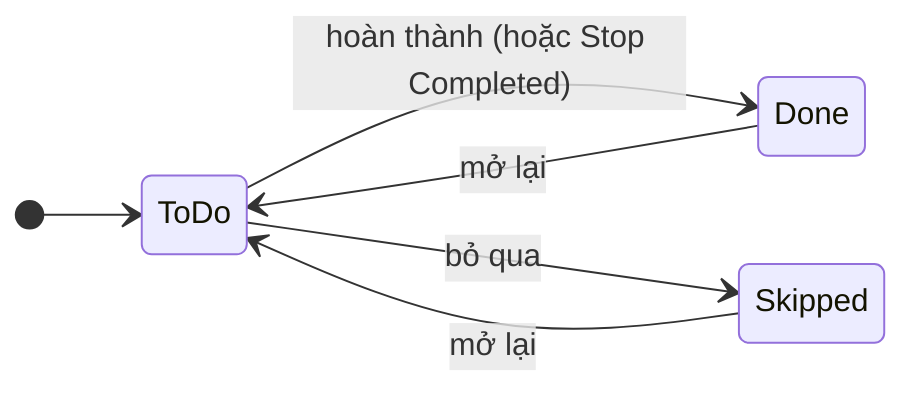
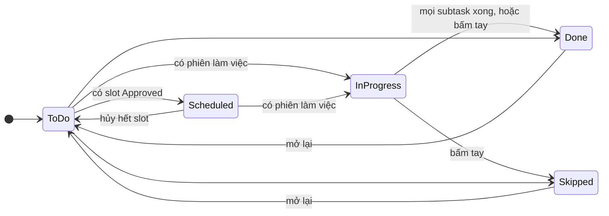
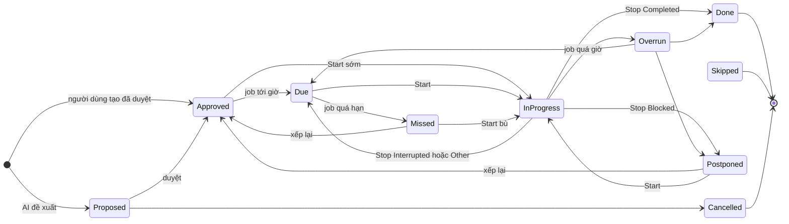
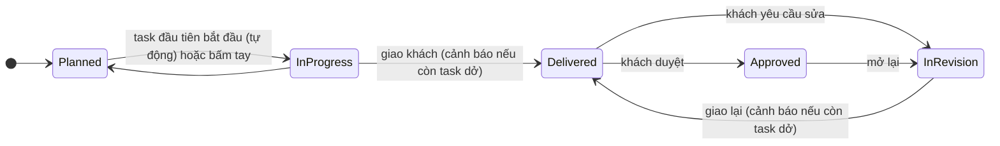
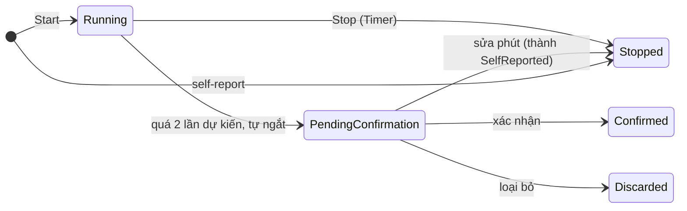

# Luồng trạng thái liền mạch: Milestone, Task, Subtask, Slot và Focus session

Tài liệu này mô tả **luật chuyển trạng thái** của bốn bảng và cách chúng **tự đồng bộ** với nhau, cùng ý nghĩa của `StopReason` và `CaptureMethod` ở bảng `FocusSession`.
Không đổi database và không đổi entity: chỉ dùng các giá trị đã có (riêng enum C# `ScheduleSlotStatus` thêm giá trị `Cancelled`, trước đó đang dùng bằng chuỗi).

Code nằm ở:
- `METANOIA.Infrastructure/Services/StatusRules.cs`: các bảng chuyển trạng thái và hàm `Ensure...` (một nơi duy nhất quyết định bước nào hợp lệ).
- `METANOIA.Infrastructure/Services/TaskProgressService.cs`: suy lại trạng thái Task và Milestone từ dữ liệu thật, đóng task, hủy slot.
- Gọi từ `TaskService`, `SubTaskService`, `MilestoneService`, `ScheduleSlotService`, `ScheduleProposalService`, `FocusSessionService`, `SlotBackgroundJobs`.
- Test: `METANOIA.Test/StatusWorkflowTests.cs`. Trang thử bằng tay: `/focus-test.html`.

---

## 1. Nguyên tắc

1. **Mỗi bảng có bảng luật chuyển.** Chuyển sai bị chặn bằng `400`, thông báo liệt kê các bước hợp lệ. Đặt lại đúng trạng thái đang có luôn được chấp nhận (không phải lỗi).
2. **Task tự suy ra trạng thái "sống"** từ sự thật (slot, phiên làm việc, subtask) thay vì tin con số do người gọi gửi lên.
3. **Việc đóng một cấp kéo theo cấp dưới** (Task Done thì subtask còn dở thành Skipped, slot chưa diễn ra bị hủy) và **việc xong ở cấp dưới có thể đóng cấp trên** (mọi subtask xong thì Task tự Done).
4. **`PUT` không gửi `status` thì giữ nguyên trạng thái** hiện có (trước đây có thể bị ghi đè về mặc định).
5. Mọi thay đổi nhiều bảng nằm trong **một giao dịch**; job nền (Hangfire) chỉ hẹn hoặc hủy **sau khi** giao dịch lưu thành công.

---

## 2. Subtask (`ToDo`, `Done`, `Skipped`)



| Từ | Sang được |
|---|---|
| `ToDo` | `Done`, `Skipped` |
| `Done` | `ToDo` |
| `Skipped` | `ToDo` |

Tác động lên Task: xem mục 3 (mọi subtask xong thì Task tự `Done`; mở lại một subtask thì Task `Done` mở lại).
Không Start được trên subtask đã `Done` hoặc `Skipped` (`400`).

## 3. Task (`ToDo`, `Scheduled`, `InProgress`, `Done`, `Skipped`)



Trạng thái "sống" (`ToDo`, `Scheduled`, `InProgress`) **do hệ thống suy ra**:

| Điều kiện (xét theo thứ tự) | Trạng thái |
|---|---|
| Có phiên đang chạy, **hoặc** có phiên đã kết thúc và **được tính**, **hoặc** có subtask `Done` | `InProgress` |
| Chưa làm gì nhưng có slot "sống" (`Approved`, `Due`, `InProgress`, `Overrun`) | `Scheduled` |
| Còn lại | `ToDo` |

"Phiên được tính" nghĩa là phiên `Timer` hoặc `SelfReported`, hoặc phiên `AutoTimeout` đã được xác nhận. Phiên `AutoTimeout` chưa xác nhận hoặc đã bị loại bỏ **không** làm Task lên `InProgress`.
Slot `Proposed` (chưa duyệt) chưa làm Task thành `Scheduled`.

Chuyển tay:

| Từ | Sang được |
|---|---|
| `ToDo`, `Scheduled`, `InProgress` | `ToDo`, `Scheduled`, `InProgress` (hệ thống suy lại), `Done`, `Skipped` |
| `Done` | `ToDo`, `Scheduled`, `InProgress` (mở lại, xóa `CompletedAt`) |
| `Skipped` | `ToDo`, `Scheduled`, `InProgress` |

Đi thẳng `Done` ↔ `Skipped` **không được** (phải mở lại trước).

Quy tắc tự động:

| Tình huống | Kết quả |
|---|---|
| Mọi subtask đã xử lý (không còn `ToDo`, ít nhất một `Done`) | Task tự `Done`, ghi `CompletedAt`, hủy slot chưa diễn ra, báo AI học |
| Task có subtask nhưng tất cả `Skipped` | **Không** tự `Done` (chưa có việc nào thật sự xong) |
| Task không có subtask | Người dùng tự bấm `Done` (hoặc Stop `Completed` chỉ đóng **slot**, không đóng task) |
| Đặt Task `Done` hoặc `Skipped` | Subtask còn `ToDo` thành `Skipped`; slot `Proposed`, `Approved`, `Due`, `Postponed` thành `Cancelled` (kèm log `Deleted`, hủy job) |
| Đóng Task khi còn **phiên đang chạy** | `400`, phải Stop trước |
| Mở lại subtask của Task `Done` | Task về trạng thái sống, xóa `CompletedAt` |
| Task đã `Done` hoặc `Skipped` | Không tạo thêm slot, không Start (`400`) |
| Task thuộc giai đoạn `Delivered` hoặc `Approved` | Không tạo task sống mới trong giai đoạn đó, không mở lại task trong đó (`400`) |

## 4. Slot (`ScheduleSlotStatus`)

Giá trị: `Proposed`, `Approved`, `Due`, `InProgress`, `Done`, `Skipped`, `Missed`, `Overrun`, `Postponed`, `Cancelled`.



| Từ | Sang được |
|---|---|
| `Proposed` | `Approved`, `Cancelled` |
| `Approved` | `Due`, `InProgress`, `Done`, `Missed`, `Postponed`, `Skipped`, `Cancelled` |
| `Due` | `InProgress`, `Missed`, `Done`, `Approved` (dời giờ), `Postponed`, `Skipped`, `Cancelled` |
| `InProgress` | `Done`, `Due`, `Postponed`, `Overrun` |
| `Overrun` | `Done`, `Due`, `Postponed` |
| `Missed` | `InProgress`, `Done`, `Approved`, `Postponed`, `Skipped`, `Cancelled` |
| `Postponed` | `Approved`, `InProgress`, `Done`, `Skipped`, `Cancelled` |
| `Done`, `Skipped`, `Cancelled` | **chốt**, không đi tiếp |

Ngoại lệ do **hệ thống** (không qua API người dùng): `Done → Missed` khi người dùng loại bỏ một phiên `AutoTimeout` và slot không còn phiên đáng tin nào.

Slot mới do người dùng tạo chỉ được `Proposed` hoặc `Approved`. Hủy slot (`DELETE /api/schedule-slots/{id}`) là đổi sang `Cancelled`, ghi log `Deleted`, hủy job, và trả `200`.
Task suy lại trạng thái sau mỗi thay đổi slot (xem mục 3).

## 5. Milestone (`Planned`, `InProgress`, `Delivered`, `InRevision`, `Approved`)



| Từ | Sang được |
|---|---|
| `Planned` | `InProgress` |
| `InProgress` | `Planned`, `Delivered` |
| `Delivered` | `InRevision`, `Approved` |
| `InRevision` | `Delivered` |
| `Approved` | `InRevision` |

- **Cảnh báo khi giao còn task dở (không chặn cứng):** chuyển sang `Delivered` khi còn task chưa `Done` hoặc `Skipped` thì server trả **`409`** với `code = "MILESTONE_HAS_OPEN_TASKS"` và danh sách task dở. Người dùng chọn: (1) quay lại làm tiếp, hoặc (2) vẫn giao bằng cách gửi lại `PUT` với **`confirmOpenTasks = true`**. Vẫn giao thì **các task dở giữ nguyên**, không bị đổi trạng thái; chúng vẫn làm tiếp và đóng được. Áp dụng cả khi giao lại từ `InRevision`. Nếu mọi task đã xong (hoặc chưa có task) thì giao thẳng, không cần xác nhận.

  ```json
  // 409
  { "message": "Còn 2 task chưa Done hoặc Skipped (trong đó 1 subtask chưa xong). ...",
    "code": "MILESTONE_HAS_OPEN_TASKS",
    "details": { "openTaskCount": 2, "openSubTaskCount": 1,
                 "tasks": [{ "id": "…", "title": "Việc 2", "status": "ToDo", "openSubTaskCount": 1 }] } }
  ```
- `Planned` **tự lên `InProgress`** khi có task của giai đoạn bắt đầu làm (`InProgress`) hoặc đã `Done`. Các bước sau (giao, sửa, duyệt) là việc với khách nên **không tự đổi**.
- `Delivered` lần đầu ghi `DeliveredAt` (giao lại thì cập nhật). `Approved` ghi `ApprovedAt`.
- Vào `InRevision` thì `RevisionCount` tăng 1. Mở lại từ `Approved` thì xóa `ApprovedAt`.
- Giai đoạn `Delivered` hoặc `Approved` không nhận task sống mới và không cho mở lại task đã đóng (xem mục 3). Task dở còn lại sau khi vẫn giao thì làm tiếp và đóng bình thường.

---

## 6. Focus session

`FocusSession` không có cột trạng thái riêng. Ý nghĩa nằm ở `EndedAt`, `StopReason`, `CaptureMethod`, `IsConfirmed`.

### 6.1 `StopReason`: vì sao dừng

| `StopReason` | Nghĩa | Slot | Subtask của phiên | Task | `checkInRequired` | `note` |
|---|---|---|---|---|---|---|
| `Completed` | Xong | `Done` | **`Done`** (nếu phiên có `subTaskId`) | Suy lại, có thể tự `Done` | `true` | tùy chọn |
| `Interrupted` | Bị gián đoạn, sẽ quay lại | `Due` | không đổi | `InProgress` | `false` | tùy chọn |
| `Blocked` | Bị kẹt, ví dụ chờ khách | **`Postponed`**, hủy hết job của slot | không đổi | `InProgress` | `false` | **bắt buộc** |
| `Other` | Lý do khác | `Due` | không đổi | `InProgress` | `true` | **bắt buộc** |

Thiếu `note` khi `Blocked` hoặc `Other` thì `400` và **phiên vẫn đang chạy** (chưa dừng).
Slot `Postponed` không còn nhắc "bấm Start"; muốn làm tiếp thì Start lại (slot về `InProgress`) hoặc xếp lại thành `Approved`.

### 6.2 `CaptureMethod`: thời gian này có từ đâu

| `CaptureMethod` | Nghĩa | `IsConfirmed` | Tính vào thời gian thực tế và học | Làm Task `InProgress` |
|---|---|---|---|---|
| `Timer` | Bấm Start / Stop thật | `true` | Có (trọng số cao nhất) | Có |
| `SelfReported` | Người dùng tự khai sau (quên bấm Start) | `true` | Có (trọng số thấp) | Có |
| `AutoTimeout` | Chạy quá 2 lần dự kiến, hệ thống tự ngắt, `StopReason = Other` | `false` cho tới khi xác nhận | **Không** cho tới khi xác nhận | **Không** cho tới khi xác nhận |

Khi tự ngắt: phiên kết thúc, slot sang `Done` ngay, người dùng nhận thông báo `AUTO_TIMEOUT` và phải xác nhận. Xem mục 6.3.

### 6.3 Trạng thái suy ra của một phiên

API `GET /api/focus/task/{taskId}/sessions` trả mọi phiên của task kèm `state`:

| `state` | Khi nào |
|---|---|
| `Running` | `EndedAt` rỗng |
| `Stopped` | `Timer` hoặc `SelfReported`, đã kết thúc |
| `PendingConfirmation` | `AutoTimeout`, `IsConfirmed = false`, chưa bị loại bỏ |
| `Confirmed` | `AutoTimeout` đã xác nhận (nếu sửa phút thì đổi thành `SelfReported`, `state = Stopped`) |
| `Discarded` | `AutoTimeout` bị loại bỏ (`Note` chứa dấu `[Người dùng đã loại bỏ phiên này]`) |



Loại bỏ phiên `AutoTimeout`: nếu slot không còn phiên đáng tin nào thì slot từ `Done` về `Missed`, Task suy lại (có thể về `ToDo` hoặc `Scheduled`).

---

## 7. Hướng dẫn thử từng trạng thái

Mở `/focus-test.html` (chỉ khi `Development` hoặc `Swagger:Enabled`), đăng nhập ở mục 1. Cần ít nhất một **Domain** đang bật (Admin tạo ở `POST /api/domains`).

Cách nhanh nhất: mục 8 của trang, bấm **Chạy tất cả kịch bản**. Mỗi kịch bản tạo dự án riêng tên `[Thử] ...` và so sánh trạng thái thật với kết quả mong đợi (✔ đúng, ✘ sai kèm giá trị thực tế). Muốn tự tay thử thì làm theo các bảng dưới (mục 2 của trang: **Tạo nhanh cả chuỗi** dựng dự án, giai đoạn, task, 2 subtask, 2 slot).

> Các kịch bản tạo dữ liệu thật trong tài khoản của bạn (tên bắt đầu bằng `[Thử]`). Xong thì lưu trữ (archive) các dự án đó.

### 7.1 Subtask
| Làm | Mong đợi |
|---|---|
| Bấm `→ Done` ở subtask 1 | Subtask `Done`; Task `InProgress` |
| Bấm `→ Done` ở subtask 2 | Task tự `Done`, có `CompletedAt` |
| Bấm `→ ToDo` ở subtask 2 | Task về `InProgress`, `CompletedAt` bị xóa |
| Mục 7 của trang: subtask `Done` → `Skipped` | `400` (phải về `ToDo` trước) |

### 7.2 Task
| Làm | Mong đợi |
|---|---|
| Task mới | `ToDo` |
| Tạo slot `Proposed` | Task vẫn `ToDo` |
| Duyệt slot (`→ Approved`) | Task `Scheduled` |
| Hủy hết slot | Task về `ToDo` |
| Start | Task `InProgress` |
| Bấm `→ Done` khi còn subtask `ToDo` và slot chưa diễn ra | Subtask thành `Skipped`, slot thành `Cancelled` |
| Bấm `→ Done` khi đang có phiên chạy | `400`, Stop trước |
| Task `Done` thử `→ Skipped` | `400` (dùng "Mở lại" rồi mới đổi) |

### 7.3 Slot
| Làm | Mong đợi |
|---|---|
| Slot `Proposed` thử `→ Done` | `400` |
| `Proposed → Approved → Postponed → Approved → Done` | Từng bước được chấp nhận |
| Slot `Done` thử bất kỳ bước nào | `400` (trạng thái chốt) |
| Slot mới đặt "Bắt đầu sau" = 1, độ dài 1, đợi | `Approved → Due` (tới giờ) rồi `Missed` nếu không Start |
| Start rồi để quá giờ | `InProgress → Overrun` |

### 7.4 Milestone
| Làm | Mong đợi |
|---|---|
| Giai đoạn `Planned` thử `→ Approved` | `400` (không nhảy cóc) |
| Tạo task trong giai đoạn rồi Start | Giai đoạn tự `Planned → InProgress` |
| Thử `→ Delivered` khi còn task dở | Hiện cảnh báo `409` kèm danh sách task dở. Bấm **Hủy** thì giai đoạn giữ nguyên; bấm **OK** thì giao, task dở giữ nguyên |
| Đặt hết task `Done` hoặc `Skipped`, rồi `→ Delivered` | Giao thẳng, không cảnh báo, ghi `DeliveredAt` |
| `Delivered → InRevision` | `RevisionCount` +1 |
| `InRevision → Approved` | `400` (phải giao lại) |
| `Delivered → Approved` | Được, ghi `ApprovedAt` |
| Tạo task mới trong giai đoạn đã `Delivered` | `400` |

### 7.5 `StopReason` (mục 3 của trang)
Chọn slot `Approved`, bấm **Start (gắn slot đã chọn)**, chọn lý do rồi **Stop**. Lặp lại với từng lý do:

| Lý do | Ghi chú | Slot | Ghi chú thêm |
|---|---|---|---|
| `Interrupted` | để trống được | `Due` | Start lại được |
| `Blocked` | để trống → `400`, phiên vẫn chạy; điền → được | `Postponed` | nhắc nhở của slot đã bị hủy |
| `Other` | để trống → `400`; điền → được | `Due` | `checkInRequired = true` |
| `Completed` | để trống được | `Done` | Phiên của subtask thì subtask `Done` |

### 7.6 `CaptureMethod`
| Cách | Làm | Mong đợi |
|---|---|---|
| `Timer` | Start rồi Stop | Phiên `Stopped`, cột "Cách ghi nhận" là `Timer` |
| `SelfReported` | Mục 6 của trang: **Gửi self-report** | Phiên `Stopped`, `SelfReported`; slot `Done` nếu `Completed` |
| `AutoTimeout` | Mục 8 của trang: **Chuẩn bị kịch bản AutoTimeout**, rồi đợi khoảng 2 phút **không bấm Stop** | Slot `Done`, phiên `PendingConfirmation`, task **không** lên `InProgress`. Bấm **Xác nhận** (`Confirmed`, task `InProgress`), **Sửa phút** (`SelfReported`) hoặc **Loại bỏ** (`Discarded`, slot `Missed`) |

Kịch bản `AutoTimeout` cần Hangfire chạy (job nền) và cần thời gian thật; các kịch bản còn lại không cần chờ.

---

## 8. Lưu ý khi nối Frontend

- FE gửi bước chuyển sai sẽ nhận `400`; thân lỗi (`message`) liệt kê các bước hợp lệ. Nên **tải lại** task, subtask, slot, milestone sau Start, Stop, tạo hoặc hủy slot, vì trạng thái các bảng có thể đã đổi theo.
- `PUT` không gửi `status` thì giữ nguyên.
- Dịch vụ AI (Python) ghi slot thẳng vào database nên **không** đi qua các luật này. Để chặn giá trị sai chữ, xem mục 9.2.
- Dữ liệu cũ không được sửa tự động: trạng thái chỉ được đồng bộ khi có thao tác tiếp theo trên task đó, hoặc khi Admin chạy đồng bộ lại (mục 9.1).
- Luồng trạng thái không cần thay đổi database. File SQL ở mục 9.2 chỉ là lớp bảo vệ tùy chọn.

---

## 9. Dữ liệu cũ và bảo vệ cột Status

### 9.1 Đồng bộ lại dữ liệu cũ (chỉ Admin)

Luật mới chỉ chạy khi có thao tác trên task, nên dữ liệu tạo trước đó có thể đang lệch (ví dụ task `ToDo` nhưng đã có slot `Approved`, hoặc `InProgress` dù mọi subtask đã `Done`). Endpoint này suy lại bằng đúng `TaskProgressService` của luồng thường.

`POST /api/admin/status-resync?dryRun=true|false` (role `Admin`)

| `dryRun` | Hành vi |
|---|---|
| bỏ trống hoặc `true` (**mặc định**) | Chỉ tính và báo cáo, **không lưu gì** |
| `false` | Áp dụng thật, lưu theo từng lô 100 task |

Phạm vi:
- Duyệt mọi task **chưa đóng** (`ToDo`, `Scheduled`, `InProgress`) của mọi người dùng. Task `Done` và `Skipped` **không đụng tới** (đó là điều người dùng đã chốt, kể cả task `Done` kiểu cũ còn subtask `ToDo`).
- Task có mọi subtask xong thì tự `Done`, hủy slot chưa diễn ra, và báo dịch vụ AI học như bình thường (chạy thật mới báo).
- Giai đoạn `Planned` đã có task `InProgress` hoặc `Done` thì lên `InProgress`.
- Chạy lại lần hai trả về không còn thay đổi nào.

Phản hồi:
```json
{ "dryRun": true, "tasksChecked": 120, "tasksChanged": 7, "milestonesChanged": 2, "slotsCancelled": 0,
  "changes": [ { "kind": "Task", "id": "…", "name": "Viết báo cáo", "from": "ToDo", "to": "Scheduled" } ],
  "truncated": false }
```
`changes` cắt ở 1000 dòng đầu (`truncated = true` khi còn nữa).

Cách dùng khuyến nghị: gọi `dryRun=true` (hoặc để trống), đọc `changes`, thấy hợp lý thì gọi `dryRun=false`.

### 9.2 CHECK cho `ScheduleSlot.Status` (bạn tự chạy SQL)

Dịch vụ AI (Python) ghi slot thẳng vào database nên có thể ghi sai chữ. File `docs/sql/004_scheduleslot_status_check.sql` thêm CHECK chỉ nhận 10 giá trị (`Proposed`, `Approved`, `Due`, `InProgress`, `Done`, `Skipped`, `Missed`, `Overrun`, `Postponed`, `Cancelled`).
Nó có 3 bước: xem CHECK hiện có (chỉ đọc), liệt kê slot có Status lạ (chỉ đọc), rồi thêm hoặc thay CHECK (tự dừng và báo nếu còn dòng sai). Chạy lại nhiều lần vẫn an toàn. Trước khi chạy hãy xem code Python của AI ghi những giá trị nào để tránh làm AI bị lỗi.
CHECK chỉ kiểm tra "giá trị có hợp lệ", không kiểm tra luật chuyển (ví dụ AI ghi thẳng `Done` vẫn qua).
